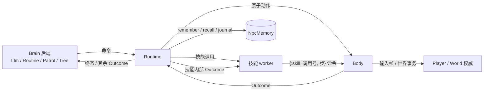
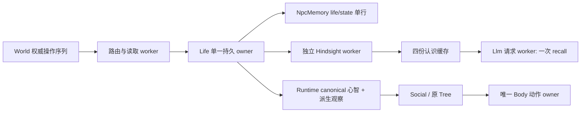

# NPC 运行时

分类：全局系统功能。统一输入与记忆规范见
[模型上下文契约](../../../../../docs/10-active/cross-cutting/2026-09-22-npc-context-memory-contract.md)。
本目录只写职责、契约与接入方式；各轮实现的验证记录在
[共用运行层与评审修复记录](../../../../../docs/10-active/cross-cutting/2026-10-06-npc-runtime-review-fixes.md)。

## 模块

- `Body` 接正式 Session/Player，产生观察并把动作交给 authority；自己维护会话（丢失后重新 claim）。
  正式生成入口 `Body.start/2`：名字即永久身份（`CharacterStore.ensure_npc/1`），阵营档案取 `Orgs.profile/1`，
  按 cid 登记在 `GateServer.NpcNames`。
- `Registry` 是 NPC 注册表：运维登记一次（`npc_specs` 表，`DataService.NpcSpecs`），节点重启后由 gate 监督树的一次性
  Task 调 `start_all/0` 拉起；`brain/2` 是唯一把注册表行的 JSON 参数解析成 `{大脑模块, profile}` 的地方（见下文“注册表”）。
- `Genesis` 是创世能力组 `:genesis`：条目 `fill_box` / `set_cells` 与 Body 动词 `genesis_edit` 的受理校验 `prepare/3`，
  授予只来自注册表行（见下文“创世”）。
- `WorldRequest` 把世界写命令拼成与玩家线帧解码（`Codec.decode/1`）同形的 `{kind, request}`，取值约束与线解码共用
  `Codec.intent?/1`；Body 把它交给与玩家同一个入口 `SceneServer.Movement.Intent.run/3`（施法 0x82 交给 `Player.cast_spell/5`）。
- `Runtime` 组合任意 Brain，统一命令路由、记忆调用、技能 worker、中断、取消结算与终态记录。
- `Abilities` 是决策侧唯一的能力定义（角色能力函数库）：组合各域条目 `%{name, group, done, description, params, build}`，
  一份参数规格同时生成 strict JSON Schema（`tools/1`，LLM 工具表）与 JSON 形参数的译码（`command/4`）。
  各域只提供条目：`Actions`（移动、工具、建造、液体、背包，施法 `spells/1`；经 Abilities 构造的 move_to 都用 `tolerance/0` 的容差，
  Patrol / Builder 仍各写 0.5，改为引用它是设计稿 §12 的独立清理；附件 kind / axis 名字表 `attachment_names/1`）、
  `Perception`（look / survey / inspect / query_balances / read_catalog，另有范围校验、World 只读入口与模型投影；prefab 目录行只在
  `prefab_row/3` 计算；步行判据 `walk_kind/1` 与列扫描 `floors/2` 也只在这里，Body 的寻路网格、survey、travel、expand 共用）、`Attention`（观察方向与敌／友目标组，Body 用的动词表由条目派生）、`Memory`（记忆）、
  `Skills`（已配置的长技能，schema 原样取自技能的 `definition/1`）、`Genesis`（创世，只在 `profile.genesis` 为真时）。`Sight` 把视野与瞄准查询投影到 World 的只读射线。
- `Responses` 是 Responses 应答里工具调用的唯一解析处；`Http` 是共享 JSON 出站。
- `Context` 从权威 profile 派生身体说明与坐标约定。
- `Brain.Llm` 组合观察、近期结果和逐轮检索记忆，只负责询问时机、模型请求与上下文。
  `Brain.Routine`（作者脚本）、`Brain.Patrol`（巡逻决策树）是非 LLM 后端，直接产出规范命令。
  `Brain.Tree` 是最小行为树后端（纯函数，叶子 `act` 经 `Abilities.command/4` 构造命令，与 LLM 共用同一份能力定义）；
  树定义在 `Trees`，首个是建设者 `Trees.settler/1`。
- `Skill` 定义 `definition/1`、`run/3` 与可选 `observations?/0`；`Skills` 按 profile 注册。
  内置 `build`（放已发布定义）、`design_house`（住宅设计会话，`Skills.HouseDesign`）、
  `gather`（从作者给定的采石盒取天然格，`Skills.Gather`）、`travel`（长途行走：直线分成每段 ≤ reach − 2 米，每段先 survey 段终点列、取离脚下最近的可站层，再带 `y` 一个 Body move_to，`Skills.Travel`；Settler 回工地站位与 expand 走向地块都用它）、`expand`（在作者划定的区域里找地块、地表略有起伏先平整、缺料自己采、放下已发布定义，
  `Skills.Expand`，见下文“持续扩张”）、`wilderness`（荒野逐格施工，驱动纯状态机 `Builder`）。技能内部的一步原子动作统一用
  `Skill.call/2`（编步号、等 Outcome）；一个技能组合另一个技能（expand 调 gather 的 `run/3`）时给被组合的那次一个步号命名空间。
- `Scheduler` 定义中断策略 `decide/2`，`Jev` 是现有实现；分类器不能操作世界。
- `Memory` 提供模型记忆工具与上下文投影；`DataService.NpcMemory` 按永久 cid 持久化、检索，并拥有保留上限。



## 契约

- **会话**：Body 是无 socket 的会话 owner，会话是它自己维护的不变量。输入积压超过 120、Scene 结束会话、
  Player 结束、跨 Scene 移交失败、claim 失败时，Body 不退出，1 秒后重新 claim（与玩家断线重连同理），
  Brain / Runtime / 记忆与在途技能都保留；在途移动命令以 `session_lost` 拒绝，已投递的世界调用照常各回结果
  （Player 已结束则 `session_lost` 拒绝，规则见下条“世界意图”）。没有会话时的身体与世界命令得到 `invalid_session`。
  同一 cid 被另一个 claim 顶替（关闭原因 2）时 Body 以 `{:shutdown, :replaced}` 正常结束；
  Body 的重启策略是 `transient`，只有崩溃才由监督者重启。
- **世界意图（与玩家同一条裁决）**：工具、放置 / 液体 / 合成 / 进食、附件、prefab 命令经 `WorldRequest` →
  `Intent.run/3`：工具走 `ToolAction.run/5`（`authorize_tool`：死亡、施法中、重放、同 key 结果、人物目标 g5），
  其余走 `Player.tool_context/2`（施法中、死亡）再进 World。Body 自己只保留两道门：命令的类型守卫（不合法回
  `invalid_command`）与部署编辑盒（prefab 越界回 `out_of_bounds`，与玩家连接共用 `Dispatch.prefab_within?/4`）。
  意图到达时刻（`received_us`，GCRA 按它判频）在 Body 受理命令时冻结，不在执行进程排到时才取。
  余额补发与玩家同一条规则（Intent 的返回值）：工具 action 1 / 2 且非人物目标、生产 / 附件 / prefab 经角色接纳后。
  执行进程对世界调用的退出：会话的 Player 已退出（`Player.running?/1`，Scene 在 peer 节点时同样适用）→ `session_lost`
  （写意图可能已提交，以 look / inspect 现算）；否则照常退出，Body 随之由监督者重启。
  每次进 Intent 的世界意图一行日志 `character_intent`（玩家同格式）；进 Intent 之前被 Body 拒绝的
  （`invalid_command`、位置未知的 `invalid_session`、编辑盒 `out_of_bounds`）各一行 `npc_intent_rejected cid= id= verb=|kind= reason=`。
  技能 `design_house` 的发布不经 Intent（见下条“技能”）；创世编辑 `genesis_edit` 也不经 Intent，直接写 World（见“创世”）。
- **施法**：`cast_spell` / `cancel_cast` 与玩家同一个角色 owner 入口：执行进程读 `World.magic_digest/1` 填入 0x82 请求后调
  `Player.cast_spell/5`（不经 Intent、不等前摇），回复目标 `{Body, {:npc_cast, id}}`；取消以同一 client_intent_seq 同步调
  `Player.spell/4` action 2，cancel 自己 `done`（data `%{}`），原施法由 World 回 `cast_cancelled`；没有待施法回
  `no_active_cast`。施法只登记在在途世界事务表（id → `:cast_spell`），`{{:npc_cast, id}, 结果}` 是唯一的 Outcome 来源
  （结算 done、立即拒绝、取消、World 侧会话结束 `invalid_session`）；`{:mmo_spell_reply, …}` 只更新 Observation 的
  `self.caster`。取消用的请求按 id 记在 `casts`，`cancel_cast` 取最早提交、还没有终态的那次（执行进程按提交顺序投递，
  它前摇时后提交的只会被 Player 回 `cast_too_soon`；它结算后才投递的后一次才会进入前摇，那时它已不在 `casts` 里）。
  会话丢失（含 Player DOWN）时在途施法以 `session_lost` 结束，迟到的回复因表中无 id 被忽略，每次施法恰好一个终态；
  `Player.stop/1` 先撤销施法，所以那时的终态是 `cast_cancelled`。跨 Scene 移交时 seal 撤销前摇（`cast_cancelled`），
  Body 仍监视旧 Player：执行进程投递时它已退出的施放没有回复，它退出时以 `session_lost` 结束；旧会话的施法不能再取消。
  `session_lost` 不保证未结算（已授权的可能先到 World）。
  法术来自作者给的 `profile.spells`（`%{名字 => 程序字节}`，0x82 的程序字段；LLM 只选名字），`:magic` 组条目只在它非空时投影；
  目标句柄同 use_tool，但只有 0x82 能表达的 g0..g2。只在流送 Scene 可用（非流送 Scene 的 Player 没有 `authority_ref`）。
  新 NPC 能量 0：施法会走火（spent 0），有效施法要法术带里先有取能（`energy.draw`）程序。
- **技能**：每个调用只有一个终态。取消命令有自己的 id：`%{id:, verb: :cancel_skill, call: 原技能调用号}`，
  受理回 `:done`（`data.call`），没有在途技能回 `no_active_skill`，已在取消中回 `already_cancelling`。
  被取消的技能仍以原调用号回终态：先等 worker 退出，再发带 `settle: 调用号` 的 `stop`，
  Body 在移动停稳且该调用已投递的世界调用全部有了结果后才确认。取消期间落定的内部结果放进终态 `data.settled`；
  已提交事务不撤销、不隐瞒，终态之后不再有这次调用引起的世界变化。停止失败明确回报 `stop_failed`。
  技能上下文与 `design_house` 的逐轮刷新都取 `Player.tool_context/2`：角色死亡期间技能无法开始（`dead`），
  进行中的 `design_house` 的 look / inspect / 记忆工具回 `error: dead`，下一轮模型请求前以 `dead` 结束。
  `design_house` 的发布直接调 `PrefabDesigner.publish/3`（死亡门、施法门经 World 内的 `actor.refresh` 生效），
  不产生 `character_intent` 行。
- **中断策略**：只由 `interrupt_policy: {模块, 配置}` 开启，每 10 秒及听到说话时检查。
  context 含 `skill`、`observation`、`heard`（技能开始后听到的话，新在前，最多 5 句）。
  `{:error, _}` 或策略进程崩溃只记一笔（终态 `metrics.scheduler_error_count`）并继续技能。
  荒野施工内部分诊用的 `scheduler` endpoint 是另一项职责，配置它不会开启中断检查。
  Jev 实现只在有把握（置信度 ≥ 0.85）地选了非继续选项时中断，拿不准等同继续。
- **观察**：Runtime 只把 Observation 转给声明 `observations?/0` 为 true 的技能（目前是 wilderness），
  其余 worker 邮箱不堆积观察。Observation 的 `self.body_state` 是本人 Session.BodyState 下行的原样投影
  （生命、可恢复生命、状态码、核心 / 皮肤温度、蛋白质、伤病；nil = 本会话还没收到），`self.caster` 是最近一次施法回复的
  施法者能量 / 容量 / 相干度（nil = 还没施过法），`entities` 带 EntityEnter 的
  `name`、`relation`（`MmoContracts.Relation.code/1`，按本角色这个观察者算）与 `relation_source`，Snapshot 只更新位置。
  这些都是派生缓存，真值在 Scene 的身体 owner 与阵营档案；关系只回答敌我颜色，不回答能否攻击。
- **目录读取**：`read_catalog`（`what: :prefab | :prefabs | :materials | :tools`）经 `Perception.read/3` 读 World 的
  公共只读目录：prefab 定义的材料单与尺寸（作者目录与运行时发布都查得到，没有这个 id 回 `definition_not_found`）、
  最近 20 条运行时发布、材料的名称 / 可食 / 配方（可食与配方只对生产材料给出，与 World 进食 / 合成门一致）、
  工具的动作 / 射程 / 间隔。不缓存，不经 Intent。
- **步行网格（Body 寻路）**：一格能不能踩、能不能穿过只看 `Perception.walk_kind/1`：挡路（与碰撞同一判据
  `VoxelMaterialCatalog.blocks_movement?/1`）、非液体、非细化的格能踩；不挡路（空气、花草）的格能穿过；液体与细化格既不能踩也不能
  穿过（不进寻路网格）——碰撞按 micro 几何，宏格网格只能保守地整格挡住细化格，也不站在 1/8 米的 micro 面板顶上。起点是身体的权威
  位置（`Path.find/7` 的 `trusted_start`）：身体站在细化格空着的部分或其上时照常出发。不给 `y` 时取盒竖直只有脚下上下 6 格
  （`Body.path_margin/0`），高差更大要给 `y`（travel 每段自动给）。
- **地表勘察（survey）**：`survey{x0, z0, x1, z1}`（列闭区间每边 ≤ 32 列、各边离自己 ≤ reach，竖直取自己所在高度上下 reach，与 look
  同一距离护栏），按 x 分片经 `World.material_snapshot/3` 读（片间不是原子快照，`seq` 给 [首片, 末片]）。每列 `floors` = 站得下自己的
  地面层（该格能踩、其上身高格数都能穿过、都在扫描范围内），地表 `y` = 最高的一层，带这一格的材质与 `placed_by`，`refined` = 这一列
  有细化格；给 LLM 的投影是按行的高度图（`[y, material]` 或 null）加放置者 / 细化格两张稀疏表。look / survey 的内容随大脑最近
  8 条 Outcome 一起保留和淘汰，不另按查询类型提前清空；各条仍是带版本与范围的历史观察，不合成为当前原子快照。
- **感知距离护栏**：`move_to` 的水平目标与给出的 `y`（相对脚所在格）都不超过 `Perception.reach()`，否则 `too_far`、
  不访问 World；`design_house` 的锚点宏格各轴离自身超过它时技能以 `too_far` 结束，不读 site、不发模型请求。
  两段 LLM 工具描述（`move_to`、`design_house`）都写了这条上限，数字由 `Perception.reach()` 插值。
- **LLM 询问**：有新情况才问——新 Outcome、听到说话、`wait` 到期、或有实体走进 6 米（离开 8 米才算走远）。
  Life 新权威评价（`mind.evidence` 变化）也唤醒；单纯情绪衰减/观察时间变化不唤醒。
  请求期间到达的新情况保留至下一轮，旧响应不能把它清掉；仍受在途命令与滑动额度约束。
  两次询问至少隔 1 秒；应答没有工具调用或请求失败按 1、2、4…60 秒退避；
  每 NPC 每小时最多 `max_requests_per_hour`（缺省 600）次，用完记 `npc_llm_budget_exhausted`。
  工具表 = `Abilities.tools(profile) ++ [wait]`，全部 `strict: true`（2026-10-08 对当前代理 live 预检通过，设计稿 D-2）；
  `profile.groups` 可选裁剪（缺省全部组；Demo LLM NPC 取 `[:move, :sense, :act, :build, :memory, :skill]`，16 个条目 + wait）。
  参数不是 JSON 对象、形状不对或工具不存在（含被 groups 裁掉的）时，在本地回报 `invalid_tool_arguments` / `unknown_tool`
  给模型并附原调用，不发给 Body。目标是显式句柄：`use_tool` / `dismantle` / `detach` / `cast_spell`（g0–g2）的 `target` 由模型从 probe_toward
  结果或 inspect 行里原样抄来（投影时每行附 `target`），Brain 不保存“最近一次 probe / inspect”；人物句柄（g5）不进 LLM 投影。
  `say` 是聊天占位，Body 照常受理（恒拒 `chat_unavailable`），但不投影给 LLM。
- **观察与目标**：Body 拥有独立观察方向和敌／友目标组，各组一个焦点；目标身份是 `entity_id + entity_epoch`。
  选择、观察转向、移动与攻击正交；本地组不是阵营或团队真值，目标 epoch 是观察身份，不能用来绕过攻击裁决。
  实体离开 AOI、更换代次、换场景、会话丢失后重新入场时清理关注，旧身份的选择以 `stale_target` 拒绝，
  `get_target_status` 返回 `valid: false`。观察半角 45°，最远距离沿用 `Perception.reach`；`look_at` 各轴超出
  感知边界回 `out_of_range`，与眼点重合回 `zero_direction`，只转向一次、不持续跟踪。
  视野里的角色只取已同步实体，以中心点做视锥与遮挡采样；`get_aim` 取最近的角色胶囊（当前场景移动 profile）
  或 canonical 方块／构件命中，复用 World 的 `target_at`、Damage 的微格 DDA 与 ToolHit 求交，独立附件未采样，
  遮挡按 canonical 实占用，尚无透明材质透视。结果带 `scene_id`、`session_epoch`、`self_tick`、实体 tick 与
  World `seq`，是各 owner 的采样版本，不是跨 owner 原子快照。已知不等于可见，可见不等于可攻击。
- **记忆**：每个 cid 最多 200 条笔记（按最近写入保留）与 1000 条经历；超出的最旧行在写入时删除并记
  `npc_memory_trimmed`。上限只在 `DataService.NpcMemory.limits/0` 定义，`remember` 工具说明从它派生。
  当前意图用 `set_plan(text)` 保存，最多1500字、空文本清除；唯一 `kind=intention/key=current` 工作行按永久 cid 覆盖，
  不受普通笔记淘汰影响。每轮决策现读 `current_plan` 和最近五条 `recent_notes`，无进程缓存；读取失败显式给出
  `working_memory_error`。计划仅表示 NPC 的主观打算；完成与否、坐标、材料仍查 World 和权威 Outcome。
  Life 模式保留四份模型缓存与一次 Hindsight recall，不再遗漏自记笔记，也不另做词法召回。

## 接入方式

正式运行时用 `Body.start(name, scene_id: …, spawn: …, brain: {模块, profile})`：在 `GateServer.NpcSup` 下起 Body，
名字即永久身份（同名永远同一 cid，同 cid 最后完成 claim 的 Body 留下：先起的在线时被顶替；它若正在重新 claim，
稍后会反过来顶掉后起的，所以换掉同名 NPC 要先停旧 Body 再 start；名字唯一由作者 / 部署脚本保证），
阵营档案取 `DataService.Orgs.profile/1` 随 claim 交给 Scene（别人看到的名牌与关系由它算出）。
直接 `Body.start/2` 起的 NPC 不随节点重启恢复；要长期放在世界里的 NPC 经注册表登记（下节）。
测试与夹具可直接 `Body.start_link(..., cid: …, faction: 档案 | nil, brain: {模块, profile})`。Body 自动组合 Runtime。
同步后端实现 Brain 的两个回调；慢后端在 init 时保存 self()，异步命令投回这个 Runtime 接收端。
角色的世界操作仍经 Body / Player / World，不把技能内部命令、HTTP 或 worker 生命周期交给后端重写。

```elixir
# 全局系统功能配置示例；definition_hex / anchor_micro 由调用方从正式已发布定义和目标取得。
brain: {GateServer.Npc.Brain.Routine, %{
  skills: %{build: %{}},
  steps: [%{verb: :skill, skill: :build, args: %{
    "definition" => definition_hex, "anchor_micro" => anchor_micro, "orientation" => 0
  }}]
}}
```

- 添加技能：实现 `GateServer.Npc.Skill`，配置 `skills: %{名字: %{module: 实现模块, ...}}`。
  `definition/1` 拥有参数说明，`run/3` 在 worker 内接纳输入并返回一个终态；无需改 Llm / Runtime 分派。
  `definition/1` 的 `parameters` 原样成为 LLM 的 strict 工具：每个 object 都写 `additionalProperties: false`、
  全部属性列进 `required`，可空字段写 `type: [t, "null"]`；不满足时代理拒绝整个请求（NPC 会一直退避重试）。
  逐帧需要位置的技能实现 `observations?/0` 返回 true。字符串工具名只在已配置名字中匹配，不把模型输出转成新原子。
- 观察与目标：`Attention.entries/0` 是 13 个命令的唯一条目（经 `Abilities` 投影给 LLM），脚本 / 行为树返回同样的命令：

  ```elixir
  # target 来自本角色 observation.entities 或 get_visible_entities 的结果。
  target = %{entity_id: entity_id, entity_epoch: entity_epoch}
  Body.command(body, %{id: "select-1", verb: :select_target, target: target, group: :enemy})
  Body.command(body, %{id: "look-1", verb: :look_at, target: target})
  Body.command(body, %{id: "aim-1", verb: :get_aim})
  ```

  `get_targets` 返回两组 members + focus 与独立 mark，`set_focus` 只接受已选成员；`get_view` 返回 origin、
  direction、range_m、half_angle_degrees；`get_aim` 的 hit（未命中为 nil）含 kind、target、point、distance_m，
  方块带 properties、角色带采样 tick 与粗部位；`get_visible_entities` 标明 center 采样与已同步实体来源。
- 添加中断策略：实现 `GateServer.Npc.Scheduler.decide/2`，配置 `interrupt_policy: {实现模块, 配置}`。
  Jev 的配置为 `%{scheduler: endpoint, activities: 活动 profile, continue_activity: 选项, request: 可选}`。
- 查看：`Abilities.entries(profile)` / `Abilities.tools(profile)` 返回能力条目及 strict 参数；
  JSON 形参数的后端（LLM、design_house 的共享工具、I3 的行为树）用 `Abilities.command(name, args, id, profile)` 构造命令。
  `Body.observe(body).outcomes`
  含最近 32 条结果。日志：`character_intent`、`npc_intent_rejected`、`npc_genesis_edit`、`npc_registry_start`、`npc_session_lost`、`npc_claim_failed`、`npc_skill_outcome`、`npc_settler_idle`、`npc_expand`、`npc_interrupt_check`、
  `npc_interrupt_check_failed`、`npc_llm_no_tool_call`、`npc_llm_request_failed`、`npc_llm_budget_exhausted`。

### 注册表（`Registry`，放置阶段 M1）

运维经 release `rpc` 登记（`docker compose exec app bin/voxim_server rpc '<表达式>'`）。信任边界在 `put/2`：参数先规范化成
JSON 形（存的与解析的是同一份），再经 `Registry.brain/2` 解析成大脑配置并当场校验（建树、投影工具表、巡逻路线），
不合法回 `{:error, {:invalid_params, 说明}}`，不落库、不建角色、不起 Body。

```elixir
# 全局系统功能运维示例（rpc 表达式）。
# 建设者：参数同下文 Settler 的 profile（JSON 写法：工具带与采石盒的键是字符串化的整数）；技能固定 build / gather，
# 配了 expansion（可选，见下文“持续扩张”）再加 expand。
GateServer.Npc.Registry.put("建设者", %{scene_id: 1, spawn: {4.0, 66.0, 10.0}, brain: "settler",
  params: %{"definition" => definition_hex, "revisit_ticks" => 36_000, "tools" => %{"1" => "镐"},
    "sites" => [%{"anchor_micro" => [64, 512, 112], "orientation" => 0, "stand" => [8.5, 11.5]}],
    "quarries" => %{"11" => %{"box" => [[10, 64, 4], [13, 64, 6]], "tool_id" => 1}},
    "expansion" => %{"region" => [[6, 8], [24, 24]], "spacing" => 2, "tool_id" => 1}}})
# LLM 住民：goal、tools 必填；groups / skills（build、gather、expand、travel、design_house）/ spells / max_requests_per_hour / genesis 可选。
# 模型接口不入库：每次解析取运行环境 NPC_LLM_URL / NPC_LLM_KEY / NPC_LLM_MODEL（必须）与 NPC_LLM_EFFORT / NPC_LLM_CACERTFILE。
GateServer.Npc.Registry.put("住民", %{scene_id: 1, spawn: {12.0, 66.0, 10.0}, brain: "llm",
  params: %{"goal" => "在出生点附近盖一间小屋", "tools" => %{"1" => "镐"}, "skills" => ["build"]}})
# 巡逻：route ≥ 2 个 [x, z]；dig 可缺省。
GateServer.Npc.Registry.put("巡逻者", %{scene_id: 1, spawn: {4.0, 66.0, 10.0}, brain: "patrol",
  params: %{"route" => [[4.0, 10.0], [14.0, 10.0]]}})
GateServer.Npc.Registry.list()           # 全部行 + running（本节点上这个 cid 的 Body 是否在跑）
GateServer.Npc.Registry.remove("巡逻者")  # 置 enabled = false 并停 Body；角色行、余额、记忆与登记行保留
```

- 返回 `{:ok, %{cid:, pid:}}`：建 / 取 NPC 角色行、写 `npc_specs` 行（`enabled = true`）、停掉同 cid 在跑的 Body（按
  `GateServer.NpcNames` 找，不靠 claim 顶替）、`Body.start/2`。同名再 `put` 就是改登记（换大脑、换出生点）。
- 节点启动：gate 监督树在 `GateServer.NpcSup` 之后起一个一次性 Task 调 `start_all/0`，拉起全部 enabled 行（持久化读回
  的参数按 `brain/2` 再解析一次）；Scene 还没就绪时 Body 自己 1 秒后重试 claim。每行一条 `npc_registry_start name= cid=
  brain= result=`，一行失败（如运行环境缺模型接口）不影响其余行。测试构建不起这个 Task。
- 位置不持久化：每次入场从 `spawn` 开始（与玩家出生探测同义）。

### 创世（`Genesis`，能力组 `:genesis`，放置阶段 M2）

创世阶段的特权 NPC 直接塑造地形。条目 `fill_box{min: [x,y,z], max: [x,y,z], material}`（闭区间每格写成 material，0 = 挖成
空气）与 `set_cells{cells: [[x, y, z, material], …]}` 都构造 Body 动词 `genesis_edit{edits: [{{x, y, z}, material}]}`，
执行进程交给 `World.apply_edits/2`——与 0x78 原始编辑后门同一个 World 入口、同一语义：不扣料、不记 placed_by、不查射程与
保护区；液体规则与 refined 拒绝照 World；事务照常经 0x79 广播，玩家看到地形变化。

- 授予只有一个来源：注册表 llm 行 params `"genesis" => true`，它同时成为 `profile.genesis`（Abilities 只在它为真时投影
  本组；给了 `groups` 时要含 `"genesis"`）与 Body 启动选项 `genesis: true`（Body 只在它为真时受理，否则 `not_permitted`）。
- Body 受理前的唯一校验 `Genesis.prepare/3`：每次 1..4096 格、格坐标是整数、材料是目录合法 id（同 0x78 解码）→ 否则
  `invalid_command`；每格各轴离自己不超过 `Perception.reach()` → 否则 `too_far`（在世界里干活，要走过去）；格在部署编辑盒内
  （与 0x78 进 World 前的编辑盒门同一判定 `Dispatch.within?/2`）→ 否则 `out_of_bounds`。被拒记 `npc_intent_rejected`，
  交给 World 的每次记 `npc_genesis_edit cid= cells= result=`。
- 正式开放后创世能力随原始编辑后门一起收回。

### 行为树后端（`Brain.Tree`）

配置 `brain: {GateServer.Npc.Brain.Tree, %{tree: fn profile -> {树, 黑板初值} end, tools: …, skills: …}}`；profile 的其余键
就是 Abilities 的 profile（`tools`、`skills`、`groups`），`act` 能用的名字 = `Abilities.entries(profile)` 的名字。节点与语义的唯一正文是
`Brain.Tree` 的 moduledoc，这里只写怎样写一棵树：

```elixir
# 全局系统功能示例：到站位后放一个已发布定义；被占就看锚点格是不是自己放的。
fn profile ->
  site =
    {:seq, [
      {:act, "move_to", %{"x" => 8.5, "z" => 11.5, "y" => nil}, retry: 60},
      {:sel, [
        {:act, "build", %{"definition" => profile.definition, "anchor_micro" => [64, 512, 112], "orientation" => 0}},
        {:seq, [
          {:cond, fn bb, _observation -> match?(%{last_failure: %{reason: :occupied}}, bb) end},
          {:act, "look", %{"x0" => 8, "y0" => 64, "z0" => 14, "x1" => 8, "y1" => 64, "z1" => 14}, store: :anchor}
        ]}
      ]}
    ]}

  {{:repeat, :forever, {:seq, [{:succeed, site, log: "npc_example_idle"}, {:wait, 600}]}}, %{}}
end
```

- **act 的参数**是 JSON 形（字符串键、数组，与 LLM 工具参数同形），或 `fn 黑板 -> map end`（tick 时求值）。静态参数在
  `Tree.new/2` 建树时就译码一次，名字不在能力里、参数不合法、节点形状不对都直接 raise；函数形参数 tick 时不合法则本地失败
  （黑板 `:last_failure` 的 reason 是 `invalid_tool_arguments`），不发给 Body。技能叶子（`build`、`gather`…）的参数原样透传，
  建树时不校验，由技能运行时以 `invalid_skill_arguments` 拒绝。`{:act, 名字, 参数}` 即 opts 为 `[]`。经 Abilities 的目标句柄
  只允许 granularity 0..3，打人（g5）只由直接产出规范命令的代码 Brain 发出。
- **常用能力名**：`move_to`、`stop`、`look`、`inspect`、`query_balances`、`read_catalog`、`probe_toward`、`use_tool`、`dismantle`、
  `place`、`craft`、`eat`、`attach`、`detach`、`prefab`，以及已配置的技能名（`build`、`gather`、`expand`、`travel`、`design_house`、`wilderness`）；
  每个名字的参数与 done 含义见 `Abilities.tools(profile)`。
- **黑板**：`store: 键` 把 done 的 `data` 写进黑板；`append: {键, fun}` 把 `fun.(data)` 追加到黑板 `键` 的列表末尾（`each`
  开始时取一次列表，追加的项下一次遍历才出现）；`each` 把当前项写进 `as`；任一 `act` 失败写
  `:last_failure = %{act: 名字, reason: 原因}`，`cond` 与 `succeed log:` 都读它。黑板不写别的东西。
- **retry**：`retry: ticks` 只对 `invalid_session` / `dead` / `session_lost`（`Tree.transient/0`）生效：不判失败，`ticks` 后用
  新 id 原样重发同一命令；其他拒绝照常失败。只给与位置无关、重发也不会多做的命令用（只读、`move_to`）：死亡复活与重新
  claim 后身体在出生点，参数又可能取自已变的世界状态（gather 中途失败时已挖的格已入账），这类步骤在树里从上游重来
  （例：建设者的工地整体重来）。
- **时间**只看 Observation 的 `self.tick`（60 Hz）；`wait` 与 retry 都按它推进，树本身不读时钟、不起进程。
- **halt**：`Tree.halt/1` 放弃全部在途叶子（技能 → `cancel_skill`，移动 → `stop`，世界事务不撤销），其 Outcome 丢弃；
  被取消的技能回终态前不会启动新的技能叶子。本轮的节点都带记忆、没有 reactive 节点，运行时不会自己 halt。

### 建设者（`Trees.settler/1`）

```elixir
# 全局系统功能配置示例：工地、采石盒与定义由作者给定（定义须已发布：作者目录或运行时发布）。
brain: {GateServer.Npc.Brain.Tree, %{
  tree: &GateServer.Npc.Trees.settler/1,
  definition: definition_hex,
  sites: [%{anchor_micro: [64, 512, 112], orientation: 0, stand: [8.5, 11.5]}],
  quarries: %{11 => %{box: [[10, 64, 4], [13, 64, 6]], tool_id: 1}},
  revisit_ticks: 36_000,
  tools: %{1 => "镐"}, skills: %{build: %{}, gather: %{}}
}}
```

每轮 `read_catalog` 取材料单，逐个工地：到站位 → `build`；余额不够 → `query_balances` → 对第一种缺料且配了采石盒的材料 `gather`
缺额 → 回站位再 `build` 一次；`occupied` → `look` 锚点格，整格或格内构件实例的 `placed_by` 是自己就算建成，否则跳过；其余拒绝本工地本轮放弃。
工地内任一步遇到 `invalid_session` / `dead` / `session_lost`：60 tick 后从站位整体重来一次（缺额重算），再遇则本工地本轮放弃；
所以每工地每轮最多两次尝试，每次最多 gather 一次、build 重试一次。
每个放弃记一行 `npc_settler_idle entity= act= reason= context=<工地>`（材料单取不到时没有 context）；一轮巡完等 `revisit_ticks`。
主循环零 LLM，进度不存档，以权威为准：Body 重启后从头巡，已建的工地表现为 occupied → 自家锚点 → 跳过。
作者保证：定义（宏格或 micro 构件均可）占着锚点格；站位离锚点格在工具射程内；各站位与采石盒站位两两水平距离不超过 `Perception.reach()`；
采石盒是地表以上的料堆或深度不超过 1 层，材料属于生产材料且没有 drop_table。`gather` 只挖采石盒里没有放置记录的天然格，
探测命中作者 prefab 宏格（owner 不是 `{0, 0}`）也不挖；真正的护栏是作者给定的采石盒。

### 持续扩张（`expand` 技能与 Settler 的 `expansion`，放置阶段 §7）

```elixir
# 全局系统功能配置示例：Settler 每轮维护完已知工地后在区域里再建一座；sites 可以为空（从零开始扩张）。
brain: {GateServer.Npc.Brain.Tree, %{
  tree: &GateServer.Npc.Trees.settler/1,
  definition: definition_hex, sites: [], quarries: %{}, revisit_ticks: 36_000,
  expansion: %{region: [[6, 8], [24, 24]], spacing: 2, tool_id: 1},
  tools: %{1 => "镐"}, skills: %{build: %{}, gather: %{}, travel: %{}, expand: %{}}
}}
# LLM 住民同一个技能：skills: %{expand: %{}}，模型调用 expand{definition, region, tool_id, spacing}。
```

`expand{definition, region: [[x0, z0], [x1, z1]], tool_id, spacing}`（`Skills.Expand`，契约正文在其 moduledoc）：

- **选址**：`read_catalog prefab` 取材料单与包围盒 `bounds_micro`（只用朝向 0）。候选地块是区域内从 (x0, z0) 起、间距
  “足迹宽 + spacing”的网格，离自己由近到远逐个 survey（足迹外扩 max(spacing, 2) 列；勘察不到就先 travel 走到地块最近的站位）。
  地面取自每个候选自己的地表（不限于自己脚下）：足迹外扩 spacing 的列里地表没有放置记录、没有细化格，足迹各列地表高差 ≤ 2 格，
  四个边中点站位里有一个离目标地面 ≤ 2 格、站得下，才成立。
- **平整**：目标地面 = 足迹各列地表的下中位数（土方量最小；偶数列时取低的，少填多挖）。分块 look 平整体积，目标地面以上到建筑
  高度的天然格（含花草）从站位逐格挖掉（`Gather.mine/3`，材料入账），以下的空位（空气或花草）`place` 填石（与玩家同一入口、花自己的
  余额）；要动的格有放置记录 / 细化 / 液体 → 地块不成立。只动足迹内的格。
- **取料**：`query_balances` 按材料单加填坑石料算缺额；缺的材料在站位周围（区域内、离足迹 ≥ spacing + 2 格）找露天的天然格（地面层
  或其上的料堆，层自上而下），逐格交给 gather（同一个 `Skills.Gather.run/3`）；附近采不到够用的 → 跳过这块地（`insufficient_material`），不硬建。
- **放置**：回站位 `prefab_place`（与玩家同一入口）；done `%{anchor_micro, orientation: 0, stand, site_cell, seq, skipped}`。
  判定不过、走不到、够不着、缺料、放置被拒都换下一个候选（`skipped` 按原因计数）。候选用尽时区分：有地块因走不到 / 够不着 / 附近缺料
  被跳过 → `no_reachable_site`（本可成立，换个位置或稍后再试）；否则 → `region_full`（都被占、太挤或地形不成立，可以停）。
  每次结束记 `npc_expand entity= result= site= skipped= gathers=`。
- **护栏**：`region` 是唯一的作者护栏，只在区域内挖、填与建；不拆、不改任何已有放置（平整只动天然格，挖前按探测命中的 owner
  挡住作者 prefab 宏格）。
- **Settler**：配了 `expansion` 时每轮巡完已知工地后调一次 expand；done 的新工地（anchor_micro / orientation / stand）追加进黑板的
  工地列表（`Brain.Tree` 的 `append:`），下一轮起与作者工地同样维护（被拆就重建）；其余结果记
  `npc_settler_idle entity= act=expand reason=region_full | no_reachable_site | …`，下一轮再找。扩张出来的工地只在黑板里：重启后只剩作者工地，扩张从世界现状
  继续（已建地块因间隔带里有放置记录不再是候选），代价是重启前扩张的建筑不再被维护（被拆后地块空出，扩张会在网格原位重建）。
  回工地站位走 travel（分段、每段带站立层），远处扩张出来的工地也回得去。

## 依据

- 会话自维护：仓库 AGENTS.md §2.1「自维护不变量」（活性/重连由 owner 自己维护）。OTP 监督者的重启强度
  （DynamicSupervisor 缺省 5 秒内 3 次）超出即连同全部子进程终止，见
  https://www.erlang.org/doc/system/sup_princ.html 与 https://hexdocs.pm/elixir/DynamicSupervisor.html ；
  动态添加的子进程不会随监督者重启恢复，所以批量会话丢失不能交给监督者处理。
- 生命周期与回调分离：Elixir behaviour（https://hexdocs.pm/elixir/typespecs.html ）；
  异步动作的运行中 / 终态 / halt 语义参考 BehaviorTree.CPP（https://www.behaviortree.dev/docs/guides/asynchronous_nodes/ ）。
- 感知范围与决策分离、视野半角：Epic AI Perception 的 Sight Radius / Peripheral Vision Half Angle
  （https://dev.epicgames.com/documentation/unreal-engine/ai-perception-in-unreal-engine?lang=en-US ）；
  本项目用服务端 canonical 遮挡代替 UE 场景碰撞，目标双组行为沿用已验收的 Voxim 客户端双组契约。
- 细化格既不能穿过也不能站、起点即权威位置、段终点取最近可站层：Recast `rcConfig::walkableRadius` / `rcErodeWalkableArea`
  （离障碍或边缘不足半径的 span 标为不可走，薄于身体的面上站不住）与保守体素化
  （https://github.com/recastnavigation/recastnavigation/blob/main/Recast/Include/Recast.h ）；Detour
  `dtNavMeshQuery::findNearestPoly`（把查询点投到搜索盒内最近的可走多边形，寻路从身体所在多边形出发；
  https://github.com/recastnavigation/recastnavigation/blob/main/Detour/Source/DetourNavMeshQuery.cpp ）。
- 平整取下中位数：L1 损失的最优解是中位数（Hastie, Tibshirani, Friedman, *The Elements of Statistical Learning*, 2nd ed., §2.4）；
  土地平整的工程做法用最小二乘平面（平均高程）再升降到挖填比 1.1–1.5（FAO 灌溉手册第 6 章 Land levelling，
  https://www.fao.org/4/T0231E/t0231e08.htm ）；本项目目标面是水平的整数格、填方要花材料，所以取土方量最小的中位数、偶数时偏挖。
- Responses 应答可以是 `incomplete` 且不含工具调用（https://platform.openai.com/docs/api-reference/responses/object ）；
  失败重试用指数退避与上限（https://cloud.google.com/storage/docs/retry-strategy ）。

## 范围与剩余工作

脚本与行为树（能力库 I3：`Brain.Tree`、建设者 `Trees.settler/1`、`gather` 技能）是真实非 LLM 调用方；行为树只有 Settler 用得到的节点，
不做 reactive / parallel、通用编辑器或规划器。世界意图入口已与玩家对齐（能力库 I1，见
[角色能力函数库](../../../../../docs/10-active/cross-cutting/2026-10-07-character-capability-library.md)）；
NPC 的合成、进食、拆解、目录读取、身体视图与名牌、`Body.start/2` 已随 I2a 接上；I2b 起能力库 `Abilities` 是 LLM 工具表与
design_house 共享工具的唯一来源，这些动词随之投影（strict、显式句柄）。Observation 的新字段（`self.body_state`、I4 起的
`self.caster`、entities 的 `name / relation / relation_source`）随 `Context.plain` 原样进入每次 LLM 请求的 input，relation 码与 body_state.status 码的含义
写在 instructions 里（relation 码由 `MmoContracts.Relation.code/1` 插值）。
NPC 施法（`cast_spell` / `cancel_cast`、`self.caster`）随 I4 接上，行为树 Brain、gather 与 Settler 随 I3 接上。正式聊天、住宅以外的设计技能
仍是后续独立功能增量；Life 关注的建筑伤害/帮助评价已经能够唤醒等待或请求在途的大脑。NPC 注册表与节点重启恢复、创世能力组随放置阶段 M1 / M2 接上
（[决策稿](../../../../../docs/10-active/cross-cutting/2026-10-08-npc-placement-phase.md)）。
测试入口在 `apps/gate_server/test/gate_server/npc_*`；真实模型用例必须显式选择 `live_llm`。

## 可选人生闭环（Life）

阶段成果的独立登记入口为 `brain: "life"`。这是可选择、可持久化的后端组合名：决策复用 `Brain.Llm`，心智由 `Life`、当前意图/笔记由 `Memory`、世界动作由 `Body` 拥有，没有复制第二套决策器或世界入口。
它要求 `goal` 和 `tools`，其余参数沿用 `llm`；省略 `life` 等于启用，服务地址来自 `NPC_LIFE_HINDSIGHT_URL`，也可显式提供 `%{"url" => ...}`。禁止 `life=false`，默认每小时60次，显式额度1..60。

```elixir
GateServer.Npc.Registry.put("LifeBuilder", %{
  scene_id: 1, spawn: {63.5, 416.91, -516.5}, brain: "life",
  params: %{"goal" => "照料珍视的构件，依据经历自行安排生活；新事实出现时修订计划。",
            "tools" => %{"1" => "镐"}, "max_requests_per_hour" => 60}
})
```

示例坐标仅是部署选点；操作既有NPC时沿用其当前地点与姓名。登记到正式根后由 Registry 负责重启恢复；endpoint/key只来自环境，不能写入参数。`Registry.list/0` 可读到独立的 `brain="life"`，`Life.observe/1` 与 `Memory.working_context/2` 继续提供原调试面。聊天目前仍是 `chat_unavailable` 占位，并未随人生后端完成。

注册参数默认没有 `life`。`settler` 加 `"life" => %{"url" => "http://hindsight:8888"}` 后只把原 Tree 包在
`Brain.Social` 中；不询问决策模型。`llm` 加同一参数后保留原 Llm，用当前心智、缓存认识和一次情境召回替代决策前的
词法检索；其默认滑动预算为 60 次/小时，显式 `max_requests_per_hour` 只接受整数 1..60，超出上限在 Registry 登记边界明确拒绝。
关闭 Life 的原有解析档案与 600 次/小时缺省不变。
也可写 `"life" => true`，但此时必须部署 `NPC_LIFE_HINDSIGHT_URL`；没有配置会明确拒绝登记。
全局实现没有实验实例名、端口或测试服务默认值。



Runtime 初始化收到 Body 的永久 cid、scene_id 与路由模块。Life 与 Runtime 关联退出；Body 替换先等旧 Life 真正退出，
同 cid 不复用旧 owner。启动、World 读取、HTTP 与数据库不会占用 Body 输入循环。Life 经当前 Scene 路由重新查询 World；
世界身份不符、操作历史 gap 和存储错误都显式报告。游标、canonical 事件态、短经历尾部、封存片段、感谢确认序号和认识缓存
原子写在同一行。`State.view/2` 的衰减视图只进入观察和模型输入，永不覆盖 canonical 状态。

短经历积累约 3000 字后封成一个不可变片段，文档 id 含世界身份和首/尾事务号；手动 flush 可以封存不足长度的尾片段。
retain 完成只从当前行删除已发送的片段 id，不以发送前快照覆盖期间的新事件。HTTP 失败保留原片段与诊断，由显式 flush
重试相同 id；同一身份在外部服务重复抽取的语义依赖 Hindsight 的 document_id 接口，不能承诺跨系统事务的 exactly-once。
首次 retain 成功后刷新认识，后续新事实使缓存 dirty，最多每 10 分钟后台刷新；CLI refresh 可显式提前刷新。
恢复时封存片段与 nil 缓存可以并存；retain 后读取已有 models 只填缓存，保留 dirty，既有后台调度随即接续首次 refresh。
只有成功 refresh 才清除该义务并保存新认识；读取旧模型不能证明新事实已进入认识。
决策调用没有 refresh，也没有 Hindsight + 词法双重检索；失败进入 `memory_error`，不冒充空记忆。

Social 先调用 Tree.halt，继续消费 draining 的技能/世界事务 Outcome，并等移动 stop 权威终态，之后才投递社交 move_to。
目标省略 `y`，由 Body 的权威导航决定目的地可站层；距离评价仍用完整 XYZ。回避与谨慎在来源角色仍可见时保持站位，
来源离开观察后恢复工作，防止原 Tree 再走回其身旁。感谢到达或已在期望范围内后按来源事务号持久确认，工作离开和重启不会
再次接近同一感谢事件。移动被拒保留原 Outcome 并保持该目标不重投；halt/settle stop 失败冻结 Social，需运维修复后重启。

本节点 release RPC 可直接调用：

```elixir
GateServer.Npc.Life.observe(cid)
GateServer.Npc.Life.flush(cid)
GateServer.Npc.Life.refresh(cid)
GateServer.Npc.Life.context(cid, "Who damaged or repaired my construction?")
```

observe 返回 `{:ok, map}`：state 是持久 canonical，mind 是当前衰减视图；还包括 bank（`npc-life-<cid>`）、pending 数、
retained 片段数、cache/metadata/age/dirty、后台 job、error、Hindsight facts/operations/usage、召回耗时及 Social 目标/真实终态。
需 JSON 时用 `GateServer.Npc.Context.plain(map) |> Jason.encode!()`。flush/refresh 立即返回 started/busy/empty，随后用 observe
等待真实完成；context 在调用者中执行一次网络召回，返回 `{:ok, context}` 或显式错误，Llm 只在自己的请求 worker 中调用。

验证边界：`npc_life_test` 通过真实 World、Scene、Body 与 VM 独占 PostgreSQL 验证持久游标/并发 outbox/重启；Hindsight 替身
只控制慢写入与失败时序；nil-cache 恢复反例单独按合法持久行形状驱动 Life 完成回调、真实 worker 和真实 NpcMemory，
不启动 World/Body、不先等缓存就绪，验证只读旧 models 不消费刷新义务及新缓存落库。`npc_social_test` 是纯 Tree 接缝与权威 Outcome 反例；
`npc_life_registry_test` 验证可选配置与预算，包括 61/600 显式拒绝、1/60 保留及关闭 Life 不变。
真实 Hindsight HTTP 语义由 `npc_hindsight_test` 覆盖；真实双端 Demo 和成本/认识内容核对属于阶段验收，不能由这些用例替代。

关联进程、动态名字与 monitor 完成顺序采用 [Elixir GenServer 官方契约](https://hexdocs.pm/elixir/GenServer.html)
和 [Process 官方契约](https://hexdocs.pm/elixir/Process.html)：消息发送与慢任务分离，名字随 owner 退出清理，monitor 等待真实终态。
本项目不另起监督根，Life 只跟随既有 Body → Runtime 生命周期；规则评价及 Hindsight API 的依据见
[人生阶段决策稿](../../../../../docs/10-active/cross-cutting/2026-10-11-npc-life-loop.md)。
