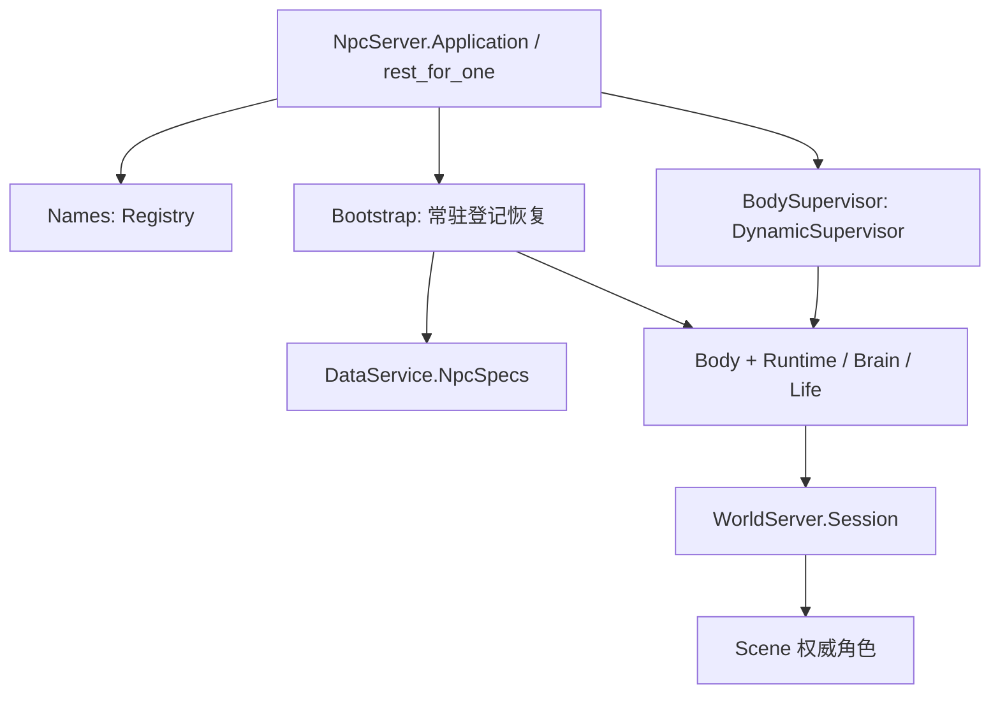

# npc_server

服务器常驻自治行为子系统，与 `gate_server` 平级，随唯一 `voxim_server` release 启动和停止。
NPC 通过感知、决策、技能和操作参与世界；Scene 统一拥有玩家与 NPC 的身体、移动、碰撞和 AOI。
同一 BEAM 部署只拆职责与故障边界，不提供独立 CPU / 内存隔离。



Body 崩溃由动态监督器恢复；名字表或动态监督器故障使后续子树按依赖顺序重建，Bootstrap 重新读取 enabled 登记。
Scene 暂不可用由 Body 原有会话维护机制处理。内部进程恢复不表示 NPC 产品下线；运维仍可显式登记、修改或停用。
模型、记忆、情绪与动作契约详见 [运行时说明](lib/npc_server/README.md)。

正式 release CLI（`bin/voxim_server rpc`）：

```elixir
NpcServer.Bootstrap.status()
NpcServer.Registry.list()
NpcServer.Registry.put("巡逻员", %{scene_id: 1, spawn: {4.0, 66.0, 10.0},
  brain: "patrol", params: %{"route" => [[4, 10], [8, 10]]}})
[{pid, _}] = Registry.lookup(NpcServer.Names, cid)
NpcServer.Body.observe(pid)
```

`status` 派生 enabled / running 数量；`:running` 只证明控制进程已经恢复，不承诺 Scene ready。
`npc_registry_start` 逐角色记录启动结果，`npc_bootstrap_ready` 记录总数与失败数。登记解析失败保持可见，不悄悄改用另一种 Brain。
编辑范围唯一部署来源为 `:voxel_region, :edit_bounds`（`VOXIM_M1_CONFIG`），玩家和 NPC 共用 `VoxelRegion.EditBounds`。

验证：本目录运行 `mix test --no-start`；默认排除需要外部模型的 live_llm/live_jev，以及 scale/soak。
根恢复集成单独运行 `mix test --no-start test/npc_server/npc_application_test.exs`，使用本 VM 隔离数据库及有限作者世界。
拆分范围与验证记录见 [阶段记录](../../docs/10-active/cross-cutting/2026-10-12-npc-server-extraction.md)。

正式根冒烟：仓库根运行 `python scripts/npc_server_smoke.py --image <正式 Docker 镜像> --out .demo/observe/<新目录>`。
脚本创建独立数据库与有限生成世界，经正常容器入口启动同一 release，检查 Gate 停止/重启时 NPC Body、Player 与会话身份不变，
整服重启后由登记自动恢复相同 cid。结束回收本次容器，保留 `result.json` 和日志；不连接 UE，不调用模型，不作为客户端或性能验收。
