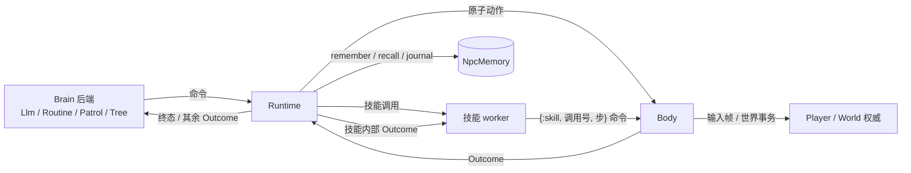
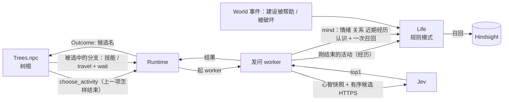
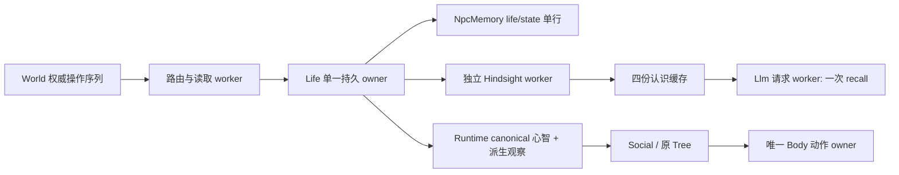
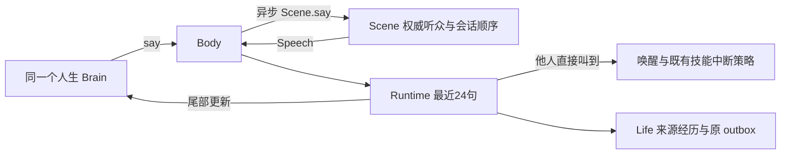

# NPC 运行时

分类：全局系统功能。统一输入与记忆规范见
[模型上下文契约](../../../../docs/10-active/cross-cutting/2026-09-22-npc-context-memory-contract.md)。
本目录只写职责、契约与接入方式；各轮实现的验证记录在
[共用运行层与评审修复记录](../../../../docs/10-active/cross-cutting/2026-10-06-npc-runtime-review-fixes.md)。

## 模块

- `Body` 接正式 Session/Player，产生观察并把动作交给 authority；自己维护会话（丢失后重新 claim）。
  正式生成入口 `Body.start/2`：名字即永久身份（`CharacterStore.ensure_npc/1`），阵营档案取 `Orgs.profile/1`，
  按 cid 登记在 `NpcServer.Names`。
- `Registry` 是 NPC 注册表：运维登记一次（`npc_specs` 表，`DataService.NpcSpecs`），节点重启后由 NPC 正式监督树的常驻
  Bootstrap 调 `start_all/0` 拉起；`brain/2` 是唯一把注册表行的 JSON 参数解析成 `{大脑模块, profile}` 的地方（见下文“注册表”）。
- `Genesis` 是创世能力组 `:genesis`：条目 `fill_box` / `set_cells` 与 Body 动词 `genesis_edit` 的受理校验 `prepare/3`，
  授予只来自注册表行（见下文“创世”）。
- `WorldRequest` 把世界写命令拼成与玩家线帧解码（`Codec.decode/1`）同形的 `{kind, request}`，取值约束与线解码共用
  `Codec.intent?/1`；Body 把它交给与玩家同一个入口 `SceneServer.Movement.Intent.run/3`（施法 0x82 交给 `Player.cast_spell/5`）。
- `Runtime` 组合任意 Brain，统一命令路由、记忆调用、技能 worker、中断、取消结算与终态记录。
- `Abilities` 是决策侧唯一的能力定义（角色能力函数库）：组合各域条目 `%{name, group, done, description, params, build}`，
  一份参数规格同时生成 strict JSON Schema（`tools/1`，LLM 工具表）与 JSON 形参数的译码（`command/4`）。
  各域只提供条目：`Actions`（移动、工具、建造、液体、背包，施法 `spells/1`；经 Abilities 构造的 move_to 都用 `tolerance/0` 的容差，
  Patrol / Builder 仍各写 0.5，改为引用它是设计稿 §12 的独立清理；附件 kind / axis 名字表 `attachment_names/1`）、
  `Perception`（look / survey / inspect / query_balances / read_catalog，另有范围校验、World 只读入口与模型投影；prefab 目录行只在
  `prefab_row/3` 计算；步行判据 `walk_kind/1` 与列扫描 `floors/2` 也只在这里，Body 的寻路网格、survey、travel、expand 共用）、`Attention`（观察方向与敌／友目标组，Body 用的动词表由条目派生）、`Memory`（记忆）、
  `Skills`（已配置的长技能，schema 原样取自技能的 `definition/1`）、`Genesis`（创世，只在 `profile.genesis` 为真时）。`Sight` 把视野与瞄准查询投影到 World 的只读射线。
- `Responses` 是 Responses 应答里工具调用的唯一解析处；`Http` 是共享 JSON 出站。
- `Context` 从权威 profile 派生身体说明与坐标约定。
- `Brain.Llm` 组合观察、近期结果和逐轮检索记忆，只负责询问时机、模型请求与上下文。
  注册表 JSON `cadence` 默认 `"automatic"`；显式 `"manual"` 后仅由
  `Body.step(body, observer, tag, context \\ %{})` 受理单次决策许可，返回 `:ok` 或
  `{:error, :busy | :automatic_cadence | :unsupported_backend}`。Body 将受理回复交由既有 Runtime 转发，
  不等待模型；许可需下一次新 Observation 且无在途命令、`pending=[]` 才启动，仍遵守两次请求最少隔 1 秒。
  本轮 `context` 只进入 JSON `input.step_context`；结果恰好一次发给 observer：
  `{:npc_llm_step, tag, {:ok, raw_response, body_command_ids} | {:error, reason}}`。
  空工具应答为 `{:error, :no_tool_call, raw_response}`，保留已付费的 usage；
  手动步进遇到上下文的 `memory_error` / `working_memory_error` 时，在 HTTP 请求前返回
  `{:error, {:memory_context_unavailable, reason}}`，不把读取失败当空记忆继续付费。自动模式维持原语义。
  IDs 只含投给 Runtime / Body 的命令；`wait` 只完成决策，IDs 为 `[]`。模型错误与空工具应答显式失败，
  不自动重问；观察、对话、结果和 wake 均不产生新的许可。等待动作仍由原 Runtime / Body 执行。
  `max_requests_per_hour` 正整数保持原滑动小时预算；Life 仍默认 60 且有限值只接受 1..60。
  只有显式 JSON `"unlimited"` 解析为 `:infinity`，不保存询问时刻列表，也不绕过最小请求间隔。
  同步受理与异步结果分开依据 [Elixir GenServer 官方调用契约](https://hexdocs.pm/elixir/GenServer.html#call/3)，
  应用于已有 Brain receive-loop，保持唯一请求 owner，不新建 Brain 或监督分支。
  验证采用真实 Brain / Runtime 进程、公开 step 与事件入口；HTTP 和记忆用冻结应答与 Store 替身隔离。
  Body 转发另测回调接缝，不把它称为真实会话验收；实验首步须验证正式 Body PID。
  最小命令：`cd apps/npc_server && mix test --no-start test/npc_server/npc_brain_llm_test.exs test/npc_server/npc_life_registry_test.exs`；
  本轮日志在 `.demo/observe/npc-year-20261011/validation/`，覆盖单许可、fresh/pending、重复受理拒绝、一次结果、
  context 隔离、无限额度解析及错误不重试；不启动 PG、World 或 UE。
  `Brain.Routine`（作者脚本）、`Brain.Patrol`（巡逻决策树）是非 LLM 后端，直接产出规范命令。
  `Brain.Tree` 是最小行为树后端（纯函数，叶子 `act` 经 `Abilities.command/4` 构造命令，与 LLM 共用同一份能力定义）；
  树定义在 `Trees`，首个是建设者 `Trees.settler/1`。
- `Skill` 定义 `definition/1`、`run/3` 与可选 `observations?/0`；`Skills` 按 profile 注册。
  内置 `build`（放已发布定义）、`design_house`（住宅设计会话，`Skills.HouseDesign`）、
  `gather`（从作者给定的采石盒取天然格，`Skills.Gather`）、`travel`（长途行走：直线分成每段 ≤ reach − 2 米，每段先 survey 段终点列、取离脚下最近的可站层，再带 `y` 一个 Body move_to，`Skills.Travel`；Settler 回工地站位与 expand 走向地块都用它。目标也可以是一个角色（`entity_id` +
  `entity_epoch`）：每段开头 `get_target_status` 重读他的位置，水平 2.0 米内算到，否则朝他这一侧 1.5 米的落脚点走一段；段数预算 =
  起步时段数 + 2，用完 `target_moved`，他离开观察 `stale_target`）、`expand`（在作者划定的区域里找地块、地表略有起伏先平整、缺料自己采、放下已发布定义，
  `Skills.Expand`，见下文“持续扩张”）、`wilderness`（荒野逐格施工，驱动纯状态机 `Builder`）。技能内部的一步原子动作统一用
  `Skill.call/2`（编步号、等 Outcome）；一个技能组合另一个技能（expand 调 gather 的 `run/3`）时给被组合的那次一个步号命名空间。
- `Scheduler` 定义中断策略 `decide/2`，`Jev` 是现有实现；分类器不能操作世界。
- 统一形态 NPC 的“心智 → 选择 → 执行”（总纲
  [`2026-11-12-npc-architecture-overview.md`](../../../../docs/10-active/cross-cutting/2026-11-12-npc-architecture-overview.md)，薄片一 S1-A / S1-B）：
  `Persona` 是人格卡（52 对形容词 × 9 级 + 英文自由文本）的唯一校验与英文转写；`Mind` 把人格、情绪与关系、近期经历、
  记忆（认识 + 一次召回）、眼前处境、最近做过的事拼成心智快照（发问时现读的只读视图，给模型的英文 state 只在这里拼；
  情绪、经历、记忆三栏经 `Life.mind/2` 向 Life 这个 owner 现读）；`Selector` 是选择位置：一项活动结束时把快照与有序候选交给
  Jev，直接取 top1（不设置信度门槛，`Jev.top1/1`；0.85 门槛只留给中断与 harm 护栏的 `Jev.verdict/3`），并持有“正在做什么、
  最近选过什么、最近一次问了什么”；`Trees.npc/1` 是执行它的树。见下文“统一形态”。
- `DayPlan`（LLM 日计划）与 `LlmBudget`（每游戏日额度）**未接线**：读计划的效用选择器 `Utility`、作息树 `Trees.settler_daily/1`、
  注册参数 `daily` 与写死的轮换台词已随 S1-A 删除，没有注册表入口会启动它们；代码与单测留到薄片二改成规划位置的外壳。
- `Memory` 提供模型记忆工具与上下文投影；`DataService.NpcMemory` 按永久 cid 持久化、检索，并拥有保留上限。



## 契约

- **会话**：Body 是无 socket 的会话 owner，会话是它自己维护的不变量。输入积压超过 120、Scene 结束会话、
  Player 结束、跨 Scene 移交失败、claim 失败时，Body 不退出，1 秒后重新 claim（与玩家断线重连同理），
  Brain / Runtime / 记忆与在途技能都保留；在途移动命令以 `session_lost` 拒绝，已投递的世界调用照常各回结果
  （Player 已结束则 `session_lost` 拒绝，规则见下条“世界意图”）。没有会话时的身体与世界命令得到 `invalid_session`。
  同一 cid 被另一个 claim 顶替（关闭原因 2）时 Body 以 `{:shutdown, :replaced}` 正常结束；
  Body 的重启策略是 `transient`，只有崩溃才由监督者重启。
- **世界意图（与玩家同一条裁决）**：工具、放置 / 液体 / 合成 / 进食、附件、prefab 命令经 `WorldRequest` →
  `Intent.run/3`：工具走 `ToolAction.run/5`（`authorize_tool`：死亡、施法中、重放、同 key 结果、人物目标 g5），
  其余走 `Player.tool_context/2`（施法中、死亡）再进 World。Body 自己只保留两道门：命令的类型守卫（不合法回
  `invalid_command`）与部署编辑盒（prefab 越界回 `out_of_bounds`，与玩家连接共用 `VoxelRegion.EditBounds.prefab_within?/4`）。
  意图到达时刻（`received_us`，GCRA 按它判频）在 Body 受理命令时冻结，不在执行进程排到时才取。
  余额补发与玩家同一条规则（Intent 的返回值）：工具 action 1 / 2 且非人物目标、生产 / 附件 / prefab 经角色接纳后。
  执行进程对世界调用的退出：会话的 Player 已退出（`Player.running?/1`，Scene 在 peer 节点时同样适用）→ `session_lost`
  （写意图可能已提交，以 look / inspect 现算）；否则照常退出，Body 随之由监督者重启。
  每次进 Intent 的世界意图一行日志 `character_intent`（玩家同格式）；进 Intent 之前被 Body 拒绝的
  （`invalid_command`、位置未知的 `invalid_session`、编辑盒 `out_of_bounds`）各一行 `npc_intent_rejected cid= id= verb=|kind= reason=`。
  技能 `design_house` 的发布不经 Intent（见下条“技能”）；创世编辑 `genesis_edit` 也不经 Intent，直接写 World（见“创世”）。
- **施法**：`cast_spell` / `cancel_cast` 与玩家同一个角色 owner 入口：执行进程读 `World.magic_digest/1` 填入 0x82 请求后调
  `Player.cast_spell/5`（不经 Intent、不等前摇），回复目标 `{Body, {:npc_cast, id}}`；取消以同一 client_intent_seq 同步调
  `Player.spell/4` action 2，cancel 自己 `done`（data `%{}`），原施法由 World 回 `cast_cancelled`；没有待施法回
  `no_active_cast`。施法只登记在在途世界事务表（id → `:cast_spell`），`{{:npc_cast, id}, 结果}` 是唯一的 Outcome 来源
  （结算 done、立即拒绝、取消、World 侧会话结束 `invalid_session`）；`{:mmo_spell_reply, …}` 只更新 Observation 的
  `self.caster`。取消用的请求按 id 记在 `casts`，`cancel_cast` 取最早提交、还没有终态的那次（执行进程按提交顺序投递，
  它前摇时后提交的只会被 Player 回 `cast_too_soon`；它结算后才投递的后一次才会进入前摇，那时它已不在 `casts` 里）。
  会话丢失（含 Player DOWN）时在途施法以 `session_lost` 结束，迟到的回复因表中无 id 被忽略，每次施法恰好一个终态；
  `Player.stop/1` 先撤销施法，所以那时的终态是 `cast_cancelled`。跨 Scene 移交时 seal 撤销前摇（`cast_cancelled`），
  Body 仍监视旧 Player：执行进程投递时它已退出的施放没有回复，它退出时以 `session_lost` 结束；旧会话的施法不能再取消。
  `session_lost` 不保证未结算（已授权的可能先到 World）。
  法术来自作者给的 `profile.spells`（`%{名字 => 程序字节}`，0x82 的程序字段；LLM 只选名字），`:magic` 组条目只在它非空时投影；
  目标句柄同 use_tool，但只有 0x82 能表达的 g0..g2。只在流送 Scene 可用（非流送 Scene 的 Player 没有 `authority_ref`）。
  新 NPC 能量 0：施法会走火（spent 0），有效施法要法术带里先有取能（`energy.draw`）程序。
- **技能**：每个调用只有一个终态。取消命令有自己的 id：`%{id:, verb: :cancel_skill, call: 原技能调用号}`，
  受理回 `:done`（`data.call`），没有在途技能回 `no_active_skill`，已在取消中回 `already_cancelling`。
  被取消的技能仍以原调用号回终态：先等 worker 退出，再发带 `settle: 调用号` 的 `stop`，
  Body 在移动停稳且该调用已投递的世界调用全部有了结果后才确认。取消期间落定的内部结果放进终态 `data.settled`；
  已提交事务不撤销、不隐瞒，终态之后不再有这次调用引起的世界变化。停止失败明确回报 `stop_failed`。
  技能上下文与 `design_house` 的逐轮刷新都取 `Player.tool_context/2`：角色死亡期间技能无法开始（`dead`），
  进行中的 `design_house` 的 look / inspect / 记忆工具回 `error: dead`，下一轮模型请求前以 `dead` 结束。
  `design_house` 的发布直接调 `PrefabDesigner.publish/3`（死亡门、施法门经 World 内的 `actor.refresh` 生效），
  不产生 `character_intent` 行。
- **中断策略**：只由 `interrupt_policy: {模块, 配置}` 开启，每 10 秒及被他人直接叫到时检查。
  context 含 `skill`、`observation`、`heard`（最近 24 句，按权威接收顺序，包含旁听与本人发言；技能开始/结束不清空）。
  `{:error, _}` 或策略进程崩溃只记一笔（终态 `metrics.scheduler_error_count`）并继续技能。
  荒野施工内部分诊用的 `scheduler` endpoint 是另一项职责，配置它不会开启中断检查。
  Jev 实现只在有把握（置信度 ≥ 0.85）地选了非继续选项时中断，拿不准等同继续。
- **观察**：Runtime 只把 Observation 转给声明 `observations?/0` 为 true 的技能（目前是 wilderness），
  其余 worker 邮箱不堆积观察。Observation 的 `self.body_state` 是本人 Session.BodyState 下行的原样投影
  （生命、可恢复生命、状态码、核心 / 皮肤温度、蛋白质、伤病；nil = 本会话还没收到），`self.caster` 是最近一次施法回复的
  施法者能量 / 容量 / 相干度（nil = 还没施过法），`entities` 带 EntityEnter 的
  `name`、`relation`（`MmoContracts.Relation.code/1`，按本角色这个观察者算）与 `relation_source`，Snapshot 只更新位置。
  这些都是派生缓存，真值在 Scene 的身体 owner 与阵营档案；关系只回答敌我颜色，不回答能否攻击。
- **目录读取**：`read_catalog`（`what: :prefab | :prefabs | :materials | :tools`）经 `Perception.read/3` 读 World 的
  公共只读目录：prefab 定义的材料单与尺寸（作者目录与运行时发布都查得到，没有这个 id 回 `definition_not_found`）、
  最近 20 条运行时发布、材料的名称 / 可食 / 配方（可食与配方只对生产材料给出，与 World 进食 / 合成门一致）、
  工具的动作 / 射程 / 间隔。不缓存，不经 Intent。
  prefab 目录只读 `World.prefab_catalog/1` 的轻描述与材料计数，`prefab_row/3` 不获取或展开完整几何。
  最近发布只读 `World.published_prefab_metadata/1` 的 id / publisher / name，按原发布顺序取最近 20 条；
  材料单来自同一轻目录，不为列举读取原 VXPD 或重新 hash。某条定义冷源缺失不影响其已发布元信息与材料清单。
  `design_house` 草稿编译、预览与指定 id 切面分别经 `World.compile_prefab/2`、`preview_prefab/2`、`prefab_geometry/2`
  按当前请求取得几何；冷源读取、身份或编译错误原样进入既有工具 `error`，不隐式换定义或改写成检查成功。
- **步行网格（Body 寻路）**：一格能不能踩、能不能穿过只看 `Perception.walk_kind/1`：挡路（与碰撞同一判据
  `VoxelMaterialCatalog.blocks_movement?/1`）、非液体、非细化的格能踩；不挡路（空气、花草）的格能穿过；液体与细化格既不能踩也不能
  穿过（不进寻路网格）——碰撞按 micro 几何，宏格网格只能保守地整格挡住细化格，也不站在 1/8 米的 micro 面板顶上。起点是身体的权威
  位置（`Path.find/7` 的 `trusted_start`）：身体站在细化格空着的部分或其上时照常出发。不给 `y` 时取盒竖直只有脚下上下 6 格
  （`Body.path_margin/0`），高差更大要给 `y`（travel 每段自动给）。
- **地表勘察（survey）**：`survey{x0, z0, x1, z1}`（列闭区间每边 ≤ 32 列、各边离自己 ≤ reach，竖直取自己所在高度上下 reach，与 look
  同一距离护栏），按 x 分片经 `World.material_snapshot/3` 读（片间不是原子快照，`seq` 给 [首片, 末片]）。每列 `floors` = 站得下自己的
  地面层（该格能踩、其上身高格数都能穿过、都在扫描范围内），地表 `y` = 最高的一层，带这一格的材质与 `placed_by`，`refined` = 这一列
  有细化格；给 LLM 的投影是按行的高度图（`[y, material]` 或 null）加放置者 / 细化格两张稀疏表。look / survey 的内容随大脑最近
  8 条 Outcome 一起保留和淘汰，不另按查询类型提前清空；各条仍是带版本与范围的历史观察，不合成为当前原子快照。
- **感知距离护栏**：`move_to` 的水平目标与给出的 `y`（相对脚所在格）都不超过 `Perception.reach()`，否则 `too_far`、
  不访问 World；`design_house` 的锚点宏格各轴离自身超过它时技能以 `too_far` 结束，不读 site、不发模型请求。
  两段 LLM 工具描述（`move_to`、`design_house`）都写了这条上限，数字由 `Perception.reach()` 插值。
- **LLM 询问**：有新情况才问——新 Outcome、被他人直接叫到、`wait` 到期、或有实体走进 6 米（离开 8 米才算走远）。
  Life 新接纳经历（`mind.affect.next_seq` 变化）也唤醒；旧规则模式按 `mind.evidence`，单纯情绪提交、衰减/观察时间变化不唤醒。
  请求期间到达的新情况保留至下一轮，旧响应不能把它清掉；仍受在途命令与滑动额度约束。
  两次询问至少隔 1 秒；应答没有工具调用或请求失败按 1、2、4…60 秒退避；
  每 NPC 每小时最多 `max_requests_per_hour`（缺省 60，2026-11-11 由 600 降下，与 Life 上限一致）次，用完记 `npc_llm_budget_exhausted`。
  工具表 = `Abilities.tools(profile) ++ [wait]`，全部 `strict: true`（2026-10-08 对当前代理 live 预检通过，设计稿 D-2）；
  `profile.groups` 可选裁剪（缺省全部组；Demo LLM NPC 取 `[:move, :sense, :act, :build, :memory, :skill]`，16 个条目 + wait）。
  参数不是 JSON 对象、形状不对或工具不存在（含被 groups 裁掉的）时，在本地回报 `invalid_tool_arguments` / `unknown_tool`
  给模型并附原调用，不发给 Body。目标是显式句柄：`use_tool` / `dismantle` / `detach` / `cast_spell`（g0–g2）的 `target` 由模型从 probe_toward
  结果或 inspect 行里原样抄来（投影时每行附 `target`），Brain 不保存“最近一次 probe / inspect”；人物句柄（g5）不进 LLM 投影。
  `say` 在独立 `:dialogue` 组投影；显式裁剪组的档案须纳入该组才能让模型说话。
- **观察与目标**：Body 拥有独立观察方向和敌／友目标组，各组一个焦点；目标身份是 `entity_id + entity_epoch`。
  选择、观察转向、移动与攻击正交；本地组不是阵营或团队真值，目标 epoch 是观察身份，不能用来绕过攻击裁决。
  实体离开 AOI、更换代次、换场景、会话丢失后重新入场时清理关注，旧身份的选择以 `stale_target` 拒绝，
  `get_target_status` 返回 `valid: false`。观察半角 45°，最远距离沿用 `Perception.reach`；`look_at` 各轴超出
  感知边界回 `out_of_range`，与眼点重合回 `zero_direction`，只转向一次、不持续跟踪。
  视野里的角色只取已同步实体，以中心点做视锥与遮挡采样；`get_aim` 取最近的角色胶囊（当前场景移动 profile）
  或 canonical 方块／构件命中，复用 World 的 `target_at`、Damage 的微格 DDA 与 ToolHit 求交，独立附件未采样，
  遮挡按 canonical 实占用，尚无透明材质透视。结果带 `scene_id`、`session_epoch`、`self_tick`、实体 tick 与
  World `seq`，是各 owner 的采样版本，不是跨 owner 原子快照。已知不等于可见，可见不等于可攻击。
- **记忆**：每个 cid 最多 200 条笔记（按最近写入保留）与 1000 条经历；超出的最旧行在写入时删除并记
  `npc_memory_trimmed`。上限只在 `DataService.NpcMemory.limits/0` 定义，`remember` 工具说明从它派生。
  当前意图用 `set_plan(text)` 保存，最多1500字、空文本清除；唯一 `kind=intention/key=current` 工作行按永久 cid 覆盖，
  不受普通笔记淘汰影响。每轮决策现读 `current_plan` 和最近五条 `recent_notes`，无进程缓存；读取失败显式给出
  `working_memory_error`。计划仅表示 NPC 的主观打算；完成与否、坐标、材料仍查 World 和权威 Outcome。
  公共 `Body.command/2` 与 Brain 命令都交由同一 Runtime → Memory 执行；Body 不另存计划。
  Life 模式保留四份模型缓存与一次 Hindsight recall，不再遗漏自记笔记，也不另做词法召回。
  Life 的 Llm 将已配对原调用的拒绝保存在 `intention/failures`，最近八种不同调用跨感知轮次与重启进入 `recent_failures`；同调用覆盖。
  这是带时刻的历史证据，不是禁令或当前世界状态。保存失败记 `npc_failure_memory_failed`，当前 Outcome 带 `memory_error`。
  survey 模型投影的 rows 为 `[ground_y, material, move_to_y]`，第三项可直接用于移动；`no_path` 的 data 保留同次寻路快照 seq、start、goal、goal_position，未指定脚层时后者为 nil。
  Life 人格除谨慎 `caution` 外包含亲和 `sociability`（初值0.5）：第三次起显著帮助+0.05、伤害-0.01，有界且以World seq溯源；感谢接近幅度乘 `(0.5 + sociability)`，不改变陌生人安全距离。
  旧心智在Life加载边界补初值并保存，日志 `npc_life_state_upgraded`，不回算旧事件。人格不随安静时间衰减；LLM也收到相同维度及含义。

## 接入方式

正式运行时用 `Body.start(name, scene_id: …, spawn: …, brain: {模块, profile})`：在 `NpcServer.BodySupervisor` 下起 Body，
名字即永久身份（同名永远同一 cid，同 cid 最后完成 claim 的 Body 留下：先起的在线时被顶替；它若正在重新 claim，
稍后会反过来顶掉后起的，所以换掉同名 NPC 要先停旧 Body 再 start；名字唯一由作者 / 部署脚本保证），
阵营档案取 `DataService.Orgs.profile/1` 随 claim 交给 Scene（别人看到的名牌与关系由它算出）。
直接 `Body.start/2` 起的 NPC 不随节点重启恢复；要长期放在世界里的 NPC 经注册表登记（下节）。
测试与夹具可直接 `Body.start_link(..., cid: …, faction: 档案 | nil, brain: {模块, profile})`。Body 自动组合 Runtime。
同步后端实现 Brain 的两个回调；慢后端在 init 时保存 self()，异步命令投回这个 Runtime 接收端。
角色的世界操作仍经 Body / Player / World，不把技能内部命令、HTTP 或 worker 生命周期交给后端重写。

```elixir
# 全局系统功能配置示例；definition_hex / anchor_micro 由调用方从正式已发布定义和目标取得。
brain: {NpcServer.Brain.Routine, %{
  skills: %{build: %{}},
  steps: [%{verb: :skill, skill: :build, args: %{
    "definition" => definition_hex, "anchor_micro" => anchor_micro, "orientation" => 0
  }}]
}}
```

- 添加技能：实现 `NpcServer.Skill`，配置 `skills: %{名字: %{module: 实现模块, ...}}`。
  `definition/1` 拥有参数说明，`run/3` 在 worker 内接纳输入并返回一个终态；无需改 Llm / Runtime 分派。
  `definition/1` 的 `parameters` 原样成为 LLM 的 strict 工具：每个 object 都写 `additionalProperties: false`、
  全部属性列进 `required`，可空字段写 `type: [t, "null"]`；不满足时代理拒绝整个请求（NPC 会一直退避重试）。
  逐帧需要位置的技能实现 `observations?/0` 返回 true。字符串工具名只在已配置名字中匹配，不把模型输出转成新原子。
- 观察与目标：`Attention.entries/0` 是 13 个命令的唯一条目（经 `Abilities` 投影给 LLM），脚本 / 行为树返回同样的命令：

  ```elixir
  # target 来自本角色 observation.entities 或 get_visible_entities 的结果。
  target = %{entity_id: entity_id, entity_epoch: entity_epoch}
  Body.command(body, %{id: "select-1", verb: :select_target, target: target, group: :enemy})
  Body.command(body, %{id: "look-1", verb: :look_at, target: target})
  Body.command(body, %{id: "aim-1", verb: :get_aim})
  ```

  `get_targets` 返回两组 members + focus 与独立 mark，`set_focus` 只接受已选成员；`get_view` 返回 origin、
  direction、range_m、half_angle_degrees；`get_aim` 的 hit（未命中为 nil）含 kind、target、point、distance_m，
  方块带 properties、角色带采样 tick 与粗部位；`get_visible_entities` 标明 center 采样与已同步实体来源。
- 添加中断策略：实现 `NpcServer.Scheduler.decide/2`，配置 `interrupt_policy: {实现模块, 配置}`。
  Jev 的配置为 `%{scheduler: endpoint, activities: 活动 profile, continue_activity: 选项, request: 可选}`。
- 查看：`Abilities.entries(profile)` / `Abilities.tools(profile)` 返回能力条目及 strict 参数；
  JSON 形参数的后端（LLM、design_house 的共享工具、I3 的行为树）用 `Abilities.command(name, args, id, profile)` 构造命令。
  `Body.observe(body).outcomes`
  含最近 32 条结果；`Body.observe(body).select`（`Runtime.observe/1` 同）是选择器状态：最近 5 项活动（旧在前，各带
  `activity`、`trigger`、`confidence`、`latency_ms`、`recall_ms`、`result`；`result` 为 nil 的末项是正在做的活动）、最近一次发问失败的原因
  `failure`，以及最近一次问 Jev 的内容 `asked`（`state` 给 Jev 的 state 全文、`recall_queries` 各路召回的描述、`recall_ms` 并行召回的墙钟）。日志：`character_intent`、`npc_intent_rejected`、`npc_genesis_edit`、`npc_registry_start`、`npc_session_lost`、`npc_claim_failed`、`npc_skill_outcome`、`npc_settler_idle`、`npc_expand`、`npc_interrupt_check`、
  `npc_interrupt_check_failed`、`npc_llm_no_tool_call`、`npc_llm_request_failed`、`npc_llm_budget_exhausted`、`npc_select`、`npc_select_failed`（活动选择，见下文“统一形态”）。`npc_day_plan_accepted`、`npc_day_plan_rejected`、`npc_day_plan_request_failed`、`npc_llm_usage`、`npc_llm_usage_unknown`、`npc_llm_day_budget_exhausted` 属于 `DayPlan` / `LlmBudget`：两者目前未接线（没有注册表入口会启动），这些行不会出现。

### 注册表（`Registry`，放置阶段 M1）

运维经 release `rpc` 登记（`docker compose exec app bin/voxim_server rpc '<表达式>'`）。信任边界在 `put/2`：参数先规范化成
JSON 形（存的与解析的是同一份），再经 `Registry.brain/2` 解析成大脑配置并当场校验（建树、投影工具表、巡逻路线），
不合法回 `{:error, {:invalid_params, 说明}}`，不落库、不建角色、不起 Body。

```elixir
# 全局系统功能运维示例（rpc 表达式）。
# 建设者：参数同下文 Settler 的 profile（JSON 写法：工具带与采石盒的键是字符串化的整数）；技能固定 build / gather，
# 配了 expansion（可选，见下文“持续扩张”）再加 expand。
NpcServer.Registry.put("建设者", %{scene_id: 1, spawn: {4.0, 66.0, 10.0}, brain: "settler",
  params: %{"definition" => definition_hex, "revisit_ticks" => 36_000, "tools" => %{"1" => "镐"},
    "sites" => [%{"anchor_micro" => [64, 512, 112], "orientation" => 0, "stand" => [8.5, 11.5]}],
    "quarries" => %{"11" => %{"box" => [[10, 64, 4], [13, 64, 6]], "tool_id" => 1}},
    "expansion" => %{"region" => [[6, 8], [24, 24]], "spacing" => 2, "tool_id" => 1}}})
# LLM 住民：goal、tools 必填；groups / skills（build、gather、expand、travel、design_house）/ spells / max_requests_per_hour / genesis 可选。
# 模型接口不入库：每次解析取运行环境 NPC_LLM_URL / NPC_LLM_KEY / NPC_LLM_MODEL（必须）与 NPC_LLM_EFFORT / NPC_LLM_CACERTFILE。
NpcServer.Registry.put("住民", %{scene_id: 1, spawn: {12.0, 66.0, 10.0}, brain: "llm",
  params: %{"goal" => "在出生点附近盖一间小屋", "tools" => %{"1" => "镐"}, "skills" => ["build"]}})
# 统一形态（目标形态，见下文“统一形态”）：who、persona、activities、tools 必填。Jev 接口不入库：每次解析取运行环境
# TYPESAFE_API_URL / TYPESAFE_API_KEY / TYPESAFE_MODEL（必须）。必带 Life：Hindsight 地址取运行环境 NPC_LIFE_HINDSIGHT_URL
# （必须），或在参数里写 "life" => %{"url" => ...}；不能写 "life" => false。选择本身不用 LLM 接口；Life 的反思写日记要一个，
# 同样不入库：每次解析取运行环境 NPC_REFLECT_URL（完整的 …/v1/messages 地址）/ NPC_REFLECT_KEY / NPC_REFLECT_MODEL（必须，
# 缺一个登记即 raise；用途与请求形状见下文“反思”）。
NpcServer.Registry.put("阿林", %{scene_id: 1, spawn: {22.5, 520.0, 34.5}, brain: "npc",
  params: %{
    "who" => "Lin, a builder",
    "persona" => %{
      "traits" => %{"impulsive" => 2, "thrifty" => 8, "organized" => 8, "thorough" => 8, "responsible" => 9,
                    "extraverted" => 3, "talkative" => 3},
      "personal" => "Dislikes crowds and noise. Always keeps the promises she makes."},
    "tools" => %{"1" => "镐"},
    "activities" => [
      %{"name" => "build_hut", "criterion" => "Build the small hut on the plot east of the square. Steady, useful work.",
        "skill" => "build", "args" => %{"definition" => definition_hex, "anchor_micro" => [200, 4144, 296], "orientation" => 0}},
      %{"name" => "visit_plaza", "criterion" => "Walk to the plaza and spend a while among the neighbours.",
        "place" => [30.0, 36.0], "stay_ticks" => 1200},
      %{"name" => "rest_at_home", "criterion" => "Go home and rest quietly for a while.",
        "place" => [21.0, 33.0], "stay_ticks" => 1200}]}})
# 巡逻：route ≥ 2 个 [x, z]；dig 可缺省。
NpcServer.Registry.put("巡逻者", %{scene_id: 1, spawn: {4.0, 66.0, 10.0}, brain: "patrol",
  params: %{"route" => [[4.0, 10.0], [14.0, 10.0]]}})
NpcServer.Registry.list()           # 全部行 + running（本节点上这个 cid 的 Body 是否在跑）
NpcServer.Registry.remove("巡逻者")  # 置 enabled = false 并停 Body；角色行、余额、记忆与登记行保留
```

- 返回 `{:ok, %{cid:, pid:}}`：建 / 取 NPC 角色行、写 `npc_specs` 行（`enabled = true`）、停掉同 cid 在跑的 Body（按
  `NpcServer.Names` 找，不靠 claim 顶替）、`Body.start/2`。同名再 `put` 就是改登记（换大脑、换出生点）。
- 节点启动：NPC 监督树在 `NpcServer.BodySupervisor` 之后起常驻 Bootstrap 调 `start_all/0`，拉起全部 enabled 行（持久化读回
  的参数按 `brain/2` 再解析一次）；Scene 还没就绪时 Body 自己 1 秒后重试 claim。每行一条 `npc_registry_start name= cid=
  brain= result=`，一行失败（如运行环境缺模型接口）不影响其余行。测试构建不起这个 Task。
- 位置不持久化：每次入场从 `spawn` 开始（与玩家出生探测同义）。

### 创世（`Genesis`，能力组 `:genesis`，放置阶段 M2）

创世阶段的特权 NPC 直接塑造地形。条目 `fill_box{min: [x,y,z], max: [x,y,z], material}`（闭区间每格写成 material，0 = 挖成
空气）与 `set_cells{cells: [[x, y, z, material], …]}` 都构造 Body 动词 `genesis_edit{edits: [{{x, y, z}, material}]}`，
执行进程交给 `World.apply_edits/2`——与 0x78 原始编辑后门同一个 World 入口、同一语义：不扣料、不记 placed_by、不查射程与
保护区；液体规则与 refined 拒绝照 World；事务照常经 0x79 广播，玩家看到地形变化。

- 授予只有一个来源：注册表 llm 行 params `"genesis" => true`，它同时成为 `profile.genesis`（Abilities 只在它为真时投影
  本组；给了 `groups` 时要含 `"genesis"`）与 Body 启动选项 `genesis: true`（Body 只在它为真时受理，否则 `not_permitted`）。
- Body 受理前的唯一校验 `Genesis.prepare/3`：每次 1..4096 格、格坐标是整数、材料是目录合法 id（同 0x78 解码）→ 否则
  `invalid_command`；每格各轴离自己不超过 `Perception.reach()` → 否则 `too_far`（在世界里干活，要走过去）；格在部署编辑盒内
  （与 0x78 进 World 前的编辑盒门同一判定 `VoxelRegion.EditBounds.within?/2`）→ 否则 `out_of_bounds`。被拒记 `npc_intent_rejected`，
  交给 World 的每次记 `npc_genesis_edit cid= cells= result=`。
- 正式开放后创世能力随原始编辑后门一起收回。

### 行为树后端（`Brain.Tree`）

配置 `brain: {NpcServer.Brain.Tree, %{tree: fn profile -> {树, 黑板初值} end, tools: …, skills: …}}`；profile 的其余键
就是 Abilities 的 profile（`tools`、`skills`、`groups`），`act` 能用的名字 = `Abilities.entries(profile)` 的名字。节点与语义的唯一正文是
`Brain.Tree` 的 moduledoc，这里只写怎样写一棵树：

```elixir
# 全局系统功能示例：到站位后放一个已发布定义；被占就看锚点格是不是自己放的。
fn profile ->
  site =
    {:seq, [
      {:act, "move_to", %{"x" => 8.5, "z" => 11.5, "y" => nil}, retry: 60},
      {:sel, [
        {:act, "build", %{"definition" => profile.definition, "anchor_micro" => [64, 512, 112], "orientation" => 0}},
        {:seq, [
          {:cond, fn bb, _observation -> match?(%{last_failure: %{reason: :occupied}}, bb) end},
          {:act, "look", %{"x0" => 8, "y0" => 64, "z0" => 14, "x1" => 8, "y1" => 64, "z1" => 14}, store: :anchor}
        ]}
      ]}
    ]}

  {{:repeat, :forever, {:seq, [{:succeed, site, log: "npc_example_idle"}, {:wait, 600}]}}, %{}}
end
```

- **act 的参数**是 JSON 形（字符串键、数组，与 LLM 工具参数同形），或 `fn 黑板 -> map end`（tick 时求值）。静态参数在
  `Tree.new/2` 建树时就译码一次，名字不在能力里、参数不合法、节点形状不对都直接 raise；函数形参数 tick 时不合法则本地失败
  （黑板 `:last_failure` 的 reason 是 `invalid_tool_arguments`），不发给 Body。技能叶子（`build`、`gather`…）的参数原样透传，
  建树时不校验，由技能运行时以 `invalid_skill_arguments` 拒绝。`{:act, 名字, 参数}` 即 opts 为 `[]`。经 Abilities 的目标句柄
  只允许 granularity 0..3，打人（g5）只由直接产出规范命令的代码 Brain 发出。
- **常用能力名**：`move_to`、`stop`、`look`、`inspect`、`query_balances`、`read_catalog`、`probe_toward`、`use_tool`、`dismantle`、
  `place`、`craft`、`eat`、`attach`、`detach`、`prefab`，以及已配置的技能名（`build`、`gather`、`expand`、`travel`、`design_house`、`wilderness`）；
  每个名字的参数与 done 含义见 `Abilities.tools(profile)`。
- **黑板**：`{:succeed, 子, store: 键}` 把子节点的结局（`:success` / `:failure`）写进黑板；`act` 的 `store: 键` 把 done 的 `data` 写进黑板；`append: {键, fun}` 把 `fun.(data)` 追加到黑板 `键` 的列表末尾（`each`
  开始时取一次列表，追加的项下一次遍历才出现）；`each` 把当前项写进 `as`；任一 `act` 失败写
  `:last_failure = %{act: 名字, reason: 原因}`，`cond` 与 `succeed log:` 都读它。黑板不写别的东西。
- **retry**：`retry: ticks` 只对 `invalid_session` / `dead` / `session_lost`（`Tree.transient/0`）生效：不判失败，`ticks` 后用
  新 id 原样重发同一命令；其他拒绝照常失败。只给与位置无关、重发也不会多做的命令用（只读、`move_to`）：死亡复活与重新
  claim 后身体在出生点，参数又可能取自已变的世界状态（gather 中途失败时已挖的格已入账），这类步骤在树里从上游重来
  （例：建设者的工地整体重来）。
- **时间**只看 Observation 的 `self.tick`（60 Hz）；`wait` 与 retry 都按它推进，树本身不读时钟、不起进程。
- **halt**：`Tree.halt/1` 放弃全部在途叶子（技能 → `cancel_skill`，移动 → `stop`，世界事务不撤销），其 Outcome 丢弃；
  被取消的技能回终态前不会启动新的技能叶子。本轮的节点都带记忆、没有 reactive 节点，运行时不会自己 halt。

### 建设者（`Trees.settler/1`）

```elixir
# 全局系统功能配置示例：工地、采石盒与定义由作者给定（定义须已发布：作者目录或运行时发布）。
brain: {NpcServer.Brain.Tree, %{
  tree: &NpcServer.Trees.settler/1,
  definition: definition_hex,
  sites: [%{anchor_micro: [64, 512, 112], orientation: 0, stand: [8.5, 11.5]}],
  quarries: %{11 => %{box: [[10, 64, 4], [13, 64, 6]], tool_id: 1}},
  revisit_ticks: 36_000,
  tools: %{1 => "镐"}, skills: %{build: %{}, gather: %{}}
}}
```

每轮 `read_catalog` 取材料单，逐个工地：到站位 → `build`；余额不够 → `query_balances` → 对第一种缺料且配了采石盒的材料 `gather`
缺额 → 回站位再 `build` 一次；`occupied` → `look` 锚点格，整格或格内构件实例的 `placed_by` 是自己就算建成，否则跳过；其余拒绝本工地本轮放弃。
工地内任一步遇到 `invalid_session` / `dead` / `session_lost`：60 tick 后从站位整体重来一次（缺额重算），再遇则本工地本轮放弃；
所以每工地每轮最多两次尝试，每次最多 gather 一次、build 重试一次。
每个放弃记一行 `npc_settler_idle entity= act= reason= context=<工地>`（材料单取不到时没有 context）；一轮巡完等 `revisit_ticks`。
主循环零 LLM，进度不存档，以权威为准：Body 重启后从头巡，已建的工地表现为 occupied → 自家锚点 → 跳过。
作者保证：定义（宏格或 micro 构件均可）占着锚点格；站位离锚点格在工具射程内；各站位与采石盒站位两两水平距离不超过 `Perception.reach()`；
采石盒是地表以上的料堆或深度不超过 1 层，材料属于生产材料且没有 drop_table。`gather` 只挖采石盒里没有放置记录的天然格，
探测命中作者 prefab 宏格（owner 不是 `{0, 0}`）也不挖；真正的护栏是作者给定的采石盒。

### 统一形态（`Trees.npc/1`、`Selector`、`Mind` 与 Life，薄片一 S1-A / S1-B）

注册表 brain `"npc"`：一个 NPC 的“心智 → 选择 → 执行”。规划（LLM）、说话、活动进行中的打断是后续薄片；选择不调用任何 LLM
（Hindsight 服务的后台巩固用它自己的模型）；唯一的模型调用是 Life 的反思写日记（见下文“反思”），它不参与选择。



- **参数**：`who`（英文自称，如 `"Lin, a builder"`；注册名可以是中文，不进模型）、`persona`（人格卡
  `{"traits": {高标记形容词: 1..9}, "personal": 英文自由文本}`，键只能取自 `Persona.pairs/0` 的 52 个高标记词）、`tools`、
  `activities`（有序、非空、名字唯一；次序即给 Jev 的次序）。每个候选有 `name`、`criterion`（给 Jev 当判据的一句英文）和“怎么做”：
  `{"skill": "build" | "gather" | "expand" | "travel", "args": 技能参数}`，或 `{"place": [x, z], "stay_ticks": n}`（travel 过去再待
  n tick，60 Hz），或 `{"person": "distrusted", "stay_ticks": n}`（选中时从当时的观察与 Life 信任里选附近信任 ≤ −0.2 中最低的人，
  `Mind.person/2`，travel 走到他身边再待 n tick；选不到人以 `failed (travel: nobody_distrusted)` 结束，Life 状态还没到是
  `life_not_ready`）。每个候选还可以带可选的 `"place_name"`（这项活动在哪里的名字，非空字符串）：只进记忆——活动结束时成为
  那条经历的 `place:<地名>` tag，召回按地点调取；不进给 Jev 的候选，也不决定去哪里。技能表由候选推出，不另写 `skills`。
  坏人格卡、空候选表、重名候选、未知技能、未知选择器、place 与 person 同写、地名为空或不是字符串在 `put/2` 被拒并说明原因。
- **必带 Life**：不是可选项。`life` 省略或 `true` 时 Hindsight 地址取运行环境 `NPC_LIFE_HINDSIGHT_URL`，也可写
  `"life" => %{"url" => ...}`；没有地址或写 `false` 都拒绝登记。Runtime 按规则模式起 Life（`emotion_owner: :construction_rules`：
  只认 World 来源的建设被帮助 / 被破坏）。**不套 `Brain.Social`**：情绪只通过快照影响 Jev 的选择，不在树之前接管移动；
  `settler` + `life`（Social）的行为不变。Life 状态里的 `traits`（`caution` / `sociability`）统一形态不读——人格只来自人格卡，
  把这两个值并入人格卡要迁移持久状态并牵动 Social，**待做**。
- **什么时候问**：只在一项活动结束（成功或失败）回到树根时。读心智、召回、发问都在独立 worker 里，不阻塞权威帧；等应答期间树不发
  命令，身体原地不动。选定后执行到该活动的终止条件为止，不按定时器改选，活动进行中不打断（打断是后续薄片）。
- **问什么**：state 是 `Mind` 的心智快照，发问那一刻从各 owner 现读，不另存。七栏，最近一轮反思写成了“自己”时在记忆之后多一栏（共八栏），次序如下（写法与数值档位的正文在 `Mind` 的 moduledoc）：

  | 栏 | 内容 | owner |
  |---|---|---|
  | Now | 游戏钟此刻的时段与钟点：`It is <morning / afternoon / evening / night>, <HH:MM>.`（05–11 / 12–16 / 17–20 / 其余） | 游戏钟（Runtime 写进观察的 `world_time`） |
  | Character | 人格描述 | 人格卡 |
  | Feelings and relationships | 此刻仍活跃的情绪（`Feels strong / moderate / faint anger / gratitude toward …`）与信任（`Deeply distrusts / Distrusts / Trusts / Deeply trusts …`）；都没有写 `Nothing notable.` | Life |
  | What just happened | Life 手里还没写进 Hindsight 的经历（已封存待写的片段 + 未封存的尾部，旧在前），每条句首按游戏时间写多久以前（`Just now, ` / `About <N> hours ago, ` / `About <N> days ago, `）；没有写 `Nothing new.` | Life |
  | What I remember | 缓存的四份认识（`- Belief (self / relationships / world / commitments): …`）加分路召回合并后的清单（`- Recalled: [多久以前, ]<正文去掉 " \| When: …" 后缀>`），开头写明“只是我的记忆，不是当前世界事实”；都没有写 `Nothing relevant.` | Hindsight，经 Life |
  | What I have come to think（可缺） | 最近一轮反思写成的“自己”一问的收尾一句，只有原文（不加“多久以前”与 `I thought: `，R4b）；最近一轮没写成“自己”（中止、失败、丢弃）、还没有过一轮或不反思时整栏不出现，不沿用上一轮的（只对留下了小结的一轮成立：一轮已起而没留下小结时仍是上一轮那句，边界见 `Life` moduledoc 的“已知”清单） | Life 持久行，规则在 `Life.Reflection.thought/1`（见下文“反思”） |
  | Current situation | 位置、生命、附近的人与距离、我的建筑在不在、背包里余额非零的材料（全为零写 `Inventory: empty.`） | World / Scene（Observation）；建筑在不在是发问时现查 World |
  | Recent activities | 最近 5 项活动及结果，上一项失败时带失败的动作与原因 | 选择器 |

  “多久以前”= 两个真实时刻各经 `MmoContracts.WorldTime.game_us/1` 换成游戏时间后相减：不足 0.25 游戏小时 `Just now`，不足 48 小时
  按 0.5 小时四舍五入（`1 hour`、`0.5 hours`、`13.5 hours`），再往上按天四舍五入。句型与取整照离线测量 S1-K 的原文
  （`docs/10-active/cross-cutting/tools/jev/s1k_design.py`）。存进 Hindsight 的正文仍是 `At <UTC> (UTC), …`，快照不解析它，用条目的 `at_ms`。

  情绪强度由代码转成词（≥ 0.4 strong、≥ 0.2 moderate、其余 faint；Life 衰减到 0.1 及以下的不给出：一次破坏后约 70 秒内 strong、
  约 190 秒内 moderate、约 310 秒后消失）。信任不随时间恢复（≤ −0.6 / ≤ −0.2 / ≥ 0.2 / ≥ 0.6 四档，其间不写）。
  人写成 `名字 (actor <cid>)`，不在附近的写 `actor <cid>, who is not nearby`：经历与记忆的原文同样写 `名字 (actor <cid>)`
  （写经历时取不到名字就只有 `actor <cid>`），模型靠 cid 把两处对上。名字写法（空名 `someone unnamed`）、“附近的人”与距离
  由 `Life.State` 的 `person_name/1`、`others/1`、`distance/2` 一处定义，写经历与写快照共用。
  “Current situation”里，Life 记得的每座“我的有名字的建筑”各一句，放在背包之前：`My building "<发布名>" at (<ax>, <ay>, <az>) is standing.`
  或 `… is gone.`（坐标是锚点所在宏格；`is gone.` 是离线实测过的 `SIT_GONE` 原文）。问哪几座来自 Life 的记忆，在不在只认
  `Life.mind/2` 在发问 worker 里现查 `World.instance_cells/2` 的结果（有格 = 在，`:instance_not_found` = 不在）；没有这样的建筑就一句不写。
  “受损但还在”不写（要逐格 HP，没有便宜的读法）。
  已知限制：发问时对每座记得的建筑各做一次同步的 `World.instance_cells/2`；建筑所在的页不在内存或建筑很大时可能很慢，
  会拖长这一次选择（目标 2–4 秒）。现在不加超时或缓存：已登记的 NPC 的建筑都在身边，等真的出现再处理。
  句子里的坐标是 Life 记下的锚点（记忆），不是现查的；建筑被整体挪动后坐标会与现状不符。“在 / 不在”只认 World。
  候选次序原样进请求体。没有可行性过滤：做不成的候选靠失败结果进入“最近做过的事”。
- **召回**：一次选择按处境分路召回（`Mind.recall_queries/2`，问句、tags 与 token 上限照离线重测 S1-Q 的原文），
  各路在发问 worker 里并行（`Life.mind/2` 用 `Task.async_stream`，同时至多 3 路，每路最多等 10 秒），三路都 `prefer_observations: true`、不按类型过滤：

  | 路 | 问句 | 过滤 / `max_tokens` |
  |---|---|---|
  | R1 附近的人（至多 2 人，近者在前；每人一路） | `What has happened between me and <名字> (actor <cid>)? Did they help, harm, or promise me anything?` | `actor:<cid>`、`any_strict` / 700 |
  | R2 我的建筑（Life 记得的最近放下的那座；没有就省） | `What has happened at my building "<名>"?` | `place:<名>`、`any_strict` / 700 |
  | R3 未了与感受 | `What am I looking forward to, worried about, or have promised to do?` | 无 / 600 |

  合并（`Mind.merge_recalled/1`）：路的优先级 R1（近者在前）> R2 > R3，各路保持 Hindsight 返回的次序，每路取前 4 条还没被更高优先级的路
  取走的，按 id 去重。不按时间排：S1-Q 在真实导出上看到“路内新的在前”截掉了拆屋事实与“守屋 77 次，没人来”
  （`.demo/observe/npc-slice1-20261112/s1q/results.md`）。每路 4 条是原创取值，在那份导出上量过一次，实跑后调。
  任何一路失败或超时，整次心智读不到（见下文“失败”），不拿其余几路凑一张残缺的清单。
- **经历**：进 Life 的是“做了什么、结果如何、期间谁来过”——选定一项活动时 Runtime 调 `Life.activity_started/1`，
  它结束时调 `Life.activity/2`（`%{text:, place:}`，`Selector.experience/2`）记一条
  `I did "<候选名>" (<判据>). Result: completed | failed (<动作>: <原因>).`，末尾加一句**期间事实**：活动期间 Life 每收到一帧
  观察就记下自己以外每个人到我的最小距离（不加新观察通道），结束时写 `During it: nobody came near.`，或
  `During it: <名字> (actor <cid>) came within <N> m and then moved away.` / `… and was still there at the end.`
  （`<N>` = 最小距离向上取整、最小 1；多人近的在前、最多 3 人，用 `; ` 连成一句）。靠近半径 6 米是用户 2026-11-13 定的原创取值，
  没有外部依据，实跑后可调（`Life.State` 的 `@near_m`）。没有收到开始信号或期间没有观察就不写这句（没有真值）；
  距离账只在 Life 进程里，Life 重启时正在进行的那项活动不写期间事实。这几句英文没有离线测过。
- **看到的**（`Life.Sight`，内容规范 `2026-11-13-npc-mind-content-spec.md` §9；用户 2026-11-13 定只做 A、B）：所见单独成经历，
  不新增栏，与其它经历同一条路进 “What just happened” 与 Hindsight。**A 相遇**：Life 每帧观察喂相遇账，某人离开视野满 10 秒
  （其间再出现算同一次）写一条 `<人> was around for about <时长>; came within <N> m of me, then left.`（进过 6 米）或
  `…; stayed at least <N> m away, then left.`（没进过 6 米、但在视野里累计满 50 秒；N 向下取整）；满 5 分钟还没走先写一条
  `<人> has been around for about <时长> and is still here; …`；观察中断超过 5 秒按最后见到时结束，句末不说 `then left`。
  **B 附近的建造 / 拆除**：每秒读到的 World 事件里不是我做的、没有被写成“动我的建筑”经历的（按 seq 排除）、事件格离我
  ≤ 30 米且落后 ≤ 5 秒的，按（谁、放 / 拆、哪座建筑或散格）分组，组内 30 秒无新事件或开组满 5 分钟合成一条：
  `<人> placed <N> blocks | the building "<名>" | an unnamed building about <M> m from me.`、
  `<人> removed the entire | broke off part of the | damaged part of the building "<名>"[ that <原放置者> placed,] about <M> m from me.`、
  `<人> removed | damaged <N> blocks[ …] about <M> m from me.`（全部句型与取整规则在 `Life.Sight` 的 moduledoc）。时长按游戏钟写
  （现实 50 秒 = 游戏 1 小时，`about <N> minutes / hours`）。同一人每类每 20 分钟至多 4 条，挡下的不写、记 `npc_sight_capped`
  （`Life.observe/1` 的 `sight_capped` 按类计数）。只写看到的：不写意图与评价，不动情绪与信任。门槛与上限都是原创取值，
  实跑导出后再调；进行中的账只在 Life 内存里，重启即丢、不补写；观察每秒 20 帧，没有条目要写的帧不保存。
  与活动句 `During it:` 的重复先两者都留。C 倒下 / 死亡不做（要改 Body）。这些句子没有离线测过。
- **经历条目与写入 Hindsight**：每条经历是 `%{"id", "at_ms", "text", "tags"}`（World 事件另有 `seq` / `actor`，对话另有 `speech`）。
  `"text"` 不带时刻；交给 Hindsight 的正文由 `Life` 的一处函数加离线测过的 `At <UTC> (UTC), ` 前缀，快照拿到 `%{at_ms:, text:}`、由 `Mind` 写多久以前。tags：
  World 事件 `kind:event` + `actor:<cid>` + 涉及有名字的建筑时 `place:<建筑名>`；对话 `kind:conversation` + 对方 `actor:<cid>`；
  活动 `kind:activity` + 期间进过 6 米内的每个人 `actor:<cid>` + 候选登记了地名（注册参数 `place_name`）时 `place:<地名>`；
  所见 `kind:sight` + 那个人 `actor:<cid>` + 涉及有名字的建筑时 `place:<建筑名>`（id `sight:encounter:…` / `sight:place:…` / `sight:remove:…`）。
  经历照旧按原文字数攒到约 3000 字封成片段（`%{"id", "at_ms", "episodes"}`，只是运输批次），retain 时**每条经历一份文档**
  （document_id = 经历 id，timestamp = 它的 `at_ms`，tags = 它的 tags）。旧形状（片段只有 `"text"`）不转换：开发数据清空重建（用户 2026-11-13 定）。
- **经历按标准描述表写**（owner 是 `Life.State`，表只在它的 moduledoc 与 `account/5` 一处定义）：程序里一种 World 事件
  对应一句固定、精确的英文，不同事件不写成同一个词。原文 = 下表句子 + 情绪句（规则模式
  `I feel angry / grateful toward this actor; my trust changed.`，`"life"` 模型评价模式 `My trust changed; emotional appraisal is pending.`），
  `<where>` = `(x, y, z), material <m>, in world <world> (transaction <seq>)`，`<who>` = `名字 (actor <cid>)`（名字取自 Life 此刻的观察，
  取不到写 `actor <cid>`）：

  | 事件 | 原文 |
  |---|---|
  | 有名字的建筑被 `:destroy`，根实例已不在（整座被移除） | `<who> removed the entire building "<发布名>" that I built, at <where>; the building no longer exists.` |
  | 有名字的建筑被 `:destroy`，根实例还在（毁掉一部分） | `<who> broke off part of the building "<发布名>" that I built, at <where>; the rest of the building is still standing.` |
  | 有名字的建筑被 `:damage`（打了没毁） | `<who> damaged part of the building "<发布名>" that I built, at <where>; the building is still standing.` |
  | 别人在有名字的建筑受损的那一格修上同一材料 | `<who> repaired the damaged part of the building "<发布名>" that I built, at <where>.` |
  | 没有名字（散格、空名发布）被 `:damage` / `:destroy` | `<who> damaged construction I care about at <where>.` |
  | 没有名字的那一格被别人修好 | `<who> repaired construction I care about at <where>.` |

  第一句与第三句是离线对照实测过的原文（`tools/jev/s1c_diag.py` 的 `WHOLE_ALT`、`PART`；2026-11-12 S1-D1：写明“整座没了”后
  16 / 16 转向重建方向）。三段各有 owner：
  - **World 给事实**：操作构造边界（`Interactions.capture`）冻结目标所属**根实例**——`prefab`（它的定义 id；整体放下的那一座，
    不是子定义）、`instance`（实例身份 `{birth, occurrence}`）、`anchor`（锚点所在宏格）；散格为 nil。提交处
    （`Interactions.settle/2`，提交后的状态已定、落盘之前）补 `instance_removed`：这笔之后根实例是否已不在 World。按根实例判断：
    多构件建筑拆掉一个叶子构件，根还有格就是 false。prefab 放置 / 替换的 build 事件按提交后取所属建筑（刚放下的那座），
    `placed_by` 仍按提交前。2026-11-12（S1-D2）之前提交的事件没有这三个键。
  - **Life 写句子**：读取 worker 按 `prefab` 查 `World.published_prefab_metadata/1` 的名字写进事件（`building`）→ `Life.State`
    按上表写句子，并把名字记在关心格上（之后别人修这一格时修上去的是散格，仍说得出修的是哪座）。一个关心格在一次毁坏过程里
    只评价第一次破坏；**评价过之后整座被移除**（先被打一下、再整座拆掉）时，情绪与信任不再评价一次，但“整座被移除”这条经历
    照样写出，且不带情绪句（没有发生评价）。没有名字时这一条不另写（无名的写法不在本次范围）。
  - **Life 记住“我的建筑”**：自己放下有名字的 prefab 的那条 build 事件，记进状态的 `"buildings"`：`[%{"name", "instance",
    "anchor"}]`，按放下的次序，同一锚点重建时新的一座取代旧的。这是记忆，不是世界真值；旧持久行加载时补成空表，
    升级前放下的建筑不补记。自己建造不写经历句。
  **没有名字就不点名**：空名发布（NPC 的 `design_house` 现在发布为空名）、作者目录里没在运行时发布过的定义、散格都是这样。
  所以要让 NPC 认得出自己的建筑，定义须带名字发布，且候选判据里用同一个叫法（判据写 “the small hut”，发布名就叫 “small hut”）。
  真实 Jev 的对照（`tools/jev/episode.py`，2026-11-12）：只有坐标与编号时 `build_hut` 的概率 0.30–0.50、top1 摇摆；点名后
  0.81–0.87、4 / 4；去掉编号但不点名 0 / 4；编号留着不影响。当时人写 `Actor <cid>`（换成 `名字 (actor <cid>)` 没有可测的差别）；
  2026-11-13 起按用户同意的写入侧写法改为 `名字 (actor <cid>)`，使记忆与处境栏用同一写法。
  同一段原文也是 `"life"`（进它的评价来源）与 `settler` + `life` 的经历：涉及有发布名的建筑时文本随表变，规则、数值与行为都没变；
  已存的旧经历不重写。
  `choose_activity` 自己的 Outcome 是选择器内部往来，不是经历；规则模式下 `Life.experience/2`（动作终态进情绪评价流水）不建流水，
  技能内部的每一步也不进经历。
- **失败**：心智读不到（Life 还没加载完 `life_not_ready`、认识还没有缓存 `{:life_models_unavailable, 原因}`、任何一路召回出错或超时
  （超时为 `:recall_timeout`；失败那一路的问句与原因见 `Life.observe/1` 的 `recall`）、
  “我的建筑”现查 World 时路由或查询失败——不写“在”或“不在”；World 调用退出时发问 worker 随之退出，记 `select_worker_failed`）
  记为 `{:mind_unavailable, 细节}`，**不发 Jev 请求**，不把读不到的记忆当成“没有记忆”；新 NPC 的空 bank 召回为空是正常结果。
  HTTP 出错 / 超时（10 秒）、应答不成形、top1 不在候选里、worker 崩溃同样是显式失败：`choose_activity` 的 Outcome 为 rejected，
  记 `npc_select_failed cid= reason=`，这一轮不执行任何活动，600 tick（10 秒）后照常再问；不换别的选择器、不取缺省活动。
  新登记的 NPC 在 Hindsight 建好 bank 与四份认识之前（真实服务要几十秒到几分钟）每 10 秒失败一次，属于这一条。
- **观察**：`Body.observe(pid).select.asked` 是最近一次问 Jev 的内容：`state`（给 Jev 的全文）、`recall_queries`（各路召回的描述，按优先级）、`recall_ms`（并行墙钟）；
  在 Jev 请求发出前记下，Jev 随后失败或 worker 崩溃也留着；心智读不到的那次没有发问，仍是上一次的。
  `Life.observe(cid)` 照旧给出情绪原值与衰减值、`pending_episodes`、`pending_fragments`、`retained`、认识缓存、最近一次召回的成败与耗时。
- **日志**：每次选择一行
  `npc_select cid= trigger= candidates= chosen= confidence= latency_ms= recall_ms= model=`；trigger 为 `start`（首次）、`completed` / `failed`
  （上一项活动的结局）、`retry`（上次发问失败后重问）；`latency_ms` 是 Jev 请求，`recall_ms` 是各路记忆召回并行的墙钟。state 全文不进日志。
  技能候选另有既有的 `npc_skill_outcome`；Life 与 Hindsight 的既有日志（`npc_life_error`、`npc_life_memory_error`、`npc_hindsight_failed`）照旧。
- **模型**：取运行环境 `TYPESAFE_MODEL`，随每行 `npc_select` 记录。模型名就是 `jev-latest`（Jev 不分版本）。

### 持续扩张（`expand` 技能与 Settler 的 `expansion`，放置阶段 §7）

```elixir
# 全局系统功能配置示例：Settler 每轮维护完已知工地后在区域里再建一座；sites 可以为空（从零开始扩张）。
brain: {NpcServer.Brain.Tree, %{
  tree: &NpcServer.Trees.settler/1,
  definition: definition_hex, sites: [], quarries: %{}, revisit_ticks: 36_000,
  expansion: %{region: [[6, 8], [24, 24]], spacing: 2, tool_id: 1},
  tools: %{1 => "镐"}, skills: %{build: %{}, gather: %{}, travel: %{}, expand: %{}}
}}
# LLM 住民同一个技能：skills: %{expand: %{}}，模型调用 expand{definition, region, tool_id, spacing}。
```

`expand{definition, region: [[x0, z0], [x1, z1]], tool_id, spacing}`（`Skills.Expand`，契约正文在其 moduledoc）：

- **选址**：`read_catalog prefab` 取材料单与包围盒 `bounds_micro`（只用朝向 0）。候选地块是区域内从 (x0, z0) 起、间距
  “足迹宽 + spacing”的网格，离自己由近到远逐个 survey（足迹外扩 max(spacing, 2) 列；勘察不到就先 travel 走到地块最近的站位）。
  地面取自每个候选自己的地表（不限于自己脚下）：足迹外扩 spacing 的列里地表没有放置记录、没有细化格，足迹各列地表高差 ≤ 2 格，
  四个边中点站位里有一个离目标地面 ≤ 2 格、站得下，才成立。
- **平整**：目标地面 = 足迹各列地表的下中位数（土方量最小；偶数列时取低的，少填多挖）。分块 look 平整体积，目标地面以上到建筑
  高度的天然格（含花草）从站位逐格挖掉（`Gather.mine/3`，材料入账），以下的空位（空气或花草）`place` 填石（与玩家同一入口、花自己的
  余额）；要动的格有放置记录 / 细化 / 液体 → 地块不成立。只动足迹内的格。
- **取料**：`query_balances` 按材料单加填坑石料算缺额；缺的材料在站位周围（区域内、离足迹 ≥ spacing + 2 格）找露天的天然格（地面层
  或其上的料堆，层自上而下），逐格交给 gather（同一个 `Skills.Gather.run/3`）；附近采不到够用的 → 跳过这块地（`insufficient_material`），不硬建。
- **放置**：回站位 `prefab_place`（与玩家同一入口）；done `%{anchor_micro, orientation: 0, stand, site_cell, seq, skipped}`。
  判定不过、走不到、够不着、缺料、放置被拒都换下一个候选（`skipped` 按原因计数）。候选用尽时区分：有地块因走不到 / 够不着 / 附近缺料
  被跳过 → `no_reachable_site`（本可成立，换个位置或稍后再试）；否则 → `region_full`（都被占、太挤或地形不成立，可以停）。
  每次结束记 `npc_expand entity= result= site= skipped= gathers=`。
- **护栏**：`region` 是唯一的作者护栏，只在区域内挖、填与建；不拆、不改任何已有放置（平整只动天然格，挖前按探测命中的 owner
  挡住作者 prefab 宏格）。
- **Settler**：配了 `expansion` 时每轮巡完已知工地后调一次 expand；done 的新工地（anchor_micro / orientation / stand）追加进黑板的
  工地列表（`Brain.Tree` 的 `append:`），下一轮起与作者工地同样维护（被拆就重建）；其余结果记
  `npc_settler_idle entity= act=expand reason=region_full | no_reachable_site | …`，下一轮再找。扩张出来的工地只在黑板里：重启后只剩作者工地，扩张从世界现状
  继续（已建地块因间隔带里有放置记录不再是候选），代价是重启前扩张的建筑不再被维护（被拆后地块空出，扩张会在网格原位重建）。
  回工地站位走 travel（分段、每段带站立层），远处扩张出来的工地也回得去。

## 依据

- 会话自维护：仓库 AGENTS.md §2.1「自维护不变量」（活性/重连由 owner 自己维护）。OTP 监督者的重启强度
  （DynamicSupervisor 缺省 5 秒内 3 次）超出即连同全部子进程终止，见
  https://www.erlang.org/doc/system/sup_princ.html 与 https://hexdocs.pm/elixir/DynamicSupervisor.html ；
  动态添加的子进程不会随监督者重启恢复，所以批量会话丢失不能交给监督者处理。
- 生命周期与回调分离：Elixir behaviour（https://hexdocs.pm/elixir/typespecs.html ）；
  异步动作的运行中 / 终态 / halt 语义参考 BehaviorTree.CPP（https://www.behaviortree.dev/docs/guides/asynchronous_nodes/ ）。
- 感知范围与决策分离、视野半角：Epic AI Perception 的 Sight Radius / Peripheral Vision Half Angle
  （https://dev.epicgames.com/documentation/unreal-engine/ai-perception-in-unreal-engine?lang=en-US ）；
  本项目用服务端 canonical 遮挡代替 UE 场景碰撞，目标双组行为沿用已验收的 Voxim 客户端双组契约。
- 细化格既不能穿过也不能站、起点即权威位置、段终点取最近可站层：Recast `rcConfig::walkableRadius` / `rcErodeWalkableArea`
  （离障碍或边缘不足半径的 span 标为不可走，薄于身体的面上站不住）与保守体素化
  （https://github.com/recastnavigation/recastnavigation/blob/main/Recast/Include/Recast.h ）；Detour
  `dtNavMeshQuery::findNearestPoly`（把查询点投到搜索盒内最近的可走多边形，寻路从身体所在多边形出发；
  https://github.com/recastnavigation/recastnavigation/blob/main/Detour/Source/DetourNavMeshQuery.cpp ）。
- 平整取下中位数：L1 损失的最优解是中位数（Hastie, Tibshirani, Friedman, *The Elements of Statistical Learning*, 2nd ed., §2.4）；
  土地平整的工程做法用最小二乘平面（平均高程）再升降到挖填比 1.1–1.5（FAO 灌溉手册第 6 章 Land levelling，
  https://www.fao.org/4/T0231E/t0231e08.htm ）；本项目目标面是水平的整数格、填方要花材料，所以取土方量最小的中位数、偶数时偏挖。
- Responses 应答可以是 `incomplete` 且不含工具调用（https://platform.openai.com/docs/api-reference/responses/object ）；
  失败重试用指数退避与上限（https://cloud.google.com/storage/docs/retry-strategy ）。

## 范围与剩余工作

脚本与行为树（能力库 I3：`Brain.Tree`、建设者 `Trees.settler/1`、`gather` 技能）是真实非 LLM 调用方；行为树只有 Settler 用得到的节点，
不做 reactive / parallel、通用编辑器或规划器。世界意图入口已与玩家对齐（能力库 I1，见
[角色能力函数库](../../../../docs/10-active/cross-cutting/2026-10-07-character-capability-library.md)）；
NPC 的合成、进食、拆解、目录读取、身体视图与名牌、`Body.start/2` 已随 I2a 接上；I2b 起能力库 `Abilities` 是 LLM 工具表与
design_house 共享工具的唯一来源，这些动词随之投影（strict、显式句柄）。Observation 的新字段（`self.body_state`、I4 起的
`self.caster`、entities 的 `name / relation / relation_source`）随 `Context.plain` 原样进入每次 LLM 请求的 input，relation 码与 body_state.status 码的含义
写在 instructions 里（relation 码由 `MmoContracts.Relation.code/1` 插值）。
NPC 施法（`cast_spell` / `cancel_cast`、`self.caster`）随 I4 接上，行为树 Brain、gather 与 Settler 随 I3 接上。对话的 NPC 接缝见下节；住宅以外的设计技能
仍是后续独立功能增量；Life 关注的建筑伤害/帮助评价已经能够唤醒等待或请求在途的大脑。NPC 注册表与节点重启恢复、创世能力组随放置阶段 M1 / M2 接上
（[决策稿](../../../../docs/10-active/cross-cutting/2026-10-08-npc-placement-phase.md)）。
测试入口在 `apps/npc_server/test/npc_server/npc_*`；真实模型用例必须显式选择 `live_llm`。

## 可选人生闭环（Life）

### OCC 情绪（2026-10-12）

`life` / Llm + Life 使用 `life/emotion_vocabulary.ex` 的 `occ22-v1` 词表。`life/appraisal.ex` 负责释义投影、
评价契约和状态更新；Body、World 与能力表不依赖类别。初始情境、实际动作终态、权威 Speech、既有建设关注事件
进入 Life 的持久 `affect.pending`；每轮按来源顺序取最多 16 项，`through` 只指向本轮末项，后缀留在原队列。
16 是运输预算，不是情绪阈值，不合并或丢弃自然经历。普通观察帧不反复生成来源。
自动模式在消费游标推进后若仍有后缀，继续处理原待办；最后一次提交不自行唤醒。该条件不绕过已有请求节流与额度。
Brain 只保留本次 Life 成功提交的消费回执 `appraised_through`，与观察里的 cursor 取较大值后判断是否还有来源。
它不是第二份情绪状态；用于防止 Life 快照领先于 Body 投影时，把已处理来源再次积累为 dirty。

同一次 LLM 请求在已有工具参数中返回 `appraisal` 数组（没有激发时为 `[]`）。每项包含
`emotion/intensity/source_seq/target_id/reason`；Life 校验所选词表、强度、来源和对象，保存成功后才执行原工具。
拒绝会记录 `npc_emotion_rejected` / `npc_llm_appraisal_failed`，不执行该次动作；Life 上下文缺失时不调用模型。
模型当轮综合当前状态与新评价选行动；之后的请求读取已持久化且按时间衰减的情绪。该过程不保证情绪必然改变动作。

`life/emotions.ex` 拥有对象化数值状态与衰减。schema 2 的 canonical `feelings` 按 emotion/object 独立保存
intensity/at_ms/evidence；人物对象 `{kind: actor, id: cid}`，无人物评价引用 `{kind: event, id: source_seq}`，
包括该事件引出的具体前景。同一来源可分别对不同对象评价；只拒绝 source/emotion/target 三者相同的重复项。
同类同对象取衰减后旧值与新值的较大者，保留获胜来源；不同对象互不覆盖，弱评价仍记入最后一次评价。
继续采用既有 120 秒半衰期；这是工程参数。加载旧状态一次迁移到 feelings，保留原来源、时间、人格、关系和待办；
没有来源的旧情绪显式标为 legacy。canonical 不再持有 emotions 摘要，观察时从 feelings 派生。
未知词表/schema 版本显式拒绝，替换时须写明确迁移。LLM 路径不再重复施加建设情绪规则，关系/人格规则保持独立。
非 LLM 的 Social 仍是建设规则兼容策略，只认 World 来源，不把模型评价序号用于旧感谢确认。
模型 Life 的持久状态不能直接改由规则 owner 接管；加载返回 `emotion_owner_mismatch` 并保留原数据，禁止把规则更新写入派生摘要后静默丢弃。

CLI：`Life.observe(cid)` 的 `state.affect` 给出词表/schema、消费游标、待评价来源与最后评价；`state.feelings` 是持久原值，
`mind.feelings` 给出各对象当前衰减值，`mind.emotions/evidence` 是每类最强项的展示摘要；`unsaved_experiences/unsaved_speech/error` 显示未落盘输入与错误。
World worker 只读取事件，Life owner 在最新状态上推进，避免在途旧快照覆盖模型刚提交的情绪。

移动仍由 Brain 根据完整 feelings、任务和已同步人物位置选择 move_to/stop/wait；Body 寻路与 Scene 权威执行不读取情绪类别。
恐惧/感激/愤怒只作为情境相关倾向，不固定映射动作，不改变移动速度；离场人物不能从情绪证据猜当前位置。
当前在动作完成后再决策，不提供移动中的即时情绪中断；人物攻击另行设计。
`npc_emotion_movement_test.exs` 的干跑覆盖双人物混合情绪持久化、Body 重启、下一轮输入与真实移动终态；
显式 live_llm 场景经真实 Speech 激发情绪并执行移动，Hindsight 为替身。`npc_emotion_probe_test.exs` 的移动对照只交换既有情绪对象，属于纯输入模型探针。

最小回归见 `npc_appraisal_test`、`npc_emotion_life_test` 及 Life/Llm/Social 原测试；实际模型模拟是显式 `:live_llm` 的
`npc_emotion_simulation_test.exs`。模拟使用正式 `Registry.brain` → `Body.start` → Runtime/Life/Llm，
有限真实 World/Scene、独占测试 PG、真实模型和 Hindsight；只测试 NPC 闭环，不代表 UE 双端或 release 验收。
角色卡 JSON 加载仍待实施；当前角色差异由已有 `goal` 输入。

### 组合与操作

阶段成果的独立登记入口为 `brain: "life"`。这是可选择、可持久化的后端组合名：决策复用 `Brain.Llm`，心智由 `Life`、当前意图/笔记由 `Memory`、世界动作由 `Body` 拥有，没有复制第二套决策器或世界入口。
它要求 `goal` 和 `tools`，其余参数沿用 `llm`；省略 `life` 等于启用，服务地址来自 `NPC_LIFE_HINDSIGHT_URL`，也可显式提供 `%{"url" => ...}`。禁止 `life=false`，默认每小时60次，显式额度1..60。

```elixir
NpcServer.Registry.put("LifeBuilder", %{
  scene_id: 1, spawn: {63.5, 416.91, -516.5}, brain: "life",
  params: %{"goal" => "照料珍视的构件，依据经历自行安排生活；新事实出现时修订计划。",
            "tools" => %{"1" => "镐"}, "max_requests_per_hour" => 60}
})
```

示例坐标仅是部署选点；操作既有NPC时沿用其当前地点与姓名。登记到正式根后由 Registry 负责重启恢复；endpoint/key只来自环境，不能写入参数。`Registry.list/0` 可读到独立的 `brain="life"`，`Life.observe/1` 与 `Memory.working_context/2` 继续提供原调试面。聊天由独立 `:dialogue` 能力接入同一个 Llm 后端。

注册参数默认没有 `life`。`settler` 加 `"life" => %{"url" => "http://hindsight:8888"}` 后只把原 Tree 包在
`Brain.Social` 中；不询问决策模型。`llm` 加同一参数后保留原 Llm，用当前心智、缓存认识和一次情境召回替代决策前的
词法检索；其默认滑动预算为 60 次/小时，显式 `max_requests_per_hour` 只接受整数 1..60，超出上限在 Registry 登记边界明确拒绝。
关闭 Life 的原有解析档案与 600 次/小时缺省不变。
也可写 `"life" => true`，但此时必须部署 `NPC_LIFE_HINDSIGHT_URL`；没有配置会明确拒绝登记。
全局实现没有实验实例名、端口或测试服务默认值。

统一形态（`"npc"`）必带 Life，用法与上面两种都不同：大脑仍是原 Tree（不包 `Brain.Social`，不问决策模型），Life 按规则模式运行；
Life 对它多给两个入口——`Life.mind(cid, queries)` 是心智快照的只读视图（此刻活跃的情绪与信任、还没写进 Hindsight 的经历、
缓存认识与各路并行召回合并后的清单，加记得的“我的建筑”此刻在不在——现查 World；读不到显式失败），`Life.activity_started(pid)` 与
`Life.activity(pid, %{text:, place:})` 标出一项活动的开始与结束，结束时接纳“做了什么、结果如何、期间谁来过”的活动经历。`context/2` 的返回与 `Brain.Llm` 的输入不变。
详见上文“统一形态”。



Runtime 初始化收到 Body 的永久 cid、scene_id 与路由模块。Life 与 Runtime 关联退出；Body 替换先等旧 Life 真正退出，
同 cid 不复用旧 owner。启动、World 读取、HTTP 与数据库不会占用 Body 输入循环。Life 经当前 Scene 路由重新查询 World；
世界身份不符、操作历史 gap 和存储错误都显式报告。游标、canonical 事件态、短经历尾部、封存片段、感谢确认序号和认识缓存
原子写在同一行。`State.view/2` 的只读衰减视图进入观察和模型输入；接纳新评价时先衰减再写 canonical，纯观察不落盘。

短经历积累约 3000 字后封成一个不可变片段（`%{"id", "at_ms", "episodes"}`，片段 id 由首尾经历本身的唯一 id 构成）；
手动 flush 可以封存不足长度的尾片段。片段只是运输批次：retain 时片段里每条经历单独成一份 Hindsight 文档（document_id 是经历 id）。
retain 完成只从当前行删除已发送的片段 id，不以发送前快照覆盖期间的新事件。HTTP 失败保留原片段与诊断，由显式 flush
重发同一批经历文档（id 不变）；同一身份在外部服务重复抽取的语义依赖 Hindsight 的 document_id 接口，不能承诺跨系统事务的 exactly-once。
首次 retain 成功后刷新认识，后续新事实使缓存 dirty，最多每 10 分钟后台刷新；CLI refresh 可显式提前刷新。
恢复时封存片段与 nil 缓存可以并存；retain 后读取已有 models 只填缓存，保留 dirty，既有后台调度随即接续首次 refresh。
只有成功 refresh 才清除该义务并保存新认识；读取旧模型不能证明新事实已进入认识。
决策调用没有 refresh，也没有 Hindsight + 词法双重检索；失败进入 `memory_error`，不冒充空记忆。

Social 先调用 Tree.halt，继续消费 draining 的技能/世界事务 Outcome，并等移动 stop 权威终态，之后才投递社交 move_to。
目标省略 `y`，由 Body 的权威导航决定目的地可站层；距离评价仍用完整 XYZ。回避与谨慎在来源角色仍可见时保持站位，
来源离开观察后恢复工作，防止原 Tree 再走回其身旁。感谢到达或已在期望范围内后按来源事务号持久确认，工作离开和重启不会
再次接近同一感谢事件。移动被拒保留原 Outcome 并保持该目标不重投；halt/settle stop 失败冻结 Social，需运维修复后重启。

本节点 release RPC 可直接调用：

```elixir
NpcServer.Life.observe(cid)
NpcServer.Life.flush(cid)
NpcServer.Life.refresh(cid)
NpcServer.Life.context(cid, "Who damaged or repaired my construction?")
```

observe 返回 `{:ok, map}`：state 是持久 canonical，mind 是当前衰减视图；还包括 bank（`npc-life-<cid>`）、pending 数、
retained 片段数、cache/metadata/age/dirty、后台 job、error、Hindsight facts/operations/usage、召回耗时及 Social 目标/真实终态。
需 JSON 时用 `NpcServer.Context.plain(map) |> Jason.encode!()`。flush/refresh 立即返回 started/busy/empty，随后用 observe
等待真实完成；context 在调用者中执行一次网络召回，返回 `{:ok, context}` 或显式错误，Llm 只在自己的请求 worker 中调用。

### 反思（`Life.Reflection`，内容规范 §10.11、§10.12）

**是什么**：NPC 隔一段时间就自己最近经历的事想一想，给“我的建筑”“有关系的人”“自己”各写一段简短日记，
记下“我对这件事现在怎么看”。**为什么**：经历只是一条条事实，召回给出的也是事实；反思把它们收拢成 NPC 自己的看法，
其中“自己”一问最新的收尾一句作为 state 的一栏 `What I have come to think` 交给 Jev（R4，见上文栏表与下文“当前状态”）。设计、离线测量与取值依据在
[内容规范](../../../../docs/10-active/cross-cutting/2026-11-13-npc-mind-content-spec.md) §10.11、§10.12。


- **谁有**：只有 profile 带写日记接口（`reflect`）的 Life 反思，现在只有统一形态（`"npc"`）由 `Registry` 给出；别的形态不计分、不起槽。
- **何时想**：四个经历入口接纳经历时逐条计分，到点后起**单独的反思槽**（Life 的第三个 worker 槽，与读 World 的 `poll`、
  写 Hindsight 的 `job` 并列）。一轮要串行写 2–3 次，所以不占封存与认识刷新的槽；计分规则与触发条件见
  [`life/reflection.ex`](life/reflection.ex) 的 moduledoc。
- **一轮做什么**：定问题（至多 3 问）→ 取材料 → 写日记 → 检查，流程见 [`life/reflection/round.ex`](life/reflection/round.ex) 的 moduledoc。
- **落在哪**：一轮写完**一次**落进 Life 持久行（`life/state` 的 `"reflection"`：触发状态、新经历、各问最新一条、最近一轮小结、计数），
  这是权威、随行持久、重启后还在；之后再存档到单独的 Hindsight 库 `npc-reflect-<cid>`——只是存档，产品不从它读回。
  落栏与存档的时刻、新经历何时消耗、中止与崩溃时怎么算，以 [`life.ex`](life.ex) moduledoc 的“反思”一节为准。
- **失败不挡别的**：写作、召回、检查、存档的失败只记进这一轮的小结、计数与日志，不进 `job_error`，不挡封存、认识刷新与活动选择。
- **观察与操作**：手动起一轮 `NpcServer.Life.reflect(cid)`（形状同 `flush/1`）；`Life.observe(cid)` 的 `reflection` 给出槽在不在途、
  触发状态、新经历条数、各问最新一条、最近一轮、计数、此刻新栏里的那一句（`thought`，同 `Life.mind/2` 交给 Mind 的）与最近一次失败原因；日志一律 `npc_reflect cid=<cid> …`，日记正文不进日志。
- **写作接口（环境变量）**：同 Jev，不入库，每次解析 `"npc"` 登记时取运行环境 `NPC_REFLECT_URL`（完整的 `…/v1/messages` 地址）、
  `NPC_REFLECT_KEY`、`NPC_REFLECT_MODEL`，三个都必填，缺一个时解析即 raise（`Registry.put/2` 回 `{:error, {:invalid_params, …}}`，不登记）。请求是 Anthropic Messages 形状
  （`POST`，头 `x-api-key` 与 `anthropic-version`，不带思考参数），细节见 [`life/reflection/writer.ex`](life/reflection/writer.ex) 的 moduledoc。
  这三个变量**还没有配进任何部署环境**（生产现在 NPC `enabled=0`）；启用 `"npc"` 登记之前要先补上。
- **当前状态**（2026-11-14）：实现分 R1 纯函数核心、R2 写作与存档两个出口、R3 接进 Life 三步（R 编号是内容规范 §10.12 的实现拆分），
  三步都已实现、已测试、已评审；R3 做过一次真实服务端短实跑 S1-Z（只起 NPC 的真实服务端跑五轮反思，判定见内容规范 §10.12 末尾的进度），
  **不算验收**。R4 新栏 `What I have come to think`（用户答复选 A：只放“自己”一问最新的收尾一句；按处境带出对应的想法放到 R6 之后离线测）
  **已实现、已过单元与 Life 集成测试**；`Selector` 的问法不变（不点名新栏）。R4 在句首加过“多久以前 + `I thought: `”两段标注（原创取值）；
  R6 闭环实跑（已实跑；选择的召回超时一条未通过，没有记为验收）之后的离线对照（`.demo/observe/npc-slice1-20261112/s1r6/why-results.md`、`age-results.md`）显示两段都在削弱这句话，
  R4b（用户 2026-11-14 定）改成只放收尾句原文，依据与代价见 [`mind.ex`](mind.ex) moduledoc；R4b 已过单元测试，**未实跑、未验收**。

## 附近对话（2026-10-11）

`say` 已在统一函数库内，`life` 默认全部能力组同时包含对话、移动、材料与计划工具，不需要第二个聊天后端。
若已有NPC通过 `groups` 限制工具，向它原来的组列表追加 `"dialogue"`；不要把列表替换成只剩对话。
模型经 `Abilities.command/4` 选择 `say`，树用同名 `act` 叶子；工具 schema 与完成语义以 `Dialogue.entries/0` 为唯一正文。
例如模型调用 `say({"text":"你好，今天有什么打算？","target_id":51107598336,"conversation_id":null})` 开新话题；
回复使用收到的真实 `conversation_id` 与对方身份，目标必须在权威可听范围内。NPC不需玩家先发话才可选择该能力。

新增最小组合验证：`mix test --no-start test/npc_server/npc_life_registry_test.exs test/npc_server/npc_dialogue_world_test.exs`。
它检查同一life工具表中的say/gather/move_to，并用两个真实Body/Runtime/Llm经Scene开场、回复、回到工作；
模型与Hindsight为显式替身，因此这是接线证据，不冒充真实语言生成实验。累计预算与新实跑状态见[自主生活阶段](../../../../docs/10-active/cross-cutting/2026-10-11-npc-autonomy.md)。

`Dialogue.entries/0` 提供 `say{text,target_id,conversation_id}`，地址可空并译为0；范围、文本长度与发言间隔直接取
`SceneServer.Dialogue.limits/0`。Body 复用原 FIFO 执行进程调用 `Movement.Scene.say/3`，不会等待接纳而停止移动输入。
Body 自己分配递增请求号，不把任意 term 命令 id 当线序号。拒绝回统一 Outcome；未接纳的文字不进入对话或 Life。
Scene 公共调用超时/退出在 say 边界回 `rejected/delivery_unknown`，表示调用未获确认、可能已接纳，不表示权威拒绝。
Body 不自动重试，不因这次调用丢失而退出；如果权威 Speech 已收到，仍照常记录已发生的台词。Llm 的 outcomes/recent_failures
均将该原因解释为未知，先参考 heard 与上下文，不能盲目重发。该异常语义采用 [GenServer.call/3 官方契约](https://hexdocs.pm/elixir/GenServer.html#call/3)：
超时结束调用者等待，并不证明服务端没有处理请求；保留原世界动作的通用退出规则，仅修正说话调用的边界。



Runtime 按权威接收顺序保留最近24句（含本人回声），经 `dialogue` 事件与 `Observation.heard` 投影；技能开始/结束不清空。
本人回声与旁听不唤醒，不强制取消工作；Routine、Patrol、Tree、Social 忽略语言事件，保留在途动作。
Jev 中断检查以旧→新顺序呈现同一尾部，明确本人/旁听/直接对象与不可信声明性质，不把整份尾部标成玩家正在叫本角色。
Llm 的独立 `input.heard` 保留 speaker/target/conversation/turn/time/原话，台词不进入 instructions；提示明确台词是
不可信角色声明。最新直接叫到本角色的话并入原检索查询，Life 模式仍仅一次 Hindsight recall，请求在途的新话仍留到下轮。

Life 只消费 Body 收到的已确认 Speech，经历 id 为 `speech:<conversation_id>:<turn>`；原话标明“I said/I heard”及发言人、
对象（写成 `名字 (actor <cid>)`，名字取自 Life 此刻的观察，取不到写 `actor <cid>`；`NpcServer.Dialogue.episode/3`），时刻在条目的 `at_ms`，
tags 为 `kind:conversation` 与对方 `actor:<cid>`；不改 World cursor、人格、情绪或关系。慢 World poll 只返回本轮新增 World 经历，owner 合并进当前 outbox，
不会复制旧对话或覆盖同时到达的新话；retain 完成仍只删除实际发送的片段。初次加载与数据库写失败期间的输入保留在
`unsaved_speech`，失败通过 `error` 可见；尚未成功落盘不能声称重启记得。Scene 已保证一次权威投递，Life 不复制第二套会话去重表。
Hindsight 仍固定0.10.3/flashrank及原批量封存/refresh规则；2026-11-13 起封存的片段在 retain 时逐条经历成文档，没有第二记忆检索路径。

可操作入口：`Body.command(pid, %{id: :hello, verb: :say, text: "你好", target_id: 0, conversation_id: 0})`；
`Body.observe(pid).dialogue` 读近期尾部，`Life.observe(cid)` 读持久状态/未落盘数；`Life.flush(cid)` 封存短尾部。
日志 `dialogue.request/result/speech` 带请求、会话、轮次、发言人、对象与接收者。Body.observe 将尾部读取异步交给 Runtime，
不阻塞 Body 的输入循环。真实玩家入口与双端 Demo 的验收状态见[阶段记录](../../../../docs/10-active/cross-cutting/2026-10-11-npc-dialogue.md)。

最小验证：`npc_dialogue_test` 用真实 Runtime/Llm、模型与检索替身验证在途直接话不丢、旁听/本人不唤醒、24句尾部及不可信输入；
`npc_dialogue_life_test` 是纯回调并发/存储拒绝反例；`npc_dialogue_world_test` 用正常 claim/Ready、真实 Scene/Body/Life/
VM独占PostgreSQL验证真实说/听、Routine不崩溃、拒绝不记成功、慢retain期间新话保留与进程重启恢复。Hindsight替身仅控制HTTP完成时序。
`delivery_unknown` 反例让真实 Scene 先接纳，再由传输替身扣住回复，覆盖 Player 仍在/已离场：唯一 Speech、未知 Outcome、Body存活且不重发。
技能中断/完成/下一次开始的尾部回归在 `npc_skill_brain_test`；共享能力/Llm旧测试因新增工具一起回归。
从 `apps/npc_server` 运行 `mix test --no-start test/npc_server/npc_dialogue_test.exs test/npc_server/npc_dialogue_life_test.exs test/npc_server/npc_dialogue_world_test.exs`；
数据库按现有 `MmoTest.Database` 入口配置。证据在 `.demo/observe/npc-dialogue-20261011/npc/`。
这些通过只证明NPC接缝，不替代真实模型自主对话、真实客户端操作或语言长期一致性验收。

上述并发边界依据 [Erlang 进程信号顺序](https://www.erlang.org/doc/system/ref_man_processes.html)：Scene统一排序后按自然事件流消费，
慢worker只返回自己负责的增量，持久owner不被过期快照覆盖；片段身份/时间延续 [Hindsight retain](https://hindsight.vectorize.io/developer/api/retain)
及仓库固定版本适配器，不假定跨HTTP与数据库原子提交。

验证边界：`npc_life_test` 通过真实 World、Scene、Body 与 VM 独占 PostgreSQL 验证持久游标/并发 outbox/重启；Hindsight 替身
只控制慢写入与失败时序；nil-cache 恢复反例单独按合法持久行形状驱动 Life 完成回调、真实 worker 和真实 NpcMemory，
不启动 World/Body、不先等缓存就绪，验证只读旧 models 不消费刷新义务及新缓存落库。`npc_social_test` 是纯 Tree 接缝与权威 Outcome 反例；
`npc_life_registry_test` 验证可选配置与预算，包括 61/600 显式拒绝、1/60 保留及关闭 Life 不变。
真实 Hindsight HTTP 语义由 `npc_hindsight_test` 覆盖；真实双端 Demo 和成本/认识内容核对属于阶段验收，不能由这些用例替代。

关联进程、动态名字与 monitor 完成顺序采用 [Elixir GenServer 官方契约](https://hexdocs.pm/elixir/GenServer.html)
和 [Process 官方契约](https://hexdocs.pm/elixir/Process.html)：消息发送与慢任务分离，名字随 owner 退出清理，monitor 等待真实终态。
本项目不另起监督根，Life 只跟随既有 Body → Runtime 生命周期；规则评价及 Hindsight API 的依据见
[人生阶段决策稿](../../../../docs/10-active/cross-cutting/2026-10-11-npc-life-loop.md)。
