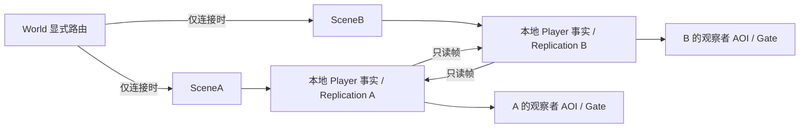
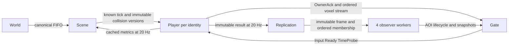

# Movement module map

2026-09-19 工程整改：Scene 的默认消息出口改用 `MmoContracts.Session.Outbound`。
此前引用无 Mix 依赖的 `GateServer.Session.Sink`，使复制测试只能依靠 umbrella 的额外代码路径运行。
依据 OTP 进程消息契约，原 `mmo_reliable/mmo_datagram/mmo_close` 元组和身份语义保持原样；
公共契约只投递，Gate 继续拥有编码、传输和队列。既有 Sink 调用委托同一实现，不复制规则。
测试 helper 不再默认建库或启动 Horde，只有数据库与路由用例显式准备对应资源。
调用 World 编排的 `voxim_neighbour_nodes` / `voxim_transfer` 已迁至 World app；Scene 测试
不通过 umbrella 附带代码路径加载反向依赖。冷生成测试复制参数到临时 manifest 并移除旧世界
钉住版本，以当前 kernel 创建新世界，仍比较原有几何字节金样。

M3 keeps the shared P1/Rapier kernel and the M1 wire contract. `Scene` owns
canonical collision publication and the public 60 Hz clock. Each `Player`
owns one authenticated identity's InputSlots, state, simulation tick and ACK.
`Replication` consumes immutable Player results and distributes frames to four
workers, each owning a disjoint set of observers' derived AOI relations.

2026-09-18：InputStart 保持 Hello13 的 `origin=anchor+30` 冻结合同。
用已有 `Clock.sample/1` 检查起点是否仍留有协议规定的8tick预测提前量；
过旧的碰撞发布先沿正常路径追上，再发送InputStart。历史anchor、碰撞revision与状态
仍取已消费的真实历史；不重写历史、不跳输入号，不隐藏客户端reason=7。
依据是本模块既有公共Clock契约和两端Session codec的InputStart约束。
Voxim `snow-03` 中 anchor=181541、origin=181571，而发送时公共时钟已约181572；
`Saved/R7/Harness/astra-clock-red-20260918-01` 的受控排队复现旧版 origin=32 落后公共120，
初次公共时钟直接签发origin的实现被真实客户端以reason8拒绝（`astra-clock-clay-01`），
因此已改为在合同内等待追上。`astra-clock-contract-green-20260918-04`覆盖旧发布暂不签发、
追上后合法签发、真实Session codec往返及既有历史输入恢复，5项Player回归通过。

## M4a 邻区只读复制增量

两个 Scene 可引用同一个远端 Canonical World。Scene 的快照 worker 用
`Node.spawn_monitor/2` 在 World 所在节点调用公开快照 API；GeneratedStore 的
ETS / 原生计数器留在源节点，Scene 只接收不可变 canonical artifact 并独立构建碰撞。
冷 region 的双节点回归覆盖此边界；已生成的同机磁盘缓存不能证明跨节点生成正确。

`WorldServer.Movement.connect_neighbours/2` 通过现有显式路由读取两个已初始化
Scene 的 `neighbour_endpoint/1`，核对 Scene 身份、代际、内容版本与角色配置后连接。
Scene 公开复制 PID 和 tick 零点的服务器时间；原始 monotonic 值不跨 VM 相减。
`Clock.translate_tick/2` 将源的历史 simulation_tick 转到观察者时间线，向下取整，
不以收到消息时的 tick 替代源状态年龄。

Player 仍按 20 Hz 产生不可变结果；Replication 在既有 60 Hz Scene tick 检查已到变化，
有新事实才合并构帧，本地事实或移交桥变化才向邻区发送完整帧。普通邻区导入只更新本地
AOI 候选，不回声转发。邻区记录不成为本地观察者，也不进入 Player/碰撞路径。
源的完整帧缺失实体时，本地 AOI 发出 Leave；旧帧被源 tick 水位拒绝；复制端点
monitor 结束时清除其全部派生事实。canonical 源失败导致 Scene 停 Tick 时，
Scene 显式关闭邻区通道；复制端点仍可观察，但迟到帧不能恢复已关闭的邻区。
控制面连接操作不参与逐输入热路径。

本增量已部署至在线 Demo，在同主机两个独立 BEAM VM、真实双 UE/QUIC/P1 上往返移交。
相同 L0/profile/World 使用显式公共 tick 零点，连接后 prediction travel 取两区并集，
authority 保留各自半开分区。Player 越界停步，Gate 按同发送者顺序 seal，目标使用本地
共同基线加源 checkpoint 重建历史碰撞，并导入纯 InputSlots，Ready 前不积分。
源切点之后已发布的碰撞版本保留其原 apply tick；目标的当前 N/R 可以领先或落后。
迁入 Player 接续 Replica 的有序 canonical tail，后续版本在源已发布 fence 之后生效；
普通 Player 继续共享 Scene 的碰撞发布。Replica 是节点本地只读物化视图，World 仍独占写入。
源停止后释放，目标才激活，不传 NIF resource。Replication 搬移观察者缓存并保留
generation，源最后本地产生的切点桥持续导出到目标首帧，远端 ghost 不再次导出。
同机共享系统时钟只覆盖本轮实验，跨机器偏差与漂移未验收；进程发现不代表
授予角色写权限。`transfer_cut` 到 `transfer_resumed` 的同机 system-time 锚点测量完整停步区间；
`transfer_prepared` 记录导入耗时与 checkpoint 字节。实际验收结果见下面的运行记录入口。
入口、依据与记录见同级 Voxim 的 `Docs/M4a/README.md` / `plan.md`。

历史表示参考 [PostgreSQL snapshot + ordered transaction stream](https://www.postgresql.org/docs/16/logical-replication-architecture.html)
和 [RocksDB immutable checkpoints](https://rocksdb.org/blog/2015/11/10/use-checkpoints-for-efficient-snapshots.html)：
仅借用共同基线与不可变增量原则，跨节点不传原生句柄，也不重跑 canonical 规约。

## Production composition and routes

`SceneServer.Application` starts the configured `Scene`. Scene starts its own
linked DynamicSupervisor for temporary Players and one linked Replication
dispatcher, which starts four linked ReplicationWorkers. Scene exit invalidates the Players; a Player failure closes its session
without restarting from a Gate or AOI snapshot. Configuration remains the
explicit D1 `voxim-m1-demo-v1` asset export; no profile or terrain defaults
were added. Each join reserves a spawn probe and consumes only the authorized
character ID, never a saved position.

`Scene.join(scene, identity, character, gate)` returns `{:ok, player_pid}` or
`{:error, :closed}` after queuing the existing close reason. Gate stores the
returned route and calls `Player.input/3`, `ready/4`, `time_probe/3` directly.
`Scene.leave/3` removes membership; old identities cannot remove a rejoin.
The listener orders old leave before new join and allocates a new identity.

## Timeline and fixed steps

CollisionUpdates consumes the existing ordered transaction/marker FIFO,
installs at most one occupancy transaction per public tick, and publishes
`{tick, revision, readonly_world}`. The NIF setter returns a new immutable
world. Scene sends each completed prefix asynchronously, never waits for a
Player step, and can then retire its old resource references. Each Player
retains and retires its own exact historical versions. A stalled player can
therefore replay R while another player queries R+1. Versions in a delayed
mailbox also retain their references until that prefix is consumed.

Hello33 finalizes every elapsed InputSlot within the known canonical collision prefix.
Missing continuous axes hold the last real sample for 3 ticks, then become zero;
yaw holds and jump is never synthesized. Late frames cannot rewrite finalized slots.
Gate stamps trusted ingress time before Player queuing. Same-node stamps use monotonic
time; cross-node stamps use the existing server-time mapping (cross-host clock error
remains outside the measured same-host scope). A frame must precede its deadline AND
reach the owner before that slot is finalized; earlier Gate time cannot undo a cut.
ACK processed_input_seq is a final slot watermark, not proof of receiving a real command.
substituted_through_seq records the latest substituted slot; per-frame logs distinguish
received/held/neutral/late. Physics time is never created by packet count.
Joining zero-input physics remains
the existing explicit pre-InputStart behavior. Ready confirms the exact
bootstrap N/R; after TimeProbe and joining physics catch up, InputStart
freezes origin=anchor+30. No state or ACK is emitted for a future unknown
collision prefix.

`Clock` owns integer microsecond-to-60Hz conversion and deadlines. TimeReply
pairs server time and clock tick from the same monotonic sample, including
when an old queued probe resumes after a Player pause. This clock estimate is
separate from the published collision watermark used to authorize physics.
ACK continues every third known public tick, with distinct world and actual
simulation ticks. A completed input arriving between those opportunities is
acknowledged at the next one. Bootstrap, transactions, CollisionApplied and
TimelineFence for one identity all originate from its Player in order.

The runtime follows OTP's independent process ownership and same-sender
signal ordering described in [OTP processes](https://www.erlang.org/doc/system/ref_man_processes.html)
and [DynamicSupervisor](https://hexdocs.pm/elixir/DynamicSupervisor.html).
There is no cross-player barrier or physics RPC through Scene. Cross-sender
arrival at Replication is allowed: a publication can use the latest already
received result without pretending a slow Player reached the new public tick.

## AOI and observation

AOI remains a pure 32m-grid, 30/34m-hysteresis algorithm. Input entities carry
actual `simulation_tick` and `collision_revision`. EntityEnter anchors its
state at that actual tick. Snapshots group records by their actual tick and
preserve each record's revision. Replication validates results against the
current member route and ignores older simulation results; removed identities
cannot be revived by delayed results. Gate batches compatible records using
the existing codec and the negotiated complete-datagram byte limit.

The 200-player ramp exposed repeated per-observer sorting and rebuilding in
this derived path. AOI now reuses sorted candidates per occupied grid cell,
retains each observer's sorted relation keys until membership changes, and
builds actual-tick groups directly. Lifecycle and packet order remain equal
to the prior algorithm. Lists accumulate by prepending and reversing once,
following the [Erlang list handling guidance](https://www.erlang.org/doc/system/listhandling.html).
The isolated `Docs/M3/tools/aoi-run.py --out <directory>` benchmark in Voxim
compares the saved prior algorithm and checks mixed ticks, leave and reconnect
equivalence. It also drives the real Replication owner and Gate sink into
200 receiving processes at 20 Hz; codec, QUIC and shared live physics load
remain the responsibility of the real load run.

The live 200-player rerun still overloaded a single relation owner. Per M3's
observer partition, Replication builds the shared immutable spatial frame
once per changed publication and sends it to four workers. P1 checks pending
facts on each existing 60 Hz Scene tick: a result arriving after its 20 Hz
Player opportunity waits at most until the next Scene tick, without a barrier.
No-change ticks skip frame construction and output; separately phased arrivals
can produce up to 60 periodic publications per second, whose cost requires live
measurement. Explicit first-frame flushing on target activation is unchanged. The
Scene's consecutive entity epoch modulo four assigns each observer to exactly
one worker; database entity IDs in the real 200-player sample occupied only
two modulo-four buckets. Each worker owns
its relations, generation counters and Gate routes; all targets remain visible
to each partition. Join, frame and leave originate from the dispatcher in
order. Leave reaches every partition and deletes both target relations and
the departing observer. No worker waits for another worker or Player. The
dispatcher rejects removed routes' stale results before building any frame.
Normal Scene termination stops its Player supervisor and replication root;
normal dispatcher termination stops its workers; linked failures propagate.

The 32-scheduler isolated sink benchmark measured 200 mixed-tick p95 of
18.14/10.31/6.84/5.43 ms for 1/2/4/8 workers. Four is the fixed production
choice; eight saved only another 1.4 ms while doubling frame copies. This
measurement does not establish live capacity. `Replication.metrics/1` returns
dispatcher and worker `pid`, `message_queue_len`, `memory`, and `reductions`
through `Process.info`, without worker calls or relation enumeration.

`Scene.observe/1` and `metrics/1` return the public tick, collision FIFO/build
metrics and cached 20Hz character facts. Character fields include identity,
entity ID/epoch, `player_pid`, `gate_pid`, state, origin/simulation ticks,
processed sequence, pending count, collision revision, cumulative physics
steps and step microseconds, and `published_tick`. These are cached facts,
not a guarantee every Player finished Scene.tick. Scene aggregation does not
synchronously call Players or enumerate all AOI relations. `Player.observe/1`
provides one owner's instantaneous values; `Replication.observe/1` explicitly
returns the complete diagnostic relation view when required by a test.

Scene `region_tick` timing now measures public collision publication rather
than whole-scene physics. Player cumulative `step_us` brackets its synchronous
NIF calls, including dirty-scheduler wait and return; it is not kernel CPU time.
Input rows remain DEBUG; lifecycle and one Scene summary per second remain
INFO. Default observation never serializes occupancy or collision resources.

## Targeted verification

The sibling Voxim `Docs/M3/tools/test-player.exs` runner compiles current
modules into an isolated VM and loads the existing production P1 NIF, without
booting the umbrella or touching the live Demo. Tests use public routes and
explicit diagnostic waits instead of adding a production synchronization
barrier. `runtime_observation.exs` centralizes those test-only waits.

`voxim_player_test.exs` pauses P for approximately 400ms while Q consumes 24
real commands across R to R+1, then compares P's recovery exactly against a
per-tick serial native baseline. It also covers duplicate jump suppression,
unknown future prefixes, reconnect/crash isolation and queued TimeProbe clock
pairing. Scene, collision timeline, AOI and Gate tests cover their changed
seams. Real two-UE and load acceptance are recorded in sibling Docs/M3; test
success alone does not establish 200-player capacity.

## 2026-09-29 工具命中人物（Hello35）

Global system：`ToolAction` 在既有 Gate 请求 worker 中编排；`Player` 授权工具身份，`ToolHit` 对当前权威移动胶囊做人物部位求交，World 检查 canonical 遮挡和共用工具频率，目标 Player 去重并提交既有 Body 外伤。没有第二份 HP。查询只为指定目标生成 Body 报告，候选扫描仍为 O(N)，没有容量验收结论。

Test-only：只有显式配置 `test_combat_bounds_m` 的场景允许范围内互伤，未开放正式 PvP 或击杀奖励。详细协议、边界及真实双端验证见同级客户端仓库 `Voxim/Docs/Gameplay/ToolCombat.md` 和 `ToolCombat/QueryOptimization.md`；火球伤人、治疗与恢复验收留后续。

## 2026-10-05 投射物身体热交付（Hello37）

Global system：World 的触散飞行每轮经 WorldServer 查询当前 Player 胶囊，ToolHit 复用球半径膨胀胶囊求交。World 冻结命中与焦耳，Player 接纳后把焦耳送进原 Body 局部组织 pending 热；没有新 HP、机械伤或击退。`projectile_hits` 与完整身体同笔持久化并随 Scene 移交，新 owner 重投已入账命中只返回原收据；旧会话/生命的新命中拒绝。Session ProjectileHit 供双方关联同一球、事务、人物生命与金额；本人承伤继续从正常 BodyState 推导。完整边界、测试与实际镜像见 `docs/10-active/magic/cast-phases-2026-10-05.md`；正式双客户端验收由 Voxim `Docs/Magic/CombatProjectile-plan.md` 记录。

## 2026-10-08 角色世界意图唯一入口（能力库 I1）

Global system：`Intent.run/3` 是角色世界意图（工具、生产 1..5、附件、prefab 放 / 拆 / 换、发布）的唯一执行入口，
无进程无状态；玩家的 Gate 编辑 worker（`GateServer.Session.Dispatch`）与 NPC Body 的 FIFO worker 都只调它，
交来与 `Codec.decode/1` 同形的 `{kind, request}` 和意图到达入口的时刻（`received_us`、`clock_node`）。
工具走 `ToolAction.run/5`（`authorize_tool`），其余走 `Player.tool_context/2` 再进 World 公共 API；结果原样返回，
另附“是否补发余额”（工具 action 1 / 2 且 granularity ≠ 5；生产 / 附件 / prefab 仅角色接纳通过；发布不补）。
`tool_context` 在施法互斥之后加死亡门（`:dead`），施放 action 1 遇死亡也回 `:dead`（原为 `cast_too_soon`）；
World 写意图与发布的 refresh 回调同一函数，所以“授权后、提交前死亡”同样得到 `dead`。同一函数也是 NPC
技能上下文与 `design_house` 刷新 actor 的来源，死亡期间 NPC 技能无法开始，进行中的设计会话以 `dead` 结束。每次调用一行
`character_intent kind= cid= client_seq= request_id= elapsed_us= action= tool= g= result=` 日志（action / tool / g
用 `Map.get` 读，prefab 与发布留空），取代无解析方的 `voxel_tool_dispatch`。
例外：NPC `design_house` 技能的发布仍直接调 `PrefabDesigner.publish/3`（死亡门与施法门经 `World.publish_prefab`
内的 `actor.refresh` 生效，设计稿 §7.7），不经 Intent，也没有 `character_intent` 行；NPC Body 在进 Intent 之前拒绝的
命令（类型守卫 `invalid_command`、位置未知 `invalid_session`、编辑盒 `out_of_bounds`）记 `npc_intent_rejected`。
`ToolAction.public_receipt/1` 是身体回执的公开投影，玩家 ToolState 与 NPC Outcome 共用。设计与测试矩阵见
`docs/10-active/cross-cutting/2026-10-07-character-capability-library.md` §7、§11；I1 合入时为“已实现、未实跑”，
玩家路径的真实双客户端核对放在该稿的最终实跑。

## 2026-10-08 施放的公共入口（能力库 I4）

Global system：`Player.cast_spell/5` 是施放（0x82 action 1）的角色 owner 入口，把请求异步排进与 `spell/4` 同一处理
（玩家 Gate 的 `Dispatch` 与 NPC Body 是仅有的两个调用方）。函数头要求 `ingress.caster_recipient` 与 `reply_to` 都是
`{pid, tag}`：前摇、授权与 World 结算不变，结算、立即拒绝、取消与会话结束都以 `GenServer.reply(reply_to, 结果)` 回给
调用方，成功结算的施法者状态由 World 先发 `{:mmo_spell_reply, ref, request, reply}` 给 caster_recipient。施法不经
`Intent.run/3`（同步入口会让调用方等前摇）。报价 action 0、取消 2、改向 3 仍同步走 `spell/4`。只在流送 Scene
（`authority_ref` 非 nil）可用。

## 2026-10-08 碰撞基线前的 timeline（NPC 落位 M3）

Global system：Player 在碰撞基线装好之前（非流送：Scene 发来的 `{:anchor, ...}`；流送：首个 `CollisionStream` 窗口）
收到的 `{:timeline, ...}` 只推进公共 tick，不摄入其中的版本、事务与食物收据。依据：Scene 的 `tick/1` 在同一 tick
先向全部角色发 timeline、再由 `anchor_join/3` 发 anchor；anchor 携带 Scene 该 tick 的完整派生碰撞（`anchor_join` 断言
marker 的 seq 等于已消费的 seq），由 Player 整体替换 `updates`，快照本身拥有全部历史收据。入场时 Scene 交给 Player 的
`updates` 只是模板：Scene 尚未装好初始快照时它是 `CollisionUpdates.new/1` 的空值，不是发布序列的前缀。
旧实现把基线前的 timeline 交给 `CollisionUpdates.ingest_publication/6`，Scene 初始化后、该 Player anchor 前一旦发布含
chunk 的事务（夹具在 Body 入场前写入作者样本即可触发），`record_artifact/3` 取 `artifacts[revision - 1]` 得 KeyError，
Player 崩溃、会话按原因 3 关闭。流送 Scene（正式 Demo / 青岚，`collision_window_radius_tiles` = 1）原本就在基线前只推进
tick，且其 FIFO 由首个窗口 `initialize_stream/2` 初始化，不受影响。回归：`voxim_scene_test.exs`
“join before the initial snapshot: a transaction published before the anchor is carried by the anchor”。
