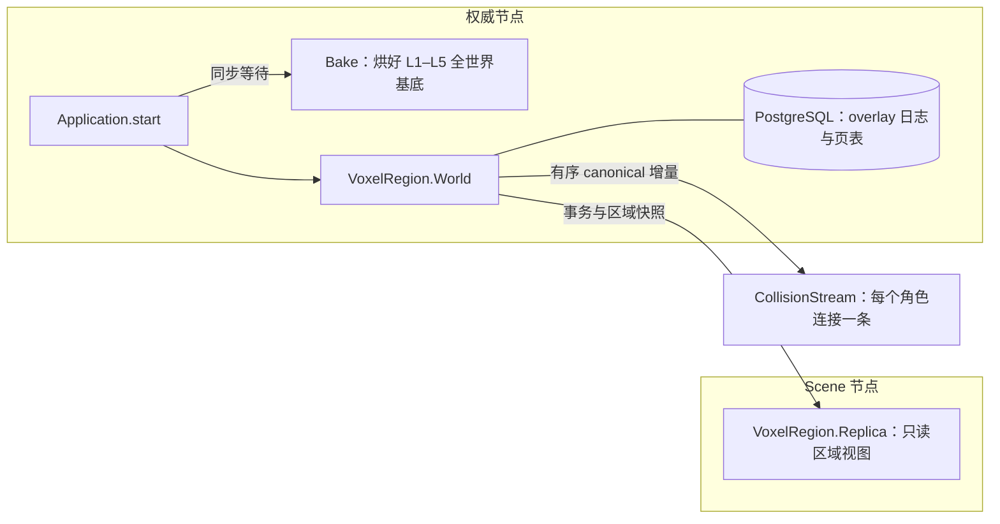

# voxel_region：体素世界的唯一真值

本应用拥有 Voxim 体素世界的权威状态：地形、细化格、附件、预制件实例、有限液体、温度与损伤等属性，以及受保护区域。
世界的真值 = **基底**（按世界生成规则在线生成或离线烘焙的 region 载荷）⊕ **overlay 日志**（之后每一笔已提交的修改）。
所有修改都经同一个进程 `VoxelRegion.World` 提交；其他进程拿到的都是它派生出来的只读视图。

本文件只描述**当前结构**。演进过程与执行记录见 [变更与执行记录](../../docs/10-active/voxel-authority/voxel-region-change-notes.md)
和各专项的 execution-plan。

## 怎么读这个应用

1. 本文件：应用由哪些部分组成、各自负责什么。
2. [World 子系统](lib/voxel_region/world/README.md)：一个请求在 World 里怎么走、各子模块管什么、必须守住的不变量。
3. `VoxelRegion.Access`（`lib/voxel_region/access.ex`）：谁能改世界，一张表列全。

## 进程与启动

- 配置了 `:root` 的节点是**权威节点**：先跑完 `Bake`（基底未齐全前应用不完成启动，依赖它的 Gate 不开始监听），
  再启动 `World`。
- 配置了 `:replica` 的节点只启动 `Replica`，不启动第二个 `World`。

## 模块地图

| 分组 | 模块 | 负责 |
|---|---|---|
| 权威 | `World` 与 `world/` 下的子模块 | 唯一写者：接请求、装页、裁决、提交、模拟推进。详见 [World 子系统](lib/voxel_region/world/README.md) |
| 授权 | `Access`、`Protection` | `Access` 定义谁能做哪类动作、能改哪些格；`Protection` 只回答“这格归谁” |
| 基底来源 | `GeneratedStore`、`FileStore`、`Native`、`Bake`、`AssetPack` | 在线生成或读取离线烘焙的 region 载荷；`Bake` 是启动就绪门 |
| 持久化 | `OverlayLog`、`LogProjection` | 事务日志的追加、回放与空间投影 |
| 派生视图 | `Replica`、`CollisionStream`、`CollisionSource`、`CanonicalFeed`、`PropertyObservation` | 给 Scene 与客户端的只读投影；不持有世界真值 |
| 几何与内容 | `Prefab`、`Attachments`、`RefinedSlots`、`Structure`、`Reducer`、`EpochChunk`、`Blueprint`、`EditBounds` | 预制件、附件、细化格与粗层规约等纯计算 |
| 物理 | `Thermal*`、`Liquid`、`Phase`、`Combustion`、`Transform`、`Circuit`、`DCNetwork`、`Climate`、`BodyContact`、`Damage`、`ParameterEvolution` | 热、液体、相变、燃烧、电路与损伤规则；纯函数或可丢弃的派生缓存，结果由 World 提交 |
| 坐标 | `Spatial` | 宏格 / 微格 / region 尺寸、最大层级与 `region_of/1` 的唯一定义 |

## 坐标与分页约定

- 一个**宏格**是 1 m³，坐标是整数 `{x, y, z}`（Y 向上）；一个宏格可细分成 `Spatial.micro_resolution/0`³ 个微格。
- 一个 **region（页）**是 `Spatial.region_size/0`³（64³）宏格的 core；载荷另带 1 格邻环。
- 层级 L0 逐宏格，Lk 每格覆盖 2^k 宏格，到 `Spatial.max_level/0`（L5）为止。L1 以上由 L0 逐级规约而来。

## 观察入口

- `VoxelRegion.World.stats/1`：缓存、页表、驻留、模拟进度的计数（不扫描数据）。
- `VoxelRegion.World.residency_status/1`：页驻留与退休状态及阻退原因。
- `VoxelRegion.World.admission_status/1`、`simulation_windows/1`：请求接纳队列与模拟窗口。
- 结构化日志：`voxel_region transaction`（每笔提交）、`world_access_denied`（授权拒绝）、`voxel_page_retire_blocked`（退休被阻）。

## 授权：谁能改世界

“谁（主体）能做哪类动作、能改哪些格”只在 `VoxelRegion.Access` 定义，该模块文档里一张表列出全部规则。
World 在 `handle_call` 入口对每个请求调用 `Access.admit/1`：消息未登记或主体无权时直接拒绝，并打一行 `world_access_denied`。
原始格编辑（`apply_edit/4`、`apply_edits/3`）显式携带主体：玩家会话的 `{:character, cid}` 一律 `forbidden`；
创世 NPC 的 `{:genesis, cid}` 受保护区约束；运维默认 `:operator`，不受保护区约束。

新增 World 消息时，必须在 `Access` 的 `@messages` 里给它选一个动作类，否则 `test/access_test.exs` 变红。
设计见 [统一授权设计稿](../../docs/10-active/cross-cutting/2026-10-30-server-authorization-design.md)。

## 已知限制

- 正式世界（`GeneratedStore`）上页退休整体被阻断：热模拟对未登记的天然活动返回 `natural_activity_unregistered`，
  已装入的页要到进程重启才释放。解除依赖“天然初态登记”，已排在 Weather 阶段。
