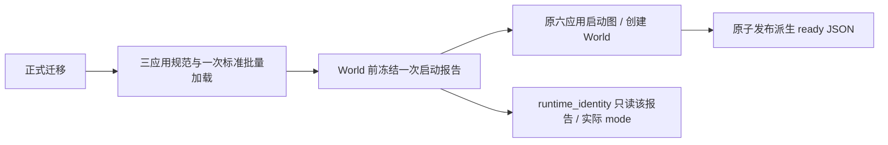

# paging_m0 — 区域分页 M0 规模与尖峰基准（只测试 / Test-only）

决策稿：[`docs/10-active/voxel-authority/2026-10-24-world-region-paging.md`](../../../../docs/10-active/voxel-authority/2026-10-24-world-region-paging.md) 的 M0。
本目录不进任何发布产物，只服务 M0（以及 M1、M3 之后的复测）。

## M0 启动代码条件（2026-10-28）

新启动 profile 为 `m0_manifest_ready_v1`。`boot.exs` 先完成正式迁移，再调用
`code_ready.exs` 的唯一 `M0CodeReady.prepare!` 边界，最后按原顺序启动六个应用。
该边界要求 `VoxelRegion.World` 尚未创建，正常 `Application.load` 三个目标应用的规范
（只接受成功或同应用 `already_loaded`），从**目标 VM 实际规范**读取版本及完整 modules，
冻结去重集合，并且只调用一次标准 `:code.ensure_modules_loaded/1`。三应用集合只在 helper 定义：
`voxel_region / mmo_contracts / data_service`；不扫依赖闭包、不手编动作模块、不改变 VM mode。
正常 NIF `on_load` 初始化属于此启动阶段，与旧 d 干预要求 NIF 预先 loaded 的条件不同。
缺失／非法规范、模块或 NIF 加载失败、返回成功但仍有模块未 loaded，都会中止启动，不发 ready。
失败可能已加载部分模块；应结束该隔离 VM，不重试、跳过或卸载回滚。



启动报告由 helper 在 World 创建前写入一次 `persistent_term`，运行期只读，不更新或清除；
`runtime_identity.exs` 的 `startup` 就是 `m0-ready.json.code_ready` 的同一报告，另读回当前
`:code.get_mode()`，不另建应用名单或重新推断代码就绪。报告保存 PID、node、UTC、实际 mode、
三应用版本／完整 manifest／规范接纳结果、批量加载结果、前后 loaded 元数据与阶段单调时间。
ready 另保存迁移、各应用启动及发布的时间事实，能直接确认 code-ready 先于 voxel_region 启动。
`m0.start` 经 `validate_ready` 在 JSON 边界接纳这些事实，返回明确 `startup_profile/code_mode`；
缺 profile 或不合格的新 ready 会显式失败，不把旧版三字段 ready 当作本 profile 成功。

依据 [OTP 29.0.4 code API 源码](https://github.com/erlang/otp/blob/OTP-29.0.4/lib/kernel/src/code.erl)、
[Application.load 文档](https://elixir.hexdocs.pm/Application.html#load/1) 和
[persistent_term 文档](https://www.erlang.org/doc/apps/erts/persistent_term.html)：批量加载只补未加载模块，
并允许正常 on_load；应用规范加载本身不保证 BEAM 就绪。启动事实读多写一次，避开运行期替换
全局 term 的 GC 代价。M0 仍是 Windows 无 Gate 的 probe/compatibility，只有所列三应用的代码
条件，不能称完整 release 等价，也不能外推正式主节点或 Scene peer 的实际 mode。

旧 a/b/c/d 和原 interactive 首加载数据完整保留。新 profile 改变了代码准备条件，后续原备份／
单窗口／原坐标动作须独立标记；不把旧 d 的关联结果或本次纯测试称为自然 cold 性能胜利。
20GiB host available 精确自有树护栏、单回合 300ms／装页中位 220ms 门禁不变。
不添加 World 强制 GC、heap 参数、暖场编辑、物理暂停或新 authority。

最小反例入口（仓库根）：`elixir.bat --erl "+S 1:1" apps/voxel_region/bench/paging_m0/test_code_ready.exs`
与 `python -B -m unittest discover -s apps/voxel_region/bench/paging_m0 -p test_m0_ready.py -v`。
前者只用受控规范／loader／loaded／World 是否已存在回调，证明 prepare 边界的失败、去重一次加载和不可改写报告；
后者通过真实 `m0.start` 配合假的 OS、子进程与 ready，证明新报告接纳和旧／缺失／失败／反序报告拒绝。
两者不启动 Mix、项目应用、NIF、数据库或 World，不改写 boot AST，不证明真实 boot、NIF 初始化、
正式恢复、首笔成本或完整八窗；这些留给同一新 profile 的正常启动与后续根级验证。

## 组成

| 文件 | 职责 |
|---|---|
| `m0.py` | Windows 原生部署控制端：`start` / `stop` / `status` / `rpc` / `osmon`。部署目录内私有 `m0-env.json`（含测试密钥，不提交）给出节点名、cookie、调度器数、隔离 PG 与全部运行时环境变量 |
| `boot.exs` | 启动组合：正式迁移 + 除 `gate_server` 外的全部应用（quicer 只在 Linux 构建；M0 不接客户端） |
| `probe.ex` | 节点内采样器 `VoxelRegion.Bench.M0Probe`：每秒节点内存 / World 堆与 mailbox / 调度器利用率；`:sys.install` 计 World 回合；system_monitor与PG telemetry；历史 `field_heap/0` 名称仅返回现有stats与进程元信息，字段拆分明确unavailable |
| `load.ex` | 负载驱动 `VoxelRegion.Bench.M0Load`：N 个活跃窗口，各 = 一个先登记模拟窗口再经 `canonical_snapshot_and_subscribe` 的长期订阅者 + 一个经作者入口 `apply_edits` 交替放 / 挖的编辑者；`activity` 每窗口加水与热源，`circuit` 每窗口加热电石 8 格环与热源 |
| `run_m0.py` | 一轮编排：还原隔离库 → 启动 → 空闲段 → 逐级 N 窗口 → 收集证据 → 停机；`--activity` / `--circuit` 活动负载，`--spacing` 窗口间距（< 186 m 为重叠） |
| `install_copy.py` | 冷内容份数轴：经 `World.parcel_install` 把同一份如园装到远处（key 带 tag，幂等） |
| `summarize.py` | 把 `M0Probe.snapshot()` 摘成可读表 |
| `compare.py` | 多轮 run 目录的冷内容份数对比表（启动、空闲字段堆、各级吞吐 / 延迟 / 阶段、World long_gc、OS 峰值） |
| `equiv.py` / `equiv.ex` | M2a 迁移等价：还原 M2a 之前的库 → 启动（旧日志全量回放，首个切点即迁移）→ 迁移切点发布前采集 A → 发布后停机 → 按页恢复再启动采集 B；比较原始真值逐字段摘要（判定器 a）与每个页存在的区域的正式读取载荷（去头部 seq，判定器 b）。自带内存看门狗 |
| `migrate.py` | M2b 重启基准的前置：还原 M2a 之前的 dump → 启动（迁移切点）→ 等发布 → 停机；之后 `run_m0.py`（不带 `--dump`）的启动即“有前缀的重启”（按需装页），其 startup.json 为重启就绪 |
| `reinstall.py` | 同页反复安装轴：同一份如园按原位再装 N 遍，每遍后重启量冷启动与空闲字段堆（`--skip` 跳过不能原位重装的批次） |

## 数据与隔离

2026-10-27 内存观测修正：旧 `field_heap` 用 `:sys.replace_state` 在World内计算小摘要，但系统调用仍把完整state作为回复传到RPC进程。
OTP官方的返回合同与小型自有GenServer trace反例确认该复制通道；这不能用于运行authority的无扰动测量。
现入口只调用已有 `World.stats` 和 `Process.info`，同时给出node内存；不增加生产全state扫描或任意回调口。
`field_breakdown.status=unavailable` 明确禁用原因，报告不把缺失字段／旧top25之外字段填成0，也不把字段平铺尺寸相加当真实堆。
`total_heap_mb`／`process_memory_mb` 的历史键名保持，数值单位为MiB；OS RSS／peak working set另计，不能混作活对象字节。
`run_m0` 将snapshot、load与前后诊断写入 `phases.jsonl`，全轮OS最大值仍保留，必须按阶段解释。
旧r118／r130原始证据不改写；结束诊断污染不代表真实快照准备／提交p99已通过。单回合300ms和装页中位220ms目标不变。

对应轻量反例：本app `mix.bat test --no-start --no-compile test/m0_probe_safety_test.exs`；仓库根
`python -m unittest discover -s apps/voxel_region/bench/paging_m0 -p test_compare.py -v`。
两者只证明诊断运输／报告口径，不证明真实M0内存已下降。`--circuit` 的旧circuit_totals与独立equiv采集还有sys全state返回路径，
本轮内存复现不调用这些路径；它们需按各自公开读取合同另行修正，不能把本次probe修补推广成所有诊断已安全。

- 世界数据只来自 `D:/hemifuture/Backups/ruyuan-20261024/` 的 dump，还原到隔离 PG（容器 `voxim-pg-paging1024`）。
  如园源世界与演练副本全部只读（见 kickoff“如园保护”），本目录脚本不连接它们。
- 生成缓存目录是演练副本 `world/` 的复制品，归本部署所有；parcel 导出件从备份 tar 解出。
- 证据写到 Voxim `Saved/Playtest/paging-20261024/runs/<run>/`。

## P6 模拟资格与验证

普通 canonical 观察订阅不会授予模拟资格。每个长期订阅者在自己的进程内同步调用
`World.set_simulation_windows(World, [box])`，收到接纳回执后才准备快照；`box` 直接复用
`CollisionStream.box/2` 算出的完整 XYZ L0 盒，一圈页外扩仍由 World 唯一维护。
编辑者与活动夹具安装进程不登记来源，避免多个窗口互相替换，或临时 RPC／Task 退出后资格立即退休。
活动夹具先经作者入口安装，随后由窗口登记唤醒已有液体前沿，再进入快照与稳态编辑测量。

截止时间与 `stop/0` 沿既有退出路径结束订阅者，World 通过来源 monitor 的 DOWN 退休其模拟资格；
保留 ETS 报告的负载父进程不持有窗口。`stop/0` 的 `stopping` 只表示请求已发出，不能当作退休完成。
登记开销计入 `start/1` 总耗时；快照 `us` 继续只计准备与接收快照，新增 `simulation_source` 供来源身份核对。

复测时经现有 `m0.py rpc` 对同一隔离部署读取 `VoxelRegion.World.simulation_windows(VoxelRegion.World)`：
活跃期应有 N 个来源，每个来源恰好对应 `M0Load.report()` 快照行的 `simulation_source` 与启动报告中的 XYZ 盒；
重叠页只计一次。带 `--activity` 时还需核对 `World.liquid_activity/1` 与既有液体提交日志确有推进，不能仅以编辑吞吐判断活动负载。
停止／截止后等只读报告中本轮来源全部消失，再开始下一轮；按可观测条件等待，不增加固定延时。
这些是基准验收步骤，不在负载生产循环里追加门禁或扫描。

## 已知适用范围

- 负载走作者入口 `apply_edits`：覆盖 World 几何提交尾部（规约、后像、结构、碰撞、日志、扇出），不覆盖玩家工具会话、限速与扣料。
- 开发机是 Windows 原生 OTP 29 / Elixir 1.20；演练副本镜像是 Linux OTP 27，两者内存分配器与 GC 行为不同，绝对内存值不可直接对比。
- RPC 只调用一次、失败不重试；探针与负载都是注册名幂等进程，并自带截止时间。
- `run_m0.py`、`equiv.py`、`migrate.py` 都带同一个内存看门狗：系统可用内存低于 20 GB 时只杀当前编排脚本真实进程树内的 erl。
  同时新出现的其他 erl 不属于本轮；阈值保持 `< 20 × 2³⁰` 字节，恰好 20 GB 不触发。BEAM 尚未启动时继续监视，不能提前退掉护栏。
  原始异常继续抛出、不重试；三入口的还原／启动／收尾均在同一个 `MemoryWatchdog` 生命周期内，停止并 join 后记录结果。
  `memory_watchdog.json` 记录 `tripped` 与 OS 异常的 `error.type/reason`，`meta.json` 保留 `memory_watchdog_tripped` 并新增
  `memory_watchdog_error`；触发时保留同名标记文件。无原始业务异常时，护栏错误／触发会令主流程抛错；
  已有还原／运行错误时保留原异常，护栏次生错误仍单独记证据，不能仅凭 daemon 的 stderr 当作失败传播。

## Q5 离线判定

2026-10-28：判定器新增固定29持久字段、目录页／g2-g3身份完整性、采样同seq与A发布前／B冷恢复后资格。
`capture_complete` 必须与原字段、载荷及Q5判定同时通过，双方同样漏字段或页也失败；纯Python16项与既有护栏12项已过。
后续完整采集已接入 `capture_full/3`，当前仍待真实 File 接缝与 1x／4x 验证；旧无身份参数的 `capture/2` 继续拒绝。
不会返回完整World的 `sys.replace_state` 已删除，不用quiet等待、最后resident摘要或两侧共有结果补齐资格。
完整入口产生三份产物：H 在确定序前的冻结 `18f6cb4c52107d2123c19da9948add2a401c370e` checkout
运行原 Observation；A 在当前源码选中切点发布前；B 在当前源码的同切点冷恢复后。旧摘要不含逐身份数值，不能代替 H。

H/A 由唯一 M0 boot 的 `M0_Q5_SIDE` 设置全委托日志包装，在原 PageWriter 初始C0的 `publish` 前等待有期限闸。
`capture_static/3` 等待真实活动、timer/next due、原生pending、投射物/施法等完成事实，不累计quiet秒数。
若自然初始化后的X=C0，直接采用该cut；若X>C0，只一次正常释放确认C0、将同闸绑定X并调用正常compact，采用真正X cut。
旧4x `14699→14700` 事实保留，不再把C0宣称为自然初始化后的X；不人为加序号，不在失败后反复换样本。
World 和物理继续运行，采集 finally 释放真实发布。应用组合根仅允许显式 `:log_backend` 注入，默认仍为原 Db。
首尾及逐页均须同 CV/seq/published；H/A 的 live seq 必须恰等选中cut，B 必须 `seq == published` 且无正在发布的cut和后缀。
R4只证明声明的静态样本迁移；持续活动恢复由R5单独验证。
A/H 区域目录为当前／选中cut自然单元与已有发布页目录的并集（C0发布后P1可退休冷页），B 来自已发布页目录；fragment 用 Pages 的粗区域换算。
每页独立从真实 refined owner／附件槽提取应有身份，再核原 Observation 输出，不能用输出结果构造期望目录。
摘要按既有自然归属逐页合并，包含全部29字段；无发布前缀、仍为全量恢复的H/A另核全体canonical身份目录。
已有前缀时不把部分驻留身份称为全体，完整性由全部页及每页独立canonical身份保证。保留逐身份完整属性和实际payload seq。

```text
python bench/paging_m0/equiv.py <隔离deploy> <新E> --dump <容器内已核dump> --historical-repo <冻结18f6cb4c-checkout>
```

历史 checkout 仅允许应用组合根相同的日志注入一行，CLI 在还原前核 commit、差异和该行原文；不复制、改写历史求和算法。
三个阶段顺序使用本次独占 `paging_q5_` 库，H与A各从同dump新还原，B冷恢复A发布结果；沿正常Mix构建图，保存各源码清单和模块MD5。
H→B 仅按原Q5规则核历史 max_hp 候选；A→B 的字段、载荷和所有属性必须精确，不能借用历史浮点例外。
H的代表点、材质、当前HP等变化仍失败。实际1x／4x尚未运行，不把本接线或Python结果计作R4验收。

本切片最小直接验证是 `python -B -m unittest test_equiv.ThreeCaptureTest test_equiv_preflight -v`
（工作目录本bench，8项已通过）及原首发布 `full_audit` 3个File接缝（已通过）。
静态X新增仅 `test_equiv.StaticCutContractTest` 和 `mix test --no-start test/paging_equiv_capture_test.exs --only static_cut`，
分别检查切点资格，以及公开编辑产生的液体候选经真实tick自然清空、C0→X正常compact与冷恢复；两者已分别通过1项。
原File首红保留：只列live自然单元漏掉已退休的5个coarse overlay；合入发布目录后同例29字段/载荷/属性严格相等。
不重复旧watchdog／无关World suite。
当前可独立调用有限区域采集（在已授权、独占的测试节点内，输出路径必须新建）：

```elixir
Code.compile_file("apps/voxel_region/bench/paging_m0/equiv.ex")
VoxelRegion.Bench.PagingEquiv.capture_regions(
  "D:/hemifuture/ex_mmo_cluster/.demo/observe/<新运行>/regions.json",
  VoxelRegion.World,
  [{0, {0, 0, 0}}, {0, {20, 2, -2}}]
)
```

有限入口全轮固定同一World PID，沿正常serve的prepare pin，在精确请求完成回合计算本页自然字段摘要，
g2/g3只按home／无主anchor归属一次；不返回State、不改World、不注册生产审计API。首尾和逐页必须同seq，
物理进行中、错误或漂移均失败；payload可合法复用旧seq，记录实际 `payload_seq <= seq`，原内容摘要仍去头seq。
失败不会写成功产物，钩子只按本次唯一id清理，保留其他诊断。`paging-region-audit-v1` 明示只覆盖传入区域，
不是全世界 `paging-live-audit-v1`，也不是性能测量；不要与性能窗口重叠。该入口有真实小File World两页退休、
跨页home身份、正常编辑导致漂移及异常/清理反例。测试：`mix test --no-start test/paging_equiv_capture_test.exs`。
证据与剩余资格见 [安全采集切片](../../../../.superpowers/sdd/voxel-authority-sharding/task-s0-q5-safe-collector.md)。

`equiv.py` 的 `compare(a, b)` 读取两侧 `q5.properties`：每个 g=2 部件按完整 owner、g=3 附件按 aid
标识，并保存 Observation 的完整公开属性；`damage_without_max_hp` 沿用现有摘要算法，仅剔除 g=2 的
`max_hp`。旧采集曾预先用 `PageStore.page_keys` 和当前驻留单元列区域，再经正式 `World.serve` 读取；
该做法的覆盖缺口按上段收口，不能再据此声称覆盖有已发布段的冷页与当前后缀。文件保留 content_version、seq 和所有原始属性数值。
`result.json` 逐笔列出 `max_hp_differences`（identity、before、after、delta），即使零差异也输出空列表。
只把 g=2 上限相邻浮点数作为候选例外，其余字段、g=3 上限、当前 HP、原始损伤记录其余字段及正式载荷均需精确相等；
超过一个相邻浮点值保守拒绝，不推断任何差异必然由遍历次序造成。默认 HP 与上限一起变化也会失败，等待明确裁定。
依据 [Python math.nextafter 官方文档](https://docs.python.org/3/library/math.html#math.nextafter)，该操作取得给定方向的下一可表示浮点数，
是本测试侧对“末位”的保守判定，不是通用 epsilon 或第二个求和实现。

从 `apps/voxel_region` 运行 `python -m unittest discover -s bench/paging_m0 -p test_equiv.py -v`；纯输入夹具不启动
BEAM、数据库或基准。它验证允许的单末位差异，以及 HP、丢失／新增身份、其他字段、g=3 和较大差异的拒绝；
不能替代真实 1x/4x 迁移、采集器与完整冷页覆盖的集成验收。

## 看门狗纯测试

契约与依据：按 [psutil 官方源码（本机 7.2.2）](https://github.com/giampaolo/psutil/blob/release-7.2.2/psutil/__init__.py)
的 `Process.children(recursive=True)` 从当前 Python 编排进程取后代，直接在所得 `Process` 对象上 `kill()`，保留 API 的 PID 复用校验。
不用全机进程增量猜归属。基准的 `m0.start` 在节点运行期间保留自己的启动子进程；本次没有引入脱离父进程树的启动模式，
也不声称能发现枚举前已失去中间父进程的孤儿节点。

线程失败交接依据 [Python 3.13 threading 官方文档](https://docs.python.org/3.13/library/threading.html)：线程未捕获异常只交给
`excepthook`，`join()` 等待线程实际终结。这里由护栏唯一 owner 保存原错误，退出时 join 后落证据并交回主线程；
不用全局异常 hook、自动重试或第二套看门狗。

从仓库根运行 `python -m unittest discover -s apps/voxel_region/bench/paging_m0 -p test_watchdog.py -v`。
纯测试用假的 OS 进程树／内存和启动入口失败替身，验证无关新 erl／cmd 包装进程不被杀、真实后代被杀、进程消失竞争、
20 GB 边界、BEAM 启动前仍受监视、停止后的无动作及启动期失败标记。不会启动数据库、BEAM 或基准，也不会结束真实进程。
2026-10-27 证据 `.demo/observe/m2b-hardening-20261027/`：最初误杀／启动期丢标记反例红→6/6；独立 review 又复现
OS 错误仅终止后台线程、两迁移入口还原失败丢标记，新增契约断言红→修补后 12/12。
补充测试实际运行三入口，进程树拒绝时均失败且不启动节点；还覆盖 root／name／kill 拒绝、主次异常并存与干净结束。
这只证明选择和失败证据契约，没有重跑性能基准，也不覆盖任何既有失败数值。
