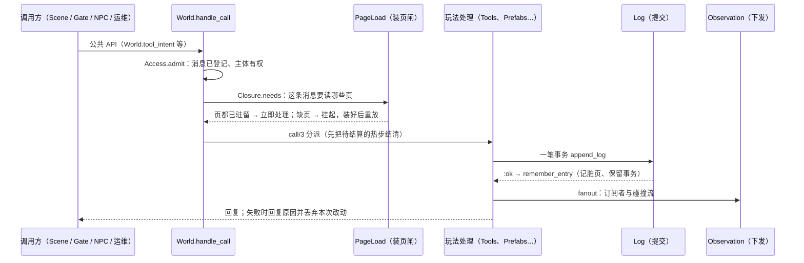

# World 子系统

`VoxelRegion.World`（`../world.ex`）是体素世界唯一的写者：一个 GenServer，持有全部权威状态。
本目录下的模块都是**作用在 World 状态上的函数**：输入是 World 状态，返回新的 World 状态或回复；
它们不自己起进程持有世界数据。少数辅助进程（写回、装页任务、窗口快照发送）只做 IO 或计算，结果交回 World 接纳。

## 一个请求怎么走

1. **入口**：公共函数把消息包成 `{:page_request, ref, message}` 交给 World。`handle_call` 先调 `Access.admit/1`。
2. **装页闸**：`Closure.needs/2` 只按当前状态与消息算出要驻留的页；`PageLoad.gate/3` 发现缺页就挂起请求，
   由装页任务读库后分批交回（`page_stage` / `page_commit`），页齐后按原顺序重放。World 回合内不读库。
3. **分派**：`call/3` 按消息标签进入对应模块。热域有待结算的步时，先 `Thermal.flush` 再处理请求。
4. **提交**：处理函数从 `before` 状态算出新状态和一笔事务，经 `Log.append_log` 追加到 overlay 日志；
   成功后 `Log.remember_entry` 更新页索引、保留事务并唤醒热模拟；失败就回复原因、返回 `before`，不留下半个修改。
5. **下发**：`Observation.fanout` 推给订阅者，`fanout_canonical` 推给每个角色的碰撞流。

模拟由 World 自己的定时消息推进：`thermal_tick`（热）、`liquid_tick`（液体）、`projectile_tick`（飞行体），
结果同样经 `Log` 提交。没有玩家时模拟照常推进（[持续演化决策](../../../../../docs/10-active/voxel-authority/2026-10-24-world-region-paging/continuous-world-decision.md)）。

## 模块地图

| 分组 | 模块 | 负责 |
|---|---|---|
| 入口与调度 | `Admission`、`Clock`、`Closure`、`PageLoad`、`SimulationWindows` | 请求接纳与排队、每条消息的读取闭包、装页闸与装页任务、模拟窗口登记 |
| 提交与持久化 | `Log`、`Interactions`、`PageCut`、`PageWriter`、`CoarseRebuild` | 事务追加与回放；周期性切点把脏页写进 PostgreSQL；离线重建粗层 |
| 页与缓存 | `Pages`、`Residency`、`Cache`、`Payloads`、`WindowSnapshot` | 页索引与脏单元、驻留与退休、有界 LRU 缓存、区域载荷物化、窗口快照 |
| 读取 | `Canonical`、`Observation`、`Canopy` | 权威格读取与材料判定；订阅者视图与增量；树冠派生 |
| 玩法意图 | `Tools`、`Production`、`Prefabs`、`Definitions`、`AttachmentOps`、`Casting`、`Beacons`、`Claims`、`Phases`、`Edits` | 工具、建造与合成、预制件、附件、施法、信标、领地认领、相态操作、逐格编辑批次 |
| 运维与作者 | `Catalogs`、`Parcel`、`Gm` | 目录发布、地块导出与安装、只测试的 GM 施工 |
| 模拟 | `Thermal`、`HeatCommit`、`Liquids`、`Projectiles`、`CircuitGraph`、`CircuitAdmission` | 热步与热提交的世界后果、液体流动、飞行体、电路图与新增连接的接纳 |

想改某类玩法时，从“玩法意图”一行找到模块；想知道某条消息读哪些页，看 `Closure`；想知道它能否被某个主体发起，看 `../access.ex`。

## 必须守住的不变量

1. **唯一写者**：只有 World 进程改世界状态；其他进程拿到的是快照或增量。
2. **唯一提交入口**：每笔修改都经 `Log` 追加，`seq` 单调递增；启动时用同一套规则回放日志重建状态。
3. **先装页再处理**：处理一条消息前，它读写的页都必须已驻留；缺页时挂起，不把“没装入”当成空气。
4. **失败不留痕**：处理函数失败时返回 `before` 状态；只有成功提交的事务才改变世界。
5. **消息必须登记**：新增一条 World 消息要同时在 `Access` 的 `@messages`（动作类）和 `Closure.registered_entries/0`（读取闭包）
   登记，`test/access_test.exs` 与 `test/closure_entries_test.exs` 守住这一点。

## 名词

- **canonical**：权威的格数据（地形材质、细化槽、附件），区别于客户端或缓存里的派生表示。
- **overlay**：基底之上的稀疏修改；**压实**（rebase）把 overlay 并回基底，只改表示、不改内容。
- **切点（cut）**：一次把脏页写进 PostgreSQL 并发布的边界；页只有在切点发布后才能退休。
- **驻留（resident）**：页的内存表示已装入 World；**退休**是释放不再需要的页。
