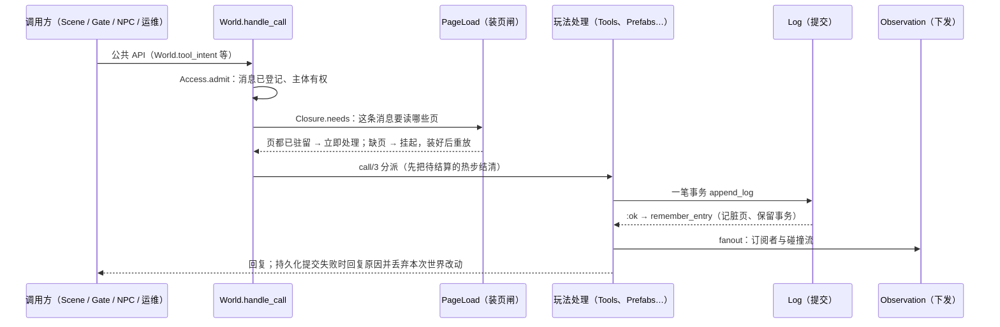
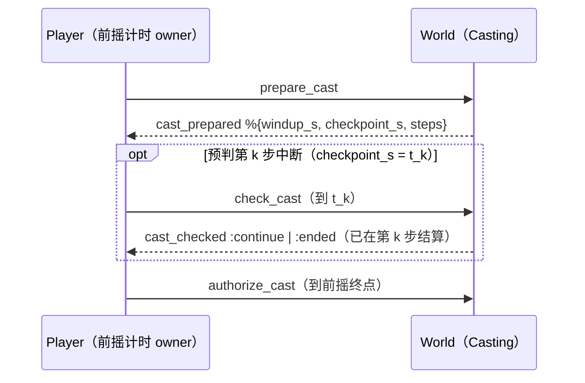
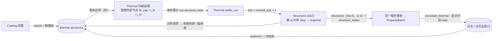
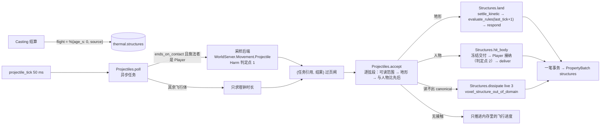
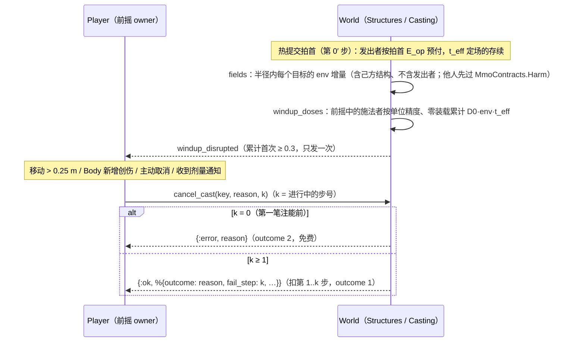

# World 子系统

`VoxelRegion.World`（`../world.ex`）是体素世界唯一的写者：一个 GenServer，持有全部权威状态。
本目录下的模块都是**作用在 World 状态上的函数**：输入是 World 状态，返回新的 World 状态或回复；
它们不自己起进程持有世界数据。少数辅助进程（写回、装页任务、窗口快照发送）只做 IO 或计算，结果交回 World 接纳。

## 一个请求怎么走

1. **入口**：公共函数把消息包成 `{:page_request, ref, message}` 交给 World。`handle_call` 先调 `Access.admit/1`。
2. **装页闸**：`Closure.needs/2` 只按当前状态与消息算出要驻留的页；`PageLoad.gate/3` 发现缺页就挂起请求，
   由装页任务读库后分批交回（`page_stage` / `page_commit`），页齐后按原顺序重放。World 回合内不读库。
3. **分派**：`call/3` 按消息标签进入对应模块。热域有待结算的步时，先 `Thermal.flush` 再处理请求。
4. **提交**：处理函数从 `before` 状态算出新状态和一笔事务，经 `Log.append_log` 追加到 overlay 日志；
   成功后 `Log.remember_entry` 更新页索引、保留事务并唤醒热模拟；失败就回复原因、返回 `before`，不留下半个修改。
5. **下发**：`Observation.fanout` 推给订阅者，`fanout_canonical` 推给每个角色的碰撞流。

模拟由 World 自己的定时消息推进：`thermal_tick`（热）、`liquid_tick`（液体）、`projectile_tick`（飞行体），
结果同样经 `Log` 提交。没有玩家时模拟照常推进（[持续演化决策](../../../../../docs/10-active/voxel-authority/2026-10-24-world-region-paging/continuous-world-decision.md)）。

## 模块地图

| 分组 | 模块 | 负责 |
|---|---|---|
| 入口与调度 | `Admission`、`Clock`、`Closure`、`PageLoad`、`SimulationWindows` | 请求接纳与排队、每条消息的读取闭包、装页闸与装页任务、模拟窗口登记 |
| 提交与持久化 | `Log`、`Interactions`、`PageCut`、`PageWriter`、`CoarseRebuild` | 事务追加与回放；周期性切点把脏页写进 PostgreSQL；离线重建粗层 |
| 页与缓存 | `Pages`、`Residency`、`Cache`、`Payloads`、`WindowSnapshot` | 页索引与脏单元、驻留与退休、有界 LRU 缓存、区域载荷物化、窗口快照 |
| 读取 | `Canonical`、`Observation`、`Canopy` | 权威格读取与材料判定；订阅者视图与增量；树冠派生 |
| 玩法意图 | `Tools`、`Production`、`Prefabs`、`Definitions`、`AttachmentOps`、`Casting`、`Beacons`、`Claims`、`Phases`、`Edits` | 工具、建造与合成、预制件、附件、施法、信标、领地认领、相态操作、逐格编辑批次 |
| 运维与作者 | `Catalogs`、`Parcel`、`Gm` | 目录发布、地块导出与安装、只测试的 GM 施工 |
| 模拟 | `Thermal`、`HeatCommit`、`Liquids`、`Structures`、`Projectiles`、`CircuitGraph`、`CircuitAdmission` | 热步与热提交的世界后果、液体流动、魔法结构的运行时（物理体、逐拍步进、记录与持久化）、飞行中结构的墙钟飞行驱动（地形求交、人物采样、接触结算）、电路图与新增连接的接纳 |
| 迁移 | `SemblanceMigration` | 旧存档拟态的一次性散解（恢复时，魔法 v2 Q4-6；退出条件见模块头注） |

想改某类玩法时，从“玩法意图”一行找到模块；想知道某条消息读哪些页，看 `Closure`；想知道它能否被某个主体发起，看 `../access.ex`。

进食（生产意图 action 5）与合成（action 4）的可行性门槛只写在 `Production.consumable/3`、`Production.craftable/3` 一处：
提交（`consume/3`、`craft/3`）与只读查询 `World.production_options/2`（角色此刻能吃一份 / 能合成一次的材料，`Production.feasible/2`，
不装页、不改世界）共用同一组判定。调用方（如 NPC 的背包候选 `NpcServer.Offers`）读这个查询，不自己镜像条件；
执行时 World 仍按提交那一刻的状态重新裁决。

## 施法（魔法 v2，切片 3–4）

`Casting` 只吃 IR v2 程序与目录 v5（v1 JSON 与 v4 目录已删，决策稿
[`2026-11-19-slice3-protocol.md`](../../../../../docs/10-active/magic/2026-11-19-slice3-protocol.md)）。前摇计时器只归
Scene 的 Player（落地稿 D7）；World 在前摇开始、第 k 步检查与出手三处各按当时的施放处读数重新报价（`Magic.Cost`），
只回判定结果。

- 报价（action 0）限频每施法者每秒 `quotas.quotes_per_caster_per_s` 次（World 单调时钟），超出 `:quote_rate`。
- 施法域距离只由报价的 T6 判；射线落空 `:no_target`，数值检查违规 `{:rejects, [检查名]}`。
- 中断支出落在形成位置（〈握〉〈取〉手边格、〈附〉目标格），`release_heat_fraction` 一份作为有限热源、其余记
  `cast_interrupt_radiation_j`；格子不是未细分热节点时全部计入辐射账。成功施法的构型损耗仍记 `cast_waste_j`（脚下）。
- 结构建成（切片 4c）：扣报价 `total_mj`，按形成锚与〈投〉求物理体，`Magic.Structure.new/4` 放进 `thermal.structures`；
  施放记录 live 0 与结构记录 live 1 在同一笔事务。施法者名下已有 `quotas.structures_per_caster`（6）个结构时，前摇开始、
  第 k 步检查与出手都回 `:structure_quota`（决策稿 Q4-5，其余准入在切片 7）。
- 可观测：`voxel_spell_quote`（phase=quote|prepare|checkpoint|release）、`voxel_cast_begin`、`voxel_spell`、
  `voxel_structure_built`、`voxel_cast_rejected`、`voxel_magic_program_rejected`；热账 `cast_interrupt_heat_j` /
  `cast_interrupt_radiation_j`、`structure_created_mj`。

## 结构运行时（魔法 v2，切片 4c）

决策稿 [`2026-11-26-p1-closure-slices4-8.md`](../../../../../docs/10-active/magic/2026-11-26-p1-closure-slices4-8.md) §4。
结构的储能、欠账与规则状态是纯值 `Magic.Structure` 的整数真值；`Structures` 只编排，`Thermal` 只把落地的热结构接进内核。

- 时钟：`thermal.commit_tick` 每完成一次热提交 +1（Q4-9），拍长唯一定义在 `Magic.Structure.tick_ms/0`；积压冻结时热提交
  不开始，结构随之冻结；冷重启从持久化的拍号继续，不补算。
- 热节点：带〈热〉且本拍开始时已落地的结构；节点温度 T_port = T_ref + (E_th + 本拍已累计净热)/C_th，限流参数取自结构；
  多次内核调用的计数汇总成 `voxel_thermal_throttle`。飞行中的结构不进内核。
- 沉积：请求里的热只落进接触格（执行时复核施法者对它可写，设计 §12.1 更正 3），否则计入灵炁辐射账。
- 线上：出生记录随施放事务；每拍终止的结构发 live 2–6 终态快照并移出；运行中的结构按固定分箱（Q4-4）比较步进前后，
  变了才发状态增量（随事务运输完整记录，编码时投影成 20 B）。`Replica` 与 `PropertyObservation` 按位置投影、按 §3.2 物化。
- 持久化：条目随每笔带 `thermal` 的事务写出，写出前 `Structures.persisted_thermal/1` 换成显式字段 map（`Log` 的事务元数据与
  `Pages.globals/1` 两处），恢复后 `Structures.restore/1` 一次校验（含 `last_tick = commit_tick`）。
- 账目（整数 mJ，按去向）：`structure_created_mj + structure_heat_in_mj = structure_light_mj + anima_radiated_mj +
  structure_leak_heat_mj + structure_released_mj + Δstored`；内核 f64 → mJ 的残差列在 `structure_rounding_mj`。
- 可观测：`voxel_structure_tick`、`voxel_structure_end`、`voxel_thermal_throttle`、`voxel_structure_restored`、
  `voxel_structure_migrated`；`voxel_thermal_commit` 行尾追加上述科目与 `commit_tick`；观察快照的 `thermal_accounting`
  带同名科目与 `commit_tick`、`structures`、`structure_stored_mj`。

## 飞行与〈遇〉（魔法 v2，切片 5、5b）

决策稿 §5 与 §14 的用户答复（以答复为准）：**所有投掷结构都不设射程终点**（2026-11-26 批准，切片 5b 落地）：无质量者直线
匀速、有质量者按弹道，飞到接触（〈遇〉→〈散〉，live 2）、落地（之后作为静止结构接入热内核）或在飞行中衰竭（live 3），
不在端点悬停。射程与距离衰减都由能量账推导；目录 `limits.range_m` 只作**施法域**（准星射线、形成位置、〈附〉格面、
射线落空回 `:no_target`）。飞行沿用墙钟合同（设计 §5.8）：`Projectiles` 每 50 ms 一拍（`projectile_tick`，经 `Clock`）
推进飞行进度，维持照常在热提交拍里步进。

- 预计飞行时长 T（`Structures.flight_horizon_s/4`，由报价推导）：T = (⌊life_s / 0.5 s⌋ + 1) × 0.5 s；有质量者再取
  min(T, t_fall)，t_fall = (v_y + √(v_y² + 2gD))/g，D = 出发点高出施法者脚下支撑格底面的高度（至少 1 m）。T 只限定两件事：
  施放时的弹道预测（`Semblance.trace/8`，读不出 canonical 的弦段处提前结束）与出手 / 第 k 步检查的读取闭包、前摇驻留里的
  飞行走廊（`Structures.flight_plan/5` → `Projectiles.corridor_keys/1`）。T 之后的飞行由 `Projectiles` 的页闸按段装入。
- 线上记录：飞行中的记录带 `flying` 状态位，`flight_s`/`rest` 是施放时到预计飞行时长为止的预测（与 4a golden 同义）；客户端在
  `flying` 位置位时按 t0、初速（有质量者加重力）外推，**不按 `flight_s` 截断**；飞行结束由下一条记录给出真实终点
  （停住的 live 1 不带 `flying`，或 live 2–6 终态快照，`flight_s` 为真实飞行时长、`rest` 为真实落点）。
- 〈遇〉：命中地形时按 `last_tick + 1` 求值（含 mix64 读数丢失），触发即在投射物提交点 `respond/3`，读〈遇〉的规则记 live 2；
  丢失时结构作为静止结构留下、接触待决，之后的热拍重判。动能经 `settle_kinetic/1` 在命中格沉积。
- 人物命中（只对 `ends_on_contact`，Q5-4）：进入组织 `q = E_op 热半 + 热份额（至多到 T_port）+ 动能`（Q5-2），辐射半只记账；
  冻结交付随 `thermal` 持久化，Player 接纳后终止并记 `structure_body_mj`（分项 `projectile_body_j`、`body_exchange_j`），
  未接纳散入空气记 `projectile_rejected_j`。kind14 回执照旧由后端在终止事务之后下发。
- 恢复：冷重启时仍在飞行的结构以 live 3 散解（`voxel_projectile_restored_dissipated`），冻结交付照常重投。
- 积压 mid/hard 或模拟装页失败时不开始新的投射物拍（与热、液体同一冻结语义）。
- 账目闭合式加一项：`… + structure_released_mj + structure_body_mj + Δstored`。
- 可观测：`voxel_structure_flight phase=launch|contact|landed|out_of_domain|restored`、`voxel_structure_end … hit=terrain|body`、
  `voxel_structure_state`（随状态增量记 load、x*、env、相干、温度）、`World.stats/1` 的 `simulation_progress.projectiles`。

## 驱散脉冲与前摇打断（魔法 v2，切片 6）

决策稿 §6（Q6-1–Q6-5）；设计 §5.3 第 0′ 步、§5.5 打断行、§7.3。按 id 驱散早已删除，驱散只有“区域扰乱、误伤己方”一种。
前摇计时与打断的唯一 owner 是 Scene 的 Player（落地稿 D7）：World 只算剂量、通知 Player，并在收到取消时结账。

- 干预场（`Structures.tick/3` 第 0′ 步）：发出者是带〈乱〉、本拍预付存续 t_eff > 0 的运行中结构；目标是半径内其余运行中结构
  （飞行中的也算，位置取已推进到的飞行位置；已冻结人物命中交付的不算）。作用于他人结构前按发出者**施放时**的战斗范围
  （物理体 `combat_scope`，Player 施法快照给出，缺省 nil = 禁伤）判 `MmoContracts.Harm`，同一施法者的结构不判。场作为
  `inputs.fields` 交给目标的 `Structure.step/4`；被打到相干跌破且 `debt_int > debt/2` 的结构以 live 5（驱散）终止。
- 施法者处剂量：位置取待施放里的施法者快照（前摇开始时，第 k 步检查时随快照刷新；Q6-2），`Structure.windup_dose/2`
  按拍累计在待施放的 `windup_dose` 上，首次达到目录 `runtime.windup_interrupt_dose` 时给前摇 owner 发一次
  `{:windup_disrupted, 动作键, 累计量}`。他人的场先过 Harm。
- 取消结账（`Casting.cancel_pending_cast/4`）：k = 0 免费（outcome 2，回 `{:error, reason}`）；k ≥ 1 与分阶段失败同一口径
  （`Cost.charge_through/3`：第 1..k 步累计支出、付到余额为止），报价按此刻施法者所在格的气候温度重算，作用面沿用前摇开始时的
  `checked`（不再求射线）；支出落在形成位置（W7）。施放记录 outcome 1、`fail_step = k`，结算回复的 outcome 即打断原因
  （`interrupted_cancelled / moved / disrupted / wounded`，Q6-4），经 `publish_cast_reply` 给连接下发 0x83 与 0x68 accepted。
  World 自己收尾的取消（Player 退出 `invalid_session`、装页失败）一律 k = 0。
- 结算回复（建成、第 k 步中断、取消结账）都带 `fail_step`（切片 3 残余 R2），NPC 的 Outcome 原样拿到。
- 可观测：`voxel_structure_field emitter cid tick t_eff_s radius_m targets doses=[{sid, 单位剂量, permitted}]`（每个有场的发出者
  每拍一行）、`voxel_cast_dose cid key tick dose total threshold notify`、`voxel_cast_disrupted cid key tick dose`、
  `voxel_cast_cancel seq cid request_id reason k charged_mj outcome windup_dose`；终止仍由 `voxel_structure_end … type=dispelled` 记。
- 待用户确认（按推荐暂行）：Q6-1 取消按进行中的步 k 扣第 1–k 步；Q6-5 只有 Body 新增创伤算伤口事件。

## 必须守住的不变量

1. **唯一写者**：只有 World 进程改世界状态；其他进程拿到的是快照或增量。
2. **唯一提交入口**：每笔修改都经 `Log` 追加，`seq` 单调递增；启动时用同一套规则回放日志重建状态。
3. **先装页再处理**：处理一条消息前，它读写的页都必须已驻留；缺页时挂起，不把“没装入”当成空气。
4. **持久化世界提交原子性**：提交失败时不留下本次未提交的 canonical／库存／能量等持久化真值；只有成功追加的事务才发布对应世界改动。运行状态按各入口契约处理失败，不承诺整份内存状态回到 `before`：例如工具频率已接纳后返回 `ineffective_tool`，仍保留已消耗的接纳额度；施法拒绝也可能提交结束预警记录。
5. **消息必须登记**：新增一条 World 消息要同时在 `Access` 的 `@messages`（动作类）和 `Closure.registered_entries/0`（读取闭包）
   登记，`test/access_test.exs` 与 `test/closure_entries_test.exs` 守住这一点。

## 名词

- **canonical**：权威的格数据（地形材质、细化槽、附件），区别于客户端或缓存里的派生表示。
- **overlay**：基底之上的稀疏修改；**压实**（rebase）把 overlay 并回基底，只改表示、不改内容。
- **切点（cut）**：一次把脏页写进 PostgreSQL 并发布的边界；页只有在切点发布后才能退休。
- **驻留（resident）**：页的内存表示已装入 World；**退休**是释放不再需要的页。
