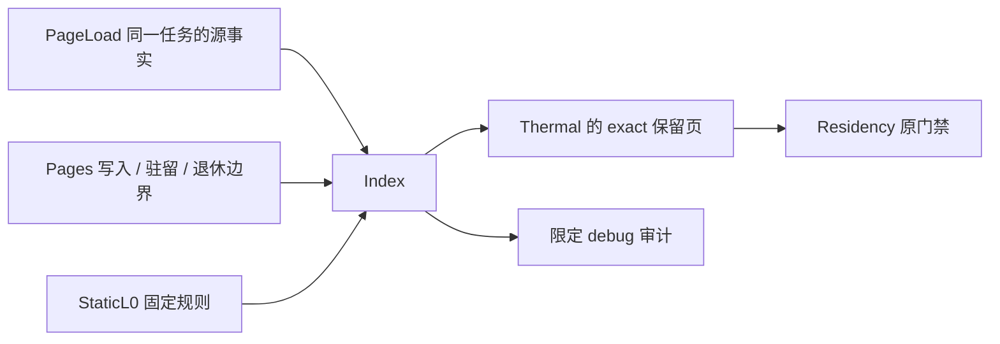

# 静态 L0 证明维护

此目录的 `Index` 负责可重建证明的接纳、失效和释放，用来回收无当前读取需求的天然页内存。
完整页及 26 邻页必须无任何记录、默认材料在固定环境下没有驱动力；纯资格规则在上级 `static_l0.ex`。
World 持有唯一 `static_l0` 状态，Pages 只在生命周期边界通知 Index；证明不进数据库、cut 或网络协议。

`VOXIM_STATIC_L0_RETIREMENT=true` 通过重启开启，默认关闭。启动不支持的配置会返回
`static_l0_start_failed` 并在启动 writer 前停止；日志 `voxel_static_l0_rejected` 给出陈旧代数或错源原因。
普通 `residency_status` 不遍历证明表估算内存；限定 debug 的 `static_l0_event` 才包含维护集合及内存估算。

资格不能绕过真实活动、观察、准备、dirty 或未发布 cut。被修改的页即使改回原材质也不能恢复原生资格；
临时 `resident=:all` 的在线维护仍必须撤销已有证明，只有尚未接纳最终环境的冷迁移阶段不发证。
