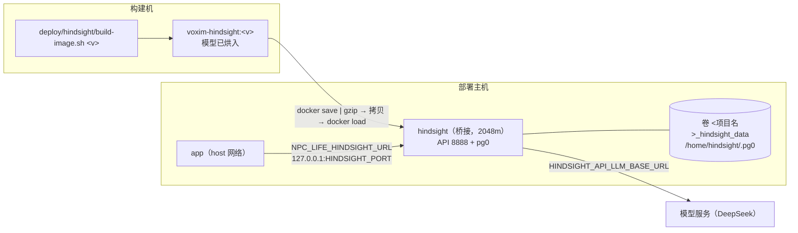

# Voxim server deployment

One release (`voxim_server`) runs the canonical World, Auth (HTTP) and Gate (QUIC) on one BEAM node.
Scenes are started from a topology file: one local Scene, plus any number of Scene peer nodes started
from the same release on the same host (Qinglan: two Scenes split at X = 41 m). Postgres holds the
authoritative overlay log, accounts/characters and NPC memories.

## Files

| File | Purpose |
|---|---|
| `build-image.sh <version>` | Build `voxim-server:<version>` (needs the sibling `Voxim` repo as a named build context) |
| `docker-compose.yml` | `db` (Postgres 16, 127.0.0.1 only) + `app` (host network, memory limit) + `hindsight` (NPC 记忆库，127.0.0.1 only，2048m) |
| `.env.example` | Every setting; copy to `.env` |
| `upgrade.sh <version>` | Backup (pg_dump + published prefabs + Hindsight `hindsight-admin backup`) → switch version → wait for QUIC |
| `nginx.conf.example` | TLS termination for the portal and game hosts (see Domains) |
| `qinglan-memory-guard.py` | 青岚 app 容器的内存守护（见“青岚内存兜底”） |
| `hindsight/build-image.sh <version>` | 构建 `voxim-hindsight:<version>`（见“Hindsight”） |
| `hindsight/Dockerfile` | 生产 Hindsight 镜像：0.10.3 slim（digest 钉死）+ 钉版本的 ONNX / flashrank 依赖 + 烘入的两个模型 + M-3c 配置 |
| `hindsight/ort-bound/sitecustomize.py` | ORT 线程补丁（移植上游 b18f425，有退出条件） |

## Domains

Flat names under `hemifuture.cn`, one level deep, so the shared `*.hemifuture.cn` wildcard certificate covers
them all. This also matches the other products on that host (`calix.`, `eval.`, `huanxi.`, `inkstone.`, `mail.`).
Hosts are split by audience: browsers carry cookies, while the game client carries bearer tokens, large
downloads and UDP.

| Host | Serves | Notes |
|---|---|---|
| `account.hemifuture.cn` | Player portal: `/auth` (account centre, `/` → `/auth`), `/admin` (invites) | `PHX_HOST`; mail links point here; session cookie stays on this host |
| `mmo.hemifuture.cn` | Game service: `/account/*` client API, `/game/*` world data, `/playtest/*` legacy; QUIC `20003/udp` | Shipped clients and the QUIC certificate (`server_name`) use this name, so keep it. `/auth` → 301 portal |
| `notify.mmo.hemifuture.cn` | Sender domain for Aliyun DirectMail (`noreply@notify.mmo.hemifuture.cn`, SMTP `smtpdm.aliyun.com:465`) | SPF/DKIM (`aliyun-cn-hangzhou`)/DMARC/MX records only, no web host; `mail.hemifuture.cn` is the Stalwart mailbox server, so keep them separate |

Names describe the role, not the project: the game may be renamed, and only page and mail text would follow.

Reserved; create these only when a feature needs them (prefixed with the service, like `notify.mmo.`):

- `mmo-admin.` — move `/admin` here when it needs an IP allow-list or extra auth in front.
- `mmo-cdn.` — client packages and large world assets via OSS+CDN.
- `mmo-status.` — a status page.

Further worlds or shards should come from a server list returned by the API, not from new DNS names in shipped
clients.

The brand site stays on `skopunarverk.com` (Cloudflare) and links to the portal.

Every proxied location must send `X-Real-IP $remote_addr`. The app trusts it only from a loopback peer and uses
it for per-client rate limits; without it, every player shares one 60-request/minute bucket.

## Data directory (`VOXIM_DATA_DIR`, mounted at `/srv/voxim`)

```
worldgen-manifest.json      # explicit generation manifest → content_version
kernel-manifest.bin         # published movement kernel; kernel_id = sha256(file)
world/<content_version>/    # generated baseline cache (L0 on demand, L1–L5 baked) + prefabs/ (player-published, back up)
scenes/scene-*.json         # Scene configs (L0 window, travel bounds, spawn, profile)
scenes/topology.json        # which Scenes run where (see below)
catalogs/                   # properties.json, environment.json, magic-catalog.json, prefabs/
tls/server.pem, server.key  # QUIC certificate (the client pins its CA)
invites.json                # invite-code digests for /playtest/*
```

The release runs as uid 1000 (`voxim`); on a Linux host `chown -R 1000:1000` the data dir. World generation writes
baseline files and published prefabs into it.

Topology (`VOXIM_TOPOLOGY`); at most one `local` Scene, every `peer` Scene gets its own node:

```json
{"scenes": [
   {"scene_id": 1, "config": "/srv/voxim/scenes/scene-1.json", "node": "local", "replica": true},
   {"scene_id": 2, "config": "/srv/voxim/scenes/scene-2.json", "node": "peer", "schedulers": "1:1"}],
 "neighbours": [[1, 2]],
 "report": "/srv/voxim/scenes/topology-state.json"}
```

Without `VOXIM_TOPOLOGY` the release runs a single Scene from `VOXIM_M1_CONFIG` against the World directly.

## First start

```sh
./build-image.sh 20260930-release01        # on the build machine
docker save voxim-server:20260930-release01 | gzip > voxim-server.tgz   # copy + docker load on the host
hindsight/build-image.sh 0.10.3-20261120    # NPC 记忆库镜像，同样 docker save → 拷贝 → docker load（见“Hindsight”）
cp .env.example .env                        # fill secrets, version, paths
docker compose up -d
docker compose logs -f app                  # migrations, bake check, voxim_topology_ready, voxim_quic_listener
```

Startup order is fixed by the application dependencies: migrations (`bin/server`) → World (bakes / verifies the
L1–L5 baseline before anything listens) → Scenes (topology) → Auth + Gate. A cold baseline bake can take minutes.

## Operations

- Remote shell: `docker compose exec app bin/voxim_server remote`; one-off calls: `bin/voxim_server rpc '<expr>'`.
- Catalog publication for a release (advances the playable property catalog in one World transaction):
  `bin/voxim_server rpc 'VoxelRegion.World.publish_parameters(VoxelRegion.World, "/srv/voxim/catalogs/<next>.json", Base.decode16!("<current digest>", case: :lower))'`,
  then point `VOXIM_PROPERTY_CATALOG_PATH` at the new file.
- Upgrade: `./upgrade.sh <version>`. Rollback: `pg_restore --clean` the printed dump, restore the prefabs archive,
  set the old `VOXIM_VERSION`, `docker compose up -d app`.
- Client and server must match: the Gate rejects a client whose protocol version, kernel_id or profile_id differ.
  Ship a new client package together with any server that changes the protocol (Voxim `Docs/Distribution.md`).

## Sizing notes (from the Qinglan host)

- No swap + a runaway BEAM stalls the whole host: always set `VOXIM_MEM_LIMIT` below host RAM; two Scenes steady at
  1.4–1.7 GB, so 8 GB hosts use `4000m`; keep `VOXEL_REGION_PAYLOAD_CACHE_MB` and generation concurrency small.
  Qinglan runs on a Tencent Cloud 2 vCPU / 8 GB host (7679 MiB visible, no swap). 用户 2026-11-20 定的同机目标形态：
  app `VOXIM_MEM_LIMIT=4600m` + `hindsight` 2048m（compose 写死），其余约 1 GiB 给 Postgres、nginx、dockerd 与云监控代理；
  在青岚落地属 E9、另行授权（见“Hindsight”的“青岚落地”）。
- Host networking is required when the host routes traffic through a TUN proxy (bridged container UDP replies are lost).
- UE's default `HttpActivityTimeout` (30 s) is shorter than a cold region request; the client sets 120–180 s.

## NPC 常驻应用

同一 `voxim_server` release 包含平级的 Gate 和 NPC 应用。NPC 登记、模型配置与持久化表保持原语义，
运维 RPC 入口改为 `NpcServer.Registry`，状态读 `NpcServer.Bootstrap.status()`。
Gate 重启不重启 NPC；正式服务启动由 `NpcServer.Bootstrap` 恢复 enabled 登记。
详见 [NPC 应用说明](../apps/npc_server/README.md)。升级请重启 release，旧 `GateServer.Npc.*` 名称不保留兼容转发。

统一形态（注册表 brain `"npc"`）的登记要求运行环境里有三组变量，都不入库、缺一个登记即失败：选择用的 Jev 接口
（缺省 `TYPESAFE_API_URL` / `TYPESAFE_API_KEY` / `TYPESAFE_MODEL`；`NPC_JEV_API=openai` 时改用 `NPC_JEV_URL` / `NPC_JEV_KEY` /
`NPC_JEV_MODEL`），记忆库地址 `NPC_LIFE_HINDSIGHT_URL`（或写在登记参数里），写作（反思、日计划、说话）的接口
`NPC_REFLECT_URL` / `NPC_REFLECT_KEY` / `NPC_REFLECT_MODEL`（形状由 `NPC_REFLECT_API` 选）。
各自的用途与请求形状以 [NPC 运行时说明](../apps/npc_server/lib/npc_server/README.md) 为准（“注册表”“反思”两节），这里不复述。
变量名与说明见 `.env.example` 的 NPC 一组（整组注释掉、值留空：启用时取消注释并填写；可选项不用就保持注释——
空值不等于不写：`NPC_JEV_API`、`NPC_REFLECT_API`、`NPC_JEV_THINKING`、`NPC_JEV_MAX_TOKENS`、`NPC_LLM_TIMEOUT_MS` 为空时登记被拒，
三个 `*_EFFORT`（`NPC_LLM_EFFORT`、`NPC_JEV_EFFORT`、`NPC_REFLECT_EFFORT`）为空时空串会原样随请求发出，`NPC_LLM_CACERTFILE`
为空时空串会被当成 CA 文件路径、https 请求连不上（最后这条是读源码所得，未实测））。llm / life 大脑另需 `NPC_LLM_*` 一组，
同样列在 `.env.example` 里。
**现状（2026-11-20）**：生产仍是 `20261112-qinglan`、NPC `enabled=0`，生产 `release.env` 里没有这些变量，主机上也还没有 Hindsight。
`deploy/` 的部署模板（compose 的 `hindsight` 服务、`.env.example` 的 Hindsight 与 NPC 两组）已备好；青岚落地属 E9、另行授权
（见“Hindsight”的“青岚落地”），启用 `"npc"` 登记之前要先把这些变量填进部署环境。

**每天花费额度（2026-11-19 起）**：配了 `NPC_LIFE_HINDSIGHT_URL` 即视为启用 NPC，此时 `NPC_SPEND_LIMIT_USD`、`NPC_SPEND_STOP_RATIO`、
`NPC_SPEND_PRICES` 必填（`NPC_SPEND_PEAK_UTC` 可选，按 UTC 星期与时段写高峰规则），缺或非法 **release 启动失败**；没配 `NPC_LIFE_HINDSIGHT_URL` 时额度不读这些变量，
Life 的后台工作按“无法计量”一直停着（现状生产不受影响）。形状与取值见 `.env.example` 的花费额度一组，行为见
[NPC 运行时说明](../apps/npc_server/lib/npc_server/README.md)“每天花费额度”。额度要读 Hindsight 自己的 LLM 追踪并按库开关自动巩固，
所以 Hindsight 容器的 `HINDSIGHT_API_LLM_TRACE_ENABLED` 与 `HINDSIGHT_API_ENABLE_BANK_CONFIG_API` **不得关**（`voxim-hindsight` 镜像已设为
`true`，见下面“Hindsight”）。账本表 `npc_spend_ledger` 随常规迁移建立。

**Test-only 世界钟偏移（`VOXIM_TEST_WORLD_CLOCK_OFFSET_S`）生产 / 分发不得设置**：它让 NPC 的游戏时间 = 墙钟 + 偏移，只给本地实跑
驱动用（让一轮落在游戏日开头），客户端昼夜不跟着偏移；`.env.example` 有意不列。设了非 0 值时 release 启动日志有一行
`world_clock_test_offset Test-only`，部署核对时见到即撤掉。格式不对 release 启动失败。说明见世界钟设计页
`docs/10-active/cross-cutting/2026-11-13-world-clock-design.md`“Test-only 偏移”一节。

**模型 key 与崩溃转储**：各 `*_KEY`（含 llm / life 大脑的 `NPC_LLM_KEY`）登记时先校验是合法的 HTTP 头值：非空、首尾为
0x21–0x7E、中间只有 0x20–0x7E 与制表符（不含 CR / LF 等控制字符，RFC 9110 §5.5；也不含 NBSP、零宽空格、全角字符等非 ASCII
字节——有意比 RFC 严格，与 Mint HTTP/1 一致），不合法即登记被拒、错误只报变量名与原因，不自动 trim——Windows 编辑的 `.env`
留下 CRLF、从网页复制 key 时带进的不可见字符都要先改掉。之后在 NPC 进程里以闭包（`NpcServer.Secret`）流转，进程状态与崩溃
报告里不是原文；据 ERLEF 安全工作组《Protecting sensitive data》，闭包也不会写进崩溃转储（本仓库未测）。

残余是发请求时的明文请求头（读 finch 0.25.0 / mint 1.11.0 / hpax 1.1.0 与本机 OTP / Elixir 源码所得，未实测；细节见
`NpcServer.Http` moduledoc 的“密钥”）：
- `https` 模型主机走 HTTP/2，在途请求连同请求头存在 Finch 的 HTTP/2 池进程里，请求结束才删除；
- 写作 endpoint 的 Messages 形状用 `x-api-key`，它不在 HPACK 静态表里，key 会进连接的动态编码表，**留在池进程里直到连接关闭
  或被新条目挤出**，不只是在途期间（Bearer 用的 `authorization` 在静态表里，值不进动态表）；
- 池进程崩溃时 Finch 没有 `format_status`：Elixir 打印的 gen_statem 终止报告里，`Queue:`（可能含排队中的请求及其头）在任何
  日志级别都会出现，`State:`（在途请求与编码表）在 debug 级别出现——生产不要开 debug 级别日志；
- VM 崩溃时这些进程的堆会进 `erl_crash.dump`。

建议生产在 `.env` 里写 `ERL_CRASH_DUMP_BYTES=0`（ERTS 读这个环境变量，0 表示不写转储），或至少保证转储文件不落在
可被他人读取、会被收集上传的位置；代价是 VM 整体崩溃（如内存耗尽）后没有转储可查，只剩 release 日志与容器退出码。

### 青岚内存兜底

`qinglan-memory-guard.py` 是青岚部署运维脚本，安装于 `/data/voxim_qinglan/ops/`，dyz cron每分钟调用。
仓内脚本：原始cgroup v2 memory.current >3400MiB告警，>3900MiB持续180秒受控重启（对应同机目标形态的 app 容器上限4600m，余量规则见脚本常量注释）；每日UTC21:00也请求重启，所有自动重启共用一小时冷却与flock。
青岚主机上现装的那份不随仓库更新，E9 落地时随 app 上限一起换成仓内版本。
守护只看 app 容器：同机的 `hindsight` 容器不在守护范围内，靠 compose 里 2048m 的硬限额（无 swap，超限由内核在该容器内 OOM，不波及 app）。
日志按UTC日轮转、14天/16MiB上限；SMTP复用现有release.env，收件人由ops/notify.json指定。
`--dry-run` 不重启、不发邮件、不写状态，仅真实采样和验证判定；停用删除crontab中 `# qinglan-memory-guard` 行。
阈值及完整部署记录见 `.demo/observe/qinglan-deploy-20261029/RUNBOOK.md` §8。

## Hindsight（NPC 记忆库）

`deploy/` 是部署模板：compose 的 `hindsight` 服务是 Hindsight 0.10.3（API + 内嵌 pg0 数据库，同一容器），与 app 同机常驻。
启用这份 compose 之前要先在主机上 `docker load` 好 `voxim-hindsight` 镜像并填好 `.env` 的 Hindsight 一组，否则 `docker compose up -d`
起不来 `hindsight`。NPC 的 Life / 反思 / 花费额度经 `NPC_LIFE_HINDSIGHT_URL` 访问它；它自己调用的模型（抽取、巩固、认识刷新）由
`.env` 的 `HINDSIGHT_API_LLM_*` 三项给出。青岚生产不是用这份 compose 运行的，落地见本节末“青岚落地”。



- **网络**：桥接网络，只把 API（容器 8888）发布到宿主 `127.0.0.1:${HINDSIGHT_PORT}`；控制台（9999）不发布。出站只有模型请求（TCP）。
- **内存**：`mem_limit` / `memswap_limit` 都是 2048m（用户 2026-11-20 定；M-3c 实跑同一限额，3 人内存峰值 1838 MiB，见
  [扩人数与进青岚决策稿](../docs/10-active/cross-cutting/2026-11-18-npc-scale-and-qinglan-entry-decision.md) §7 2026-11-19 条）。
  内存守护只看 app，不管它。
- **卷**：`hindsight_data`，实际卷名随 compose 项目名为 `<项目名>_hindsight_data`（本模板 `voxim_hindsight_data`），挂在
  `/home/hindsight/.pg0`。用 Docker 命名卷：镜像以 uid 1000 运行，命名卷首次使用时继承镜像目录的属主，绑定宿主目录则要先
  `chown 1000:1000`（镜像 `/app/start-all.sh` 的说明）。
- **worker id**：compose 固定 `HINDSIGHT_API_WORKER_ID=hindsight`。缺省取容器主机名，换镜像重建容器后旧 id 名下 `processing` 的
  任务（巩固等）永远不会被接回——0.10.3 在容器里不设它时启动日志的告警即此意，并建议设成 compose 服务名。
- **停止**：`stop_grace_period: 45s`——`start-all.sh` 收到 SIGTERM 后最多等 30 s 让 pg0 落盘，compose 缺省的 10 s 会把它强杀。
- **app 不等它**：npc_server 启动时不同步依赖 Hindsight（Life 的记忆任务失败按 30 s 起的指数退避再起；花费额度读不到用量时后台停着），
  所以 app 没有 `depends_on: hindsight`，游戏主体不因记忆库没起来而起不来。冷启动的头一两分钟里 NPC 的记忆任务可能失败一次再起。

### 镜像（`deploy/hindsight/`）

`Dockerfile` 是镜像内容的唯一事实源：基底 `ghcr.io/vectorize-io/hindsight:0.10.3-slim`（按 digest 钉死）、钉版本的 ONNX / flashrank 依赖
（取 Test-only 镜像 `voxim-npc-evolve-hindsight:0.10.3-flashrank` 实际解析出的版本，见 `../Voxim/Docs/Gameplay/NpcEvolve/Dockerfile`）、
烘入的两个模型、M-3c 配置和其余非密钥设置，各项依据写在 Dockerfile 注释里。

- **模型烘进镜像**：嵌入 `BAAI/bge-small-en-v1.5`（ONNX + 分词器，钉 commit `5c38ec7c…`）与 flashrank 重排 `ms-marco-MiniLM-L-12-v2`
  （上游只有 `main` 的下载地址，改钉五个文件的 sha256），构建时不一致即失败；之后 `HF_HUB_OFFLINE=1`，运行时不联 HuggingFace，缓存缺
  文件即启动失败。flashrank 用 `requests` 直接下 zip、不认 `HF_HUB_OFFLINE`，它不下载是因为模型目录已在镜像里。
- **配置分工**：与镜像内模型、M-3c、花费额度契约绑定的非密钥项在镜像 ENV；属于部署的模型地址、模型名、key 在 `.env`，经 compose
  `environment` 只交给 `hindsight` 容器。
- **构建与分发**（构建机要能访问 PyPI 与 huggingface.co；部署主机不需要）：

  ```sh
  deploy/hindsight/build-image.sh 0.10.3-20261120             # 产出 voxim-hindsight:0.10.3-20261120，打印镜像 id
  docker save voxim-hindsight:0.10.3-20261120 | gzip > voxim-hindsight.tgz
  # 拷到主机：docker load < voxim-hindsight.tgz；.env 写 HINDSIGHT_VERSION=0.10.3-20261120；docker compose up -d hindsight
  ```

  换 Hindsight 镜像版本：先按下面备份，再改 `HINDSIGHT_VERSION`、`docker compose up -d hindsight`。

### M-3c 同机 2 核配置

同机部署时 Hindsight 必带 M-3c 的 2 核配置（ORT 线程补丁、`OMP_NUM_THREADS=2`、worker 名额 2 / 巩固保底 1、嵌入与重排分批 8）。
取值、依据与“原创初值”的说明只写在 [`hindsight/Dockerfile`](hindsight/Dockerfile) 的 M-3c 一节；决策与实跑记录见
[扩人数与进青岚决策稿](../docs/10-active/cross-cutting/2026-11-18-npc-scale-and-qinglan-entry-decision.md) 的 E3 / E7、D-2（同机、首批限 3 人）
与 §7 2026-11-19 条。结论只适用于带这组配置、限 3 人的同机部署。ORT 线程补丁的来源与退出条件见
[`hindsight/ort-bound/sitecustomize.py`](hindsight/ort-bound/sitecustomize.py) 文件头。

### 凭据、追踪保留与价目表

- `HINDSIGHT_API_LLM_API_KEY` 只写在部署 `.env`（不进镜像、不进仓库）。app 用 `env_file: .env`，所以 app 容器环境里也看得到它，与 NPC 各
  `*_KEY` 同一处理。
- 花费额度读 Hindsight 自己的 LLM 追踪：`HINDSIGHT_API_LLM_TRACE_ENABLED` 不得关；追踪保留天数 `HINDSIGHT_API_LLM_TRACE_RETENTION_DAYS`
  用 0.10.3 缺省 1 天（`config.py` `DEFAULT_LLM_TRACE_RETENTION_DAYS = 1`），**不得调短**（额度按北京自然日读当天用量）。
- `NPC_SPEND_PRICES` 必须含 `HINDSIGHT_API_LLM_MODEL` 的模型名（当前 `deepseek-flash`），否则后台按“未定价”停。

### 备份与恢复

依据：Hindsight 官方 Admin CLI 文档（<https://hindsight.vectorize.io/developer/admin-cli>）与 0.10.3 源码
`hindsight_api/admin/cli.py`。`hindsight-admin backup` 在一个 `REPEATABLE READ` 事务里把全部表导出成一个 zip（一致快照，不要求停 API）；
内嵌 pg0 时 CLI 要在拥有 pg0 数据的那台机器（即本容器）里跑，连上已在运行的 pg0。`restore` **先清空目标 schema 再导入**；之后官方要求
`repair-bank --all` 补建逻辑恢复丢掉的每库向量索引。

- **备份**：模板的 `upgrade.sh` 先确认 hindsight 在跑（不在就在停 app 之前退出），停 app 之后自动备份（`backups/<时间>-hindsight.zip`，
  与 pg_dump 同一静止时刻）。手动：

  ```sh
  docker compose exec -T hindsight hindsight-admin backup /tmp/hindsight-backup.zip
  docker compose cp hindsight:/tmp/hindsight-backup.zip backups/<时间>-hindsight.zip
  docker compose exec -T hindsight rm /tmp/hindsight-backup.zip
  ```

- **恢复**（停 app，让 NPC 不再写；hindsight 保持运行，恢复后重启一次）：

  ```sh
  docker compose stop app
  docker compose cp backups/<时间>-hindsight.zip hindsight:/tmp/restore.zip
  docker compose exec -T hindsight hindsight-admin restore /tmp/restore.zip --yes
  docker compose exec -T hindsight hindsight-admin repair-bank --all
  docker compose exec -T -u root hindsight rm /tmp/restore.zip   # cp 进容器的文件属 root，/tmp 有粘滞位
  docker compose restart hindsight
  docker compose up -d app
  ```

  最后的 `restart hindsight`：备份时正在执行的任务以 `processing`、本 worker id 的状态被一起恢复回来，而 0.10.3 只在 worker 启动时把
  本 worker id 名下的 `processing` 任务放回 `pending`（`worker/poller.py` `recover_own_tasks`，唯一调用点是 `run()` 启动时起的
  `_run_recovery`；启动日志 `Worker hindsight recovering stale tasks …`），不重启这些任务会一直挂着。

### 部署后生效核对

在部署目录执行（`.env` 里取端口，运维 shell 里没有这个变量）：

```sh
port=$(sed -n 's/^HINDSIGHT_PORT=//p' .env)
curl -s "http://127.0.0.1:$port/health"                                  # {"status":"healthy","database":"connected",…}
docker compose logs hindsight 2>&1 | grep -o '{"npc_ort_bound"[^}]*}}'  # 至少 3 个会话，每个 intra 2 / inter 1 / spinning "0"
docker compose logs hindsight 2>&1 | grep -E 'batch_size=8|max_slots=2, reservations=\[consolidation=1\]'
docker compose logs hindsight 2>&1 | grep -E 'Error in sitecustomize|Downloading|LLM connection verification failed'  # 应无输出
docker compose exec -T hindsight printenv HINDSIGHT_API_RERANKER_FLASHRANK_BATCH_SIZE HINDSIGHT_API_WORKER_ID HF_HUB_OFFLINE  # 8 / hindsight / 1
```

ORT 会话应有嵌入的 `model.onnx` 与 flashrank 的 `flashrank-MiniLM-L-12-v2_Q.onnx`；flashrank 的分批在启动日志里没有，所以用 `printenv`
只读指定变量（不要整份 `env`，它会打出 key）。`LLM connection verification failed` 出现说明模型地址 / key 不通——0.10.3 只告警、照常
启动，所以要看日志。

### 青岚落地（E9，另行授权）

青岚生产（`hemifuture.cn`）不是用 `deploy/` 这份 compose 运行的：它是 `/data/voxim_qinglan/docker-compose.yml`、项目名
`-p voxim_qinglan`（容器 `voxim_qinglan-app-1` / `voxim_qinglan-db-1`，db 镜像 `postgres:16-alpine`），app 用
`env_file: releases/<ver>/release.env`，升级走 cutover 步骤而不是 `upgrade.sh`。现状（2026-11-20）主机上没有 Hindsight。落地属 E9、另行授权，
内容包括：

- 把 `hindsight` 服务（镜像、只听回环的端口、卷、2048m、`stop_grace_period`、`HINDSIGHT_API_WORKER_ID`）并进青岚 compose；卷名随项目名为
  `voxim_qinglan_hindsight_data`；
- Hindsight 的模型三项（含 key）写进 `release.env`，NPC 一组与 `NPC_LIFE_HINDSIGHT_URL` 同处；端口先在主机上核对没被占用；
- 把 Hindsight 备份（上面“备份”的三条命令）放进 cutover 步骤，恢复按上面“恢复”；
- app 上限改为 4600m，内存守护换成仓内 3400 / 3900 的版本（见“青岚内存兜底”）。
