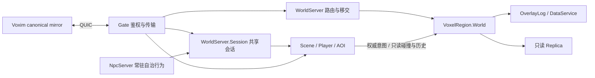
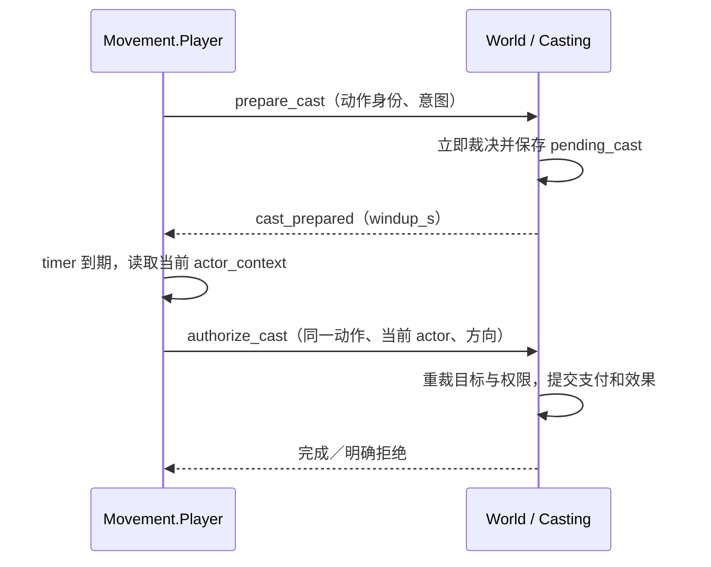

# Voxim 当前运行时边界

本文按 owner、正常入口和验收边界组织当前实现。Voxim 是唯一客户端；服务端只在 Linux 开发、构建与运行。

## 当前事实

### 组合根与权威边界

- 唯一服务端 release 是 `voxim_server`，由根 `config/runtime.exs` 与各 app 的 `Application` 组合。专用 probe 与作者工具不成为第二条生产路径。
- `VoxelRegion.Application` 在配置 root / manifest 后先完成 Bake，再启动唯一 `VoxelRegion.World`。显式生成基底与持久化 overlay 构成 canonical 真值；World 拥有体素、材料、库存、损伤、热、燃烧、相变、电路与魔法世界效果的接纳和提交。只读 `Replica` 消费权威结果，不能补造缺失真值。
- `WorldServer` 负责路由与受控移交；`SceneServer.Movement.Scene`、`Player`、`Replication` 分别负责场景成员、每玩家移动／身体／动作与碰撞历史、AOI。碰撞派生物从 canonical World 或本地只读副本建立，不拥有第二份可写体素世界。
- `NpcServer.Application` 是与 Gate 平级的常驻自治行为组合根，随 release 启停。玩家与 NPC 共用 `WorldServer.Session` 会话占用与移交，编辑边界共用 `VoxelRegion.EditBounds`；NPC 不依赖 Gate 生命周期。详见 [NPC 应用](../../../../apps/npc_server/README.md)。
- `GateServer.Transport.QuicListener` 与 `Session.QuicConnection` 是正式网络入口。Hello / Join、鉴权、身份 epoch、Ready、可靠流与 DATAGRAM 已实现。TCP / WS 与 `VOXIM_TRANSPORT` / `legacy_reference` 选择已删除。
- `MmoContracts.Session`、`Movement`、`Voxel` 是当前字节契约。Hello 版本直接读取 [Session codec](../../../../apps/mmo_contracts/lib/mmo_contracts/session/codec.ex)，本页不维护第二份版本号。CanonicalBootstrap 的完整 L0 payload 进入客户端既有 canonical 管线，规定 L0 驻留、初始 collider 建好且同 T/N/R 的 TimelineFence 已接纳后才 Ready。

### World 的读取、提交与持续演化

[World 子系统 README](../../../../apps/voxel_region/lib/voxel_region/world/README.md) 是目录职责与请求流程入口。`Access` 接纳主体与动作，`Closure` 定义读取闭包，`PageLoad` 在缺页时挂起请求、装页后重放；World 回合内不读库，不把未装入当空气。`Log` 统一追加事务，再发布订阅与 canonical 增量；`PageCut` / `PageWriter` 负责脏页切点与 PostgreSQL 写回，`CoarseRebuild` 负责粗层重建。旧整世界同步 compact 的性能数字不能代替当前分页写回验收。

热、液体、飞行体由 World 的模拟消息持续推进，没有在线玩家也保持已接纳的演化义务。材料内核只产出结果，由 World 统一提交；批次或观察窗口不成为第二真值。

- **液体与散体**均已进入当前实现。液体侧流用润湿门槛，湿格间按整数差量平衡；散体用材料 `loose_threshold_units` 休止角，共用 `Liquid.step_transfers`。有限格的 `liquid_units` 与 `World.finite_volume/2` 服务数量、热、燃料与损伤折算，数量和焓随权威通量搬运。工具 11 / 12 同时处理液体与散体。
- **下落展示**由权威重力通量派生，按完整 XYZ 窗口投影，不构成第二份世界数量。当前线格式以 [Voxel codec](../../../../apps/mmo_contracts/lib/mmo_contracts/voxel/codec.ex) 为准；`liquid_falls` 与 `casts` 从持久日志和保留历史投影中排除，实时展示不参与冷恢复。
- **提交热路径**使用 `Canonical.put_refined/3` 维护的 owner / region 派生索引、变动身份投影与随写入失效的编码缓存。早期全量扫描的修复过程、比较范围与实测数字见历史证据，不作为新的性能承诺。

### 魔法与动作生命周期

取能、远程点火、拟态、投掷、驱散、命中瓦解、前摇与符文预警均已有当前源码，不再等待 Hello 23 / 24 / 25 / 27 分支合并。规则正文见 [Voxim Magic](../../../../../Voxim/Docs/Magic.md)，本页只索引服务端边界：

- [Magic.Catalog](../../../../apps/voxel_region/lib/voxel_region/magic/catalog.ex) 是发布目录的唯一服务端读取与校验入口。当前强制 **v4**，要求 `rest_pose`、`release_lead_s`；姿态为六关节整数角、5° 的倍数、绝对值不超过 175°。目录字节的 SHA-256 标识发布物；运行时不兼容旧 v2 四关节目录。
- `Magic.Program` 在信任边界解析程序；`Magic.Cost` 是报价、构型损耗与前摇时长的共同计算源。`World.Casting` 接纳领域目标、权限与能量账并提交效果。施法者能量、蓄能石、热源与拟态沿既有 World 日志和检查点持久化。
- **Player 拥有前摇与出手授权**：`Casting.begin_cast` 保存待支付领域负载并发送 `cast_prepared`；Player 设置 timer，到期从当前 `actor_context` 取位置、身份、身体状态与相干度，发送 `authorize_cast`。World 匹配同一动作与 Player，合入授权时 actor 与方向后重新裁决并结算，不按开始时姿态自动结算。
- `pending_casts` 与符文 `casts` 是运行状态，冷重启不恢复未支付施法。取消／结算拒绝返回明确原因；成功提交的结束记录可以发布 `outcome 2`，不能把拒绝概括为所有内存与观察状态都毫无变化。`quote_windup_s` 来自同一次 `Cost.quote`，登录与结算状态为 0。

### 身体、库存与作者入口

- Player 是唯一身体 owner；`SceneServer.Body` 负责体温、伤病合成、修复、营养、死亡与复活规则。[身体子系统 README](../../../../apps/scene_server/lib/scene_server/body/README.md) 保存规则与参数。DataService 按角色保存完整 Body、待吸收热、生命代次和分世界消费游标，session epoch 拒绝旧会话覆盖；离线冻结，在线后按既有节奏继续。
- 进食由 World 扣料并同笔保存 `food_ledger` / `food_receipts`；Player 按 content version 游标吸收并保存身体，不向旧 PID 直接补发身体真值。Scene seal / 正常退出先等待热接触 fence。连续性边界见 [身体连续性 P0](../../../20-archive/cross-cutting/2026-10-05-body-continuity-p0.md)。
- `World.material_supply` 与 `World.liquid_fill` 是 server-only 作者入口，未接 Gate；来源 key 回执与数量／焓同笔持久化，重试不能补料。有限作者样本不替代正常玩家消费，具体约束以对应公共 API 与测试为准。
- `World.gm` 与 `Player.gm_teleport` 是 Test-only 工具；`VOXIM_GM_TOOLS=1` 显式开启，默认 `gm_disabled`，不进入分发。传送信标由 World 维护安装与调谐，Player 维护读条；`VOXIM_BEACONS_ALL_ATTUNED=1` 是开发期开关，不写调谐账，不放宽距离与完好校验。

## 已删除的旧链路

`SceneServer.Voxel.ChunkProcess`、`ChunkDirectory`、`FieldRuntime`、`FieldTickWorker` 及服务归档客户端的旧 TCP / WS / chunk / field 链路已在 `af180c98` 删除。它们不是活跃兼容 owner，不应恢复为 Voxim 缺失数据的兜底。旧设计与操作日志只能作为归档证据。

## 证据源与验收边界

- **已实现**以当前源码、目录契约与正式组合根接线为准；实现存在不证明当前部署已更新。
- **已实跑**须保留当次源码／协议／资产身份、日志与实际覆盖范围。局部 World、wire 或传输测试不代替真实双客户端。
- **已验收**：[M1 路线与验收入口](../../../../../Voxim/Docs/M1/plan.md)覆盖 bootstrap / Ready、移动与真实双客户端；[M4a 验收](../../../../../Voxim/Docs/M4a/acceptance.md)覆盖两 Scene、本地 Replica 与受控移交。同主机多 VM 不扩为跨主机时钟或故障接管验收。
- 魔法与身体的历史双端场景、目录身份及剩余视觉／性能边界见 [Magic](../../../../../Voxim/Docs/Magic.md) 与 [施法动作](../../../../../Voxim/Docs/Gameplay/CastActions.md)，各记录只证明其声明的版本、输入与窗口。
- [R7 工程审计](../../../../../Voxim/Docs/R7/Engineering-audit-2026-09-19.md)保存 Linux / CI / cook 的当次证据。本地单测、cook、远端 CI、同版本镜像加打包客户端冒烟和最终分发各证明不同事实。
- [迁出的 runtime 历史证据](../../../20-archive/cross-cutting/2026-11-03-voxim-runtime-historical-evidence.md)完整保存本页旧日志，包括早期散体／魔法分支、P0 下落展示、Hello14 / Hello15 与同步历史维护的命令、测试数、产物位置和限制。该快照不是当前运行指南。

## 被取代结论与后续缺口

“M1 authority / QUIC / bootstrap 尚未实施”“散体与魔法仍在未合并分支”“World timer 使用起手姿态结算”“v2 四关节魔法目录”和“旧 ChunkProcess / FieldRuntime 仍有活调用”均已被当前实现取代。

性能、视觉、分发与部署状态须按各自版本证据判断。后续明确缺口统一见 [已知缺口](../../impl/known_gaps.md)，不以早期日志中的“实施中”推断当前未完成。
