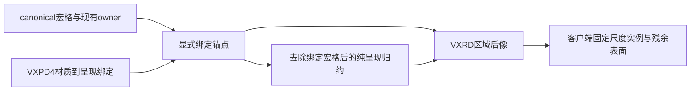

# Prefab 里的宏格（VXPD v3）与 Prefab Designer 内核 — 决策稿

2026-09-21，与用户逐项确认。**名单移除、D0、VXPD v3 与 D1 已实施验收；D2 会话已实现，完整目标验收未完成；D3 不在本轮。** 排期见 `Voxim/starter.md`“排期与进入条件”的 Prefab Designer D0–D3；
NPC 一侧的背景见 [`2026-09-21-npc-unified-interface-design.md`](2026-09-21-npc-unified-interface-design.md) §0。

2026-09-22 实施增量 0（全局系统功能）：已移除 §6 建造者名单及 QUIC 登录缓存，部署编辑盒保留。
影响 prefab 放置/拆除/替换与单格/批量直接编辑；付费放格、液体、附件、工具不变。
直接编辑沿用现有 `World.apply_edit(s)`，不消耗背包，不增添工具射线规则；prefab 仍由 World 裁决与结算。
验证契约：普通角色可进入这些入口，盒外、未知定义、占用、材料不足仍按原契约拒绝；不覆盖 v3、损伤及设计技能。
Gate 路由无名单时改前事务序号不变，改后正常提交；NPC 真实 World 一格 micro 构件放/替换/拆的余额为 1→0→0→1。
当前源码本机 Gate/NPC 22 项通过（7 项真实模型/规模测试未运行）；Linux 正常 Mix 构建的 QUIC 文件 45 项通过。
同时修正该文件沿用的旧测试夹具：协议 16 玩家 `kind: 0`、冷编辑准备的既有 `adopt_liquid` 回调；没有改动协议。
命令与原始失败/通过日志位于 `Voxim/Saved/Gameplay/prefab-designer-20260922/`。
独立旧 Demo 双客户端的增量 0 验收镜像为 `voxim-gameplay:build-access-cab7a9ae`，Hello 16，
固定旧场景生成器，材质目录经现有 `publish_parameters` 升级至当前客户端资产版本。
`smoke.py --mode assembly --server-dir Saved/Gameplay/prefab-designer-20260922/isolated-server --container voxim-prefab-designer-test`
完成准星放置/替换/F 拆卸，事务 413807/413819/413828，两端逐笔属性一致、World 占用与双方余额恢复。
证据 `assembly-final/acceptance.json`、原始两端日志及截图；共享森林 Demo 保留，公网未改动。
旧 smoke 仅凭回放完成会假通过，现补操作/结果/副本/World 判定；`assembly-isolated` 的 occupied 原始失败仍保留。
本轮 D0 数字与近似边界见 [测量记录](2026-09-22-prefab-d0-measurement.md)；VXPD v3 的实现、兼容与实跑边界见 [增量验收](2026-09-22-prefab-v3-validation.md)；工作台与发布见 [D1 验收](2026-09-22-prefab-designer-d1.md)；会话及尚未通过的模型目标见 [D2 记录](2026-09-22-prefab-designer-d2.md)。

## 0. 为什么

建筑以 prefab 为单位：在编辑器里设计、修改、组合、查看效果，成型后整体放到地图上；玩家与 NPC 共用同一套编辑器内核
（LLM 一次性交蓝图不可靠——它看不到自己设计出来的东西）。逐格编辑只是荒野改造工具。

现状（`VoxelRegion.Prefab` / `World` 的 prefab 放置）：定义的格全是 micro 精度（1/8 m）；放下后每个被占的宏格存一张
`slot => {material, owner}` 表（512 个槽位各一条），线上每个槽位 16 字节。一个填满的宏格 ≈ 8 KB 线上载荷；一间 70 宏格的小屋 ≈ 570 KB；
一栋 10×10×8 的空心建筑（约 400 宏格）3 MB 以上、二十万条记录，放置事务、进场快照、区域载荷、压实检查点都带着它。
现有 47 个定义最大 98 KB（约 7 千格），都是门窗楼梯级的部件。

**greedy 救不了这个**：greedy 是从真值派生的东西（客户端面抽取、碰撞盒），已经在起作用；瓶颈是真值与线格式按 micro 槽位逐条存。
把真值改成盒编码等于引入八叉树（任何槽位都能被单独挖掉，盒子要分裂），波及挖、损伤、附件锚点、结构 LOD。
而“一个填满的、同材质同归属的 refined 宏格”在语义上就是“一个有归属的宏格”——直接把它表达出来。

## 1. 定义格式：VXPD v3

每个节点在现有的 micro 格、子引用、初始附件之外多一段**宏格**：`(x, y, z, material)`，坐标是节点局部的宏格坐标。
v1 / v2 照读，现有定义不动，已放下的旧实例不迁移。不做盒编码（400 个宏格才 5.6 KB）。

一个节点里宏格与 micro 格**可以混放**（带石基座的门框）：发布时校验同一节点内两者不占同一个宏格。

## 2. 对齐

含宏格的节点，原点必须落在宏格栅格上：
- 发布时：含宏格的子节点，相对父节点的锚点各轴是 8 的倍数；
- 放置时：整棵树里只要有宏格，放置锚点（micro 坐标）各轴是 8 的倍数，否则拒绝 `:misaligned`；
- 24 种朝向都是轴对齐旋转，锚点对齐则旋转后仍对齐。

## 3. 放下之后

prefab 的宏格就是**普通宏格**：材质进现有 overlay、走现有的宏格事务，因此天然走现有的 LOD 归约、碰撞盒、远景资产、客户端同步，
热 / 燃烧 / 液体等宏格模拟原样生效（micro 构件走的是另一套“结构 LOD”路径）。

多出来的只有一张归属表：`宏格 => 实例身份 {birth, occurrence}`，形状与持久化同 `placed_by`（随事务元数据走，重启与压实后仍在）。
占用规则与 micro 对称：目标宏格必须是空气且没有 refined 内容，否则 `:occupied`。

客户端不需要新的线格式：宏格照常同步；探测结果的 `owner` 字段（普通方块是 `{0, 0}`）对归属于实例的宏格填实例身份，
够客户端做“高亮整栋”“看着它发起整体拆除”。

## 4. 损伤：宏格 = 隐式叶子

现有规则：攻击只认权威射线命中的叶子构件，非叶子拒绝 `:not_a_leaf_component`；叶子的 HP 是它自己那些格按材质汇总的一个血条，
打到 0 整件拆掉并退料。

prefab 里的一个宏格就是一个**隐式的最小叶子**：射线打到哪一格，那一格就是命中的叶子；HP 按材质的 `max_hp_per_macro`，与荒野方块相同；
打到 0 这一格消失、按一个宏格的造价退料、从归属表删掉。它永远是叶子，不受“父级要等子级拆完”的限制。
不为每个宏格真建实例记录——裁决时把“归某实例所有的宏格”当叶子处理，行为与字面做法相同。

**血条粒度由作者选表示方式决定**：要一面整体一个血条、打不出洞的墙 → 做成 micro 构件（现状）；要能逐格破坏的砖石墙 → 用宏格；同一栋建筑可以混用。

- 拆卸（action 2）作用在宏格叶子上 = 拆这一格并退料；整栋拆除仍是 `prefab_remove`，一次清掉实例的 micro 槽位与归属的宏格、全额退料。
- 实例的 micro 部分与宏格都没了，实例记录自动删掉（并入现有“最后一个构件删掉后实例消失”的判断）。

## 5. 造价、退料、溯源

放置造价 = 宏格数 × 512 × 单位 + micro 格数 × 单位，与现在单个宏格的造价口径一致；退料对称。
放置者记在实例上，其宏格同时写进 `placed_by`——顺带补上“prefab 没有溯源”的缺口。

## 6. 权限

所有角色都可以放置 prefab。现有的建造者名单（`gate_server` 的 `voxim_builder_cids`、`Dispatch.builder?/1`，玩家与 NPC 共用）是早期的部署限定，移除；
部署编辑盒 `bounds` 保留。地块归属与权限、出生点保护、延时建造（审核 → 虚影 + 完工时间 → 到期整体放下）是后期的独立系统。

## 7. Prefab Designer 内核（D1）

草稿就是一份定义：大体量是根节点的宏格，细部是子 prefab 引用。`GateServer.Npc.Blueprint` 的 `walls` / `fill` / `clear` 盒操作不废，
直接编译成根节点的宏格段；再加一种操作“在锚点、朝向放一个目录里的 prefab”。

- 工具：新建 / 增删改操作 / 组合 / 查看 / 检查 / 发布；发布得到按内容寻址（sha256）的定义 id，可回头改、可复用。
- 查看与检查：逐层切面与立面的文本图 + 代码算出来的结论（屋内净高、门能否走进去——复用 `SceneServer.Movement.Path` 在草稿上跑、
  有无悬空格、屋顶是否盖满、材料清单对比背包、与工地现状的冲突含出生点与 `placed_by` 非 nil 的格）。不做图像渲染。
- 运行时发布是新的玩家信任边界（现在只有作者整目录 `World.publish_prefabs`）：宏格数、micro 格数、节点数、嵌套深度、包围盒各一个上限，
  具体数字由 D0 的测量定。
- **D1 只做服务端**：NPC 与测试先用，不动协议、不动客户端。玩家的预览虚影需要定义本身——按 id 从服务端取定义（走现有 HTTP 载荷通道，
  按内容寻址可缓存）、客户端 VXPD 解析升到 v3、“拼装仓库”读自制定义，统一放到 D3 与玩家的编辑器界面一起做。
  这期间玩家看不到自制建筑的预览虚影；放下之后的样子完全正常（线上传的是实际占用，不是定义）。

## 8. D0 要量的

同一间石木小屋分别做成“纯 micro”与“宏格 + micro 部件”两份定义，经作者入口在本机 World 发布并放下，对比：定义大小、放置事务耗时、
载荷大小、碰撞构建时间、压实后的日志体积；再放大到 10×10×8 的建筑重复一遍。目的不再是“要不要扩展格式”，而是给宏格方案定上限，
并留一份 micro 方案的对照数字。

## 9. 明确不做

把 refined 真值改成盒 / 八叉树编码；为每个宏格建实例记录；迁移已放下的旧实例；图像渲染；把“笔记本”做成世界里的实体；
整套延时建造与审批。

## 2026-10-17：显式通用稀疏树冠呈现（VXPD4 / VXRD13）

用户已批准按新定义启用的通用呈现扩展。旧定义、材料结算、归属、碰撞和 ReduceBlockV1 保持原合同；不按树种名或材料58启用。服务端唯一输入为现存 macro_owners、instances、定义的 presentation_bindings 以及 canonical cell_value，绝不从发布模板恢复已删占用。

依据与取舍：沿用本仓 `MmoContracts.Voxel.Refined` v7的实例身份/父子关系，`VoxelRegion.Reducer.reduce_cell` 与 `VoxelRegion.Structure` 的既有归约和方向附件投影。新呈现只是在真实占用集合上派生另一份可丢弃呈现值。Epic 官方 [Instanced Static Mesh Component](https://dev.epicgames.com/documentation/en-us/unreal-engine/instanced-static-mesh-component-in-unreal-engine) 说明同网格实例可共享组件、逐实例变换而组件共用材质；客户端据 presentation id 分组，保持1m宏格锚点与scale1。ISM并不自动保证性能，密度、可见实例和边界交换须后续实测。wire只含锚点与身份，不传逐叶片几何。

所有整数小端。VXPD4保持v3全布局，仅version=4；宏格列表之后追加binding_count:u32，再按material严格升序的 `{material:u16,presentation:u16}`。两者非零且material必须出现在本定义macro_cells；不继承父定义绑定。无绑定的encode仍输出原v3字节，绑定进入SHA256内容身份。

VXRD头magic=`VXRD`，version=13；body为原terrain段 + base_version:u32(4..12) + base_tail_length:u32 + 原base尾 + canopy段。base保留原格式语义，禁止递归wrapper。canopy段：

1. canopy_version:u32=1。
2. 原Refined v7段，refined_count固定0；instance_count:u32及85字节实例（含祖先），按既有排序；与base同ID的共享字段必须相同。解码公开实例表合并，保存base实例集合供字节往返。
3. anchor_count:u32；按世界XYZ字典序，每条 `x:i64,y:i64,z:i64,birth:u64,occurrence:u32,material:u16,presentation:u16`，40字节。XYZ为1m真实宏格位置，负坐标按floor除法投影，范围为该LOD的66格完整三维core/ring。
4. residual_count:u32；按local cell index严格升序，每条 `index:u32,material:u16,skin_extent:u8,face_ids:u8[6],map_mask:u8`，随后按face升序的置位面extent²个u8 texels。extent=1/2/4；extent1不得带map，mask仅低6位。残余来自将绑定宏格替换为空后的同一Reducer，保留未绑定旧叶/树干/其他主体。
5. 现有Structure v2段：`2:u32,count:u32`与现有index/count/grid记录。空段精确8字节`2,0`。只包含受影响且原有structure的格；残余存在而该格无残余structure表示移除原呈现structure。原canonical structure保持。非空复用原结构信任边界。

不因粗材质未变化而停止呈现失效：每次实际编辑或owner替换，将前后绑定宏格祖格与本次变化祖格相交，在LOD0..5及对应ring发布完整区域后像。已有payload缓存、region日志和代际顺序仍是唯一更新链路，不引入额外持久化真值。

测试范围：纯协议冻结字节/坏包，纯派生两个同58粗格的5/8不同布局、负XYZ及region ring、混旧叶残余；真实World公共publish/place/tool collect/replace/remove/文件日志恢复及原材料余额。测试Source只提供空baseline，Actor只替代鉴权角色上下文；不代表真实网络/UE渲染验收。依赖只用现有Mix环境，不启动DB、线上世界或UE。服务端测试文件为canopy_test.exs、canopy_definition_test.exs、canopy_projection_test.exs、canopy_world_test.exs；阶段状态：服务端协议与World闭环已实现并通过下述最小回归；客户端互通/渲染及真实部署另行验收。

服务端验证（2026-10-17）：mmo_contracts 的 canopy/payload/payload_reuse/liquid_wire/r7_prefab 共35项通过；voxel_region 的 canopy_definition/canopy_projection/canopy_world、prefab_definition/prefab_macro_world/structure/payload_candidate/prefab_runtime_publish/prefab_preview 共61项通过，2项数据库测试明确排除。命令使用 mix test --no-start --no-compile --no-deps-check（后者另加 --exclude database）。仅增量Elixir编译，未重建NIF、启动生产服务或UE。冻结检查点只携带绑定目录投影及属性参数，基底清除全部呈现派生；库存、live compact/replay及删除后恢复均走公共入口。原runtime测试的400000B过期阈值改用Prefab.limits().bytes+1，产品既有字节预算未变。

互通夹具通过正常World.publish_prefab/prefab_intent生成，可用 CANOPY_FIXTURE_DIR 环境变量运行 canopy_world_test.exs 导出：负XYZ区域{-1,-1,-1}，LOD0..5，5个绑定宏格和1个未绑定微格。定义116B；L2原始body609257B、压缩body842B、完整payload896B，5锚点、1残余、1残余结构。该计数只说明小例，不代表生产密度性能。线上部署、数据库与视觉验收未执行。

附件失效补充（2026-10-17）：残余蒙皮依赖附件曝光，因此 canopy 失效取编辑前后 attachment_dirty 的并集；跨父格遮挡及被裁掉的附件仍须刷新相邻树冠祖格。直接附件放置/拆除也发送 L1..5 完整残余 afterimage，覆盖所替代的 coarse 项并用当前 coarse 值更新缓存基底。新增三个回归先红后绿；canopy_projection + canopy_world 共10通过，既有 damage_world 的 b4 标签12通过（74未选），均无生产世界操作。修复未改 wire 或 fixture 字节定义。
