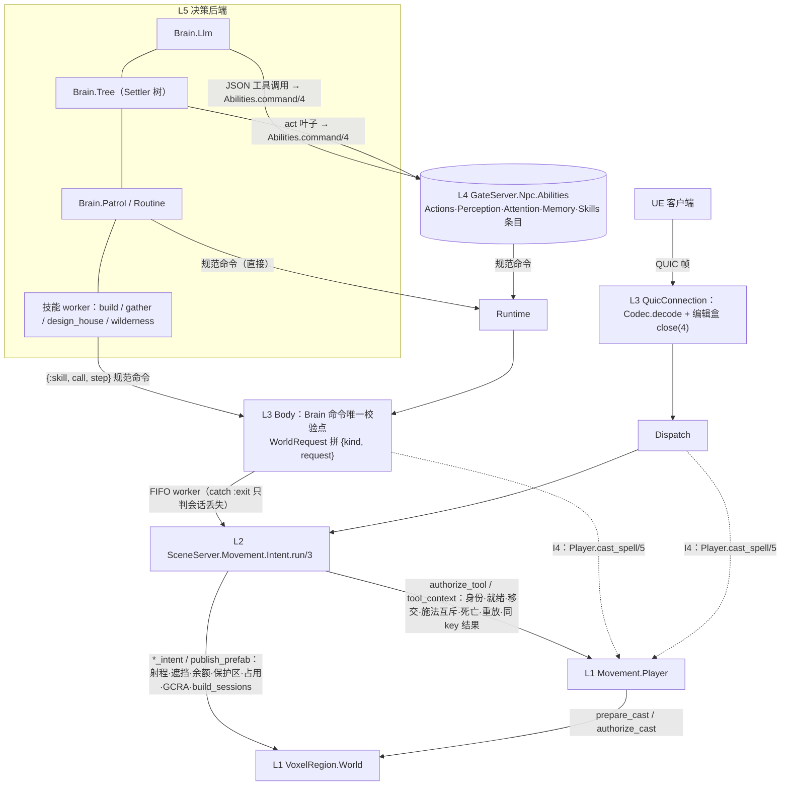
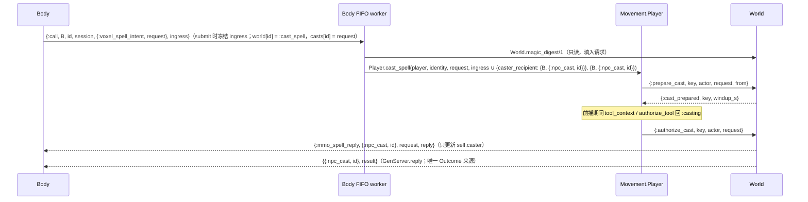

# 角色能力函数库（决策稿）

分类：**Global system**，决策稿。状态：**I1–I4 已实现并提交（b363f122、33377ad2、60f01c75、c727418f，合并 6b95d110）；最终实跑已做（本地 Demo + 真实双客户端，判据 6/6，见 §14）；实跑暴露的三处缺陷已修复并有红绿回归；24 h 长跑与“往世界里放 NPC”阶段（NPC 注册表、重启恢复、正式服取料规则）未做**。

- 基线：服务端 master `f94a3d72`（worktree `ex_mmo_cluster-capabilities`，分支 `capability-library-20261007`）；Voxim `main` `b40f922c`。下文行号都按基线。
- 上位与相邻文档：[NPC 统一接口层](2026-09-21-npc-unified-interface-design.md)、[NPC 运行层评审修复](2026-10-06-npc-runtime-review-fixes.md)、[上下文与记忆契约](2026-09-22-npc-context-memory-contract.md)、Voxim `Docs/Combat-Action-Design.md`、`Docs/Testing.md`。
- 接口权威说明仍是 `GateServer.Npc.Brain` 的 moduledoc 与 `apps/gate_server/lib/gate_server/npc/README.md`；本稿与代码不一致时以代码为准，并回头修正本稿。

路径简写：

| 简写 | 实际路径 |
|---|---|
| `npc/X` | `apps/gate_server/lib/gate_server/npc/X` |
| `mv/X` | `apps/scene_server/lib/scene_server/movement/X` |
| `world.ex` / `w/X` | `apps/voxel_region/lib/voxel_region/world.ex` / `…/voxel_region/world/X` |
| `codec.ex` | `apps/mmo_contracts/lib/mmo_contracts/voxel/codec.ex` |
| `dispatch.ex` / `quic.ex` | `apps/gate_server/lib/gate_server/session/dispatch.ex` / `…/session/quic_connection.ex` |
| `Voxim:` | 客户端仓库根 |

## 0 结论

1. **角色动作只有一种形状 `{kind, request}`**，即 `MmoContracts.Voxel.Codec.decode/1` 的输出（codec.ex:149-312）。玩家从线字节解出；NPC 由纯函数模块 `GateServer.Npc.WorldRequest` 把 Brain 的规范命令拼成同一形状（拼装代码从 body.ex:808-914 迁出）。两边用手写冻结帧对拍，kind 沿用 Codec 原子。
2. **世界意图只有一个执行入口 `SceneServer.Movement.Intent.run/3`**（同步，无进程无状态）。Gate 的 `Dispatch` 与 NPC 的 `Body` 都只调它。门禁只挂在角色 owner `Movement.Player` 与 `VoxelRegion.World` 上，Body 不复刻任何权威门。它是 Combat-Action-Design §1“薄 Action 公共层”的服务端接纳点；§11 第 1 步（挖掘与火球共用 ActionId 与结果阶段）将来挂在 Intent 上，**本库不交付**。
3. **决策侧只有一份能力定义 `GateServer.Npc.Abilities`**，组合 Actions / Perception / Attention / Memory / Skills 各域条目。条目字段只有 `name, group, done, description, params, build`；`params` 一份手写，同时生成 strict JSON Schema 与 JSON→规范命令译码。LLM 工具表与行为树叶子都经它构造命令；代码写的 Patrol / Routine 照旧直接产出规范命令。Abilities 只在 `gate_server/npc` 内使用，Intent 与 World 从不读它（Combat-Action-Design.md:183“不新建全量 ActionDefinition 注册表”）。
4. **最小行为树 Brain `GateServer.Npc.Brain.Tree`**：`seq / sel / act / cond / wait / repeat / each / succeed / fail`，语义按 BehaviorTree.CPP（叶子 RUNNING 直到 Outcome 回来；halt = 在途技能 `cancel_skill`、在途移动 `stop`）。`act` 叶子经 `Abilities.command/4` 构造命令（构造期即校验，相当于 typed ports）。
5. **首个真实消费者：建设者 Settler 树**（`GateServer.Npc.Trees.settler/1`）加 `gather` 技能，主循环零 LLM。取料 → 建造 → 被占跳过 → 定期巡回；材料取自作者给定采石盒里的天然地形，因果闭环。
6. **线协议与 Hello 39 零改动，UE 客户端零改动**，服务端可单独部署。玩家可感知的变化只有一处（D-1）：死亡后约 1 s 窗口内放置、合成、附件、prefab、发布被拒，原因 `dead`；客户端中文文案是后续资产项，期间 HUD 显示原文 `dead`。
7. **增量**：I1 统一执行入口 → I2 能力库与 LLM 投影收敛及 NPC 补齐 → I3 gather + 行为树 + Settler + 长时验证（逐轮推进的多轮集成用例 + 30 min 浸泡，主控 I3 任务指示（2026-10-08），代替原定 2 h 墙钟长跑）→ I4 NPC 施法 → 最终 Demo 镜像与真实双客户端短场景（§11）。

## 1 目标与范围

**目标**：玩家与 NPC 的同一能力在“定义、执行、结果”上各只有一份实现；决策后端换成玩家、脚本、行为树、LLM 或 Jev 中任何一个，NPC 的世界实现与权威都不改。完成后能往世界里放一个长期运行的建设型 NPC。

| 范围内 | 增量 |
|---|---|
| 执行入口收敛（工具 / 生产 / 附件 / prefab / 发布），死亡门，ingress 时刻，补余额唯一规则，NPC 人物目标 g5，Body worker 最小退出隔离 | I1 |
| 能力库与 LLM 投影（strict、显式句柄、描述常量化、say 不投影）；NPC 补 craft / eat / dismantle / read_catalog（craft / eat / dismantle 的 Body 受理与 `aim/2` 已随 I1 交付，I2 补 Abilities 条目与集成测试）；观察补 body_state、名字与关系；S1、S3；正式生成入口 `Body.start/2` | I2 |
| `gather` 技能、行为树 Brain、Settler 树、本机真实 World 无人值守（多轮集成 + 30 min 浸泡，见 D-8） | I3 |
| NPC 施法（`Player.cast_spell/5`） | I4 |
| Demo 镜像 + 真实双客户端短场景 | 最终 |

不在范围见 §12。24 小时验收按 D-8 在 I3 长时验证通过后进行。

## 2 依据

依据按服务端 AGENTS §2.2-8“证据优先”。本稿没有原创架构决策；行为树有两处适配（失败原因写黑板、瞬态重试内联在 `act`，对应 RetryUntilSuccessful），在 §8.2 写明。

| 来源 | 要点 | 本库怎样用 | 取舍 |
|---|---|---|---|
| Unreal GAS https://dev.epicgames.com/documentation/en-us/unreal-engine/using-gameplay-abilities-in-unreal-engine | TryActivate → CanActivate → Commit → Task → End/Cancel；输入与 AI 触发同一能力 | CanActivate ≈ `authorize_tool` / `tool_context`；Commit ≈ World 余额与 GCRA；Task/End/Cancel ≈ 技能单终态 + settle | 只借生命周期分工，不移植 GAS / GameplayTag，不复制数值 |
| NeoForge FakePlayer https://github.com/neoforged/NeoForge/blob/main/src/main/java/net/neoforged/neoforge/common/util/FakePlayer.java ；Valve bot https://github.com/ValveSoftware/source-sdk-2013/blob/master/src/game/server/sdk/sdk_bot_temp.cpp ；Mineflayer https://github.com/PrismarineJS/mineflayer | 机器人以玩家身份走真人路径，自然触发同样的保护检查 | NPC = 没有 socket 的玩家会话；角色门、世界门都在共享入口 | 采用 |
| Command pattern https://gameprogrammingpatterns.com/command.html | AI 与玩家产出同一种命令对象 | 收敛对象就是线解码的 `{kind, request}` | 采用，不另造命令对象 |
| BehaviorTree.CPP https://www.behaviortree.dev/docs/guides/asynchronous_nodes/ ；ports https://www.behaviortree.dev/docs/tutorial-basics/tutorial_02_basic_ports/ ；源码 https://github.com/BehaviorTree/BehaviorTree.CPP （controls/sequence、fallback，decorators/repeat、retry） | 异步节点 RUNNING、单终态、halt 必须尽快停止；typed ports 建树期校验；Sequence / Fallback 带记忆 | `Brain.Tree` 节点语义、黑板、`act` 经 Abilities 构造 | 只做 Settler 用得到的节点，不做 reactive / parallel |
| Screeps intents https://docs.screeps.com/game-loop.html | 受理 ≠ 生效 | 每个能力写明 done 的含义 | 不搬 tick 末批处理 |
| OpenAI function calling https://developers.openai.com/api/docs/guides/function-calling | strict；enum 让非法状态无法表达；单轮 ≲ 20 个函数 | strict、字符串枚举、`profile.groups` 裁剪 | 工具合并不做（§12） |
| Anthropic tools https://www.anthropic.com/engineering/writing-tools-for-agents ；https://platform.claude.com/docs/en/agents-and-tools/tool-use/define-tools | 描述 ≥3 句；错误能引导下一步；命名空间分组 | 描述由常量插值；组即命名空间 | 不建错误提示目录（会成第二真值） |
| MCP tools https://modelcontextprotocol.io/specification/latest/server/tools | 协议错误与执行错误分开；跨调用状态用显式 handle | `unknown_tool` / `invalid_tool_arguments` 与权威拒绝分开；显式目标句柄取代“最近一次 probe” | 只借形状，不搭传输 |
| GOAP / F.E.A.R. https://pages.cs.wisc.edu/~dyer/cs540/handouts/gdc2006_orkin_jeff_fear.pdf ；Unity ML-Agents https://unity-technologies.github.io/ml-agents/Learning-Environment-Design-Agents/ | 按角色分配 Action Set；后端可换、动作契约不变、静态掩码 | `profile.groups` + 工具带 + 技能配置 = 授予条件，只依赖 profile | 不做规划器；不随瞬时状态增删工具（保护提示缓存） |
| Elixir GenServer https://hexdocs.pm/elixir/GenServer.html ；Process https://hexdocs.pm/elixir/Process.html#alive?/1 ；DynamicSupervisor https://hexdocs.pm/elixir/DynamicSupervisor.html | call 失败以 exit 退出；`reply/2` 发往 `{pid, tag}`；`alive?/1` 只接受本地 pid；默认重启强度 3 次 / 5 s | Body worker 的退出规则（§7.6）；NPC 施法以 `{body, tag}` 收回执（§7.8） | 采用 |

## 3 现状事实

| # | 事实 | 证据 |
|---|---|---|
| F1 | 同一编排写了两份：玩家在 Dispatch，NPC 在 Body worker（`prefab_gate → Player.tool_context → World.*_intent`） | dispatch.ex:89-114、122-164、224-267；body.ex:1010-1026 |
| F2 | NPC 工具绕过 `ToolAction.run` / `authorize_tool`：无死亡检查、无同 key 结果缓存、无 g5 分支；Body moduledoc 自称“同一条裁决” | body.ex:1020；mv/tool_action.ex:7-25；mv/player.ex:291-330；body.ex:10-12 |
| F3 | `tool_context` 不查死亡（只拒施法中、未 ready、移交、失败）；死亡后施放回 `cast_too_soon` | player.ex:276-289、246、258-259 |
| F4 | World 写意图与发布都经 `actor.refresh` 回调 `Player.tool_context`，所以 tool_context 一加死亡门，“授权后、提交前死亡”与技能内直接发布也得到 `dead` | w/tools.ex:560-568；world.ex:1006-1008 |
| F5 | 补余额两套：玩家工具看 `action ∈ [1,2] and g != 5`（与结果无关），生产/附件/prefab 看 tool_context 是否通过，发布不补；NPC 除 a0 与只读外一律补，失败也补 | dispatch.ex:108、156-157、234；body.ex:966-969 |
| F6 | `received_us` 取值时刻不同：Gate 入队时取，Body worker 执行时取；GCRA 按它判频 | quic.ex:594、608；body.ex:1013-1017；world.ex:886 |
| F7 | 谓词缺口：`prefab_remove` 无无符号检查，`prefab_replace` 靠手写 32 字节 match；Codec 谓词不是全函数（非数字方向算 norm 抛错、非二进制 `byte_size` 抛错、原子 tool 按项序 `> 0` 为真），Body 先做类型守卫再调谓词 | body.ex:873-881、810-812；codec.ex:114-134、268-291 |
| F8 | Body worker 是 `spawn_link`，Body 不 trap_exit；只有 `tool_context` 包了 catch | body.ex:115、1029-1033 |
| F9 | Body 的 Outcome 映射只有三支，遇 `{:body, _}` 会 CaseClauseError；`{:npc_path, …}` 只匹配 `{:ok, path}` / `:no_path` | body.ex:362-374、376-392 |
| F10 | Body 丢弃的下行：BodyState、EntityEnter 的 `name/relation/relation_source`（只缓存 4 字段）、`{:mmo_spell_reply, …}` | body.ex:443、298-306；player.ex:1107；w/casting.ex:44-48 |
| F11 | Body 有一段 `player` 已有、`position` 仍为 nil 的窗口（claim 后到首个 ACK、重新 claim 期间）；`eye_position/1` 不接受 nil | body.ex:162-169、197、696-697；player.ex:1126 |
| F12 | 技能 worker 经 `Body.skill_context` 直接读 World 并发布（house_design → `PrefabDesigner.publish/3`）；死亡门、施法门经 F4 照样生效，覆盖不到的只有取消时的 settle；发布不占 seq、不扣料，丢 settle 无后果 | house_design.ex:447-457；body.ex:243；npc/README.md 取消段 |
| F13 | LLM 目标靠隐式状态（最近一次 probe / inspect），五个目录由私有函数串译码；约 31 个工具 + 技能；未开 strict；kind/axis 裸整数 | llm.ex:54-58、80-111；actions.ex:102-108 |
| F14 | `say` 是用户已批准的聊天 stub：Body 恒回 `:chat_unavailable`，`{:heard,…}` 形状保留 | body.ex:773-775；interface-design.md:36、62-63 |
| F15 | NPC 缺 craft / eat（`@production` 只有 1..3）、dismantle（action 固定 0/1）、读目录、施法 | body.ex:43、818；inventory §5、§8 |
| F16 | 正式运行时没有 NPC 生成入口；`ensure_npc/1` 返回 `{:ok, %Character{}}`，同名玩家角色 CaseClauseError；名字即永久身份，同 cid 的新 claim 顶替旧的 | application.ex:38；character_store.ex:47-65；claims.ex:27-33；body.ex:396-397 |
| F17 | claim 不带阵营档案，Scene 读 `:profile`，缺省为空档案 | body.ex:157；scene.ex:419-421；orgs.ex:72 |
| F18 | `move_to` 的目标 y 无界：盒子按 sy..goal_y±6 整批交 `material_snapshot` | body.ex:718-722、974-988 |
| F19 | 技能锚点可远距离读世界并触发冷区域生成；wilderness 收尾对蓝图格读 snapshot | house_design.ex:123-128；prefab_designer.ex:19；wilderness.ex:163-172；world.ex:204-209 |
| F20 | 作者不带 actor 放的 prefab 宏格只写 `macro_owners`、删 `placed_by`；look 行看不到 macro_owners，探测命中带 `owner` | w/prefabs.ex:411-413；world.ex:780-781；w/canonical.ex:100-105 |
| F21 | `published_prefabs/1` 只含运行时发布（不含作者目录）；作者定义只在 `prefab_catalog/1` | world.ex:336-337、997-1003 |
| F22 | inspect 的 owned_macro 行 `micro` 是宏格角点；g0 命中 micro = cell×8；World 对 g0–g2 沿 direction 重做射线并核对身份 | w/observation.ex:162-168；w/canonical.ex:100-101；w/tools.ex:40-53、110-112 |
| F23 | 技能声明 `observations?` 时 Runtime 每帧转发 Observation；Skills.Build 是选择性 receive | runtime.ex:49-56；skills/build.ex:34-42 |
| F24 | Dispatch 非 in_scene 兜底帧各不相同：生产/附件/工具回 `ResultFrame.error(request, :invalid_state)`，prefab/发布回 request_id 0 的通用 error | dispatch.ex:116-120、166-169、269-278 |
| F25 | `Player.stop` 先撤销施法（World 回 `cast_cancelled`），再 detach、退出；kill 时 World 按 DOWN 回 `invalid_session`，与 Body 自己的 DOWN 竞争 | player.ex:454、854-862、1147-1154；w/casting.ex:127-135；world.ex:1407-1410 |
| F26 | 施法回执经 `actor.caster_recipient` 投递，缺键时 World KeyError；非流送 Scene `authority_ref` 为 nil，施法会让 Player 崩溃 | w/casting.ex:44-47；scene.ex:436-439；player.ex:243 |
| F27 | 当前 LLM endpoint 是第三方代理，是否接受 `strict:true` 及 minItems / minimum 未知 | .env.example:6-7；skill.ex:22-27 |
| F28 | 服务端 tick = 1/60 s；`voxel_tool_dispatch` 日志全仓库无解析方 | mv/clock.ex:19；dispatch.ex:160 |

## 4 分层与模块



| 模块（owner） | 文件 | 职责 | 改后公共 API / 改动 | 增量 |
|---|---|---|---|---|
| `MmoContracts.Voxel.Codec` | codec.ex | 请求形状与取值谓词唯一 owner（字节不变） | 新增 `intent?({kind, request})` 按 kind 分派现有谓词；新增 `prefab_remove?/1`（birth ∈ 0..2⁶⁴−1，occ ∈ 0..2³²−1）、`prefab_replace?/1`（再加 32 字节 definition_id）。谓词只做取值约束，类型守卫留在 WorldRequest。`decode/1` 不改 | I1 |
| `SceneServer.Movement.Intent`（新） | mv/intent.ex | 角色世界意图唯一执行入口 | `run/3`，见 §7.1 | I1 |
| `SceneServer.Movement.Player` | mv/player.ex | 角色 owner | `tool_context` 在“施法中”之后加 `body.status == :dead → {:error, :dead}`；`{:spell}` action 1 死亡回 `:dead`；I4 新增公共 `cast_spell/5` 包装现有 `handle_cast({:spell,…})` | I1、I4 |
| `SceneServer.Movement.ToolAction` | mv/tool_action.ex | 工具编排 | `run/5` 只由 Intent 调；新增 `public_receipt/1`（`message/3` 复用它） | I1 |
| `GateServer.Session.Dispatch` | dispatch.ex | 玩家意图回执编码 | state 契约不变（dispatch.ex:8）。只合并 in_scene 子句：工具、生产 1..5、附件、prefab、发布调 `Intent.run/3` 后由 `reply/3` 编码；非 in_scene 兜底子句原样保留。I4 施放 action 1 改调 `Player.cast_spell/5`（消息逐字相同） | I1、I4 |
| `GateServer.Npc.WorldRequest`（新，纯函数） | npc/world_request.ex | 规范命令 → `{kind, request}` | `build(command, %{seq:, scene_id:, eye:}) :: {kind, map} \| nil`（保留类型守卫，含目标句柄身份字段的整数型，再调 `Codec.intent?/1`）；`aim(eye, handle)`（I1） | I1、I2、I4 |
| `GateServer.Npc.Body` | npc/body.ex | NPC 会话 owner；Brain 命令唯一校验点 | `command/2`、`observe/1`、`skill_context/1` 不变；I1 worker 改调 Intent（§7.6）、submit 冻结 ingress、补 `{:body,_}` 映射与 `{:npc_path, id, {:error, r}}`；I2 新动词、观察字段、S1、`start/2`；I4 施法 | I1、I2、I4 |
| `GateServer.Npc.Perception` | npc/perception.ex | 感知范围与只读 World 入口 | 新增 `read(world, cid, {:catalog, what, definition})`；house_design 私有 `catalog_rows` 迁入，只留一份 | I2 |
| `GateServer.Npc.Abilities`（新） | npc/abilities.ex | 决策侧能力定义门面 | `entries/1`、`tools/1`、`command/4`，见 §5 | I2 |
| Actions / Attention / Memory / Skills / Perception 各域 | npc/*.ex | 各域条目 | `tools/*` 与 `command/*` 改为 `entries/0`（Skills 按 `profile.skills` 为 `entries/1`）；Attention 的 `@verbs` 由条目派生（消除 attention.ex:185-204 的第二份表）；Actions 暴露 `tolerance/0`（move_to 容差唯一常量） | I2 |
| `GateServer.Npc.Brain.Llm` | npc/brain/llm.ex | LLM 适配 | 工具表与译码只走 Abilities；删除 `probes` / `probe` / `things` 隐式状态与 llm.ex:83 默认技能表 | I2 |
| `Skills.HouseDesign` | npc/skills/house_design.ex | 设计技能 | 共享工具（look、inspect、remember、recall、search_memory）取自 Abilities；S3；目录投影改用 Perception。发布仍调 `PrefabDesigner.publish/3`（F12） | I2 |
| `Skills.Gather`（新） | npc/skills/gather.ex | 只经 Body 原子动作从采石盒取天然格 | Skill 契约；纯函数 `candidates/3` | I3 |
| `Brain.Tree`（新） | npc/brain/tree.ex | 最小行为树 Brain | Brain behaviour；`new/2`、`halt/1`，见 §8.2 | I3 |
| `GateServer.Npc.Trees`（新） | npc/trees.ex | 树定义 | `settler(profile) :: {tree, blackboard}` | I3 |
| `VoxelRegion.World` | world.ex | 权威 | 裁决不变；I4 新增只读 `magic_digest/1` | I4 |

规范命令表仍只在 `GateServer.Npc.Brain` 的 moduledoc（Body 契约的唯一文档处），新增动词在那里补；Abilities 的 moduledoc 只引用它，形状以 Body 为准。

## 5 能力条目形状（Abilities）

```elixir
@type group :: :move | :sense | :attend | :act | :build | :liquid | :inventory | :magic | :memory | :skill
@type spec ::
        :integer | :number | :string | :hex32              # hex32：64 位十六进制 → 32 字节
        | {:enum, %{String.t() => term()} | [integer()]}  # 字符串枚举 → 码 / 原子；或整数枚举
        | :belt                                           # 整数枚举 = Map.keys(profile.tools)
        | {:tuple, [spec()]}                              # JSON 数组 → 元组（vec3、cell、instance）
        | {:map, [{atom(), spec()}]}                      # JSON 对象 → 原子键 map（目标句柄、实体身份）
        | {:nullable, spec()}
@type entry :: %{
        name: String.t(),          # 稳定 snake_case 英文 = LLM 工具名 = 树 act 名 = 日志 verb / 技能名
        group: group(),
        done: String.t(),          # done 的确切含义，一句话
        description: String.t(),   # ≥3 句；数字一律由源常量插值
        params: [{atom(), spec()}] | {:skill, map()},  # 技能：原样用 definition/1 的 schema，参数透传
        build: (typed :: map(), profile :: map() -> map())   # 定型参数 → 不含 :id 的规范命令
      }
```

- **一份规格两种产物**：`schema/2` 生成 strict JSON Schema（每个 object `additionalProperties: false`、全部属性进 `required`、可空写 `type: [t, "null"]`）；`decode/2` 把 JSON 参数转成定型值，形状不对返回 `:error`。`decode` 是 Abilities 唯一的形状校验，不另写通用 JSON Schema 校验器；取值合法性仍由 Body 与权威裁决。
- **I2b 实现注记（以代码为准）**：译码只认 JSON 写法（字符串键、数组）——当前调用方（`Brain.Llm`、design_house 共享工具）都给这种形状；I3 行为树同样只用 JSON 写法，不加 Elixir 写法（I2b 审查定案）。对象里多余的键忽略，可空字段缺键视为 null；可空枚举的 `enum` 另含 `null`；元组元素同型，schema 取首元素作 `items` 并写 `minItems = maxItems`。`:belt` 只约束 schema、只出现在顶层参数，译码只要求整数（与“授予条件只是投影约束”一致）。字符串长度不写进 schema（strict 不支持 minLength / maxLength），记忆的 key / text / query 上限写在描述里、仍由 `Memory.execute/4` 校验。技能参数原样透传（JSON 形）；技能 `definition/1` 的 schema 必须满足 strict（写进 Skill 契约与 README）。描述句数：stop、13 个关注动词等只有一两句，未到上面的“≥3 句”——每条都另附 done 说明，再加句会增大每次请求的 tools 字节（Demo 分组 11 887 B），取此折中。附件的 kind / axis 在 attach 参数与 inspect 投影里是同一组名字（`face` / `edge`、`x` / `y` / `z`，`Actions.attachment_names/1`），槽地址只由 `VoxelRegion.Attachments.slot/1` 恢复。LLM instructions 只写通用约定；只关乎某些工具的提示在这些工具都投影时才写进去。
- **授予条件只是投影约束，不是权限**：`profile.groups` 可选过滤（缺省全部）；`:belt` 条目要求 `profile.tools` 非空；技能条目要求出现在 `profile.skills`；`:magic` 要求 `profile.spells` 非空。World 受理目录里任何 tool_id（world.ex:942），G22 不在本轮。
- **不进条目**：kind（只作下表文档）、射程 / 成本 / 冷却数值、reason 目录、`llm` 标志（只给代码用的 `cancel_skill` 归 Runtime，不是条目）。

### 5.1 done 的含义（文档表）

| kind | 适用 | done 表示什么 |
|---|---|---|
| accepted | move_to、stop | 首个零输入帧已被权威处理且身体停稳（速度 ≤ 0.05 m/s，含落地；最多再等 1 s，`data.settled` 标明）——2026-10-08 实跑后改：原“不代表已停稳”使下落中的身体被当作已到达 |
| instant | 只读、注意力、记忆 | 返回带版本（seq / self_tick）的结果，不改世界 |
| committed | 世界事务 | World 已提交，`data.seq` 是事务号；人物目标返回目标 owner 的回执。会话丢失不代表未提交 |
| settled | 施法（I4） | 前摇结束且 World 已结算；成功与走火都是已提交事务，用回复里的 outcome 区分 |
| long | 技能 | 单终态；halt = `cancel_skill` + settle |

### 5.2 失败语义

失败一律 `%{status: :rejected, reason: 原样}`。条目描述只列**本层拥有**的 reason：

| 层 | reason |
|---|---|
| Body | `too_far` / `no_path` / `stuck` / `out_of_bounds` / `invalid_command` / `invalid_session` / `session_lost`；read_catalog 的 `definition_not_found`（与 World prefab_intent 同名同义）；cancel_cast 的 `no_active_cast`（没有待施法，I4） |
| Runtime | `skill_busy` / `skill_not_configured` / `no_active_skill` / `already_cancelling` |
| 技能 | build：`invalid_skill_arguments` / `body_timeout`；gather：`exhausted` / `unreachable` / `invalid_skill_arguments`；design_house：`too_far`（S3） |
| 适配层（LLM、树） | `unknown_tool` / `invalid_tool_arguments`（本地回报，不发给 Body） |

权威 reason 一律“原样来自权威”，不建枚举、提示目录，也不写把 World 与 gate_server 绑死的白名单测试。

### 5.3 目标句柄

沿用 0x7D 与 property_state 的身份形状，不新造身份类型：

```elixir
handle :: %{granularity: 0..3 | 5, micro: {x, y, z}, incarnation: non_neg_integer(),
            owner: {a, b}, material: non_neg_integer(), direction: {dx, dy, dz} | nil}
```

| 方面 | 规则 |
|---|---|
| 来源 | `probe_toward` 的 done data（World 属性行 + Body worker 补的本次 `direction`）；g5 探测为 `%{granularity: 5, owner: {target_id, 0}, incarnation: target_life, micro: {0,0,0}, material: 0, direction}` 加 `public_receipt` 字段；inspect 行（LLM 投影每行附原样 `target`） |
| 补方向 | `use_tool` / `dismantle` / `cast_spell` 收到 `direction: nil` 时 Body 用 `WorldRequest.aim(eye, handle)`：g0 瞄宏格中心（`micro + 4` micro），g1/g2 瞄该 micro 中心（`micro + 0.5`），g3 任意单位方向（按身份寻址）。`position == nil` 时这些命令回 `:invalid_session`（F11） |
| 不作来源 | `get_aim`：它用未过滤液体的 `target_at`（world.ex:756），工具射线过滤液体，隔液体会得 `stale_target` |
| LLM 与行为树 | JSON 里元组写数组，由 `decode` 还原。经 Abilities 构造的句柄（LLM 投影与 I3 行为树的 `act`）granularity 只允许 0..3；g5 只由直接产出规范命令的代码 Brain（Routine 式，`Body.command`）发出（D-13）。I2b 审查后按此写定（条目参数规格即 `handle([0, 1, 2, 3])`，不为树放行 g5）；树要攻击角色时作为独立变更再议。`cast_spell` 的句柄再收窄为 `handle([0, 1, 2])`：0x82 线帧只能表达 g0..g2（`Codec.spell_intent?/1`），g3 进 schema 只会换来必然的 `invalid_command`（I4 实现注记） |

### 5.4 API

```elixir
@spec entries(profile :: map()) :: [entry()]   # 按 groups 与授予条件过滤，顺序固定
@spec tools(profile :: map()) :: [map()]       # LLM 投影（§8.3）
@spec command(name :: String.t(), args :: term(), id :: term(), profile :: map()) :: map()
# 命中且 decode 成功 → Map.put(build.(typed, profile), :id, id)
# args 不是 map 或 decode 失败 → %{id:, verb: :invalid_tool_arguments, tool: name}
# 无此条目 → %{id:, verb: :unknown_tool, tool: name}（与现 llm.ex 本地拒绝同形）
```

调用方只有 JSON 形参数的适配层：`Brain.Llm`、house_design 的共享工具、`Brain.Tree` 的 `act`。Abilities 不插进 Runtime 公共路径，不对代码 Brain 再校验（Body 是唯一语义校验点，body.ex:777-778）。

## 6 完整能力表

“NPC 执行路径”写改后状态；玩家入口细节见调研 inventory。参数写 JSON 形（LLM 与树共用）。

| 稳定名 | 组 | 参数 → 规范命令 | done data | kind | 玩家入口 | NPC 执行路径 | 授予 | 增量 |
|---|---|---|---|---|---|---|---|---|
| move_to | move | `{x:number, z:number, y:int\|null}` → `%{verb: :move_to, position: {x,z}, tolerance: Actions.tolerance(), y:}` | `%{position, within_tolerance}` | accepted | WASD 原始帧（无寻路） | Body 取盒寻路 → `Player.input/4` | 总有 | 已有；I2 加 S1 |
| stop | move | `{}` | 同上 | accepted | 松键 | Body | 总有 | 已有 |
| look | sense | `{x0,y0,z0,x1,y1,z1:int}` → `%{verb: :look, min, max}` | material_snapshot 投影 + 边界 / seq | instant | 无（流送） | worker → `Perception.read` → `World.material_snapshot/4` | 总有 | 已有 |
| inspect | sense | `{}` | `%{seq, property_states}`；LLM 每行附 `target` | instant | 无 | `World.simulation_snapshot/3` | 总有 | I2 改投影 |
| query_balances | sense | `{}` | `%{balances}` | instant | 会话开始自动 0x7F a0 | `World.material_balances/2`（不经 Intent，同 dispatch.ex:81-87） | 总有 | 已有 |
| read_catalog | sense | `{what: "prefab"\|"prefabs"\|"materials"\|"tools", definition: hex\|null}` → `%{verb: :read_catalog, what:, definition:}` | §9.1 | instant | 本地目录资产；HTTP /game/prefabs | worker → `Perception.read({:catalog, …})` | 总有 | I2 |
| get_view … toggle_mark（13 个） | attend | 现有 Attention 表，strict 形 | 现有 | instant（本地） | 客户端本地目标组 | `Attention.apply/4`；视线类 `Sight.read/2` | 总有 | 已有；I2 迁入 |
| probe_toward | act | `{direction:[3 number], tool_id: belt}` | 句柄（§5.3） | instant（a0 不进事务、不进 GCRA） | 准星每 0.25 s 自动 0x7D a0 | WorldRequest → Intent → `ToolAction.run` a0（g0–g3 `World.tool_intent`，g5 body_tool） | belt | I1 |
| use_tool | act | `{tool_id: belt, target: handle}` | `%{seq}`；人物目标为 `public_receipt` | committed | 左键 / K / L / I / J / G / B → 0x7D a1 | Intent → `ToolAction.run` a1 → `authorize_tool` → World / body_tool → `finish_tool` | belt | I1；I2 句柄形 |
| dismantle | act | `{tool_id: belt, target: handle}` → action 2 | `%{seq}`（按剩余燃料退料） | committed | F → 0x7D a2 | 同上 a2 | belt | I1 形状；I2 条目与集成测试 |
| place / scoop / pour | build / liquid | `{x,y,z, material:int, tool_id: belt}` | `%{seq}` | committed | 右键 / 按住 F / 按住右键 → 0x7F a1/a2/a3 | Intent → `tool_context` → `World.production_intent` | belt | I1 |
| craft | inventory | `{material:int}` → coord `{0,0,0}`、tool_id 1（a4 不读二者，w/production.ex:115-117） | `%{seq}` | committed | N / 背包按钮 → a4 | 同上 → `Production.craft` | 总有 | I1 形状；I2 条目与集成测试 |
| eat | inventory | `{material:int}` → 同上 a5 | `%{seq}`；营养要等本角色 Player 消费收据 | committed | 背包右键 → a5 | 同上 → `Production.consume` | 总有 | I1 形状；I2 条目与集成测试 |
| attach | build | `{kind:"face"\|"edge", axis:"x"\|"y"\|"z", size: 1\|8, x,y,z(micro), material, tool_id}` → 现有整数形 | `%{seq}` | committed | Q 模式 + 右键 → 0x81 a0 | Intent → `tool_context` → `World.attachment_intent` | belt | I1；I2 枚举 |
| detach | build | `{tool_id, target: handle(g3)}` → `{kind, axis, anchor} = Attachments.slot/1`，attachment_id = incarnation，size 1 | `%{seq}`（退料） | committed | F → 0x81 a1 | 同 attach | belt | I2 |
| prefab | build | `{op:"place"\|"remove"\|"replace", definition: hex\|null, x,y,z:int\|null, orientation:int\|null, instance:[b,o]\|null}` | `%{seq}` | committed | 右键 → 0x7A；X → 0x7C；remove 只有控制台 0x7B | Body 编辑盒门 → Intent → `tool_context` → `World.prefab_intent` | 总有 | I1 |
| cast_spell | magic | `{spell: enum(profile.spells 的名字), target: handle(g0–g2)}` → `%{verb: :cast_spell, program: 程序字节, direction, target}`（decode 时按名字取出程序字节） | World 回复原样（seq、outcome、caster） | settled | M → 0x82 a1 | Body worker 读 `World.magic_digest/1` 填请求 → `Player.cast_spell/5` → 前摇 / 授权 → World 结算 | spells 非空 | I4 |
| cancel_cast | magic | `{}` | `%{}`；原施法回 rejected `cast_cancelled`；没有待施法回 `no_active_cast` | instant | 前摇中再按 M → a2 | worker → `Player.spell/4` a2（同一请求换 action 2 与新 request_id，client_intent_seq 不变，`WorldRequest.cancel/2`） | 同上 | I4 |
| remember / recall / search_memory | memory | 现有 | 现有 | instant | 无 | Runtime → `Memory.execute/4` | 总有 | 已有 |
| build | skill | `{definition, anchor_micro, orientation}` | `%{seq, metrics}` | long | 无（玩家直接 0x7A） | `Skills.Build` → Body prefab_place | skills | 已有 |
| gather | skill | `{box:[[x0,y0,z0],[x1,y1,z1]], material:int, units:int, tool_id: belt}`（全部必填） | `%{mined, gained, skipped}` | long | 无（玩家逐格挖） | `Skills.Gather` → 只经 Body：move_to / look / query_balances / probe_toward / use_tool | skills | I3 |
| design_house | skill | 现有 | `%{definition_id, summary, check, metrics}` | long | 无（D3 编辑器） | `Skills.HouseDesign` | skills | I2：S3、共享工具 |
| wilderness | skill | 现有 | 现有 | long | 无 | Builder → 逐格 place | skills | 不加码 |

**不进 Abilities 的能力**：

| 能力 | 原因 |
|---|---|
| say | 用户已批准的聊天 stub（F14）：Body 的命令与 `{:heard,…}` 形状保留，只是不投影给 LLM、不成为条目 |
| publish_prefab | 玩家经 0x71 → Intent；NPC 只在 design_house 内经 `PrefabDesigner.publish/3`，门禁经 refresh 生效（F12），没有 Body 动词 |
| cancel_skill | Runtime 命令，不经 Abilities；技能执行期间 LLM 不被询问（llm.ex:301-305） |
| wait | 只在 LLM 适配器内（本地计时）；树有自己的 `wait` 节点 |
| jump、慢走、原始轴；跨 Scene 移交；回城、账号、HTTP | NPC 走 `move_to`；移交由 Body 自动完成；无 NPC 调用方 |
| 原始编辑 0x70 / 0x78 | 开发期后门（D-11） |
| 报价 0x82 a0、改向 a3、法术编辑与预设 | NPC 施法方向固定、用作者法术带（D-10） |
| material_supply、author_regions、publish_parameters、实验入口、admin prefab、`World.spell_intent/3` | 作者 / 运维 / 测试入口 |

## 7 执行入口契约（Intent）

### 7.1 API

```elixir
defmodule SceneServer.Movement.Intent do
  @moduledoc """
  全局系统功能：角色世界意图的唯一执行入口（Voxim Docs/Combat-Action-Design.md §1 薄 Action 层的服务端接纳点）。
  Gate 编辑 worker 与 NPC Body 的 FIFO worker 交来与 Codec.decode/1 同形的 {kind, request}：
  角色 owner 接纳 → World 公共 API → 原样结果。无进程、无状态；不校验形状、不翻译 reason、不重试、不捕获退出。
  """
  @type kind :: :voxel_tool_intent | :voxel_production_intent | :voxel_attachment_intent |
                :voxel_prefab_place_v1 | :voxel_prefab_remove_v1 | :voxel_prefab_replace_v1 | :voxel_prefab_publish_v1
  @type session :: %{required(:player) => pid(), required(:identity) => term(),
                     required(:world_ref) => GenServer.server(), optional(atom()) => term()}
  @type ingress :: %{optional(:received_us) => integer(), optional(:clock_node) => node()}
  @type result :: {:ok, non_neg_integer()} | {:ok, map()} | {:ok, <<_::256>>} | {:body, map()} | {:error, term()}

  @doc "执行一条已校验的世界意图；返回原样结果与是否补发余额（§7.4）。生产 action 0 不经此处。"
  @spec run(session(), {kind(), map()}, ingress()) :: {result(), boolean()}
end
```

- Dispatch 直接把自己的 state 当 session（含 player / identity / world_ref / cid，dispatch.ex:8），ingress 为 `Map.take(state, [:received_us, :clock_node])`。Body 传 submit 时冻结的 session（body.ex:920 已有 player、identity、world_ref、cid）。
- **日志**：每次调用一行 `character_intent kind= cid= client_seq= request_id= elapsed_us= action= tool= g= result=`，取代 `voxel_tool_dispatch`（F28）。字段一律 `Map.get(session, :cid)`、`Map.get(request, :client_intent_seq, 0)`，与 quic.ex:598 同法（tool_dispatch_test 的夹具没有这两个键）；`action` / `tool` / `g` 同样 `Map.get`，用来区分同一 kind 下的挖掘与拆解、放置与进食、人物探测与命中，prefab 与发布留空。这一行就是三入口要求里的日志验证入口。NPC Body 在进 Intent 之前拒绝的命令（类型守卫 `invalid_command`、位置未知 `invalid_session`、编辑盒 `out_of_bounds`）没有这一行，各记一行 `npc_intent_rejected cid= id= verb=|kind= reason=`；I3 按 reason 归类拒绝时两者合计。NPC `design_house` 的发布不经 Intent（§7.7），也没有这一行。
- 施法不进 Intent：前摇是 Player 的异步协议，同步 `run` 会让 FIFO 等前摇；I4 用 `Player.cast_spell/5`（§7.8）。

### 7.2 门禁顺序（每道门只在一处）

| 顺序 | 层 | 门 | 位置 |
|---|---|---|---|
| 1 | 入口自身的部署约束 | 玩家：`edit_scene?` + 编辑盒，越界 close(4)（传输层惩罚，quic.ex:536-571）；NPC：编辑盒越界回 `:out_of_bounds`（body.ex:1036-1042）。两边共用 `Dispatch.prefab_within?/4` | Gate / Body，各自保留 |
| 2 | 角色 owner `Player` | identity、ready、transfer、failure、施法互斥、**死亡**、重放与同 key 结果（工具走 `authorize_tool`，其余走 `tool_context`） | player.ex |
| 3 | `World` | 射程、遮挡、余额、保护区、占用、GCRA、build_sessions（按 `actor.gate`） | world.ex、w/*.ex |

Body 在 1 之前还有它自己的信任边界：规范命令的模式匹配与类型守卫（`WorldRequest.build` 返回 nil → `invalid_command`）。

### 7.3 ingress

| 入口 | 取值时刻 |
|---|---|
| 玩家 | `QuicConnection.enqueue_edit/2` 入队时取一次 `received_us` 与 `clock_node`（quic.ex:594、608），不变 |
| NPC | `Body.apply_command` 受理、submit 的那一刻取一次，随调用一起交给 worker（修 F6） |

语义统一为“意图到达角色入口的时刻”，GCRA 按它判频。Intent 对所有 kind 都把 ingress 并进 actor（prefab 与发布现在不并，World 也不读，无行为变化）。

### 7.4 补发余额（唯一规则：沿用玩家现规则，NPC 跟随）

| kind | 是否补发 |
|---|---|
| 工具 | `action ∈ [1, 2] and granularity != 5`，与结果无关（dispatch.ex:156-157） |
| 生产 1..5 / 附件 / prefab 放·拆·换 | 仅当 `tool_context` 接纳通过，与 World 结果无关（dispatch.ex:108、234） |
| 发布 | 不补 |

- 调用方先发回执、再补余额，保持 voxim_production_dispatch_test 守住的“回执先于余额”。Dispatch 用 `state.cid` 取余额（与 `actor.cid` 同值）。
- **玩家帧序列零变化。**
- **NPC 的全部变化**（改前是 a0 与只读之外一律补，body.ex:966-969）：(1) g5 a1 不再补；(2) 生产 / 附件 / prefab 被 `tool_context` 拒绝时不再补（请求没进 World，余额本不会变）；(3) prefab 编辑盒越界（`out_of_bounds`）不再补（请求没到角色 owner）；(4) 执行进程判定会话丢失（`session_lost`）时不再补。发布对 NPC 不适用（NPC 无 Body 发布动词）。工具 a1/a2（g≠5）被 `authorize_tool` 拒绝时照旧补。

### 7.5 结果映射

| Intent 结果 | 玩家（`Dispatch.reply/3`） | NPC Outcome（Body） |
|---|---|---|
| `{:ok, seq}`（整数） | 0x68 accepted(seq) | done `%{seq}` |
| `{:ok, %{} = hit}`（工具 a0） | 0x7E property_state | done，data = hit + 本次 `direction`（worker 补） |
| `{:body, receipt}` | control 流 ToolState（`ToolAction.message/3`） | done，data = `ToolAction.public_receipt(receipt)`；g5 探测同时构成句柄 |
| `{:ok, <<_::256>> = id}`（发布） | 0x68 accepted(0) | —（NPC 无此 kind） |
| `{:error, r}` | 0x68 error(r) | rejected r（原样） |

I1 必须**先补 `{:body, _}` 映射，再接通 g5**（F9）。

### 7.6 退出语义

| 进程 | 规则 |
|---|---|
| Intent / ToolAction | 不捕获任何退出或异常 |
| Gate 编辑 worker | 不动：仍 `spawn_link` 到连接，Player 退出时带断连接（quic.ex:589） |
| Body FIFO worker | 对 `Intent.run`、读口与寻路取盒 `catch :exit`：若 `not Player.running?(session.player)` → `{:error, :session_lost}`；否则 `exit(reason)` 重新退出（worker 与 Body 同死，NpcSup 按 `restart: :transient` 重启 Body）。寻路取盒按同一规则回 `{:npc_path, id, {:error, :session_lost}}`，Body 走 `reject_move`。不捕获异常，代码缺陷照样崩溃 |
| 私有包装 `tool_context/2` | 保留，`skill_context` 依赖它（body.ex:243） |

- 判活不假设同节点：`WorldServer.Topology.start_peer/3` 会把 Scene 起在 peer 节点，Body 经 claim 或移交拿到的 Player 可能是远端 pid，而 `Process.alive?/1` 遇到远端 pid 抛 `ArgumentError`。`Player.running?/1` 本地 pid 用 `Process.alive?/1`，远端经 `:erpc.call(node, :erlang, :is_process_alive, [pid], 1_000)`，节点已断开（`{:erpc, :noconnection}`）视为已退出；其余 `:erpc` 错误照常抛出，不当作已退出。
- 不引入 `world_call_failed`、退出原因分类或故障注入测试。I3 浸泡采样 Body 重启次数与 `npc_session_lost`，证明重启有害再加。
- 已知风险：多个 NPC 同时因 World 超时重启，可能撞上 DynamicSupervisor 默认 3 次 / 5 s 的重启强度；复现后再处理。

### 7.7 技能 worker

| 方向 | 规则 |
|---|---|
| 写 | build、gather、wilderness 一律 `Body.command(context.body, %{id: {:skill, call, step}, …})` 并等 `{:outcome, %{id: step}}`（skills/build.ex:26-43 同模式），经 Intent，取消时 settle 覆盖 |
| 发布 | house_design 仍直接 `PrefabDesigner.publish/3`：死亡门与施法门经 `World.publish_prefab → current_actor → Player.tool_context` 生效（F4）；只有 settle 覆盖不到，发布不占 seq、不扣料，无后果。不经 Intent，所以没有 `character_intent` 行 |
| 死亡 | D-1 的死亡门在 `Player.tool_context/2`，它同时是 `Body.skill_context/1` 与 house_design 每轮请求、look / inspect、记忆工具刷新 actor 的来源：NPC 死亡期间任何技能都无法开始（`dead`）；进行中的 design_house 的这些工具回 `error: dead`，下一轮模型请求前以 `dead` 结束，已用的模型轮次作废。改前死亡不拦这些路径（只拦施法中）。这是 D-1 在 NPC 侧的连带变化，若不想要应作独立决策，不在 I1 里加分支 |
| 读 | 调 World 公共只读 API；design_house 的锚点受 S3 约束；wilderness 收尾读取不在本轮（不再加码） |

### 7.8 NPC 施法（I4）



- `Player.cast_spell/5` 函数头要求 `%{caster_recipient: {_, _}}` 与 `{pid, tag}` 形的 `reply_to`，从结构上消除 F26 的 KeyError（S4）；构造处只有 Dispatch 与 Body 两处。
- **一张挂起表**：施法登记在既有 `world`（id → verb），回执 tag `{:npc_cast, id}` 直接定位表项，终态只按这张表收尾；取消所需的请求按 id 记在 `casts: %{id => request}`（与 `world` 同增同删）。`cancel_cast` 取 `casts` 里最早提交（client_intent_seq 最小）、还没有终态的那次：执行进程按提交顺序投递，它在前摇时后提交的只会被 Player 立即回 `cast_too_soon`；它在后一次投递前已结算时，后一次才真正进入前摇，那时它已不在 `casts` 里，取到的正是后一次。剩余竞争：已授权、结算回复尚在路上时又有后一次进入前摇，这时取消取到已授权的那次，Player 回 `already_released`（与玩家放出后再按 M 同一结果）。（实现注记：存整条请求而非只存 seq，因为取消帧就是同一请求换 action 2 与新 request_id，与玩家客户端 Voxim:Source/Voxim/VoxelRender/VoxelSpellInteraction.cpp:304-314 一致。I4 审查修复：原单槽 `cast` 在“前一次结算后后一次才投递”时为空，后一次前摇无法取消。）
- **0x82 形状**：`WorldRequest.build/2` 拼出与 `Codec.decode/1` 同形的请求，`catalog_digest` 留 nil（Body 受理时不知道），由 worker 投递前用 `World.magic_digest/1` 填入；拟态 id 填 `{0, 0}`；取值约束走新增的 `Codec.intent?({:voxel_spell_intent, _})` → `spell_intent?/1`。`WorldRequest.cancel/2` 是取消帧。冻结帧对拍见 npc_world_request_test。
- `cancel_cast`：worker 以同一 client_intent_seq 同步调 `Player.spell/4` action 2（player.ex 按 `{identity, client_intent_seq}` 匹配）；cancel 自己 done（data `%{}`），原施法由 World 回 `cast_cancelled`。`cast` 为空时 Body 直接回 `no_active_cast`（没有可取消的请求）；前摇已结束时 Player 原样回 `already_released`。
- **会话结束时恰好一个终态**：`lose_session`（含 Player DOWN）时，`world` 里所有 `:cast_spell` 项一并移除并各发 rejected `:session_lost`，`cast` 置空；之后迟到的 `{{:npc_cast, id}, _}` 因表中无 id 被忽略。（实现注记：移除全部施法项而不只是槽里那一项——前摇中被 Player 立即拒绝的第二次施放，若 Player 在处理它之前退出，就再也不会有回复。）终态原因取先到者：`Player.stop` 先撤销施法，所以是 `cast_cancelled`；kill 时 World 的 `invalid_session` 与 Body 的 DOWN 竞争，二者之一（F25）。施法的 `session_lost` 不保证未结算（已授权可能先于 DOWN 到 World），Brain 以 look / inspect 现算。跨 Scene 移交时 `Player.seal` 先撤销施法，同样回 `cast_cancelled`（World 的回复排在 body_detach fence 之前，先于 seal 的回复到 Body）；移交后投给旧 Player 的施放回 `invalid_state`，而执行进程投递时旧 Player 已被终止的施放没有任何回复，所以移交时若有在途施法，Body 不撤销对旧 Player 的监视（`retired: %{monitor ref => 施法 id}`），旧 Player 退出时其中仍无终态的各以 `session_lost` 结束；旧会话的施法从 `casts` 去掉（取消按新会话身份匹配，取消不了）。（I4 审查修复：原实现移交时即 demonitor，这类施法永远在途，LLM Brain 因此不再提问。）
- 立即拒绝（`cast_too_soon`、`dead`、`invalid_state`）由 Player 经同一 `reply_to` 回，Body 同样按 tag 收尾。worker 的施法分支只在投递前失败（读 digest 时会话丢失）时回 `{:npc_world_result, id, {:error, :session_lost}, nil}`，同时从 `casts` 去掉。
- `{:mmo_spell_reply, {:npc_cast, _}, request, reply}` 只把 `reply.caster` 的 `energy_j / capacity_j / coherence` 写进 `self.caster`；它跨会话保留（World 按 cid 记账，重新入场不会重发）。
- 只用流送 Scene（F26）；复现前不加分支。玩家侧：施放 action 1 的 waiter 路径不变，只把内联 `GenServer.cast` 换成 `Player.cast_spell/5`（消息 `{:spell, identity, request, ingress, reply_to}` 逐字不变）；action 0 / 2 / 3 仍同步 `Player.spell/4`。

## 8 后端投影

### 8.1 玩家线协议（不改）

| 能力 | 线上表示 |
|---|---|
| probe_toward / use_tool / dismantle | 0x7D a0 / a1 / a2（g0–3、g5） |
| query_balances / place / scoop / pour / craft / eat | 0x7F a0 / a1 / a2 / a3 / a4 / a5 |
| attach / detach | 0x81 a0 / a1 |
| prefab place / remove / replace；publish | 0x7A / 0x7B / 0x7C；0x71 |
| cast_spell / cancel_cast | 0x82 a1 / a2（a0 报价、a3 改向只由客户端发） |
| move_to / stop | 不同编码（datagram InputBatch），语义等价 |

“同一能力”由 T1.2 证明：手写冻结帧的 `Codec.decode` 与 `WorldRequest.build` 全等。客户端不读 Abilities（需要协议或代码生成，没有当前调用方）。

### 8.2 行为树与脚本

**Brain.Tree** 是纯函数 Brain（同 Patrol：不起进程、不读时钟，用 Observation 的 `self.tick`，1 tick = 1/60 s）。`init(%{tree: build_fun} = profile)` 调 `build_fun.(profile)` 得到 `{tree, blackboard}`，再 `Tree.new(tree, profile)` 校验。

| 节点 | 形状 | 语义 |
|---|---|---|
| seq | `{:seq, [child]}` | 依次执行，带记忆（RUNNING 子节点下次从它继续）；任一 FAILURE 即 FAILURE |
| sel | `{:sel, [child]}` | 依次尝试，带记忆；任一 SUCCESS 即 SUCCESS；全 FAILURE 为 FAILURE |
| act | `{:act, name, args, opts}` | 叶子 = 一条能力命令。`args` 是 JSON 形 map，或纯函数 `fn blackboard -> map end`；tick 时经 `Abilities.command(name, args, id, profile)` 构造，id 由树单调分配。发出后 RUNNING，直到同 id 的 Outcome：done → SUCCESS（`store: key` 时把 `data` 写黑板）；rejected / superseded → FAILURE。构造结果是 `unknown_tool` / `invalid_tool_arguments` 时本地 FAILURE，不发给 Body |
| cond | `{:cond, fun}` | `fun.(blackboard, observation) :: boolean`，纯函数，立即 SUCCESS / FAILURE |
| wait | `{:wait, ticks \| fun}` | 首次 tick 记下 `until = tick + n`，Observation 的 tick 达到后 SUCCESS |
| repeat | `{:repeat, n \| :forever, child}` | child SUCCESS 就再来，直到 n 次；child FAILURE 即 FAILURE。每轮结束先返回 RUNNING，下一个事件再开下一轮（防同一事件内空转） |
| each | `{:each, key, as, child}` | 遍历黑板 `key` 的列表，每项写入黑板 `as` 再执行 child；行为同 seq |
| succeed / fail | `{:succeed, child, opts}` / `{:fail, child}` | child 结束后强制 SUCCESS / FAILURE；`succeed` 带 `log: tag` 时，child FAILURE 记一行 `tag entity= act= reason=`（取黑板 `:last_failure`），带 `context: key` 时追加该黑板值 |

| 规则 | 内容 |
|---|---|
| 构造期校验（typed ports） | `Tree.new/2`：每个 `act` 的 name 必须在 `Abilities.entries(profile)` 中；静态 map 参数在建树期 `decode` 一次。任一失败直接 raise（作者配置错误，启动即失败，不降级）。函数形参数在 tick 时 decode |
| 黑板 | 普通 map，只由 `act` 的 `store:`、`each` 的 `as` 与失败写入：任一 `act` FAILURE 时写 `:last_failure = %{act: name, reason: reason}`（适配 1：BT.CPP 节点状态不带原因，本树经黑板传出，供 `cond` 与 `succeed log:` 读）；节点状态本身只有 SUCCESS / FAILURE / RUNNING |
| 瞬态重试 | `act` 的 `retry: ticks`：rejected 且 reason ∈ `[:invalid_session, :dead, :session_lost]`（`Tree.transient/0`）时不判失败，`ticks` 后用新 id 原样重发同一命令（适配 2：RetryUntilSuccessful 的叶子内联形）。这些原因表示命令未被执行或角色暂时不能行动。原样重发只适合与位置无关、重发也不会多做的命令（只读、move_to；放置重发得 occupied）：死亡复活与重新 claim 后身体在出生点（player.ex died/1 → relocate；body.ex claim 传 spawn），gather 中途失败时已挖的格已入账、原样重发会多挖。这类步骤在树里从上游重来（Settler：工地整体重来，I3 审查修复） |
| 事件 | `{:observation, o}` 更新黑板外的最新观察并推进 wait / retry；`{:outcome, o}` 只交给 id 匹配的 RUNNING 叶子；`{:heard, _}` 忽略。首个 Observation 到达后才 tick 根 |
| halt | 父节点放弃一个 RUNNING 子节点时调用 `Tree.halt/1`：RUNNING 的技能叶子发 `%{verb: :cancel_skill, call: 叶子 id}`，RUNNING 的移动叶子发 `%{verb: :stop}`，RUNNING 的世界事务不撤销（已提交不可顶替）。被 halt 的 id 进入 `draining`，其 Outcome 丢弃；`draining` 含技能 id 时不启动新技能叶子（结构上避免 `skill_busy`），技能终态到达后移出。本轮节点都带记忆、没有 reactive 节点，Settler 树运行时不会放弃子节点；halt 作为 act 契约的另一半实现并单测（T3.1） |

**Settler 树**（`GateServer.Npc.Trees.settler/1`）。profile：

```elixir
%{tree: &GateServer.Npc.Trees.settler/1,
  definition: hex64,                                   # 玩家或作者已发布的定义（D-6：首跑不设计）
  sites: [%{anchor_micro: [x, y, z], orientation: 0..23, stand: [x, z]}],
  quarries: %{material_id => %{box: [[x0,y0,z0],[x1,y1,z1]], tool_id: t}},
  revisit_ticks: 36_000,                               # 600 s
  tools: %{t => …}, skills: %{build: %{}, gather: %{}}}
```

```elixir
stand = {:act, "move_to", &stand_args/1}
build = {:act, "build", &build_args/1}
attempt =
  {:seq, [stand,
    {:sel, [build,                                     # 建成即本工地完成
      {:seq, [{:cond, &last?(&1, &2, :insufficient_material)},
              {:act, "query_balances", %{}, store: :balances},
              {:cond, &shortage?/2},                   # 首个缺料且配了采石盒
              {:act, "gather", &gather_args/1},        # units = 缺额；material / units 必填
              stand, build]},                          # 先回站位再重试一次 build
      {:seq, [{:cond, &last?(&1, &2, :occupied)},
              {:act, "look", &anchor_cell/1, store: :anchor},
              {:cond, &own_anchor?/2}]}]}]}            # 锚点格 placed_by == 自己 → 视为已建成
# 瞬态原因（Tree.transient/0）：60 tick 后从站位整体重来一次（身体可能在出生点、缺额重算）
site = {:sel, [attempt, {:seq, [{:cond, &transient?/2}, {:wait, 60}, attempt]}]}
round = {:seq, [{:act, "read_catalog", &bill_args/1, store: :bill, retry: 60},   # what: "prefab"；只读，原样重发
                {:each, :sites, :site, {:succeed, site, log: "npc_settler_idle", context: :site}}]}
tree  = {:repeat, :forever, {:seq, [{:succeed, round, log: "npc_settler_idle"},
                                    {:wait, profile.revisit_ticks}]}}
```

| Settler 规则 | 内容 |
|---|---|
| 材料单 | `read_catalog what: "prefab"` 按 id 取（作者目录与运行时发布都能查到，F21）；查不到 → 本轮 FAILURE，记 `npc_settler_idle reason=definition_not_found`，休息后再试 |
| 缺料 | `shortage = bill.materials − balances`；取第一种缺料且配了采石盒的材料，`gather{box, material, units: 缺额, tool_id}`，然后先 `move_to stand` 再 build 一次 |
| 被占 | 一律跳过；先 look 锚点格：`placed_by` 为自己 → 视为已建成（SUCCESS），否则 FAILURE 记 `reason=occupied`。不清场 |
| 次数上限 | 每次尝试最多 gather 一次、build 重试一次；瞬态原因整体重来一次，所以每工地每轮最多两次尝试（树结构保证，无循环）；第二次再遇瞬态原因记 idle 换下一工地 |
| 其余拒绝 | protected_region、out_of_reach、no_path、stuck、out_of_bounds、exhausted、unreachable：该工地 FAILURE，记 `npc_settler_idle entity= act= reason= context=<site>`，换下一个 |
| 移动范围 | 不做分段与长途寻路：作者保证各站位与采石盒站位两两水平距离 ≤ `Perception.reach()`（夹具断言） |
| 进度 | 不存档，以权威为准。重启后从头巡：已建好的工地表现为 occupied → 自家锚点 → 跳过，不重复建。前提：自家格在 placed_by 升级后放下、没被别的编辑改过 |

**Patrol / Routine 不动**：直接产出规范命令，Body 在信任边界一次裁决；Routine 的 `target: :probe` 与 Patrol 比对目标身份是它们自己的状态。gather 是技能（代码），LLM 与行为树都能调用。

### 8.3 LLM

| 项 | 规则 |
|---|---|
| 工具表 | `Abilities.tools(profile) ++ [wait]`：通过 groups 与授予条件的条目投影为 `%{type: "function", name, description: description <> " 完成：" <> done, parameters: schema, strict: true}`，按 `entries/1` 固定顺序。schema 只依赖 profile（工具带、技能配置、groups、spells），不依赖余额等观察状态 |
| strict（D-2） | I2 开工前对当前代理做一次 strict 工具的 live 请求（只一次）。不支持就退回 `strict: false`，schema 与本地 decode 保留，不静默降级。**2026-10-08 已预检**：一个 strict:true 函数（字符串 / 整数枚举、`type: [t, "null"]`、定长数组 minItems·maxItems、嵌套 object）HTTP 200，代理回显 `strict: true`，模型按 schema 调用（null 处写 null）→ 投影 `strict: true` |
| 枚举与必填 | 全部属性进 required，可空用 null；kind / axis / op / what 改字符串枚举，tool_id 用工具带整数枚举 |
| 不投影 | `say`（stub 保留）、`cancel_skill`、g5 句柄 |
| 数量（D-3） | Demo LLM NPC groups `[:move, :sense, :act, :build, :memory, :skill]`：16 个条目 + wait + 已配置技能，约 20；现状约 31 + 技能。Attention 13 个动词不在投影层合并，靠分组裁剪 |
| 译码 | `Responses.function_calls/1` → wait 本地处理 → `Abilities.command/4`；`unknown_tool` / `invalid_tool_arguments` 本地回报并附原调用，不发给 Body |
| 描述 | 数字由常量插值：`Perception.reach/0`、Perception 的 `@cells`、`NpcMemory.limits/0`、`Actions.tolerance/0`；射程与间隔写“见 read_catalog tools”。删除“镐 = 攻击”与已退役电路安装 / 投料说明（actions.ex:56-57、brain.ex:74-75；w/tools.ex:150-152 已回 `:retired_tool`） |
| house_design 会话 | 共享工具定义取自 Abilities（strict）；它自有的 edit / view / slice / check / publish 本轮不改 strict。若要 strict，ops 改 nullable 且 `Draft.edit` 视 null 为缺省，作为显式契约变化写进报告 |

### 8.4 Jev

Jev 只做多选一，不产参数、不操作世界（npc/README.md）。本轮没有新的 Jev 调用方：`interrupt_policy` 与 Builder 分诊选的是“继续 / 中断 / 补料”这类裁决，不是能力。本稿不为 Jev 定新契约；将来若 Jev 要触发能力，由适配器填好参数后经 `Abilities.command/4`，候选名即稳定名。

## 9 观察与事件

数据源全是 Body 已经收到、在 body.ex:443 被丢弃的下行，不改协议。

| 字段 | 形状 | 来源 | 消费者 | 增量 |
|---|---|---|---|---|
| `observation.self.body_state` | `nil \| %{life, recoverable, status, core_k, skin_k, protein_g, injuries: [%{tag, severity, heal, remaining_s}]}`；nil = 还没收到第一份，字段原样 | `{:mmo_reliable, identity, 1, %Session.BodyState{}}`（player.ex:1107） | LLM 上下文；长跑采样 | I2 |
| `observation.entities[]` 加 `name`、`relation`、`relation_source` | EntityEnter 原样，保留到 Leave 或换代；Snapshot 只更新位置 | types.ex:98-119；body.ex:298-306 | LLM 上下文；T2.9 名牌互见 | I2 |
| `observation.self.caster` | `%{energy_j, capacity_j, coherence}` | `{:mmo_spell_reply, …}` | LLM / 树判断能否施法 | I4 |

### 9.1 read_catalog 结果

| what | 返回 | 来源 |
|---|---|---|
| `"prefab"`（`definition` 必填） | `%{definition_id, materials: %{material => units}, size_m}`；无此 id 回 rejected `definition_not_found` | `World.prefab_catalog/1` 按 id 取已编译定义 + `PrefabDesigner.Check.materials/2`（check.ex:111）；作者目录与运行时发布都在内 |
| `"prefabs"` | `%{prefabs: [%{definition_id, name, publisher, materials}], total}`：最近 20 条运行时发布（新在前）与总数，供 LLM 浏览 | `World.published_prefabs/1`（id = 字节 sha256）+ 同上 |
| `"materials"` | `%{materials: [%{material, name, edible: %{protein_g, energy_j} \| nil, recipe: %{inputs: %{material => units}, units} \| nil}]}`：列全部材料；edible / recipe 只对生产材料给出，与进食 / 合成门一致（非 nil 时 eat / craft 不会回 `not_edible` / `unknown_recipe`） | `World.material_catalog/1` 的 `display_name / food / recipe_inputs / recipe_units` + 生产材料集合（`World.material_balances/2`，按 `production_materials` 逐项返回）；门条件同 w/production.ex:151、187 |
| `"tools"` | `%{tools: [%{tool_id, action, range_m, interval_s}]}` | 目录 `tools` |

house_design 私有的 `catalog_rows`（house_design.ex:166-179）迁到 Perception，只留一份。单位与余额相同，都是微格体积单位。
列表一律包在 map 里（Outcome 的 `data` 是 map）；prefab 目录行（尺寸、材料单）只在 `Perception.prefab_row/3` 计算，house_design 的目录投影改调它，输出不变。

### 9.2 生成入口 `Body.start/2`

```elixir
def start(name, opts) do
  with {:ok, character} <- DataService.CharacterStore.ensure_npc(name) do
    faction = DataService.Orgs.profile(character)            # 与 Auth.join 同一函数
    DynamicSupervisor.start_child(GateServer.NpcSup, {__MODULE__, Keyword.merge(opts, cid: character.id, faction: faction)})
  end
end
```

- 名字即永久身份，必须唯一（F16）：同名 NPC 拿到同一 cid，同 cid 最后完成 claim 的 Body 留下——先起者在线时被顶替（`{:shutdown, :replaced}`）；先起者若正处于重新 claim（会话丢失后约 1 s 内或 Scene 未就绪重试中），收不到顶替，稍后自己的 claim 会反过来顶掉后起者。换掉同名 NPC 由部署脚本先停旧 Body 再 start；需要强保证时再改 Claims（不给自己发 close）+ Body（identity 为 nil 时收到 close-2 也结束），本轮不做。同名玩家角色让 `ensure_npc` 抛 CaseClauseError。由调用方（作者 / 部署脚本）保证唯一，不加分支。
- 字段名 `faction`（Body 的 `profile` 已是运动 profile）；claim 时传 `%{id, spawn, kind: "npc", profile: faction}`（scene.ex:421 读 `:profile`）。节点重启不自动恢复（D-7）。

### 9.3 本轮不做

世界变化唤醒大脑（G4，D-12；将来只在 watch 盒非空时解码 0x79 并跳过自己的事务）；受击 ToolState / ProjectileHit 进 Observation（无消费者）。

## 10 安全修正

只针对当前真实的信任边界与已知分叉。

| 编号 | 问题 | 修正 | 增量 |
|---|---|---|---|
| S1 | `move_to` 的 y 无界，LLM 给离谱 y 能让 World 扫上百万格（F18） | `abs(goal_y − 脚格 y) > Perception.reach()` 直接回 `:too_far`，不访问 World | I2 |
| S2 | 死亡统一拒绝（F3，D-1） | `tool_context` 遇死亡回 `:dead`；施放遇死亡回 `:dead` | I1 |
| S3 | design_house 锚点能远距离读世界、触发冷区域生成（F19） | site 读取与 `PrefabDesigner.check` 前要求锚点宏格各轴离自身不超过 `Perception.reach()`，否则技能以 `:too_far` 结束，不发模型请求。gather 的盒由 look 的范围约束（look 拒绝原样作为终态，不另做预检）。wilderness 收尾读取不在本轮（不再加码） | I2 |
| S4 | `caster_recipient` 缺键让 World KeyError（F26） | `Player.cast_spell/5` 函数头要求它，构造处只有两个 | I4 |
| S5 | World 调用退出带崩 Body（F8） | §7.6 的最小规则：Player 已退出 → `session_lost`，否则照常退出由监督者重启 | I1 |
| S6 | 自主改造世界的护栏 | **真正的护栏是作者给定的采石盒**。gather 候选只取 `placed_by == nil` 的格，并在 probe 后核对命中 `granularity == 0 and owner == {0,0}` 且就是该格才 `use_tool`，否则计入 skipped / 换站位。`placed_by` 只能跳过有放置记录的格：作者 prefab 格只记 macro_owners（由 owner 核对挡住），被别的编辑改过的格与升级前的格仍会被挖（F20）。原子 `use_tool` 不加这条门，仍由权威裁决 | I3 |
| — | 0x70 / 0x78 原始编辑后门（G20） | 不在本库，另案（D-11） | — |

## 11 增量计划与测试矩阵

**通用纪律**

- 每个增量：实现 → 两视角审查 → 修复 → 主控复核提交。报告分“已实现 / 已实跑 / 已验收”。
- 测试命令（Windows Git Bash）：`cd apps/<app> && MIX_ENV=test MMO_DB_PORT=26909 MMO_DB_PASSWORD=p0_body_test_only mix.bat test --no-start <files>`，完整输出写文件再看。同一时刻只有一个进程在 worktree 跑 mix。
- 已知基线失败（与本库无关，不得据此改测试）：gate_server `T1TransportTest` 57 项需要 Linux quicer；`GateServer.VoximSpellDispatchTest` 4 项因夹具魔法目录 v2 而代码要求 v4，在 master 上就失败（I4 之后由主控批准的独立提交换成 v4 夹具 19c513f9…，期望值按 Magic.md §13.6 手算不变，4 项转绿）。回归时对照“改前同样失败、改后不新增失败”，不计为通过。
- live_llm / live_jev / npc_scale / npc_soak 默认排除，排除不算通过；付费用例每次一个目标，不循环重跑。每轮独立 cid、空记忆，有限样本只经作者入口安装一次并记账。
- 期望值来自契约、手算小例或冻结样本，不由被测函数生成；缺陷修复保留改前为红的依据。

### I1 统一执行入口

**目标**：玩家与 NPC 的工具、生产、附件、prefab、发布意图只经 `Intent.run/3`；NPC 获得 `authorize_tool` 全部门禁与 g5；死亡统一回 `dead`；ingress 取入口时刻；补余额一条规则；World 调用退出不再在 Player 已退出时带崩 Body。

**改动**：新建 mv/intent.ex、npc/world_request.ex；mv/player.ex 两个死亡分支；mv/tool_action.ex `public_receipt/1`；codec.ex `intent?/1`、`prefab_remove?/1`、`prefab_replace?/1`；dispatch.ex 合并 in_scene 子句并加 `reply/3`；npc/body.ex（WorldRequest、submit 冻结 ingress、worker → Intent + §7.6、`{:body,_}` 映射、a0 命中补 direction、补余额看 refresh 标志、`{:npc_path, id, {:error, r}}` → `reject_move`）；文档：npc/README.md、mv/README.md、Body moduledoc（“与玩家同一条裁决”从此属实）。

| 测试 | 文件 | 内容与期望来源 | 改前 |
|---|---|---|---|
| T1.1 回调 | scene_server `movement/cast_action_test.exs` 追加（沿用 Test-only owner 状态夹具） | `body.status = :dead` 时 `tool_context` → `{:error, :dead}`；死亡时施放 action 1 → `:dead`。期望来自 D-1 | `{:ok, actor}`；`:cast_too_soon` |
| T1.2 冻结帧 | gate_server `npc_world_request_test.exs`（新） | 按 codec.ex 布局手写十六进制帧：0x7D a0/a1/a2（含 g3 与 g5 owner `{cid,0}`）、0x7F a1–a5、0x81 a0/a1、0x7A/0x7B/0x7C，含负坐标与非零 owner；断言 `Codec.decode(bytes)` 与 `WorldRequest.build(同语义命令)` 全等且 `Codec.intent?` 为真。反例：remove 的 birth = −1、direction `{"a",0,0}`、tool_id `:x`、definition 非二进制、目标句柄的 micro / owner / incarnation 含浮点时 `build` 返回 nil，Body 回 `invalid_command` 不崩溃 | birth −1 被放行 |
| T1.3 Intent 接缝 | scene_server `movement/intent_test.exs`（新；替身 owner + voxel_region `test/support/world_fixtures.exs` 真实 World，替身范围写在测试里） | owner 对生产回 `{:error, :casting}` → `{{:error, :casting}, false}`；真实放置 → `{{:ok, seq}, true}` 且余额减少一格放置单位（按夹具目录手算）；工具 a0 → false；工具 a1 被拒 → true；发布 → false；session 缺 `:cid`、request 缺 `client_intent_seq` 时日志不 KeyError。期望表取自 dispatch.ex:108、156-157、234、244-267 现行规则 | 无 Intent |
| T1.4 NPC g5 | gate_server `npc_body_world_test.exs` 新用例（Scene 配 Test-only `test_combat_bounds_m`，目录加带 `body_impact` 的工具，同 world_server p0_body_world_test） | Body A 对 B 发 `probe_toward target: %{granularity: 5, owner: {B, 0}}`，句柄 `incarnation` = `Player.hit_context(B)` 的 `life_generation`（独立读口）；再 `use_tool` 该句柄：done 的 `target_life` 一致，`Player.body_snapshot(B)` 出现新外伤 | World 无 g5 分支，被拒 |
| T1.5 回归 | gate_server：tool_dispatch_test、voxim_production_dispatch_test（回执先于余额）、voxim_prefab_publish_dispatch_test、voxim_spell_dispatch_test（基线 4 失败）、quic_connection_test、npc_body_test、npc_body_world_test 既有挖 / 放 / 液体 / prefab / 取消 / “Player 结束时排队调用回 session_lost”；scene_server：cast_action_test、tool_action_test 与身体相关 | 加一条“非 in_scene 时各 kind 错误帧字节不变”（或引用已有用例，F24）。夹具缺 `:cid` 时按 dispatch.ex:8 契约补，报告里写明，不改断言 | — |

**实跑**：I1 不单独起双客户端；玩家路径的真实双客户端核对放进最终实跑（主控裁决）。I1 合入时记为“已实现、未实跑”。

### I2 能力库、LLM 投影收敛与 NPC 补齐

**开工前**：对当前 LLM 代理做一次 strict 工具 live 请求（只一次，记录请求与应答），决定 D-2 的取值。

**改动**：新建 npc/abilities.ex；actions / perception / attention / memory 改为 `entries/0`、skills 改为 `entries/1`；brain/llm.ex 只走 Abilities、删隐式状态与默认技能表；skills/house_design.ex 共享工具取自 Abilities、S3、目录投影迁 Perception；world_request.ex 的 craft a4、eat a5、dismantle a2 与 `aim/2`（I1 已交付，见 §14）；body.ex 加 read_catalog（craft / eat / dismantle 与 `position == nil` 时需 aim 的命令回 `invalid_session` 已随 I1 交付）、BodyState 与 EntityEnter 字段、S1、`start/2` 与 `faction`；perception.ex `read({:catalog, …})`；brain.ex moduledoc 命令表补新动词（say 保留为 stub）；npc/README.md。

| 测试 | 文件 | 内容与期望来源 | 改前 |
|---|---|---|---|
| T2.1 能力库算法 | `npc_abilities_test.exs`（新，纯函数） | (a) 名字唯一，等于 build 输出的 verb 或技能名；(b) 每个投影条目递归满足 strict 不变量（依据供应商规范）；(c) 每个条目一组手写 args → 手写期望命令字面量（期望来自 §6，不由 build 生成）；(d) Demo profile 工具名单等于手写名单；(e) `say` 不在任何投影里 | 无 |
| T2.2 接缝 | `npc_body_world_test.exs` | 对每个投影给 LLM 的条目，把 build 的一份输出交给真实 Body（world_ref 用声明范围的替身或真实 World），断言 reason 不是 `:invalid_command` | 无 |
| T2.3 冻结 Responses | `npc_brain_llm_test.exs` 改写 | `use_tool{tool_id: 1, target: {...}}` 译成带元组 target 的命令（无先行 probe）；`detach{target: g3 句柄}` 译成显式 detach，kind / axis 按 owner `{id, type}` 手算为 `div(type,3)` / `rem(type,3)`；未知工具、非对象参数仍本地拒绝。既有期望随工具改形显式更新（契约变化，写进报告）；Routine 场景与 say 步骤不改 | target 为 nil |
| T2.4 真实 World 冻结应答 | `npc_body_world_test.exs` | probe_toward → use_tool（句柄）→ place：石柱格变空气，余额增量 = 格数 × 手算单位；射程外原样回 reason | — |
| T2.5 craft | 同上 | 夹具目录加带 `recipe_inputs` 的产物，输入经 `material_supply` 一次性供给并记账；craft 后余额 = 输入 − 配方单位、产物 + `recipe_units`，`material_snapshot(...).craft_ledger` 增加（手算自夹具 JSON） | `invalid_command` |
| T2.6 eat | 同上 | 供给一株带 `food` 的材料；eat 后余额减一株单位，`World.material_snapshot(world, [cid], []).food_ledger[material]` 增加 place_units（夹具目录值，缺省 512）。本场景无 climate，只证明事务，营养进身体的接缝不在覆盖范围（写进测试说明） | `invalid_command` |
| T2.7 dismantle 与 aim | 同上（runtime_build 夹具） | 放下 prefab，用 inspect 拿叶子构件 g2 句柄、不给 direction → done，退料按满燃料全额（手算）；一个 g0 inspect 句柄同样成功；被别的构件挡住的叶子原样回 `stale_target`；天然地形回 `:not_a_component`；`position == nil` 时回 `invalid_session` | 无 a2 |
| T2.8 read_catalog | 同上 | `prefab`：作者目录定义与另一角色运行时发布的定义都能按 id 取到，materials 等于手算单位；未知 id → `definition_not_found`。`prefabs`：发布后列表出现其 id、名称、发布者。`materials`：recipe 与 food 行等于夹具 JSON。`tools`：range、interval 等于夹具值 | 无 |
| T2.9 名字与 body_state | 同上 | 两个 Body 以 `faction: %{name: "建设者", …}` 启动（`Body.start/2` 的数据库部分由最终实跑覆盖）；对方 entities 里有该名字；`self.body_state` 的 life / status 等于 `Player.body_snapshot/1` | 无字段 |
| T2.10 S1 | 同上 | `move_to` 的 y = 脚格 + 1000 立即回 `:too_far`，替身 world_ref 收到调用 0 次 | worker 取百万格盒 |
| T2.11 S3 | `npc_skill_house_design_test.exs` | 锚点离自身 200 m 时技能以 `:too_far` 结束，模型请求计数 0 | 锚点不受限 |
| T2.12 回归 | npc_body_world_test 全部、npc_skill_house_design_test、npc_brain_llm_test、npc_skill_brain_test、npc_attention_test、npc_skills_test、npc_wilderness_test、npc_builder_test | — | — |

**实跑**：显式 `--only live_llm` 跑一次 npc_body_world_test 的“a real LLM … mines the pillar and builds a wall”，记录 request_count 与每次请求的 tools 字节数，与改前同一用例对比（无记录就在父提交补跑一次）。完成即记录，不循环付费重跑。

### I3 gather、行为树与 Settler

**目标**：只靠代码驱动的建设型 NPC 在作者指定的工地与采石盒里循环工作（§8.2），本机真实 World 无人值守（主控 I3 任务指示（2026-10-08）：逐轮推进的多轮集成用例 + 30 min 浸泡，代替原定 2 h 墙钟长跑）。

**gather 流程**（技能壳 + 纯函数；不声明 `observations?`）：

1. `World.tool_definition(world, tool_id)` 取间隔（唯一读路径）。射程不在本地预检：够不够得着只由权威射线裁决（`Damage.trace` 量入射面距离），探测 `no_target` 即这个站位够不着（I3 审查修复）。
2. 经 Body `query_balances` 取起始余额与该材料的 `cost`（每宏格单位）。
3. 站位 = `GateServer.Npc.Blueprint.stands/2`（npc/blueprint.ex:55-63）；`move_to` 站位，位置取 done data。
4. look 盒；look 被拒原样作为终态。候选：材质匹配、非空气、非液体、非细化、`placed_by == nil`；按（层自上而下，离当前站位水平距离由近到远）排序。
5. 逐格：沿眼点到格心方向（`WorldRequest.aim/2` 的 g0 瞄准点）`probe_toward`；命中 `granularity == 0 and owner == {0,0}` 且 `micro == cell×8` 才对句柄 `use_tool`，直到再探测命中变化或 `no_target`；命中别的格当作 occluded；`tool_cooldown` 在 worker 里等 interval 后重试；`stale_target` 重新探测；`out_of_reach` / occluded 换站位，站位用尽计入 skipped。
6. 按 `cost` 估算需挖格数；估算达到后再 `query_balances` 核对，不足按差额继续。增量 ≥ units → done `%{mined, gained, skipped}`；候选用尽 → `:exhausted`；无站位可达 → `:unreachable`。
7. 采石盒要求：地表以上的料堆或深度不超过 1 层（坑沿会挡射线、Path 不跳坑）；盒内材料属于 production_materials 且无 drop_table（否则挖掉不入账，w/tools.ex:190-198），夹具断言。

**改动**：新建 npc/brain/tree.ex、npc/trees.ex、npc/skills/gather.ex；skills.ex `@builtins` 加 gather；npc/README.md（行为树与 Settler 契约）；本稿进度日志。

| 测试 | 文件 | 内容与期望来源 |
|---|---|---|
| T3.1 树语义 | `npc_tree_test.exs`（新，纯函数） | 手排事件序列 → 手写命令序列：seq / sel 带记忆续跑、each 遍历写黑板、repeat 每轮先 RUNNING、wait 按 tick、cond、`store:` 与 `:last_failure`、`succeed log:`；`retry:` 对三种瞬态原因重发、对其他原因失败；`Tree.halt/1` 对 RUNNING 技能发 `cancel_skill`、对 RUNNING 移动发 `stop`、draining 期间不启动新技能；`Tree.new/2` 对未知名字与坏静态参数 raise |
| T3.2 Settler 树 | `npc_settler_test.exs`（新，纯函数部分） | 喂 Outcome 序列断言命令序列：缺料 → query_balances → gather（units = 手算缺额）→ move_to stand → build；无采石盒 → 记 idle 换下一工地；occupied → look → 自家锚点算建成 / 他人锚点跳过；每工地每轮 gather ≤ 1、build 重试 ≤ 1；`definition_not_found` 本轮休息；瞬态原因隔 60 tick 从站位整体重来一次（build 回 dead 后先 move_to 再 build；gather 回 session_lost 后不原样重发旧 units，缺额重算），再遇则记 idle 换下一工地；一轮完成 → wait → 再巡 |
| T3.3 gather 纯函数 | `npc_gather_test.exs`（新） | 手算小世界：他人格、自己格、液体、细化、盒外、材质不符都排除；排序按层与水平距离 |
| T3.4 gather 集成 | 同上（真实 World / Scene / Player / Body） | 作者写入盒内 N 格石料，外加盒内一格由另一 NPC（另一个名字）放置、一格作者 prefab 宏格（只有 macro_owners）、一格盒外；done 时余额增量 = N × 每格单位（夹具目录手算）；另三格仍在（material_snapshot） |
| T3.5 Settler 集成 | `npc_settler_test.exs` | 两个工地，供料只够一个：第二个触发 gather，最终 World 里两个实例，余额 = 供给 + 采得 − 2 × 材料单（手算）；中途重启 Body 后实例数不变、不重复建；再用一个作者目录定义跑一次，材料单可取到 |

**实跑**：`npc_settler_soak_test.exs`（`@tag :npc_soak`，默认排除；本机真实 World 夹具，也可在 Demo 上跑），LLM 关闭，Settler 无人值守（主控 I3 任务指示（2026-10-08）：30 min，每 5 min 采样；另由逐轮推进的多轮集成用例证明 ≥ 6 轮与 Body 重启；原定 2 h、每小时采样）。采样：新放下的 prefab 数（`character_intent` 中该 cid 的 prefab 成功行）、gather 挖掉的格数、按 reason 分类的拒绝、`npc_settler_idle` 分布（`exhausted` 是预期停因）、`npc_session_lost` 次数、Body 崩溃重启次数、LLM 请求数（应为 0）、body_state 的 life 与 protein 首尾值（夹具无 climate 时身体不推进，报告注明）。判据见 D-8。

### I4 NPC 施法

**改动**：mv/player.ex `cast_spell/5`；dispatch.ex 施放 action 1 改调它（消息不变）；world.ex 只读 `magic_digest/1`；world_request.ex 0x82 形状；body.ex cast_spell / cancel_cast、`casts`（id → 请求）、`{{:npc_cast, id}, result}` 与 `:mmo_spell_reply` 处理、`self.caster`、`lose_session` / DOWN / 移交后旧 Player DOWN 收尾（§7.8）；Abilities 的 magic 条目（spell 枚举取 `profile.spells`，decode 时填程序字节）；npc/README.md、brain.ex。`World.spell_intent/3` 不删（voxel_region 5 个测试与 world_fixtures.exs:71-72 依赖它）。

测试夹具：流送 Scene（`collision_window_radius_tiles: 1`，同 world_server p0_body_world_test）；魔法与材料目录用 voxim_spell_dispatch_test 的 Test-only 目录（注意其 digest 基线问题，NPC 用例的 digest 取自 `magic_digest/1`，不依赖该夹具常量）。实现：voxim_spell_dispatch_test 原用的 ff15757b… 是版本 2，现行 `Magic.Catalog` 只收版本 4，所以那 4 项在 master 上 World 启动即失败；NPC 用例改用 v4 目录 19c513f9…（release_lead_s 0、rest_pose 全 0、常数相同）。voxim_spell_dispatch_test 本身不改，仍是已知基线失败（上面通用纪律），它的 v4 夹具更新留给主控裁决是否作为独立提交（I4 审查修复时从本增量回退）。

| 测试 | 内容与期望来源 | 改前 |
|---|---|---|
| T4.1 施放 | NPC 对探测句柄施放点火程序；前摇期间 `use_tool` 回 `:casting`；前摇后 done，施法者能量 0 时按夹具手算报价应为走火 `misfire_energy`、`spent_j = 0` | 无入口 |
| T4.2 取消 | 前摇中 `cancel_cast`：cancel done，原施法 rejected `cast_cancelled`，`World.caster_state` 能量不变 | 无入口 |
| T4.3a stop | 前摇中经公共 API `Player.stop/1` 结束会话：恰好一个终态，reason == `cast_cancelled`，能量不变 | — |
| T4.3b kill | `Process.exit(player, :kill)`：恰好一个终态，reason ∈ `{:session_lost, :invalid_session}`，观察窗口内迟到回复不产生第二个 Outcome | — |
| T4.4 死亡 | 死亡时 cast_spell → rejected `dead`。实现：死亡立即拒绝经 `cast_spell/5` 的 reply_to 回由 scene cast_action_test 的 owner 状态夹具证明；Body 侧“立即拒绝按 tag 收尾”由 T4.1 的 `cast_too_soon` 证明。真实 NPC 场景造不出死亡（身体只在热环境里推进，死亡要 130 s 致命状态），而直接写死亡身体是注入身体真值，不做 | `cast_too_soon` |
| T4.5 回归 | cast_action_test、voxim_spell_dispatch_test（对照基线 4 失败）、voxel_region 魔法测试（spell_intent 原样） | — |
| T4.6 Body 施法记账 | npc_body_cast_test（真实 Body，Player / Claims / World 是声明范围的替身，按场景控制回复时序）：① 移交时 seal 撤销的前摇回 `cast_cancelled`，执行进程在旧 Player 退出后才投递的施放恰好一个 `session_lost`；② 会话丢失时两次在途施法（一次前摇中、一次 Player 来不及处理）各恰好一个 `session_lost`，迟到回复不产生第二个 Outcome；③ 前一次结算后后一次才投递时，`cancel_cast` 发的是后一次的 client_intent_seq | ① 后一次永无终态；③ `no_active_cast` |

### 最终：Demo 镜像与真实双客户端短场景

- 用本分支 release 镜像起本地 Demo（Hello 不变，复用当前客户端包）。用全新 Demo 卷，或在记录里注明一次性样本状态（npc.exs 的挖柱样本记账后不补写）。
- Voxim Test-only 脚本 `Docs/Gameplay/npc.exs` 改用 `Body.start/2` 生成 Settler（名字“建设者”，Test-only 采石样本经作者入口一次写入并记账）；属于 Voxim 仓库的 Test-only 改动，单独提交。
- 两个真实客户端约 10 分钟（`Voxim:Docs/Gameplay/smoke_checks.py` 短场景）：A 用准星挖一格、放一格、放一个 prefab、按 K 点火、按 M 施放；B 按 request_id 与 seq 逐笔对上同一事务。A、B 都看到名牌“建设者”的 NPC 采石或建造，NPC 的 prefab 事务 seq 双方一致。
- 判据：`character_intent` 中 A 与 NPC 的 cid 同一格式出现；A 的 0x68 / 0x81 顺序与改前一致；施放先 0x83 后 0x68 不变；录屏与截图存 `Voxim:Captures/CapabilityLibrary/<日期>/` 并实际查看。

### 测试矩阵

| 增量 | 算法 / 协议 | 真实模块集成 | 真实客户端 | 长跑 / 付费 |
|---|---|---|---|---|
| I1 | T1.1、T1.2 | T1.3、T1.4、T1.5 | 并入最终 | — |
| I2 | T2.1、T2.3 | T2.2、T2.4–T2.11 | — | strict 预检 1 次；live_llm 1 次 |
| I3 | T3.1、T3.2、T3.3 | T3.4、T3.5 | 并入最终（NPC 被看见） | 多轮集成 + 30 min npc_soak（D-8，代替 2 h） |
| I4 | 0x82 a1 / a2 冻结帧（npc_world_request_test）、施法条目（npc_abilities_test） | T4.1–T4.6 | 并入最终（玩家 M 施放） | — |
| 最终 | — | — | 双客户端约 10 分钟 | — |

## 12 明确不做

| 项 | 原因 |
|---|---|
| 正式聊天与 say 投影（G14） | 先做玩家正式版，NPC 再接同一通道；stub 保留不投影 |
| 技能发布改走 Body、`publish_prefab` 动词、删 `PrefabDesigner.publish/3` | 门禁已经由 refresh 生效（F4、F12）；唯一收益是 settle，发布无 seq、不扣料 |
| 退出原因分类、`world_call_failed`、故障注入 | 没有复现；长跑证明重启有害再加 |
| reactive / parallel 节点、通用 BT 编辑器、GOAP、Utility 打分、Smart Object 预约 | 当前唯一树 Settler 不需要；多 NPC 抢工地真实复现后再做预约 |
| Settler 清场（lot）、长途分段移动、travel 技能、进食与设计分支 | 清场是换名的地形改造，违背“逐格编辑不再加码”（prefab-macro-cells-design.md:6、24-25）；长跑出现伤病或营养耗尽再加 eat |
| 统一 reason 枚举、提示目录、outputSchema 运行时校验、can_* 预检、通用 JSON Schema 校验器 | 会成为权威的第二份副本或无调用方的框架 |
| LLM 工具合并（probe + use、Attention 13 合 1） | 会多一个 Body 复合动作或第二套名字映射；分组裁剪即可 |
| Runtime 统一类型校验、`%{call, args}` 字符串命令 | 破坏 brain.ex 原子键契约并造成双重校验 |
| wilderness 加 dig、改 Blueprint、wilderness 收尾读取限距 | 逐格施工保留但不再加码 |
| 世界变化唤醒（D-12）、watch / works 记忆、`prefab_replace` 修复、实例 id 公开契约 | 没有本轮消费者 |
| NPC 跳跃、入水、过细化格、按角色运动 profile（G9、G26） | 作者保证站位可达 |
| 服务端“角色持有工具”权威表（G22）、审批、地块权限、出生点保护、玩家目标组上行 | 后期独立系统 |
| 任何协议改动；UE 客户端改动（含 `dead` 中文文案，列为后续客户端资产项） | 本库零协议、零客户端 |
| 0x70 / 0x78 后门处置（D-11）；NPC 自动恢复、位置持久化（D-7） | 另案 |
| 独立清理：删 `World.combustion_intent/3`（无调用方）、ResultFrame 6 个死构造函数、Builder 请求体改走 `Responses.request_body`、house_design 改用 `Context.plain`、Patrol / Builder 容差引用 `Actions.tolerance/0`、`World.spell_intent` 迁 test/support | 与能力库无关，单独提交、编译通过即可，不计入本库验收 |

## 13 待用户拍板（带默认）

**2026-10-08 用户确认：全部按默认。** 特别列出的四项：死亡门对玩家生效（D-1）；0x70 / 0x78 原始编辑后门另开安全项处理（D-11）；正式服 NPC 取料规则本轮不定（D-5）；NPC 注册表与节点重启自动恢复放到“往世界里放 NPC”阶段（D-7）。

| 编号 | 决策 | 默认 |
|---|---|---|
| D-1 | 死亡门：`tool_context` 与施放统一回 `dead`（玩家可感知） | 是；中文文案随后续客户端资产发布，期间 HUD 显示 `dead`。NPC 侧连带：死亡期间技能无法开始、design_house 以 `dead` 结束（§7.7） |
| D-2 | LLM strict | 开；I2 开工前 live 预检一次，代理不支持就 `strict: false`，保留本地 decode。**已定：开**（2026-10-08 预检通过，见 §8.3） |
| D-3 | `profile.groups` 与 Demo 分组 | 采用；缺省全部；Demo LLM NPC 取 `[:move, :sense, :act, :build, :memory, :skill]` |
| D-4 | say | 保留 Body stub 与 `{:heard,…}` 形状，不投影给 LLM（与已批准的聊天 stub 一致） |
| D-5 | 建设者材料来源 | Demo：作者采石盒内天然地形 + 一次性作者样本；正式服待“地形极难破坏 / 城区审批”规则确定后另议 |
| D-6 | 建设者主脑 | 行为树 Settler，首跑零 LLM，使用玩家或作者已发布的定义；design_house 接入是后续增量 |
| D-7 | 生成入口 | `Body.start/2`，名字唯一即身份，节点重启不自动恢复 |
| D-8 | 验收顺序与指标 | 先 I3 长时验证：Body 崩溃 0、`npc_session_lost` ≤ 2、LLM 请求 0，给出各采样点 prefab 数、挖掘格数、拒绝与 idle 分布、body_state 首尾值；默认在本机真实 World 夹具跑。原定 2 h 墙钟长跑、每小时采样；按主控 I3 任务指示（2026-10-08）改为逐轮推进的多轮集成用例（≥ 6 轮，含一次 Body 崩溃重启）+ 30 min 浸泡、每 5 min 采样（依据 Voxim `Docs/Testing.md`：长时演化用逐提交推进的 World 集成测试证明，不按墙钟空等）。通过后再 24 h，阈值届时确认 |
| D-9 | 增量顺序 | I1 → I2 → I3 → I4 → 最终实跑 |
| D-10 | NPC 法术来源 | 作者给的 `profile.spells`，LLM 只选名字；NPC 初始能量 0 会走火，有效施法需法术带含 `energy.draw` |
| D-11 | 0x70 / 0x78 后门 | 独立安全项，不并入本库 |
| D-12 | 世界变化唤醒大脑 | 本轮不做；Settler 每次动工以权威结果现算 |
| D-13 | g5（攻击角色） | 只对直接产出规范命令的代码 Brain 开放；不进 LLM 投影，行为树 `act` 经 Abilities 与 LLM 同为 0..3（I2b 审查写定，主控可改）；合法性仍只由 combat_scope 裁决，正式世界一律拒绝 |
| D-14 | 语言 | 稳定名英文 snake_case；描述中文；与 Jev 交互英文 |
| D-15 | 执行层位置 | scene_server 的 `Movement.Intent` |

## 14 进度日志

| 日期 | 事项 |
|---|---|
| 2026-10-08 | 设计定稿（综合稿 + 红队修正 + 主控裁决），I1 实施中 |
| 2026-10-08 | I1 已实现、未实跑：`Movement.Intent.run/3`、`Npc.WorldRequest`（含 `aim/2`）、Codec `intent?/1` / `prefab_remove?/1` / `prefab_replace?/1`、`tool_context` 与施放的死亡门、`ToolAction.public_receipt/1`、Dispatch in_scene 子句合并、Body 改走 Intent（受理时冻结 ingress、`{:body,_}` 映射、g5、补余额按 Intent 标志、最小退出隔离）。因 T1.2 冻结帧要覆盖 0x7D a2 与 0x7F a4/a5，WorldRequest 已含 dismantle / craft / eat 形状（Body 经同一路由即受理），I2 只剩这些动词的 Abilities 条目与 T2.5–T2.7 集成测试。测试 T1.1–T1.4 新增并转绿（另加 Body 侧反例：prefab_remove birth −1 回 invalid_command，改前 World 回 instance_not_found）；改前在同一 worktree 还原代码跑基线：gate 全量 150/211（失败 61 = T1Transport 57 + VoximSpellDispatch 4）、scene 全量 230/246（失败 16 = 8+4 项缺 E1_FIXTURE / IS_FIXTURE 环境变量 + CastActionTest 4 项夹具缺 `life_generation` 的 KeyError）；改后 gate 162/223、scene 239/251，失败名单是基线子集（CastActionTest 夹具按 Player.init 补 `life_generation` 后转绿，断言未改），world_server p0_body_world_test 3/3、mmo_contracts 146/146 与基线相同，编译无新增告警 |
| 2026-10-08 | I1 审查修复：Body 退出隔离的判活改用节点安全的 `Player.running?/1`（Scene 在 peer 节点时 `Process.alive?/1` 会抛 `ArgumentError` 带崩 Body）；WorldRequest 对目标句柄的 micro / owner / incarnation / material / granularity 补整数型守卫（非整数会在 World 进程内的整数运算崩溃）；`character_intent` 加 `action= tool= g=`，Body 在进 Intent 前的拒绝记 `npc_intent_rejected`；§7.4 补 out_of_bounds 与 session_lost 不再补余额；§7.7 / D-1 记 NPC 技能侧的死亡连带变化；session、movement、npc README 与 Codec 谓词文档同步 |
| 2026-10-08 | I2a（NPC 补齐，不含 Abilities 与 LLM 投影）已实现、未实跑：Body 新动词 `read_catalog`（worker → `Perception.read({:catalog, what, definition})`，prefab / prefabs / materials / tools，列表包在 map 里，§9.1 已按代码修正；prefab 目录行只在 `Perception.prefab_row/3` 计算，design_house 目录投影改调它、输出不变）；Observation 加 `self.body_state`（Session.BodyState 原样）与 entities 的 `name / relation / relation_source`（EntityEnter，Snapshot 只更新位置）；S1（`move_to` 的 y 与脚格相差 > `Perception.reach()` 立即 `too_far`）；S3（design_house 锚点宏格任一轴超距以 `too_far` 结束，不读 site、不发模型请求）；`Body.start/2` 与 `faction` 字段（claim 带 `profile:`，scene.ex:421 读该键）。测试新增 8 项：npc_body_world_test 7 项（T2.5 craft、T2.6 eat、T2.7 dismantle 与 aim（叶子 g2 退 1、宏格 g0 退 512、被挡叶子 `stale_target`、天然地形 `not_a_component`、位置未知 `invalid_session`）、T2.8 read_catalog、T2.9 名字 / 关系 / body_state、T2.10 S1、`Body.start/2` 测试库用例），npc_skill_house_design_test 1 项（T2.11）。改前为红：同一 worktree 临时换回 I1 版 body / perception / house_design 跑这 8 项，5 项失败（read_catalog 回 `invalid_command`、`Body.start/2` 未定义、Observation 无 `body_state`、S1 用例 World 冻住时 Outcome 不到、S3 用例 `request_count` 1），craft / eat / dismantle 已随 I1 受理，换成基线 f94a3d72 的 body.ex 再跑这 3 项全部回 `invalid_command`。改后 gate 全量 170/231（I1 后 162/223 + 新增 8），失败 61 项与基线名单相同（T1Transport 57 + VoximSpellDispatch 4）；scene_server prefab_designer / check 20/20；编译无新增告警。live_llm 与真实双客户端本切片未跑 |
| 2026-10-08 | I2a 审查修复：read_catalog materials 的 edible / recipe 只对生产材料给出（集合取 `World.material_balances/2`，配方判据改用 `recipe_inputs`，与 w/production.ex:151、187 的进食 / 合成门同条件），T2.8 改为生产材料 [11, 20, 21] 并加反例：22（有 food）、23（有配方）不在其中 → 目录 edible / recipe 为 nil，eat 22 回 `not_edible`、craft 23 回 `unknown_recipe`（改前该用例红：22 的 edible 非 nil）；`Body.start/2` 文档按实际语义改为“同 cid 最后完成 claim 的 Body 留下，先起者正在重新 claim 时会反顶后起者，换人先停旧 Body”（§9.2、body.ex、README），不改 Claims；`move_to` 与 `design_house` 的 LLM 工具描述补上 too_far 上限（由 `Perception.reach()` 插值），§5.2 技能行补 `design_house：too_far`；house_design 锚点宏格换算合并为 `anchor_cell/1`（守卫与 site 读取同一格）；README 写明 Observation 新字段从 I2a 起已随 `Context.plain` 进入 LLM 请求 input，relation / status 码含义随 I2b 写进 instructions。gate 全量 170/231，失败 61 项名单与修复前逐条相同（T1Transport 57 + VoximSpellDispatch 4） |
| 2026-10-08 | I2b（能力库 Abilities 与 LLM 投影收敛）**已实现**：开工前 strict 预检 1 次（strict:true 函数含字符串 / 整数枚举、`type: [t, "null"]`、定长数组、嵌套 object，HTTP 200、代理回显 strict、模型按 schema 调用 → D-2 定为开）；新建 `npc/abilities.ex`（`entries/1`、`tools/1`、`command/4`；一份 spec 生成 strict schema 与 JSON / Elixir 双写法译码，注记见 §5）；Actions / Perception / Attention / Memory / Skills 改为只提供条目，删掉各自的 tools / command 双份实现（Attention 动词表由条目派生；`Actions.tolerance/0`；query_balances 归 Perception 的 sense 条目；技能条目用各自 `definition/1` 的 schema）；显式目标句柄：use_tool / dismantle 的 target 抄 probe 结果或 inspect 行，detach 由 g3 句柄算 kind / axis / attachment_id，inspect 与 probe 命中的 LLM 投影各附 `target`，删 llm.ex 的 probes / probe / things 与默认技能表，g5 不进投影；`Llm.commands/3` = function_calls → wait 本地 → `Abilities.command/4`，`wait` 也标 strict；say 不投影（Body stub 保留）；描述数字由常量插值（reach、look 格数、inspect tile / 条数、NpcMemory.limits、tolerance、micro 分辨率），射程与间隔写“见 read_catalog tools”，删“镐 = 攻击”与电路安装 / 投料；instructions 补句柄规则与 relation（`Relation.code/1` 插值）/ body_state.status 码；`profile.groups` 可选（Demo 分组 16 条目 + wait = 17 个工具）；design_house 共享工具（look / inspect / remember / recall / search_memory）定义与译码取自 Abilities（strict），自有 edit / view / slice / check / publish 不改。既有期望随契约显式更新：move_to 命令恒带 `y`（可为 nil）；probe_toward 参数 dx/dy/dz → `direction` 数组；attach 的 kind / axis 改字符串枚举；prefab 坏 hex、非列表 instance、缺参数在本地回 `invalid_tool_arguments`（改前交 Body 回 `invalid_command`）；prefab 命令只带该 op 用到的键；记忆工具的长度上限从 schema 移进描述（strict 不支持 maxLength，`Memory.execute/4` 校验不变）；npc_attention / skills / memory 测试改调 Abilities。测试：新增 npc_abilities_test 9 项（T2.1）；npc_brain_llm_test 冻结 Responses 段改写为 8 项（T2.3：use_tool 显式句柄、detach g3 句柄 kind/axis 手算、未知工具 / 非对象 / 错形 / say / g5 本地拒绝、inspect 与 probe 投影带 target）；npc_body_world_test 新增 2 项（T2.2 接缝：34 个投影条目逐个交给真实 Body，无 `invalid_command`；T2.4 冻结应答 + 真实 World：probe 句柄 → use_tool × 4 挖掉石柱上格 → 放到 (14,64,12)，余额 0 → 512 → 0）。改前为红：临时还原 I2b 前代码（HEAD 版 llm / actions / attention / memory / skills，I2a 版 perception / house_design，去掉 abilities.ex）跑新测试，新单测 19 项失败、T2.2 `UndefinedFunctionError`、T2.4 的 probe_toward / use_tool 回 `invalid_command` 未挖成；旧 `Llm.commands/5` 对同一组冻结应答给出 use_tool target / direction nil、detach kind / axis nil、数组方向译不出、工具表含 say 且无 strict。改后 gate 全量 184/245（I2a 170/231 + 14），失败 61 项名单与 I2a 逐条相同（T1Transport 57 + VoximSpellDispatch 4）；编译无新增告警。**已实跑**：live_llm 挖石柱砌墙 1 次（Demo 分组、空记忆）通过：request_count 36，每次请求 tools 11 887 B（17 个工具），约 2.6 min 完成，0 次 unknown_tool / invalid_tool_arguments，use_tool 全部抄 probe 结果的 target；tools 字节对比（同一 profile、Jason 编码）：改前 31 个工具 12 293 B（无 strict、无 done 说明）；改后缺省全部组 34 个 18 850 B（审查修复时更正：原记 19 318 B 是关注动词 done 文字定稿前的测量）、Demo 分组 17 个 11 887 B。改前同一用例无 request_count 记录，审查修复时已在父状态补跑一次（见下一行）。Voxim `Docs/Gameplay/npc.exs` 的 Demo LLM NPC 还没配 `groups`（Voxim 仓库，随最终 Demo 增量改）；真实双客户端未跑 |
| 2026-10-08 | I2b 审查修复**已实现**：① `WorldRequest.aim/2` 眼点恰在瞄准点上（长度 0）返回 nil，Body 回 `invalid_command`（改前在 Body 进程里 ArithmeticError；反例：眼 (60.5, 520.5, 57.5) 对 micro (480, 4160, 456) 的 g0 句柄）；② inspect 投影的附件 kind / axis 改为与 attach 参数同名的字符串（face / edge、x / y / z，`Actions.attachment_names/1`，与 attach 枚举同一张表），detach 的槽地址改取 `VoxelRegion.Attachments.slot/1`；③ 译码只认 JSON 写法，删掉无调用方的原子键 / 元组分支与技能参数转换（Elixir 写法随 I3 行为树的真实调用方再加），`:belt` 只看顶层；④ g5 按“经 Abilities 的 LLM 与行为树同为 0..3、g5 只由直接产出规范命令的代码 Brain 发出”写定（§5.3、D-13，主控可改）；⑤ instructions 只写通用约定，点名工具的提示在这些工具都投影时才写（Demo 分组不再点名 get_view / get_visible_entities / get_aim），句柄抄写规则只留在各工具说明；wait 的 1–300 秒与 6 米、眼高、body_state 的 status 码（新增 `SceneServer.Body.status_code/1`，`report/2` 同用）、build 技能的 micro 分辨率改由源常量插值；search_memory 说明补 query 1–1500 字；⑥ Skill 契约与 README 写明技能 schema 须满足 strict，Survey 夹具补 `additionalProperties: false`；⑦ live inspector 用例去掉“拆完说一句”与 say 断言（I2b 起 say 不投影），改为按 inspect 行的 target 拆（未实跑）；⑧ 文档：各域 `entries/0`（Skills `entries/1`）、`tolerance/0` 的实际范围（Patrol / Builder 仍是字面量，§12 独立清理）、描述句数取舍（§5 注记）。改前为红：新反例与 3 处新断言在修复前 4 项失败（ArithmeticError；Demo instructions 含 get_view；search_memory 说明无 1500；inspect 的 kind 为整数 0）。改后 NPC 相关 12 个测试文件 148 通过、7 项 live 排除；gate 全量 185/246，失败 61 项名单与 I2b 逐条相同；scene_server 全量 240/252，失败 12 项全是缺 E1_FIXTURE / IS_FIXTURE，与 I1 后相同；编译无新增告警。tools 字节：Demo 分组 11 887 → 11 948 B，缺省全部组 18 850 → 18 911 B；Demo instructions 1 529 → 1 201 B。**父状态补跑（已实跑）**：I2a 代码（actions.ex 用 HEAD 版，少 I2a 的 move_to too_far 一句，约 74 B）、同一 live 挖石柱用例与同一计数包装、未配 groups，跑 1 次：**未完成**（780 s 超时），request_count 82，每次 tools 12 219 B（31 个工具，无 strict）；40 次 use_tool 全部 `invalid_command`——模型按旧 schema 带了可选的 attachment_id，旧译码因此把它当作对“最近一次 inspect 的附件”使用，target 为 `:unknown_attachment`，一格未挖。对比 I2b：36 次、约 2.6 min 完成。修复后的描述与 instructions 未再跑 live |
| 2026-10-08 | I3（gather、行为树与 Settler）**已实现**：新建 `npc/brain/tree.ex`（`Brain.Tree`：seq / sel / act / cond / wait / repeat / each / succeed / fail，语义按 §8.2；`new/2` 构造期校验 act 名字与静态参数、节点形状，失败 raise；`act` 经 `Abilities.command/4`（JSON 形参数或 `fn 黑板 -> map end`），id 单调分配，`store:` / `:last_failure` / `retry:`（只对 invalid_session / dead / session_lost）；`halt/1` 对在途技能发 cancel_skill、移动发 stop、世界事务不撤销，被 halt 的 id 进 draining、其 Outcome 丢弃、draining 含技能时不启动新技能叶子，之后下一个事件从根重来；superseded 记 reason `:superseded`；根结束后不再发命令）、`npc/trees.ex`（`Trees.settler/1` 按 §8.2 原样，停因日志 `npc_settler_idle entity= act= reason= [context=]`）、`npc/skills/gather.ex`（技能壳 + 纯函数 `candidates/3`，流程按 §11 I3 1–7 步，只经 Body 的 move_to / look / query_balances / probe_toward / use_tool；不声明 observations?）；skills.ex `@builtins` 加 gather。实现注记（以代码为准）：探测命中这一格但 owner 不是 `{0,0}`（作者 prefab 宏格）永久跳过、计入 skipped，不为它换站位；一个站位的候选里有够不着的格才去下一个站位，否则直接核对余额（look 覆盖整盒）；两击之间按工具间隔等待（撞上 tool_cooldown 也再等一个间隔）；盒角按 min / max 归一；目录里没有的工具、不是生产材料的材料、units ≤ 0 回 `invalid_skill_arguments`。测试新增 19 项：npc_tree_test 9（T3.1）、npc_gather_test 3（T3.3 候选手算小世界 + strict schema；T3.4 真实 World：盒内作者 4 格、邻居放的 1 格、作者 prefab 宏格 1 格、盒外 1 格，units 1024 → done `%{mined: 2, gained: 1024, skipped: 0}` 且先挖上层；再要 2048 → 西侧被邻居格挡住、换南侧挖完余下 2 格 → `exhausted`，余额共 2048 = 4 × 512，另三格仍在；参数不成立三例）、npc_settler_test 7（T3.2 纯函数 5：缺料 → query_balances → gather units 724 → 回站位 → build 一次、无采石盒 / 采石用尽记 idle 换下一工地、自家锚点算建成 / 他人锚点跳过、definition_not_found 本轮休息、invalid_session / dead 隔 60 tick 重试；T3.5 作者目录三格石柱：材料单 1536 由 read_catalog 取到、用供给建成；多轮浸泡 (a)：工地 A、B 自建 + C 被作者石料占，revisit 60 tick，供给 1324，第一轮 A 用供给、B 缺 724 → gather 2 格 → 建成，两轮后 kill Body（监督者 transient 重启）再跑 ≥4 轮：放置成功恰 2 次、B 首次 insufficient_material 1 次、其余放置一律 occupied（≥16 次）、idle 每轮恰一行且只有 C occupied、gather 只 1 次，余额 1324 + 1024 − 2 × 1024 = 300、采石堆剩 10 格、两个实例各占两格；约 30 s）；npc_abilities_test 的 strict 不变量覆盖改为含 gather。测试夹具：`apps/gate_server/test/support/npc_world.exs`（真实 World / Scene / Claims、Body 起在测试自己的 DynamicSupervisor 下、日志转发 LogTap），gate_server mix.exs 加 `test_ignore_filters` 忽略 test/support，test_helper 默认排除 `:npc_soak`。改前为红：同一 worktree 临时移走三个新模块并还原 skills.ex 跑三个新测试文件，0/19（UndefinedFunctionError；gather 集成为 `KeyError :gather`）。改后 gate 全量 204/265 + 1 doctest（I2 后 185/246 + 新增 19），失败 61 项名单与 I2 逐条相同（T1Transport 57 + VoximSpellDispatch 4）；编译无新增告警；scene_server 未改动、未重跑。**已实跑**：`npc_settler_soak_test.exs`（`--only npc_soak`）30 min 一次（基线 33377ad2 + 本切片未提交改动，LLM 关闭），同多轮夹具外加 Test-only 拆除者（每 120 s 用作者入口 `World.remove_prefab/2` 拆掉 NPC 最早的一座石柱，作者拆除不退料）、revisit 1800 tick。每 5 min 采样（t = 0/5/10/15/20/25/30 min）：放下 0/4/6/7/7/7/7 座、拆 0/2/4/7/7/7/7、挖掉 0/6/10/12/12/12/12 格（第 15 min 前采石堆 12 格挖空）、idle occupied 0/9/18/26/35/43/52、exhausted 0/0/0/6/24/41/58（挖空后两个自建工地每轮以 exhausted 停）、拒绝（character_intent 错误 + npc_intent_rejected + npc_move_rejected）末值 occupied 91 / insufficient_material 64 / no_target 4（gather 探测被挡）、npc_session_lost 1、Body 崩溃重启 0、LLM 请求 0、任何时刻立着的 NPC 石柱 ≤ 2、余额 1324 + 512 × 12 − 1024 × 7 = 300（守恒断言通过）；BEAM 进程数 134 → 134，内存 total 80.3 → 83.9 MB、processes 24.9 → 28.8 MB（中段 86–87 MB 后回落，无持续增长）。这次 30 min 浸泡满足 D-8 的三项阈值（崩溃 0、session_lost ≤ 2、LLM 0）——已实跑、未验收：原定 2 h 未跑，按主控 I3 任务指示（2026-10-08）以多轮集成用例 + 30 min 浸泡代替，验收待主控复核；夹具无 climate，身体不推进，body_state 当时未采样（审查修复补上，见下一行）。那 1 次 session_lost 不是 I3 引入：开跑约 2 s 时 Player 崩溃 `KeyError key 1` @ `SceneServer.Movement.CollisionUpdates.record_artifact/3`（非流送 Scene 里 Player 尚未装好碰撞基线就收到带 chunk 的 `{:timeline, …}`，夹具在 Body 入场前刚写入作者样本），Body 1 s 后重新 claim 继续；gate 全量里 cid 9101 也出现 1 次同一崩溃。未修，列为 scene_server 独立问题。真实双客户端与 Demo 未跑（并入最终实跑） |
| 2026-10-08 | I3 审查修复**已实现、已实跑**：① Settler 瞬态重试改为工地级：工地内任一步遇 invalid_session / dead / session_lost，60 tick 后从站位整体重来一次（`site = {:sel, [attempt, {:seq, [transient?, {:wait, 60}, attempt]}]}`），move_to / build / query_balances / gather / look 不再带叶子 retry，只有 read_catalog（只读）保留原样重发。依据：死亡复活回会话出生点（player.ex died/1 → relocate）、重新 claim 从 spawn 入场，原样重发的 build 从出生点发出会回 out_of_reach；gather 中途失败时已挖的格已入账，原样重发旧 units 会多挖。次数上限改为每次尝试 gather ≤ 1、build 重试 ≤ 1，每工地每轮最多两次尝试（§8.2）；Tree / README / §8.2 删掉“重发对 World 幂等安全（已挖 → 目标变化）”，retry 只给与位置无关、重发不会多做的命令；新增 `Tree.transient/0`（Tree 的 retry 与 Settler 的 transient? 共用）。② gather 删本地射程预检（眼点到格心 > range_macro 判 blocked，比权威按入射面量的射线更严）与私有 `toward/2`：够不够得着只看 probe_toward（no_target / 命中别的 → 换站位），方向取 `WorldRequest.aim/2` 的 g0 瞄准点，tool_definition 只取间隔（§11 I3 第 1、5 步）。③ 语义去重：`Abilities.belt_schema/1`（`:belt` 规格与 gather 的 tool_id 同用）、`Skill.body_timeout/0`（build、gather 同用）、锚点 micro → 宏格换算在 Trees 与 HouseDesign 都改用 `VoxelRegion.Damage.macro/1`。④ Tree：删无调用方的 `{:succeed, 子}` 简写，节点表注明 `{:act, 名字, 参数}`（opts 缺省 `[]`），moduledoc / `new/2` 的 @doc / README 写明技能叶子参数原样透传、建树时不校验（运行时 `invalid_skill_arguments`）。⑤ 夹具：`NpcWorld.start/1` 断言石料是生产材料、目录无 drop_table（§11 I3 第 7 步）；站位两两 ≤ `Perception.reach()` 抽成 `NpcWorld.assert_stands_within_reach/2`，多轮与浸泡用例共用；删无调用方的 `stone/0`；浸泡采样补 body_state（Body 收到的身体视图 life / protein_g）。⑥ 文档：I3 的 2 h 口径按主控 I3 任务指示改为多轮集成 + 30 min 浸泡（§0、§1、§11、D-8、测试矩阵），实跑与验收分开；§5 的 I2b 注记改为 I3 同样只用 JSON 写法；README 模块图补 Tree。测试：npc_settler_test 原“invalid_session / dead 重试同一步”用例按契约修正替换为两例（build 回 dead → 60 tick 后先 move_to 站位再 build；gather 回 session_lost → 工地重来、缺额按新余额重算为 1024 − 812 = 212、不再出现 units 724 的第二条 gather，第二次瞬态原因记 idle 换下一工地）；npc_gather_test 新增 1 例真实 World：盒 x 20..32 / z 6..18 只有一格 (20,64,6)，出生在南侧站位 (26.5, 4.5)、眼高 65.5，到格心 ≈ 6.40 m > 射程 6 m、入射面 ≈ 5.87 m（手算），done `%{mined: 1, gained: 512, skipped: 0}`；npc_tree_test 补一行“技能叶子参数建树时不校验”。改前为红：三条新用例在修复前代码上 0/3（gather 用例 `exhausted`，四个站位都被本地预检判够不着；Settler 两例在重试时刻发出的不是 move_to）。改后 tree / settler / gather / abilities / skill_house_design 五个文件 47/47；gate 全量 207/268（1 doctest，206/267），失败 61 项名单与修复前逐条相同（T1Transport 57 + VoximSpellDispatch 4）；编译 npc/ 无告警；scene_server 未改动、未重跑。**已实跑**：修复后代码（基线 33377ad2 + 未提交改动）上 30 min 浸泡一次，每 5 min 采样：放下 0/4/6/7/7/7/7、拆 0/2/4/7/7/7/7、挖掉 0/6/10/12/12/12/12 格、idle occupied 0/9/18/26/35/44/52、exhausted 0/0/0/6/24/42/58，拒绝末值 occupied 91 / insufficient_material 64 / no_target 4，npc_session_lost 1（入场约 2 s 的同一 CollisionUpdates KeyError）、Body 崩溃重启 0、LLM 0、立着的 NPC 石柱 ≤ 2、余额 300 守恒，body_state 首尾 `%{life: 100, protein_g: 100.0}` 相同（夹具无 climate），进程 134 → 134，内存 79.8 → 77.1 MB。满足 D-8 三项阈值；未验收（同上一行，待主控复核）。瞬态重试路径只由纯函数用例覆盖，浸泡里没有遇到工地内的瞬态拒绝 |
| 2026-10-08 | I4（NPC 施法）**已实现**：`Player.cast_spell/5`（公共施放入口，函数头要求 `caster_recipient` 与 `reply_to` 都是 `{pid, tag}`，S4），Dispatch 施放 action 1 改调它（消息 `{:spell, identity, request, ingress, reply_to}` 逐字不变、waiter 不变）；`World.magic_digest/1` 只读；Codec `intent?/1` 加 0x82 分派；`WorldRequest` 0x82 形状（digest 留 nil）与 `cancel/2`；Body `cast_spell` / `cancel_cast`（world 表登记、单槽 `cast: %{id, request}`、`{{:npc_cast, id}, 结果}` 唯一 Outcome 来源、`{:mmo_spell_reply, …}` 只更新 `self.caster`、`lose_session` 收掉全部在途施法各发一次 `session_lost`、没有待施法回 `no_active_cast`）；Abilities `:magic` 组（`Actions.spells/1`：`cast_spell{spell: 法术名枚举, target: handle(g0–g2)}` 译码时按名字填程序字节、`cancel_cast{}`，授予条件 `profile.spells` 非空）。§7.8 已按代码修正（槽存请求、收掉全部施法项、g0–g2）。测试：新增 npc_cast_world_test 4 项（T4.1 施放：probe 句柄 → 前摇中 use_tool 回 `casting`、再施放回 `cast_too_soon` → 前摇 ≥ 892 ms 后 done，`outcome: misfire_energy`、`spent_j 0`、`energy_j 0`、报价 402 292.5445548 J（±1e-4）、`quote_s 1`、相干度 4，`self.caster` 同值；T4.2 取消：cancel done `%{}`、原施法 `cast_cancelled`、整段前摇后无第二个终态、能量不变、无待施法时 `no_active_cast`；T4.3a `Player.stop/1` → 恰好一个 `cast_cancelled`；T4.3b kill → 恰好一个，`session_lost` 或 `invalid_session`）；npc_world_request_test 2 项（0x82 a1 / a2 冻结帧，含负 micro 与 g2 owner {12, 1}；不给方向时按句柄瞄准；g3 / g5 / 非二进制程序 / 浮点 micro 拼不出）；npc_abilities_test 3 项扩充（施法条目手写期望、法术带外名字与 g3 / g5 目标本地拒绝、授予条件与 schema 枚举）；cast_action_test 1 项（T4.4：`cast_spell/5` 的消息在死亡时经 reply_to 回 `dead`，存活时进入前摇且 World 收到的 actor 带 caster_recipient；两个函数头反例）。夹具更新：voxim_spell_dispatch_test 由 v2 目录 ff15757b… 换成 v4 目录 19c513f9…（同常数，release_lead_s 0、rest_pose 全 0），按新夹具手算报价 400 000 + 2292.5445548 J、前摇 0.4919834945 + 0.4 s，与原期望数值相同，断言语义不变，4 项由基线失败转绿、守住玩家施放路径。改前为红：同一 worktree 未改代码时跑新测试，gate 9 项失败（0x82 用例 `Codec.intent?/1` FunctionClauseError 与 `WorldRequest.cancel/2` 未定义；Abilities 3 项无施法条目；NPC 施法 4 项 `unknown_tool`），scene 1 项 `Player.cast_spell/5` 未定义；voxim_spell_dispatch_test 4 项基线即失败（`Magic.Catalog.decode/1` 版本断言 MatchError）。改后 gate 全量 195/252（I2 后 185/246 + 新增 6 + 转绿 4），失败 57 项全是 T1TransportTest；scene_server 全量 241/253，失败 12 项全是缺 E1_FIXTURE / IS_FIXTURE；mmo_contracts 146/146；voxel_region 魔法 7 个测试文件 56/56；编译无新增告警。**已实跑（仅真实模块集成，不是真实客户端场景）**：真实 World + 流送 Scene + Player + CollisionStream + Claims + Body 的 npc_cast_world_test 4 项通过（日志：`voxel_cast_begin windup_s=0.8919834945 loss_j=2292.5445548`、`voxel_spell outcome=misfire_energy spent_j=0.0 energy_j=0.0 cells=[{6, 4, 9}] foot={6, 3, 6}`）。**未做**：真实客户端场景（NPC 施法被玩家看见、玩家按 M 施放的双客户端核对）并入最终实跑；Demo 的 LLM NPC 没配 `spells`；新 NPC 能量 0 只会走火，有效施法要作者法术带含取能程序与可取能的蓄能石 |
| 2026-10-08 | I4 审查修复**已实现**：① 跨 Scene 移交时执行进程还没投递的施放：旧 Player 被终止后才投到它，消息被丢、没有回复，而 Body 移交时已 demonitor 旧 Player，这次施法永远在途（LLM Brain 要求在途为空才提问，等于停摆；单槽也永远指向它）。改为移交时若有在途施法就留着对旧 Player 的监视（`retired: %{monitor ref => 施法 id}`），它退出时仍无终态的各以 `session_lost` 结束；seal 撤销的前摇照旧回 `cast_cancelled`（World 的回复先于 seal 的回复到 Body，所以不在移交分支里直接收尾）；旧会话的施法不能再取消。② 单槽 `cast` 换成 `casts: %{id => request}`，`cancel_cast` 取最早提交、仍无终态的那次（原单槽在“前一次结算后后一次才投递”时为空，后一次的前摇取消不了，回 `no_active_cast`）；会话丢失 / 旧 Player 退出的收尾合并为 `lose_casts/2`。③ T4.2 补 `refute_receive {:caster, _}`（World 结算必经 caster_recipient 推送 `self.caster`，取消后不应出现），T4.3a 改在 World 侧看结算日志（`voxel_spell … cid=` 不出现，并以同段日志里的 `voxel_cast_begin` 自检判定器看得见 info 行）；原两条断言（Body 不重复发终态、能量 0 → 0）证伪不了“取消后仍结算”。④ 新增 npc_body_cast_test 3 项（T4.6：真实 Body + 声明范围的替身 Player / Claims / World，按场景控制回复时序）。⑤ voxim_spell_dispatch_test 的 v4 夹具更新从本增量回退：主控任务与本稿 §11 通用纪律都把这 4 项列为已知基线失败、不得据此改测试；补丁原样另交主控，裁决是否作为独立提交；T4.5 恢复“对照基线 4 失败”。⑥ DRY：WorldRequest 的 0x7D / 0x82 目标表示合成 `target_fields/2`，Actions 的句柄拆分合成 `aimed/1`（冻结帧与施法条目用例不变即证）。⑦ 文档：§7.8 时序图消息形状按代码改为 `{:call, B, id, session, {:voxel_spell_intent, request}, ingress}`，测试矩阵 I4 填算法 / 协议列；Body `@world_verbs` 注释与 WorldRequest moduledoc / `verbs/0` 写明施法交 `Player.cast_spell/5`；llm.ex profile 补 `spells`、显式句柄句与 README 补 `cast_spell`（g0–g2）与 `self.caster`。改前为红：未改代码时新用例 2 项失败（移交用例后一次施法 2 s 内无终态；取消用例回 `no_active_cast`）；临时变异（只测试，跑完即还原）——Body 会话丢失只收单槽那一项 → npc_body_cast_test 的会话丢失用例失败（b 无终态）；World 在取消时照样结算再回 `cast_cancelled` → 加强后的 T4.2（收到 `{:caster, …}`）与 T4.3a（日志有 `voxel_spell … cid=9201`）失败，而原版 npc_cast_world_test 在同一变异下 4/4 通过。改后 NPC 施法相关 4 个文件 28/28；gate 全量 195/256（1/1 doctest，194/255 tests），10 excluded，失败 61 项 = T1TransportTest 57 + VoximSpellDispatchTest 4（`Magic.Catalog.decode/1` 版本 MatchError），与 I2 基线名单相同；scene_server / voxel_region / mmo_contracts 源码本轮未改，沿用实现者的结果；编译无新增告警 |
| 2026-10-08 | I4 合入能力库分支（合并提交，冲突仅为三处并列文字）；合并后 gate 全量 216/277，失败 61 项 = T1Transport 57 + VoximSpellDispatch 4（与基线同）。随后主控批准把 VoximSpellDispatchTest 的魔法夹具 ff15757b（v2）换成 19c513f9（v4，同一组常数、release_lead_s 0、rest_pose 全 0）作为独立提交：报价 402 292.5445548 J 与前摇 0.89198349452 s 按 Magic.md §13.6 公式手算（不调 Magic.Cost），断言语义不变，4/4 通过；此后它守住玩家施放路径（I4 改了 Dispatch 施放子句） |
| 2026-10-08 | **最终实跑（已实跑）**：镜像 `voxim-server:20261008-caplib-f7438006`（sha256:e0cdba11…，源码 f7438006）起本地 Demo（容器 voxim-caplib-20261008，HTTP 26761 / QUIC 26763，森林世界 4ecf 全新拷贝，Hello 39），客户端 Voxim b40f922c 编辑器二进制 `-game`（UnrealEditor-Voxim.dll sha256 9917c39b…，10-07 编译，未重编）。建设者 NPC 经 `Body.start("建设者", …)` + `Brain.Tree` / `Trees.settler/1` 起，作者定义 dc74c04d（1×1×1/8 m 石板，石 262144 + 木 4104，木料作者入口一次供给 `caplib-settler-v1`，石料自采）。双客户端约 5.5 min：A 挖一格（5 击）、放回、放隔热桥、放木块后 K 点火、M 施放光球（零能量走火）；B 东侧观察。判据 6/6 通过：A（30 行）与 NPC（39 行）的 `character_intent` 同一格式；A 9 笔接纳意图回执先于余额；施放 0x83 先于 0x68（request 28，misfire_energy，txn 46）；B 对 A 的 10 笔事务都有 canonical_applied 且投影相同；NPC prefab 实例 35:0 两端一致；截图（已打开查看）a-07 / a-08 / b-50 见“建设者 / 中立”名牌，b-19 见 A 的木块燃烧与 NPC。证据：Voxim `Saved/CapabilityLibrary-20261008/run01/scene2/`（judge / record / visual-review / 两端 client.log / server.log）与 `Captures/CapabilityLibrary/2026-10-08/run01/`（截图、raw.mp4 268 s）；驱动与部署脚本同目录（Test-only）。**实跑暴露两个缺陷**：gather 首轮以 exhausted 失败（第二轮才采到），建设者每轮把自家 micro 构件工地记为 occupied |
| 2026-10-08 | **实跑缺陷根因与修复（已实现）**：① `move_to` 的 done 原为“首个零输入帧被处理”，不保证停稳：建设者从工地站位（y≈421）下到采石盒边（y=418）时，水平进入容差即报完成，身体仍在下落，gather 按 done 位置算的方向从下降中的眼点出发，第二击 `stale_target`。新回归（走下 3 m 平台）改前 done 时 y = 67.53（离地 2.6 m，红），改后 done 要求权威速度 ≤ 0.05 m/s（最多再等 1 s，`data.settled` 标明），绿；平地用例改前改后都绿，说明滑行不是原因、落差才是。② gather 把“再探测命中变了”当作挖掉：改为命中变了或 no_target 时 `look` 这一格，是空气才算挖掉，否则留给下一个站位（声明范围的替身 Body 用例，改前下一条命令是 query_balances，红）。③ `World.material_snapshot` 的 `slots` 行加实例的 `placed_by`（实例记录里本有这份溯源，只是没投影），Settler 的自家锚点判定同时看整格与格内构件实例（prefab_macro_world_test 断言加强、Settler 纯函数新用例，改前均红） |
| 2026-10-08 | 实跑修复回归：gate 全量 222/280，失败 58 = T1Transport 57 + NpcSkillDesignTest 1（site 行“无损”精确相等断言，因 slots 新增 placed_by，已显式更新期望为放置者 cid 1001，17/17）→ 修后失败只剩 T1Transport 57；voxel_region 全量 590/601，失败 11 = BodyContactWorldTest 10（魔法夹具 v2，同 VoximSpellDispatchTest 旧问题）+ ThermalDomainEquivalenceTest 1（换回 HEAD world.ex 同样失败，既有问题），均与本库无关 |
