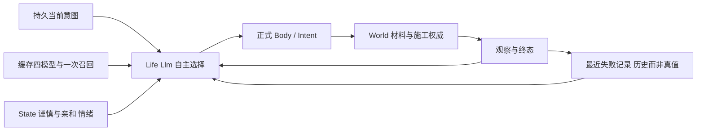

# NPC 连续生活、资源闭环与最小人格扩展

> 用户明确授权在同一 worktree 自主实现验证；按 `executing-plans` 内联执行，不重复开工审批。起点 b41d1f4f。规格继承 [续接](2026-10-11-npc-next-session.md)，本页同时记录小闭环、实现计划与证据。未完成项不能写成验收通过。

## 已核实前提

同 cid607440080896 已通过 Registry 恢复 settler，canonical/cache 不变，Life error=nil。记录 `.demo/observe/npc-autonomy-20261011/takeover-01/`。累计外部模型预算继承 1,243,611/2,000,000，后续先核对交接后的增量，不重置额度。只使用独立18908记忆实例。

两次旧 no_path：原目标分别是 (69.5,417,-516.5)、(65.5,417,-517.5)。历史 survey 两列的实心地表均417；move_to 的 y 要求脚所在空气格。只读当前同世界seq48复演：两目标417均不可站立；改418均找到路径。原观察seq46到48的操作只影响关注木构件，不影响两目标地形。证据 `no-path-01/`，不会将当前只读复演宣称为历史身体移动或自主采材成功。

## 依据与取舍

- [Generative Agents §4.3](https://arxiv.org/html/2304.03442v2#S4.SS3)：计划和环境反应共同维持行为连续性。采用既有持久意图、保留失败及新观察后重规划；不引入日程框架或另一套记忆检索。
- [SayCan 作者说明](https://research.google/blog/towards-helpful-robots-grounding-language-in-robotic-affordances/)：语义计划必须落到环境中可执行的能力。本项目已有权威 Path/Body/World；把可用脚层直接投影给模型、保留诊断，不放宽碰撞或替模型偷偷改目标。
- [FAtiMA §3](https://arxiv.org/html/2103.03020)：事件评价、持久倾向、短期情绪与动作选择分层。沿用纯 State owner；新增亲和倾向只改变感谢时主动接近的幅度，与谨慎的陌生人安全距离分开。具体系数是游戏设计参数，不声称心理测量模型。
- 资源沿用 `World.material_snapshot/material_balances`、`WorldRequest → Intent → World`，身体沿用 Scene.Body/Repair；不新增饥饿数值或补余额路径。本次优先证明有限材料恢复维护；不把材料闭环称为完整食物生存。

## Task 1：失败后继续推进

契约：survey 的模型投影给出可直接用于 move_to 的脚层；不可站立目标的 no_path 有具体只读诊断。Life 决策最近八种被拒调用跨感知轮次/重启可见，不随最近八个普通 Outcome 淘汰；这些是历史失败，环境变化后重新观察再决策，不做永久黑名单。

文件：`npc/{perception,body,memory}.ex`、`npc/brain/llm.ex`及直接测试。接口：survey rows 新增第三项 move_to_y、row_fields 明示含义；`no_path.data` 给 snapshot seq、start、goal、goal_position（复用 Path.position）。`Memory.record_failure/3` 接纳已配对 command 的 rejected Outcome，存 `kind=intention/key=failures` 的最多八条不同调用（最新在前）；同调用覆盖旧失败，id 不构成身份。working_context 返回 recent_failures；只在启用Life的Llm记录，失败保存异常结构化日志且回到当前 Outcome，不伪装已保存。

- [ ] RED：真实Body不可站立目标诊断；survey手算脚层；真实NpcMemory失败跨新进程、普通笔记淘汰及角色隔离；Life Llm收到真实拒绝后下一请求/重启仍见失败。
- [ ] GREEN：最小接线与提示，保持现有权威拒绝和路径算法。
- [ ] 验证：`mix test --no-start test/gate_server/npc_survey_test.exs test/gate_server/npc_memory_test.exs test/gate_server/npc_life_test.exs`，Body针对新增用例、Llm直接回归；记录RED/GREEN后提交。

## Task 2：有限材料自主恢复

契约：测试场景拥有初始有限样本和全部步骤。NPC零目标材料余额，经正常采集得到材料、建造消费、遭受环境变化后重新获取并恢复。每次采集/消费核对actor/txn/余额差及canonical；没有玩家替修复、没有过程中补余额。受控时间/重启只在服务端集成场景，不冒充真实长时模型活动。

先用真实World/Scene/Body组件和模型替身证明入口、资源守恒、拒绝后的观察/恢复；声明替身不能证明自主选择。再用本任务正式release、同LifeBuilder/四模型+一次召回做固定最多30次真实决策（包含停滞和拒绝），固定新运行标识。只给目的和合法场景约束，不给动作序列。玩家环境变化与双端复制约10分钟、首失败停止。真实模型失败保留，不重采样掩盖。

- [ ] RED/现有事实复用：以正常入口验证资源闭环，发现缺口才新增产品代码。
- [ ] 创建可复跑 Test-only 驱动与判定反例，离线干跑、预算核算、冻结版本。
- [ ] 实跑记录，核对每笔NPC采集/消费/恢复与双端复制，单独报告行为和准备失败。

## Task 3：亲和倾向

契约：State 新增 `sociability` 初值0.5，范围0..1；第三次起显著帮助每次+0.05，第三次起伤害每次-0.01，每次指向原World seq。感谢接近幅度为既有 `3 * gratitude` 乘 `(0.5 + sociability)`，默认保持旧行为。谨慎仍负责安全距离；亲和不改变敌对回避或无情绪的陌生人距离。时间经过不漂移人格，情绪照常衰减。旧合法持久行只在 Life 加载边界补初值，不按旧历史偷偷追溯增益，不改Hindsight真值。

- [ ] RED：同事件只有亲和不同造成不同感谢移动目标；批/单事件等价、重复事件无增益、JSON/受控时间保持；旧行迁移保持既有字段。
- [ ] GREEN：纯State规则、加载迁移、文档；不增加新的Brain或模型。
- [ ] 实际正常事件后持久/重启/行为接线验证；模型选择的有限配对最多4请求，固定样本，不将文字意向称为动作。

## 观察与验收边界

记录源码/镜像/加载身份、cid/world/bank、goal/current_plan/recent_failures、每次模型工具及usage、权威Outcome/seq/material balance、Life canonical/evidence、时间控制/墙钟分列。新产物统一 `.demo/observe/npc-autonomy-20261011/`，旧证据不改写。真实模型总预算继续累计，先给本轮最多450,000 token，余量覆盖后台写入/刷新；预测无法容纳时显式停在发请求前。key不落盘。

Review Focus：失败历史不能成为当前World真值；采材必须通过真实工具意图；地表/脚层坐标不可混用；迁移不能重评价旧事件；首次失败、错误与未执行阶段必须进入结论。最小充分回归只扩大到修改的跨owner接缝。聊天保持未完成，不纳入本轮成功声明。

## 执行日志

- 2026-10-11：完成接管和两次no_path只读复演；尚未产品实现或新行为验收。
- Task1：survey投影、失败历史、Body诊断分别取得RED；Life真实Body拒绝到LLM下一轮的接线RED为 `recent_failures=[]`，实现后包含同次seq/目标诊断并跨Body/Life重启保留。直接回归54/55，唯一失败是测试中嵌套模块前向别名未解析，修正并用真实旧行+拒绝写替身验证，Memory10项通过。环境5432不可达、测试端口26769缺省凭证错误、首次Body观察未就绪均保留，不冒充产品RED。持久失败事实由LLM单个进程顺序提交Memory，无新进程/重试门。
- 预算接管审计：从上轮最后请求完成到恢复settler，服务日志新增决策0、请求失败0；Hindsight末次写入仍为08:52、末次刷新08:53，费用无新增。基线仍1,243,611。
- Task2组件：一次作者样本两格、NPC零余额，正常gather每轮入账512再place扣至0；第一次建造被测试Actor正常工具打毁后，NPC第二轮采集恢复、placed_by仍为NPC；最后exhausted且余额0、建筑保持。`resource-01.log` 1项通过（6.5秒），已有生产资源入口无需修改。这是确定动作的真实组件测试，不称自主选择。
- Task3先于昂贵正式部署完成，以一次镜像组合全部生产增量。3个纯规则反例RED（19/22）→32项State/Social GREEN；新增Social实际命令目标对照与旧存档加载后持久补值。组合Life/State/Social/资源共45项通过，`combined-green.log`。旧人格与四模型不重置，不回算历史；正式Demo与真实模型尚未执行。
