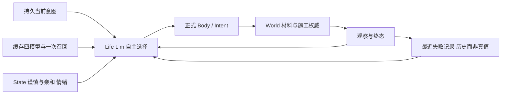

# NPC 连续生活、资源闭环与最小人格扩展

> 用户明确授权在同一 worktree 自主实现验证；按 `executing-plans` 内联执行，不重复开工审批。起点 b41d1f4f。规格继承 [续接](2026-10-11-npc-next-session.md)，本页同时记录小闭环、实现计划与证据。未完成项不能写成验收通过。

## 已核实前提

同 cid607440080896 已通过 Registry 恢复 settler，canonical/cache 不变，Life error=nil。记录 `.demo/observe/npc-autonomy-20261011/takeover-01/`。累计外部模型预算继承 1,243,611/2,000,000，后续先核对交接后的增量，不重置额度。只使用独立18908记忆实例。

两次旧 no_path：原目标分别是 (69.5,417,-516.5)、(65.5,417,-517.5)。历史 survey 两列的实心地表均417；move_to 的 y 要求脚所在空气格。只读当前同世界seq48复演：两目标417均不可站立；改418均找到路径。原观察seq46到48的操作只影响关注木构件，不影响两目标地形。证据 `no-path-01/`，不会将当前只读复演宣称为历史身体移动或自主采材成功。

## 依据与取舍

- [Generative Agents §4.3](https://arxiv.org/html/2304.03442v2#S4.SS3)：计划和环境反应共同维持行为连续性。采用既有持久意图、保留失败及新观察后重规划；不引入日程框架或另一套记忆检索。
- [SayCan 作者说明](https://research.google/blog/towards-helpful-robots-grounding-language-in-robotic-affordances/)：语义计划必须落到环境中可执行的能力。本项目已有权威 Path/Body/World；把可用脚层直接投影给模型、保留诊断，不放宽碰撞或替模型偷偷改目标。
- [FAtiMA §3](https://arxiv.org/html/2103.03020)：事件评价、持久倾向、短期情绪与动作选择分层。沿用纯 State owner；新增亲和倾向只改变感谢时主动接近的幅度，与谨慎的陌生人安全距离分开。具体系数是游戏设计参数，不声称心理测量模型。
- 资源沿用 `World.material_snapshot/material_balances`、`WorldRequest → Intent → World`，身体沿用 Scene.Body/Repair；不新增饥饿数值或补余额路径。本次优先证明有限材料恢复维护；不把材料闭环称为完整食物生存。

## Task 1：失败后继续推进

契约：survey 的模型投影给出可直接用于 move_to 的脚层；不可站立目标的 no_path 有具体只读诊断。Life 决策最近八种被拒调用跨感知轮次/重启可见，不随最近八个普通 Outcome 淘汰；这些是历史失败，环境变化后重新观察再决策，不做永久黑名单。

文件：`npc/{perception,body,memory}.ex`、`npc/brain/llm.ex`及直接测试。接口：survey rows 新增第三项 move_to_y、row_fields 明示含义；`no_path.data` 给 snapshot seq、start、goal、goal_position（复用 Path.position）。`Memory.record_failure/3` 接纳已配对 command 的 rejected Outcome，存 `kind=intention/key=failures` 的最多八条不同调用（最新在前）；同调用覆盖旧失败，id 不构成身份。working_context 返回 recent_failures；只在启用Life的Llm记录，失败保存异常结构化日志且回到当前 Outcome，不伪装已保存。

- [ ] RED：真实Body不可站立目标诊断；survey手算脚层；真实NpcMemory失败跨新进程、普通笔记淘汰及角色隔离；Life Llm收到真实拒绝后下一请求/重启仍见失败。
- [ ] GREEN：最小接线与提示，保持现有权威拒绝和路径算法。
- [ ] 验证：`mix test --no-start test/gate_server/npc_survey_test.exs test/gate_server/npc_memory_test.exs test/gate_server/npc_life_test.exs`，Body针对新增用例、Llm直接回归；记录RED/GREEN后提交。

## Task 2：有限材料自主恢复

契约：测试场景拥有初始有限样本和全部步骤。NPC零目标材料余额，经正常采集得到材料、建造消费、遭受环境变化后重新获取并恢复。每次采集/消费核对actor/txn/余额差及canonical；没有玩家替修复、没有过程中补余额。受控时间/重启只在服务端集成场景，不冒充真实长时模型活动。

先用真实World/Scene/Body组件和模型替身证明入口、资源守恒、拒绝后的观察/恢复；声明替身不能证明自主选择。再用本任务正式release、同LifeBuilder/四模型+一次召回做固定最多30次真实决策（包含停滞和拒绝），固定新运行标识。只给目的和合法场景约束，不给动作序列。玩家环境变化与双端复制约10分钟、首失败停止。真实模型失败保留，不重采样掩盖。

- [ ] RED/现有事实复用：以正常入口验证资源闭环，发现缺口才新增产品代码。
- [ ] 创建可复跑 Test-only 驱动与判定反例，离线干跑、预算核算、冻结版本。
- [ ] 实跑记录，核对每笔NPC采集/消费/恢复与双端复制，单独报告行为和准备失败。

## Task 3：亲和倾向

契约：State 新增 `sociability` 初值0.5，范围0..1；第三次起显著帮助每次+0.05，第三次起伤害每次-0.01，每次指向原World seq。感谢接近幅度为既有 `3 * gratitude` 乘 `(0.5 + sociability)`，默认保持旧行为。谨慎仍负责安全距离；亲和不改变敌对回避或无情绪的陌生人距离。时间经过不漂移人格，情绪照常衰减。旧合法持久行只在 Life 加载边界补初值，不按旧历史偷偷追溯增益，不改Hindsight真值。

- [ ] RED：同事件只有亲和不同造成不同感谢移动目标；批/单事件等价、重复事件无增益、JSON/受控时间保持；旧行迁移保持既有字段。
- [ ] GREEN：纯State规则、加载迁移、文档；不增加新的Brain或模型。
- [ ] 实际正常事件后持久/重启/行为接线验证；模型选择的有限配对最多4请求，固定样本，不将文字意向称为动作。

## 观察与验收边界

记录源码/镜像/加载身份、cid/world/bank、goal/current_plan/recent_failures、每次模型工具及usage、权威Outcome/seq/material balance、Life canonical/evidence、时间控制/墙钟分列。新产物统一 `.demo/observe/npc-autonomy-20261011/`，旧证据不改写。真实模型总预算继续累计，先给本轮最多450,000 token，余量覆盖后台写入/刷新；预测无法容纳时显式停在发请求前。key不落盘。

Review Focus：失败历史不能成为当前World真值；采材必须通过真实工具意图；地表/脚层坐标不可混用；迁移不能重评价旧事件；首次失败、错误与未执行阶段必须进入结论。最小充分回归只扩大到修改的跨owner接缝。首次设计时聊天未完成；当前对话成果与后续验证见下节，不把旧占位当现状。

## 执行日志

### 对话合入后续接（当前）

用户明确要求继续自主生活并将聊天加入能力库；核对 `8eac2696` 后确认 `Dialogue.entries → Abilities.entries/tools/command → Body.say → Scene.say → heard` 已经是正式共用路径，默认人生能力含 say，不重复建聊天适配器。现有两NPC由各自模型生成8条指定发言，用户提示开场；本轮需补无玩家开场、与生活能力共存的验证，而非重跑旧玩家UI事实。

用户追加1000000外部token：总上限3000000，已有2010947（含旧超额10947）继续计入，可用989053。旧付费停止账本和失败证据保留；新增统一请求账本继承该基线，不按角色、后端或重启清零。

实施使用已有隔离worktree，沿用设计/计划/TDD流程，不新增开工审批。以下为本次小闭环及文件边界：

- [ ] 请求预算：`scripts/npc_life/budget_proxy.py` 为 Test-only 唯一付费出口，SQLite持久账本先原子预留、后结算；所有NPC决策及独立18908 Hindsight的retain/reflect/consolidation共享。模型请求体/凭证不落账本。准备只改本任务容器配置并保留数据；不改生产能力、Scene或协议。`test_budget_proxy.py`先证明并发不能各自借同一余额、崩溃预留不释放、费用未知不记零、count失败不调用模型。经本地HTTP替身验证真实转发边界后再接现场。
- [x] 能力组合：复用现有say定义，检查默认life profile同一工具表含say/gather/move_to；两个真实Body/Runtime/Llm通过Scene交谈，模型与Hindsight使用明确替身，证明每个大脑自己的heard与自己的工具输出能完成往返。无玩家消息作为触发；该测试不证明语言生成或真实自主意愿。
- [ ] 正式有限实验：先同版本只读场景干跑，再单次约10分钟以内的同世界两NPC/双端观察。先无玩家开场的短交谈，再有限材料自主维修；阶段首失败停止后续，不把台词当履约或World真值。两模型均使用原缓存四模型+一次召回。总费用由出口账本覆盖记忆后台；结束关闭出口、退出life且保留持久尾部，汇总已用与未决预留。

预算依据与适用条件：OpenAI官方 [token counting](https://developers.openai.com/api/docs/guides/token-counting) 与 [input_tokens](https://developers.openai.com/api/reference/resources/responses/subresources/input_tokens/methods/count) 提供完整Responses输入计数；`max_output_tokens`覆盖可见输出及推理token。当前兼容服务 `/responses/input_tokens` 已实查返回 `object=response.input_tokens,input_tokens=6`、无usage/模型生成，证据 `resume-01/token-count-preflight.json`。因此不凭字数猜费用：计数与实际请求共享同一输入/模型/工具，输出上限8192；不支持计数、stream/background、隐式服务端会话或缺失usage时显式停止，不另造估算回退。SQLite事务将所有并发预留串行化；启动遗留预留按未知费用保留，实际token超出预留作为契约违反关闭出口。这里只有预算与外部传输职责，不拥有NPC动作/记忆真值。

验收命令与范围：`python -B -m unittest discover -s scripts/npc_life -p test_budget_proxy.py`；NPC组合只跑新增接缝及既有Dialogue/Abilities直接回归。预算异常、输出截断、网络失败均为当轮失败，不让第三方重试绕过出口。尚未启动付费实验，准备进度不得冒充自主生活验收。

**实查否证与当前停止边界**：`resume-01/frozen-count-preflight.json`首次完整输入返回502，`count-diagnosis.json`保留最小输入502和去掉reasoning后的计数；最后`frozen-count-exact-02.json`以原有全部计数字段（含reasoning）返回11694，原决策真实usage为10294。最初“hello计数6”不足以验证完整模型契约，当前不能宣称兼容供应方实现了官方精确计数。没有发生成请求来赌误差，也没有部署代理或改现场；准备脚本先核验该反例，再允许任何容器生命周期动作。外部原因尚未查明，不以输出余量掩盖输入计数不一致，不猜固定补偿常量。

本地预算出口15项通过（`budget-final-green.log`）：并发共享余额、重启持有未知费用、输入计数/usage违约、截断、传输/结算失败、下游回传丢失和重复serve端口占用。审查追加反例先RED（`budget-review-red.log`、`serve-red.log`）再修复；初轮Windows连接未关闭与测试替身类型错误均保留，不混称产品行为失败。依据为 [SQLite BEGIN IMMEDIATE](https://www.sqlite.org/lang_transaction.html) 的串行写事务与 [Python连接上下文](https://docs.python.org/3/library/sqlite3.html#how-to-use-the-connection-context-manager) 不负责关闭连接的明确契约；连接显式关闭。固定单容器/端口取得绑定后才恢复旧预留，数据文件不能由第二个serve共享。

Hindsight配置依据：[官方配置](https://hindsight.vectorize.io/developer/configuration)、[多语言说明](https://hindsight.vectorize.io/developer/multilingual)与固定镜像`engine/prompt_utils.py`/`engine/retain/fact_extraction.py`源码共同确认 `LLM_OUTPUT_LANGUAGE=English` 会替换“保留源语言”规则，作用于抽取/巩固/反思；原话仍在服务端Speech与经历文档可追溯。计划使用此现有选项匹配BGE-small/flashrank英文约束，不引入翻译模型、不重写旧事实。上游count30秒/生成120秒，NPC和Hindsight请求180秒、Hindsight SDK/包装重试0；异常由统一出口关闸。以上部署配置尚未生效，既有语义失败未因此消失。

`npc_life_registry_test`与`npc_dialogue_world_test`合计11项通过（`chat-library-01.log`），新增的是共享能力与真实运行时接线证据，因现有产品已经支持say而为GREEN基线，不伪称改前RED。原玩家UI/Session/Scene的冻结事实不重复实跑。新固定场景脚本`live_autonomy.py`及负例检查已保存，真实自主交谈/修复仍未执行；累计外部模型2010947/3000000，余989053。

最终离线检查：`python -B -m unittest discover -s scripts/npc_life -p 'test_budget*.py'` 17项，`-p test_service.py` 5项，`-p test_live_autonomy.py` 5项通过，分别为`budget-suite-final.log`、`service-final.log`、`live-review-green.log`。新增双端零投递反例先RED后GREEN；关闸/结算查询失败时各NPC恢复/停用与trace停止独立执行。`git diff --check`通过；Python只作AST解析，不跨树写pycache。未扩大到旧协议或玩家UI回归。

当前接管manifest为`resume-01/manifest.json`：两NPC均settler/no-life、无本轮trace，World seq48；两bank累计usage仍893288/182925且后台待办为0。真实兼容计数差异是尚未解除的外部阻塞，不是额度不足；本轮不继续昂贵阶段，也不把准备阶段或替身测试记成完整自主生活成功。

- **2026-10-11 20:16优先级切换**：用户明确要求先实现玩家↔NPC与NPC↔NPC聊天，由原会话接管 say/heard。自主生活已保存，暂停正式模型/双端/配对实验，不再升级共享Demo或切换后端；占用及运行预算真值已同步 `2026-10-11-npc-next-session.md` 页首。真实自主修复尚未验收，不能把下面组件通过扩大成完整目标完成。

- 2026-10-11：完成接管和两次no_path只读复演；尚未产品实现或新行为验收。
- Task1：survey投影、失败历史、Body诊断分别取得RED；Life真实Body拒绝到LLM下一轮的接线RED为 `recent_failures=[]`，实现后包含同次seq/目标诊断并跨Body/Life重启保留。直接回归54/55，唯一失败是测试中嵌套模块前向别名未解析，修正并用真实旧行+拒绝写替身验证，Memory10项通过。环境5432不可达、测试端口26769缺省凭证错误、首次Body观察未就绪均保留，不冒充产品RED。持久失败事实由LLM单个进程顺序提交Memory，无新进程/重试门。
- 预算接管审计：从上轮最后请求完成到恢复settler，服务日志新增决策0、请求失败0；Hindsight末次写入仍为08:52、末次刷新08:53，费用无新增。基线仍1,243,611。
- Task2组件：一次作者样本两格、NPC零余额，正常gather每轮入账512再place扣至0；第一次建造被测试Actor正常工具打毁后，NPC第二轮采集恢复、placed_by仍为NPC；最后exhausted且余额0、建筑保持。`resource-01.log` 1项通过（6.5秒），已有生产资源入口无需修改。这是确定动作的真实组件测试，不称自主选择。
- Task3先于昂贵正式部署完成，以一次镜像组合全部生产增量。3个纯规则反例RED（19/22）→32项State/Social GREEN；新增Social实际命令目标对照与旧存档加载后持久补值。组合Life/State/Social/资源共45项通过，`combined-green.log`。旧人格与四模型不重置，不回算历史；正式Demo与真实模型尚未执行。
- 后续部署事实：审查无确定产品Critical/Important；补采集逐笔actor/seq检查和survey注释后，资源/Survey/Memory/LLM直接回归17项通过，`review-green.log`。正式镜像源码 `5b4cd58e` 构建103.92秒、exit0；在用户新优先级消息之前已完成冷升级，`upgrade-01/`证明旧canonical仅补亲和初值，其余严格相等。此前“尚未执行Demo”是当时进度，不是当前运行版本。
- Test-only新场景：六格天然木材、NPC零余额，无玩家修复或中途补料。只读快照副本上四个技能站位均可寻路，`dry-01/frozen-path-copy.json`；这不是实际身体移动。准备查询时出现嵌套for语法、material_snapshot误认返回形状、skill_context漏解{:ok,...}三类只读脚本错误，均未改变World或发模型请求，不计产品RED。
- 新驱动的公开接口接线与双端逐事务门禁审查发现缺陷，均在实跑前修复；新增末动作终态、验收窗口先于settler恢复两个反例RED→GREEN，`last-action-red.log`、`lifecycle-red.log`、`driver-green.log`（17项）。判定器最初只有GREEN证据，不伪称这部分有改前RED。真实实验尚未启动；350000决策usage轮询+100000余量不能称逐请求硬预算门禁，错误后停止的轮询与生产重试仍需在下一次实际实验前收口。
- 最新外部费用复核：`chat-priority-handoff-01/manifest.json`；当前settler、trace关闭、Life无错误、world cursor48；升级后无模型请求，Hindsight usage不变且无后台待办。累计1243611/2000000，余756389。本轮未跑人格配对，也未把安静时间或玩家旧修复算自主活动。
