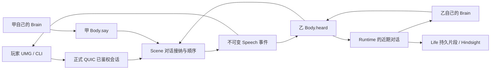

# NPC 对话：玩家与 NPC、NPC 与 NPC

分类：全局系统功能；Demo 与驱动为 Test-only。2026-10-11 用户将对话提为首要增量，明确要求两种参与组合。当前是设计/实施记录，勾选验收前不代表聊天已完成。

## 契约与范围

一个角色只拥有自己的发言。服务端确认谁说了什么、向谁说、谁处于听觉范围；NPC 自己决定是否回应、说什么及是否改变计划。两名 NPC 经同一条说话/听见通道交流，不由一个模型同时编写双方台词。聊天不暂停世界，也不自动控制听者。

第一版采用附近公开文字交谈，可指定对象，旁人能听见、加入；默认无回答义务。玩家↔玩家也是同一传输的自然结果。先覆盖同一 Scene；跨 Scene、耳语/私聊、语音、声学遮挡、全局频道、离线留言、任务/交易承诺执行均不在这一增量。跨 Scene 指定对象明确拒绝，不能伪装送达。听觉按权威完整 XYZ 距离，不复用视锥判定。

成功场景：玩家 A 指定 NPC 甲说话，甲依据自己的历史回答；甲自主对乙说话，乙通过自己的一次决策回答；玩家 B 在旁看到同一权威发言并能加入；远处角色收不到；离开或沉默可结束，NPC 回到自己的活动；重要对话留有来源，重启后可回忆。不能把协议收包、固定脚本台词、内部 heard 注入称为模型自主交谈。

## 选择与依据

- 附近公开交谈（采用）：具备共同场景与旁听，复用正式角色会话。纯私聊不能覆盖旁听，全球广播会让不在现场的 NPC 获得信息。默认范围 12 米，只是可调产品初值，不是文献结论。
- 感知与选择分离：[Epic AI Perception / Hearing](https://dev.epicgames.com/documentation/en-us/unreal-engine/ai-perception-in-unreal-engine) 将听觉刺激、范围/寿命与行为分开。本项目沿用边界，由服务端而不是 UE AI 感知裁定听众；第一版不模拟穿墙衰减。
- 独立代理记忆、计划、交谈：[Generative Agents](https://arxiv.org/abs/2304.03442) 支持把对话放入各自经历与后续规划；不引入其整套模拟器，也不以该论文证明我们的长期自洽。
- 有序发言：[Erlang 信号契约](https://www.erlang.org/doc/system/ref_man_processes.html) 不提供不同发送者间的全局顺序，因此由一个 Scene owner 接纳发言，生成会话内序号。客户端不拼接多个来源猜顺序。
- 片段记忆：[Hindsight retain](https://hindsight.vectorize.io/developer/api/retain) 支持带时间/文档身份的经历。继续固定 0.10.3、flashrank、片段批量写；具体 API 以仓库现有适配器及固定版本测试为准，不每说一句就 reflect/retain。

## 所有权

- `SceneServer.Dialogue`：纯状态规则；由现有 `Movement.Scene` 拥有状态和生命周期，不再起一个会话监督根。接纳时使用 Scene 已接收的最新权威角色观察，记录裁决 tick，不信客户端位置/姓名/kind。
- `Movement.Scene.say(scene, identity, request)`：玩家与 NPC 共用公共入口。当前 identity 必须对应已 Ready 且仍在场角色；指定目标必须在同 Scene、同一听觉范围且可接收。失效/移交期间显式失败。
- Gate：只鉴权、译码与转发，不解释台词，不调用 LLM。Scene 经既有 Outbound.control 投递 Speech。`accepted` 仅代表完成权威接纳并向当时听众排入可靠出口，不代表听者理解、答应或已持久记忆。
- Body：`say` Outcome 是 Scene 结果；收到本人回声用于记账，不把自己说的话当作新外界刺激。收到他人 Speech 才产生 `heard`。
- Runtime：拥有近期发言尾部；传给自己的 Brain 与已有技能中断策略，不清掉尚待处理的话，不强制取消工作。
- Llm：同一个人生大脑决定工作/说话/沉默，不建立第二聊天大脑。请求在途收到的新发言在下轮保留；对话检索加入最近被直接叫到的话，每轮依然仅一次 Hindsight recall。
- Life：只接纳服务端已发生的 Speech 事件，追加经历与现有片段 outbox；不依自然语言直接修改人格/情绪/库存/关系数值。

## 发言与轮次

1. 请求：`request_id`（调用者单会话递增）、`target_id`（0 表示对附近公开说）、`conversation_id`（0 新起）、`text`。身份来自已鉴权连接/Body；用户不能提交 speaker/kind/name/position。
2. 事件：`conversation_id`（服务端随机非零 u64）、`turn`（从 1 递增）、`speaker_id`、`speaker_epoch`、`speaker_kind`、`speaker_name`、`target_id`、`at_ms`、`text`；接收者 identity 由 Outbound 携带。事件唯一键为 conversation_id/turn。随机会话号避免进程重启后复用旧序号。
3. 合法文本：UTF-8，去首尾空白后 1..512 个 Unicode 字符，最多 2048 字节；拒绝控制字符（换行可保留）。超长拒绝，不切断中文。发言间隔至少 2 秒，双方都受规则约束。数值由服务端 Dialogue 一处定义并作为能力描述的来源。
4. 指定对象是叫谁，不是保密：同范围其他人照样收到。回复须引用仍有效的 conversation_id；调用者必须是此前收到此会话发言的人，不能猜 ID 接入远程对话。每次发言重新计算听众，离开后不再收到。
5. 同一会话连续没有玩家发言时，最多 8 句 NPC 发言；下一条被明确拒绝为 `conversation_limit`。玩家新的发言刷新该计数。NPC 自己新开话题至少间隔 5 分钟，防止换 ID 绕过接话上限；听到的话仍可在额度内选择回应。会话空闲 120 秒失效；Scene 自己清理失效会话，不依赖下一条消息或别人维持活性。
6. 被直接叫到只唤醒被叫者。旁听进入近期上下文，在下一次正常决策时可选择加入，不唤醒整圈 NPC。所有决策仍计入现有 60 次/小时上限；无配额、请求失败或拒绝保持可诊断，不生成假回复。
7. 每个身份只缓存最近一次请求与结果，并维护请求高水位。相同 request_id/同内容返回原结果、不二次广播；同号不同内容拒绝 `request_conflict`；更旧号拒绝 `stale_request`。玩家/Body 不自动重试发言。会话重连即新身份。
8. 沉默是合法选择：现有 wait/继续工作即可。没有台词即没有 Speech。结束由沉默、离开或轮数上限自然产生，不额外强制生成告别词。人格/情绪影响是否接近、接话与措辞；不能用一句赞美就改写既有伤害证据。

## 线协议（已实现）

复用 Session 的 M1 envelope（大端、domain=1），在既有 kind 14 后追加，不改变任何旧消息字段。新增 Hello 40，在两端与构建清单同步，旧 Hello 显式拒绝。

| kind | struct | 按顺序字段 |
|---|---|---|
| 15 | Session.Say | identity, request_id:u64, target_id:u64, conversation_id:u64, text:utf8 |
| 16 | Session.Speech | identity, conversation_id:u64, turn:u32, speaker_id:u64, speaker_epoch:u64, speaker_kind:u8, speaker_name:utf8, target_id:u64, at_ms:u64, text:utf8 |
| 17 | Session.SayResult | identity, request_id:u64, conversation_id:u64, turn:u32, reason:utf8 |

SayResult.reason="ok" 为接纳；拒绝 conversation_id/turn 为 0。跨进程调用超时为 `delivery_unknown`，表示结果未知，不等于拒绝；显示“发送结果未知”，不自动重发。正常结果必须关联 request_id；Speech 不依赖 EntityEnter 到达顺序即可显示名字。旧 G0 字节冻结样本保持原样，不以新 Hello 重捕获。

## 短期上下文与长期经历

近期对话按权威接收顺序保留最近 24 句（自己的句子也保留）；呈现明确 speaker、target、conversation、turn、时间和原话。短期尾部是有界上下文，不是永久聊天存档。独立 `heard` 输入不混入 instructions；提示说明台词是角色声明，不能变成系统指令。

Life 对自己的发言、被叫到的发言以及实际听到的旁听统一留来源明确的经历，批量封存，复用原 outbox/refresh。存储的是 “我听到/我说了……”，不是把引号内容当成已验证世界事实。聊天经历不推进 World transaction cursor；片段 ID 使用经历本身的唯一 ID，不用 World seq 假装聊天事务。持久化失败可见，不能声称重启记住了。

人格/情绪本轮不新增数值维度、不做语言情感分类器。已有 caution/sociability、anger/gratitude、关系以及缓存 mental models 进入同一个选择上下文。后续若要“被辱骂会生气”必须另行定义可审计的权威评价规则，不能靠自由文本分类结果任意写心智。

## 玩家入口与可观测性

复用 Voxim 唯一生产 `VoxelWorldActor`/M1 连接与现有 PlayerController。新增全局 UMG 对话组件与资产：Enter 打开输入、Enter 发送、Escape 取消，中文输入法组合 Enter 不能误提交；选择当前目标后显示“对 某某 说”，无目标显示“附近”。附近日志显示确认后的原话、发言人和指定对象；待确认/拒绝单独显示。输入中暂停角色移动/工具输入，关闭后恢复原输入模式，不挂住按键。

CLI 和 UMG 共用 `Say` 调用；日志 `dialogue.request/result/speech` 包含 request_id/conversation_id/turn/speaker/target/receiver/reason；Scene 只读观察包含活跃会话/接纳和拒绝计数；NPC 观察包含近期对话与决策输入依据。默认输出 `.demo/observe/npc-dialogue-20261011/`；客户端截图遵从 Voxim `Captures/`。

## 实施计划

按仓库 `AGENTS.md` 与 `Voxim/Docs/Testing.md`，已授权范围自主推进，无额外逐文件审批。服务端在当前 worktree；客户端另建隔离 worktree，不动主树。旧自主生活会话已保存并让出共享产品文件和 Demo。

- [ ] 1. 纯协议与 Scene：`session/types.ex`、`session/codec.ex`、`scene_server/dialogue.ex`、`movement/scene.ex`；先红再绿。证明中文 golden、未知版本/截断、完整 XYZ 范围、身份冒用、离开/重连、重复请求不重播、会话过期/轮次限制。纯规则受控时钟；真实 Scene 测试经正常 join/Ready 建立角色。
- [ ] 2. NPC：`npc/dialogue.ex` 能力定义、Abilities、Body、Runtime、Brain.Llm、Brain 文档、Life。工具 `say{text,target_id,conversation_id}` 的 target_id/conversation_id 可空、译码为0；统一 Outcome。证明每个大脑只见实际听见的消息、在途不丢新话、旁听不群体唤醒、记忆来源与 World cursor 不串、重启恢复及出站失败不被记成成功。
- [ ] 3. Gate 与客户端：控制流 Say 转发、SayResult/Speech 解码与 identity 隔离，Hello40；Voxim 网络类型、M1数据桥、PlayerController、authored UMG、CLI、自动化与现有生产根接线。为双方共用固定 golden，不复制裁决规则。
- [ ] 4. 正式 Demo：冻结代码/两端/镜像版本；沿用独立18908记忆实例，不碰18888/18898、不落盘key。先驱动干跑与反例，再约10分钟真实双端，两个独立 LLM NPC、附近旁听玩家、远距负例；核对每个确认事件。然后服务端重启读取持久对话记忆；长时间规则在受控时钟测试。
- [ ] 5. 审查本次边界、修复、复核最小相关回归，更新 NPC README 与此处证据。分别报告已实现/已实跑/已验收。

## 验收与风险

需要实证的五类破坏：两个玩家并发叫同一 NPC 后答错对象；NPC 模型在对方离开后迟到应答；技能途中聊天导致未完成动作丢失；重连回放旧身份台词；恶意台词被误当作系统命令/已证世界事实。上述分别落在 Scene 顺序、目标重检、Runtime技能回归、客户端代际过滤和上下文/记忆断言；真实模型验收承认语言生成非确定，不能只靠单条输出证明永不受诱导。

已知限制：12米范围是简单距离模型；同Scene边界明确；Npc↔Npc预算限制降低交谈长度；真实模型可能选择沉默，需要区分自主不回应、预算拒绝、网络失败。模型说“答应”只是一句发言，不证明承诺已履行。第一轮不声称长期人格一致性或完整自主人生已经验收。

## 进度与证据

- 设计前已核对：旧 Body.say 恒拒 `chat_unavailable`；Abilities 不投影；Llm.heard 只置 dirty、不保留文本；无当前正式 UI/QUIC 对话契约。不能复用旧归档客户端聊天当完成品。
- 已协调原自主生活会话冻结共享产品文件和 Demo；当前 release 为5b4cd58e，模型本轮未发起，累计外部 token1,243,611/2,000,000。
- 用户已明确选择“附近公开交谈，可指定对象”。服务端首轮实现提交381f5388/6303a114/530c91c0；客户端隔离工作树 `C:/Users/DYZ/orca/workspaces/Voxim/npc-dialogue-20261011`，提交3594478a；尚未合并主树。
- 分层证据：纯合同151项通过；Scene新规则与真实模块回归40项通过；NPC相关8文件88项通过；客户端独立构建及16项Session/Hello/对话边界测试通过。各自替身与覆盖边界见 `.demo/observe/npc-dialogue-20261011/{scene,npc}/` 与客户端 `Saved/Dialogue/`。这些不等于真实QUIC/模型/UMG完成。
- 独立审查发现NPC说话调用超时的身体退出与技能中断提示来源漂移，两项正在用最小反例修复。用户端超时为 `delivery_unknown`；NPC沿用既有 `Outcome.status=rejected` 表示本次调用未获确认，必须看reason，不能把 `delivery_unknown` 当成Scene权威拒绝。未新增全局Outcome状态集合。
- 双端驱动 `scripts/npc_dialogue/run.py`：保留本任务独占的长期世界与LifeBuilder历史，合法登记第二个NPC“松岚”，不改心智。两端使用正式登录、QUIC、生产地图与UMG；玩家只提出话题，两个life大脑各自决策，每个最多16请求。本轮模型使用量另加至1243611/2000000累计额度。初次UMG发言双端确认前，后续阶段与模型不启动；结束恢复无模型的settler后端。
- 判定器先过8个离线最小用例，包含漏一笔、重复、错误角色/文本/收件人、超范围仍收到、错误request关联和缺失服务端收件人记录；不能以共有一条消息或回放退出成功当完整复制。
- 本节最后更新时尚未启动真实模型与双端，正式Hindsight持久对话与重启验收仍待运行。
