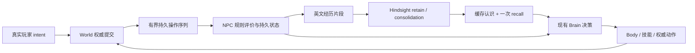

# 一个 NPC 的经历、记忆、情绪与人格最小闭环

> 全局系统功能 + Test-only 验收场景。状态：设计已定，实施中，尚未实跑/验收。
> For agentic workers: REQUIRED SUB-SKILL: superpowers:subagent-driven-development.
> 唯一产品规格：[NextLoop](../../../../Voxim/Docs/Gameplay/NpcEvolve/NextLoop.md)。用户 2026-10-11 授权自主推进到真实 Demo；本文细化工程接口，不改变交接结论。

## 契约与范围

在本 capability-library worktree 实现；不修改主树或 Voxim 客户端。一个正式 Session/Body 的 NPC，通过现有工具建造；两个真实 Demo 客户端发起伤害、帮助、再次伤害。离线测试使用受控时钟，不延长双端场景到数小时。LLM 决策默认关闭；开启仍遵守 60 次/小时。Hindsight 后台费用单列。

- World 是位置、物体、材料、余额和操作的唯一事实源。
- NPC 自己持有经历评价、人格和情绪；规则只接纳 World 已提交的操作。模型不修改这些数值。
- Hindsight 0.10.3 独立实例 `voxim-npc-life-loop-20261011`，宿主端口 18908；不碰 18888/18898 实例/卷。flashrank 重排，BGE-small-en-v1.5 ONNX CLS/query prefix，英文经历，启用 observations/consolidation。
- Hindsight 按片段批量 retain；缓存 self/relationships/world/commitments 四份 mental models。每次决策至多一次 situational recall，不在决策热路径 refresh。所有模型文本注明不是当前数值真值。
- 重启继续同 cid、同记忆库、同人格与衰减后的情绪；不可伪装新生。

## 依据与取舍

[FAtiMA 论文 §3.4–3.6](https://arxiv.org/html/2103.03020) 提供事件规则评价、独立情绪状态、随时间衰减、由情绪影响动作的已有实践。本轮采用这些边界，不引入其框架或完整心理分类。具体系数是游戏设计参数，不声称是人类心理测量模型。

[Hindsight retain](https://hindsight.vectorize.io/developer/api/retain)、[mental models](https://hindsight.vectorize.io/developer/api/mental-models) 支持片段文档和预计算认识。实现以实际 0.10.3 镜像 API 为准，不把后续版本的幂等 operation_id 当作已存在。复用交接实验的已验证配置，独立数据卷；异步后台写入不阻塞身体。

已评估三种接入：只写提示词不能证明人格有状态；读取客户端画面猜事件丢失因果；选用 World 提交记录 + NPC 自有纯评价器。World 已有 `operation`（actor/kind/material/micro），本轮扩充内部溯源并持久化有限操作历史，不改 wire。只保留最近 512 个有操作者的提交；落后游标明确返回 gap，绝不静默跳过。

## 最小心智与可观测面

情绪：愤怒 anger（回避伤害者）、感激 gratitude（接近帮助者）；按真实经过秒数指数衰减，离线时间同样计算，负时间差不倒流。人格：谨慎 caution，初值 0.2，前两次伤害不漂移，第 3 次起每次最多 +0.05，上界 1；多次帮助后可小幅降低。谨慎影响陌生人的期望社交距离（2 + 6*caution 米）。这一个人格维度足以本轮证伪慢变化，暂不加入没有行为用途的维度。

情绪唯一持久值锚定最近一次评价事件的时刻；当前时间的衰减只从该锚派生展示，不把轮询时刻写回锚。否则延迟事件与饱和上界会使同一事件序列按不同传输批次产生不同情绪。连续击打到同格被毁只算一次显著伤害，原材料修复后才开始下一轮；自己修复清除损坏标记但没有正向奖励。

关系 trust 按 actor 保存，伤害降低、帮助提高；它是 NPC 对该人的主观关系，不是阵营真值。伤害定义：别人破坏 NPC 放置的物体，或它已经记住并关心的同一施工位置。帮助定义：别人把曾被破坏的施工格按原材料修复；不把陌生人随便放块算帮助。自己操作、无效/失败 intent、无主自然地形改动不改变人格/情绪。

观察输出必须包含 cid、world_id、事务游标、来源 seq、actor、分类、情绪、人格、关系、选择动作及原因、目标位置、最终 Outcome；Hindsight 输出 pending/retained/facts/refresh 状态、召回耗时和各操作 token。数值只在 observe/log 中，不加玩家 UI。

## Global Constraints

- 读取 `AGENTS.md`、`../Voxim/Docs/Testing.md`；中文代码注释；最小充分 RED→GREEN 测试。
- 不用客户端预测或测试专用事件修改生产心智；不从 Hindsight 取当前数值。
- 跨 app 走公开 API / WorldServer.Movement.route，不穿内部 worker。
- 保留现有 NPC 行为和工具契约；启用 life 的 NPC 才增加心智能力。
- 持久写失败必须显式报错；游标、心智和待写片段一起持久化；Hindsight 未产出可检索事实不算 retain 成功。
- key 只在进程环境；日志、命令行参数、配置与报告不得写 key。
- 本文任务接口是实施约定；实际发现矛盾在进度中记录修订及原因。

## Task 1: World 有界权威操作历史

**Files:** `apps/voxel_region/lib/voxel_region/world.ex`、`world/{observation,log,tools,production,...}.ex`，新增 `world/interactions.ex`；测试 `apps/voxel_region/test/world_interactions_test.exs`（实际测试目录沿用仓库惯例）。

**Interfaces:**
- `VoxelRegion.World.interactions_since(server, cursor)`，cursor 为 `nil`（建立现在起点）或非负事务序号。
- 返回 `{:ok, %{world_id: binary, cursor: integer, events: [event]}}` 或 `{:error, {:interaction_gap, oldest_seq}}`；world_id 来自已有 content_version 的稳定表示。
- event 为 `%{seq: integer, at_ms: integer, actor: integer, kind: :damage | :destroy | :build, cell: {x,y,z}, material: integer, placed_by: integer | nil}`。按 seq 升序；placed_by 来自提交前目标归属。
- World 的操作 history 上限 512，操作与世界事务同日志提交；checkpoint/replay 保留历史。非操作事务不制造事件。

1. 写失败测试：权威 build/damage 的 actor/旧归属、失败操作不产事件、同一序列读取、压实/冷重启、超出保留范围显式 gap。
2. 运行新测试，确认未实现的接口失败。
3. 复用已有 operation 构造点及 World 日志，最小实现公开读取和持久历史。不额外复制几何真值；不更改 wire 字节。
4. 跑新测试与被改动直接覆盖的 operation/ownership 测试，记录命令结果。
5. 自审并提交这一任务；报告文件交控制器审查。

## Task 2: NPC 纯心智状态

**Files:** 新增 `apps/gate_server/lib/gate_server/npc/life/state.ex`、`apps/gate_server/test/gate_server/npc_life_state_test.exs`。

**Interfaces:** `GateServer.Npc.Life.State.new(cid, world_id, cursor, now_ms)` 返回纯 JSON 兼容字符串键 map；`advance(state, events, cursor, now_ms)` 返回 `{state, episodes}`。event 消费 Task 1 形状，重复 seq 不再评价；一次 batch 与逐条推进的规则语义相同。
- `view(state, now_ms)` 返回衰减后 JSON map（不写库）；`behavior(state, observation, now_ms)` 返回 `%{mode: :work | :avoid | :thank | :cautious, actor: cid | nil, distance: float, source_seq: integer | nil}`。决定动作模式不做 World 查询或实际移动。
- `advance` 返回可持久的 canonical 事件态，不能把 `view` 返回的当前时间投影传回 `advance` 或覆盖它；同一排序事件序列分批与整批必须得出相同 canonical 状态，包含饱和情况。
- episodes 是英文 `%{"id" => world_id <> ":" <> seq, "text" => text, "at_ms" => ms, "seq" => seq}`，只含事实与明确主观反应，不虚构 actor 名字/对话。
- state 带 cid/world_id/cursor/last_at_ms/emotions/traits/relationships/concerns/evidence。不同 world_id 的拒绝在集成边界。

1. RED 测试：伤害→帮助→重复伤害；对照自操作/自然块/无关建造；重复事件；受控时钟长时间衰减与人格界限；JSON roundtrip/cold restore 后关系和人格继续。
2. GREEN 最小纯规则。anger/gratitude 的 half-life 120 秒，单次增量 0.6；关系初值 0，伤害 -0.35、修复 +0.25；caution 按上文阈值变化，所有值有界。
3. 行为测试分别孤立每个维度（near entities 的事实只来自 observation），证明每维会改变选择或距离。
4. 跑本任务测试，自审提交，报告证据。不新增持久层/进程/Brain。

## Task 3: Hindsight 客户端与独立服务

**Files:** 新增 `apps/gate_server/lib/gate_server/npc/life/hindsight.ex`、对应 `npc_hindsight_test.exs`；`scripts/npc_life/service.py`（Test-only 运行配置）。

**Interfaces:** `GateServer.Npc.Life.Hindsight` 纯 HTTP 模块，config `%{url: url, bank: bank}`；`ensure(config, name)`、`retain(config, episodes)`、`refresh(config)`、`models(config)`、`recall(config, query, now_ms)`、`status(config)`，统一返回 `{:ok, map}` / `{:error, sanitized_reason}`。
- retain 一次传一个片段列表的一个批请求，稳定 document_id；支持观察 operation 完成，事实为空明确失败。models 只读四份缓存文档，不 refresh；recall 只一次 HTTP 请求，含 mid budget/query_timestamp，结果有 latency。
- refresh 是后台/运维调用，可耗时；不得在每次决策调用。具体同步/异步轮询以 0.10.3 实际 OpenAPI 为准。
- service.py 只管理上述新命名实例/18908/独立卷；从现有授权凭证源读入内存经环境传 docker；manifest 排除 key/URL；沿用实验镜像 `voxim-npc-evolve-hindsight:0.10.3-flashrank`。禁止 full inspect 输出环境。

1. RED HTTP 契约测试：一次批量 retain、固定文档ID、非2xx/空facts显式错误、缓存读取不触发refresh、一次recall及超时。
2. GREEN 实现、必要官方 pinned API 核对；启动独立服务并查看版本/provider（不打印密钥）。
3. 跑本任务测试和一条真实 bank 的 retain/recall；记录 facts 与用量、隔离信息。
4. 自审提交，报告证据。服务配置不是正式生产部署。

## Task 4: 正式 NPC 组合与可操作行为

**Files:** 新增 `npc/life.ex`、`npc/brain/social.ex`；改 `npc/{body,runtime,registry,memory}.ex`、`npc/brain/llm.ex`、最近 README；对应集成测试。

**Interfaces:** Life 在 NPC Runtime 内拥有一个状态 owner，单独慢 worker 读 World 和 Hindsight；首次观察获取 cid/scene route，使用 `NpcMemory` kind `life` key `state` 原子保存心智+游标+待写片段。对外提供 `Life.observe(cid)` / `Life.flush(cid)` / `Life.refresh(cid)` / `Life.context(cid,query)`；刷新/写入不阻塞 Body 输入。
- Registry settler/llm 可选 `life` 参数，缺省关闭。social Brain 组合已有 Tree：情绪触发回避/感谢、谨慎保持陌生人距离；移动仍走 Body 的 move_to/stop；在途技能经既有 halt/cancel settle，不能插入第二动作 owner。
- observation 增加心智派生视图供 Brain；LLM 决策启用 life 时用缓存 mental models + 一次 recall；错误可诊断，不当空记忆。
- 片段积累约3000字符或显著事件边界后台批写；重大事件允许立刻flush，同一批已接受事件不被并发完成回写覆盖。
- `State` 的短 episode 是事实单元；Life 将多条短经历合成一个约3000字符片段（稳定首/尾seq文档id），再交 HTTP retain，手动 flush 可收尾未满片段。一次 HTTP items 批请求可能有多次模型抽取，不能把每次镐击各写一份文档。后台完成按已发送的episode id移除pending，不拿旧状态覆盖当前状态。

1. 写失败集成测试：真实 World 操作流进 Life；持久失败不推进游标；Hindsight 慢/失败 Body 仍持续；重复启动/重启不重复评价；取消技能后社交动作才开始；原有 life 关闭 NPC 不变。
2. 实现接线、最小调试 API、文档；跑这些边界的最小集及现有直接关联 Runtime/Tree 测试。
3. 自审提交并独立审查。

## Task 5: 真实 Demo 与验收

**Files:** `scripts/npc_life/demo.py` 和支持文件；观察产物 `.demo/observe/npc-life-20261011/`；更新本页结果。

1. 新服务端实例/数据库/端口/世界；只使用本 worktree 构建的 release。只读借用已有场景/客户端二进制，生成文件在 worktree；不操作旧实验库。
2. 单 NPC 常规建造，A 真实工具伤害，B 修复帮助，A 重复伤害。每种触发至少两次，记录权威事务→状态变化→NPC移动/动作 Outcome；同场景对照无触发时状态不变。客户端约10分钟。
3. 停并重启本轮 server/Hindsight，同 cid/库；验证 traits/relations、按elapsed衰减emotions、models与recall保存。长时演化只受控时钟服务端测试。
4. 保存状态/交易/输入/输出、实际截图、LLM各阶段token与recall latency；人工读四模型能说清人/事件/时间，错误如实记录。
5. 更新已实现/已实跑/已验收三列和限制，最终整段改动独立审查；不合并主树。

## Review Focus

1. World 操作提交失败、压实与重启会不会产生假事件或静默丢失历史？Task 1 用真实事务/日志覆盖。
2. 伤害者与帮助者身份互换、修复材料不符、NPC 自己修复，会不会奖励错误的人？Task 2 对照覆盖。
3. HTTP 成功但 facts 为空、慢 consolidate、refresh 未完成，会不会被宣称有记忆？Task 3 状态覆盖。
4. 后台完成与新事件并发、NPC重启，会不会覆盖尚未写入片段或重复人格漂移？Task 4 集成覆盖。
5. 技能正在改世界时情绪触发移动，会不会绕过 settle 或让两个决策者同时发命令？Task 4 取消/恢复覆盖。

## 进度与结果

- 2026-10-11：完整读交接/实验 README/共同测试规则；确认工作分支 `capability-library-20261007`，基点 `9daa5e47`。尚未开始产品实现，尚无本轮实跑结论。
- 2026-10-11（实现阶段）：World 提交历史、纯心智状态和 Hindsight HTTP/隔离服务已实现，并完成分项审查修复。World 覆盖 File/DB/cold-VM 持久边界；State 18 项测试通过；Hindsight 10 项 HTTP 契约测试、服务隔离 4 项测试通过。真实独立探针 bank 的 2 个文档得到 5 条事实、5 条巩固认识，召回 63 ms，四份 mental models 已刷新；这是记忆服务契约验证，**不是 NPC 行为验收**。
- 2026-10-11（组合阶段）：`ef199540` 接入 Life owner、并发片段写入、Social、Registry 与 LLM 请求 worker。核心 16 项、直接影响回归 86 项、最终 Body/World 接缝 62 项通过（另有 7 项排除）；新模块未新增编译警告，原依赖警告不作通过的新证据。分项独立复审进行中，真实双端、整系统重启与行为对照仍待实跑。
- 2026-10-11（部署准备）：从冻结的 `cf4f19e0` 构建正式 `voxim_server` release，镜像 `voxim-server:20261011-npc-life-cf4f19e0`；隔离实例 `voxim-npc-life-demo-20261011` 使用新数据库 `voxim_npc_life_20261011`，HTTP 27361 / QUIC 27363，Hello 39、初始 World 游标 0。Hindsight 独立实例仍为 18908。部署、构建与已加载 NPC BEAM 摘要在 `.demo/observe/npc-life-20261011/{build-cf4f19e0.json,formal-start.json,formal-preflight.json}`；只读规划旧镜像已经停止，规划产物不算新功能验收。

当前状态：**已实现**至 NPC 组合；**已实跑**至真实 Hindsight 服务及新 release 启动；**已验收**尚不包含真实 Demo 行为闭环。后续结果应在本页续记，不从单模块通过推导整系统完成。
