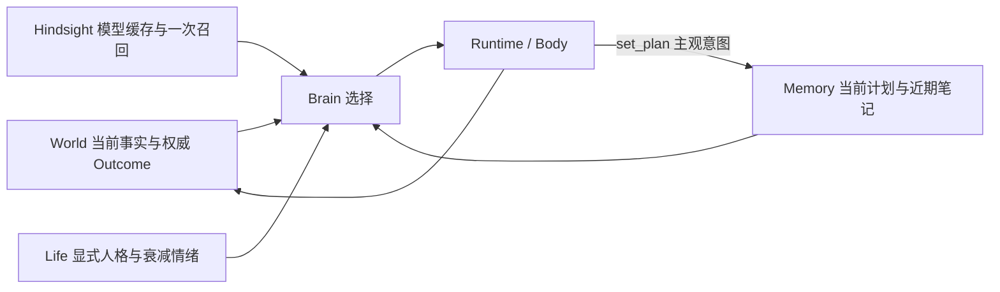

# NPC 长期自洽：续验契约与执行计划

> 用户要求继续验证并修复，直到得到可复核结果；工作仅在本 worktree。起点 `c6c6dabd`。本页是续验的 spec 与执行计划，继承 [人生闭环](2026-10-11-npc-life-loop.md) 和客户端 `Docs/Gameplay/NpcEvolve/NextLoop.md`，不改写前轮失败。

## 契约

“长期自洽”本轮可证伪定义：同一 NPC 的当前意图跨决策/进程重启延续；关系与人格只有权威经历能改变，情绪随经过时间衰减；当前 World 与旧记忆矛盾时采用 World；同 World 下互换自传中的伤害者/帮助者身份后，选择应随经历改变；模型输出最终经正式 Body/World 执行，不能把计划文字当完成。有限场景通过不推导无限期或完整人类生活保证。

当前发现：Life 模式完全替代 `Memory.context`，导致普通 `remember` 笔记不进入下一轮上下文；最近 8 个 Outcome 也不构成持久计划。笔记最多 200 条、仅取最近 5 条，本来就不能承诺当前意图永不被挤掉。

最小修复：由既有 `Memory` 能力 owner 提供 `set_plan(text)`，保存唯一 `npc_memories` 工作记录 `kind=intention/key=current`，最多 1500 字，空文本清除。它是 NPC 的主观打算，可自由更换，不是任务进度/人格/世界状态。每次决策现读当前计划；Life 模式另读最近 5 条笔记，不调用词法搜索，Hindsight 仍是缓存四模型 + 一次 recall。没有新表、进程、规划框架或新 World 真值。普通 remember/recall/search_memory 保持原语义。

依据与取舍：
- [Generative Agents §4.3](https://arxiv.org/html/2304.03442v2#S4.SS3) 区分计划、观察和环境变化后的重规划。采用持续可见的意图，不照搬日程分解或其检索算法；当前玩法只需一个可覆盖计划。
- [AMA-Bench §3](https://arxiv.org/html/2602.22769v1) 将记忆验证分为时间召回、因果前提、状态更新与概括。本轮采用状态更新/先决条件的反例和消融，不引入论文的另一套记忆框架。
- 持久化复用 `DataService.NpcMemory` 的既有 `{cid,kind,key}` 唯一行契约；非 note/event 工作记录按键覆盖。Hindsight 仍锁定 0.10.3/flashrank，数字永远查 World。

## 全局约束与观察面

- 不触及主树，不用 18888/18898，不复活已停止的 Concordia 实验；沿用独立 18908 实例，真实 Demo 同 cid/world/bank。
- 不写入 LLM key，日志只保存脱敏请求体、响应工具、usage、World/Body Outcome 与时间。所有新观察产物在 `.demo/observe/npc-long-horizon-20261011/`。
- 先自动测试，再固定模型实验，再必要的短客户端验证。服务端受控时钟承担 30 天/重启验证；不挂机 30 天、不用改变真实服务时钟模拟。
- 模型实验预设上限：12 次配对选择 + 最多 24 次真实自主决策，共 36 次；Life 每小时上限仍 60。总模型 token 计入用户 200 万额度（此前本任务约 712464）；遇到失败保存首次结果，修复有新版本依据才重跑。
- 可观测面：cid/world/版本、当前计划与写入/清除 Outcome、决策上下文 hash、记忆处理方式/错误、模型工具与 usage、权威终态、心智 canonical/cursor/cache、控制时钟/实际时间分列。

## Task 1: 持久意图与 Life 决策输入

**Files:** `npc/memory.ex`、`npc/runtime.ex`、`npc/brain/llm.ex`、最近 README；`npc_memory_test.exs`、`npc_life_test.exs`。

**Interfaces:** `set_plan(text)` 能力属于 memory 组，映射 `%{verb: :set_plan, text:, id:}`；Memory 执行唯一写入/清除，返回正常 Outcome。`Memory.working_context(memory,cid)` 返回 `current_plan`（body 或 nil）、`recent_notes`（最多五条带时间记录），失败返回 `working_memory_error`，不得伪装空计划。Llm 在原记忆上下文外合并该字段，不改变 Life 的一次召回与缓存职责。

1. RED：正式 Llm 的 Life 决策必须收到经 Memory 写入的计划与近期笔记；不许触发词法搜索。新增计划工具接纳/覆盖/清除/角色隔离/真实 DB 失败；201 条普通笔记不能淘汰当前计划。先运行并记录真实失败。
2. GREEN：按上面边界实现；提示明确区分意图、历史和 World，遇到冲突更新计划，动作完成只认 Outcome。
3. 最小回归覆盖 memory/Life/Llm/Runtime 的现有直接测试，不扩大到无关全仓。文档同步、提交。

## Task 2: 受控时间与重启的组合验证

**Files:** Life 集成测试，必要的 Test-only 验证脚本；不新增生产时间开关。

**Interfaces:** 使用现有 `Life` 注入时钟，真实 World/Body/NpcMemory，外部 Hindsight 在自动化接缝测试中用明确替身；纯规则试验与真实权威经历分开标注。

1. 真实 World 伤害/帮助后将 Life 观察时钟推进到 1、7、30 天，canonical 不被观察写坏；重启 Life/Body 同 cid 后关系/人格不重置、情绪不复燃、计划不丢，重复旧事件不重复评价。
2. 通过正式 Runtime 命令覆盖/清除计划，验证下一轮上下文收到当前意图。无效参数/存储失败的旧计划必须保留。
3. 测试旧实现已满足的长期状态不变量可以直接通过，不为制造 RED 修改正确代码；新增能力的 RED 由 Task1 提供。保存命令/版本/结果。

## Task 3: 真实选择、正式 Demo 与最终审查

**Files:** `scripts/npc_life/` 的 Test-only 续验入口与说明、本页进度。

**Interfaces:** 使用生产 `Llm.body`/Http 与正式 Brain/Body；仅消融分支是 Test-only，不写回真实 NPC 心智。沿用真实历史、四模型和一个召回；World 观察同源。保存首轮所有样本。

1. 冻结 6 组同 World 配对选择（原自传/自传身份互换，共 12 请求），保留可选能力，不给唯一正确工具、角色标签或硬编码正确答案；判断依据在请求前落盘。失败不得从统计中删去。
2. 自主维护目标只给目的，不给动作序列；最多 24 请求观察自选计划、实际动作/等待和受拒后的调整。用真实 World/Outcome 判定，不按模型自述判成功。
3. 冻结提交构建正式 release，升级本任务唯一 Demo、检验同 cid 持久状态。客户端只在需验证新可见行为时启动短场景（每场景约 10 分钟），不重复前轮整套伤害循环。
4. 最终独立代码审查、针对 Important 的红绿修复、最终证据索引；区分已实现/已实跑/已验收/未证明。保持工作分支，不合并推送。

## Review Focus

关注计划文本被误当 World 真值；当前计划意外受普通笔记淘汰；读取失败变成 nil；Life 多次召回/模型刷新落入决策热路径；新增工具没有经过 Runtime；控制时钟证据冒充真实长时运行；配对输入泄漏正确答案；失败样本被隐藏；服务升级版本与证据不一致。

## 进度与裁定

- Task3 开始前发现并用两个反例确认：等待与请求期间的新心智评价不能可靠触发后续选择。沿用已有 Brain 的 dirty 义务，比较权威 `mind.evidence`（不用随时间变化的 emotion/view），旧响应保留请求期间的新 dirty。依据为上文环境变化后重规划及本仓正交纲领“时间性不变量由 owner 持续维护”；无新计时器或重试框架。

- 2026-10-11：完成现状/一手依据调查，开始 Task1；尚无新验收结果。
- Task1：已有笔记遗漏反例 RED；新增能力 0/3 RED，owner 隔离反例 RED；最终 memory/Life/Llm/skill-runtime 59 项通过（validation/task-1-final.log）。中间失败保留：新工具表旧断言、重启测试未等旧 Life DOWN、Wilderness plan/current 键冲突。当前意图改为 intention/current；现有蓝图保留。Windows 本地无 quicer 的既有编译警告不等于正式 release 验证。
- Task2：真实 World 三次独立伤害、同格继续击打至破坏后他人补回；Life 观察时钟推进 1/7/30 天，重启 Body/Runtime/Life，canonical 与计划严格保留，情绪不复燃；Runtime 修改/清除计划和真实 PG 拒绝写入保留旧意图通过。Life+Memory 16 项通过（task-2-final.log）。首轮测试在 Runtime 首次 Observation 前发命令，被正确 invalid_session 拒绝；已改为等真实观察就绪。该结果是受控时间持久性测试，不是 30 天模型连续活动。
- Task3：等待/在途请求两个唤醒反例 RED，修复后 Llm/skill-runtime 47 项通过。配对实验预登记改为真实经历/经历中互换伤害者与帮助者身份（仍6组12请求），World/工具/人格/目标不变，仅改测试副本的自传内容。该实验检验心智关系与 Hindsight 组成的自传上下文整体，不单独归因 Hindsight；不会写回真实 bank 或 canonical。
- 最终独立审查：生产变更无 Critical/Important；实验生命周期有两项 Important。先核对现有 R7 `VoxelB3LiveInputs.cpp` 的命名 `@await_peer token` 契约，再在本 worktree 驱动复用它：本轮 A 的意图、结果、同 actor/cell/txn 的 World destroy 全部一致才放行 B；拒绝、只有旧历史、尚未破坏、角色/格错配和超时均不能放行。A 同样等 B 的权威 build 后才结束，双端保持原会话。来源为既有 R7 命名 barrier 与 `Testing.md` 首失败停止规则，不增加客户端协议。
- 清理审查修复：最终观察、恢复 settler、停止 trace、保存尾部证据独立尝试；恢复失败显式记录并停用本任务 NPC 登记，防止持续付费；原始运行异常继续上抛。测试依赖是完全离线进程/网络替身，保留真实时间轴、日志解析与门禁；不触发真实模型。初次 1/8 GREEN（2 failures/5 missing implementation errors）为 RED，修复后8项通过；接线测试发现 World 返回字段是 cursor 而非 seq，再RED/GREEN，最终10项通过（validation/review-final.log）。当前真实场景发生于修复前，其正确事件不代替失败门禁测试；修复后不重复消费模型或重开 UE。

## 本轮验收结论（2026-10-11）

本轮最小契约通过：同一 NPC 可以在维护构件的目标下自行制定、保存、修订意图，经历会改变其选择，当前 World 会纠正旧计划，重启不抹掉身份、关系和经历。**尚不能宣称完整人生、无限期自主生活或持续生存能力已经完成。**

### 已实现

- 持久意图 `set_plan` 与 Life 决策的近期笔记输入；意图和蓝图分别由不同工作行拥有，普通笔记淘汰不会删除意图。
- 等待或请求在途期间的新权威评价能唤醒后续决策，旧响应不会覆盖新消息；单纯情绪衰减不触发付费请求。
- 仍为 Hindsight 0.10.3 / flashrank、批量片段、四模型缓存 + 一次情境 recall；所有动作与数字经既有 World/Body authority。

### 已实跑、已验收的证据

观察根目录：`.demo/observe/npc-long-horizon-20261011/`，最终索引 `final-01/manifest.json`。

| 契约 | 结果与证据 | 适用边界 |
|---|---|---|
| 30 天与 owner 恢复 | 真实 World 三次独立伤害及修复，受控时间推进1/7/30天；canonical、当前计划与缓存保留，情绪衰减；`validation/task-2-final.log` 16项通过 | 安静时间经过与持久性，非30天连续模型活动；外部记忆依赖为声明的替身 |
| 经历影响选择 | 6组12请求全部完成；每组原/互换自传的合作意向跟随帮助者、戒备跟随伤害者；`pairs-results-02/human-review.json` | 冻结 World 下的意向选择；没有执行合作动作；不能单独归因 Hindsight，因为显式关系一并互换 |
| 正式自主维护 | 22个真实模型请求均结束；13个 Body done、2个 no_path rejected、7个 Brain 本地 wait；`audit-01/verdict.json`、`decisions.json` | 约7分3秒的一个维护片段；没有自主采材/重建成功，玩家完成修复 |
| 当前事实纠正旧计划 | look确认缺失→自行保存采材修复计划→两次路径拒绝→重新look确认材料19/帮助者放置→保存取消采材修复的新计划和笔记→wait；原意图与新意图均有正式写入 Outcome | 不是模型文字自报完成；不把wait算World动作，不把寻路拒绝算成功 |
| 双端真实输入与复制 | A三次准星击打对应43/44/45，B准星放置对应47；按本轮鉴权cid、client_seq、result、World actor/cell/txn逐笔核对，两端全部收到；`clients-01/`、`audit-01/` | 双端启动到退出约229.3秒，约3分49秒；站位为Test-only夹具，不宣称移动/流送验收。原驱动的失败门禁缺陷已离线修复，不改写原实跑版本 |
| 新经历进入认识 | 本轮2条经历批为第3个fragment/document；自动慢刷新四模型，人工核对最新08:41伤害/08:42帮助及“没有明确承诺”；`memory-01/` | Hindsight帮助事实仍有+10ms派生偏差；World原始时戳与状态是权威。旧饱和信任文字仍写changed，不视为数值变化证据 |
| 完整服务冷恢复 | 实际stop/start同一个Demo容器；同cid/world/bank；canonical、四模型缓存、模型自写计划与笔记严格相等，情绪继续衰减；`cold-restart-01/verdict.json` | 本次只重启整个服务端，Hindsight保持运行；前轮两者冷重启证据仍单独保留 |

首次配对调用因为 Windows 命令行过长失败（WinError206），发生在发送HTTP之前，0模型请求；改为本轮挂载目录传递无凭证请求体后运行完整12请求，旧目录与日志保留。正式 live 无请求错误、无尾部悬挂请求。两次 no_path 是实际能力限制，NPC 没有声称已抵达，也没有循环重复同一路线。

最新真实关系仍为 A=-1、B=+1；伤害/帮助评价数由6/6到7/7；谨慎特质0.36→0.40。数值只用于调试与验证，不作为产品UI。

### 版本、命令与成本

- 生产源码冻结 `c9bfe2249dfde2fa36d7c9dad63d7c9231479450`；正式 release 镜像 `voxim-server:20261011-npc-life-c9bfe224`，image ID `sha256:aae0e422df7c7d41f902e13e5de8496fa0d6a91fdb6455bdb8c271c6a4d4d603`。唯一 Demo 升级与加载身份在 `upgrade-01/`，本轮服务冷恢复共用 BEAM 摘要一致。
- 客户端/模型实跑驱动 `0843fa0e`；最终审查修复 `4b06b564` 仅改Test-only驱动、测试与文档，生产目录相对c9无变化，不重复构建相同运行时。工作保留在 `capability-library-20261007`，不合并、不推送、不改主树。
- 最小相关验证：`mix test --no-start test/gate_server/npc_memory_test.exs test/gate_server/npc_life_test.exs test/gate_server/npc_brain_llm_test.exs test/gate_server/npc_skill_brain_test.exs` 对应Task1 59项；Task2 Life/Memory 16项；Task3 Llm/skill-runtime 47项；各日志保留实际选取命令和RED/GREEN。这些有重叠，不能加起来当独立测试总数。
- `python -B -m unittest discover -s scripts/npc_life -p test_long_horizon.py`：最终10项通过；`python -B .demo/observe/npc-long-horizon-20261011/audit-01/verify.py`：离线真实日志对账通过。驱动与裁决源/hash保存于产物。
- 续验模型消耗：配对106,584 + 自主245,363 + Hindsight新增169,445 = **521,392 token**；加前轮712,464，累计 **1,233,856 / 2,000,000**。本轮决策请求34次（12配对+22现场），上限36；Hindsight后台模型请求单列入token，不冒充34次之内。没有价格输入，不虚构金额。
- 结尾NPC登记已恢复常驻settler，trace停止、临时客户端退出；持久意图与新经历保留。没有留下无界付费模型挂机。

### 仍未证明

跨月连续自主活动、多目标/承诺冲突、资源耗尽后的持续生存、复杂关系长期修复与完整人生均不在本轮已验收范围。人格与情绪目前仍是已批准的最小维度集合。本轮证明的是这些基础状态和当前意图能持续自洽、在现实反证下修订，不能把有限证据扩大为永不失常。

## 阶段后端接入与下一会话（用户追加）

用户要求先把成果做成独立后端，再新开会话继续连续自主生活、自给自足与人格模型。本轮有限接入采用 `Registry.brain/2` 已有组合入口：新增持久登记名 `life`，复用已验收的 `Brain.Llm`/`Life`/`Memory`/`Body`，强制Life配置与既有1..60/h额度，不创建第二套调度器或World owner。省略life从环境取Hindsight地址；显式false拒绝。依据为本仓Registry工厂、Body生命周期及系统正交/SSOT约束；此次不改变它们的边界。

观察面：`Registry.list/0` 的brain必须是life；`Life.observe/1`有同cid/bank/state/cache；`Memory.working_context/2`保留计划和笔记。最小验证为新登记名/缺配置/禁止关闭/额度/等价profile反例，原Registry真实PG/Body集成回归，以及正式release内同NPC接入。聊天经代码和既有测试核实仍为stub（`say -> chat_unavailable`，LLM不投影）；曾有npc-dialogue-rag工作树也仍是相同占位，不能宣称聊天已经完成。

验证产物：`.demo/observe/npc-life-backend-20261011/`。配置RED5项中2项因life入口不存在失败；实现后LifeRegistry+Registry共17项通过。现场驱动切换独立life登记名，入口反例先RED10项2失败，修复后结果续记。下一会话交接见 [NPC 连续生活接力](2026-10-11-npc-next-session.md)。
