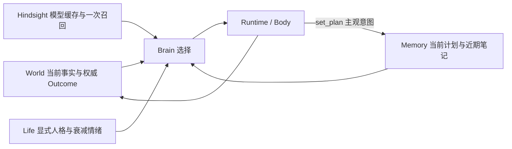

# NPC 长期自洽：续验契约与执行计划

> 用户要求继续验证并修复，直到得到可复核结果；工作仅在本 worktree。起点 `c6c6dabd`。本页是续验的 spec 与执行计划，继承 [人生闭环](2026-10-11-npc-life-loop.md) 和客户端 `Docs/Gameplay/NpcEvolve/NextLoop.md`，不改写前轮失败。

## 契约

“长期自洽”本轮可证伪定义：同一 NPC 的当前意图跨决策/进程重启延续；关系与人格只有权威经历能改变，情绪随经过时间衰减；当前 World 与旧记忆矛盾时采用 World；存在记忆时的选择与拿走记忆的同场景选择可区分；模型输出最终经正式 Body/World 执行，不能把计划文字当完成。有限场景通过不推导无限期或完整人类生活保证。

当前发现：Life 模式完全替代 `Memory.context`，导致普通 `remember` 笔记不进入下一轮上下文；最近 8 个 Outcome 也不构成持久计划。笔记最多 200 条、仅取最近 5 条，本来就不能承诺当前意图永不被挤掉。

最小修复：由既有 `Memory` 能力 owner 提供 `set_plan(text)`，保存唯一 `npc_memories` 工作记录 `kind=intention/key=current`，最多 1500 字，空文本清除。它是 NPC 的主观打算，可自由更换，不是任务进度/人格/世界状态。每次决策现读当前计划；Life 模式另读最近 5 条笔记，不调用词法搜索，Hindsight 仍是缓存四模型 + 一次 recall。没有新表、进程、规划框架或新 World 真值。普通 remember/recall/search_memory 保持原语义。

依据与取舍：
- [Generative Agents §4.3](https://arxiv.org/html/2304.03442v2#S4.SS3) 区分计划、观察和环境变化后的重规划。采用持续可见的意图，不照搬日程分解或其检索算法；当前玩法只需一个可覆盖计划。
- [AMA-Bench §3](https://arxiv.org/html/2602.22769v1) 将记忆验证分为时间召回、因果前提、状态更新与概括。本轮采用状态更新/先决条件的反例和消融，不引入论文的另一套记忆框架。
- 持久化复用 `DataService.NpcMemory` 的既有 `{cid,kind,key}` 唯一行契约；非 note/event 工作记录按键覆盖。Hindsight 仍锁定 0.10.3/flashrank，数字永远查 World。

## 全局约束与观察面

- 不触及主树，不用 18888/18898，不复活已停止的 Concordia 实验；沿用独立 18908 实例，真实 Demo 同 cid/world/bank。
- 不写入 LLM key，日志只保存脱敏请求体、响应工具、usage、World/Body Outcome 与时间。所有新观察产物在 `.demo/observe/npc-long-horizon-20261011/`。
- 先自动测试，再固定模型实验，再必要的短客户端验证。服务端受控时钟承担 30 天/重启验证；不挂机 30 天、不用改变真实服务时钟模拟。
- 模型实验预设上限：12 次配对选择 + 最多 24 次真实自主决策，共 36 次；Life 每小时上限仍 60。总模型 token 计入用户 200 万额度（此前本任务约 712464）；遇到失败保存首次结果，修复有新版本依据才重跑。
- 可观测面：cid/world/版本、当前计划与写入/清除 Outcome、决策上下文 hash、记忆处理方式/错误、模型工具与 usage、权威终态、心智 canonical/cursor/cache、控制时钟/实际时间分列。

## Task 1: 持久意图与 Life 决策输入

**Files:** `npc/memory.ex`、`npc/runtime.ex`、`npc/brain/llm.ex`、最近 README；`npc_memory_test.exs`、`npc_life_test.exs`。

**Interfaces:** `set_plan(text)` 能力属于 memory 组，映射 `%{verb: :set_plan, text:, id:}`；Memory 执行唯一写入/清除，返回正常 Outcome。`Memory.working_context(memory,cid)` 返回 `current_plan`（body 或 nil）、`recent_notes`（最多五条带时间记录），失败返回 `working_memory_error`，不得伪装空计划。Llm 在原记忆上下文外合并该字段，不改变 Life 的一次召回与缓存职责。

1. RED：正式 Llm 的 Life 决策必须收到经 Memory 写入的计划与近期笔记；不许触发词法搜索。新增计划工具接纳/覆盖/清除/角色隔离/真实 DB 失败；201 条普通笔记不能淘汰当前计划。先运行并记录真实失败。
2. GREEN：按上面边界实现；提示明确区分意图、历史和 World，遇到冲突更新计划，动作完成只认 Outcome。
3. 最小回归覆盖 memory/Life/Llm/Runtime 的现有直接测试，不扩大到无关全仓。文档同步、提交。

## Task 2: 受控时间与重启的组合验证

**Files:** Life 集成测试，必要的 Test-only 验证脚本；不新增生产时间开关。

**Interfaces:** 使用现有 `Life` 注入时钟，真实 World/Body/NpcMemory，外部 Hindsight 在自动化接缝测试中用明确替身；纯规则试验与真实权威经历分开标注。

1. 真实 World 伤害/帮助后将 Life 观察时钟推进到 1、7、30 天，canonical 不被观察写坏；重启 Life/Body 同 cid 后关系/人格不重置、情绪不复燃、计划不丢，重复旧事件不重复评价。
2. 通过正式 Runtime 命令覆盖/清除计划，验证下一轮上下文收到当前意图。无效参数/存储失败的旧计划必须保留。
3. 测试旧实现已满足的长期状态不变量可以直接通过，不为制造 RED 修改正确代码；新增能力的 RED 由 Task1 提供。保存命令/版本/结果。

## Task 3: 真实选择、正式 Demo 与最终审查

**Files:** `scripts/npc_life/` 的 Test-only 续验入口与说明、本页进度。

**Interfaces:** 使用生产 `Llm.body`/Http 与正式 Brain/Body；仅消融分支是 Test-only，不写回真实 NPC 心智。沿用真实历史、四模型和一个召回；World 观察同源。保存首轮所有样本。

1. 冻结 6 组同 World 配对选择（有历史/去历史，共 12 请求），保留可选能力，不给唯一正确工具、角色标签或硬编码正确答案；判断依据在请求前落盘。失败不得从统计中删去。
2. 自主维护目标只给目的，不给动作序列；最多 24 请求观察自选计划、实际动作/等待和受拒后的调整。用真实 World/Outcome 判定，不按模型自述判成功。
3. 冻结提交构建正式 release，升级本任务唯一 Demo、检验同 cid 持久状态。客户端只在需验证新可见行为时启动短场景（每场景约 10 分钟），不重复前轮整套伤害循环。
4. 最终独立代码审查、针对 Important 的红绿修复、最终证据索引；区分已实现/已实跑/已验收/未证明。保持工作分支，不合并推送。

## Review Focus

关注计划文本被误当 World 真值；当前计划意外受普通笔记淘汰；读取失败变成 nil；Life 多次召回/模型刷新落入决策热路径；新增工具没有经过 Runtime；控制时钟证据冒充真实长时运行；配对输入泄漏正确答案；失败样本被隐藏；服务升级版本与证据不一致。

## 进度与裁定

- 2026-10-11：完成现状/一手依据调查，开始 Task1；尚无新验收结果。
- Task1：已有笔记遗漏反例 RED；新增能力 0/3 RED，owner 隔离反例 RED；最终 memory/Life/Llm/skill-runtime 59 项通过（validation/task-1-final.log）。中间失败保留：新工具表旧断言、重启测试未等旧 Life DOWN、Wilderness plan/current 键冲突。当前意图改为 intention/current；现有蓝图保留。Windows 本地无 quicer 的既有编译警告不等于正式 release 验证。
- Task2：真实 World 三次独立伤害、同格继续击打至破坏后他人补回；Life 观察时钟推进 1/7/30 天，重启 Body/Runtime/Life，canonical 与计划严格保留，情绪不复燃；Runtime 修改/清除计划和真实 PG 拒绝写入保留旧意图通过。Life+Memory 16 项通过（task-2-final.log）。首轮测试在 Runtime 首次 Observation 前发命令，被正确 invalid_session 拒绝；已改为等真实观察就绪。该结果是受控时间持久性测试，不是 30 天模型连续活动。
