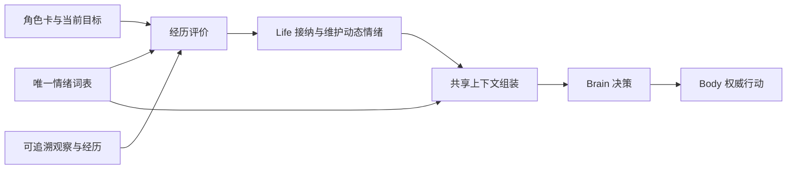
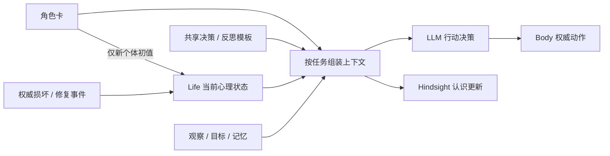
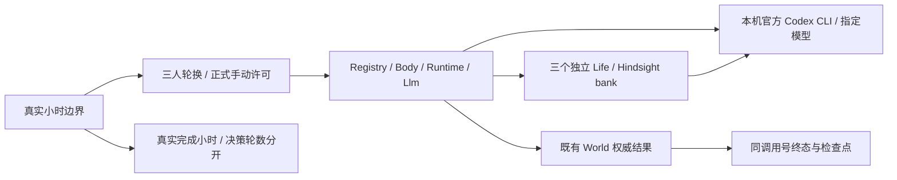
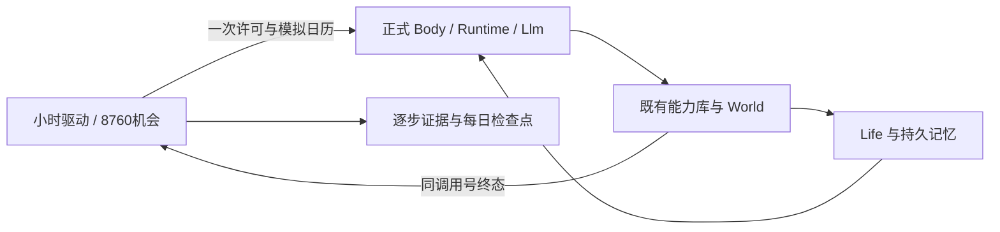
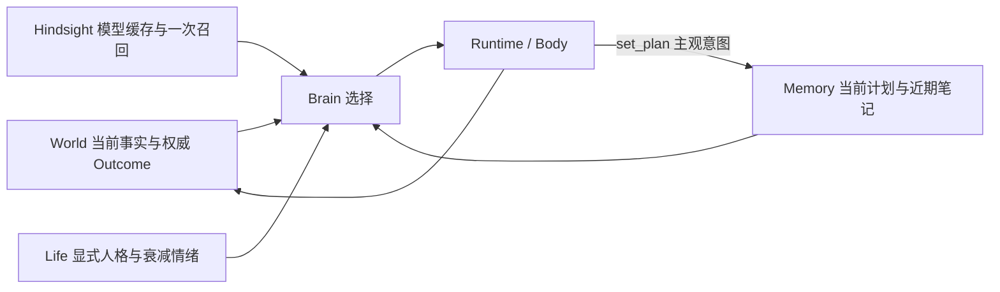

# NPC 长期自洽：续验契约与执行计划

## 2026-10-12 续议：选定 OCC 词表与可替换边界

用户确认：不追求情绪分类面面俱到，先选一份有研究依据的词表应用，保持设计解耦，后续可替换。
第一版选用**经典 OCC 22 类**；这是项目采用的情绪词表，不宣称它是心理学统一标准，也不引入完整 OCC 推理系统。
本节补充下文早期设计的情绪范围；兴趣仍可用文字表达，不扩展人格维度，角色卡、Life、记忆与身体的所有权划分不变。
本轮已接入 Llm + Life 的 OCC 评价；角色卡 JSON 加载仍待实施，角色差异暂用已有 goal 输入。实现与验证证据见本节末尾。

### 词表与依据

以下英文标识和语义集中定义；中文为本项目释义。决策提示词、评价输入输出说明与 CLI 展示从同一份定义派生。

- 事件结果：`joy`（喜悦）、`distress`（痛苦）。
- 他人际遇：`happy_for`（替人高兴）、`sorry_for`（同情）、`gloating`（幸灾乐祸）、`resentment`（对他人得利的不快）。
- 前景与预期兑现：`hope`（希望）、`fear`（恐惧）、`satisfaction`（如愿满足）、`fears_confirmed`（担忧成真）、`relief`（宽慰）、`disappointment`（失望）。
- 行为评价：`pride`（自豪）、`shame`（羞愧）、`admiration`（钦佩）、`reproach`（责难）。
- 对象吸引：`love`（当下喜爱）、`hate`（当下厌恶）；不等同于长期关系状态。
- 行为与结果结合：`gratitude`（感激）、`anger`（愤怒）、`gratification`（自我嘉许）、`remorse`（懊悔）。

依据：[O'Rorke 与 Ortony，Explaining Emotions，1994，§1.2 / Table 1](https://www.cs.northwestern.edu/~ortony/Andrew_Ortony_files/1994%20-%20Explaining%20emotions.pdf)
明确列出经典 OCC 的 22 类及触发条件；[Ortony 与 Clore，2015](https://users.cs.northwestern.edu/~ortony/Andrew_Ortony_files/2015%20-%20Appraisal%20and%20constructionism.pdf)
解释目标、标准、偏好与事件／行为／对象评价的对应关系。适用点是本项目已有角色愿望、价值观与兴趣，
可以为不同职业共用的评价提供上下文；取舍是先采用这套有限语义，不追加好奇、惊讶、无聊等词，也不把情绪名当行动命令。
强度数值、衰减参数和实际评价算法属于工程实现，不能声称由上述论文直接确定。

### 最小解耦边界

1. **词表只定义含义。** 每项有稳定标识、释义与成立条件；词表有整体标识以解释保存下来的状态。
   不在词表里写“建设者使用某情绪”，不定义技能、移动指令或权限。不预建插件平台、运行中热切换或多模型并行框架。
2. **评价负责解释经历。** 输入是角色设定、当前目标与可追溯经历，输出是所选词表内的情绪、强度、对象与来源依据。
   同一评价边界服务不同职业；构件损坏／修复只是现有事件来源。已发生的 Speech 只能证明发言发生，不能把台词内容当世界事实。
   采用词表不等于所有触发已接通；扩大到探索、对话、任务结果时须在该边界明确接纳来源和评价执行方式。
3. **Life 继续唯一持有动态状态。** 情绪、时间演化与持久化由 Life 维护，支持多种情绪同时存在。
   外部评价结果只在 Life 接纳边界校验一次；非法类别、强度或来源显式失败，不静默改名或丢弃。
   角色卡只提供稳定设定与初始气质，不保存当前情绪；换卡不能重置人格、信任或人生记忆。
4. **Brain 负责行为。** LLM 消费词表释义与当前状态，结合处境选择行动；情绪不直接授予或执行能力。
   现有 `State.behavior/3` 与 Social 对 anger/gratitude 的硬规则属于特定社交策略，不能反过来规定公共情绪接口。
   落地解耦时，把词表相关判断集中在该策略边界，Social 的停止／移动／完成机制消费行为选择，不再直接读特定情绪证据键。
5. **替换范围明确。** 替换词表时同步调整依赖其语义的评价／策略，并在 Life 加载边界显式迁移已有情绪状态；
   不要求改 Body、World、角色身份或记忆存储。原始经历保留，不假装不同词表存在无损一一映射，不静默清空旧状态。



### 实施时的最小验证与观察面

- 词表契约：标识唯一、定义可投影；Life 接纳边界拒绝词表外输出。纯函数测试不启动 World 或数据库。
- 真实接缝：同一评价与上下文入口服务两张角色卡；选择一个建设事件和一个非建设经历，核对来源、情绪与决策上下文。
  若评价使用模型，组件测试在模型边界使用显式替身，不把它称为真实模型行为验证。
- 时间与恢复：复用当前情绪衰减测试；已有个体的迁移保留人格、逐人信任与记忆身份。原始经历不重放为新的情绪事件。
- 策略解耦：复用 Social 的回避／感谢／动作终态测试，核对它只依赖策略输出，不读取公共状态里的具体词表键。
- CLI/trace：沿用 Life.observe/context，能读到词表标识、当前情绪强度、对象、来源与评价失败；
  正式短场景验证非建设经历确实进入同一 Life → Brain 链路，不能以添加 22 个零值字段宣称应用完成。

### 2026-10-12 实施计划与进度

用户已批准实施上述方案并运行模拟。使用当前工作区的 `feat/npc-occ-emotions` 分支连续执行，保留既有环境与文档改动。
本次落实情绪链路；角色卡文件加载不捆绑进本次任务，现有身份／目标继续作为评价上下文。

技术选择：给 Life LLM 的既有单个工具调用增加 `appraisal` 元数据，译成能力命令前移除；
不新增独立评价请求，不改变 Body 工具契约。依据 [官方函数调用文档](https://developers.openai.com/api/docs/guides/function-calling)：
沿用 strict JSON Schema、所有字段 required、对象 additionalProperties=false 和 parallel_tool_calls=false。
Life 为真实接收的经历分配单调序号，模型仅评价本次上下文中的未处理经历；成功持久化其消费位置后才执行动作。
空评价也消费该段经历；失败不推进。继续沿用 120 秒半衰期与 0..1 强度，这是已有工程参数，不是心理学结论。
同类情绪取衰减后强度与新激发强度的较大者，避免把重复相似刺激简单累加至饱和；新经历仍保留各自评价依据。
Life 的 World worker 只取事件，规则推进回到 owner 执行，避免旧快照覆盖同时提交的模型情绪。
LLM 路径停用建设规则的情绪写入，保留其独立关系／人格规则；非 LLM 的既有 Social 策略仍使用建设评价，显式标为兼容范围。

- [x] 1. `life/emotion_vocabulary.ex` 与 `life/appraisal.ex`：唯一 OCC 定义、工具参数投影、来源校验、消费位置与情绪更新。
  先以小输入验证非建设情绪、非法输出拒绝、重复来源不重加和衰减，执行 `mix test --no-start test/gate_server/npc_appraisal_test.exs`。
- [x] 2. `life.ex`、`runtime.ex`、`brain/llm.ex`：真实经历接纳、模型评价先落盘再动作，旧存量保持；Social 不直接读取情绪证据键。
  在真实 Life/Runtime 接缝验证持久化失败、轮询并发、新消息在途到达与重启；模型／Hindsight 用显式替身。
  执行受影响的 appraisal、life、brain_llm、social、dialogue_life 测试，不扩大到无关全仓。
- [x] 3. 运行正式 NPC 组合的有限真实模型模拟；只给场景目标，不预写情绪或模型动作。
  保存请求、响应、Life 状态、动作结果和实际 usage 到新的 `.demo/observe/npc-emotions-*` 目录。
  检查非建设来源激发、下轮读取、失败与收尾；不能把模型主观理由当严格行为因果证明。
- [x] 4. 更新相邻 README 与本节证据，独立审查改动，保留实现、模拟结果与未覆盖范围。

### 实现与验证记录（2026-10-12 21:15，UTC+8）

实现入口见 [NPC README 的 OCC 小节](../../../apps/gate_server/lib/gate_server/npc/README.md#occ-情绪2026-10-12)。
独立审查后修复：积压按最多 16 条自然前缀交给模型且保留后缀、弱刺激不篡改强情绪来源、未知词表显式拒绝、
存储失败期间初始情境只入队一次、Life 上下文缺失不调用模型、Social 不混用 World 与模型来源序号。
启动前观察的 nil 状态也有最小反例，已从 BadBooleanError 修正为正常接收观察。以上数值是工程参数，
分批只控制运输，不改变逐条评价的合法性与消费顺序，符合本仓自然数据流约束。

**确定性验证**：在 `apps/gate_server`、既有测试 PG 的 `MMO_DB_*` 环境下运行：

```powershell
mix test --no-start test/gate_server/npc_appraisal_test.exs test/gate_server/npc_emotion_life_test.exs test/gate_server/npc_life_test.exs test/gate_server/npc_social_test.exs test/gate_server/npc_dialogue_life_test.exs test/gate_server/npc_life_state_test.exs test/gate_server/npc_brain_llm_test.exs
```

结果 **96 passed，44.3 秒**，日志 `.demo/emotion-regression-verified.log`。范围只覆盖改动的评价、Life 持久化与并发、
Runtime/Llm 接缝、Social 兼容，不扩大到无关全仓。四项审查反例与启动反例保留 red/green 日志。
修改文件的 `mix format --check-formatted`、`git diff --check` 通过。

**真实模型模拟**：`npc_emotion_simulation_test.exs`（显式 `--include live_llm`），正式 `Registry.brain("life", ...)`
与 `Body.start` 组合，真实有限 World/Scene、VM 独占测试 PG、既有 18908 Hindsight，以及本机桥接的
`gpt-6.1-sol / medium`。新建“知衡”（实地调查学者）与“松岚”（合作探索者），目标是调查地面并交流，未指定情绪或动作。
旧 Demo 已停止且原挂载目录不存在，因此没有复用或修改旧角色存档。该场景是 **Test-only**，没有 UE、玩家界面或 release 联合验收。

运行命令：先按 `scripts/npc_life/README.md` 的既有桥接方式配置 `NPC_LLM_URL/KEY/MODEL/EFFORT/TIMEOUT_MS`、
`NPC_LIFE_HINDSIGHT_URL`，设置 `NPC_EMOTION_OUT` 为新的空目录，然后执行：

```powershell
mix test --no-start --include live_llm test/gate_server/npc_emotion_simulation_test.exs
```

结果 **1 passed，485.8 秒，10 次决策、4 项评价**（全部来自非建设来源）。第 5 轮学者对无名称/配方的目录结果
产生 `disappointment=0.2`，对邻居主动交流产生 `gratitude=0.2`；第 6 轮探索者因收到具体观察产生 `gratitude=0.55`；
第 7 轮学者对补充交流再产生 `gratitude=0.2`。前四轮及后续记笔记、等待多轮均返回空评价，没有每次成功都自我奖励。
下一轮输入真实读到学者感激/失望各约 0.1191、探索者感激约 0.4847，体现持久状态与 120 秒半衰期。
双方最终选择等待；观察窗口结束时各自 affect 游标与 next_seq 都为 8、未落盘输入为 0、error/job 为空，
持久行与 Life canonical 一致。各有 3 条短对话经历已保存在原 outbox，尚未封片写 Hindsight；没有声称四份认识已刷新。
初始化 GET 缺失认识文档的 404 来自既有 ensure 流程，随后正常创建，最终没有残留错误。

完整产物在 `.demo/observe/npc-emotions-20261012/`：`run-01/summary.json`、`steps.jsonl`、每次 request/response、
`final-<cid>.json` 与 `bridge-01/calls.jsonl`；实际决策 token 合计 **331632**（桥接 CLI 报告，包括其开销）。
`.demo/emotion-simulation-01.log` 保留完整运行结论。最终工作源码快照与 hash 在 `source-final/`、`source-manifest.json`；
模拟开始后修正的启动布尔条件、非 Life 自动模式兼容门与 Social 序号隔离由最终回归覆盖，未把运行中的旧 VM 宣称为热更新验证。
模拟结束已停止本任务新起的模型桥接，NPC/测试 PG 按测试生命周期清理；观察产物保留，既有 Hindsight 服务未改配置或停止。

结论边界：已证明真实非建设经历激发、合法接纳/保存、后续模型读取与时间衰减；只自然出现了两类情绪，
不声称所有 22 类均已实测，也不把“带情绪后记笔记/等待”解释为情绪的独立行为因果证明。角色卡 JSON 加载仍属于后续任务。

### 补测计划：行为敏感性、对象与自动节奏

用户批准补测，并指出针对不同对象的情绪应可区分。本次先核验现有实现，不把缺失的多对象状态说成已支持。
依据前述 Ortony/Clore 文献（§1，情绪有对象而心境可以没有），对象不限于人物，也可为事件/前景。
当前 canonical 每类只保存一个强度与获胜证据；可验证没有误归因，但无法证明保留了多个对象的同类情绪。

- 模型对照（Test-only、无 World/PG）：用正式 `Llm.body` 构造固定合法输入，处境/目标/记忆/能力不变，
  比较对甲的低/高愤怒、对乙的高愤怒，每条件两次，交错顺序。只改变受控情绪及其对象指向。
  不向运行中的 Life 注入状态，不执行模型动作。保存完整输入/输出与真实 usage；比较行动、对象、措辞，
  两次样本不能声称统计稳定性，行为不变也必须照实报告。
- 代表性评价：用明确标为合成的羞辱、帮助、期待落空、风险解除四个小情境，调用同一真实模型与接纳契约；
  只断言输出合法、来源准确，语义结果独立检查，不通过固定期望诱导模型。
- 自动节奏（真实 Body/Runtime/Life/World/PG）：先用受控模型替身隔离等待、自提交不唤醒、在途新来源、
  超过单轮前缀的积压继续消费与预算。任何失败先保留最小反例，再修复唯一 owner。
  再用真实模型与 Hindsight 的有限自动场景验证接线，人工邻居只通过 Body.say 发起明确标为场景刺激的对话。
- 范围：不扩充词表、不改成多对象状态、不做 UE 验收；新增测试与实际发现触及的最小回归，产物写新目录。

### 补测结果（2026-10-12 21:46，UTC+8）

**行为对照**：`npc_emotion_probe_test.exs` 完成 10 次真实 `gpt-6.1-sol / medium` 请求（237.2 秒）。
其中 6 次是相同处境/目标/记忆/能力的交错对照，每条件两次：对甲愤怒 0.05 时两次均接受甲乙合作；
对甲愤怒 0.8 时两次均暂缓与甲合作；同强度改为乙时两次均暂缓与乙合作。
变化主要体现为 `say.text` 的合作意愿与指向，不能说已证明移动/战斗策略差异；小样本也不证明统计稳定性。
请求核对产物 `contrast-check.json`：6 份请求去除 anger 强度与 evidence.actor 两个干预字段后应完全一致。

另外 4 个合成情境经真实模型和 Appraisal 接纳：羞辱→distress 0.65 + anger 0.8；
帮助完成资料整理→gratitude 0.85 + joy 0.65；期待落空→disappointment 0.7；损毁风险解除→relief 0.7。
输出均引用真实给定的合成来源序号；没有向运行中 World/Life 回填这些情绪。
这证明受控输入下的语义表现，不把合成经历声称为世界实跑。10 次请求 usage 合计 270359 token（包含 CLI 桥接开销）。

**自动运行**：`npc_emotion_automatic_test.exs` 使用正式 Registry/Body 组合、真实 World/Scene/PG/Hindsight。
最终 `run-04/automatic` 通过（61.2 秒）：wait 3600 → 邻居经正式 say 发出场景羞辱 →
anger 0.75 + reproach 0.8，均指向实际发言人 → 明确回应 → wait 3600。
共 3 次真实请求、81115 token；完整消费至 cursor=next_seq=4、error 为空、未落盘输入0；
未靠耗尽额度停止（运行配置60次/小时，只有2次启动上下文未就绪加3次HTTP），最终静默窗口没有多余请求。
这是短自动场景，不是长期浸泡或 UE 玩家入口验收。

补测确实暴露并修复了两个调度问题：

1. 16条前缀处理后，剩余2条会被 wait 3600 延后；真实18次 look 终态的受控接缝反例先红。
2. Life.context 已包含来源、Brain 的观察投影稍后到达时，旧 dirty 逻辑会多问一次空请求；
   自动 run-03 与纯替身时序反例均证实。最终让情绪待办直接从消费位置派生，
   Life 成功持久化后返回 through，Brain 只持有消费回执，抵御迟到观察（含首次没有 mind 的投影）。

最终局部验证命令（`apps/gate_server`、既有 `MMO_DB_*` 测试环境）：

```powershell
mix test --no-start test/gate_server/npc_appraisal_test.exs test/gate_server/npc_brain_llm_test.exs test/gate_server/npc_emotion_life_test.exs test/gate_server/npc_dialogue_world_test.exs
```

52项先得到51通过/1旧对话用例失败：旧用例先放行回复，却仍要求两次后续决策，依赖了多余请求。
修正为先完成开场后决策再放行邻居回复；之后只重跑该文件5项，全部通过。
两种迟到投影、16+2积压与最终静默都有通过证据；积压测试使用无限额度，避免额度耗尽掩盖空转。
相关52项均有最终通过证据，未重复扩大无关suite。`mix format --check-formatted`、`git diff --check` 通过。
独立审查发现并补齐了首次无mind的时序变体。

原始失败也保留：automatic run-01 测试驱动把 conversation_id:nil 直接传 Body，改用 Abilities.command 后已由真实
对话回归验证；run-02 遇模型 TLS/503/容量不足，停止测试VM避免继续调用；run-03 发现重复唤醒；
run-04 在修复后通过。run-04 运行期间补的首次无mind分支由最终确定性回归覆盖，没有声称热更新进入旧VM。
强停VM遗留的独占测试库已核对进程号与无连接后删除；本任务模型桥接已停止，既有Hindsight服务未改配置。

产物根 `.demo/observe/npc-emotion-followup-20261012/`，模型对照在 `run-01/probe/summary.json`，
成功自动场景在 `run-04/automatic/summary.json`；完整请求/响应、失败轮次及 `bridge-01/calls.jsonl` 均保留。
日志 `.demo/emotion-followup-final.log`、`.demo/emotion-dialogue-final.log`、`.demo/emotion-automatic-04.log`。

**对象结论**：用户指出的缺口成立。情绪通常有具体对象，对象可以是人物，也可以是事件/前景/事物。
当前单槽结构只能保留每类情绪的获胜对象；本次对照证明该对象会影响输出，但不证明同时保留甲乙两份愤怒。
后续若按对象建模，应以“类别＋对象”为独立状态，整体强度作为派生摘要；本次按授权只补测与修复调度，未修改此数据模型。

## 2026-10-12 收口设计：角色卡、共享提示词与心智边界（待实施）

用户决定本轮先记录设计、整理并合并既有代码，不继续开发角色卡或归档修复。
目标是复用所有NPC的大部分提示词，让角色设定成为独立数据，同时保留每个永久cid自己的经历与成长。
采用 **共享任务模板 + 角色卡 + 个体运行状态**；模板按决策、反思等任务划分，建设者/探索者/学者使用同一模板。

### 职责与唯一来源

- **角色卡**：稳定身份/背景、兴趣、价值取向、长期愿望、表达与行为习惯，以及初始气质。
  第一版使用JSON与固定字段；NPC登记引用`card_id`，通用规则中移除写死的builder身份。
- **共享提示词**：解释观察、行动结果、工具、记忆与心理状态；按任务选择所需上下文。
  决策与Hindsight的mission/source_query从同一角色卡取得身份，不各自维护职业文案。
- **Life**：唯一维护当前情绪、人格倾向、逐人信任与事件证据；卡片初值只用于新个体构造，
  已有个体继续读取持久状态，重新载入卡片不能重置已经形成的性格与关系。
- **Memory / Hindsight**：保存真实笔记、计划、经历与派生认识；每个cid继续独立记忆，卡片不充当人生存档。
- **World / Body / Abilities**：继续拥有当前位置、库存、动作结果与可用能力；卡片中的职业叙述不授予技能或权限。

拟议卡片内容示例（不是已实现schema）：

```json
{
  "card_id": "zhiheng",
  "identity": "学者",
  "background": "喜欢通过实地观察理解周围世界",
  "interests": ["植物", "自然现象"],
  "values": ["亲自验证", "尊重邻居劳动"],
  "aspiration": "逐渐记录附近植物知识并与邻居分享",
  "habits": "观察足够就实践，遇到不懂的事情愿意请教",
  "speech_style": "简洁、具体、愿意分享发现",
  "initial_traits": {"caution": 0.2, "sociability": 0.5}
}
```



### 心智现状与拟议调整

继续保留四类文字认识：self（自我与经验）、relationships（他人及关系依据）、world（地点与环境经验）、
commitments（约定及履行情况）。问题模板改为职业无关的问法，例如“我是怎样的人，从经历中学到了什么”，
身份来自角色卡，内容来自已记录经历。已有bank中的source_query不会因改代码自动更新；落地时应显式更新问题并刷新认识，
保留原始经历，不重建或清空人生库。

当前数值层只有anger/gratitude两种情绪（120秒半衰期）、caution/sociability两项人格倾向（初值0.2/0.5），
以及逐人trust。损害/修复关心构件由规则评价，对话只进入经历，不直接改数值。第三次起同类损害/帮助会引起缓慢人格变化。
LLM路径把这些状态放进提示词；Social/Tree路径才直接使用社交距离公式，本轮三人走的是前者。
当前没有好奇、快乐、恐惧等独立数值机制；第一版角色卡可用文字表达兴趣与习惯，不为此扩展人格维度。
完整行动流水、普通remember笔记尚未统一进入Life长期提炼，不能把一次记事视为四份认识已同步更新。

### 归档边界的后续修复

已复现的两个问题分别是：checkpoint把经历写入与四模型后台refresh一并等待600秒；flush遇busy在封尾前返回，
调用方却当已接纳且漏查pending_episodes。应由Life维护flush接纳与完成的明确契约，区分“经历已写入”和“认识已刷新”。
本轮保留失败原样，后续不以加长超时、自动重试或备用写入路径代替这两个边界修复。

### 后续最小验证与观察面

1. 角色卡组装：同一模板装入两张不同卡，决策身份与反思身份保持一致；复用现有Registry/Brain/Life入口验证，
   模型边界使用显式替身，不复制组装实现来判定自身。
2. 个体成长：新个体使用卡片初值；已有持久人格与关系在重新载入卡片后保持，名字/职业变化不换cid或记忆bank。
3. flush：先以正在refresh且存在不足3000字尾部的状态复现busy未封尾，验证真实Life与存储接缝，
   第三方慢任务使用可控替身；另核对“写入完成”不被后续认识刷新拖成同一完成条件。
4. 正常玩法：继续用三人短场景观察身份表达、交流、行动和经验复用；使用真实Body Outcome与已接纳Speech，
   不预写工具序列，不把理论归因、全量人格维度或长时挂机作为本轮验收条件。

CLI/trace应能读出永久cid、角色卡标识、任务模板标识、最终上下文，以及经历写入和认识刷新各自状态。
角色卡本身没有用户GUI入口要求；若后续增加编辑界面，再同步提供操作、自动化和CLI入口。

依据：[SillyTavern Prompt Manager](https://docs.sillytavern.app/usage/prompts/prompt-manager/)与
[Character Design](https://docs.sillytavern.app/usage/core-concepts/characterdesign/)提供角色资料与提示词组合的成熟做法；
采用其字段注入思路，第一版只实现本项目当前需要的固定字段，不引入整套卡片导入、宏语言或插件系统。
[Hindsight Mental Models](https://hindsight.vectorize.io/developer/mental-models)说明认识是后台预计算的文档；
本项目继续按已固定0.10.3适配器实际接口接入，现代文档中的新刷新能力不自动视为已部署。
这一拆分遵守本仓系统正交与SSOT约束：角色内容、行为能力、动态心理状态和派生认识各有唯一owner。

## 2026-10-12 邻里植物散步 happy path 实验

用户要求按实际效果判断经验和心智，不做严格理论归因；已授权设计后直接开始，只跑正常玩法。
本轮是既有三人连续人生的短场景：同一 Demo、同一身份/位置/记忆，不从空白世界重新初始化。
先给共同目标“各找一处近邻植物点，实地行走并分享”，再给目标“亲自去邻居介绍的地点，应用已有经验并记事”。
每段最多发起24次决策、600秒内发放许可，已发请求和动作等正常终态；两段后结束并恢复原登记。
每个模型自行选工具和顺序，等待沿用其真实时长及直接对话唤醒；阶段切换是新任务输入。
不注入故障、不重启恢复测试、不补资源、不改写心智、不做消融，不切换模型或自动重试。

观察只回答：是否实际行走、是否有已接纳交流、是否记下可用经验、第二段是否采用已有认识。
动作以正式Body同调用号Outcome和实际位置核对，笔记/对话人工阅读；不把完成请求当作完成目标。
复用Registry、Body.step、hourly_year.step/step_complete、checkpoint、原决策trace及CLI桥接；
只给step增加可选场景context，避免短实验冒用8760小时标签，新增接缝用例先RED后GREEN，相关12项通过。
依据为现有已实跑接口与本仓Testing.md的最小充分验证；不改变生产运行时或记忆算法。


入口：`python -B -X utf8 scripts/npc_life/happy_path.py --out .demo/observe/npc-happy-path-20261012/run-02`。
原始产物包含progress、protocol、execution、steps、model-results、两阶段checkpoint及独立bridge日志。
当前既有run-05已停止：269步、两个真实小时后模型返回capacity；本轮保留其证据，单独记录新实验。
以下按时间保留当时设计、启动与运行证据；最终行动与归档结论见本节后文，不以启动快照当作当前状态。

启动记录：run-01在准备阶段误等Life后台refresh，120秒超时，NPC决策0次，原始失败保留。
核对`Life.handle_call(:context)`可知已有cache即可读，后台刷新不属于决策readiness；只删除实验侧`job=nil`等待。
桥接按独立现有服务使用，不随每轮场景重建。run-01启动的桥接PID208556仍供本轮使用，模型已返回真实成功终态。
run-02驱动PID208168于2026-10-12 17:32:25（UTC+8）启动；不是重试失败的模型调用或重放旧NPC动作。
该轮实际状态读取`.demo/observe/npc-happy-path-20261012/run-02/progress.json`。
17:33首个真实决策已完成：LifeBuilder自主say分享旧的枫木/蕨观察与行走经验，同调用号Body结果done。
这是本轮已接纳交流证据，不能把其讲述的上轮行走计为本轮新移动；后续轮转继续。

行动结果（2026-10-12 17:52）：两段共30次真实决策，3次移动全部到达并停稳；
6次观察、6次记事、6次接纳发言、1次会话过期拒绝、7次计划更新、1次自主休息。
知衡听取南侧介绍后实地到访，LifeBuilder听取东侧介绍后实地到访；松岚第一段已实走东侧，
第二段完成分享与记事后休息，没有再访问第二处。三人均完成本轮实走、观察、分享、记事。
知衡四份认识在行动期更新，纳入本轮提议；其self仍自称builder，现有统一建设者问题模板不匹配学者身份。
这说明已有可用的经验复用与认识更新；本轮没有数值人格/信任变化，也没有采集、建造或完整往返路线验收。
决策共1,433,907 token，约20分钟；这是决策usage，不含记忆后台，不换算虚构金额。
行动汇总在 `run-02/action-summary.json`，可由 steps 与阶段检查点复核。
最终18:02:45（UTC+8）以 `failed_cleanup` 结束：记忆归档等待600秒超时，未生成final checkpoint；
三人已通过实际Registry核对恢复原登记、均未启用Life。不能称整轮无错误完成或记忆已全部归档；
已有30步与阶段检查点保留，不追加重试。

19:05只读诊断确认：经历落库后自动接续四模型串行刷新，驱动却把所有job归零放进同一个600秒完成条件；
建设者最后的认识刷新18:04:42完成，超出18:02:45收尾期限。另查松岚flush遇busy未封尾，
6条2404字符经历仍持久保存在pending而未送入Hindsight；驱动忽略busy状态且漏检pending_episodes。
完整证据、两个问题的边界及当前心理状态生效路径见[交接页诊断](2026-10-11-npc-next-session.md)。
本次未实施修复或追加模型调用。

## 2026-10-12 小时内连续自主决策修正（历史记录）

当前轮为run-04，详见[交接页首](2026-10-11-npc-next-session.md)。
用户再次确认预算全部放开，并要求像真人一样思考；此前run-03每人每小时一工具调用是驱动缺陷，
不能把set_plan完成当作计划已执行。真实请求有完整40个工具，故排除接口列表漏注入。

修正契约：小时是时间观测桶，不是动作门禁；动作同调用号终态后，继续公平三人轮转。
仅模型wait推迟该角色下一许可，新直接发言通过正式Dialogue契约唤醒。
同小时可以多次思考与行动，sequence/tag独立；模型自由选择工作、交谈、记事或休息。
小时内无新增决策也可以是真实休息，不强制每小时醒来一次制造活动。
每步与真实hour完整度仍分别记录，不加速身体、不制造饥饿或补料、不编造年度完成。

最小验证在驱动测试中证明set_plan → 三人轮转 → 同小时同人新许可，并验证wait延时及独立tag；
真实启动建设者survey/Body done，原计划、记忆、库存保留。run-03及其成本不覆盖。

## 2026-10-12 三角色真实小时新轮（当前执行）

当前实际接管、身份、后端、失败及成本入口见 [交接页首](2026-10-11-npc-next-session.md)。
新轮 `npc-three-life-20261012/run-03` 目标8760真实小时，已经开始，尚未完成。
共同目标在 `hourly_year.py:LIFE_GOAL`，三个兴趣角色在 `ROLES`；不强制调用say、采材或建造。
原两人既有心智保留，新学者通过正式Registry取得永久cid，由Life建立自己的bank。

契约：三人各一次真实决策完成且同调用号终态可信，计一次决策轮；真实小时边界经过后才计完成小时。
先手每小时按三人循环轮换。记忆/模型/基础设施失败停止，玩法拒绝保存原样，停止后恢复原登记。
前提：固定27361/27363 Demo与18908 Hindsight，原镜像、DB、卷和存档不变；本机官方CLI复用现有登录。
观察：progress的轮数/实际小时/活跃cid/usage/心跳，steps的调用与终态，checkpoint的三个bank和World。
范围：真实CLI、Hindsight抽取及正式Npc模块接线；不验证UE复制、不加饥饿模型、不加速物理、不声明全年完成。

决定依据：固定Scene `Movement.Player` 的1Hz身体推进与Life `State.view`的事件时间锚说明小时标签不具备加速语义；
采用真实小时避免另造时间真值，代价是8760小时需要365天在线。
CLI接口按 [官方非交互文档](https://learn.chatgpt.com/docs/non-interactive-mode) 的 JSON事件与schema输出实现，
认证按 [官方登录文档](https://learn.chatgpt.com/docs/auth)由CLI自己读取；
Hindsight消费契约直接核对固定容器 `openai_responses_llm.py`，桥接使用既有正式Responses译码与Body管线。



## 2026-10-11 追加：8,760 小时自主生活实验（10月12日因余额不足停止）

最新核验（2026-10-12 06:54，UTC+8）：`run-01`于03:44:54以 `failed` 结束，已完成1,689小时、3,379步；第1,690小时LifeBuilder请求收到HTTP403 `insufficient balance / billing_error`。实验侧无token上限，阻塞来自外部服务余额。PID199876已退出，两NPC登记已恢复settler，服务容器仍在；最终检查点 `checkpoint-01689-final.json` 已保存且无待存片段、话语或Life错误。没有新发言（say=0），3,301次等待；决策58,886,946 token、记忆新增404,386、预检4,278，失败请求usage未知1次。全年和自主交谈尚未达成。继续前需恢复服务余额并明确第1,690小时半完成步骤的续接；当前驱动无原地resume，不能覆写旧run或重置计数。以下保留启动与执行证据。

### 2026-10-12 结果复盘：等待与驱动力

复核命令：`python -B -X utf8 .demo/observe/npc-year-20261011/analysis-01/audit.py`。离线读取3,380条模型结果与完整请求、3,379条步骤以及72个检查点；按hour/cid关联请求、usage、工具及同调用号Body终态，检查唯一性与1–1,689回合双人完整性，保留第1,690回合只有松岚完成的事实。所有断言通过；汇总与原始文件SHA256见 `analysis-01/results.json`。本次分析未调用模型、未重启实验、未改写原始证据。

**实际行为**：等待3,301次，占97.6916%；其余78次动作均有对应done，分别为look48、inspect26、set_plan2、survey1、move_to1。LifeBuilder共1,689次决策，45次look、26次inspect、1,618次wait，位置与当前计划未变。松岚第73–76回合自行制定勘察休息地点计划、勘察、移动约3.2045米并保存新计划；此后77–1,690连续1,614回合wait。没有say、remember、采集、建造或进食调用。这说明本轮出现过有限的自主目标与执行，但没有持续生活活动或自主交谈。

**排除简单输入缺失**：全部3,380个请求都包含say工具；除第一条外均收到另一NPC的entity，距离0.6801–2.5710米，处于工具声明的12米范围内；heard始终为空，无memory_error/working_memory_error。由此排除“全程没给聊天工具”或“一直看不到/超距”的解释；没有实际say调用，因此不能用本轮验收发言传递链路。

**驱动力证据与边界**：初始计划明确规定“无新问题或异常时长时间等待”；构件保持完好，所有材料快照的seq均为48且逐项相等。两NPC的关系、人格canonical记录和旧笔记未变；每个请求里的life均100、protein_g均100。当前 `Life.State.behavior/3` 的sociability只调节活跃感激时的接近距离，未定义按独处时间累积的社交需要；提示词也明确沉默是合法选择。松岚的新计划收束为“安静休息，有人交谈时回应”。这些证据支持“已满足的守望目标、变化稀少的环境与有限的持续需求使等待稳定延续”，但没有做对照消融，不能确定各因素贡献或归因于模型本身。

**时间口径必须收紧**：实际运行17,941.64秒（4小时59分）；1,689仅为按小时命名的决策采样回合。manual step设置dirty并发放新许可，未推进World/身体/Life统一时钟。3,286次wait请求3,600秒，但从wait返回到同角色下一次请求的真实间隔中位数仅3.8485秒（3,300个可观察间隔）。这属于外部回合驱动，与自动模式wait到期不同；不能将编号换算为真实70天生理、社交或世界演化。原实验设计不足以验证用户所需的长期生活，不能只靠多跑回合补足此缺口。

**记忆与成本**：首个检查点双方各有4条既有pending episodes，首日flush后归零，Hindsight文档分别4→5与1→2；第24回合检查点到结束用量没有继续增长。检索中新增可见speech片段的事件时间早于本轮启动，不计为本轮新交谈。决策token为输入58,813,940+输出73,006；输入已含缓存14,354,688（24.4069%），不能重复相加或直接换算金额。返回wait的请求占决策token的97.5636%，单次成功决策平均17,427.33 token；输入平均约37,554字符，主要是检索记忆和四类摘要。加记忆404,386与预检4,278，本轮已知合计59,295,610 token，另有1条失败usage未知。高消耗主要落在重复决策，不能据此宣称获得等量新经历。

后续应先验证时间契约与目标/需求如何触发变化，再决定续跑范围；目前仅记录待验证方向，没有新增生产需求模型或强迫NPC发言。现有证据支持的是调用持续性、当前小范围动作关联及错误后停止，不是完整长期生活验收。

用户本轮明确要求至少一年、预算全部放开、`gpt-6.1-sol` / `medium`，并选择按小时推进，共 8,760 小时。新授权覆盖旧 3,000,000 token 上限；历史实际 2,010,947 不清零。指定模型的真实 Responses 工具预检成功，新增 4,278 token，证据 `.demo/observe/npc-year-20261011/preflight-01/`。

本轮契约是 **Test-only 小时决策采样**：同两个永久 NPC、同 World/库存/意图/记忆连续演进，每小时每人一次模型决策，轮流先行动；模型自由选择交谈、工作、查验、记事或等待。非等待动作必须取得同一调用号的 Body 终态，才能记为完成该小时。拒绝动作作为真实经历保留，不伪装成功；基础设施、模型、记忆写入错误停后续。没有玩家代答、代修、补料或脚本编造一年经历。

模拟日历只表示决策机会；World 物理、原事件时间与 Life 情绪衰减仍使用真实时钟。因此不能从本轮结果推出全年物理/饥饿/情绪演化或完整生存验收。此边界同时进入模型上下文和进度产物。生产默认自动后端不变，小时驱动经正式 Registry → Body → Runtime → Llm 手动 step 接缝，复用原请求、工具译码和命令流水。显式 `max_requests_per_hour="unlimited"` 解除预算；不通过反复重启重置滑动窗口。

依据：现有 Brain 行为契约、Runtime 的单终态、Registry 的登记接纳边界；[Erlang 消息顺序保证](https://www.erlang.org/doc/system/ref_man_processes.html#signals)用于单发送者 step/结果关联；[OpenAI 模型规范](https://developers.openai.com/api/docs/models/gpt-6.1-sol)确认 Responses 函数工具及 medium。本轮只增加当前实验所需的单许可控制，不另造模型循环、世界 owner 或通用时钟框架。旧严格计数预检失败继续保留；无总额上限时不再依赖它作为开跑条件，仍记录全部实际 usage。

观察与验证：`progress.json` 分开记录已完成小时、目标、真实时间、模型 usage 和失败；每步保存 hour/cid/tag/response/命令号/Body 终态；每模拟日保存 Life/World/记忆用量检查点。测试范围是手动模式无额外请求、一次许可对应一次结果、错误不重试、显式无限预算与原有限预算、错误/缺失/错配终态不得推进小时。模型使用替身的离线测试不称真实模型验收。真实首次启动后确认双方模型调用及实际对话，再把后台任务的 PID、命令、版本与输出目录写回本节。一年尚未完成。



启动证据：2026-10-11 22:45（UTC+8）启动 PID199876，`run-01/progress.json`为实时进度；首小时两人均真实 `look` 并取得对应 `Body done`。正式镜像 `voxim-server:20261011-npc-year-manual02`（image ID/source hashes见 `build-02/manifest.json`）；服务端与18908记忆配置均实际核验 `gpt-6.1-sol / medium`，`wiring-01/stored-before.json`与after逐项相等。模型调用与usage在 `model-results.jsonl`，动作/对话证据在 `steps.jsonl`，完整无凭证请求在既有server挂载的 `year-run-01-requests.jsonl`。

首次行为观察：第1至24小时共48次决策，2次 `look`、46次 `wait`，没有新增自主交谈。实际请求输入中双方能够看到彼此，旧 `current_plan` 都倾向于没有新情况便等待；这与所见行为一致，但不是严格因果证明。保留旧计划和负面结果，不为制造聊天成功而中途改写记忆。第24小时须在每日记忆检查点完成后才计入 `completed_hours`；每小时决策数不能冒充完整生活活动。

首次跨日验证：22:54:38（UTC+8）写出 `run-01/checkpoint-00024.json`，双方 Life 无错误、无在途 job、无待存片段或话语；随后继续小时25及以后。22:55:10快照为26小时完成、53步，决策711,902 token、记忆新增404,386 token（记忆计数按日更新）。只作为当时快照，最新进度仍读 `progress.json`；证据 `validation/startup-verification.json`。后台 PID199876 在快照后仍存活。

审查修正：manual读取记忆失败在HTTP前终止；`remember/set_plan`的明确存储故障不能按普通玩法拒绝放行；空工具应答的原response/usage保留；终态等待失败也计已发生请求费用；失败尾部使用独立checkpoint文件，不覆盖旧结论。Python6个反例/判定测试通过，生产Brain最终35个用例覆盖（34一次通过，1个异常类型夹具期望修正后定点通过），LifeRegistry8个用例此前通过；原始日志与范围见 `validation/`。首轮镜像build-01未部署，正式仅部署审查修正后的build-02。尚未完成全年，不以局部测试或短对话扩写结论。

> 用户要求继续验证并修复，直到得到可复核结果；工作仅在本 worktree。起点 `c6c6dabd`。本页是续验的 spec 与执行计划，继承 [人生闭环](2026-10-11-npc-life-loop.md) 和客户端 `Docs/Gameplay/NpcEvolve/NextLoop.md`，不改写前轮失败。

## 契约

“长期自洽”本轮可证伪定义：同一 NPC 的当前意图跨决策/进程重启延续；关系与人格只有权威经历能改变，情绪随经过时间衰减；当前 World 与旧记忆矛盾时采用 World；同 World 下互换自传中的伤害者/帮助者身份后，选择应随经历改变；模型输出最终经正式 Body/World 执行，不能把计划文字当完成。有限场景通过不推导无限期或完整人类生活保证。

当前发现：Life 模式完全替代 `Memory.context`，导致普通 `remember` 笔记不进入下一轮上下文；最近 8 个 Outcome 也不构成持久计划。笔记最多 200 条、仅取最近 5 条，本来就不能承诺当前意图永不被挤掉。

最小修复：由既有 `Memory` 能力 owner 提供 `set_plan(text)`，保存唯一 `npc_memories` 工作记录 `kind=intention/key=current`，最多 1500 字，空文本清除。它是 NPC 的主观打算，可自由更换，不是任务进度/人格/世界状态。每次决策现读当前计划；Life 模式另读最近 5 条笔记，不调用词法搜索，Hindsight 仍是缓存四模型 + 一次 recall。没有新表、进程、规划框架或新 World 真值。普通 remember/recall/search_memory 保持原语义。

依据与取舍：
- [Generative Agents §4.3](https://arxiv.org/html/2304.03442v2#S4.SS3) 区分计划、观察和环境变化后的重规划。采用持续可见的意图，不照搬日程分解或其检索算法；当前玩法只需一个可覆盖计划。
- [AMA-Bench §3](https://arxiv.org/html/2602.22769v1) 将记忆验证分为时间召回、因果前提、状态更新与概括。本轮采用状态更新/先决条件的反例和消融，不引入论文的另一套记忆框架。
- 持久化复用 `DataService.NpcMemory` 的既有 `{cid,kind,key}` 唯一行契约；非 note/event 工作记录按键覆盖。Hindsight 仍锁定 0.10.3/flashrank，数字永远查 World。



## 全局约束与观察面

- 不触及主树，不用 18888/18898，不复活已停止的 Concordia 实验；沿用独立 18908 实例，真实 Demo 同 cid/world/bank。
- 不写入 LLM key，日志只保存脱敏请求体、响应工具、usage、World/Body Outcome 与时间。所有新观察产物在 `.demo/observe/npc-long-horizon-20261011/`。
- 先自动测试，再固定模型实验，再必要的短客户端验证。服务端受控时钟承担 30 天/重启验证；不挂机 30 天、不用改变真实服务时钟模拟。
- 模型实验预设上限：12 次配对选择 + 最多 24 次真实自主决策，共 36 次；Life 每小时上限仍 60。总模型 token 计入用户 200 万额度（此前本任务约 712464）；遇到失败保存首次结果，修复有新版本依据才重跑。
- 可观测面：cid/world/版本、当前计划与写入/清除 Outcome、决策上下文 hash、记忆处理方式/错误、模型工具与 usage、权威终态、心智 canonical/cursor/cache、控制时钟/实际时间分列。

## Task 1: 持久意图与 Life 决策输入

**Files:** `npc/memory.ex`、`npc/runtime.ex`、`npc/brain/llm.ex`、最近 README；`npc_memory_test.exs`、`npc_life_test.exs`。

**Interfaces:** `set_plan(text)` 能力属于 memory 组，映射 `%{verb: :set_plan, text:, id:}`；Memory 执行唯一写入/清除，返回正常 Outcome。`Memory.working_context(memory,cid)` 返回 `current_plan`（body 或 nil）、`recent_notes`（最多五条带时间记录），失败返回 `working_memory_error`，不得伪装空计划。Llm 在原记忆上下文外合并该字段，不改变 Life 的一次召回与缓存职责。

1. RED：正式 Llm 的 Life 决策必须收到经 Memory 写入的计划与近期笔记；不许触发词法搜索。新增计划工具接纳/覆盖/清除/角色隔离/真实 DB 失败；201 条普通笔记不能淘汰当前计划。先运行并记录真实失败。
2. GREEN：按上面边界实现；提示明确区分意图、历史和 World，遇到冲突更新计划，动作完成只认 Outcome。
3. 最小回归覆盖 memory/Life/Llm/Runtime 的现有直接测试，不扩大到无关全仓。文档同步、提交。

## Task 2: 受控时间与重启的组合验证

**Files:** Life 集成测试，必要的 Test-only 验证脚本；不新增生产时间开关。

**Interfaces:** 使用现有 `Life` 注入时钟，真实 World/Body/NpcMemory，外部 Hindsight 在自动化接缝测试中用明确替身；纯规则试验与真实权威经历分开标注。

1. 真实 World 伤害/帮助后将 Life 观察时钟推进到 1、7、30 天，canonical 不被观察写坏；重启 Life/Body 同 cid 后关系/人格不重置、情绪不复燃、计划不丢，重复旧事件不重复评价。
2. 通过正式 Runtime 命令覆盖/清除计划，验证下一轮上下文收到当前意图。无效参数/存储失败的旧计划必须保留。
3. 测试旧实现已满足的长期状态不变量可以直接通过，不为制造 RED 修改正确代码；新增能力的 RED 由 Task1 提供。保存命令/版本/结果。

## Task 3: 真实选择、正式 Demo 与最终审查

**Files:** `scripts/npc_life/` 的 Test-only 续验入口与说明、本页进度。

**Interfaces:** 使用生产 `Llm.body`/Http 与正式 Brain/Body；仅消融分支是 Test-only，不写回真实 NPC 心智。沿用真实历史、四模型和一个召回；World 观察同源。保存首轮所有样本。

1. 冻结 6 组同 World 配对选择（原自传/自传身份互换，共 12 请求），保留可选能力，不给唯一正确工具、角色标签或硬编码正确答案；判断依据在请求前落盘。失败不得从统计中删去。
2. 自主维护目标只给目的，不给动作序列；最多 24 请求观察自选计划、实际动作/等待和受拒后的调整。用真实 World/Outcome 判定，不按模型自述判成功。
3. 冻结提交构建正式 release，升级本任务唯一 Demo、检验同 cid 持久状态。客户端只在需验证新可见行为时启动短场景（每场景约 10 分钟），不重复前轮整套伤害循环。
4. 最终独立代码审查、针对 Important 的红绿修复、最终证据索引；区分已实现/已实跑/已验收/未证明。保持工作分支，不合并推送。

## Review Focus

关注计划文本被误当 World 真值；当前计划意外受普通笔记淘汰；读取失败变成 nil；Life 多次召回/模型刷新落入决策热路径；新增工具没有经过 Runtime；控制时钟证据冒充真实长时运行；配对输入泄漏正确答案；失败样本被隐藏；服务升级版本与证据不一致。

## 进度与裁定

- Task3 开始前发现并用两个反例确认：等待与请求期间的新心智评价不能可靠触发后续选择。沿用已有 Brain 的 dirty 义务，比较权威 `mind.evidence`（不用随时间变化的 emotion/view），旧响应保留请求期间的新 dirty。依据为上文环境变化后重规划及本仓正交纲领“时间性不变量由 owner 持续维护”；无新计时器或重试框架。

- 2026-10-11：完成现状/一手依据调查，开始 Task1；尚无新验收结果。
- Task1：已有笔记遗漏反例 RED；新增能力 0/3 RED，owner 隔离反例 RED；最终 memory/Life/Llm/skill-runtime 59 项通过（validation/task-1-final.log）。中间失败保留：新工具表旧断言、重启测试未等旧 Life DOWN、Wilderness plan/current 键冲突。当前意图改为 intention/current；现有蓝图保留。Windows 本地无 quicer 的既有编译警告不等于正式 release 验证。
- Task2：真实 World 三次独立伤害、同格继续击打至破坏后他人补回；Life 观察时钟推进 1/7/30 天，重启 Body/Runtime/Life，canonical 与计划严格保留，情绪不复燃；Runtime 修改/清除计划和真实 PG 拒绝写入保留旧意图通过。Life+Memory 16 项通过（task-2-final.log）。首轮测试在 Runtime 首次 Observation 前发命令，被正确 invalid_session 拒绝；已改为等真实观察就绪。该结果是受控时间持久性测试，不是 30 天模型连续活动。
- Task3：等待/在途请求两个唤醒反例 RED，修复后 Llm/skill-runtime 47 项通过。配对实验预登记改为真实经历/经历中互换伤害者与帮助者身份（仍6组12请求），World/工具/人格/目标不变，仅改测试副本的自传内容。该实验检验心智关系与 Hindsight 组成的自传上下文整体，不单独归因 Hindsight；不会写回真实 bank 或 canonical。
- 最终独立审查：生产变更无 Critical/Important；实验生命周期有两项 Important。先核对现有 R7 `VoxelB3LiveInputs.cpp` 的命名 `@await_peer token` 契约，再在本 worktree 驱动复用它：本轮 A 的意图、结果、同 actor/cell/txn 的 World destroy 全部一致才放行 B；拒绝、只有旧历史、尚未破坏、角色/格错配和超时均不能放行。A 同样等 B 的权威 build 后才结束，双端保持原会话。来源为既有 R7 命名 barrier 与 `Testing.md` 首失败停止规则，不增加客户端协议。
- 清理审查修复：最终观察、恢复 settler、停止 trace、保存尾部证据独立尝试；恢复失败显式记录并停用本任务 NPC 登记，防止持续付费；原始运行异常继续上抛。测试依赖是完全离线进程/网络替身，保留真实时间轴、日志解析与门禁；不触发真实模型。初次 1/8 GREEN（2 failures/5 missing implementation errors）为 RED，修复后8项通过；接线测试发现 World 返回字段是 cursor 而非 seq，再RED/GREEN，最终10项通过（validation/review-final.log）。当前真实场景发生于修复前，其正确事件不代替失败门禁测试；修复后不重复消费模型或重开 UE。

## 本轮验收结论（2026-10-11）

本轮最小契约通过：同一 NPC 可以在维护构件的目标下自行制定、保存、修订意图，经历会改变其选择，当前 World 会纠正旧计划，重启不抹掉身份、关系和经历。**尚不能宣称完整人生、无限期自主生活或持续生存能力已经完成。**

### 已实现

- 持久意图 `set_plan` 与 Life 决策的近期笔记输入；意图和蓝图分别由不同工作行拥有，普通笔记淘汰不会删除意图。
- 等待或请求在途期间的新权威评价能唤醒后续决策，旧响应不会覆盖新消息；单纯情绪衰减不触发付费请求。
- 仍为 Hindsight 0.10.3 / flashrank、批量片段、四模型缓存 + 一次情境 recall；所有动作与数字经既有 World/Body authority。

### 已实跑、已验收的证据

观察根目录：`.demo/observe/npc-long-horizon-20261011/`，最终索引 `final-01/manifest.json`。

| 契约 | 结果与证据 | 适用边界 |
|---|---|---|
| 30 天与 owner 恢复 | 真实 World 三次独立伤害及修复，受控时间推进1/7/30天；canonical、当前计划与缓存保留，情绪衰减；`validation/task-2-final.log` 16项通过 | 安静时间经过与持久性，非30天连续模型活动；外部记忆依赖为声明的替身 |
| 经历影响选择 | 6组12请求全部完成；每组原/互换自传的合作意向跟随帮助者、戒备跟随伤害者；`pairs-results-02/human-review.json` | 冻结 World 下的意向选择；没有执行合作动作；不能单独归因 Hindsight，因为显式关系一并互换 |
| 正式自主维护 | 22个真实模型请求均结束；13个 Body done、2个 no_path rejected、7个 Brain 本地 wait；`audit-01/verdict.json`、`decisions.json` | 约7分3秒的一个维护片段；没有自主采材/重建成功，玩家完成修复 |
| 当前事实纠正旧计划 | look确认缺失→自行保存采材修复计划→两次路径拒绝→重新look确认材料19/帮助者放置→保存取消采材修复的新计划和笔记→wait；原意图与新意图均有正式写入 Outcome | 不是模型文字自报完成；不把wait算World动作，不把寻路拒绝算成功 |
| 双端真实输入与复制 | A三次准星击打对应43/44/45，B准星放置对应47；按本轮鉴权cid、client_seq、result、World actor/cell/txn逐笔核对，两端全部收到；`clients-01/`、`audit-01/` | 双端启动到退出约229.3秒，约3分49秒；站位为Test-only夹具，不宣称移动/流送验收。原驱动的失败门禁缺陷已离线修复，不改写原实跑版本 |
| 新经历进入认识 | 本轮2条经历批为第3个fragment/document；自动慢刷新四模型，人工核对最新08:41伤害/08:42帮助及“没有明确承诺”；`memory-01/` | Hindsight帮助事实仍有+10ms派生偏差；World原始时戳与状态是权威。旧饱和信任文字仍写changed，不视为数值变化证据 |
| 完整服务冷恢复 | 实际stop/start同一个Demo容器；同cid/world/bank；canonical、四模型缓存、模型自写计划与笔记严格相等，情绪继续衰减；`cold-restart-01/verdict.json` | 本次只重启整个服务端，Hindsight保持运行；前轮两者冷重启证据仍单独保留 |

首次配对调用因为 Windows 命令行过长失败（WinError206），发生在发送HTTP之前，0模型请求；改为本轮挂载目录传递无凭证请求体后运行完整12请求，旧目录与日志保留。正式 live 无请求错误、无尾部悬挂请求。两次 no_path 是实际能力限制，NPC 没有声称已抵达，也没有循环重复同一路线。

最新真实关系仍为 A=-1、B=+1；伤害/帮助评价数由6/6到7/7；谨慎特质0.36→0.40。数值只用于调试与验证，不作为产品UI。

### 版本、命令与成本

- 生产源码冻结 `c9bfe2249dfde2fa36d7c9dad63d7c9231479450`；正式 release 镜像 `voxim-server:20261011-npc-life-c9bfe224`，image ID `sha256:aae0e422df7c7d41f902e13e5de8496fa0d6a91fdb6455bdb8c271c6a4d4d603`。唯一 Demo 升级与加载身份在 `upgrade-01/`，本轮服务冷恢复共用 BEAM 摘要一致。
- 客户端/模型实跑驱动 `0843fa0e`；最终审查修复 `4b06b564` 仅改Test-only驱动、测试与文档，生产目录相对c9无变化，不重复构建相同运行时。工作保留在 `capability-library-20261007`，不合并、不推送、不改主树。
- 最小相关验证：`mix test --no-start test/gate_server/npc_memory_test.exs test/gate_server/npc_life_test.exs test/gate_server/npc_brain_llm_test.exs test/gate_server/npc_skill_brain_test.exs` 对应Task1 59项；Task2 Life/Memory 16项；Task3 Llm/skill-runtime 47项；各日志保留实际选取命令和RED/GREEN。这些有重叠，不能加起来当独立测试总数。
- `python -B -m unittest discover -s scripts/npc_life -p test_long_horizon.py`：最终10项通过；`python -B .demo/observe/npc-long-horizon-20261011/audit-01/verify.py`：离线真实日志对账通过。驱动与裁决源/hash保存于产物。
- 续验模型消耗：配对106,584 + 自主245,363 + Hindsight新增169,445 = **521,392 token**；加前轮712,464，累计 **1,233,856 / 2,000,000**。本轮决策请求34次（12配对+22现场），上限36；Hindsight后台模型请求单列入token，不冒充34次之内。没有价格输入，不虚构金额。
- 结尾NPC登记已恢复常驻settler，trace停止、临时客户端退出；持久意图与新经历保留。没有留下无界付费模型挂机。

### 仍未证明

跨月连续自主活动、多目标/承诺冲突、资源耗尽后的持续生存、复杂关系长期修复与完整人生均不在本轮已验收范围。人格与情绪目前仍是已批准的最小维度集合。本轮证明的是这些基础状态和当前意图能持续自洽、在现实反证下修订，不能把有限证据扩大为永不失常。

## 多对象情绪与移动接入（2026-10-12，用户批准；攻击另会话）

目标：同类情绪对不同对象独立保存；Life 决策能据此选择目的地，并观察真实移动 Outcome。保持 OCC22 词表可替换、Life 唯一状态 owner、Body/Scene 唯一移动执行与权威裁决。

依据：[Marsella & Gratch 2009 EMA](https://people.ict.usc.edu/~gratch/CSCI534/Readings/COGSYS-RS-EMOTION-2008-6.pdf) §2.3.5 将评价与情境可控性用于应对及行动选择。这里采用对象化评价和决策层消费；不复制完整 EMA 推理器，不把情绪强度直接编成速度/伤害倍率。强度最大值合并与 120 秒半衰期沿用当前游戏参数，不声称是心理学定律。

契约：canonical `feelings` 按 emotion/object 独立保存 intensity/at_ms/evidence；人物对象引用 actor id，无人物的评价引用 source_seq 对应事件（包括由该事件引出的前景）。来源与对象分开；当前没有跨事件的前景身份系统，不凭空创造。`mind.emotions/evidence` 仅在观察时派生主要情绪，模型依据完整 `mind.feelings` 决策。旧 emotion/evidence 在接纳边界迁移一次；无来源旧值显式标为 legacy，不捏造人物。schema 与 vocabulary 独立版本；不认识的版本显式拒绝。

移动：在既有 LLM 决策处结合对象化情绪、人格、任务和已同步位置选择 move_to/stop/wait；位置只能来自当前观察，不能用情绪证据恢复已离场角色的位置。保留混合情绪的情境判断，不建立 anger→固定动作表。移动期间仍沿用现有命令完成节奏，本轮不提供实时惊吓中断或战斗反射。

实施计划（在当前已隔离功能分支继续，由本会话直接执行）：

- [ ] Task 1：`life/emotions.ex` 拥有迁移、对象状态与时间投影；`appraisal.ex` 接纳键改为 source/emotion/object；`state.ex` 的模型路径只派生视图，规则 Social 保留自身旧路径。先写同来源双对象、弱刺激不覆盖、独立时间、事件对象、旧数据迁移与未知 schema 反例，再实现并运行 `npc_appraisal_test`/`npc_life_state_test`。
- [ ] Task 2：`brain/llm.ex` 增加按对象判断移动的说明；Life/PG 集成覆盖不同人物情绪持久化、重启、完整上下文。更新既有 probe 以消费新 canonical，运行 Life/Llm/Dialogue 直接相关回归。
- [ ] Task 3：新增有限真实模型移动场景：真实 Body/Scene/World/PG，Hindsight 明确用替身隔离记忆开销；场景经正常 Speech 激发恐惧/感激，模型自主选择移动。观察每轮输入情绪、模型命令、实际起终点、与对象距离及权威 settled Outcome，产物写 `.demo/observe/npc-emotion-movement-20261012/`。先用确定模型替身干跑驱动，再真实模型运行；首个失败停止、保留原始产物。不包含 UE 玩家入口或人物攻击验收。

复核重点：同来源同情绪两个对象不能被重复键校验误拒；强度衰减锚不能被其它人物更新重置；纯观察不能回写 canonical；旧数据无来源不能错误指向人物；目标离场不能从证据取陈旧坐标。Task 1/2 用手算与集成覆盖前四项，移动说明和场景检查最后一项。

### 实现与验收结果（2026-10-12 22:17，UTC+8）

- 多对象反例先 RED：同来源两人被错误判重、事件与人物数字身份混淆、旧模型行未迁移，共 3 项失败（`.demo/emotion-multi-red.log`）。实现后同类别/不同对象互不覆盖，时间独立；另补重复视图不二次衰减的 RED→GREEN（`.demo/emotion-view-red.log`）。
- 接入范围：Emotions 持有数值/对象/时间规则，Appraisal 负责输入接纳，Life 保存唯一状态，Brain 消费完整 feelings；Body/Scene 不依赖 OCC 名称。词表版本仍为 occ22-v1，持久结构 schema 2；无第二可写摘要。
- 独立代码复核发现旧 Social owner 加载模型行会把规则更新写进派生摘要并丢弃；在 Life 接纳边界显式拒绝 `emotion_owner_mismatch`，原行不改。反例 `.demo/emotion-owner-red.log`，修复 `.demo/emotion-review-fixes.log`。这是明确不支持的反向 owner 切换；需要切换时应另做显式迁移，不能重置人物人生。
- 确定性移动集成分两轮：先接纳甲 fear=0.8、乙 fear=0.2/gratitude=0.8，真实 PG 保存，停止并重建同名 Body（永久 cid 不变），验证三项 canonical 完整恢复、下一轮输入含衰减后的三项，再执行 move_to 并收到 done/settled。模型和 Hindsight 为替身，此项只证明状态与执行接缝。
- 真实模型场景：正常 Speech 后产生甲 fear=0.8、乙 gratitude=0.6/hope=0.4，选择 move_to(-2, null, 10)。权威终点 (-2.1193,64.91,10)，对甲距离 4→9.1193 米，对乙 4→1.1193 米，done、within_tolerance、settled 均确认。1 次模型请求，29.2 秒测试墙钟，27,825 token。产物 `run-01/movement/{request,response,before,final,summary}.json`。
- 对象敏感性单独用纯输入探针验证：处境/人格/任务/位置/强度完全相同，只有既有恐惧与感激的对象互换。fear(A)/gratitude(B) 选 (-2,12)，fear(B)/gratitude(A) 选 (8,11)，均远离恐惧对象、接近感激对象。2 次模型请求，42.7 秒，53,621 token；不是世界动作或统计稳定性证明。`run-01/movement-contrast/` 保存两对请求响应，`run-01/contrast-check.json` 列出且核对唯一变化的 8 个对象字段。
- 最终相关回归 **99 passed，1 live 用例显式 excluded**：`.demo/emotion-movement-final.log`。因本次改变 State 共享衰减规则、Life 加载/持久化以及 Llm 上下文，覆盖 State/Appraisal、Life、对话和 Llm 的直接接缝；没有扩大到整个 umbrella 或 UE。另行 live 验证是 `.demo/emotion-movement-live-01.log` 与 `.demo/emotion-movement-contrast.log`，各 1 项通过。格式与 diff 检查通过。
- 所有本轮真实模型合计 3 次、81,446 token（含 CLI 适配开销）。测试适配 bridge 增加 `--host`，本轮只绑定 127.0.0.1，结束后已停止；未启动长期模型循环。最初干跑对 Body.observe 的 entities 误用列表接口，已按实际 map 契约修正，保留 `.demo/emotion-movement-dry.log` 和通过的 `-dry-02.log`，未靠重复付费调用调试。

复现：在 `apps/gate_server`，配置现有 MMO_DB_* 到测试 PostgreSQL；辅助程序 `scripts/npc_life/codex_bridge.py --host 127.0.0.1 --port 27365 --out <新目录> --cli <Codex可执行文件>` 使用环境 `NPC_CODEX_BRIDGE_KEY`。模型入口配置 NPC_LLM_URL/KEY/MODEL/EFFORT/TIMEOUT_MS，NPC_EMOTION_OUT 必须为新目录。模型为 gpt-6.1-sol，medium，180000ms。测试不要求真实 Hindsight。

```powershell
mix test --no-start test/gate_server/npc_appraisal_test.exs test/gate_server/npc_life_state_test.exs test/gate_server/npc_emotion_life_test.exs test/gate_server/npc_dialogue_life_test.exs test/gate_server/npc_brain_llm_test.exs test/gate_server/npc_dialogue_world_test.exs test/gate_server/npc_emotion_movement_test.exs test/gate_server/npc_life_test.exs
mix test --no-start test/gate_server/npc_emotion_movement_test.exs --only live_llm
mix test --no-start test/gate_server/npc_emotion_probe_test.exs:100 --include live_llm
```

所有本轮产物根：`.demo/observe/npc-emotion-movement-20261012/`，最终源码身份见 `manifest.json` 与 `source-final/`。真实移动场景先于 owner 拒绝边界修复，健康模型 owner 路径未变；最终源码已通过上述确定性回归，没有把已加载旧 VM 宣称热更新验证。

限制：不包含 UE 玩家操作入口、正式 release 更新、移动中实时惊吓中断或人物攻击；没有离场人物/多种地形的真实模型验收。攻击由用户在新会话设计。跨事件追踪同一前景的身份系统与长期情绪/关系演化也未在本轮扩展。

## 阶段后端接入与下一会话（用户追加）

用户要求先把成果做成独立后端，再新开会话继续连续自主生活、自给自足与人格模型。本轮有限接入采用 `Registry.brain/2` 已有组合入口：新增持久登记名 `life`，复用已验收的 `Brain.Llm`/`Life`/`Memory`/`Body`，强制Life配置与既有1..60/h额度，不创建第二套调度器或World owner。省略life从环境取Hindsight地址；显式false拒绝。依据为本仓Registry工厂、Body生命周期及系统正交/SSOT约束；此次不改变它们的边界。

观察面：`Registry.list/0` 的brain必须是life；`Life.observe/1`有同cid/bank/state/cache；`Memory.working_context/2`保留计划和笔记。最小验证为新登记名/缺配置/禁止关闭/额度/等价profile反例，原Registry真实PG/Body集成回归，以及正式release内同NPC接入。聊天经代码和既有测试核实仍为stub（`say -> chat_unavailable`，LLM不投影）；曾有npc-dialogue-rag工作树也仍是相同占位，不能宣称聊天已经完成。

验证产物：`.demo/observe/npc-life-backend-20261011/manifest.json`。配置RED5项中2项因life入口不存在失败；实现后LifeRegistry+Registry共17项通过。现场驱动切换独立life登记名，入口反例先RED10项2失败，修复后10项通过。正式release源码9b52cde9构建104.15秒后升级同Demo，canonical不变；LifeBuilder已登记life，实际首轮look/Body done，旧计划与笔记进入首轮上下文。新增9,755 token，累计1,243,611；目前life临时1/h，后续生命周期交接新会话。下一会话交接见 [NPC 连续生活接力](2026-10-11-npc-next-session.md)。
