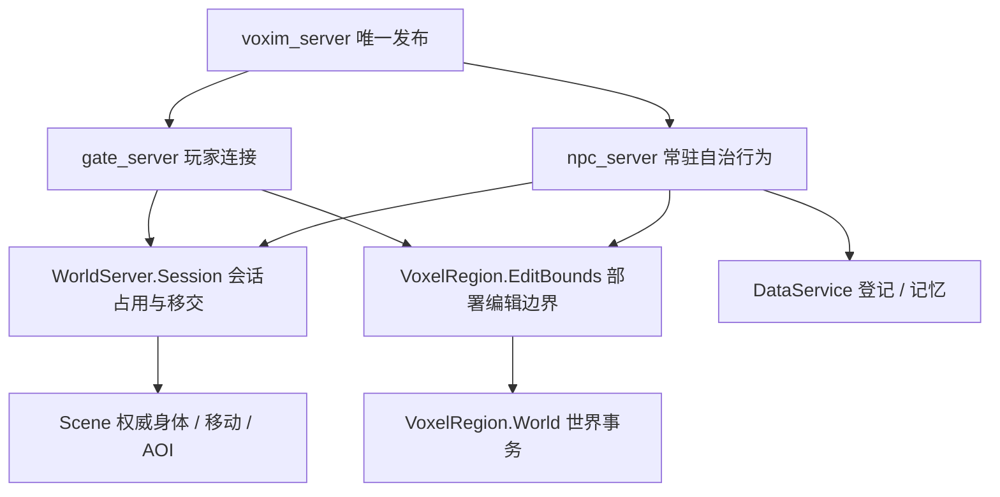

# NPC 常驻应用拆分

## 已批准边界

依据会话 `01a11ba2-3329-7b63-9682-658667dd4bcd` 的最终结论：NPC 是服务器常驻自治行为系统，与服务器同生命周期；Gate 与 NPC 都只消费感知、提交操作，Scene 继续拥有角色身体、移动和 AOI。此次保留情绪、记忆、技能与移动语义，不设计攻击、不改 Scene 实体生命周期、不引入第二发布入口。

## 实施与依据

1. NPC 全部模块、测试与支持夹具迁到 `apps/npc_server`，公开命名为 `NpcServer.*`；同步活跃 CLI 和调用方。新应用不依赖 Gate，二者同一 BEAM release 启动，此次不声称计算资源已隔离。
2. 无传输依赖的 Claims 迁到 `WorldServer.Session`，提供 claim / prepare_transfer / commit_transfer 公共 API；调用进程身份与原消息契约保持不变。World 独占登记处，Gate 重启不能撤销 NPC 会话。
3. 编辑盒算法归 `VoxelRegion.EditBounds`，配置唯一来源为 `:voxel_region, :edit_bounds`；Gate 与 NPC 使用同一契约，保留显式测试参数覆盖。
4. NPC 根按名字注册表 → Body DynamicSupervisor → 常驻 Bootstrap 排序，用 `rest_for_one` 维护依赖。Bootstrap 启动时读正式持久化注册表；上游监督器恢复后重新拉起 enabled NPC。保留逐条显式错误日志，CLI status 从当前注册表派生运行状态，不存第二份角色真值。行政停用仍走 Registry.remove；内部恢复不定义为产品下线。

依据 [Elixir Supervisor 官方文档](https://hexdocs.pm/elixir/Supervisor.html) 的依赖顺序、`rest_for_one` 与临时子进程语义：动态子进程需由应用恢复配置；已结束的 temporary Task 不提供持续恢复契约。采用常驻启动协调进程而非轮询或另一套角色登记。依据 [Application 官方文档](https://hexdocs.pm/elixir/Application.html) 的应用依赖和生命周期，正式 release 显式包含 `npc_server`，启动顺序由依赖决定。

## 最小充分验证与可观测性

- 新根集成：真实数据库中登记 patrol NPC，以实际 Application 入口启动，观察注册表与 Scene；杀 Body、杀 BodySupervisor / 名字注册表后恢复相同 cid；Gate 生命周期变化不改变 NPC Body 与会话。
- 共享会话：沿用 QUIC 的 claim 顶替、移交和旧 owner 拒绝测试，NPC 实际 Scene 集成验证同一登记处；不改 wire。
- namespace 迁移触达全部 NPC 模块，因此运行迁移后的 NPC 默认 suite；模型外部实跑不在此次范围，算法和模型提示未改变。Gate 直接关联会话/分发测试和 CI 选择器覆盖边界迁移。
- 正式启动观测：`NpcServer.Bootstrap.status/0`、`NpcServer.Registry.list/0`、`NpcServer.Body.observe/1`；日志 `npc_registry_start` 与 `npc_bootstrap_ready`。status 只证明控制进程已启动，Scene 加入状态仍由 Body/Scene 观察，不冒充世界 ready。
- 输出保留 `.demo/observe/npc-server-extraction/`。测试遵守 `../Voxim/Docs/Testing.md`，数据库按 VM 隔离，有限世界使用既有 NpcWorld 作者夹具。

## 进度

- 已完成 NPC 应用、共享会话/编辑边界、正式 release、运维脚本、当前事实文档与独立 CI 作业迁移。原有情绪与技能只改模块名。
- 根恢复反例先因缺少 `npc_server.app` 失败；迁移后真实数据库/Scene 用例通过，覆盖 Body、BodySupervisor、Names 故障后的同 cid 恢复。
- `apps/npc_server: mix test --no-start`：351 passed、16 excluded（真实外部模型/长时测试按默认配置排除）。此次 namespace 迁移触达整个 NPC 子系统，故运行完整 NPC 默认 suite。
- `apps/world_server: mix test --no-start test/world_server/session_test.exs`：2 passed，验证实际公共进程入口、调用者身份、占用顶替及移交。
- Windows Gate 直接回归：`mix test --no-start test/gate_server/quic_connection_test.exs test/gate_server/voxim_prefab_publish_dispatch_test.exs test/gate_server/dialogue_dispatch_test.exs --exclude quic_transport`：16 passed、58 excluded（原生 QUIC 独立在 Linux 验证）。
- Linux 真实 QUIC：正式 Dockerfile 的 builder 镜像中运行 `mix test --no-start test/gate_server/quic_connection_test.exs --only quic_transport --seed 0`：58 执行通过，11 excluded（ExUnit 总计 69 tests, 0 failures）。使用新生成的一日 CA/localhost 证书，Auth/Scene 为该传输套件声明的替身；证明共享 Session 迁移后的实际 QUIC 入口，不声称 UE 玩家验收。脚本与日志在观察目录 `quic.sh`、`logs/npc-extraction-quic-linux.log`。
- `python .github/test_test_scope.py`：11 passed；`python -m unittest discover -s scripts/npc_life -p 'test_*.py'`：73 passed；`scripts/npc_dialogue` 同命令：10 passed。
- 正式 Docker 构建成功，镜像 `voxim-server:npc-extraction-20261012`，ID `sha256:74aeca1a08a9b0fba55ca9c48119590488a551fe194c2a976cf3415dd1ce031a`。
- `python scripts/npc_server_smoke.py --image voxim-server:npc-extraction-20261012 --out .demo/observe/npc-server-extraction/release-05`：通过。独立数据库、当前 kernel 新建有限世界、真实正式应用与 QUIC listener；cid `267323969536`。Gate 停止/重启前后 Body、Player、Session 进程和 session_epoch 均不变，tick `48 → 84 → 135` 且实际位置改变；整服重启后自动恢复同 cid，分配新会话，控制进程恢复数 1/1。
- `release-01..04` 保留准备/驱动失败记录：Docker 自动网段池耗尽、旧 inspect 字段、观察结果含不可 JSON 编码的 PID/结构体、数据库 readiness 轮询缺参。修正驱动后 `release-05` 从新数据库和新世界完整执行；这些失败不计作产品通过或客户端验收。
- 独立代码审查未发现重要缺陷；剩余边界：同 BEAM 的资源隔离、独立节点部署与压力测试不在本次范围；无 UE 双端或模型质量验收声明。
