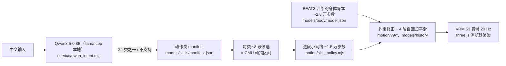

# NPC 动作表现：HAST-SEC 调研与少资产路线候选

分类：**Global system**（客户端表现层）调研 / 决策稿。状态：**D1–D3 已定（不引入 HAST-SEC；会商业化；先走跑后交互）；方向 A 进入隔离 probe 验证，B、C 未批准、未实施**，进入实施前各自另立阶段稿。

- 起因：2026-10-29 用户提出能否用 [sola1039/HAST-SEC](https://github.com/sola1039/HAST-SEC) 给 NPC 生成动作，从而不再预设动作资产。
- 调研基线：HAST-SEC `f4d5c9aa`（2026-10-14，v0.1.1），浅克隆后只读源码与模型清单，**未安装、未运行**；Voxim 与本仓按 2026-10-29 工作区。
- 相邻文档：[角色能力函数库](2026-10-07-character-capability-library.md)（NPC 动词来源）、[NPC 对话](2026-10-11-npc-dialogue.md)、Voxim `Docs/Gameplay/CastActions.md`（`ABP_Unarmed` 上身层）、Voxim `Docs/Combat-Action-Design.md`。

## 1 结论

1. **HAST-SEC 达不到"不用预设动作资产"。** 它本身就是"动作捕捉片段库 + 检索 + 约束修正与平滑"：动作只有 22 类站姿上身小动作，全部来自 51 段 CMU 动捕切片。没有行走、没有与物体交互，也无法自己扩充（不含训练流程）。
2. **不引入（D1）。** 覆盖面、平台（three.js / VRM 对 UE5.8）、许可（非商业）、成熟度（v0.1）四项都不满足；任何一项单独都足以否决。
3. **可借鉴的是它的分层思路**：语义动作类别 → 少量片段 → 骨骼约束 / IK 修正。UE 有原生对应物，见 §6。

## 2 HAST-SEC 实际结构（源码证据）

| 部件 | 事实 | 证据 |
| --- | --- | --- |
| 动作覆盖 | 22 类：左右手各自上抬 / 放下 / 左移 / 右移 / 前移 / 后移 / 举过头 / 摆臂 / 小幅自然活动，外加全身"自然静止""自然活动" | `models/skills/manifest.json` 的 `classes` |
| 片段来源 | 每类候选是 CMU 动捕片段的帧区间，例如"右手向上抬高"一段候选为 `86_02` 第 479–540 帧；共 51 段 | `models/skills/class-3.json`、`models/trajectories/*.bin`、`THIRD_PARTY_NOTICES.txt` |
| 选段 | 15 129 参数 MLP 在给定类的候选里按概率取最大者；注释："范围内的具体动作码由训练出的概率选择" | `models/policy/model.json`、`motion/skill_policy.mjs` |
| 说话身体动作 | 28 080 参数码本预测器，源数据为 BEAT2 说话人片段 | `models/body/model.json`、`models/body/sources.json` |
| 后处理 | 关节限位、质心 / 支撑面、按 De Leva 比例近似质量的运动学修正；不是物理仿真 | `motion/rigid_dynamics.mjs`（注释"工程近似"）、`motion/v9/controller.mjs` |
| 语言 | 0.8B 模型只做"文本 → 类别 / 闲聊"；不在类别里的指令回复"这个动作还没有学会" | `service/qwen_intent.mjs` |
| 规模 / 栈 | 运行代码约 2.7k 行 JS，three.js 0.180 + @pixiv/three-vrm 3.5.5，Node 22 | `package.json` |
| 可扩展性 | 不含训练流程与原始数据；`training/` 只是运行依赖 | `README.md` |
| 成熟度 | 作者自述"早期研究版本，尚未完成完整的强化学习训练与应用适配"；任意角色重定向效果不保证 | `README.md` |

## 3 我们的现状（只列本次核对到的）

- NPC 与远端玩家共用 `AVoximRemoteCharacter`（Voxim `Source/Voxim/VoxelRender/VoximRemoteCharacter.{h,cpp}`）。网格与 `AnimationClass` 在角色蓝图里配置；`Present` 只把服务端快照的速度和是否着地写进 CMC 的 `Velocity` / `MovementMode`，供既有动画图读取（CMC 位移 tick 关闭）。
- 显示快照 `FMmoRemoteDisplay`（`Source/Voxim/Movement/MmoRemoteStore.h`）里只有位置、朝向、速度、是否着地和采样时间信息，**没有"正在做什么动作"的字段**。
- 施法是唯一核对到的动作表现：`VoxelMagicPresentation.cpp` 在 `UpperBody` 槽上用 `PlaySlotAnimationAsDynamicMontage` 播放蓄力循环与释放姿势，并输出 `cast.animation` 结构化日志；`ABP_Unarmed` 的上身分层见 Voxim `Docs/Gameplay/CastActions.md`。
- NPC 的动词（move_to、gather、craft、eat、dismantle、cast_spell、say 等）由服务端 `GateServer.Npc.Abilities` 定义，决策（LLM / 行为树）在服务端完成，见[角色能力函数库](2026-10-07-character-capability-library.md)。
- 采集、建造等动词的客户端身体动画：本次未找到对应代码，**不确定是否已有**；后续阶段稿须先确认。

## 4 差距

| 维度 | HAST-SEC | NPC 需要 |
| --- | --- | --- |
| 动作覆盖 | 站姿单臂动作、说话手势 | 走 / 跑 / 转向；砍、挖、采集；建造放置；施法；受击 |
| 移动 | 无根运动 | 步伐要和服务端裁决的速度一致（避免滑步，CastActions 已踩过） |
| 与物体互动 | 无手持物、无目标对准 | 伸手对准体素目标 |
| 平台 | three.js + VRM 人形骨骼 | UE5.8 + `ABP_Unarmed` 与 UE 人形骨骼；接入等于整套移植加重定向 |
| 决策位置 | 每个角色在本地跑一次语言模型做理解 | 决策已在服务端；客户端只应消费语义标签，不再复制一份理解 |
| 可扩展 | 无训练流程，类别固定 | 动作持续增加 |
| 许可 | 见 §5 | 有正式服部署（青岚）；若有商业化打算，非商业许可直接阻断 |

## 5 许可证据

| 对象 | 结论 | 来源 / 可信度 |
| --- | --- | --- |
| HAST-SEC 本体 | 仅非商业学习研究；商业须书面授权 | 仓库 `LICENSE`、`README.md`（一手） |
| CMU 动捕库 | 原站声明可用于研究与商业项目；不得原样转售数据 | 二手引述原站原文（[4TU FBX 转换说明](https://data.4tu.nl/datasets/0448aab2-3332-449f-a8e2-d208cb58c7df/1)）；原站 `mocap.cs.cmu.edu` 本次 TLS 失败，**待直接核对** |
| BEAT2 | 存在冲突：HF 数据卡标 `apache-2.0`；HAST-SEC 声明称"相关研究站点同时提出非商业使用要求"，[EMAGE 项目页](https://pantomatrix.github.io/EMAGE/)本次未见许可文字 | **未定**，需查 PantoMatrix 仓库 LICENSE |
| AMASS | 仅限非商业科研；明确禁止"incorporation in a commercial product"，并禁止用其训练商业用途的模型 | [AMASS license](https://amass.is.tue.mpg.de/license.html)（一手） |
| HumanML3D | 仓库标 MIT，但动作数据来自 AMASS，因此受 AMASS 约束（推断） | 推断，非条文 |
| UE Game Animation Sample | 仅限 UE 产品使用（UE-Only Content），可商用、可重定向到自有角色 | [Fab 条目](https://fab.com/s/46a85e1ef0c5)、[Epic 博客](https://www.unrealengine.com/blog/game-animation-sample)；完整条文**未读到**，商用前须核对 |

## 6 少资产候选方向（均未批准）

按 AGENTS §2.2.8，下列只是附依据的候选，**不是已批准设计**；任一进入实施都要在 Voxim `Docs/` 另立阶段稿，写可观测面、测试矩阵和验收入口。

### A 走跑转向：Motion Matching + Game Animation Sample

- 依据：[Motion Matching in UE](https://dev.epicgames.com/documentation/en-us/unreal-engine/motion-matching-in-unreal-engine)：Pose Search 插件里"query-based animation pose selection"，可替代状态机 / Blendspace；需要 Schema、Database、Pose History 节点，片段须开 Root Motion；调试走 Rewind Debugger。示例项目提供 500+ 段动画并有 5.8 更新。
- 和我们的对应：替换 `ABP_Unarmed` 里的走跑部分，上身槽（施法）保持不变。
- 开放问题：官方文档的轨迹通道"designed to be used in conjunction with the Character Trajectory blueprint component"，而远端角色关闭了 CMC 位移 tick，轨迹只能来自服务端快照（历史 + 外推）。能否喂自定义轨迹、外推不足时的表现，**须先做隔离 probe 验证**；文档也未提及 AI / 网络角色。

### B 交互动作：语义标签 + Control Rig / IK

- 依据：[Control Rig](https://dev.epicgames.com/documentation/en-us/unreal-engine/control-rig-in-unreal-engine) 官方定位含程序化动画与 Full-Body IK；[IK Rig](https://dev.epicgames.com/documentation/unreal-engine/unreal-engine-ik-rig?lang=en-US) 可在动画蓝图里程序化调整。具体 FBIK 求解细节本次只见二手资料，**待读官方 FBIK 页**。
- 和我们的对应：一个基础姿势配 IK 目标（伸手、指向、注视、放置），覆盖采集 / 建造 / 拆除等，不必一个动作一套资产。这也正是 HAST-SEC "类别 → 片段 → 约束修正"的 UE 对应。
- 前置：客户端需要知道"谁在对哪个目标做哪类动作"。§3 的显示快照没有这些字段，属于**协议扩展**（铁律 7、§3.8），须先立协议决策稿；表现层只消费已确认的事件，不影响服务端权威。

### C 资产生产：离线文字生成动作再烘焙

- 定位：美术生产工具，不是运行时。
- 阻断：主流文字生成动作模型多基于 HumanML3D / AMASS 训练，受 AMASS 非商业条款约束（§5）；在许可确认前不考虑。

## 7 决策项

| 编号 | 内容 | 状态 |
| --- | --- | --- |
| D1 | 不引入 HAST-SEC（代码、模型、数据均不进入任何分发物或正式组合根） | 已定 |
| D2 | 项目**会商业化**（2026-10-29 用户确认）。因此：非商业资源（HAST-SEC、AMASS 及其派生模型、许可未定的 BEAT2）不进入任何资产、probe 或训练；方向 C 在拿到商业授权前搁置；示例动画包与 CMU 数据使用前须读到一手完整条文并记录 | 已定 |
| D3 | **先 A（走跑）后 B（交互）**（2026-10-29 用户确认）。A 先在独立工作区做隔离 probe，回答 §6 A 的开放问题；B 的协议稿在 A 出结论后再立 | 已定 |

## 8 进度日志

- 2026-10-29：完成 HAST-SEC 源码调研与许可核对，落本稿；D1 定为不引入。未写任何代码。
- 2026-10-29：用户确认 D2（会商业化）、D3（先 A 后 B）。为方向 A 开 Voxim 独立 Orca 工作区做隔离 probe，结论回写本节。
