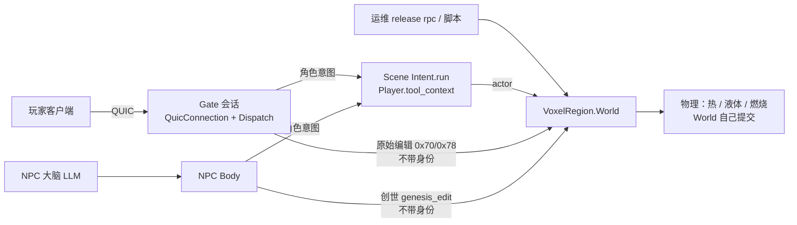
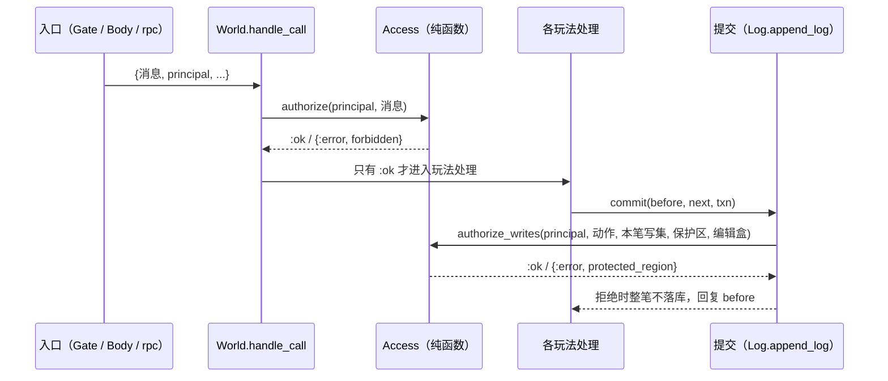

# 服务端统一授权设计（决策稿，待批准）

- 日期：2026-10-30
- 状态：**草案，等待用户批准**；批准前不改生产代码
- 起因：原始体素编辑绕过如园保留区，已复现（`.demo/observe/qinglan-deploy-20261029/fix-20261030/raw-edit-protection/REPORT.md`）
- 用户要求：权限不能散落在各个操作里，每加一种操作就要全仓扫一遍；要用成熟的做法，由一个模块从代码层面统一管理

## 1. 一句话结论

新增一个纯函数模块 `VoxelRegion.Access`，作为 World 写操作授权的**唯一策略定义处**，并把执行点收敛为两处：

1. **入口准入**：在 World 接到请求时执行。每条会改世界的消息都必须在 `Access` 的一张表里登记"属于哪类动作、哪些主体可以做"。没登记的消息默认拒绝，并由测试保证不可能漏登记。
2. **落库前写集检查**：在 World 提交事务时执行。按这笔事务**实际写到的格子**，检查主体是否可以改这些格子（保护区、部署编辑盒）。各操作不再自己计算"影响了哪些格"，然后各自调用 `Protection.permitted?`。

这相当于把现有做法换成 NIST RBAC（主体类别 → 动作类）加上 ABAC 的空间属性（格子归谁），沿用 XACML 的 PEP/PDP 分工。不引入规则引擎或策略语言。

## 2. 现状盘点（生产代码 `ab7fced0`）

### 2.1 谁能调到会改世界的入口



| 入口 | 主体 | 进入 World 的方式 | 保护区检查 | 其他检查 |
|---|---|---|---|---|
| 角色工具意图（挖、拆、点燃、认领…） | 玩家 / NPC（同一条路） | `ToolAction.run` → `World.tool_intent` | `world.ex:1395-1397` | 射程、遮挡、死亡门、重放 |
| 生产 / 放置 | 同上 | `Intent.run` → `World.production_intent` | `production.ex:121, 253, 300` | 余额、材料合法性 |
| 附件 | 同上 | `World.attachment_intent` | `claims.ex:24-36`（另有"不跨区域边界"规则） | |
| prefab 放 / 拆 / 换 | 同上 | `World.prefab_intent` | `world.ex:1494` | Gate 侧再查一次部署编辑盒（`quic_connection.ex:578-589`，同步调 World） |
| 施法 | 同上 | `Player.cast_spell` → World | `casting.ex:105` | 能量、相干 |
| 液体注入 | 玩家（cid）或运维（nil） | `World.liquid_fill` | `liquids.ex:296`，**cid 为 nil 时跳过** | |
| **原始单格 / 批量编辑** | **玩家** | `Dispatch` → `World.apply_edit(s)`（`dispatch.ex:219-252`） | **无（已复现缺陷）** | Gate 侧只查部署编辑盒与 Scene |
| NPC 创世 `genesis_edit` | NPC（注册表授予 `genesis: true`） | `Body` → `World.apply_edits`（`body.ex:1300`） | **无** | `Genesis.prepare`：距离、编辑盒、格数 |
| GM 施工 `World.gm/4` | 运维（rpc） | 直接调 | 无（设计上不受限） | `VOXIM_GM_TOOLS=1` 才开（`world/gm.ex:34-37`） |
| 作者 / 维护：`author_regions`、`parcel_install`、`publish_*`、`*_experiment`、`material_supply`、`beacon_install`… | 运维（rpc） | 直接调 | 无（设计上不受限） | 无身份、无开关 |
| 物理提交（热、液体、燃烧） | 系统 | World 内部 | 不走许可，靠物理隔离（`Protection.same_holder?`） | |

### 2.2 问题归纳

1. **没有"主体"这个概念。** World 只在角色意图里间接拿到 `actor.cid`；原始编辑、创世、运维调用都不带身份。因此无法用一条规则表达"玩家不许做原始编辑"。
2. **保护区检查分散在 8 处。** 每处各自算一遍"本操作影响哪些格"（`target_cells`、`prefab_intent_cells`、`effect.cells`、附件足迹……），再各自调用 `Protection.permitted?`。新增一种写操作时，只要忘了这两步，就会像原始编辑一样整条路径不设防，而且没有任何测试会报警。
3. **默认放行。** World 的公共写 API 对谁都开放，是否检查全凭每个入口自觉。这与 OWASP 的 Deny by Default、Saltzer & Schroeder 的 fail-safe defaults 相反。
4. **部署编辑盒检查在 Gate 侧做。** 为此 Gate 连接进程要同步调 World 算 prefab 格子，最长等 300 s（代码审查报告的严重项 2），算出的结果 World 之后还会再算一遍。
5. **特权来源不统一。** GM 用环境变量开关，创世用 NPC 注册表行，运维靠"能连上 release"。三者都没有统一的名字，也没有统一的拒绝日志。

## 3. 边界：什么归授权，什么不归

| 归 `Access`（授权） | 不归 `Access`（仍由各 owner 负责） |
|---|---|
| 这类主体能否发起这类动作（玩家能否原始编辑、NPC 能否创世、谁能用 GM） | 射程、遮挡、冷却、死亡门、重放（角色 owner `Player`） |
| 这个主体能否改这些格（保护区持有者、部署编辑盒） | 余额、扣料、材料合法性、耐久（World 各玩法模块） |
| 拒绝时的统一原因与结构化日志 | 认领工具自身的规则：面积、数量上限、重叠（`Claims`，属于玩法） |
| | 物理跨区域隔离（`Protection.same_holder?`，属于物理） |
| | 账号登录与网页管理权限（`auth_server` 的 `Identity.administer`，见 §8 决定项 4） |

## 4. 业界做法与取舍

| 做法 | 要点 | 适用条件 | 对本项目 |
|---|---|---|---|
| NIST RBAC（ANSI INCITS 359-2004；Ferraiolo/Sandhu/Kuhn） | 主体 → 角色 → 权限，权限 = 对对象的操作 | 主体类别少且稳定 | **采用核心部分**：主体类别（角色、创世 NPC、运维、系统）× 动作类的静态表。不需要角色分配数据库，因为类别由**进入的通道**决定（Gate 会话只能是角色，release rpc 才是运维）。 |
| ABAC（NIST SP 800-162） | 按主体属性、资源属性、环境属性求值 | 规则依赖资源上下文 | **采用于空间维度**："格子的持有者"和"是否在部署编辑盒内"都是资源属性。 |
| XACML 3.0（OASIS）的 PEP / PDP / PIP 分工 | 执行点拦截请求，决策点只求值，信息点提供属性 | 任意规模 | **采用这个分工**：`Access` 是纯函数 PDP；World 的接纳入口和提交入口是 PEP；`Protection` 索引是 PIP。**不采用** XACML 的策略语言。 |
| OWASP Authorization Cheat Sheet | Deny by Default；Validate the Permissions on Every Request（用全应用的统一机制）；Exit Safely（统一的失败路径）；Implement Appropriate Logging；为授权逻辑写测试 | 通用 | **全部采用**，分别对应：未登记即拒绝、两个执行点、统一的拒绝结果与日志、穷举登记测试。 |
| Saltzer & Schroeder 1975 设计原则 | complete mediation（每次访问都检查）、fail-safe defaults、economy of mechanism | 通用 | 这正是要把空间检查放到"每笔事务的实际写集"上的理由：检查对象是事务真正写了什么，而不是每个操作自己声称会写什么。 |
| WorldGuard（Minecraft 区域保护，成熟的游戏实践） | `build` 标志覆盖挖、放等全部改动；"members and owners can build and non-members can't by default"；flags "are not player-specific"，活塞、TNT 引起的方块变化同样按位置判定 | 体素世界的区域保护 | **采用其思路**：保护按"哪个格被改了"判定，与哪种工具、哪条消息无关。它是在方块变化事件这一层统一拦截，而不是在每种工具里各写一遍。 |
| Google Zanzibar / ReBAC | 关系图（谁是谁的成员）、全球一致性 | 海量对象与共享关系 | **暂不采用**：当前持有者只有角色和 `:reserved` 两种，还没有组织或成员关系。将来出现"公会成员可建"时，再把 holder 扩展为关系查询，只改 `Access` 一处。 |
| AWS Cedar、OPA（策略语言 / 外置引擎） | 可分析的声明式策略、与代码分离 | 多团队、策略需独立发布 | **不采用**：规则少，而且需要与 World 状态同步求值；外置引擎会多一跳和一套新语言，违反 AGENTS §2.2.7（不过度设计）。 |
| Elixir 生态 Bodyguard（`Policy.authorize(action, user, params)`） | 每个上下文一个 policy 模块，返回 `:ok | {:error, reason}` | Phoenix 上下文 | **借鉴其接口形状**：`Access.authorize(principal, action, resource)`，不引入依赖。 |

来源：
- OWASP Authorization Cheat Sheet：<https://cheatsheetseries.owasp.org/cheatsheets/Authorization_Cheat_Sheet.html>
- NIST RBAC：<https://csrc.nist.gov/projects/role-based-access-control>
- NIST SP 800-162：<https://csrc.nist.gov/pubs/sp/800/162/upd2/final>
- XACML 3.0：<https://docs.oasis-open.org/xacml/3.0/xacml-3.0-core-spec-os-en.html>
- Saltzer & Schroeder, *The Protection of Information in Computer Systems*：<https://web.mit.edu/Saltzer/www/publications/protection/>
- WorldGuard Flags：<https://worldguard.enginehub.org/en/latest/regions/flags/>
- Zanzibar（USENIX ATC 2019）：<https://research.google/pubs/zanzibar-googles-consistent-global-authorization-system/>
- Cedar：<https://www.cedarpolicy.com/>
- Bodyguard：<https://hexdocs.pm/bodyguard>

## 5. 设计

### 5.1 主体（principal）：只列当前真实存在的四类

| 主体 | 谁构造 | 含义 |
|---|---|---|
| `{:character, cid}` | `Player` 生成 actor 时（玩家和 NPC 走同一条角色路径） | 以角色身份行事，受保护区约束 |
| `{:genesis, cid}` | NPC `Body`，仅当注册表授予 `genesis: true` | 创世 NPC 的地形编辑特权 |
| `:operator` | release rpc 与维护脚本调用的 World 公共 API | 运维 / 作者 / GM，明确不受保护区约束 |
| `:system` | World 内部（物理、装页、压实） | 不经授权检查；跨区域靠物理隔离 |

主体在**进入的通道**处构造一次（Gate 会话只可能产生 `:character`），之后作为 World 请求的一个字段传递。下游不再自己推断。集群内 BEAM 调用属于可信代码，所以"谁能构造哪类主体"由一个测试守住：在源码里扫描 `:operator`、`{:genesis, _}` 的构造位置，只允许出现在白名单模块里。不另做签名或令牌，那属于过度设计。

### 5.2 `VoxelRegion.Access`：一张能读懂的表

```elixir
# 示意（实施时以代码为准）：动作类 => 允许的主体类别、是否受空间约束
@policy %{
  character_intent: %{principals: [:character],          spatial: [:protection, :edit_bounds]},
  raw_edit:         %{principals: [:genesis, :operator], spatial: [:protection, :edit_bounds]}, # 创世是否受保护区约束见决定项 2
  gm_build:         %{principals: [:operator],           spatial: [], requires: :gm_tools},
  world_authoring:  %{principals: [:operator],           spatial: []},
  read:             %{principals: :any,                  spatial: []}
}

# 消息 => 动作类：World 每个 call 消息都必须在这里出现，否则拒绝
@messages %{tool_intent: :character_intent, production_intent: :character_intent, ...,
            apply_edit: :raw_edit, apply_edits: :raw_edit, gm: :gm_build, author_regions: :world_authoring, ...}

@spec authorize(principal, message_tag) :: :ok | {:error, {:forbidden, action, principal_kind}}
@spec authorize_writes(principal, action, cells, protection, edit_bounds) :: :ok | {:error, :protected_region | :out_of_bounds}
```

- 读这个模块的人，在一屏之内就能知道"谁能做什么、受不受保护区约束"。
- 规则怎么判（持有者相等、在编辑盒内）只写在这里。`Protection` 回归为纯索引（PIP），只负责回答"这格归谁"。

### 5.3 两个执行点



**执行点 1：入口准入（World 接到请求时）。** `handle_call` 在分派到具体处理之前，统一调用一次 `Access.authorize`。原始编辑来自玩家会话时，就在这里被拒。Gate 只把会话的角色身份作为主体交给 World，自己不持有任何权限规则（实施时的取舍见 §9）。

**执行点 2：落库前写集检查（提交事务时）。** 这是"以后不用再扫全仓"的关键：
- World 已有一组"唯一写入口"（`Edits.put_overlay`、`Canonical.put_refined / put_attachments / drop_attachments / put_liquid / put_macro_owner / put_structure` 等，见 `pages.ex:18-21`），它们现在会登记脏单元。设计让它们同时把**宏格**记进本回合的写集 `state.write_cells`。另外，事务自带的 `property_states`（伤害行）、`epochs`、`placed_by` 也并入写集。
- 提交入口（`Log.append_log`，以及 `edits.ex:376` 那条液体快路径）带上本笔的 principal 和动作类，对写集调用 `Access.authorize_writes`。被拒时整笔不落库，处理函数回复 `before`。
- 这样新加一种写操作时，只要它通过写入口改格子、通过提交入口落库，就自动受检查，不需要自己算格子，也不需要记得调用检查。`:system` 主体（物理）跳过这项检查，跨区域仍靠物理隔离。
- 部署编辑盒也在这里一起判定，于是 Gate 不再需要同步调 World 去算 prefab 格子（顺带解决审查严重项 2）。

### 5.4 防遗漏：靠测试与结构，不靠记性

1. **World 消息穷举测试**：解析 `world.ex` 的 `defp call/3` 子句，取出全部消息标签，断言每个都在 `Access` 的 `@messages` 里。新加一个 call 却没登记，CI 直接变红。
2. **Gate 上行穷举测试**：`MmoContracts` 解码器能产生的每种上行消息，都必须映射到一个动作类（或明确标记为只读 / 会话控制）。
3. **提交入口唯一性测试**：除了 `Log` 自己，不允许出现直接调用 `append_journal` 的提交（现有液体快路径改为经同一入口）。
4. **主体构造白名单测试**：见 §5.1。
5. **行为测试**：现有 6 个红测试（原始编辑进保留区）变绿；对照组（角色意图被拒）保持绿；每类角色动作各加一例"副作用写进保护区 → 整笔被拒"。

### 5.5 可观测性

- 每次拒绝打一行结构化日志：`world_access_denied principal=character:42 action=raw_edit reason=forbidden message=apply_edits cells=3 sample=[{3988,10,162}] seq=…`。
- World `stats` 增加按 `{动作, 原因}` 计数的拒绝次数，便于在 CLI / 观测里看是否有人在试探。
- 拒绝原因统一为 `:forbidden`、`:protected_region`、`:out_of_bounds`、`:gm_disabled`，在一处定义。客户端看到的 reason 字符串保持现有拼写，`:protected_region` 不变。

### 5.6 刻意不做的事

- 不做运行时可改的规则引擎、策略 DSL 或外部授权服务。
- 不做角色分配数据库或组织 / 公会关系。等到出现真实需求，再在 `Access` 里加 holder 求值。
- 不对 BEAM 内部调用做签名或令牌校验。
- 不在内部链路重复校验：两个执行点之外不再出现 `Protection.permitted?` 调用（AGENTS §2.2.6）。

## 6. 迁移计划

| 步 | 内容 | 改动面 | 验收（改前红 → 改后绿） | 上线影响 |
|---|---|---|---|---|
| **1** | 新增 `Access`（主体、动作表、`authorize/2`）。World 公共写 API 加 principal 参数，`handle_call` 统一准入。Gate 原始编辑直接拒绝，并带结构化日志。NPC 创世传 `{:genesis, cid}`。运维 API 默认 `:operator`。 | 新模块；`world.ex` 公共 API 与 `handle_call` 入口；`dispatch.ex`；`npc_server/body.ex`；运维脚本调用不变（默认值） | 6 个原始编辑红测试转绿；消息穷举测试；主体白名单测试 | 只影响原始编辑：正式青岚控制器不走这条路；旧 M1/R7 控制器和控制台 `Voxel.R5.*` 会收到 `forbidden`。可单独发版。 |
| **2** | 写入口记录宏格写集；提交入口带 principal 并调用 `authorize_writes`；液体快路径并入同一提交入口。 | `canonical.ex` / `edits.ex` 写入口；`log.ex`；约 20 处 `append_log` 调用改为带 principal | 每类角色动作的"副作用越界"反例；物理提交不受影响（回放与 off/on 对比一致） | 行为应与现状一致；性能需测（写集是本回合格子集合，预计很小） |
| **3** | 删除 8 处分散的 `Protection.permitted?` 调用。附件"不跨区域边界"保留在 `Claims`（属于玩法）。Gate 的 prefab 编辑盒同步检查删除，改由执行点 2 统一判定。 | `world.ex:1395, 1494`；`casting.ex:105`；`production.ex:121, 253, 300`；`liquids.ex:296`；`claims.ex:24-36` 中的许可部分；`quic_connection.ex:578-589` | 第 2 步的反例全部保持绿；原有保护区测试保持绿 | 无可见变化；Gate 不再同步调 World |
| **4** | GM 开关、创世授予改为在 `Access` 的表里表达（`requires: :gm_tools`），环境变量和注册表只作为属性来源。 | `world/gm.ex`、`npc_server` | GM 关闭时被拒，原因一致 | 无 |

**与静态 L0 分支的合并顺序**：两边都改 `world.ex`，但区域基本不重叠：静态 L0 改装页 / 驻留，本设计改请求入口与提交入口。建议静态 L0 先合入；第 1 步在其后 rebase，改动小、冲突少。第 2 步改写入口，与静态 L0 的 `Pages.mark` 路径相邻，必须在静态 L0 合入之后再做。

## 7. 风险

- **第 2 步的写集是否完整**：如果某个写入口漏记，空间检查就会漏掉。缓解办法：写集与已有的"脏单元"登记出自同一批写入口，并加一个测试——对每类动作，断言"写集覆盖了事务的全部 `entries` 坐标与 `property_states`"。
- **提交时拒绝的回滚**：World 处理函数大多是 `before → next` 的纯计算，拒绝时回复 `before` 即可。但个别处理在提交前有进程副作用（如 `Process.monitor`、认领角点状态）。第 2 步要逐个核对这 20 处调用。
- **创世 NPC 行为变化**：如果决定让创世也受保护区约束（决定项 2），现有创世脚本中凡是跨入保留区的改动都会被拒，需要先在复制库上演练一次。

## 8. 需要用户决定

1. **原始编辑留给谁？** 推荐：只留给 `:operator` 和 `{:genesis, cid}`，玩家一律拒绝。备选：彻底删除原始编辑协议（要同步改客户端与 `mmo_contracts` 冻结字节，成本高）。
2. **创世 NPC 受不受保护区约束？** 推荐：**受约束**。创世用于野外塑形，不应能改玩家领地和如园。备选：不受约束，与运维同级。
3. **范围是否先只做第 1 步并单独上线？** 推荐：第 1 步单独发版，尽快封住玩家原始编辑；第 2、3 步在静态 L0 合入后再做。
4. **账号 / 网页管理权限（`auth_server` 的 `auth_admin`）要不要并入同一套词汇？** 推荐：本轮不并。它已经集中在 `Identity.administer` 一处，且属于账号领域。将来如果游戏内 GM 身份要和账号绑定，再让 GM 主体从账号声明里来。

## 9. 进度日志

- 2026-10-30：复现原始编辑绕过保留区（6 红 2 绿）；完成现状盘点与本草案。
- 2026-10-30：用户批准 §8 全部推荐项：原始编辑只给运维与创世 NPC；创世受保护区约束；第 1 步单独发版；账号管理权限本轮不并。
- 2026-10-30：第 1 步实现（分支 `investigate/raw-edit-protection`，未提交）：
  - 新增 `VoxelRegion.Access`：主体、动作类策略表、World 全部消息的登记表、`admit/1`、`authorize/2`、`authorize_cells/4` 和唯一的拒绝日志出口。
  - World `handle_call` 统一准入；原始编辑消息改为携带主体（`{:apply_edit, principal, coord, material}`、`{:apply_edits, principal, edits}`）；新增 `apply_edit/4`、`apply_edits/3`，旧 arity 即运维主体。
  - Gate 原始编辑以 `{:character, cid}` 转交 World，由 World 拒绝为 `forbidden`；Gate 不持有权限规则。
  - NPC 创世以 `{:genesis, cid}` 调用，受保护区约束。
  - 与设计 §5.3 的偏差：Gate 不单独调用 `Access`，而是转交 World 由其唯一执行点判定。这样 Gate 与策略完全解耦，代价是被拒请求仍会先走一次装页准备；这与正常意图的成本同级，没有引入新的放大面。
  - 主体白名单用源码扫描测试实现（gate / scene / npc 不得调用运维专用 World 写 API，原始编辑必须显式带主体）。
  - 验证（证据 `.demo/observe/qinglan-deploy-20261029/fix-20261030/raw-edit-protection/authz-step1/`）：`access_test`、`raw_edit_access_test`、`closure_entries_test` 全绿。`world_test` 9 项失败均为环境原因：8 项需要本机 PostgreSQL；GC 阈值 1 项在基线 `ab7fced0` 上同样失败。Gate 的 `movement_route_test` 与 `quic_connection_test` 中的编辑 worker 用例通过；`T1TransportTest` 在 Windows 上缺 quicer，未启动、未开套接字。NPC Body 的创世用例通过；注册表用例需要 PostgreSQL。
