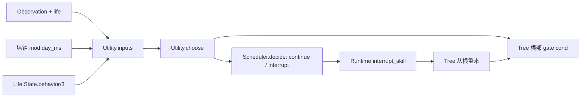
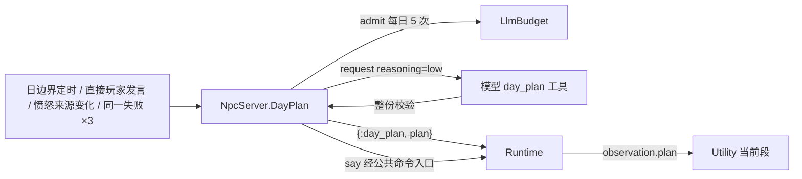

# NPC 活动选择器（效用打分，N1）

> **2026-11-12 更新（薄片一 S1-A）：本稿的 N1 已被取代，以下内容只作历史记录。**
> 按用户确认的总纲 [`2026-11-12-npc-architecture-overview.md`](2026-11-12-npc-architecture-overview.md)，选择位置上只有一个判断者 Jev。
> 已删除：`NpcServer.Utility`（时钟打分、默认日程、惯性与紧急覆盖、`gate/3`、`decide/2`、日志 `npc_utility_decision`）、
> `Trees.settler_daily/1`（含 rest / social / avoid 分支与写死的轮换台词 `@lines`、日志 `npc_daily_idle`）、注册参数 `daily`、
> 测试 `npc_utility_test.exs`，以及 `Brain.Tree` 里只为 social 分支加的两参数函数形 `act` 参数。这些从未实跑过。
> 取代它们的是 `NpcServer.Selector`（活动结束时异步问 Jev，取 top1）、`NpcServer.Mind`（心智快照）、`NpcServer.Persona`（人格卡）、
> `Trees.npc/1` 与注册表 brain `"npc"`，说明在 `apps/npc_server/lib/npc_server/README.md` 的“统一形态”一节。
> 仍在但**未接线**：N2 / N3 的 `DayPlan` 与 `LlmBudget`（没有注册表入口会启动；`DayPlan` 的活动名表改为自己的常量，
> 其测试里经 `Utility` 断言的三处随之去掉），留到薄片二改成规划位置的外壳。

分类：全局系统功能；测试 `npc_utility_test.exs` 为 Test-only。日期：2026-11-10。
状态：**已实现；纯函数与 Scheduler／Tree 接缝测试已跑通（`npc_utility_test.exs` 12 项；连同 jev、skill_brain、social、tree、life_state 共 80 通过，2 项按标签排除）。
未做真实客户端或生产运行，"看起来有生活感"完全未验证。**
验证命令（WSL，OTP 29.1.2 / Elixir 1.20.5，独立 build 目录）：`cd apps/npc_server && MIX_ENV=test mix test --no-start test/npc_server/npc_utility_test.exs …`。
改前红：模块缺失，测试文件无法加载；另做三处变异（关闭紧急覆盖、惯性置 0、平局次序反向）各有对应用例失败，见交接报告。
用户 2026-11-10 授权实现一版并以埋点看效果；不部署、不扩到 N2（LLM 日程）。

## 契约

- **行为：** 配了 `profile.interrupt_policy = {NpcServer.Utility, config}` 的 NPC，技能运行中每次检查（Runtime 每 10 秒）按
  "日程时段 + 情绪／社交 + 附近有人" 给活动打分；选出的活动与正在做的不同就中断技能，否则继续。路径上**不调用模型**。
  不配置时行为与现在完全一致（`Scheduler.configured/1` 仍返回 `nil`）。
- **边界：** `Scheduler` 的继续／中断语义、`Tree` 的 halt 与根部重启、`Life.State.behavior/3`。
- **不覆盖：** 真实双端观感、生产、LLM 日程（N2）、记忆与反思、余额输入。

## 接线

1. `Utility.decide/2`（`@behaviour NpcServer.Scheduler`）：技能运行中重新打分，不同则 `{:interrupt, 活动字符串}`。
2. `Utility.gate/3`：`{:seq, [{:cond, 是否选中}, 子树]}`。被中断后树从根重来，根 `sel` 里各活动子树用 gate 包起来，只有被选中的往下走。
3. **没有改 Tree、Runtime、Life。** 避险／感谢规则不重写：直接取 `State.behavior/3` 的 mode（`:avoid`／`:cautious`／`:thank`）当输入。
4. 一个已知缝：Tree 目前只把中断记成 `superseded` 失败，不知道中断到哪个活动；所以活动要靠根部 gate 重新选，而不是靠中断原因传递。

## 参数（均为游戏设计调参起点，不来自论文或实测）

| 名 | 值 | 含义 |
|---|---|---|
| 活动次序 | `avoid, work, rest, social` | 有序；平局靠前者胜 |
| `@inertia` | 0.25 | 正在做的活动加分，防抖动 |
| `@urgent` | 1.0 | "avoid" 分数达到它直接压过惯性 |
| `@avoid_threat` / `@avoid_cautious` | 1.5 / 0.4 | mode 为 `:avoid` / `:cautious` 时的 avoid 加分 |
| `@thank_bonus` | 0.7 | mode 为 `:thank` 时 social 加分 |
| `@nearby_bonus`/`@nearby_range` | 0.15 / 10 m | 有他人在范围内时 social 加分 |
| `day_ms` | 1_440_000 | **旧假设（现实 24 分钟 = 1 游戏日），2026-11-13 更正**：实际昼夜日 = 现实 20 分钟（×72，客户端冻结值；服务端 `MmoContracts.WorldTime`）。`DayPlan` 未接线，重做时读 `WorldTime`，不再用 `day_ms`；`config.day_ms` 现无调用方 【已于 2026-11-15 改为 ×24（昼夜日 = 现实 60 分钟），见游戏钟设计页 `2026-11-13-world-clock-design.md` 页首】 |
| 默认日程 | 千分位 0–250 夜（rest）、250–700 日（work）、700–850 晚（social）、850–1000 夜（rest） | 有序，取第一个覆盖当前时刻的段 |

时钟：（写于 2026-11-10；**2026-11-13 更正**）当时服务端没有游戏日时钟；现已有 `MmoContracts.WorldTime`（纯函数，与客户端昼夜同公式，设计见 `2026-11-13-world-clock-design.md`）。下面一句是旧设计的原话。
本版游戏时刻 = `rem(Life 观察里的 now_ms, day_ms)`，全体 NPC 与重启后一致。若以后服务端有权威游戏时钟，换 `inputs/2` 里这一处即可。

没有单独的最短持续时间：10 秒的检查节拍本身就是重新打分间隔。

## 埋点

每次决定一行日志，与 `npc_interrupt_check` 同风格：

    npc_utility_decision cid= current= chosen= switched= plan_source=authored|llm scores=avoid:0.0,work:0.8,rest:0.1,social:0.45

看效果时可统计：每 NPC 每游戏日 `switched=true` 次数（抖动）、各活动占比、`chosen=avoid` 的触发来源。
LLM 请求数：此路径没有任何 HTTP 或模型调用；Runtime 的 `jev_requests` 只对 `NpcServer.Jev` 计数，使用 Utility 时保持 0，
`scheduler_requests` 会计数（它是策略调用次数，不是模型请求）。

## 未验证

- 真实客户端里 10–20 个 NPC 是否"有生活感"；默认日程与各系数是否合理；是否抖动，全靠上面日志后评。
- 与 `Social`、`Tree.settler` 的真实运行叠加（本版只在纯函数和单棵测试树上验证）。
- 打断点落在步骤之间：`Tree.halt` 不撤销已提交的世界事务，沿用现状，未做新证明。
- 接线：新增 `Trees.settler_daily/1`（Test-only 试验树）：根 `sel` 按活动次序放 `gate`，`work` 分支是原 `settler/1` 的一轮（含回访等待，不含外层 repeat），每轮做完回根重新选择；其余活动只是原地等 600 tick（avoid/感谢的真实移动仍由有 `:life` 时的 `Brain.Social` 接管）。
- 2026-11-10 本机实跑（`Saved/Tests/telemetry-npc-20261110/` 于 Voxim 仓库）：首版把整棵 settler（外层 repeat :forever）放进 work 分支，切到 work 后再不回根，rest/social 时段仍在工作；技能都短于 10 s，中断检查也没触发。已改为只取一轮，并加回归用例。
  profile 加 `tree: &Trees.settler_daily/1`、`utility: cfg`、`interrupt_policy: {NpcServer.Utility, cfg}` 即可启用。`settler/1`、生产 NPC 配置未改，生产无 NPC。
  树级测试 2 项（夜里不发命令、白天首条命令与原 settler 相同）已过；没有真实运行。

## 可见的 rest 与 social（2026-11-11）

- **rest**：`travel` 回 `profile.home`，再等一个检查节拍（600 tick）。
- **social**：观察 `entities` 里有别的角色（玩家或 NPC）时，`move_to` 到水平距离最近者前方 2 米（沿水平连线；已在 2 米内就原地），
  再 `say`（附近公开、新话题）台词表 `Trees.lines/0` 的下一句，然后等一个节拍；没人时 `travel` 到 `profile.plaza` 等一个节拍。
  台词有序轮换：下一句 = 上次被 Scene 接纳那句（黑板 `:said`）之后的一句，末句后回到第一句。频率、距离、新话题 300 s 间隔只由
  `SceneServer.Dialogue` 裁决，被拒（如 `topic_rate_limited`）不换句。
- **avoid** 仍是原地等待（真实移动在 `Brain.Social`）。
- 分支内任一步失败记一行 `npc_daily_idle entity= act= reason=`，照常等待，不让根 repeat 结束、不在同一节拍内重发。
- `Brain.Tree` 的 `act` 参数现在也可以是 `fn 黑板, 观察 -> map end`（social 的走近目标取自当前观察）；1 元函数行为不变。

注册表（`brain: "settler"`）可选参数，不需要迁移（存在 params JSON 列）：

    "daily": {"home": [x, z], "plaza": [x, z], "day_ms": 正整数, "plan": 布尔（可缺省，默认 false）}

配了就换成 `Trees.settler_daily/1`，profile 多 `home`、`plaza`、`utility: %{day_ms:}`；**不**设置 `interrupt_policy`（技能运行中不被中断，
只在每轮结束回根时重新选择）。形状不对 → 登记被拒 `{:error, {:invalid_params, …}}`。不配 `daily` 与原来完全相同。

已知：没有 Life 的 NPC 每轮 social 都会尝试一次 `say`，5 分钟新话题间隔内被 Scene 拒绝并记一行 `npc_daily_idle`，这是预期日志。
未实跑：真实客户端里的走近与说话。

## N2 LLM 日计划 / N3 升级（2026-11-11）

- **owner**：`NpcServer.DayPlan`，Runtime 只为同时带 `profile.utility` 与 `endpoint`（注册表 `settler` + `daily.plan: true`）的 NPC 在 Life 旁起一个链接进程。
  LLM 日计划按 NPC 显式开启：`daily.plan` 为 true 才取运行环境 `NPC_LLM_URL/KEY/MODEL`（缺失即登记被拒）并起 DayPlan；不写 plan 的作息 NPC 只用手写作息，零模型调用。
- **日计划（N2）**：日号 `div(now_ms, day_ms)` 变化（进程自己定时到下一日边界）时请求一次，reason=plan。
  应答只接受一次 `day_plan` 工具调用：有序 `{from, to, activity, target}`，千分位整数，从 0 首尾相接到 1000，
  activity ∈ avoid/work/rest/social，target ∈ home/plaza/null；否则整份拒绝 `npc_day_plan_rejected cid= day= reason={:invalid, 原因} trigger=`，
  不修补。请求失败记 `npc_day_plan_request_failed`。接受记 `npc_day_plan_accepted … slots=`。提示词只在 `DayPlan`（中文，要 4–8 段）。
- **选择器**：当日有接受的计划时 `Utility.inputs/2` 用计划当前段（该活动权重 0.8、其余 0），情绪加成与 avoid 紧急覆盖照常；
  否则用手写日程。这是批准的显式缺省，不是静默降级：决策行带 `plan_source=authored|llm`。
  段的 `target` 给 rest 与"无人时的 social"选去处（home/plaza），null 用分支缺省；work 忽略 target。
- **升级（N3）**：三种触发各请求一次"重排今天剩余"，reason=speech|anger|failure：
  1. 玩家（`speaker_kind == 0`）直接对本 NPC 说话（Runtime 已判定 `Dialogue.direct?`）；NPC 说话不触发；
  2. Life 心智愤怒来源序号变化（首次读到的是基线）。**作息 NPC 缺省没有 Life，此触发已接线但不生效**；
  3. 同一 `{动作, 原因}`（与 Tree 黑板 `:last_failure` 同形）连续 3 次失败，取自交给大脑的 Outcome 流，任何 done 清零，触发后清零。
     不直接读 `:last_failure`：它被同值覆盖、成功也不清除，分不出"连续"。
  重排只替换现在（千分位 p）以后：旧计划 [0, p) 截断保留，新应答 [p, 1000) 截断采用；当日还没有计划时整份采用。
  应答可带一句 `say`，经 Runtime 公共命令入口（id `{:day_plan, n}`）发给 Body，频率与距离由 Scene 裁决；玩家触发时回复其会话。
- **额度**：每 NPC 每游戏日 5 次（`DayPlan.cap/0` = 1 计划 + 4 升级），超出记 `npc_llm_day_budget_exhausted` 且不请求。
  请求发出即计一次；没有 usage（失败或缺字段）时 token 记 0 并另记 `npc_llm_usage_unknown`。
- **成本测量**：按 `cid` 与 `day` 汇总 `npc_llm_usage`（每行是当日累计，取每 cid/day 最后一行的 `in`/`out`/`calls`）。
- **不持久化**：计划只在进程内；重启后当日没有计划，再请求一次（多花一次调用），之前的当日额度也随之清零。
- **观察**：`Runtime.observe/1` 与 `Body.observe/1` 带 `plan`。
- 测试：`test/npc_server/npc_day_plan_test.exs`（请求函数替换为本地假应答，不调用真实模型）。未实跑：真实模型的应答质量与真实客户端表现。
