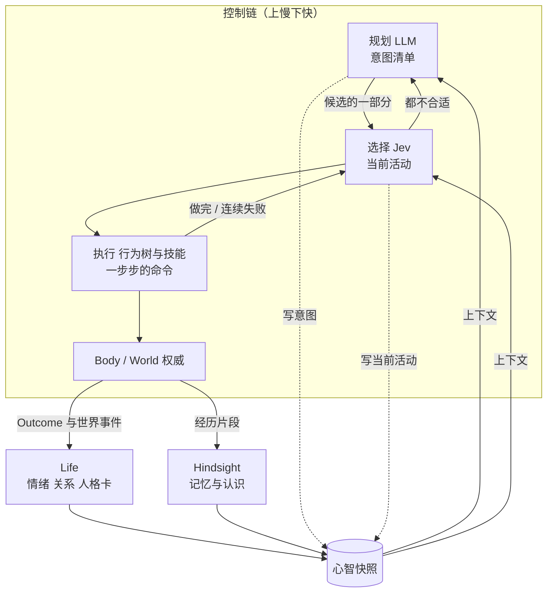

# NPC 整体概念：一条控制链、一块共享心智、一个回路（2026-11-12）

分类：全局系统功能的总体设计（概念稿）。状态：**概念已成文，待用户确认；未实现。**
本页是 NPC 线的总纲：各组件是什么关系、各在什么时间尺度上起作用。组件各自的细节见
[`2026-11-11-npc-jev-decision-research.md`](2026-11-11-npc-jev-decision-research.md)（Jev 与人格卡）、
[`2026-11-10-npc-utility-selector.md`](2026-11-10-npc-utility-selector.md)（选择器接缝、日计划）、
`apps/npc_server/lib/npc_server/README.md`（Body / Runtime / Tree / Life / Hindsight 现状）。进度与交接见 [`2026-11-11-npc-coordination.md`](2026-11-11-npc-coordination.md)。

## 一句话

一个 NPC 只有一种形态。**慢的层给快的层提供上下文，快的层把经历和例外交给慢的层**；任何一层在等更慢的层时都有“继续现在这样”可做，慢层从不阻塞快层。

## 五个组件各在什么位置

行为树、选择器、Jev、LLM、Hindsight 不是五个并列的大脑，它们分属三种角色：

- **控制链上的三个位置**（谁在这个时间尺度上做决定）：规划 → 选择 → 执行。
  LLM 坐在规划位置，Jev 坐在选择位置，行为树与技能坐在执行位置。
- **“选择器”是位置，Jev 是坐在这个位置上的判断者。** 选择器负责什么时候问、候选是什么、选定后保持多久、过期应答怎么丢；
  Jev 负责在候选里选。两者不是两个模块各选一次。能直接算出来的（紧急避险、不可行的候选）由代码在同一位置先处理。
- **Hindsight 不在控制链上，它是上下文的提供者。** 记忆不做决定，只让做决定的层知道“我经历过什么、我怎么看”。
  与它同类的还有 Life（情绪、关系、人格卡）。

| 位置 | 组件 | 回答的问题 | 单次延迟 | 何时运行 | 管多长时间的事 |
|---|---|---|---|---|---|
| 权威 | Body、Scene、World | 这个动作成不成立 | 每 tick | 每 tick | 一步 |
| 执行 | 行为树 + 技能 | 这件事的下一步怎么做 | 每 tick，无模型 | 每 tick | 几秒到几分钟（一项活动） |
| 选择 | 选择器接缝 + Jev | 现在做哪件事 | 约 0.6 秒 | 事件：活动结束、时段变化、被直呼、情绪过线、连续失败 | 几十秒到几十分钟 |
| 规划 | LLM | 今天想做成什么；这句话怎么说；这座房子怎么设计 | 3–30 秒 | 稀疏：每游戏日一次、选择位置报告“都不合适”、对话、设计 | 一个游戏日及以上 |
| 心智 | Life：情绪、关系、人格卡 | 我现在什么心情、我是什么样的人 | 规则即时 | 每个权威事件 | 情绪几分钟（半衰期 120 秒）；人格以天计 |
| 记忆 | Hindsight | 我经历过什么、我怎么看这些事 | 召回 1–3 秒；写入与巩固在后台 10–60 秒；认识刷新几分钟 | 经历攒成片段才写；认识按新事实数刷新 | 整个一生 |

## 共享心智：所有层读同一份东西

每个 NPC 有一份**心智快照**，是各层发问时唯一的上下文来源。每一栏只有一个 owner，其余层只读：

| 栏 | 内容 | owner | 变化速度 |
|---|---|---|---|
| 我是谁 | 人格卡：标准特质（52 对形容词 × 9 级）+ 自由文本 | Life | 以天计（经历累积后漂移） |
| 我的心情与关系 | 对各对象的情绪、信任 | Life | 分钟 |
| 我记得什么 | 缓存的认识（mental models）+ 针对当前处境的一次召回 | Hindsight | 小时到天 |
| 我打算做什么 | 当天的意图清单（做什么、去哪、找谁、为什么） | 规划（LLM） | 游戏日 |
| 我正在做什么 | 当前活动、最近做过的几件事 | 选择器 | 分钟 |
| 眼前的处境 | 观察、余额、游戏时刻、附近的人和物 | World（现查，不存进记忆当真值） | 秒 |

Jev 和 LLM 看到的是同一份快照的英文转写，只是问题不同：Jev 被问“在这些候选里选哪个”，LLM 被问“今天的意图是什么”。
行为树不读整份快照，只读选择器给它的那一项活动和观察。

## 回路：经历怎样改变下一次选择

- **向下是上下文**：记忆与心智 → 意图 → 当前活动 → 一步步的命令。
- **向上是经历与例外**：Outcome → 情绪（即时）→ 经历片段 → 记忆巩固（后台）→ 认识刷新 → 人格漂移（最慢）；
  执行层做不下去交给选择层，选择层没有合适的候选交给规划层。
- **候选来自数据**：可用技能、附近的去处与对象、意图清单里的条目，由代码先按可行性过滤，再交给 Jev。
- **不变的边界**：世界真值只在 World；记忆与认识只是“我记得”；不可逆动作由代码规则把关；计数与数值由代码算好写进快照。

## 现状为什么是碎的

五个组件都已经存在，但分别装在三种互不相通的 NPC 里，没有一个 NPC 走完整条链：

| 现有形态 | 有什么 | 缺什么 |
|---|---|---|
| `life`（`Brain.Llm` + Life + Hindsight） | 记忆、情绪、LLM | LLM 同时坐在规划和选择两个位置，每一步都问一次；没有行为树的稳定执行，没有 Jev |
| `settler`（行为树 + 技能） | 稳定的执行 | 没有选择、心智、记忆 |
| `settler` + `daily`（行为树 + 效用选择器 + 日计划） | 选择器接缝、规划位置 | 选择只看时钟；日计划没有任何心智输入；没有记忆、人格 |
| Jev | 判断者 | 只用在“技能运行中要不要打断”，没有坐到选择位置上 |
| 人格卡 | 调研与离线实验 | 未进运行时，与 Life 的两个慢变量并存 |

## 做法：先让一个 NPC 走通整条链，再逐层加厚

不按组件分头做，按“整条链的薄片”做，每一片都能在真实世界里看到行为变化：

1. **薄片一（最短链路）**：一个 NPC，人格卡 + Life + Hindsight 组成心智快照；候选是现有技能与两三个去处；
   Jev 在活动结束和被直呼时选；行为树执行；Outcome 写回情绪与记忆。验收：同一处境下两张不同的人格卡选得不同；
   经历一件事之后（被帮助 / 被破坏）下一次选择随之改变。此片不含 LLM 规划。
2. **薄片二（规划）**：LLM 每游戏日读同一份快照写意图清单，意图进入候选；选择层报告“都不合适”时再问一次。
3. **薄片三（时间与反应）**：游戏时刻与客户端一致；事件能在步骤边界打断当前活动。
4. **薄片四（多个 NPC 实跑）**：3–5 张不同人格卡，看差别与成本。

现有 `Utility` 的有序候选表、`gate` 与“应答经 Runtime 进观察”的通道留作选择器接缝；`DayPlan` 的整份校验与额度留作规划位置的外壳；
写死台词、日计划里的回话、第二套额度、只看时钟的打分随薄片一、二替换掉。

## 待确认

- 是否认可本页的整体概念与薄片顺序。
- 人格只有一个来源：Life 的 `caution` / `sociability` 并入人格卡对应特质的级别（建议）。
- 情绪评价现在搭在 `Brain.Llm` 的每次请求里；LLM 退到规划位置后，评价由规则还是由 Jev 做，尚未决定。
