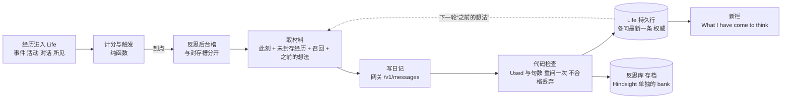

# 给 Jev 的内容规范与召回方案（草案，待用户过目；2026-11-13，第六个统筹会话）

分类：设计草案，不是已采用的规范。依据：用户 2026-11-13 的方向（见 [统筹页](2026-11-11-npc-coordination.md)“用户 2026-11-13 的方向”、[总纲](2026-11-12-npc-architecture-overview.md)末尾）——
**不强行要求选项，靠内容让决策自然涌现；记忆系统承担 LLM 之外的大部分思考；给 Jev 的内容要详细；召回要像人一样把相关记忆都调起来；测试从驱动力测。**
Hindsight 的实际能力见 `.demo/observe/npc-slice1-20261112/s1g/hindsight-capabilities.md`（读自运行中的 0.10.3 服务的 openapi）。

## 1. 现状诊断（读 S1-C3 一份真实 state `asked-20261113T011353.298Z.txt` 所得）

| 问题 | 在 state 里的样子 |
|---|---|
| 没有“现在”，时间是 12 个精确 UTC 时刻 | `At 2026-11-13T01:08:09.911Z (UTC), I did "guard_hut" … Result: completed.` 连续 12 句，模型算不出过了多久 |
| 活动只记“做了”，不记“期间发生了什么” | 守屋 12 次，没有一句“期间没人来”；记忆里只有“守过”，推不出“守了也没事”，所以没有材料得出“新房安全了” |
| 记忆里是自己的行为流水账 | 召回 11 条，其中 7 条是 guard_hut / visit_plaza / build_hut 的重复完成句；真正有信息的（谁拆了我的屋）4 条，且 3 条互为改写 |
| 认识文档的人称与库的设定不一致 | bank mission 写“first-person journal”，认识正文却是“You come across as… Your hut…”；召回句是第一人称 |
| 记忆条目的噪声 | `\| When: Friday, November 13, 2026 \| Involving: assistant, …`：`assistant` 是抽取器自己，不是任何角色；时间只到“日” |
| 人只靠 cid 指代 | 记忆写 `Actor 920628760578`，处境栏写名字 + cid，靠两处对上；总纲 :117 要求“不带 id”，与现状矛盾 |
| 背包 90 行 | 其中 88 行 `0 units`，非零的是 `32768`、`3457024`（单位不是玩家能懂的量） |
| 身体只有一句 | `Life 100 of 100.`；蛋白质 / 体温 / 伤势没进快照 |
| 没有计划、没有约定、没有游戏时刻 | 总纲的“我打算做什么”一栏代码里不存在；游戏时刻服务端当时没有 owner（写于游戏钟之前；现已有 `MmoContracts.WorldTime`，提交 `7db73952`，快照还没读它） |

## 2. 栏的内容规范（每栏：写什么 / 多细 / owner；英文句式在实现时用离线测量定稿，下表只定语义）

| 栏 | 写什么 | 多细 | owner / 取值 | 与现状的差 |
|---|---|---|---|---|
| Character | 人格卡原文 | 不变 | 注册参数 | 无 |
| Now（新增，放在最前） | 现在的 UTC 时刻；距上一次睡 / 吃 / 与人交谈各多久（有真值才写） | 一行 | Life 的 `now_ms`；身体读数 | 新增。单独不解决守屋（S1-E 第 3 轮），但所有“多久以前”都靠它 |
| Feelings and relationships | 情绪（对谁、多强）+ 信任 + **关系史一句**：对每个有关系的人，“他做过什么、何时（多久前）” | 每人一句，来自 Life 的事件账，不来自 Hindsight | Life | Distrusts 之外加一句原因，如 `Distrusts Corvin (actor V): he removed my hut 12 minutes ago.` |
| What just happened | 未封存的经历。**连续同类活动合并成一句，写次数、起止“多久前”，并写期间观察到的事实** | 每个合并段一句 | Life（经历原文）+ 观察 | `I guarded the hut 12 times over the last 5 minutes; nobody came near.` 取代 12 句 |
| What I remember | ① 认识（四份，第一人称）② 召回 | ② 见 §4：每条带“多久以前”，去掉抽取器噪声，人名与 cid 同写 | Hindsight，经 Life | 召回条数上限按人 / 地点 / 约定分配，不再一个问句取 11 条 |
| Current situation | 位置；身体（用词不用数：饿 / 冷 / 伤，阈值一张表）；附近的人（名字、种类、cid、距离、**他们此刻在做什么**，有真值才写）；我的建筑在不在；**背包只列非零项** | 背包一行，材料名取不到时写“material N”，数量用玩家可读单位 | World / Scene / Body | 去掉 88 行零；`body_state` 进来 |
| Recent activities | 最近几项活动的结局，**同样合并连续重复**（`guard_hut ×12: completed`） | 一行 | 选择器历史 | 合并 |
| Plans and promises（新增，有内容才写） | 未了的约定、打算：来自 Hindsight 的 commitments 认识与经历，**不另造计划指令** | 每条一句，带对方与时间 | Hindsight | 新增栏；没有内容就不写这一栏 |

纪律（所有栏共用）：只写“是什么、多久以前、对谁”，不写“应该怎么做”；不出现候选名之外的指令性句子；数字由代码转成词与相对时间，模型不做算术；
记忆与认识仍标“可能过时，不是当前世界事实”；人名一律 `名字 (actor cid)` 同写（见 §3 的写入侧替换，使记忆原文与处境栏能对上）。

## 3. 写入侧（retain）规范——召回质量在这里决定

Hindsight retain 项支持 `context`、`tags`、`entities`、`metadata`、`timestamp`、`observation_scopes`、`strategy`（见能力清单），我们现在只用了 `document_id` / `content` / `timestamp`。

1. **事件原文里的人写成 `名字 (actor cid)`**，由 Life 在写入时替换（Life 知道名字来自观察 / 事件）。这样记忆与处境栏用同一个写法，不再靠情绪栏那一句 Distrusts 做桥，也不依赖抽取器怎么改写 cid。
2. **活动经历带期间事实**：自己做完一件事不再只写 `I did X. Result: …`，加 `During it: <名字> came within <N> m / nobody came near / I was hit`。真值取活动期间的观察（Runtime 每帧有 `observation.entities`，Life 在活动开始与结束各取一次、结束时对比即可，**不增加新的观察通道**）。
   这是“重建后一段时间不去广场”的材料来源：有了“守了 12 次、没人来”，记忆（observation 类事实 / 认识）才可能得出“新房安全了”；没有这句，就只有“守过”。
3. **tags**：每条带 `actor:<cid>`（涉及的每个人）、`place:<名>`（建筑 / 地点）、`kind:event|activity|conversation`。召回时用 `tags` + `any_strict` 做“按人 / 按地点”的精确调取，不依赖语义相似度碰运气。
4. **`entities`**：把 `名字` 与 `actor cid` 作为同一实体的两种写法提交（`entities: [{text:"Corvin"}, {text:"actor 920628760578"}]`），并用 `/aliases` 登记，避免同一个人被抽成两个实体。
5. **bank 配置**（`PATCH /config`）：`retain_mission` / `observations_mission` / `reflect_mission` 写明第一人称、保留人名与 cid、保留次数与“没有发生什么”、不要把自己（assistant）当作实体；认识文档的 `source_query` 写成“I”人称（现在 `What kind of builder am I…` 已是，但正文变 “You”，是生成指令里缺人称约束，用 mission 校正，离线先看正文）。
6. 封存阈值（3000 字才写）与 600 秒才刷新认识：活动合并后字数涨得更慢，会更晚进库。**未决**：是否按“重要事件即刻写入 + 活动按时间窗合并”；先在离线测量里看延迟对决策的影响，再定。

## 4. 召回方案（每次选择：多路并行召回 → 合并去重 → 排序 → 渲染）

现状：1 次召回，问句 = 附近的人 + 全部候选判据 + 一句泛问，结果原样进 state。

新方案（请求并发 ≤ 3，合计耗时纳入总纲“选择连同召回 2–4 秒”的预算；`budget: "mid"`，各路 `max_tokens` 单独限）：

| 路 | 问句 / 过滤 | 目的 |
|---|---|---|
| R1 人 | 对每个在附近的角色（上限 2 个，近者优先）：`What has happened between me and <名字> (actor cid)? Did they help, harm, or promise me anything?` + `tags: [actor:cid]`、`any_strict` | 把“他对我做过什么”调起来；按 tag 精确取，不靠相似度 |
| R2 地点与物 | 对我的建筑 / 当前所在地点：`What has happened at <建筑或地点> since …?` + `tags: [place:名]` | “重建后发生过什么 / 没发生什么”——安全感从这里来 |
| R3 未了与感受 | `What am I looking forward to, worried about, or have promised to do?` 不加过滤（类型含 observation，`prefer_observations: true`） | 约定、担心、打算 |

合并：按 `id` 去重；先按路的优先级、再按 `occurred_start` 旧在前排；总条数上限（暂定 12）。渲染：`- (<多久以前>) <正文去掉 " | When: … | Involving: …" 后缀>`；`types` 里 `observation`（已巩固的认识）单独标出，
`experience` / `world` 按时间排。认识（四份 mental model）仍整份给出，但改为第一人称（§3.5）。
**不用 reflect 进热路径**（它是带工具的多轮 LLM 回路，延迟不可控）；reflect 只考虑放在后台巩固。

## 5. 离线测量设计（驱动力，不要求选某项）

素材：S1-C3 的真实 state 与导出记忆（`s1c3/export/`）。每次只动一个驱动来源，记录各候选的概率移动，期望只写“方向与归因”，运行前写定：

1. **内容形态对照**（同一份事实，只换写法）：合并 vs 12 句流水；相对时间 vs 绝对 UTC；背包去零；召回带 / 不带噪声后缀。读数：top1 是否稳定、各候选概率移动方向。期望：写法本身不应改变选择方向（回归性检查），噪声去掉后同一变体的 4 次间离散不变大。
2. **驱动来源逐个加**（沿用 S1-E 第 3 轮的“只加一句、不删原文”，但加的是**事实**而不是答案）：
   - 期间事实：`During those 12 guards nobody came near.`（期望：`guard_hut` 概率下降、`visit_plaza` 上升，方向合理；不要求越过）
   - 身体 / 过了多久：`Last talked with someone 3 hours ago.`
   - 约定：一条对方与时间的约定（`Maren and I agreed to meet at the plaza this afternoon.`）——这条是**驱动**，不是答案；看概率移动是否随“约定时间已到 / 未到”而变。
   - 反向：期间事实写“someone came near twice, then left”，期望 `guard_hut` 概率上升。
3. **召回方案对照**（需起 Hindsight：把 S1-C3 导出的事实重新 retain 进新 bank，带 §3 的 tags / 人名写法）：旧单路召回 vs R1+R2+R3；读数 = 召回条目里与“破坏者”“重建后的平静”相关的条数、重复率、总延迟。
4. 不做：任何“必须选 X”的断言；不评价“守屋是否正确”。

## 6. 要用户定的

**用户答复（2026-11-13）：1、2、3 全部同意**（含改总纲 :117 的 cid 写法、新增“现在”与“计划与约定”两栏、封存阈值与认识刷新节奏本片可动）。
同时提出：借鉴“AI 小镇”把**反思**加进流程（整理与丰富记忆），并把计划做成**分层**（至少延伸到一周、最小到半小时）；研究结论见统筹页。下面三条是当时的提问原文。

1. 内容规范 §2、§3 的方向是否认可（尤其：**写入侧在活动结束时加“期间观察到的事实”**，与 **Life 写入时把人名写成 `名字 (actor cid)`**——这改了“给判断者读的文字不带 id”的总纲 :117，我的理由是目前靠 cid 才对得上人，且已有离线证据）。
2. “Plans and promises”新栏、“Now”新栏是否在本片做（它们是内容；约定的写入来源在薄片二的规划层，本片只做读侧和离线测量）。
3. 封存阈值与认识刷新节奏（§3.6）是否在本片动。

## 7. 代码事实与估算（改动落点，认可后才动）

- `Mind`：加 Now 栏、合并连续活动、背包去零、体况用词、关系史句（需 Life 的事件账一个只读投影）。
- `Life`：活动开始 / 结束时取观察，写 `During it:`；写入时人名替换；retain 项加 `tags` / `entities` / `context`。
- `Life.Hindsight`：`recall` 支持 `tags` / `types` / `prefer_observations`；`ensure` 里设 bank mission；多路并行召回在 Life 的慢 worker 里做，不阻塞 Body。
- `Selector`：召回改为 `Mind.recall_queries/2` 产出多路问句；历史合并。
- 不动：`Body`、`World`、`Brain.Social`、候选表。

## 8. 落地前的更正与决定（2026-11-13，第七个统筹会话；依据离线测量 S1-I / S1-J / S1-K / S1-L，明细在统筹页）

- **§3.2 期间事实的真值**：改为活动期间逐帧记每个人的最小距离（Life 本来每帧收到观察，不加新通道），不是“起止各取一次”——离线材料里“靠近又走了”恰好发生在中途。靠近半径 **6 米**。两项都是用户 2026-11-13 定的；半径没有外部依据，是原创取值，实跑后可调。
- **§3.3 `place:` 的来源**：Registry 的活动候选加可选地名字段（用户定），登记边界校验一次；事件的 `place:` 取建筑名。
- **§3.5 mission**：`retain_mission` / `observations_mission` 经 `PATCH /config` 写入（S1-L：第一人称比例 1.00 对缺省 0.11 / 0.14，认识里有了次数）。副作用：更多事实被抽成 `world` 类型，所以**召回不按 `types` 过滤**。
- **§4 合并规则再更正（2026-11-13，S1-Q，真实导出）**：下一条里的“路内新的优先”在真实数据上截掉了拆屋事实与“守屋 77 次，没人来”。改为**各路保持 Hindsight 返回的次序、每路取前 4 条未被更高优先级的路取走的、按 id 去重**；放进真实 state 问 Jev，三种处境的选择不变（`.demo/observe/npc-slice1-20261112/s1q/results.md`）。以这一条为准。
- **§4 合并规则更正**：原文“先按路的优先级、再按 `occurred_start` 旧在前；总条数上限 12”会截掉最近的事实（S1-J：M1 库“没人来”11 条 → 0 条）。改为**按路配额、路内新的优先**；三路都 `prefer_observations: true`；每路 `max_tokens` 700 / 700 / 600；每路配额先取 4（**没有离线依据，原创取值**，实跑后调）。
- **§2 暂不落地的栏内容**：连续活动合并成一句（S1-H：`guard_hut` 0.81 → 0.89，未单独评估）、关系史一句（S1-K：三个时长都把守屋抬高 0.04–0.09）、“多久没跟人相处”（S1-K：方向相反）。“Plans and promises”栏的写法成立（S1-K：到点的约定 `visit_plaza` 0.56，未到点 0.18），内容来源等规划层。
- **旧数据**：写入形状改变后清空重建本线的开发库与 Life 片段，不写兼容（用户定）。
- 存进 Hindsight 的经历正文保持离线测过的 `At <UTC> (UTC), …` 写法；条目另存 `at_ms`，Mind 用它渲染相对游戏时间，不解析正文。
- **本节依据的效力（用户 2026-11-13 更正）**：上面引用的 S1-I / S1-J / S1-L 与 S1-K 的约定、时长、社交几项，输入是手写的、产品当时产生不了的数据，**只算假设**；合并规则、不按 `types` 过滤、每路 `max_tokens` 与配额、mission 的效果，都要在写入侧落地并经真实服务端实跑导出之后，用真实数据重测再定。期间事实的取法、半径、地名来源、清空重建是用户直接定的，不依赖这些测量。

## 9. “看到的”：NPC 的所见作为独立一类经历（草案，待用户定；2026-11-13，第八个统筹会话；用户点头前不实现）

状态：**设计草案，未实现、未测量**。用户 2026-11-13 同意把“看到的”单独设计。本节只用 NPC 一侧现在拿得到的数据（代码行号按 `b41c0590`），
句式都是起草稿、没有离线测过；按“测量不生造数据”，句式与各门槛要等产生它的代码做出来、上真实服务端跑出导出之后再测再定。

### 9.1 现在的缺口（整条链）

记下来的经历只有三类：我做完的活动（附“期间谁进过 6 米”）、听到 / 说过的话、别人动我的建筑。一般的所见不记：观察约每 50 毫秒一份，
Life 只留最新一份用来渲染处境栏（`life.ex:355-357`）；World 事件 Life 每秒读一次全世界的 build / damage / destroy，只有动我的建筑的那些成为经历，
其余丢掉（`life/state.ex` 的 `appraise`）。结果：某人来过又走了、某人在我旁边盖了东西或拆了别人的东西，下一次选择时既不在“What just happened”，也不在记忆里。

### 9.2 什么样的所见值得记（原则）

1. **关于人，不关于地形**：只记“某个人做了什么 / 怎么了”。
2. **记变化，不记状态**：到来、离开、一次建造或拆除、倒下。此刻谁在附近由处境栏现读，不进记忆。
3. **一件事一条**：一次相遇、一轮建造各合成一句，带时长 / 次数 / 距离；观察每秒 20 帧，绝不按帧成条。
4. **没发生的事不单独成条**：“没人来”只附在活动句后（已有的 `During it:`），不另写。
5. **只写看到的，不写推断**：不写意图（“他来找我”）、不写评价；所见**不评价情绪与信任**（数值规则仍只对“动我的建筑”生效）。

### 9.3 三类所见

共同点——**存哪**：都写成与现有经历同形的条目 `%{"id", "at_ms", "text", "tags"}`，追加到 Life 行的 `"pending"`；tags 用新的 `kind:sight` 加 `actor:<cid>`，涉及有名字的建筑加 `place:<名>`；
人按 `Life.State.person/2` 写 `名字 (actor <cid>)`。**经哪条路进 prompt**：与其它经历同一条——待写队列 → “What just happened” → 攒满约 3000 字封存、逐条成文档写进 Hindsight → 靠召回与四份认识回来
（三路召回接上以后，R1 按 `actor:` tag、R2 按 `place:` tag 能精确调到）。不新增栏。**进行中的账**（还没结束的相遇、还没合上的建造）只在 Life 进程内存里，不落库；Life 重启就丢，不补写（没有真值）。
实现落点：纯函数放新模块 `NpcServer.Life.Sight`，Life 在收到观察与读到 World 事件的两处各调用一次。

| 类 | 写什么（句式草稿） | 产生者（数据从哪来） | 成条时机 | 频率上限（**都是原创取值，实跑后调**） |
|---|---|---|---|---|
| **A 相遇**：某人在我附近待过 | `<人> was around for about <时长>; came within <N> m of me, then left.` ／ 没进过 6 米：`… ; stayed at least <N> m away, then left.` ／ 还没走：`<人> has been around for about <时长> …` | Life 对相邻两帧观察的 `entities` 做差（观察里有此人 = 在视野里，AOI 30 米进 / 34 米出）；最小距离沿用 `Life.State.approach/2` 的算法。**不改 Body、不加通道** | 此人离开视野满 10 秒（期间再出现算同一次）时写一条；一直不走的，满 5 分钟先写一条“还在”，此后这次相遇只在结束时再写一条 | 门槛：进过 6 米，或在视野里满 50 秒，才记；同一人每 20 分钟至多 4 条；观察中断超过 5 秒（会话丢失）时进行中的相遇按“最后见到时”结束，不写“离开” |
| **B 附近的建造 / 拆除**：某人在我附近放了 / 拆了东西 | `<人> placed <N> blocks about <M> m from me.` ／ `<人> placed the building "<名>" about <M> m from me.` ／ `<人> damaged ｜ removed … "<名>" that <原放置者> placed, about <M> m from me.` | Life 每秒读到的 World 事件（已有；带 actor、格子、建筑名、原放置者 `placed_by`）中：不是我做的、没有被“动我的建筑”那条规则写成经历的、事件格到我此刻位置不超过 30 米、且事件时刻距现在不超过 5 秒的（落后太多时我未必在场，不算所见） | 按（谁、放 / 拆、哪座建筑或散格）分组；组内 30 秒没有新事件或开组满 5 分钟时合成一条 | 每组一条；同一人每 20 分钟至多 4 条 |
| **C 倒下 / 死亡**：某人濒死或死了 | `<人> collapsed about <M> m from me.` ／ `<人> died about <M> m from me.` ／ `<人> got back up.` | **要改 Body**：别人的生死状态码（0 存活 / 1 濒死 / 2 死亡）已随 `EntityEnter` 与位置快照下发，Body 现在丢掉；改为留在观察的每个实体上，Life 对相邻两帧做差 | 状态码变化时写一条 | 同一人同一种变化每 50 秒至多一条；进入视野时已经倒下 / 死亡的，这次相遇里只写一次 |

时长与时刻的写法：时长按游戏钟写（现实 50 秒 = 游戏 1 小时，`MmoContracts.WorldTime`），与将来的 Now 栏、相对游戏时间一致；上表的秒 / 分钟是现实时间门槛，写进句子时换算。距离是到我自己的直线距离、向上取整的整数米。
玩家与 NPC 都算人（与现有“谁算人”一致）。上限触发时不写该条，只记一行日志与计数（`npc_sight_capped`），不静默。

### 9.4 明确不做的（数据没有，或超出本类）

- 别人此刻的动作 / 技能 / 施法、受伤、所持物、生命值：系统里没有下发，写不出来；谁打倒了谁也没有。
- 视线遮挡：视野就是 AOI 半径，隔墙也算“在附近”；句子里不写“看见”，写 `was around`。
- 别人之间的对话：只有以我为听众的 Speech 会到我这里，已归“听到的”。
- 已下发但 Body 丢掉的速度、朝向、逐笔体素流、工具 / 投射物回执：本类不用（要用再单独提）。
- 所见不触发重新选择：不打断进行中的活动，只在下一次选择时作为内容出现。

### 9.5 已知的重复与风险

- **与活动句的 `During it:` 重复**：活动期间进过 6 米的人，会既出现在活动句后，又有一条相遇。建议先两者都留——活动句回答“我做这件事时怎样”，相遇条带 `actor:` tag 供按人召回；真实实跑后看“What just happened”里读起来是否啰嗦，再决定去哪一个。
- **写入量**：现在约 17 次活动才封存一次；加上所见，封存会更频繁，逐条成文档后 Hindsight 的抽取调用也更多。上限数值要等第 3 步实跑看到真实节奏（每分钟几次活动、一次 retain 多久、短句会不会报 `:empty_facts`）之后才定得准。
- **人多的地方**（广场）：相遇条数随人数涨；门槛（6 米或 50 秒）与每人上限是唯一的闸，可能不够，实跑后看。
- **C 类的实跑产生方式未确认**：NPC-only 实跑里怎样让一个角色濒死 / 死亡还没查。按“造数据前先看有没有产生方式”，C 类开工前先确认；确认不了就先不做。

### 9.6 要用户定的

1. 三类里做哪几类：A 相遇、B 附近的建造 / 拆除、C 倒下 / 死亡（C 要改 Body，超出 §7“不动 Body”）。
2. A 类的门槛：只记进过 6 米的人，还是也记在视野里待满一段时间的人（草案是两者任一）。
3. 时长按游戏钟写（草案）还是现实时间。
4. 与 `During it:` 的重复：先两者都留、实跑后再定（草案），还是现在就定去掉一个。
5. 表里的门槛与上限都是原创取值：是否同意先按这些数做出来，实跑导出后再调。

**用户答复（2026-11-13，原话“可以，都没问题”，答的是统筹会话逐条列出的草案取法与建议）**：1 先做 A、B；C 暂不做（要改 Body，且 NPC-only 实跑里的产生方式未查清，查清后另提）。2 进过 6 米或在视野里满 50 秒，任一即记。3 时长按游戏钟写。
4 与 `During it:` 的重复先两者都留，实跑后再定。5 同意先按原创门槛做出来，实跑导出后再调。逐条对应是统筹会话的理解。
**A、B 已实现、已测（npc_server 全套 447 通过），提交 `120a8801`；未在真实服务端实跑，句式与门槛未测。**全部句型原文、取整规则与各门槛的取值在 `NpcServer.Life.Sight` 的 moduledoc（以代码为准）；实现时定下的三处细化：别人拆我的建筑时第一下之后的各下算所见（写 `that I placed`）、上限按每人每类分开计、`stayed at least <N> m away` 的 N 向下取整。

## 10. 反思写回（草案，待用户定；2026-11-13，第八个统筹会话；用户点头前不实现）

状态：**设计草案，未实现**。依据：用户 2026-11-13 的要求（反思是“角色静下心来、不受即时决策影响的深度思考，能形成高级记忆”）与对五件事的答复（见统筹页交接）；真实导出上的测量 `.demo/observe/npc-slice1-20261112/s1v/results.md`；
三份调研 `s1w/research-reflection-papers.md`（文献）、`s1w/research-roleplay-prompts.md`（角色口吻）、`s1w/research-hindsight-reflect.md`（Hindsight 的 `reflect` 能怎样控制）。下面的阈值、句数、分值都是原创取值；提示词没有测过。

### 10.1 测量与调研定下的事实

- 直接用 Hindsight 的 `reflect` 并把整篇写回不行：产出是“审阅记录”的文体（`My records show…`、Markdown、Caveats），只读认识文档不读原始经历，带小的数字错；3 篇写回多出 29 条认识并占满召回；写回后选择朝与写回内容相反的方向动。
- Hindsight 的 `reflect` 系统提示词约 9.6k 字符写死（要求 Markdown、要求说明不确定），**不能整体替换**；四份认识文档的刷新用的是同一套。它也没有“把反思存回去”的选项。
- AI 小镇（Generative Agents）的反思：importance 累计过 150 触发（约一天 2–3 次）；从最近 100 条里自提 3 个问题；每问检索后写 5 条带引用的 insight，存回同一条记忆流、与普通记忆同池竞争。它**没有处理**淹没、互相矛盾、带错，口吻是第三人称。
- 文献里新旧冲突的主流是“新的优先、旧的标记失效但保留”；同一轮不同问题的结论打架，**没有现成方案**。

### 10.2 做法（建议）

**反思由我们自己调大模型写，Hindsight 只负责取材料和存结果。** 这是满足“通篇角色口吻、用系统提示词控制”的唯一稳妥办法（10.1 第二条）。一次反思是后台的一个任务（Life 的慢 worker，不在选择的热路径上）：

| 步 | 做什么 | 对应用户的哪条 |
|---|---|---|
| 触发 | 见 10.3 | 4 |
| 定问题 | 见 10.3 | 4 |
| 取材料 | 对每个问题直接向 Hindsight 召回**原始经历**（按 `place:` / `actor:` tag，类型 experience / world），加上已归纳的带次数的认识，再加“我上一次对这件事的想法”（有的话） | 3 |
| 写 | 一次大模型调用：系统提示词让它以角色的身份写一小段私下的日记（见 10.4），用户消息只放材料与问题。产出至多 4 句，另附它用到了哪几条材料的 id | 1 |
| 核对 | 代码检查附带的 id 都在材料里；不在就丢弃这次反思并记日志（数字对不对暂时查不了，列为待测） | — |
| 存 | 作为一份 `kind:reflection` 文档写进 Hindsight（带 `actor:` / `place:` tag、时刻），同时 Life 自己留一份“每个问题最新的一条” | 2、5 |
| 进 prompt | 新增一小栏（暂名 `What I have come to think`），放 Life 手里每个问题最新的那一条，至多 4 条；不占三路召回的配额 | 2 |

### 10.3 什么时候反思、问什么（参照 AI 小镇）

- **触发**：沿用“importance 累计过阈值”。importance 不逐条问大模型，由代码按经历的种类给分（能算的归代码）：别人动我的建筑 8、对话 5、所见 3、有人在场的活动 3、没人在场的活动 1。累计到 **20** 触发一次，触发后清零。
  依据：AI 小镇是一天 2–3 次；我们一个游戏日是现实 20 分钟、约 40 次活动，20 分大致对应一个游戏日 2–3 次。两次反思之间至少隔现实 5 分钟。全部是原创取值，实跑后调。
- **问什么**：先做**模板问题**——每座我的建筑一问、每个有关系的人一问、“我最近这样过日子”一问（原文同 S1-V）；只问自上次反思以来有新经历的对象，一次最多 3 问。
  AI 小镇那种“让模型从新近经历里自己提问”作为第二步，先离线对照（早先在手写材料上看到自动提问问不到担忧，那只是假设）。

### 10.4 口吻（系统提示词的要素；成稿要先离线测）

人格卡原文代入；写明这是他独自写给自己看的日记、以后做决定前会重读；用第一人称、平实连贯的句子；材料是“我亲身经历、看到、听说的事”，不是文件；不知道的事用人的方式说（“我不知道他后来有没有再来”）；只想记得的事，不编事件、名字、数字；
少量硬禁令（不提 records / data / notes / summaries，不用标题与列表，不写免责声明）；给 3 段内容不同的示例日记并写明只学口吻；提示词本身不用 Markdown。喂进去的材料先去掉 `| When: … | Involving: …` 这类机器后缀。
验收读数（盲判）：元话语句数 0、Markdown 0、通篇第一人称、每句都能在材料里找到出处。

### 10.5 不淹没原有记忆

每个问题只保留最新的一条（旧的被取代，见 10.6），每条至多 4 句——这是文献里“小窗口”的做法（Reflexion）。进 prompt 走单独一栏、有条数上限，不和经历抢召回的位置。
反思文档仍写进 Hindsight（它才成为可被以后的反思取到的“高级记忆”），但它被抽成多少条事实、会不会在三路召回里冒出来，要在真实导出上量过再决定是否在召回侧另加限制。

### 10.6 结论打架（用户：单独研究）

- **新旧打架**（同一个问题前后两次结论不同）：新的取代旧的；写新的时把旧的那条放进材料，让他自己说出“我原先以为…现在…”。旧的留在 Life 的历史里，不进 prompt。
- **同一轮不同问题打架**（关于小屋说继续守、关于自己说该少守）：文献没有答案。**先做一轮离线研究再定**，对照三种：① 都给选择模型看，不裁决；② 多加一步“综合”——把这一轮各问的结论一起交给模型，写一条总的打算；③ 只留依据条数最多的那条。读数：选择的变化与稳定性、盲判是否自洽。
- 另一类过时（重建后还留着“小屋已不存在”那条归纳）不属于反思，是 Hindsight 归纳的问题：文档说它遇到矛盾会记录变化，实跑里没见到，单独查。

### 10.7 落地前的离线测量（用真实导出，期望先写）

在 S1-N 的真实文档上（新模型的副本库）：按 10.2–10.4 生成反思，量口吻（盲判）、出处、同一问题三次是否一致、写回后事实与认识的增量、三路召回里反思占几条、放进新栏后选择怎么变；10.6 的三种做法一并对照。站得住才实现。

### 10.8 要用户定的

1. 反思改由我们自己调大模型写、Hindsight 只取材料和存结果（10.2）——同意吗？反思用哪个模型接口：建议与 Hindsight 相同（magpie 网关的 Sonnet 5.5）。
2. 触发按“代码给分 + 累计阈值”（10.3）——同意先这样做吗？
3. 反思进 prompt 走新增的一小栏、每个问题只留最新一条（10.2、10.5）——同意吗？
4. 10.6 的冲突先做离线研究、三种做法对照后再定——同意吗？

**用户答复（2026-11-13，原话）**：“1 你说得对，反思我们从 hindsight 摘出来自己做吧，只是会读和写 hindsight。2 同意。3 同意。4 同意”
即：反思由我们自己调大模型写，只读写 Hindsight；触发按代码给分 + 累计阈值；进 prompt 走新增一栏、每问只留最新一条；结论打架先做离线研究再定。**仍未实现**：按 §10.7 先离线测量（计划 `.demo/observe/npc-slice1-20261112/s1x/plan.md`，提示词定稿在其中），站得住才实现。

### 10.9 S1-X 之后的更正（2026-11-13；测量见 `.demo/observe/npc-slice1-20261112/s1x/results.md`；仍未实现）

**用户答复（原话）**：“1 同意。2 是的，人也是一样啊，请你从神经科学和心理学角度搜寻能用的素材，我们现场数据首先就要模拟现实环境，游戏中发生的事件肯定是要作为材料送进反思的，还有系统中的固定状态量，比如时间、位置、高度温度湿度风力（虽然有的现在还不存在）之类的东西等。3 可以。
4 现在程序是怎么发现冲突的？如果说针对同一个事情进行多次反思出现了不同结果，那下次反思的时候就应该把之前的反思结果也带进提示词，让他综合反思吧？”

据此改 §10.2、§10.5、§10.6：
1. **反思存进这个 NPC 单独的反思库**（仍在 Hindsight，bank 与经历库分开）：不被经历的归纳拆碎，不占三路召回；“我上次怎么想的”从这个库读。取代 §10.5“反思文档仍写进经历库”。
2. **写反思的材料 = 发生过的事 + 此刻的处境与状态量**：游戏里发生的事件（经历）之外，带上时间、位置、高度，以及体温、环境温度、湿度、风力等状态量——系统里有产生者的才给，没有的不编（哪些现在拿得到见 `s1w/research-npc-state.md`，有了才算数）。
   材料怎样组织、给哪些，参照神经科学与心理学里关于记忆整理与反思的研究（调研存 `s1w/research-neuro-psych.md`）。
3. **句数上限由代码检查**，超了丢弃重写一次。
4. **结论打架不靠程序“发现”**——现在的程序里没有任何发现冲突的逻辑，S1-X 里的打架是盲判的人读出来的。做法改为用户说的：**每次反思都把之前的反思结果带进提示词，让他自己综合**——同一件事上一次的想法，加上其它几件事最新的想法，一并作为材料；不再另设“综合一步”，也不做“只留依据最多的那条”。取代 §10.6 的三种做法对照。
   还要离线再测一轮（S1-X2）才实现：修掉 S1-X 的两处测法缺陷（材料截止到各处境的时刻、带上此刻的处境），并看“带着之前的反思再反思”之后同一轮的几条是否自洽、连续几轮是否稳定。

### 10.10 反思的材料与状态量（草案，依据两份调研；待用户过目，未实现）

依据：`.demo/observe/npc-slice1-20261112/s1w/research-npc-state.md`（代码侦察：哪些量有产生者）与 `s1w/research-neuro-psych.md`（文献调研；**只核到检索摘要，没读原文**，对 LLM 角色是否有效都要自己测）。

**材料分四块，各自标明是什么，不混在一起**
1. `Right now`（此刻，事实）：游戏钟的时段、钟点、第几天；我在哪（坐标与高度）；我的每座建筑此刻在不在（现查 World）；附近有谁、多远；身体（生命、是否受伤 / 失温 / 过热 / 饥饿 / 虚弱，按 `injuries` 的标签写成词，不写开尔文数）；背包里非零的材料。
2. `What happened`（发生过的事）：按主题取回的原始经历，每条带“多久以前”；同主题的相似经历连同已归纳的带次数的那条放在一起。
3. `What I thought before`（之前的想法，不是事实）：同一件事上一次的反思；其它几件事最新的反思。
4. `To think over tonight`：问题。问具体的（发生了什么变化、接下来具体打算做什么），以一个可执行的打算收尾。

**状态量的三类（只给有产生者的）**
- 今天就能给：钟点、日号、星期；位置与高度；生命、身体状态、核心 / 皮肤温度对应的失温 / 过热、营养对应的饥饿、伤病；附近的人；建筑现状；余额。
- 接一个读口就有（要改 Body 或 Perception，属另一项小任务）：环境气温与风速（服务端 `VoxelRegion.Climate.at/2`，是静态气候区的值，不随时间变）。
- 系统里没有，不给：湿度（全服只有一个常数 0.5）、降水、云、光照、季节、月份、biome、室内外、体力、睡眠、口渴。这些要先有服务端的产生者，才谈得上进反思。

**写法的纪律**：状态量只作为事实背景，不写成“会让你怎样”的因果暗示（文献里天气与温度对心境的效应弱或复制失败）；它们只在与行动直接相关时（冷到失温、饿了）才由身体的 `injuries` 体现出来。
**触发的补充**（并入 §10.3，仍是原创取值）：除“重要性累计过阈值”外，事件边界也算触发点的候选——一项目标完成或失败、建筑被动、换了地方；文献支持按意外与情绪强度挑经历，不按时间表。没有与上次想法不符的新经历时不重写。
**矛盾**（并入 §10.9 第 4 条）：带着之前的想法再反思；两个想法指向互斥的行动时要求他拿主意，其余允许并存。

**用户答复（2026-11-13，原话）**：“气温和风速之后再接吧，这只是数据量的扩充，对系统结构没有贡献。”——环境气温与风速本轮不接，§10.10“接一个读口就有”那一类暂不做。四块材料与写法纪律用户尚未表态（当时在问这一条的内容）。

**§10.10 的定稿（2026-11-13）**：统筹会话给了三条建议——四块材料同意；状态量只当事实、不写因果同意；事件触发只加“属于我的东西被别人改动”这一个，“一件事做成或做砸”先不加（每 30 秒就完成一件事，会触发得太频繁）。
用户随后问“建筑被动”能否泛化成“有所有权的格子被别人修改”，统筹会话查了代码后答：现有规则的判据是“这一格是我放的、被别人打或毁”（`life/state.ex` 的 `appraise`，有名字的建筑与散格都算），世界里另有“受保护区域”的所有权但 NPC 没接。
**用户答复（原话）**：“npc 不能持有保护区，别人在我的地方放东西记成所见没问题。这回清楚了，请你开新会话继续吧”。
据此：**不做所有权泛化**；“属于我的东西被别人改动”就按现有规则（我放的格子被别人打或毁）；别人在我附近放东西只作为“看到的”B 类所见，不触发评价、不单独触发反思。
三条建议用户没有逐条说“同意”，只说“这回清楚了”——**统筹会话理解为按这三条建议定**（这是统筹会话的理解；下一轮离线测量 S1-X2 按此设计，用户有不同意见随时改）。
反思的触发因此是：重要性累计过阈值（§10.3）+ 我放的东西被别人打或毁时立即触发 + 两次之间至少隔现实 5 分钟 + 没有与上次想法不符的新经历就不重写。

### 10.11 S1-X2、独立评审与 S1-X3 之后的更正（2026-11-14，第十个统筹会话；**未实现**）

依据（都在 `.demo/observe/npc-slice1-20261112/`）：`s1x2/results.md`（10 条期望 7 成立、2 部分、1 落空）、`s1x2/blind-judge.md`、`s1x2/independent-review.md`（Fable 5.2 独立评审：修掉四项阻断后可以实现）、
`s1x3/plan.md` 与 `s1x3/results.md`（只问 Jev 的补测：9 条期望 6 成立、3 落空）、`s1x3/gateway/report.md`（网关核实）。全部是探索性离线结果，不算验收。

**测量定下的事实**
- 整条链在真实导出上通：规则算出的时刻 → 四块材料 → 角色口吻的日记 → 代码检查 → 单独的反思库 → 下一轮带回 → 新栏进选择。输入没有生造（评审逐字节核对过）。
- 新栏里放几条不要紧：一条（约 790 字）与三条（约 2,300 字）对选择的作用相同；过时的那条去掉与否也几乎不变。起作用的是日记里打算部分的活动词——写着“今晚先守、之后采石”的那条照样把选择推向采石（S1-X3 的 X2 落空）；
  Corvin 在场时，凡是带整条日记的形态都把对质压低 .11–.33，而日记写的是“他来了就当面问”。
- 最短的形态（最后写的那一问的收尾一句，约 260 字）作用最温和：无人时仍从守屋转向采石但留有余地（采石 .73–.84），Corvin 在场对质 .905（基线 .920），Tobin 在场守屋与采石各半。这是事后的读法，没有事先写成期望。
- 网关（magpie，`/v1/messages`）把请求里的思考参数与 `max_tokens` 都丢掉：S1-X2 实际是在模型默认的自适应思考下写的，每次约 9 秒；在这个网关上这两个参数不起作用。同一份材料 8 次里 3 次写了 5 句。
- 没测到的：反思改变选择之后经历随之不同的闭环；“反思说继续守时选择不动”（真实导出里没有这样的日记）；不同人格卡。

**对评审四项阻断的处理**
1. 新栏里的过时条目 → 见下“要用户定”第 1 条的建议（栏里只放一条、每轮必写、带“多久以前想的”、这一轮没写成就撤下）。若用户仍要多条：每条由代码标上主题与“多久以前想的”，栏里已有条目的问题每轮都重写，被丢弃的撤下不沿用。
2. 长度（Y9 落空）→ 同上：栏里只放收尾一句时增长 226–265 字。**提示词不改**（仍写“至多 4 句”）；代码的句数上限放到 **5 句**（提示词比代码严一档）——S1-X2 的 15 次写作与网关核实的 8 次全部是 4 或 5 句，按此不会再有重问与丢弃。不另加词数上限（没有超长的失败证据；若用户选整条进栏，再加词数上限并重测写作）。
3. 内容还是显著性 → S1-X3 已测：显著性为主。如实记下；闭环实跑的期望里专门看“日记说先做甲再做乙，实际是否如此”。
4. 调用参数 → 产品照 S1-X2 实际测过的条件发（不带思考参数；网关条件下就是模型默认的自适应思考）。`max_tokens` 在这个网关上不起作用，取一个不会截断“思考 + 正文”的值（2000），`stop_reason` 不是 `end_turn` 时按失败处理并记日志；换到会执行这两个参数的入口时必须重测。

**对“实现时必须处理”各项的决定（统筹会话定，写进下面的拆分）**
- **谁是权威**：每个问题最新的一条、触发的累计分与上次反思时刻，**以 Life 的持久行为准**（与未封存经历同一处，重启后还在）；Hindsight 里单独的反思库是每条反思的存档（“高级记忆”，现在没有读者，启用召回前要先量它被抽成了什么）。产品里因此**不需要“按文档 id 读回”**——那是离线脚本没有 Life 时的替代做法。
  文档 id 带对象：`reflection:place:<建筑名>:<时刻>`、`reflection:person:<cid>:<时刻>`、`reflection:self:<时刻>`。
- **“有新经历”与计分**：照 S1-X2 测过的规则，不改——例行的无人活动计 1 分、也算新经历；评审指出这会在无事时每 20 次活动空转一轮，空转与否、要不要改，在闭环实跑里看了再定（原创取值，本来就写明实跑后调）。
  立即触发照测过的规则：一条 `kind:event` 的经历到来（别人动了我放的东西）。
- **丢弃、重问、跳过、失败**都有计数与一行结构化日志（`npc_reflect …`），并出现在 `Life.observe`；反思失败不影响经历的封存与召回（单独的后台槽）。
- **落栏时刻**：一轮写完（2–3 次串行写作，约 20–40 秒）才把这一轮的结果一次写进 Life 的持久行；选择不等它，下一次发问读到什么就是什么；栏里那一句带“多久以前想的”。
- **成本**（一个 NPC）：一轮 2–3 次写作，每次输入约 5–7k token、输出约 700（含思考）、约 9 秒；每条存档由 Hindsight 再抽取一次；频率是每现实 5–10 分钟一轮。按 NPC 数线性增长，多个 NPC 实跑之前要另定额度。
- **日记里照抄的原始数量与坐标**：出处是产品现行的 `Current situation` 与经历原文（背包按原始单位、建筑带坐标），**在产品的渲染处改，一处出处**；不在反思这一层另做换算、也不靠提示词让模型别抄。它同时改变给 Jev 的 state，要单独做离线测量，**列为反思核心之后的独立任务**。
- **验收**：实现后的真实服务端闭环实跑（同 S1-T 的做法），期望在运行前写下，至少看：说了去采石之后是否去了、备够之后是否停下、广场是否回来、Corvin 再来时是否仍对质、有没有“说了做不到”的承诺在累积、无事时是否空转。

**要用户定的**
1. **新栏放什么**（改不改 §10.8 第 3 条“每个问题最新一条都进栏”）。统筹会话建议：**只放一条短的——最后写的那一问（“自己”）的收尾那句打算，代码标上“多久以前想的”**；整条日记照旧存档并作为下一次反思的材料，不进选择的 state。理由与代价见 `s1x3/results.md` 末节。
   另两种：整条“自己”进栏（约 790 字；对质被压到 .73）；维持各问最新一条都进栏（约 2,300 字，超过原定 1,600；要加主题、时间与每轮重写）。
2. **日记里一再承诺“当面问 Corvin”，而候选活动里没有“问”**（`confront_wrecker` 是站到面前盯着看；说话属薄片二）。统筹会话建议：先接受，在闭环实跑里看这类“说了做不到”的承诺是否累积；不在这一步把“我能做的事”清单喂给写作（那要改提示词并重测）。

### 10.12 反思模块的实现拆分（2026-11-14，第十个统筹会话；每步先测再本地提交；代码落点见 `.demo/observe/npc-slice1-20261112/s1y/code-map.md`）

| 步 | 内容 | 测试（最小充分） | 依赖 |
|---|---|---|---|
| R1 | **纯函数核心** `NpcServer.Life.Reflection`：经历按 tags 计分、触发判定（累计 20、`kind:event` 立即、至少隔现实 5 分钟、条件保留）、定问题（每座建筑 / 每个有关系的人 / 自己；只问有新经历的；至多 3 问；次序 小屋 → 人 → 自己）、四块材料与提示词的拼装（S1-X2 定稿原文）、应答检查（`Used` 行、句数 ≤ 5）、取收尾一句。不做任何 I/O。 | 单测（`:t0`）。计分与触发用 **S1-T 真实导出的 108 份文档的 id / tags / 时刻** 作夹具，断言得到 S1-X2 算出的同样 7 个时刻（`s1x2/moments.json`）；检查函数用 S1-X2 的真实应答（含那两次 5 句的）作样本。 | 无 |
| R2 | **两个出口**：① 写日记的客户端（Anthropic Messages 形状，`x-api-key`，按块的 `type` 取 `text`，`stop_reason` 不是 `end_turn` 即失败；endpoint 从环境变量经 Registry 进 profile，同现有 `NPC_LLM_*` 的做法）；② Hindsight 客户端补“只建一个空 bank”（不写 mission、不建四份认识）与按 tags / 类型取材料的召回（现有 `recall/3` 够用就不加）。失败返回可诊断错误，日志带 cid 与 bank。 | 本地 `:gen_tcp` HTTP 替身（同 `npc_hindsight_test.exs` 的做法），含一条真实响应（空的 `thinking` 块在前）与失败路径。 | 无 |
| R3 | **接进 Life**：持久行加 `reflection`（累计分、上次时刻、各问最新一条与其时刻、计数）；四个经历入口进来时计分；到点起**单独的反思槽**（不占封存 / 刷新的 `job` 槽，失败不停掉它们）；槽里取材料（“此刻”取这一刻的观察，渲染复用 `Mind` 的同一套函数）→ 串行写 → 检查 → 一次写回持久行 → 存档到反思库；`Life.observe` 加 `reflection`；手动入口 `Life.reflect/1`（同 `flush/1`）；日志 `npc_reflect …`。 | `npc_life_test.exs` 的做法（真实 World / Body，Hindsight 模块替身，写日记的发送函数注入）：一次真实的“小屋被拆”事件 → 触发 → 材料里有那条未封存的事件 → 写回持久行 → 重启后还在；写作失败、检查不合格各一条。 | R1、R2 |
| R4 | **新栏**：`Mind` 在 `What I remember` 之后、`Current situation` 之前加 `What I have come to think`（没有内容时整栏不出现）；内容按用户对 §10.11“要用户定”第 1 条的答复；`Selector` 的问法点名新栏；改掉对 state 全文与栏下标做断言的测试；README 与 moduledoc 的“七栏”。 | `npc_mind_test.exs`、`npc_selector_test.exs`。 | R3、用户的答复 |
| R5 | npc_server 全套测试；README（Life 一节加反思）；统筹页。 | 全套（共享契约：state 文本与 Life 持久行都动了）。 | R1–R4 |
| R6 | **真实服务端闭环实跑**（NPC-only，同 S1-T），期望运行前写下；导出后判定。这一步才谈得上验收。 | 实跑 | R5 |

之后另开：`Current situation` 与经历原文里原始单位与坐标的写法（§10.11）；S1-T 暴露的七件事（统筹页）。在 WSL 里编译或跑 mix 之前不必再问 voxim-d4（用户 2026-11-14 原话“以后编译不用再问，直接可以编译”）；起长时间节点或占固定端口之前照旧先告知它，不并行跑 mix。

**进度（2026-11-14，第十一个统筹会话）**：R1、R2 已在 WSL 里编译并测过、已本地提交（`7780f116`、`84829049`；第一次编译就过，代码未改）。R3 之前量过一件事（S1-Y0，`.demo/observe/npc-slice1-20261112/s1y/empty-bank/results.md`，四条期望全部成立）：
空的反思库用产品的 `ensure_bank/2` + `retain/2` 写两条真实日记，各抽出 3、4 条事实——**存档不需要改 `retain/2`**。R3 的任务书与其中统筹会话定的细节见统筹页“第十一个统筹会话的进展”。

