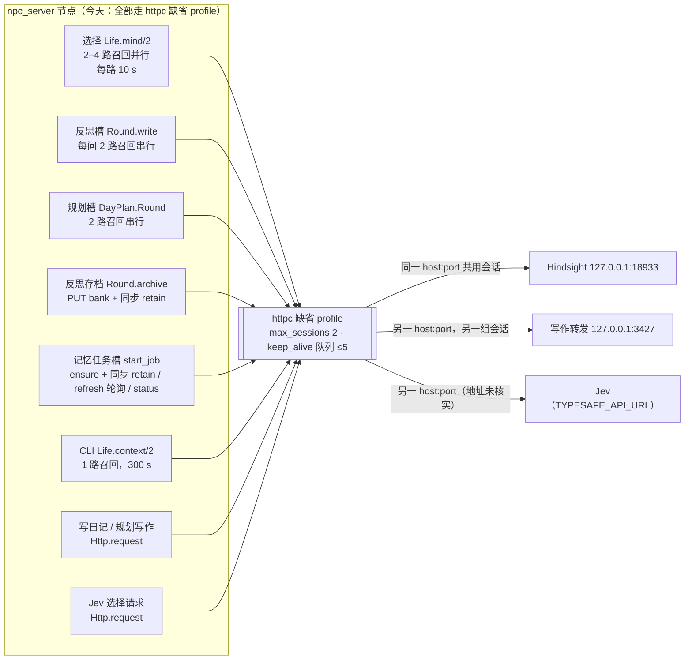
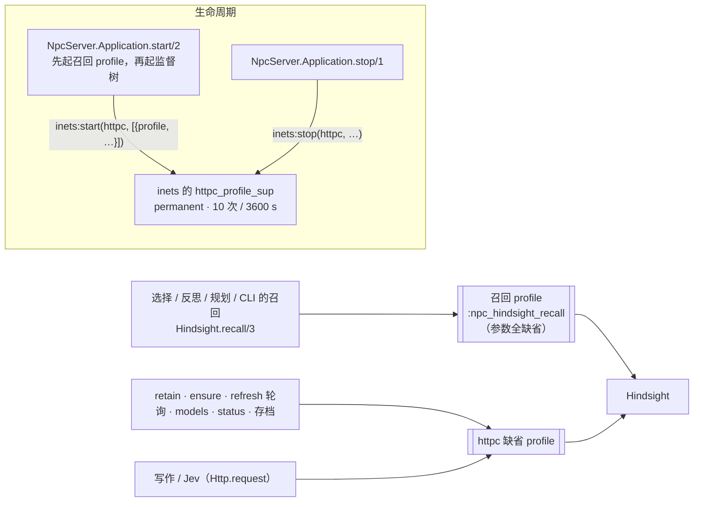

# NPC 的 Hindsight 召回隔离（召回超时修复）决策稿（用户已定 2026-11-16；D-1 / D-3a 已实现 2026-11-17）

2026-11-16，第十五个统筹会话的子会话起草。只读代码与证据写成，没有跑 mix、没有起节点、没有发任何 Hindsight / Jev / 网关请求。
上位与输入：S1-R10 判定 `.demo/observe/npc-slice1-20261112/s1r10/results.md`（用户决定第 3 条：“召回超时单独查根因，先调查、查证业界做法，再写决策稿”）；
调查报告 `s1r10/recall-report.md`（§5 根因、§6 修复方向、§7 业界做法）；实验 `s1r10/recall/e1-plan.md`、`e1-results.md`（原始输出 `recall/e1/out-ab/`）；
逐次分类 `s1r10/recall/timeout-classification.txt`。被测代码 `e85f244c`，与本稿起草时的 HEAD `78bc24dd` 的 `apps/npc_server` 召回路径相同（T7 只改额度）。

## 1. 为什么现在做

R6 / R7 / R10 共 25 次 `recall_timeout`（选择的心智快照召回 10 秒超时），另有规划两次、反思一次因召回超时失败。S1-R10 的 P8、P10、P12 都因此落空，日计划层**未验收**；用户定的补验收顺序是“额度改完（T7 已提交）、召回超时有结论后再闭环实跑一次”。所以这一项挡着日计划层验收。

调查把 25 次分成两类，原因完全不同：

| 类 | 次数 | 机制 | 证据强度 |
|---|---|---|---|
| 甲 | 13（R6 ×4、R7 ×1、R10 ×8） | **我方客户端**：httpc 缺省 profile 内，召回排在同一 host:port 上正被同步 retain 占着的 keep-alive 连接后面，不另开连接；retain 一结束（5–7 ms 后）召回才到 Hindsight，剩余预算不够 | 已证实：逐次对齐（每次预算内都有同步 retain，与 bank 无关）+ OTP 源码 + **E1 实验**（同一 profile 排队、调用方 10,001 ms 超时、请求从未发出；独立 profile 7.7 ms 返回） |
| 乙 | 12（R10 01:58:42–02:02:58） | **Hindsight 侧**：同一库、同样候选数，FlashRank 重排每候选从 11.5–17 ms 涨到 55–115 ms（6–8 倍）；Hindsight 内部无别的活 | 现象已证实；**谁占了 CPU 没有证据** |

甲类是结构问题：召回（选择在等它，交互式）和写入 / 后台请求（没有人在等，批量式）走同一条连接队列。这正是 AGENTS.md §2.1 第 1 条说的隐藏耦合：改“记忆任务槽什么时候写库”，会弄坏概念上无关的“选择能不能拿到视图”。

## 2. 已有做法（AGENTS.md §2.2 第 8 条；本子会话 2026-11-16 逐条读原文）

调查报告 §7 后半是凭记忆列的，下表每条都由本子会话重新读过原文。读不到的列在表后，**不作为依据**。

| # | 来源 | 原文要点（摘录或紧贴原文的转述） | 适用条件 | 与本项目的对应与取舍 |
|---|---|---|---|---|
| S1 | Erlang/OTP httpc 文档 <https://www.erlang.org/doc/apps/inets/httpc.html> | `max_sessions`：“Maximum number of persistent connections to a host. Default is 2.” `max_keep_alive_length`：“Maximum number of outstanding requests on the same connection to a host. Default is 5.” `keep_alive_timeout` 缺省 120000。`pipeline_timeout`：缺省 0，“results in pipelining not being used”。Profile：“keeps track of proxy options, cookies, and other options…”；“functions … that do not explicitly use a profile accesses the default profile”；起 profile 用 `inets:start(httpc, ServiceConfig)`，`profile` 必填。`timeout`：“The clock starts ticking when the request is sent.”，缺省 `infinity`。`cancel_request`：不保证响应不再送达 | 本节点所有 `:httpc` 调用方 | profile 是官方提供的隔离单位，D-1 用它。**注意**：文档说 `timeout` 从请求发出才开始计，但同步调用的实现从调用那一刻起计（见 S3），E1-A 的请求从未发出，调用方照样在 10,001 ms 超时。所以排队时间也算在调用方预算里，这对 D-3 有利：每路的超时实际上就是“从调用起的绝对截止时间” |
| S2 | Erlang/OTP inets 文档 <https://www.erlang.org/doc/apps/inets/inets.html> | `start/3`：“Dynamically starts an Inets service after the Inets application has been started.”；`How :: inets \| stand_alone`。stand_alone：“not started as part of the Inets application … lose all OTP application benefits”；“linked to the process that started it”；**“The stand_alone option is considered deprecated.”**；`stop/2`：“Stops a started service … or takes down a stand_alone-service gracefully.” | 起停 profile | 不用已弃用的 stand_alone。profile 挂在 inets 应用下，由 npc_server 负责起和停（D-1） |
| S3 | OTP 源码 `lib/inets/src/http_client/httpc.erl`（GitHub master，<https://github.com/erlang/otp>） | 同步等待 `handle_answer/5`：`after Timeout -> cancel_request(RequestId), …, {error, timeout}`；`start_service(Config) -> httpc_profile_sup:start_child(Config)`；`stop_service(Profile) -> httpc_profile_sup:stop_child(Profile)`；`profile_name(default) -> httpc_manager`，其它 profile `P` 注册为 `httpc_
` | 本节点 OTP 29.1.2 / inets 9.8.1（E1 记录）。本次读的是 master，调查报告读过 OTP-29.1.2 tag 的 `handle_answer`，两者一致 | 调用方计时到点会走 `cancel_request`。被 `Task` kill 时不走这一步（D-3a） |
| S4 | OTP 源码 `httpc_manager.erl`（master） | `select_session`：候选只取 `available = true` 的会话，再过滤 `Length =< Max`（keep_alive 时 Max = `max_keep_alive_length`），取队最短的那条；**有这样的候选就复用，不看 `max_sessions`**。只有 `{no_session, N}` 且 `N < max_sessions` 才开新的持久连接，否则开一条 `connection: close` 的连接。会话 id 是 `{HostPort, HandlerPid}`，并按 scheme 过滤。manager **不 monitor 调用方**（只 monitor handler）。`set_options` 的结果**只存在 manager 进程状态里**（`State#state{options = NewOptions}`），`init` 用记录缺省值 | 同上 | ① 只调大 `max_sessions` 没有用（E1-A 就是 `max_sessions=2`，照样排队）；② 不同 host:port 的请求不会互相挡（§3.3 据此判写日记接口）；③ 调用方被 kill 后，排队中或已发出的请求照常走完，与报告 §2 的三种结局一致；④ **profile 的参数在 manager 重启后回到缺省**（见 S5），影响 D-1 的参数选择 |
| S5 | OTP 源码 `httpc_profile_sup.erl`（master） | `one_for_one`，`MaxR = 10`，`MaxT = 3600`；profile manager 的子规格 `Restart = permanent`、`Shutdown = 4000`，`StartFunc = {httpc_manager, start_link, [Profile, Dir, inets]}`；`start_child` 只读 `profile` 与 `data_dir`；`stop_child` 先 terminate 再 delete | 同上 | inets 起的 profile 崩了会被 inets 自动重启，但重启后用的是缺省参数。所以**只要用缺省参数，重启前后就一致**，这个不变量由 inets 自己维护（AGENTS §2.1 第 2 条） |
| S6 | 本线实验 E1（`s1r10/recall/e1-results.md`，原始输出 `e1/out-ab/`） | 缺省 profile：快请求进了正忙的 keep-alive 会话队列（`queue_length` 空闲 0 → 在途 1 → 在途 + 排队 2），调用方 10,001 ms `{error,timeout}`，服务端始终没收到它。独立 profile `e1_recall`（**参数全缺省**）：走另一条连接，7.7 ms 拿到 200 | OTP 29.1.2 / inets 9.8.1，与节点同一套 | D-1 的直接证据，而且证明不调参数就够了 |
| S7 | Dean & Barroso, “The Tail at Scale”, CACM 56(2), 2013, p. 76（PDF：<https://www.barroso.org/publications/TheTailAtScale.pdf>） | “Differentiating service classes and higher-level queuing. Differentiated service classes can be used to prefer scheduling requests for which a user is waiting over non-interactive requests. Keep low-level queues short so higher-level policies take effect more quickly…”（例子是集群文件系统让 OS 磁盘队列保持很浅，自己维护优先级队列）。“Reducing head-of-line blocking … break long-running requests into a sequence of smaller requests…”。“Managing background activities … A combination of throttling, breaking down heavyweight operations into smaller operations, and triggering such operations at times of lower overall load…”。p. 75 “Why Variability Exists?”：Shared resources（“contending for shared resources (such as CPU cores…)”），Queueing（“Multiple layers of queueing … amplify this variability”） | 交互请求与批量请求共用后端 / 队列 | 召回是“有人在等”的一类，retain、refresh 轮询、status 是“没人在等”的一类。D-1 把两类分到不同的连接队列（不同 profile），召回就不会再排到长请求后面。“拆小长请求”（retain 分批）与“后台活动节流”是服务端的事，我方暂不需要（D-2）。乙类的 CPU 争用正是 “Shared resources”，要等证据（D-4） |
| S8 | Google SRE Book 第 22 章 “Addressing Cascading Failures” <https://sre.google/sre-book/addressing-cascading-failures/> | Deadline：“It’s usually wise to set a deadline.”；“servers spend resources handling requests that will exceed their deadlines … you don’t get credit for late assignments with RPCs”；Deadline propagation：“The tree of RPCs emanating from an initial request will all have the same absolute deadline.”；Cancellation propagation：“reduces unneeded or doomed work”。Retries：“Limit retries per request”；“Always use randomized exponential backoff when scheduling retries.”；“Consider having a server-wide retry budget”（例：每进程每分钟 60 次）；“Retries can destabilize a system”；“avoid amplifying retries by issuing retries at multiple levels”。Queue：“it is usually better to have small queue lengths relative to the thread pool size” | 多层 RPC、后端可能过载 | D-3a 对应 cancellation propagation：放弃的请求要真的被取消，连接关掉，Hindsight 才会在阶段边界停下来。“同一绝对截止时间”在我方每路超时从调用起算时（S1 注）已近似成立，所以不另立整次 deadline（D-3b）。退避加抖动是一般性的推荐，但本线证据显示重试**没有**维持慢段（D-3c），先不加 |
| S9 | AWS Builders' Library “Timeouts, retries, and backoff with jitter”（现址 <https://builder.aws.com/content/3EumjoZascWd1oZiEgL8ORlv3qE/timeouts-retries-and-backoff-with-jitter>） | 超时取值：“start with the latency metrics of the downstream service”，选可接受的误超时率（例 0.1%），取对应百分位（p99.9）。“When failures are caused by overload, retries that increase load can make matters significantly worse.”；“retry at a single point in the stack”；capped exponential backoff；“limiting retries locally using a token bucket”；Jitter：“If all the failed calls back off to the same time, they cause contention or overload again”；“we consider adding some jitter to all timers, periodic jobs, and other delayed work” | 很多客户端打同一后端 | 我方只在一处重试（树的 `@retry`），符合“single point”。单 NPC 时不存在“很多客户端同时退避”的问题，抖动的收益要到多 NPC 才有（D-3c）。10 s 单路预算按百分位法重定需要分布数据，下次实跑记（D-3d） |
| S10 | gRPC Deadlines 指南 <https://grpc.io/docs/guides/deadlines/> | “A deadline is used to specify a point in time past which a client is unwilling to wait”；“A timeout can be converted to a deadline by adding the timeout to the current time when the application starts a call.”；“the server application is responsible for stopping any activity it has spawned”；“you should always explicitly set a realistic deadline in your clients” | RPC 客户端 / 服务端 | 同 S8。服务端停止工作是 Hindsight 的事（上游 #2122：重排线程不可中断），我方能做的是把取消真正发出去（D-3a） |
| S11 | Bronson et al., “Metastable Failures in Distributed Systems”, HotOS ’21, pp. 221–222（<https://sigops.org/s/conferences/hotos/2021/papers/hotos21-s11-bronson.pdf>） | 亚稳态：“a bad state that persists even when the trigger is removed”，由 “sustaining effect—often involving work amplification” 维持；§2.1 “One of the most common failure-sustaining mechanisms is request retries … work amplification” | 有重试 / 超时的开放系统 | 判据是**触发消失后坏状态还在不在**。S1-R10 的慢段在 02:02:05 前后结束，而 20 s 重试一直在跑（最后一次失败 02:02:02.4，召回 02:02:12 起恢复），所以我方重试**不是**维持慢段的原因。这是 D-3c 暂不加退避的依据 |
| S12 | Hindsight 0.10 文档 “Operations” <https://hindsight.vectorize.io/0.10/developer/api/operations>（页面自注 “no longer maintained”，当前 1.2） | 异步 retain：`POST …/memories` 带 `async=true`，响应里的 `operation_id` 用来轮询；状态 `pending / processing / completed / failed / cancelled`；“The handler runs the same pipeline as a synchronous retain”（抽取 LLM、嵌入、实体、链接）；“Use async retain when you’re ingesting thousands of items and don’t want the HTTP call to hold for minutes”；worker 缺省 “in-process inside the API”；失败自动重试至 `HINDSIGHT_API_WORKER_MAX_RETRIES` 次 | 容器是 hindsight-api-slim **0.10.3**（报告 §3）。文档是 0.10 小版本的，不是 0.10.3 逐行；容器内源码（`api/http.py` L5148 起 `WorkerPoller`，后台与在线召回同进程、无优先级）由调查报告读过，本子会话按规则不碰容器，未复读 | 异步 retain 只是把同一份工作挪到**同一进程**的 worker 里，Hindsight 的 CPU 一点没少，召回和后台之间也没有优先级。它解决的只有“HTTP 连接被占住”，而这一点 D-1 已经解决。所以 D-2 不改 |
| S13 | Elasticsearch thread pool 设置 <https://www.elastic.co/docs/reference/elasticsearch/configuration-reference/thread-pool-settings>（当前版） | 节点有多个线程池；`search` 池（“For count/search operations…”）与 `write` 池（“For write operations and ingest processors”）各自定长、各自有队列 | 服务端读写隔离 | 业界“读写各一个池、各一个队列”的成熟做法，作 D-1 的旁证。它是服务端线程池，我们这里是客户端连接池，只借“按服务等级分队列”这一点 |
| S14 | Python `concurrent.futures.Future.cancel` <https://docs.python.org/3/library/concurrent.futures.html> | “If the call is currently being executed or finished running and cannot be cancelled then the method will return False” | Hindsight 用 `run_in_executor` 跑 FlashRank | 解释为什么取消只在阶段边界生效、已派出的重排会算完（报告 §3 第 4 条），D-3a 只能减少白算，不能消除 |
| S15 | Elixir `Task.async_stream/5` 文档 <https://elixir.hexdocs.pm/Task.html> | `:timeout`：“the maximum amount of time … each task is allowed to execute for”（没说从何时起算）；`:on_timeout :kill_task`：“the task that timed out is killed”；提前停止枚举时多出的任务 “will be terminated”（见 `Enum.take/2` 一节） | 选择的多路召回（`life.ex` L316–323） | 超时就 kill、提前停止也 kill，两条路都不经过 httpc 的 `cancel_request`（S3、S4），这就是 D-3a 要改的地方 |

**未核实（没有读到原文，不作为依据）**：Huang et al., “Metastable Failures in the Wild”（OSDI ’22）；SRE Book 第 21 章 “Handling Overload”；AWS Builders' Library “Avoiding insurmountable queue backlogs”、“Using load shedding to avoid overload”。另有 ONNX Runtime threading 文档，调查会话读过，本子会话没有复读，只在 D-4 的“待证据方向”里提到，不据它做决定。Hindsight 0.10.3 的容器源码（异步 retain 的实现细节）按本次规则不碰容器，以 0.10 文档 + 报告 §3 为准。

## 3. 仓库现状

### 3.1 走 httpc 的调用方与 profile

| 调用方 | 代码 | 超时 | 备注 |
|---|---|---|---|
| Hindsight 适配器全部请求 | `life/hindsight.ex` L449–488，`:httpc.request/4` 在 L467–471，没有 profile 参数 | `config.timeout_ms`，缺省 300 s | 召回 `recall/3`（L175–192）只发一次 `POST /memories/recall` |
| 选择的心智快照 | `life.ex` L249–271、L306–355 | `@mind_recall_timeout_ms 10_000`（L155）：同一个数既写进 httpc 的 `timeout`，也是 `Task.async_stream` 的 `timeout`，`on_timeout: :kill_task`，`max_concurrency: 3`（L157）；任一路失败就 halt（L324–333） | 两个 10 s 计时几乎同时到点，先到哪一个不确定；实测两条路径都出现过（报告 §2） |
| 反思一问 / 规划 | `reflection/round.ex` L180–195、L285–303；`day_plan/round.ex` L81–104；超时在 `life.ex` L1310、L1479 设成 10 s | 只有 httpc 的超时，没有 Task | 召回串行；失败即这一问 / 这次规划失败 |
| 反思存档 | `reflection/round.ex` L121–155 | 300 s | `ensure_bank` → 同步 `retain`（`async: false`，`hindsight.ex` L104）→ 逐文档 `GET /documents` 查 facts → `GET /operations` |
| 记忆任务槽 | `life.ex` L1596–1649 | 300 s；operation 总预算 600 s | `ensure`（PUT、PATCH、GET ×4）→ 同步 retain / 4 个 refresh 每 1 s 轮询 / models → `status`（分页） |
| CLI `context/2` | `life.ex` L200–220 | `:infinity` → 适配器 300 s | 调试入口 |
| 写日记接口、Jev | `http.ex` L14–39，L34 `:httpc.request/4` 无 profile | 写作缺省 60 s；Jev 10 s | 见 3.3 |

### 3.2 选择失败后的重试节奏

不在 Life 里，在树上：`trees.ex` L46 `@retry 600`（tick，60 Hz，即 10 s），L131 “发问失败：这一轮不执行任何活动，等 `@retry` tick 后下一轮再问”，L145 `{:repeat, :forever, {:sel, [round, {:wait, @retry}]}}`。召回 10 s 超时加上等 10 s，日志里 `npc_select_failed` 间隔 20.0–20.05 s（报告 §2）。这条重试路径对所有发问失败都一样（召回、Jev、World），没有退避也没有抖动。正常时选择间隔约 34 s。

### 3.3 写日记接口会不会与召回互相挡（任务点名要核实）

**不会**。依据：httpc 会话按 `{HostPort, HandlerPid}` 分（S4），还按 scheme 过滤。S1-R10 的地址（`s1r10/scripts/env-s1r10.sh` L24、L32）：`NPC_LIFE_HINDSIGHT_URL=http://127.0.0.1:18933`，`NPC_REFLECT_URL=http://127.0.0.1:3427/v1/messages`，host:port 不同，各用各的会话。
Jev 的 `TYPESAFE_API_URL` 来自一个含密钥的 `.env`（`env-s1r10.sh` L26），本稿不读，**未核实**。只要它不是 `127.0.0.1:18933`，就不会与召回同会话；D-1 之后，即使相同也不再影响召回。
附带观察（不改）：反思的写作与规划的写作都打 `127.0.0.1:3427`，同一 host:port，两者同时在途时后发的会排在先发的后面（每次写作约 9 s，写作超时 60 s），没有失败证据。

### 3.4 监督树与 inets

- `apps/npc_server/mix.exs` L28：`extra_applications: [:logger, :inets, :ssl]`，所以 inets 先于 npc_server 起来（各 worker 里的 `Application.ensure_all_started(:inets)` 是冗余的，不影响本稿）。
- `application.ex` L6–15：`NpcServer.Supervisor`（`rest_for_one`）下有 `Registry`、`BodySupervisor`、`Bootstrap`，没有任何持有连接的进程。

### 3.5 测试现状

`test/support/http_stub.exs` 是串行 accept、每个响应都带 `Connection: close` 的 `:gen_tcp` 替身，不保持连接，所以**复现不了** keep-alive 队头阻塞。D-1 的“改前红”测试需要一个能保持连接、能并发应答的替身（§7）。Life 层测试用注入的假适配器（`support/life_fixtures.exs`），不经过 httpc。

## 4. 决策项与建议

### D-1 连接隔离（核心，消除甲类 13 次）

**选项**

| 选项 | 做法 | 评价 |
|---|---|---|
| **A 一个召回 profile（建议）** | 只有召回（`recall/3`，含 CLI `context/2`）走专用 profile；其余 Hindsight 请求（retain、ensure、refresh 与轮询、models、status、存档）仍走缺省 profile | 按服务等级分两类（S7）：有人在等的、没人在等的。E1-B 直接证明有效。改动只有适配器一处，加上起停 |
| B 召回与后台各一个 profile | Hindsight 的请求全部离开缺省 profile | 后台请求也不再依赖缺省 profile（缺省 profile 节点内全局共享，任何 app 都能 `set_options` 改它）。但没有任何证据显示后台请求被别的调用方挡过，多一个 profile 收益是零（§2.2 第 7 条），不建议 |
| C 每类请求各一个 profile | 选择、反思、规划、retain、存档、刷新各一个 | 没有证据支撑的细分，过度设计 |
| D 改缺省 profile 的参数 | 例如对缺省 profile `httpc:set_options([{max_keep_alive_length, 0}])` | 缺省 profile 是节点全局的，会改到 Jev、写作以及同节点其它 app 的行为，是跨系统的隐式耦合（§2.1 第 1 条）。而且参数在 manager 重启后会丢（S4、S5）。否决 |
| E stand_alone，每个 Life 一个 manager | `inets:start(httpc, …, stand_alone)` | 官方已弃用（S2），调用方还得拿着 pid。否决 |
| F 换 HTTP 客户端（Finch / Mint 连接池） | 新依赖 | E1 已证明 httpc profile 就够了，没有换的理由。否决 |

**建议的具体形状（A）**

- **哪些请求进召回 profile**：只有 `POST /memories/recall`。分法按“调用方此刻在不在等”，不按 bank：甲类里挡住召回的既有经历库 retain，也有反思库 retain（报告 §5.1）。
- **名字与 owner**：profile 名 `:npc_hindsight_recall`（注册名会是 `httpc_npc_hindsight_recall`，S3）只在 `NpcServer.Life.Hindsight` 里定义一次。这个模块对外给“起 / 停召回 profile”两个函数，`recall/3` 内部用它，调用方不知道有 profile（§2.2 第 3、4 条）。
- **在哪里起**：`NpcServer.Application.start/2` 在 `Supervisor.start_link` 之前调起 profile 的函数，profile 挂在 inets 的 `httpc_profile_sup` 下（S3、S5）。这样任何 Life 起来之前 profile 已经在了。返回 `{:error, {:already_started, _}}` 视同成功（同一节点内 npc_server 重启时）。其它错误让应用启动失败，不静默（铁律第 8 条）。
- **参数：全部用缺省**（`max_sessions 2`、`max_keep_alive_length 5`、`keep_alive_timeout 120 s`、`pipeline_timeout 0`）。理由有两条：E1-B 用的就是缺省参数，已证明能消除甲类；`set_options` 只存在 manager 进程状态里，manager 被 inets 重启后回到缺省（S4、S5），用缺省参数则重启前后一样，“召回 profile 长什么样”这个不变量由 inets 的监督自动维护，不需要再写一个进程去盯着补设（§2.1 第 2 条，同时避免 §2.2 第 7 条说的预建自愈）。
- **关闭**：`NpcServer.Application.stop/1`（监督树已经停完、没有 Life 在用之后）调 `inets:stop(httpc, :npc_hindsight_recall)`。
- **重启**：manager 崩溃时，在途或新发的召回显式失败（httpc 调用退出或超时；选择那边表现为发问 worker 退出，Runtime 记 `select_worker_failed`；反思 / 规划记召回失败），inets 随即用同样的缺省参数重启它。不另加重试。
- **代价**：多几条到 Hindsight 的持久 TCP 连接（回环，不占 UDP，最多约 2 条持久连接，超出时 httpc 用即用即关的连接）。测试用 `--no-start` 时，要在测试 setup 里调同一个“起召回 profile”函数。
- **已知的剩余（不在 A 里解决）**：召回之间仍可能在召回 profile 的同一条热连接上排队（S4：有热会话就排上去）。会排队的场景有三种：选择失败后 20 s 重试（短于 uvicorn 的 `timeout_keep_alive = 30`，连接还热）；选择与反思 / 规划的召回同时在途；多 NPC。A 之后，记忆任务槽每 1 s 的轮询不再把召回连接焐热，报告说它曾让两路串行、`recall_ms` 翻倍，这一点会消失；正常 34 s 的选择节奏下连接已被服务端关掉，两路会新开连接并发。见 D-1b。

**D-1b 召回 profile 调参数（不建议现在做，列为待证据）**

做法：召回 profile 设 `max_keep_alive_length: 0`（只复用空闲会话，正忙的不排；`queue_length` 的含义见 S6 的原始输出），`max_sessions: 5`（= 单 NPC 召回在途上限：选择 3 + 反思 1 + 规划 1）。这两个取值是**原创决策**。由于参数会在 manager 重启后丢失，还得有一个 owner 进程 monitor manager 并补设参数，或者接受一个短暂的缺省窗口。
不建议现在做，原因：
① 没有证据显示召回之间的排队单独造成过超时。乙类 12 次里有 9 次是 SH 用 7.7–9.8 s 算完 LF 才开始，但慢段里 LF 单独跑也要 150 × 55–67 ms ≈ 8–10 s，两路并发时每候选的代价还会升高（20–35 ms 对 11.5–17 ms，报告 §3），并行多半也救不回来；
② 重排吃 CPU，两路并发时每候选变慢，按报告 §5.2 末尾的估算，300 候选时串行约 9 s、并发约 7.5–10 s，收益不明；
③ 要加一个维护参数的进程。
启用条件：下次闭环实跑在 A 之后仍看到“召回排在召回后面”导致的超时（§7 读数 R4），或进入多 NPC 实跑之前。

**D-1b 交互召回与后台召回分池（2026-11-18，用户同意在多 NPC 验收前处理）**

选用交互与后台取材分别持有固定的 httpc profile，两个 profile 沿用缺省参数。交互决策、技能交互判断和 CLI 心智查询走现有交互池。
反思与日计划通过共用的 `Reflection.Round.materials/3` 进入后台召回池。两池均由 `NpcServer.Application` 在起监督树前启动，
启动部分失败时释放本次已起的 profile，应用停止时停两池。Hindsight 适配器拥有名字与路由，调用方标明业务类别。
两类生产召回单路都是 10 秒；保留原有并行度、额度、取消和错误返回。存档、retain、ensure、刷新、状态继续使用缺省池。

依据原版 OTP 29.1.2 的 [httpc 文档](https://www.erlang.org/doc/apps/inets/httpc.html#module-profiles)、
[manager 会话选择实现](https://github.com/erlang/otp/blob/OTP-29.1.2/lib/inets/src/http_client/httpc_manager.erl#L715-L735) 与
[inets profile 子规格](https://github.com/erlang/otp/blob/OTP-29.1.2/lib/inets/src/http_client/httpc_profile_sup.erl#L98-L105)：
会话表属于 profile，忙的同类请求仍可能进入同一 keep-alive 队列。两个固定 profile 把交互和后台的队列拆开。
每个 profile 对单一 Hindsight host 的持久 TCP 连接上限仍为 2，忙时还可能打开由请求持有的短连接。
本项给该 host 增加最多 2 条持久 TCP 连接，不提高单一 NPC 的在途工作槽数，不添加请求重试或 UDP 端点。
同类队头阻塞和 Hindsight 的共享算力仍可见，保留原有失败与按路超时语义。延续 D-1 使用缺省参数的取舍，由 inets 自己保证 manager
重启后的参数一致，按多 NPC 的实际读数再判断同类竞争是否需要优化。

验证矩阵：

- T-4 用现有回环 `KeepAliveStub` 和真实 `:httpc`。由 `Reflection.Round.materials/3` 预热同一 host 的 keep-alive，再让一轮后台取材首路
  挂起并观察它已到对端。用正常 `Hindsight.recall/3` 发交互召回，成功应答且使用另一连接后才释放后台。旧共享池会在后台应答前到达交互超时。
- T-5 延续 T-3，检查两池正常起停及幂等，停后台池的取材显式报池缺失、交互仍成功。原有 T-1 保证 retain 隔离。
  运行 `wsl bash .demo/dev-env/build-test.sh test test/npc_server/npc_recall_isolation_test.exs test/npc_server/npc_hindsight_test.exs test/npc_server/npc_reflection_round_test.exs test/npc_server/npc_life_day_plan_round_test.exs`。
- 用各槽与查询入口的并发语义约束 3–5 个统一 NPC 的采样。在每个 NPC 同时最多一次选择、没有并行额外 CLI 心智查询时，交互召回至多
  3×NPC 数，后台取材至多 2×NPC 数（规划一条、反思一条），缺省池同时还有每个 NPC 至多一条记忆任务请求或存档。
  反思取材与该反思槽的存档串行；3 NPC / 5 NPC 的 Hindsight 请求在途之和上界分别 18 / 30，请求数和后端计算耗时在实跑中实际记录。
  回归不启动 World、Scene、数据库、真实模型或 QUIC，回环替身和本轮连接随测试结束清理。

### D-2 retain 改不改异步

- **A 保持同步、只靠 D-1 隔离连接（建议）**：retain 继续 `async: false`，在缺省 profile 上占连接 11–49 s，但不再有召回排在它后面。现有检查一概不动：`retain/2` 返回后逐文档 `GET /documents` 查 `memory_unit_count > 0`（`hindsight.ex` L105、L311–319）；记忆任务槽成功才删片段、`retained` 加数（`life.ex` L738–744）；存档结局 `"ok" / "failed"` 写进本轮小结（`life.ex` L810–835、L1352–1363）。
- **B 改异步 + 轮询**：`async: true` → 拿 `operation_id` → 用现有的 `completion/2`（每 1 s 轮询 `/operations/<id>`，`hindsight.ex` L343–394）等到 `completed` → 再查 facts。要处理 `failed / cancelled`，还要接受 Hindsight worker 自己最多重试 `WORKER_MAX_RETRIES` 次的语义（S12）。存档还得多一个“已提交未完成”的中间结局，或者在槽里一直等着。
- **为什么建议 A**：
  ① 异步 retain 跑的是同一份流水线，worker 缺省就在 API 同一进程里，与在线召回没有优先级（S12、报告 §3 第 9 条），Hindsight 的 CPU 一点没少；
  ② 报告 §5.3 已经排除了“同步 retain 在服务端拖慢召回”：在别的连接上的召回能与 retain 同时跑（02:07:53 那一对、01:39:33 那路 SH），retain 期间重排正常（R6 0.4–0.8 s、R10 1–3 s）；
  ③ 甲类的全部 13 次在 D-1 之后都没有机制再发生。
  改异步没有当前证据支撑，还要动 facts 检查与存档结局两处契约（§2.2 第 7 条）。
- **代价**：retain 仍占住记忆任务槽 11–49 s（现状，按设计：槽是串行的）。反思存档与任务槽的 retain 同时在途时，可能在缺省 profile 上互相排队，最长约一次 retain 的时长，远低于 300 s 超时，也没有失败证据。

### D-3 截止时间与重试节奏

**D-3a 每路只由 httpc 计时，等各路自己结束再合成（建议）**

- 现状：选择的每一路同时受 `Task` 的 10 s（到点 kill）和 httpc 的 10 s（到点 `cancel_request`）约束；任一路失败就 halt，其余在途的任务随之被终止（S15）。kill 不经过 `cancel_request`，manager 也不 monitor 调用方（S4），所以被放弃的请求照常走完：排队的会在事后发出（01:39:33 那次的 LF 在 01:40:00.781 才到 Hindsight，比我方放弃晚 17 s），已发出的照算到底（02:00:22.030 那路在我方放弃后又算了 10 s）。
- 改法：每路的截止时间只有一个 owner，即适配器写进 httpc 的 `timeout`（从调用起算，含排队时间，S1 注、S3）。`Task.async_stream` 不再设自己的超时（`:infinity`），也不在第一路失败时 halt：等每一路各自结束（成功、失败或 httpc 超时），再按现行全有全无规则合成，失败记第一条失败的那一路。这样每一次放弃都经过 `cancel_request`：已发出的关掉连接，Hindsight 的断开中间件在下一个阶段边界取消；排队的从队列里拿掉，永不发出（E1-A 已观察到这一点）。
- 依据：S8 的 cancellation propagation（“reduces unneeded or doomed work”）、S10（服务端负责停止工作）、S3 / S4（kill 不经过 cancel）、报告 §5.2 第 2 点（白算的部分与新请求抢 CPU）。
- 代价：
  ① 某一路**早早**以非超时错误失败（如 HTTP 5xx）时，整次要等其余各路结束才返回，最多晚 10 s，失去这种情况下的 fail-fast（S8 也推荐 fail-fast）。观察到的失败全是超时，这种情况没有出现过；
  ② 已派出的重排仍会把当前阶段算完（S14，上游 #2122），白算只能减少，不能消除。
- “不 halt、等各路结束”这个合成方式是**原创决策**（先例 S8 只说要传播取消，没有规定合成方式）。
- 反思 / 规划的召回本来就只有 httpc 计时，不用改。

**D-3a 改写（2026-11-18，随出站 HTTP 换 Finch；[Finch 决策稿](2026-11-18-npc-http-client-finch-decision.md) §3）**

上面“每路只由 httpc 计时、到点经 `cancel_request` 放弃”的写法以 httpc 为前提。换 Finch 后契约改为三条，由 `NpcServer.Http` 唯一持有：

- **发送与接收的截止只有一个 owner**：适配器给的 `timeout_ms` 就是 Finch 的 `request_timeout`；`receive_timeout` 取同一个值（不大于它）。
  Finch 文档说 `request_timeout` 在 HTTP/1 上是 best effort、只在两次读之间检查，单次读由 `receive_timeout` 兜住，所以两者合起来不会挂死；
  最坏情况这一段约 2×`timeout_ms`。
- **建连另有上限**：Mint 的 `transport_opts.timeout` 由车道给（交互 2 s、后台 30 s），不受 `request_timeout` 管。
- **取连接另有上限**：`pool_timeout` 由车道给（交互 2 s、后台 30 s），只管“取不到连接”，报 `:pool_timeout`（请求从未发出），与上游慢的
  `:timeout` 分开。httpc 时代“排队时间也算进同一个超时”的性质随之改为三段（取连接、建连、发送与接收）各有上限，
  调用方最坏总时长约为三者之和（交互召回 2 + 2 + 2×10 s），正常情况下前两段是毫秒级。HTTP/2 连不上报 `:connection_unavailable`。
- **放弃即取消**：超时时 Finch 关掉那条 HTTP/1 连接（HTTP/2 发 RST_STREAM）；调用进程被杀时它持有的 HTTP/1 连接随之关闭。
  两条都由 `npc_http_lanes_test.exs` 的 T-3 用替身实测（httpc 下“调用方被杀”那条为红：连接保持 keep-alive，请求照常走完）。
  `recollect/3` 仍不另设 Task 超时、等各路结束再按全有全无合成，这一条不变。

**D-3b 另立整次决策的 deadline（不建议）**

现状下同时起的各路共用同一个起点，每路超时从调用起算，已经近似 S8 说的“同一绝对截止时间”；只有第 4 路（`max_concurrency: 3`）要等前面某一路结束才起，整次最长可到约 20 s。没有任何失败与整次时长有关，也没有产品上对选择延迟的要求（树在等应答时身体原地不动，`trees.ex` L130）。不加。

**D-3c 选择失败后的重试加退避与抖动（不建议现在加；多 NPC 实跑之前再定）**

- 现状：固定约 20 s（10 s 超时 + `@retry` 10 s），所有发问失败共用。
- 不加的理由：
  ① S11 的判据，S1-R10 慢段结束时 20 s 重试仍在继续，重试不是维持慢段的原因；
  ② 单 NPC 不存在 S9 说的“大家同时退避又同时打回来”；
  ③ D-1 之后甲类没了，重试次数本身会大降；
  ④ D-3a 让放弃的请求真正被取消，报告 §5.2 第 2 点的白算会减少。
  退避要在树上或 Selector 里记“连续失败次数”这个新状态，是没有当前证据的新机制（§2.2 第 7 条）。
- 代价：慢段里每 20 s 一次的请求密度不变（约为正常节奏的 1.7 倍）；20 s 短于 uvicorn 的 30 s keep-alive，重试时两路可能在召回 profile 上串行（D-1 的剩余项）。
- 将来要加时（多 NPC 之前），按 S8 / S9 用 capped exponential backoff + jitter，只在一处（树的重问）做。到时候给出的数字（例如起点 10 s、倍率 2、上限 80 s、full jitter）都是**原创决策**，现在不定。

**D-3d 单路 10 s 预算（不改，下次实跑记分布）**

报告 §5.2 末尾：重排耗时与候选数成正比，上限 300 候选时单路约 4.5 s，库再长 10 s 预算迟早会被吃完。S9 的定法是取下游延迟的高百分位，而 S1-R10 只有 96 次召回，不够定 p99.9。下次实跑按 §7 读数 R5 记每路时长与候选数，再与 D-4 一起定。

### D-4 Hindsight 侧的重排变慢（乙类 12 次；原因未明，只定采样计划）

- **采样计划（用户 2026-11-16 已定）**：下一次闭环实跑全程每 5 s 采一次：
  - 全部容器的 `docker stats --no-stream`；
  - WSL 按进程的 `top -b -n1`；
  - Windows 总 CPU。
  Hindsight 日志里本来就有逐次召回的各阶段耗时与候选数，事后用 `s1r10/recall/parse_hindsight.py` 同样的方法算每候选重排毫秒数。
- **判据（运行前写进实跑计划）**：每候选重排毫秒数在同等重叠数下升到基线（单独跑 11.5–17 ms）的 3 倍以上的时段里，是否有别的容器或进程的 CPU 同步升高；Hindsight 容器自身 CPU 是升（它在算、算得慢）还是降（被挤占）。
- **资源约束**（全局 CLAUDE.md）：采样器是本地 CLI 循环，不开 UDP，不新建网络连接；运行时长有上界（随实跑起停），由实跑脚本起停，结束时确认进程不在；起之前与结束后各记一次主机 UDP 端点基线。输出写 `.demo/observe/` 下本次实跑目录。
- **配置侧方向，全部待证据后再定，不建议现在改**（报告 §6 第 5–8 条）：降低重排候选上限（`HINDSIGHT_API_RERANKER_MAX_CANDIDATES[_MID]`）、换更轻的 FlashRank 模型、对某库关 cross-encoder、给容器固定 cpuset、worker 拆进程、上游的重排可中断与 ORT 线程数。理由：我们还不知道 CPU 去了哪里；这些改动都会以召回质量或峰值吞吐为代价，且需要在独立还原的副本库上离线测（报告 §8 E3）。

### P-1（产品问题，只列）部分路成功是否出视图

现行规则：任一路失败，整次视图失败，“不拿其余几路凑一张残缺的清单”（`life.ex` L245）。这是产品决定，不是本稿的技术决策项。**建议不动**：D-1 之后甲类消失；乙类期间 SH、LF 两路都慢，放宽也救不回多少；放宽还会改变 Mind 拿到的记忆构成，要另做离线对照。

## 5. 两类超时分别由哪项消除

| 失败 | 次数 | 机制 | 消除它的决策项 | D-1 之后还会不会 |
|---|---|---|---|---|
| 甲类：选择召回排在同步 retain 后面 | 13（R6 ×4、R7 ×1、R10 ×8） | 缺省 profile 内的 keep-alive 队头阻塞 | **D-1** | 不会：召回与 retain 不再同 profile，按 S4 不可能排在一起 |
| 反思 02:08:28 的召回排在 retain 后面（从没到过 Hindsight） | 1 | 同甲类 | **D-1** | 不会 |
| 规划 01:59:37 的召回排在选择的召回后面（从没到过 Hindsight） | 1 | 召回排在召回后面，正赶上慢段 | D-1b 能让它不排队；但慢段里它自己也多半超时，真正要靠 D-4 | 仍可能（召回 profile 内排队） |
| 乙类：慢段 | 12 | Hindsight 重排算力降到 1/6–1/8 | **D-4**（原因未明）；D-3a 减少放弃后的白算；D-1b 让 SH / LF 并行但多半救不回 | 会，直到查清 CPU 去向 |
| 规划 02:02:37（到了 Hindsight，被取消） | 1 | 慢段的尾巴 | D-4 | 会 |

## 6. 不变量

1. 召回（有人在等）与写入 / 后台请求（没人在等）不共用 httpc 的连接队列：前者只走召回 profile，后者不走。
2. 召回 profile 的名字只在 `NpcServer.Life.Hindsight` 定义一次；它由 npc_server 应用在起监督树之前起、在应用停止时停；运行期间由 inets 的 `httpc_profile_sup` 监督，重启后参数与重启前一致（都是缺省值）。
3. 每一路召回的截止时间只有一个 owner（适配器给 `NpcServer.Http` 的 `timeout_ms`，即 Finch `request_timeout`；取连接另由车道的 `pool_timeout` 管），到点 Finch 关掉那条连接；生产代码里不再有第二个计时器去 kill 召回进程（D-3a，2026-11-18 按 Finch 决策稿 §3 改写）。
4. 选择的视图仍是全有全无（P-1 不动）；召回失败仍是显式失败，`observe/1` 的 `recall` 记失败的那一路与原因。
5. retain 的语义不变：同步、写完逐文档查 facts、成功才删片段；存档结局只有 `none / pending / ok / failed`。

## 7. 验证方式（先最小测试，后闭环实跑；期望运行前写）

### 7.1 最小测试（改前红、改后绿）

| # | 测什么 | 怎么测 | 能证伪什么 |
|---|---|---|---|
| T-1 | D-1：召回不再排在写入后面 | 一个能保持连接、能并发应答的本地 `:gen_tcp` 替身（现有 `HttpStub` 每次都 `Connection: close`、串行 accept，复现不了，需要扩展或另写一个只测试用的替身）。步骤：先用适配器 `ensure_bank/2` 让缺省 profile 有一条热的 keep-alive 会话；再起 `retain/2`，替身对 `/memories` 延迟约 3 s 才回；100 ms 后调 `recall/3`（`timeout_ms` 1000） | 改前：`{:error, :timeout}`，替身始终没收到召回（同 E1-A）。改后：召回远早于 1 s 返回 `{:ok, …}`，替身在**另一条连接**上收到它 |
| T-2 | D-3a：放弃的召回真的被取消 | 同一类替身对 `/memories/recall` 不作答；经选择的合成路径发 2 路召回（每路 `timeout_ms` 500） | 改后：两路都在约 500 ms 以 `:recall_timeout` 结束，替身观察到已发出那路的连接被客户端关闭，排在后面的那路始终没有到达。改前：kill 路径下连接不关，排队请求事后到达 |
| T-3 | 召回 profile 起停 | 起两次（第二次 `already_started` 视同成功），`:httpc.get_options(:all, :npc_hindsight_recall)` 能读到；停了之后读不到 | 起停函数与幂等 |

测试数据：请求体全部由适配器自己从产品路径生成（`ensure_bank/2`、`retain/2` 的经历条目形状、`recall/3` 的描述），不手写请求。替身的应答用现有 `npc_hindsight_test` 回放的真实 Hindsight 响应字节。替身的延迟只模拟“服务端慢”，延迟时长取自实测量级（retain 11–49 s，按比例缩短到秒级，不改变“比召回超时长”这一关系）。
范围（AGENTS §3 第 14 条）：只动适配器与 `recollect/3`，所以只加 T-1–T-3，再跑 `npc_hindsight_test` 与 Life 的现有用例。全程只用回环 TCP，不用 UDP。

### 7.2 闭环实跑读数（与日计划层补验收同一次；读数与期望写进那次的 `plan.md`）

| # | 读数 | 期望 |
|---|---|---|
| R1 | `timeout-classification` 同法分类：预算区间内有同步 retain 的 `recall_timeout` | 0 次 |
| R2 | Hindsight 日志：与 retain 重叠的召回的到达时刻 | 在 retain 进行中就到达，不再出现“retain 结束后 5–7 ms 才到” |
| R3 | 反思 / 规划的召回“从没到过 Hindsight”（我方有 `:timeout`、Hindsight 没有对应的 `Starting recall`） | 与 retain 有关的 0 次 |
| R4 | 选择的 `recall_ms` 与各路在 Hindsight 的耗时之比（≈ 两路之和为串行，≈ 较大那路为并行），按“距上次召回 < 30 s / ≥ 30 s”分组 | 只记；作为 D-1b 的证据 |
| R5 | 每路召回耗时与候选数的分布 | 只记；作为 D-3d、D-4 的证据 |
| R6 | 我方每次放弃召回之后，Hindsight 是否还收到这次选择的请求 | 0 次（D-3a）；Hindsight 的 “client disconnected” 次数应与“已发出后放弃”的次数对得上 |
| R7 | D-4 的 CPU 采样与每候选重排毫秒数的时间线 | 按 D-4 判据读；不预设结论 |
| R8 | 资源：到 18933 的 TCP 连接数（`ss`）、主机 UDP 端点基线前后 | TCP 有界（召回 profile 持久连接 ≤ 2，外加缺省 profile 的）；UDP 不变 |

## 8. 原创决策（没有直接先例的取值；实施前已在此报告）

| 项 | 取值 | 为什么没有现成答案 | 风险与验证 |
|---|---|---|---|
| 召回 profile 名 | `:npc_hindsight_recall` | 命名 | 无；只在一处定义 |
| 召回 profile 参数 | 全缺省（不调） | S1 / S4 给出语义，没人规定该怎么取；选缺省是因为 E1-B 证明够用，且重启后不会漂移 | 召回之间仍可能排队，由 R4 观察 |
| profile 的 owner 与起停位置 | `Application.start/2` 起、`stop/1` 停，运行期间归 inets 监督 | OTP 只给了机制（S2、S3、S5），没规定由哪个应用持有 | T-3 |
| 合成方式 | 不 halt、等各路结束再全有全无 | S8 要求传播取消，但没规定合成方式；代价是早失败时晚返回 | T-2 |
| （待定，不在本次）D-1b 参数 | `max_keep_alive_length 0`、`max_sessions 5` | 按单 NPC 召回在途上限推出 | 启用前另报 |
| （待定，不在本次）D-3c 退避数字 | 起点 / 倍率 / 上限 / 抖动方式 | S8、S9 只给形状 | 多 NPC 前另报 |

检索范围：Erlang/OTP 官方文档与 inets 源码（master）、CACM 论文、Google SRE Book、AWS Builders' Library、gRPC 官方指南、HotOS 论文、Hindsight 0.10 官方文档、Elasticsearch 官方文档、Python 与 Elixir 官方文档（见 §2）。

## 9. 要用户定的

1. **D-1**：只给召回一个独立 httpc profile、参数全缺省、由 npc_server 应用起停（建议） / 召回与后台各一个 profile / 现在就做 D-1b 调参数。
2. **D-2**：retain 保持同步、只靠 D-1 隔离（建议） / 改异步 + 轮询。
3. **D-3a**：每路只由 httpc 计时，等各路自己结束再合成（建议） / 保持现状（Task kill + 第一路失败就 halt）。
4. **D-3c**：现在不加退避，多 NPC 实跑之前再定（建议） / 现在就加 capped exponential + jitter（数字另报）。D-3b 不另立整次 deadline、D-3d 10 s 暂不改，如有异议一并说。
5. **D-4**：按已定的采样计划，在下一次闭环实跑附带采样，判据如 D-4。配置侧改动等证据。
6. **P-1**：部分路成功是否出视图，建议不动。

## 用户的决定（2026-11-16，经对话框，四项都选建议项）

1. D-1：**只给召回一个独立 httpc profile**（`:npc_hindsight_recall`），参数全缺省，由 npc_server 应用起停；D-1b 调参数等证据。
2. D-2：**retain 保持同步**，只靠 D-1 隔离。
3. D-3a：**每路只由 httpc 计时**，去掉 Task kill 与第一路失败即停，等各路结束再按全有全无合成。
4. D-3c：**现在不加退避**，多 NPC 实跑之前再定；D-3b（不另立整次 deadline）、D-3d（单路 10 s）照建议不改；D-4 按已定采样计划在下一次闭环实跑附带；P-1 不动。

未选的：召回与后台各一个 profile / 现在就做 D-1b；retain 改异步 + 轮询；保持 Task kill；现在就加退避。

## 进度

- 2026-11-16：草案（子会话起草）。依据：调查报告、E1 判定、逐次分类、S1-R10 判定，以及 §2 的 15 条来源（本子会话逐条读原文）。未实现。下一步：用户定 §9 → 拆实现（适配器 + `recollect/3` + 应用起停 + T-1–T-3）→ 与日计划层补验收合并为一次闭环实跑（含 D-4 采样）。
- 2026-11-16：用户定了 §9（见“用户的决定”）。下一步：拆实现（任务书 `.demo/observe/npc-slice1-20261112/s1r10/impl/t8-brief.md`）。
- 2026-11-17：**D-1 与 D-3a 已实现**（提交 `0c64e154`，与另外两项结构修复同一提交）。落地细节：
  - D-1：`NpcServer.Life.Hindsight` 里唯一一处定义 `:npc_hindsight_recall`，对外给 `start_recall_profile/0` 与
    `stop_recall_profile/0`；`NpcServer.Application.start/2` 在监督树之前起、`stop/1` 停；`recall/3` 是唯一走它的请求。
    参数全缺省（如稿中所述）。发现 profile 不在时**显式失败** `{:profile_not_started, 名}`，不退回缺省 profile。
    测试跑 `--no-start`，由 `test_helper.exs` 起同一份。
  - D-3a：`recollect/3` 去掉 `Task.async_stream` 的 `timeout` 与首败 `halt`，`timeout: :infinity`，等每一路结束再按
    全有全无合成，失败报第一条；适配器自己以退出结束时折成 `{:recall_worker_failed, _}`。
  - 验证：新增 `test/npc_server/npc_recall_isolation_test.exs`（`keep_alive_stub` 能保持连接、能并发应答）——
    **T-1 改前红/改后绿**：不做隔离时召回排在慢 retain 后面、以 250 ms 预算超时；隔离后在另一条连接上亚秒级返回。
    另有用例覆盖 profile 起停、profile 缺失的显式失败；Life 侧加"一路失败仍等其余各路结束"的用例。
  - 未做（按稿）：D-1b 调参数（待 R4 证据）、D-2 retain 异步（不改）、D-3c 退避（多 NPC 前再定）、D-4 采样（下次实跑）。
    §7.2 的读数 R1–R8 与日计划层补验收合并为同一次闭环实跑，仍未跑。
- 2026-11-17（独立评审后收口）：评审确认 D-1 的召回唯一性成立（`recall/3` 是唯一入口，其余请求全走缺省 profile），
  但指出两处要改并已改：
  - **§6 不变量 1 与实际有偏差**：反思与规划的召回（`Life.Reflection.Round`、`Life.DayPlan.Round`）也走这个召回 profile，
    而它们的 `timeout_ms` 是适配器缺省 300 s。这不是"召回退回缺省 profile"，而是"后台召回与交互召回共用同一个池"
    （每 host 2 条持久会话、每会话 ≤5 条排队）。决策稿 §5 已把"召回排在召回后面"记为 D-1b，**现在的生产者里多了一类
    300 s 的后台召回**，所以 D-1b 的启用条件从"待 R4 证据"升级为"进多 NPC 前的硬前置"；本次不改代码，只记在这里。
  - `profile_started?/1`（每次召回一次 `get_options` 预检）**已删除**：它是一次到 manager 的 infinity 调用，
    manager 卡住时预检自己会挂住。改成在 `:httpc.request/5` 外 catch "profile 不在"的退出
    （`{:noproc, …}` / `:shutdown` / `:normal`）→ `{:error, {:profile_not_started, 名}}`，其它退出照旧上抛。
  - `stop_recall_profile/0` 的分支按实测收口（OTP 29.1.2 对不存在的 profile 回 `{:error, :not_found}`）。
  - 仍然存在的残余（记录，不改）：选择链路唯一兜底是 httpc 的 10 s；`Task.async_stream(timeout: :infinity)` 之外没有
    watchdog，inets manager 病态时该次选择会一直等（不崩）。多 NPC 之前再评估粗粒度 deadline。
- 2026-11-18：**D-1 延伸到活动选择**。证据：NPC 协调稿“薄片四第二轮”（`slice4-02`）——选择关思考后上游最长 7.8 s，产品仍有
  5 次选择 10 s 超时；产品发起 38 次、上游只收到 36 次，超时都落在同一主机有写作（约 10 s）或 Hindsight retain（5–14 s）在途的时段。
  选择、写作、retain 全走 httpc 缺省 profile，与 E1 同一机制（选择排进已占用的 keep-alive 会话、超时时从队列取消而从未发出）；
  生产上选择与写作同在 `api.deepseek.com`，不只是测试代理的问题。照 D-1b 的先例改（结构最小）：
  - `NpcServer.Http.request/2` 按 endpoint 的可选 `profile` 选 httpc profile，不在时 `{:error, {:profile_not_started, 名}}`；
    命名 profile 的起停（`start_profile/1`、`stop_profile/1`，缺省参数、幂等）与“profile 不在”的判法（`profile_absent?/1`）
    从 Hindsight 挪到 Http，只此一处，Hindsight 的召回池起停调用它们。
  - 选择池 `:npc_selection` 由 `NpcServer.Jev.selection_profile/0` 持有；`NpcServer.Registry` 的 Jev endpoint（TypeSafe 与
    OpenAI 兼容两支）带它，对话回合的选择同一个 endpoint。写作 endpoint 不带（后台写作留在缺省池）；中断策略的 scheduler 不在范围。
  - `NpcServer.Application.start_http_profiles/0` 在监督树之前起两个召回池与选择池，选择池起失败回滚本次新起的召回池，
    监督树起失败只停本次新起的；`test_helper` 复用同一入口。
  - 验证：`test/npc_server/npc_selection_profile_test.exs`——缺省池先预热、再占一条 700 ms 慢请求，`Registry` 构造的 endpoint 经
    `Selector.ask/4` 发选择。**改前红**（选择走上同一条连接、697 ms 才回，`.demo/dev-env/logs/test-20261118T125548Z-selection-profile-red.log`），
    改后绿（另一条连接、远短于慢请求）；另有 profile 不在时显式失败的用例，召回隔离的回滚用例加了选择池。直接相关 7 个文件
    79 项通过、5 项排除（`test-20261118T125850Z-selection-profile-green.log`）；npc_server 全套 `--seed 0` 630 项通过、
    20 项排除（`test-20261118T130034Z-selection-profile-full.log`）。
  - 残余：两池之间只隔离连接队列，模型主机的并发限额与算力仍共享；选择池用缺省参数（每 host 2 条持久会话），
    多 NPC 同时选择时选择之间仍可能排队，等实跑读数再定是否调参。
- 2026-11-18：**httpc profile 全部换成 Finch 的两条车道**（[Finch 决策稿](2026-11-18-npc-http-client-finch-decision.md) §7）。D-1 / D-1b 的隔离语义
  （交互召回、后台取材、其余后台请求不共用连接队列；选择不排在同主机的写作 / retain 后面）由交互 / 后台两条车道承担，
  `npc_recall_isolation_test.exs` 的两项与 `npc_selection_lane_test.exs` 改走 Finch 后仍绿；profile 起停、`{:profile_not_started, 名}` 与相关用例删除。
  D-3a 按 Finch 决策稿 §3 改写（见上文“D-3a 改写”）。
