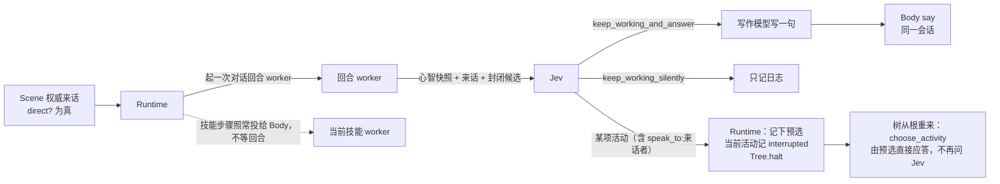

# NPC 对话通道异步化：边聊边干，停下走选择（2026-11-18）

分类：薄片三“步骤边界打断”这一层的结构决策稿（只定结构与边界，不调取值）。状态：**用户已定方案，待实现。**
前提与进度见 [`2026-11-11-npc-coordination.md`](2026-11-11-npc-coordination.md)；总纲见
[`2026-11-12-npc-architecture-overview.md`](2026-11-12-npc-architecture-overview.md)。

## 1. 问题

现状（提交 `729bb6b8`，首例 `gather`）：玩家定向来话时，Runtime 对技能的每一步做准入，等已放行的那一步结算后**暂扣下一步**，
在独立 worker 里问 Jev“继续 / 回复”，回复要先经写作模型（3–30 秒）再由 Scene 接纳，之后才放行原 worker 的下一步。
身体在这期间原地不动。这与总纲的原则相反：“任何一层在等更慢的层时都有‘继续现在这样’可做，慢层从不阻塞快层”。
它还只覆盖 `gather` 一种活动，并为此在 `Skill.call/2`、`Skills.start/6`、`Gather`、Runtime 之间穿了一条 `step_owner` 准入线。

## 2. 用户的决定（2026-11-18，对话原话）

- “关于聊天与当前行为的关系，用人来类比的话，是不是他们两个之间应该是异步的？边聊边干，除非聊的时候决定停下。”
- 对“停不停手由谁定”：统筹会话提出先由 Jev 在封闭候选里定、再把决定作为事实交给写作模型，而不是让写台词的那次调用捎带指令；
  用户答复“哦哦可以，按你的方案来”。

## 3. 结构：两条通道，一个注意力决定

### 3.1 对话通道（Runtime 持有，与技能生命周期正交）

- **触发**：`Dialogue.direct?/2` 为真且来话者是玩家（`speaker_kind: 0`，与现状一致；NPC 之间的直呼后续另定）。
- **一次只有一个回合在途**：回合进行中再来的定向来话不排队、不另起 worker，只记一行 `event=dropped`；它照旧进 `heard`、进 Life 的经历，
  下一次发问的心智快照里看得到。回合结束后不追补。
- **回合 worker 做两步**：① 读心智（`Life.selection_mind`，与活动选择同一条路）、拼快照、附来话原文，问 Jev；② 若选的是“继续并答话”，
  同一 worker 接着调写作（`Speak.reply/4`）写一句，交回 Runtime 发 Body `say`（同一 `conversation_id`）。整个回合受
  `SceneServer.Dialogue.limits().idle_ms` 一个有界窗口约束；超时、写作失败、Scene 拒绝都只记可诊断结果，不重发。
- **与技能的关系**：回合进行期间技能步骤照常直接投给 Body；技能结束或被取消**不**取消回合；只有会话丢失 / Body 退出才取消回合。
- **身份**：`say` 命令 id 为 `{:dialogue, conversation_id, turn}`，不再借用技能调用号；Outcome 回到 Runtime 只记日志，
  NPC 自己的发言经权威回声（`:said`）进 Life，与现状相同。

### 3.2 注意力决定（选择位置，判断者 Jev）

- 候选（封闭、有序）：
  1. `keep_working_and_answer` —— 判据写明当前活动名：“Keep doing <当前活动> and answer <名字> briefly while working.”
  2. `keep_working_silently` —— “Keep doing <当前活动> and do not answer.”
  3. 其后是**本轮正常可行的活动候选**（`Selector.candidates/4` 同一函数：登记项按建筑现状过滤 + `speak_to:` 话题项），
     其中**来话者本人的 `speak_to:<cid>` 必须在列**，且它的目标带本次 `conversation_id`，判据写成
     “Stop what I am doing, go over to <名字> and talk with them.”——选它就是放下手头的事专门去谈，回复仍在同一会话里。
     （来话者未必通过 `Scene.dialogue_topic_targets` 的新话题冷却，因为这不是新话题，所以由回合自己补上这一项。）
- 没有当前活动（树正停在 `choose_activity` 等应答、或发问失败等重问）时，不起回合：来话已在心智里，正常发问会看到它。
- state = 心智快照 + 一行说明 + 来话 JSON，形状沿用现有 `gather_reply_question/4`；`Selector.ask/4` 的 trigger 为 `"addressed"`。
- 取 top1，不设门槛（与活动选择一致）。判据措辞属取值，记后期；本稿只定三类选项的存在与语义。

### 3.3 停下：预选 + halt + 树从根重来

- Jev 选了任一活动项 X 时，Runtime：① 记 `preselected = 该次选择`；② 把正在做的活动记为 `{:interrupted, 原因文字}`
  （`Selector` 的结果新增这一种，`Mind.result/1` 写成 `interrupted (…)`，活动经历照常交给 Life）；③ 对 `Brain.Tree` 后端调
  `Tree.halt/1`（`Brain.Social` 已用的同一入口：在途技能 → `cancel_skill`，移动 → `stop`，世界事务不撤销，draining 期间不起新技能）。
- 树的下一个事件从根开始，根的第一步是 `choose_activity`。Runtime 看到 `preselected` 非空时**不问 Jev**：忽略树报的 `ended`
  （halt 后黑板里是上一轮的旧值），直接以预选应答（`Life.activity_started/1`、`npc_select` 一行 `trigger=addressed`），清空预选。
- 预选的 `speak_to:<来话者>` 由现有 `speak` 技能执行：走近、写一句、`say`；`Speak.run/3` 增加可选 `conversation_id`
  （缺省 0 = 新话题），本例带来话的会话号。
- 非 Tree 后端（`Brain.Llm` 等）不在范围：它们没有 `choose_activity`，来话仍走各自已有路径。

### 3.4 删除

`step_owner`（`Skill.call/2`、`Skills.start/6`、`Gather`）、Runtime 的 `boundary` / `gather_step` / `skill_step` 准入、
`skill_boundary` 观察与 `npc_skill_boundary` 日志、`Selector.gather_reply_question/4`、用量 operation
`gather_reply_selection` / `gather_reply_write`（改为 `dialogue_turn_selection` / `dialogue_reply_write`）。
不保留兼容分支：这条准入线只有本分支内的调用方。

## 4. 可观测面

- `Body.observe/1` 与 `Runtime.observe/1` 新增 `dialogue_turn`：`nil` 或
  `%{phase: :deciding | :speaking, conversation_id:, turn:, speaker_id:, speaker_epoch:, started_ms:}`。
- 日志 `npc_dialogue_turn cid= conversation_id= turn= speaker_id= speaker_epoch= event=<received|decided|said|silent|stopped|failed|dropped>`
  ，`decided` 带 `chosen= confidence= latency_ms= recall_ms=`，`said` 带 Scene 的权威编号，`stopped` 带 `activity=`（被中断的）与 `next=`，
  `failed` 带 `reason=`。模型用量照旧经 `npc_model_request`（operation 见 §3.4）。
- 被中断的活动在 `select.activities` 里 `result: {:interrupted, …}`，与“最近做过的事”一栏同一写法。

## 5. 不做

多条来话排队；按活动种类定“能不能边做边说”（由 Jev 的决定自然体现）；客户端的停手动画；NPC 之间直呼；判据措辞与门槛的调值；
`Brain.Llm` 形态的改造。

## 6. 依据

- 总纲 §“一句话”：慢层从不阻塞快层——本稿把写作模型（最慢）从执行层的关键路径上拿掉。
- Park et al., *Generative Agents: Interactive Simulacra of Human Behavior*（arXiv:2304.03442，§4.3 Reacting and Updating Plans，
  2026-11-18 核对 HTML 版）：是否回应是独立的一问（“Should John react to the observation, and if so, what would be an appropriate reaction?”），
  决定回应后才生成对话（“if the action indicates an interaction between agents, we generate their dialogue”），并且
  “regenerate the agent's existing plan starting from the time when the reaction takes place”。对应本稿：决定与写作分开；停下 = 重新选择。
  论文没有说明对话期间是否暂停其它动作（其对话是替换当前动作的），这是本稿与它的区别，依据是上一条总纲原则。
- BehaviorTree.CPP `ReactiveSequence`（behaviortree.dev，2026-11-18 核对）：条件翻转时正在 RUNNING 的子节点被 halt、序列从头重来。
  本仓 `Brain.Tree` 没有 reactive 节点，等价做法是已有的 `Tree.halt/1` + draining + 下一事件从根开始（`Brain.Social` 的抢占已这样用）。
- Wickens, *Multiple resources and mental workload*, Human Factors 50(3), 2008：语音应答与手动操作占用不同资源通道，并行干扰小。
  **本次只核到引文，未读到原文**（出版方页面拒绝抓取），仅作人类比的佐证，不是结构依据。

## 7. 测试矩阵（最小充分，先红后绿）

| # | 用例 | 改前 | 改后 |
|---|---|---|---|
| T1 | 真实 Scene / World / Body / Gather / Life，玩家在采集中定向来话，受控 Jev 选 `keep_working_and_answer`，受控写作回一句 | 下一步被暂扣直到回复落地 | 回合进行中 Gather 的下一步已投给 Body（World 事务号在回复之前出现）；回复在同一会话、恰好一次；采集照常完成、材料齐 |
| T2 | 同场景，受控 Jev 选 `speak_to:<来话者>` | 不存在该选项 | Gather 以 `cancelled` 终态结束（已提交事务留在 `settled`）；下一个 `choose_activity` 不发 Jev 请求、以预选应答；`speak` 在同一 `conversation_id` 发言；被中断活动的经历（`interrupted`）进 Life |
| T3 | 受控 Jev 选 `keep_working_silently` | — | 无写作请求、无 `say`；日志 `silent`；活动不受影响 |
| T4 | 回合进行中第二条定向来话 | — | 不起第二个 worker，日志 `dropped`，Life 仍收到这句 |
| T5 | 去处型活动（`{:place}` 的 `wait` 中）被来话打断、Jev 选别的活动 | — | 树 halt 后从根重来，预选生效，无 `skill_busy` |
| T6 | 模型用量 operation、`dialogue_turn` 观察、`npc_dialogue_turn` 日志形状 | 旧名 | 新名；`npc_registry_test` / `npc_selector_test` 里的 `skill_boundary` 断言改为新契约 |

命令（WSL）：`cd apps/npc_server && mix test --no-start test/npc_server/npc_registry_test.exs test/npc_server/npc_selector_test.exs test/npc_server/npc_speak_test.exs test/npc_server/npc_tree_test.exs`；
动了 `Selector` 结果形状与 `Skill.call/2` 这两处共享契约，改完跑 npc_server 全套。

## 8. 进度

- 2026-11-18：决策稿写成；用户已在对话里定方案（§2）。实现待派。
- 2026-11-18：实现落地（`apps/npc_server`：Runtime 的对话回合与预选、`Selector.turn_question/6` / `interrupted/2`、
  `Dialogue.reply_candidate/2`、`Speak.run/3` 的 `conversation_id`、`Trees.npc/1` 的 halt 后重来；`step_owner` 全链、
  `skill_boundary` / `npc_skill_boundary`、`gather_reply_*` 已删）。实现中发现并补的边界：树在第一项活动进行中被 halt 时黑板
  `choice` 已有而 `ended` 为 nil，`Trees.ended_args/1` 原本没有这一分支，改为按 `ended` 为 nil 判“还没有活动结束过”；
  预选应答前记被中断活动的经历失败时以 rejected 结束这次选择、预选不保留（树重问时来话已在心智里）。T1 改前红
  `.demo/dev-env/logs/test-20261118T084713Z-red.log`（T1、T2 两例红）。改后：npc_server 全套 623 通过 / 19 排除
（`test-20261118T090011Z-full.log`）；最后一处 Runtime 改动之后决策稿 §7 的四个文件复跑 54 通过 / 1 排除
（`test-20261118T090906Z-dialogue-lane-final.log`，之后无源码改动），`mix format --check-formatted` 通过。统筹会话逐段评审了差异，无阻断项。未删 `interrupt_policy` 形态被直接叫到时
  立即检查一次的旧路径（`npc_skill_brain_test` 与 README“中断策略”仍以它为契约，不属于 §3.4 的删除项）。
- 2026-11-18（第十八个统筹会话）：**T1 的真实双客户端复验通过**（`lane-01`，release `8a34c96f`）：回合未决定时 World 照常记下本居民的
  锤击与整格移除，决定“继续并答话”后同一会话第 2 句双端收件，采集记 `completed`。驱动、反例与证据见统筹页“说话的双端实机复验”一节。
