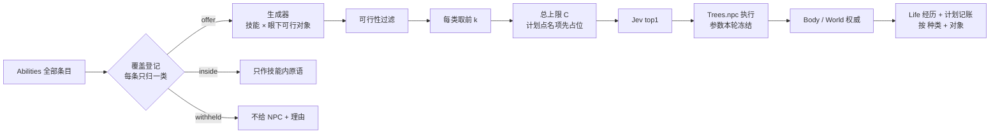

# NPC 功能全覆盖：能力库为唯一来源，Jev 在技能层选择（2026-11-18）

分类：统一形态 NPC 选择层与能力库之间的结构决策稿（只定结构、边界、分批与测试矩阵，不调取值）。状态：**用户已定（§6 全按建议，2026-11-18），实施待排（统筹页）。**
用户方向见 [`2026-11-11-npc-coordination.md`](2026-11-11-npc-coordination.md)“用户方向：NPC 要尽可能用上系统设计的全部功能”；
总纲 [`2026-11-12-npc-architecture-overview.md`](2026-11-12-npc-architecture-overview.md)。学技能另见
[`2026-11-18-npc-skill-learning-decision.md`](2026-11-18-npc-skill-learning-decision.md)（稿 B，引用本稿）。

## 1. 目标

用户原话：“选项可以都做成技能，我想的是npc尽可能把我们设计的功能都用上，不然不就是半残废么，和我们的初衷相背离了”。

- `NpcServer.Abilities` 里每一项能力，在统一形态（`"npc"`）里**要么有一个经选择层可选中的技能入口，要么显式登记为“不给 NPC”并写理由**，
  中间状态“只在某个技能内部当原语”也必须登记。由覆盖测试保证：新增能力不登记即红。
- 候选从“手写坐标与盒的静态登记”改为“技能 × 眼下可行对象”的生成；Jev 仍只在技能层选一项。

不做：取值调整；Jev 逐原语组合；独立的跨活动目标规划器；`Brain.Llm` 收编（仍按 2026-11-16 定的后期）；新的世界系统或协议。

## 2. 现状事实（各附证据）

### 2.1 覆盖表：能力库有什么，统一形态能选到什么

能力库（`abilities.ex:86-101`）合并 47 个条目；它与玩家意图的对等关系已由能力库设计稿 §6 逐项核过（含“不进 Abilities 的能力”表）。
统一形态能被选中的候选只来自三处：登记的 `activities`（`registry.ex:600-643`，技能限 `@activity_skills` 四种，`registry.ex:68-73`；
找人选择器只有 `distrusted`，`registry.ex:75`），建筑条件过滤（`selector.ex:250-262`），与唯一的动态候选 `speak_to:`（`selector.ex:264-286`、`dialogue.ex:14-30`）。

| 系统 | 能力条目 | 统一形态现在怎样用到 | 源码 |
|---|---|---|---|
| 移动 | `move_to`、`stop` | 只在 `travel` 技能内（候选：去处 / 找人）；`stop` 只由 `halt/1` 发 | `actions.ex:45-69`、`skills/travel.ex`、`brain/tree.ex:111-127` |
| 感知 | `look`、`survey`、`inspect`、`query_balances`、`read_catalog` | 只在 gather / expand / travel 内；`inspect` 无调用方 | `perception.ex:37-120` |
| 工具 | `probe_toward`、`use_tool` | 只经 gather“挖天然格”；**点火 / 灭火 / 加热 / 冷却 / 电路开关**（同一 `use_tool` 换工具）用不上 | `actions.ex:71-92` |
| 拆解 | `dismantle` | 用不上 | `actions.ex:93-102` |
| 建造 | `place`；`prefab`（place / remove / replace）；`attach`、`detach` | `place` 只在 expand 平整地表时；prefab 放置只经 build / expand（定义、锚点、区域手写）；其余用不上 | `actions.ex:103-212`、`skills/expand.ex` |
| 液体 | `scoop`、`pour` | 用不上 | `actions.ex:113-129` |
| 背包 | `craft`、`eat` | 用不上 | `actions.ex:130-148` |
| 施法 | `cast_spell`、`cancel_cast` | 用不上：`"npc"` 登记不读 `spells`（只有 llm / life 行读，`registry.ex:252`） | `actions.ex:221-253` |
| 创世 | `fill_box`、`set_cells` | 用不上：授予只来自 llm / life 行的 `genesis: true`（`registry.ex:45-46`） | `genesis.ex:26-59` |
| 关注 | 13 项（`get_view` … `toggle_mark`） | 只有 `get_target_status` 在 travel 里用；其余用不上 | `attention.ex:169-199` |
| 说话 | `say` | `speak` 技能：`speak_to:` 动态候选与对话回合 | `dialogue.ex:57-87`、`skills/speak.ex` |
| 记忆工具 | `remember`、`recall`、`search_memory`、`set_plan` | 用不上；统一形态的记忆归 Life + Hindsight，计划归 `Life.DayPlan` | `memory.ex:14-55` |
| 长技能 | build、gather、expand、travel；design_house；wilderness | 前四个可登记成候选（参数手写）；design_house 要 LLM、不可登记（`registry.ex:67`）；wilderness 要调度器端点、只能代码起（`registry.ex:57-58`） | `skills.ex:9-17` |

结论：47 个条目里，经选择层能被选中的入口只有 5 种（build / gather / expand / travel 与 `speak_to:`），除 `speak_to:` 外参数全是手写坐标与盒。

### 2.2 统筹会话判断的三处结构缺口（核实结果）

1. **动态候选与参数——成立，但缝已经有了。** `Selector.candidates/4` 已经是“登记项过滤 ++ 生成项”，`speak_to:` 已示范
   “操作 × 眼下可行对象、目标与代次冻结到本轮、Scene 最后裁决”。缺的是把这条缝泛化到其它能力，不是新机制。
2. **跨活动的多步目标——修正：大半不跨活动。** “缺料 → 采 → 回站位 → 建”在 Settler 里是一棵树里的一项活动（`trees.ex:48-112`），
   多步本来就该放进技能。真正跨活动的只剩日计划意图，而它的词表是 `profile.activities` 的候选名**逐字**（`life/day_plan.ex:10-11`）：
   动态候选名（`speak_to:<cid>`）逐轮变，计划写不出、记账也对不上——S1-R8 里 `cannot_yet` 多半是“想说话而写不出”（运行时 README“日计划·当前状态”）。
   缺口是**计划词表与动态候选对不上**，不是缺一个目标层。
3. **候选变多后的选择——成立。** 候选按 `名字 → 判据` 的有序对象全部进请求（`selector.ex:335-340`）；现在单次约 1.1k 入 token、选择中位 3.7 s
   （`slice4-04c`）。47 个条目 × 附近对象全列会到上百项；每项约 20–30 token（按现有判据句长估算，未测）。
4. **补一条登记层缺口**：`"npc"` 登记不读 `spells`、不能授予创世，工具带是唯一授予——属于登记，不是结构，随分批处理。

## 3. 依据（2026-11-18 核对原文）

- **SayCan**，Ahn et al.，arXiv:2204.01691 v2（ar5iv HTML）。§3：“the affordance function and the LLM probability are then multiplied together”，
  “the most probable skill is selected”；只靠提示 “is not enough to fully constrain the output to admissible primitive skills”；§8：瓶颈是
  “the range and capabilities of the underlying skills”。**对应**：判断者在技能描述里选，可行性由另一部分给。**取舍**：不用学出来的价值函数，
  可行性由代码过滤（总纲“能算的归代码”）；“技能面不全就是瓶颈”正是本稿要补的。
- **Voyager**，Wang et al.，arXiv:2305.16291 v2（ar5iv HTML）。§1：“Complex skills can be synthesized by composing simpler programs”；§2.2：技能按描述嵌入索引，
  每次检索 “the top-5 relevant skills”。**对应**：原语组合写在技能里，判断者只挑技能；候选多时只给相关的少数几项。**取舍**：先用代码可算的相关性，
  不上嵌入检索（现在没有这个规模的证据）；技能本变大后在稿 B 里再议。
- **Unreal Engine Smart Objects**（官方文档 UE 5.9）：“Smart Objects are objects placed in a level that AI Agents and Players can interact with”，
  可 “queried at runtime by using filters such as search area around the Agent”，行为定义跟着对象走。**对应**：候选 = 对象宣告的活动 × 运行时就近查询；
  `speak_to:` 已按此做（统筹页“主动开口的决策”）。
- **Unreal Engine EQS**（官方文档 UE 5.9，Environment Query System Overview）：Generator “produces the locations or Actors, referred to as Items, that will be tested and weighted”，
  “filter Tests are done before scoring Tests”。**对应**：生成器 → 过滤 → 排序截断，全部在 Jev 之前由代码做。
- **Anthropic Tool search tool**（platform.claude.com 文档）：“Claude’s ability to pick the right tool degrades once you exceed 30–50 available tools”。
  **适用条件**：Claude、工具定义；本项目是 DeepSeek 在候选里选一项，数字不能直接套，只说明“几十项”是必须实测的量级，上限由 §5 X-1 定。
- **Generative Agents** §4.3（arXiv:2304.03442）：计划 “stored in the memory stream”，自顶向下分解，反应后 “regenerate the agent’s existing plan”。
  **对应**：跨活动目标继续由日计划持有（已实现），本稿只改它的词表。

## 4. 决策项

- **A-1 覆盖登记与覆盖测试**。每个 Abilities 条目在统一形态里归且只归一类：`offer`（有生成器，成为候选）、`inside`（只作技能内部原语，写明是哪个技能）、
  `withheld`（不给，写理由）。owner 是候选生成模块（建议新模块 `NpcServer.Offers`，`Selector.candidates/4` 调它）；**不放进 Abilities**——
  Abilities 对 LLM、手写树、统一形态是后端中立的定义，“统一形态怎么用它”是另一个变化轴。覆盖测试：登记的键 = 以“全授予 profile”（工具带、法术带、创世、
  全部技能）算出的 `Abilities.entries/1` 名字集合，多一个少一个都红；`offer` 必有生成器，`withheld` 理由非空。做法与能力库设计稿 §6“不进 Abilities 的能力”相同，上移一层。
- **A-2 候选 = 技能 × 眼下可行对象**。每个 `offer` 一个纯函数生成器：输入本轮观察、Life 规范心智里已有的栏（如自己的建筑）与目录（`read_catalog` 已有），
  输出 `%{name, kind, criterion, args, place_name}`；名字 `种类:对象`（沿用 `speak_to:` 的避让规则），参数在本轮冻结、执行时原样用，World 仍裁决。
  需要额外 World 只读查询的种类每轮至多一次，并进发问 worker 已有的并行读取。（批 1 实际做法：召回之后顺序读一次 `World.production_options/2`，见 §7“批 1 开工”“批 1 评审修正”。）静态登记只保留作者写的地理（place / person 与地名），它们不是系统能力。
  `speak_to:` 迁成第一个生成器，行为不变。（后续：对人的登记项（person）也改由生成器 `Offers.people/2` 按人展开、可点名，种类 = 登记名、对象 = 人，
  见任务层稿 [`2026-11-19-npc-long-task-loop-decision.md`](2026-11-19-npc-long-task-loop-decision.md) §7 ①。）
- **A-3 Jev 只在技能层选**，不逐原语组合。量级：一次 gather 在技能里是几十步原子动作（look / probe_toward / use_tool / query_balances），逐步问 Jev 按中位 3.7 s
  算是分钟级纯等待、几十倍 token；一次技能选择是 3.7 s / 约 1.1k。组合写在技能里——手写，或按稿 B 由 NPC 自己写成树。
- **A-4 候选规模**：① 可行性过滤（没料不列 craft、没可食余额不列 eat、工具带没有对应动作不列……）；② 每类按代码可算的相关性取前 k（距离、是否被今日意图点名、
  同一对象最近是否失败过）；③ 总上限 C，今日 open 意图点名的项与对话回合的固定项先占位。不做两段式 Jev（先选种类再选对象，一次选择变两次请求，中位约翻倍）；
  不做嵌入检索。k、C 由 X-1 定；起点 k = 3、C = 20 是**原创取值**（检索范围：上列 SayCan、Voyager、EQS、Tool search 文档，均无适用于“DeepSeek 单选封闭候选”的数）。
- **A-5 跨活动目标：不建目标层，改计划词表**。多步放进技能（Settler 先例，稿 B 让 NPC 自己写）；日计划意图的 `activity` 从“候选名逐字”改为
  “种类 + 可选对象名”（对象用名字层：`名字 (actor <cid>)`、地名、建筑叫法），记账按种类 + 对象匹配。静态登记项的种类就是它的候选名，现有计划行语义不变。
- **A-6 分批与范围上限**（每批 ≤ 3 个新生成器；选择请求不加模型调用、不加 Jev 往返；每批一条真实客户端短场景）：

| 批 | 内容 | 为什么这样排 |
|---|---|---|
| 0 | 覆盖登记 + 覆盖测试；`speak_to:` 迁入生成器；计划词表改为种类 + 对象 | 无行为变化，先把唯一来源与缝立起来 |
| 1 | `eat`、`craft`（单个世界动作，候选的 `run` 加一种 `{:act, 名, 参数}`；批 1 实际改为独立的 `action:` 键，见 §7） | 没有空间参数，最小地验证生成器、冻结参数与计划记账 |
| 2 | `gather`（盒由附近 survey / look 算出，替代手写盒）、`use_tool` 的点火 / 加热 / 冷却 / 电路开关（对象来自 inspect）、`dismantle`（只列自己放的） | 用上材料与局部场系统 |
| 3 | `build` / `expand`（定义取自目录或自己发布的）、`attach` / `detach`、`scoop` / `pour`、prefab replace | 空间参数最多，放在缝稳定之后 |
| 4（后期） | 施法（`"npc"` 读 `spells`）；`design_house` 作为“一项由 LLM 执行的活动” | 要新授予或写作预算，与 `Brain.Llm` 收编同一议题 |

“不给 NPC”初稿：创世两项（特权，只给创世登记）；关注 12 项（本地目标组，统一形态没有战斗调用方；`get_target_status` 归 `inside`）；
记忆工具 4 项（统一形态的记忆与计划已有 owner，再给会出第二真值）；wilderness（作者施工器）。其余感知与移动原语、`cancel_cast` 归 `inside`。

## 5. 测试矩阵（按 `../Voxim/Docs/Testing.md`）

| # | 层 | 证明什么 | 做法 |
|---|---|---|---|
| X-1 | 离线实验（不是验收） | 候选 10 / 20 / 40 项时 Jev 的入 token、延迟与选择是否稳定，定 k、C | 取实跑导出的真实 state（`slice4-04c` 的 `select.asked`）+ 产品生成器从同一观察生成的候选，不手写候选；真实 DeepSeek，请求数事先定上限 |
| T-A1 | 算法 | 覆盖登记完整 | 键集合 = 全授予 profile 的条目名；改前红：临时加一个未登记条目 |
| T-A2 | 算法 | 每个生成器的可行 / 不可行、截断次序、名字避让、参数冻结 | 小观察手算期望 |
| T-A3 | 算法 | 计划按种类 + 对象检查与记账；静态候选名照旧 | `DayPlan.check/3`、`record_activity/4` 小例 |
| T-A4 | 集成 | 生成 → 选择 → 冻结参数执行 → World 提交 → 经历与计划记账 | 真实 Registry / Body / Scene / World / 独占 PostgreSQL；只替 Jev 与写作（回环替身）；每批每种类一条，另含一条权威拒绝（可行性过时 → World 拒绝 → 活动失败 → 下一次发问带原因） |
| T-A5 | 真实客户端短场景（每批一条） | 玩家经真实操作造出前提后，NPC 的候选里出现该种类，被选中时权威结果双端可见 | 双客户端同会话、真实模型、≤ 10 分钟；按驱动力判定（总纲 2026-11-13），不要求“必须选它”；UDP 基线与 Tcpip 4266 照扩人数稿 §5 |

## 6. 要用户定的

**已定**（用户 2026-11-18 答复，经第十九个统筹会话转达，原话：“额度可以增加上限，其他都按你建议来。”）：Q-1–Q-5 全按下列建议。

1. **Q-1 覆盖登记的三分类**与 §4 末段的“不给 NPC”初稿（建议：照此）。
2. **Q-2 分批顺序**（建议：批 0 → 1 → 2 → 3，批 4 后期；稿 B 在批 0 之后即可并行）。
3. **Q-3 候选上限**先做 X-1 再定（建议：是；起点 k = 3、C = 20）。
4. **Q-4 跨活动目标**不建目标层、计划词表改为种类 + 对象（建议：是）。
5. **Q-5 `"npc"` 登记读 `spells`** 放批 4（建议：是）。

## 7. 进度

- 2026-11-18：初稿（第十九个统筹会话派写）；只读代码与原文，未改代码、未实跑。等 §6 答复。
- 2026-11-18：用户答复 §6 全按建议（用户 2026-11-18 答复，经第十九个统筹会话转达，原话：“额度可以增加上限，其他都按你建议来。”）。实施排在扩人数 M-3 之后从批 0 开始（第二十个统筹会话按依赖与资源排定，见统筹页）；仍按先测后改 → 独立评审 → 提交。
- 2026-11-19：批 0a 实现（无行为变化）。新模块 `NpcServer.Offers`：覆盖登记 `coverage/0`（48 个条目：offer 5 = build / gather / expand / travel →
  `registered/2`、speak → `speak_to/2`；inside 12；withheld 31，理由逐条写明），生成器 `registered/2`（建筑过滤自 `Selector` 迁入）、`speak_to/2`、
  `reply/2`（自 `Dialogue.topic_candidates/2`、`reply_candidate/2` 迁入，Dialogue 删去这两个）与 `candidates/4`（Scene 新话题资格求交一并迁入）；
  候选加 `kind` / `object`，请求体仍只序列化 `名字 → 判据`；`Selector.experience/2` 带出 kind / object；`Skills.builtin_names/0`。
  与 §4 初稿不同处（统筹裁定）：`cancel_cast` 归 withheld（随 cast_spell 批 4），`choose_activity`（48 个条目里多出的那个）归 withheld；
  `inspect` 归 withheld（批 2 开放），不按初稿“其余感知原语归 `inside`”——统一形态里没有任何技能调用它，归 inside 等于登记一个不存在的用法。
  `stop` 归 inside [travel, gather]，但源码里它由 `Brain.Tree.halt/1` 放弃移动叶子时发出，不是技能自己调用。
  验证：`npc_offers_test.exs`（T-A1、T-A2）改前 11 红、改后绿；`npc_selector_test.exs` 全文件 23 绿；`npc_registry_test.exs` 三条真实对话用例与
  `npc_dialogue_test` / `npc_speak_test` 共 12 绿（候选搬家触及 Runtime 的说话链路，所以扩大到这几条）。
- 2026-11-19：批 0b 实现（计划词表改为种类 + 对象；规划提示词有意多出说话一类）。`Offers.plan_kinds/1`（登记项各一个静态种类，配了 speak 加
  `speak_to`，对象是人）；Life 起规划槽时把对象展开成 `%{显示名 => %{"actor" => cid}}`（关系里的人 ∪ 观察里的他人，名字层写法），快照
  `activities` 改 `vocabulary`；`DayPlan.check/3` 词表改 `%{种类 => %{显示名 => 对象}}`，意图多可缺 / 可 null 的 `object`，新失败
  `{:unknown_object, 种类, 值}`；`record_activity/4` 按 `{种类, 对象}` 记账（意图没点名或点名相同），旧行没有 `object` 读作 nil、不迁移；
  `column/3` 带出 object；Round 把有对象的种类渲染成判据后接 `Optionally add "object": exactly one of "<显示名>", ….`（原创措辞，未离线测），
  `@system_template` 与 S1-R8 金标不变；`Mind.plan_intent_line/2`（点名时写 `<种类> <名字 (actor cid)>`）；`Registry.brain("npc")` 遇登记名等于
  生成种类时拒绝。未调真实模型。验证：0b 改动的五个测试文件改前 68 红（含 `npc_registry_test` 撞名 1 条），改后
  `npc_life_day_plan_test` / `_round_test` / `_integration_test`（新增“配了说话”一条，真实 Life + World + PostgreSQL）/ `npc_mind_test` 125 绿、
  撞名 1 绿；因 Life 的活动经历契约改为读 kind / object，另跑 `npc_selector_test`、`npc_registry_test`、`npc_life_test`、
  `npc_dialogue_life_test`、`npc_offers_test` 共 95 绿。剩：说话种类的规划应答没有真实样本，提示词这一句的效果要离线重放或实跑再看。
- 2026-11-19：批 0 评审修正（统筹定修 5 条）。① `DayPlan.record_activity/4` **点名优先**：先在点名的就是这个对象的意图里按 `by` 最早取，
  没有再在没点名的里取（原来混在一起按 `by` 取，没点名的时限更早时点名那条白白落空）；兜底子句只收 `{种类, 对象}` 形状，别的形状
  `FunctionClauseError`。② 候选只从覆盖登记生成：新 `Offers.generators/1`（offer 一类的生成器，去重、按名字排序，现在
  `[:registered, :speak_to]`），`candidates/4` 按它逐个生成；把条目改成 withheld 则它的生成器（没有别的 offer 共用时）消失——
  `registered/2` 仍由四个登记技能共用，只改其中一个不会消失（过渡形态，批 1 起各种类换自己的生成器）。③ 历史工具
  `tools/jev/s1r9_columns.exs` 跟上新签名（静态种类，对象为空）。④ 文档：上面 0a 条补 `inspect`；日计划实现设计 §2 的记账改为种类 + 对象、点名优先。
  ⑤ `cid → 名字` 只留 `Life.State.names/1`，Life 与 Mind 调它。规划时可点名人数的上限不改（留给 X-1）。
  验证：改前 `npc_life_day_plan_test` 2 红（点名优先反例、形状反例）、`npc_offers_test` 4 红（`generators/1`）、s1r9 工具编译 2 条诊断；
  改后九个文件（offers / day_plan / _round / _integration / mind / selector / registry / life / dialogue_life）226 绿、2 条按标签排除，
  s1r9 工具去掉末行 `run()` 后编译 0 诊断（未真跑），`mix compile --warnings-as-errors` 与改动文件的 `mix format --check-formatted` 通过。
- 2026-11-19（第二十一个统筹会话）：批 0 已合入本分支（0a `4aae7a35`、0b `2a908ce1`、评审修正 `8bc5752c`）。**批 1 开工前要改**：`Offers.generators/1` 现按生成器名排序，新增生成器（如 `:eat`）会排到 `:registered` 之前、改变候选次序；改为在覆盖登记里显式声明生成器次序并以测试锁定。规划时可点名对象不设上限、0b 新增的提示词句子未离线测，留给 X-1 与离线重放。
- 2026-11-19（第二十二个统筹会话，S1-R8b 离线重放，探索性、不是验收）：0b 规划提示词经产品 `Round.write/1` / `Prompt.user_message/1` 渲染（与 S1-R8 逐字节相同、只多 `speak_to` 一行），
  S1-R8 的 6 份真实材料（Garen；可点名的人按产品展开 = 关系 ∪ 观察里的他人，只有 Corvin）× 3 次 = 18 次，生产写作位置（DeepSeek `deepseek-flash`，S1-R8 当时是 Sonnet，模型与句子两项变化混在一起），
  用产品 `DayPlan.check/3` 判。结果：18/18 合法（S1-R8 17/18），52 条意图种类全合规、无自造种类名、静态种类无人写 `object`；**`speak_to` 0 条**——
  15/18 份思考考虑过又放弃（R2–R7 把 “Walk up to someone” 读成“此刻旁边要有人”，Corvin 不在场就不写；R1 Corvin 在场但选了更贴切的静态种类），
  8 条“问 Corvin / 当面说”全留在 `cannot_yet`，理由都是“人不在”而非“词表写不出”。所以“对象写得对不对”仍未回答。另：答案格式行没有 `object` 键（模型一开始写说话就可能漏写）。
  用量 95,313 token（非高峰约 $0.025），UDP 97 → 96。待定（与批 1 一起报用户）：(a) 对象句明说可以给不在场的人做计划，或 (b) 把 `cannot_yet` 改成“现在做不到”；两者都要再离线测，改模板时 S1-R8 金标测试跟着重定。
  证据 `.demo/observe/npc-slice1-20261112/s1r8b-0b/`（`plan.md` 发问前写、`results.md`、`raw/`）；脚本 `tools/jev/s1r8b_0b.exs`（渲染与判定只调产品函数；对象展开与正文提取照搬 Life / Writer 的私有函数）、`tools/jev/s1r8b_0b_replay.py`。
- 2026-11-19（第二十二个统筹会话）：**A-5 的“不建目标层”被推翻**（用户 2026-11-19 在对话里认可，原话：“全部同意”）：多步固定套路仍放进技能，
  但依赖执行反馈的长程任务要一层由 Life 持有的“任务”，LLM 在步骤有结果时推进下一步（种类 + 对象），任务步作为 Jev 的候选。五条概念见统筹页“第二十二个统筹会话的进展”，
  正文待任务层决策稿。上一条 S1-R8b 的 (a) / (b) 二选一不再单独定，并入任务层稿件。批 1（eat / craft）不受影响。
- 2026-11-19（第二十二个统筹会话）：**批 1 开工**。T-A5 三项前提用户定为都可以（用户 2026-11-19 在对话里答复，原话：“都可以，开工”）：NPC 余额可由作者入口 `material_supply` 一次供给并记账；
  Test-only 部署可放宽 `VOXIM_PRODUCTION_MATERIALS`（加可食植物与配方产物）；eat / craft 的结果只在 NPC 背包，“双端可见”本批只由服务端日志 / CLI 判定。
  统筹会话按只读规划（`.demo/observe/npc-slice1-20261112/batch1-plan-20261119.md`）定：T-A4 另替 Hindsight 适配器（只替外部依赖）；生成器每轮顺序读 World 两次（余额、目录），不并进发问 worker 的并行读取；
  C 推迟到 X-1，k 只套 eat / craft、不套 `speak_to`；选中候选 `:topic` 改名 `:candidate`（observe 字段名随之变）；eat / craft 进所有带候选表 NPC 的计划词表（计划是打算，眼下不可行也可写）。
  原创取值 / 措辞（实施后实跑再调，已报用户）：每类 k = 3；每类按材料号升序（批 1 无相关性信号）；生成器次序 `[:registered, :speak_to, :eat, :craft]`；判据英文措辞；计划里 eat / craft 不可点名对象。
  已知不覆盖：选择快照没有饥饿信号，eat 被选中与否缺驱动力依据（后续议题）。
- 2026-11-19：**批 1 实现**（eat / craft；实施子会话，未提交、待统筹独立评审；未跑 T-A5、未调真实模型）。
  改了什么：① 前置：`Offers` 的 `@generators [:registered, :speak_to, :eat, :craft]` 显式次序，`generators/1` 按它过滤，登记里有、次序表没有即
  raise。② 覆盖登记 `"eat" => {:offer, :eat}`、`"craft" => {:offer, :craft}`；生成器 `Offers.eat/2` / `craft/2`（registered, inventory）：可行性
  eat = 材料行有 `edible` 且 `balance >= cost`，craft = 配方各输入够（没有余额行按 0）；按材料号升序给完整列表；候选
  `%{name: "eat:<id>", kind: "eat", object: %{"material" => id}, criterion:, place_name: nil, run: {:act, "eat", %{"material" => id}}}`，名字 `vacant_name` 避让；
  判据 `Eat one serving of <label> from my inventory.` / `Craft <label> from materials in my inventory.`（label = `名字 (material id)` 或 `material id`）。
  ③ `candidates/4` 每轮至多路由一次（说话与库存共用，第一个要用的去路由）、库存至多读一次（余额、目录顺序读，进食与合成共用），
  `@per_kind 3` 只截 eat / craft；库存路由失败 `{:inventory_unavailable, 原因}`，Selector 原样透传（不并进 `mind_unavailable`），World 调用退出不捕获。
  ④ DRY：生产材料门槛拆成纯函数 `Perception.materials/2`，`read/3` 的 `{:catalog, :materials, nil}` 与 Offers 共用。⑤ `Offers.acts/0` → `["eat", "craft"]`，
  `Trees.npc/1` 按它建分支（守卫读选择应答 data 里的 `run`）；Runtime `finish_select` 把生成候选冻结的参数放进 done 的 data（说话 `speech`、背包 `run`）。
  ⑥ 选中候选整份冻结：`Selector.ask` 一律带 `candidate`（原 `:topic`，只有说话项才有），`chose` 记进选择条目（observe 的 `select.activities[].topic`
  → `.candidate`），`experience` 直接读 candidate、去掉回查登记表。⑦ `plan_kinds/1` 按生成器次序派生，eat / craft `objects: :none`，判据
  `Eat one serving of something edible from my inventory.` / `Craft something from materials in my inventory.`（原创措辞）。Registry 撞名检查自然覆盖 eat / craft。
  与规划 / 稿件的偏差：(a) `Selector.experience/2` 改为 `experience/1`（不再读 profile；调用方 Runtime 两处与三个测试辅助函数跟着改）；
  (b) `Selector.ask/4` 不再在 `question` 没有 `candidates` 时退回 `profile.activities`（只有测试走过那条退路，退回去的登记项没有 kind / object）；
  (c) `plan_kinds(%{activities: []})` 现为 `[eat, craft]`（规划已预告会变），`npc_life_day_plan_integration_test` 里“不规划的形态”改为 profile 没有 `activities` 键
  （登记边界不接受空候选表，空表不是产品能产生的形态）；(d) eat 生成器对可食材料的余额行用 `Map.fetch!`（可食 ⇒ 生产材料 ⇒ World 一定给余额行，
  不加防御），T-A2 原计划的“没有任何余额行”用例改为“余额都是 0”；(e) T-A4 用 `Registry.brain/2` 解析 profile 再起 `NpcWorld.body/3`，不经 `Registry.put/2`
  （Hindsight 适配器模块经 put 的 JSON 参数注入不了；同 `npc_selector_test` 的做法），且 `profile.life` 去掉生产注入的 `spend`——额度进程不在时
  `SpendBudget.background/0` 回 paused，日计划被闸门挡住；Life 约定不给即放行，闸门由 `npc_spend_life_test` 证明。这是三处替身之外的第四处调整，请评审确认。
  (f) 权威拒绝里“吃掉余额”由测试进程在收到 Jev 请求后、作答前做（经 `World.production_intent/3` action 5，以该 NPC 的 cid 提交），不在 Jev 替身函数里。
  (g) T-A4 进食用例的计划时限写 `23:59`，游戏钟取墙钟，开始前若已过游戏 23:30 先等到下一游戏日（至多约 75 秒），避免跨日不记账。
  (h) S1-R8 规划金标：每个带候选表的形态的系统提示词在工作列表末尾多出 eat / craft 两行，`npc_life_day_plan_integration_test` 的期望改为“金标 + 生成种类行”
  （`plan_system/1`），模板与 `npc_life_day_plan_prompt_test` / `_round_test` 的金标不变。
  测试（先写、改前红、改后绿；`cd apps/npc_server && mix test --no-start <文件>`，WSL、本机 PostgreSQL 每 VM 独占库、跑完删除）：
  `npc_offers_test`（T-A1 / T-A2）改前 14 红 / 24、改后 24 绿；`npc_selector_test`（T-A2：ask 冻结候选、eat 经历、纯树 eat / craft 分支与拒绝）改前 8 红 / 26、
  改后 26 绿（1 条 `live_jev` 按标签排除）；`npc_life_day_plan_test`（T-A3：plan_kinds 次序、`{:unknown_object, "eat", "x"}`、eat 记账）改前 3 红 / 72、改后 72 绿；
  `npc_offers_integration_test`（T-A4，新文件：eat 4 种只列前 3 + 进食账 + 经历 + 计划记账 + observe 的 candidate；craft 合成账 + 下一轮消失；权威拒绝）
  改前 3 红 / 3、改后 3 绿；`npc_registry_test` 撞名用例加 eat / craft 改前 1 红、改后全文件 23 绿。适配改动的回归文件在旧代码上：
  `npc_life_day_plan_integration_test` 21 红 / 22、`npc_spend_life_test` 1 红 / 1（都因 `experience/1` 未定义，金标差异被它盖住），改后 22 绿、1 绿。
  扩大回归（每轮多读 World、改名触及说话链路与计划词表）：`npc_life_day_plan_round_test` 10、`_prompt_test` 13、`npc_mind_test` 24（1 排除）、`npc_dialogue_test` 8、
  `npc_speak_test` 1、`npc_dialogue_life_test` 11、`npc_life_test` 27、`npc_tree_test` 10、`npc_body_world_test:2238`（read_catalog，验 `Perception.materials/2` 拆分）1，全绿。
  `mix compile --warnings-as-errors` 与改动文件的 `mix format --check-formatted` 通过。
  遗留：T-A5（Test-only 部署放宽生产材料、作者供给）未做；X-1 定 k / C；选择快照无饥饿信号；规划提示词新增两行未离线测。
- 2026-11-19：**批 1 评审修正**（实施子会话，按统筹会话定的修法 8 条；未提交、待统筹复审；未调真实模型、未起 release）。
  ① 【阻塞】`Selector.ask` 去掉退回 `profile.activities` 后仍走那条路的测试：`npc_jev_test:254/262`、`npc_selection_lane_test:89`
  （默认运行，批 1 代码上各 1 红，`KeyError :candidates`）、`npc_mind_test:978`、`npc_selector_test:1889`（`:live_jev`，编译期
  “incompatible types given to `Selector.ask/3`”类型警告）→ 都补上产品生成器 `Offers.registered/2` 给出的 `candidates`。顺带删掉
  `Selector.chose/4` 在 `asked` 为 nil 时退回 `profile.activities` 的退路：生产唯一调用方是 Runtime 的 `finish_select`，发问 worker
  （常规与对话回合两条）都在应答前先报 `{:select_asked, _}`，`asked` 一定在；改为 `chose/3`（`state` 必带 `asked`，日志的候选与
  `inventory_ms` 取自它），不再用 `profile`。`Selector.body/2` 文档写明它只是登记表拼出的请求体、不是发问时的请求体。
  测试编译警告清零（`npc_offers_test` 原 :401 的未用默认参数随库存夹具重写消失），核对方式见下。
  ② 【SSOT】进食 / 合成门槛只由 World 定义一次：`VoxelRegion.World.Production.consumable/3`、`craftable/3` 抽成纯函数，`consume/3`、
  `craft/3` 提交与新只读查询 `Production.feasible/2` 共用；公共接口 `World.production_options(server, cid, timeout \\ 5_000)` →
  `%{seq:, eat: [%{material:, name:, units:}], craft: [%{material:, name:, inputs: [%{material:, units:}], units:}]}`（生产材料按材料号
  升序过两道门；`name` = 目录 `display_name` 或 nil；内存只读、不装页，`Access` 登记为 `:read`、`Closure` 登记为无页）。
  `Offers` 每轮调这一个接口（取代余额 + 目录两读与 NPC 侧镜像过滤），`eat/2` / `craft/2` 只把 World 列出的投影成候选（次序仍按材料号，
  是 NPC 的策略）；`Perception.materials/2` 收回（`perception.ex` 回到批 1 前，`read_catalog` 行为不变）。读取有界、显式失败：
  `Offers` 给 5000 ms 时限——依据是 World 其它内存只读目录入口（`material_catalog/1` 等）经 `PageLoad.call/3` 的缺省时限，即 OTP
  `GenServer.call/3` 的缺省 5000 ms；作为 NPC 选择的时延预算是**原创取值**（没有实测，实跑看 `inventory_ms` 再定），它短于同一次
  发问里 Life 召回的 10 秒上限。路由失败、World 不在（`:noproc`）、超时（`:timeout`）、调用中途退出 → `{:inventory_unavailable, 原因}`，
  发问 worker 不再跟着退出；`npc_select` 行末加 `inventory_ms=`，`asked` 带 `inventory_ms`。两处偏差以 World 为准：(a) 配方输入不是
  生产材料时 World 按真实余额判（NPC 原来只看生产材料的余额行、当 0）——反例由产品路径做出：铜作为生产材料时经作者入口供给，部署收窄
  生产材料后重启、余额随日志恢复，World 列出开关、提交也接受；(b) 配方输入重复时 World 逐条比较（NPC 原来 `Map.new` 合并）——但
  `Damage.load/1` 拒绝重复输入（`damage.ex:250`），产品做不出这样的目录，不拿手写数据下结论，只锁“加载即拒绝”这一前提。
  ③ T-A4 用真实目录数据（核实 Voxim `Published/e6db8dee…json`，2026-11-10 最新一份：有 `food` 的只有 Fern 34 / Dandelion 36 /
  Allium 39）：进食用例只用这三种，**当前目录下进食一类的前 3 截断不可达**（写进 Offers 文档与用例 moduledoc）；截断改在合成用例里用
  真实配方证明：Switch 41、灰褐砌石 46（石）、石质饰面 47 与太湖石 56（石灰石）四个都够时只列 41 / 46 / 47，合成 46 后石不够、
  56 补进前 3，再合成 41 后只剩 47 / 56。原 20 号浆果行、47 号去名行删去（浆果不在真实目录）。
  ④ `{:inventory_unavailable, _}` 经 `Selector.question/4` 透传：新用例（同一 NPC 的真实 Body 先问过一次，证明 Life 心智可读；再直接调
  `question/4`，路由换成只返回失败的模块）→ `{:error, {:inventory_unavailable, :scene_unavailable}}`。行为在批 1 已有，所以改前改后都绿；
  临时删掉 `question_with_candidates` 的透传分支即红（变成 `{:mind_unavailable, {:inventory_unavailable, …}}`），已还原。
  ⑤ 文档：README 的 `select` 字段表补 `candidate`（及 `asked` 的 `candidates` / `inventory_ms`）、日志行补 `inventory_ms=`；`life.ex` 起
  规划的注释（计划种类含 eat / craft，profile 带 `activities` 键即规划、空候选表也有这两类）与 `planning?/1` 注释；`npc_offers_test`
  moduledoc 不再声称锁定日志，改由合成用例真的断言两行 `npc_select … candidates=… inventory_ms=\d+`。
  ⑥ T-A4 照生产组合根：保留生产注入的 `spend`，每个用例起真实 `SpendBudget`（真实账本，`SpendFixtures.env/1` 的 65 美元上限，
  `poll_ms: :manual`，读回对端 `HttpStub` 没有任何库，`sync/0` 后 `:open`）；Jev 替身应答没有用量，不进额度账。替身仍是三处外部依赖，
  对组合根的调整只剩“`Registry.brain/2` 之后换替身、不经 `put/2`”这一处（moduledoc 如实列出）。
  ⑦ 游戏钟跨日：没有现成的缝（Runtime 写进观察的 `world_time` 直接取墙钟），按用例总时限算余量：进食用例运行预算 `@run_ms` 20 s
  （原创取值，本机实测该用例约 1.8 s），开始前到游戏日末的现实余量不足 20 s 就等到下一游戏日（等日号变化这个条件，至多 20 s，原来最坏约 75 s），
  之后每一步都在截止时刻前完成、否则显式失败，用例活不到日末；ExUnit 时限 50 s = 至多一次等待 + 预算 + 10 s。
  ⑧ 背包候选的冻结命令换独立键名 `action: {动作名, %{"material" => 号}}`（不再与登记项的分支规格 `run` 共用一个键），`Runtime.frozen/1`
  （`%{action: _}` → done 的 data 带 `action`）与 `Trees.npc/1` 的守卫 / 取参随之改。
  测试（WSL、每个文件一个 VM 与独占 PostgreSQL 库、跑完删除；`mix test --no-start <文件>`）：改前红在“新测试 + 批 1 未修代码”上跑
  （临时把 npc_server 的 offers / perception / runtime / selector / trees 还原成批 1 版本，跑完换回；voxel_region 同法还原 World 四个文件）：
  voxel_region `production_options_test` 改前 2 红 / 3（加载前提那条两边都绿）、改后 3 绿；`npc_offers_test` 8 红 / 25 → 25 绿；
  `npc_offers_integration_test` 2 红 / 4（进食：`action`；合成：日志无 `inventory_ms`）→ 4 绿；`npc_selector_test` 9 红 / 26 → 26 绿
  （1 条 `live_jev` 排除）；`npc_life_day_plan_integration_test` 21 红 / 22 → 22 绿、`npc_spend_life_test` 1 红 / 1 → 1 绿（都因
  `chose/3`）；①的两条默认运行用例在原测试上各 1 红 → 改后 `npc_jev_test` 14 绿（3 排除）、`npc_selection_lane_test` 1 绿。
  回归（改后）：`npc_registry_test` 23、`npc_life_day_plan_test` 72、`_round_test` 10、`_prompt_test` 13、`npc_dialogue_test` 8、
  `npc_dialogue_life_test` 11、`npc_dialogue_world_test` 5、`npc_speak_test` 1、`npc_tree_test` 10、`npc_mind_test` 24（1 排除）、
  `npc_life_test` 27，全绿；voxel_region `production_options_test`、`closure_entries_test`、`access_test`、`switch_material_test`（合成）、
  `damage_world_test`（进食）共 109 绿；`npc_body_world_test` 的 craft / eat / read_catalog 三条（`:2064:2091:2238`）3 绿。
  编译与格式：`mix compile --force --warnings-as-errors`（voxel_region、npc_server，test 环境）通过；npc_server **全部**测试文件编译无警告
  （`mix test --no-start --warnings-as-errors --only <不存在的标签>`：742 项全部编译、0 项执行，没有“因警告中止”）——为此另清了 7 个无关
  测试文件里本来就有的编译警告（`npc_attention_test` / `npc_brain_llm_test` / `npc_body_test` 模式里的 `0.0` → `+0.0`、
  `npc_memory_test` 的 `9..2` → `9..2//-1`、`npc_skill_brain_test` 编译期已知 status 的恒假比较、`npc_life_test` 未用的别名、
  `npc_body_world_test` 未用的 `require Logger`），这几个文件改后 85 绿。改动的 npc_server 文件与新测试文件 `mix format --check-formatted`
  通过；voxel_region 的 `access.ex`、`world.ex`、`world/closure.ex`、`world/production.ex` 在 HEAD 就不是 `mix format` 格式，只按原有写法改、
  没有整文件重排。
  遗留：T-A5 仍未做；X-1 定 k / C；选择快照无饥饿信号；`inventory_ms` 与 5 秒时限待实跑数据再定；当前目录只有 3 种可食植物，进食截断要等
  目录加可食材料才有实测意义。
- 2026-11-19：**批 1 收回外围兜底**（实施子会话；未提交）。按用户 2026-11-19 方向（原话：“记得专注happy path，其他外围兜底保护措施可以随着实验根据设计慢慢加”，
  与 AGENTS §2.2.7 一致）收回上一条评审修正里的兜底，留待实验暴露失败再按设计加：① `Offers` 读库存不再捕获超时 / 退出 / World 不在、
  不再转成 `{:inventory_unavailable, 原因}`，去掉 `@inventory_timeout_ms`；`World.production_options/3` 的 `timeout` 参数只为这层兜底而加、
  没有别的调用方，一并去掉，改为 `production_options/2`，用 `PageLoad.call/3` 的缺省时限（同 `material_catalog/1` 等只读入口）。
  路由沿用批 0：说话一路失败照旧 `{:dialogue_unavailable, 原因}`；库存一路不另设失败形状，路由或 World 调用失败照常退出，由发问 worker
  已有的失败路径处理（Runtime 的 `{:select_worker_failed, _}`）。`inventory_unavailable` 由此没有产生点，`Selector` 的透传分支删去、回到批 0 写法。
  ② 删掉 `npc_select` 行末与 `asked` 里的 `inventory_ms`（及计时代码；`Offers.candidates/4` 回到 `{:ok, 候选}`），README / moduledoc 同步，
  合成用例的日志断言只留 `candidates=` 起的部分。③ 删掉只测兜底的用例：`npc_offers_test` 的路由失败 / World 不在 / World 不应答三条（及替身模块）、
  `npc_offers_integration_test` 经 `Selector.question/4` 的透传一条、voxel_region `production_options_test` 的读取时限一条；
  World 权威拒绝（`insufficient_material` → 活动失败 → 下一次发问带原因）是产品主流程，保留。保留：`Production.consumable/3` / `craftable/3`
  共用判定、`World.production_options` 只读接口、Offers 每轮调它、真实目录数据的 T-A4、真实 `SpendBudget`、`action:` 键名、游戏钟的最小处理、
  上一轮清掉的 7 个无关测试文件的编译警告。上一条遗留里“`inventory_ms` 与 5 秒时限待实跑数据再定”随之作废。
