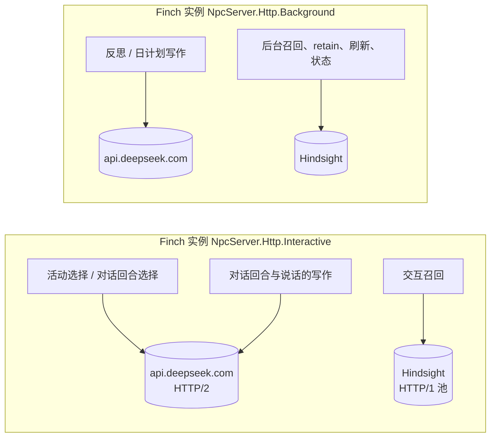

# NPC 出站 HTTP 换 Finch：车道隔离与显式排队（2026-11-18）

分类：npc_server 出站 HTTP 层的结构决策稿（新依赖、跨模块边界，按 AGENTS §3 第 8 条先写稿）。
状态：**用户已定 §5 全部按建议（2026-11-18，原话“全部按你建议来”）；已实现（2026-11-18，见 §7 进度，落地与 §2 的差异见 §2.1）。** 前置的 httpc 选择池隔离（D-1 的延伸）先落地，本稿在薄片四第三轮实跑之后、扩到更多 NPC 之前实施。
相关：[召回隔离决策稿](2026-11-16-npc-hindsight-recall-isolation-decision.md)（E1、D-1、D-1b、D-3a）、[统筹页](2026-11-11-npc-coordination.md) 薄片四两轮记录。

## 1. 问题

NPC 的所有外部请求——选择（Jev）、写作（反思、日计划、说话）、Hindsight（召回、retain、刷新、状态）——都经 Erlang `httpc`。
两次实跑都栽在同一个机制上：

| 时间 | 现象 | 证据 |
|---|---|---|
| 2026-11-16 S1-R10 | 召回排在同一 keep-alive 连接上 11–49 s 的同步 retain 后面，10 s 超时；超时的请求从未发出 | E1：缺省 profile 下 10 001 ms `{error,timeout}`，独立 profile 7.7 ms |
| 2026-11-18 slice4-02 | 选择请求排在写作 / retain 后面，5 次 10 s 超时，而上游没有一次超过 8 s；产品发 38 次、上游只收到 36 次 | 统筹页“薄片四第二轮” |

httpc 的官方缺省（inets `httpc` 文档，2026-11-18 核对）：每主机持久连接 `max_sessions` 2、每条连接排队 `max_keep_alive_length` 5、
不开管线时“always waits for the previous response before sending the next request”；只支持 HTTP/1.1（“an HTTP/1.1 compatible client”）。
所以不论多少 NPC、多少路思考在应用层并行，打到同一主机的请求都挤进 2 条连接串行，排队还是**隐式**的：请求悄悄进了一条正忙的连接，
既没有“取不到连接”的显式失败，也没有排队时长可观测。现行补法（每类请求一个 httpc profile）只能按约定把类别分开，同类内部仍是 2 条连接。
NPC 数量一上去（薄片四之后），选择请求之间就会互相排队。

## 2. 方案：Finch，按车道各起一个实例

[Finch](https://finch.hexdocs.pm/Finch.html)（“built on top of Mint and NimblePool”）的几条官方契约正对着上面的问题：

- 按 `{scheme, host, port}` 分池，池大小 `:size`、分片 `:count` 显式配置（缺省一个 50 条连接的池）。
- HTTP/1 池连接全忙时“further requests wait in the checkout queue until one is returned or `:pool_timeout`”（缺省 5 s）——排队**显式**、有上限，超了报错。
- `:protocols` 可含 `:http2`：“A single connection multiplexes streams per pool process”。DeepSeek 端点 ALPN 协商为 HTTP/2（2026-11-18 用 curl 实测，未带凭据，401）。
- Telemetry `[:finch, :queue, :stop]` 的 `:duration` 是“Time taken to check out a pool connection”——排队时长直接可观测。
- 底层 Mint 的 TLS：`:verify` 缺省 `:verify_peer`，文档建议 `cacerts: :public_key.cacerts_get()`，与现行 `NpcServer.Http` 的做法一致，不需要 CAStore。

- **车道由调用方给**（同现行召回的 `recall_kind`）：endpoint / config 带 `lane: :interactive | :background`，`NpcServer.Http` 是唯一出口，按车道选 Finch 实例。
  同一主机的选择与反思分在两个实例里，各有自己的池，结构上不可能互相排队。
- **为什么是两个实例而不是一个实例多个池**：Finch 的池键是 `{scheme, host, port}`，同主机只有一个池；车道隔离要靠实例分开。
  官方文档以 `:name` 标识实例，但没有明写多实例；实施第一步用最小用例确认（§4 T-0）。
- **Hindsight 适配器**（`Life.Hindsight`）不再自己起停 httpc profile，改经 `NpcServer.Http` 发请求；`start_recall_profiles` / D-1b 的 profile 起停随之删除。
- **不引入**：Tesla（中间件层，“The default adapter is erlang's built-in `httpc`”，池交给适配器，对我们只是多一层）；Req（建在 Finch 上，
  缺省带重试，与“显式失败、不自动重发”的约束相反，关掉后剩下的价值不足以多一层）。

### 2.1 落地时与上面的差异（2026-11-18 实施时读 finch 0.25.0 源码后定）

- **每条车道按协议两个实例，共四个**（`NpcServer.Http.{Interactive,Background}Http{1,2}`），不是一车道一个。原因：Finch 的池配置只能按
  `{scheme, host, port}` 写死或用一份 `:default`，而主机来自运行环境与测试替身的随机端口；`:protocols` 同时写 `:http1, :http2` 时
  官方文档说“there is no multiplexing”。运行中用 `Finch.start_pool/3` 给池单独起配置也不行：HTTP/2 池断线时会注销自己，下一个请求经
  `Pool.Manager` 按实例的 `:default` 重新找池，拿到与该池不符的协议模块（`Finch.Pool.Manager.maybe_start_pool/5`）。
  所以每个实例用一份静态 `:default`：`https` → HTTP/2 实例（`count` 1），`http` → HTTP/1 实例（`size` 8）。车道仍是隔离单位。
  模型主机 `api.deepseek.com`、`api.typesafe.ai`、`api.muteki.site` 2026-11-18 用 `curl --http2` 实测都协商为 h2；Hindsight 与回环替身是明文 HTTP/1。
- **HTTP/1 取连接超时 Finch 是抛错不是返回**（`Finch.HTTP1.Pool.request/6` 把 NimblePool 的 checkout 超时重抛成 `RuntimeError`），
  `NpcServer.Http` 只把这一条消息折成 `{:error, :pool_timeout}`；HTTP/2 兜底计时（2×`request_timeout` 仍无回执时抛
  “no response was received…”）折成 `:timeout`；其它异常照抛。HTTP/2 没有取连接队列，池在 `pool_timeout` 内连不上
  （DNS、拒绝连接、证书、没协商出 h2）的 `:pool_not_available` 单报 `:connection_unavailable`，不混进排队失败。
- **`queue_ms` 只有 HTTP/1 有**：`[:finch, :queue, *]` 只在 HTTP/1 取连接时发；HTTP/2 多路复用、没有取连接队列，`queue_ms` 为 null。
  生产上模型请求走 HTTP/2，所以生产日志里模型请求的 `queue_ms` 恒为 null；经本机代理（明文）跑时有读数。
- **没标车道的 endpoint 走后台车道**：旧形态（`llm`、builder、技能）的调用方不改；交互车道只给明确标了的调用方。
- **TLS 信任根**：实例不显式给 CA，交给 Mint 的缺省（`verify_peer`，建连时才取 `:public_key.cacerts_get/0`）。没有系统 CA 的环境
  只在真连 https 时显式失败，不影响应用启动（正式镜像根 `Dockerfile` 的运行层装了 `ca-certificates`）。
- **endpoint 级 `cacertfile` 保留**（及 `NPC_LLM_CACERTFILE`）：Voxim `Docs/Gameplay/server.py` 的 `--npc-llm` Demo 用 `ubuntu:24.04`
  裸容器、没有系统 CA，给 `llm` NPC 的 endpoint 带 `cacertfile: /demo/npc-ca.pem`（certifi 的包）。Finch 的 TLS 参数按池配置，
  所以带 `cacertfile` 的 https 请求走同车道 HTTP/2 实例里以 `{:cacertfile, 路径}` 为标签的池，每次请求前 `Finch.start_pool/3`
  确保它在。它与实例的 `:default` 同为 HTTP/2，断线后重新找池拿到的协议模块一致（上面否决动态池的理由只针对协议不同）。
- **建连有车道上限**：Mint 缺省建连 30 s，不受 `request_timeout` 管；每个实例按车道配 `transport_opts.timeout`（交互 2 s、后台 30 s，原创初值）。
- **协议不是 http / https** 时返回 `{:error, {:unsupported_scheme, 协议}}`，不崩。

## 3. 超时与取消契约（要改写 D-3a；落地后的三段上限见 §7 第十七个会话一条与 `NpcServer.Http` moduledoc）

D-3a 现在的规则是“每路截止时间只有一个 owner：httpc 的 timeout；调用方不再套第二个超时，放弃的请求要真的取消”。换 Finch 后：

- 截止时间仍只有一个 owner：`request_timeout`（总墙钟）。但官方说明它在 HTTP/1 上是 best effort（“only checked between reads from the socket”），
  所以另设 `receive_timeout`（单块）不大于它，两者合起来才能保证 HTTP/1 不挂死。
- `pool_timeout` 是新增的、语义不同的上限：只管“取不到连接”，报出来是可诊断的排队失败（不是上游慢），进 `npc_model_request` 的 status。
- 取消：调用进程被杀时请求是否随之中止，要用替身实测（§4 T-3），不凭推断。

## 4. 测试矩阵（实施时先红后绿）

| # | 用例 | 判定 |
|---|---|---|
| T-0 | 两个具名 Finch 实例并存，各自对同一回环主机建池 | 两实例独立建连 |
| T-1 | 现有召回隔离 T-1 与选择池隔离用例改走 Finch | 继续绿（同主机慢请求不挡交互车道） |
| T-2 | 后台车道池占满，再来一个后台请求 | 在 `pool_timeout` 处显式失败，`npc_model_request` 记排队失败 |
| T-3 | 请求在途时杀调用进程 | 替身看到连接被关闭，请求不再完成 |
| T-4 | 真实 DeepSeek 选择与写作冒烟各一次（沿用 `live_jev_openai` / `live_reflect_openai`） | `finish_reason=stop`，协商为 HTTP/2 |
| T-5 | 排队时长进可观测面 | `npc_model_request` finished 事件带 `queue_ms`（来自 `[:finch, :queue, :stop]`） |

之后 npc_server 全套，再用薄片四驱动在同一场景复跑一轮对照。

## 5. 要用户定的

1. **D-1 换 Finch**（建议）／ 继续 httpc，只把每车道 profile 的 `max_sessions` 调大。后者改动最小，但排队仍是隐式的、仍只有 HTTP/1.1。
2. **D-2 车道划分**：交互＝选择、对话回合与说话的写作、交互召回；后台＝反思与日计划写作、后台召回、retain / 刷新 / 状态（建议）。
3. **D-3 DeepSeek 走 HTTP/2**（建议）／ 先只用 HTTP/1 池。
4. **D-4 池的初值**：交互、后台各一份，DeepSeek HTTP/2 `count` 1，Hindsight HTTP/1 `size` 8；`pool_timeout` 交互 2 s、后台 30 s。这些是原创取值，实跑后调。
5. **D-5 时机**：薄片四第三轮之后、扩到 5 个以上 NPC 之前（建议）。

## 6. 依赖

新增 `finch`（及其依赖 `mint`、`nimble_pool`、`nimble_options`；`telemetry` 现已在依赖树里）。版本与许可在实施时按 hex 记录写进 PR。
现在依赖树里没有 Finch、Req、Tesla 中的任何一个（`mix.lock` 2026-11-18 核对）。

## 7. 进度

- 2026-11-18：用户在对话里同意建议（先落 httpc 选择池隔离，换 Finch 另写稿）；本稿写成，等 §5 的答复。
- 2026-11-18：httpc 选择池隔离已提交（`7afe29fe`），薄片四第三轮 `slice4-03` 五题全部成立、选择超时 0；上游选择最长 9.3 s，离 10 s 很近。
- 2026-11-18：用户定 §5 全部按建议：D-1 换 Finch；D-2 车道划分如 §2 图；D-3 DeepSeek 走 HTTP/2；D-4 池初值如 §5 第 4 条（原创取值，实跑后调）；
  D-5 现在实施（第三轮已跑完），扩到 5 个以上 NPC 之前完成。实施交给下一个统筹会话，按 §4 测试矩阵先红后绿。
- 2026-11-18（第十七个统筹会话）：**已实现**。`NpcServer.Http` 是监督者（四个 Finch 实例 + 排队时长的 telemetry 处理器），在 NPC 监督树第一位；
  `Life.Hindsight` 经 `Http.send_request/6` 发全部请求（召回按 `recall_kind` 走交互 / 后台车道，其余后台）；`Registry` 的 Jev endpoint 带
  `lane: :interactive`，说话与对话回复的写作标交互、反思与日计划的写作标后台；`ModelUsage` 记 `lane` 与 `queue_ms`，取不到连接记 `status=pool_timeout`。
  删除了三个 httpc profile 的起停、`profile_absent?`、`Jev.selection_profile/0`、`Application.start_http_profiles/0` 与 `:inets` 依赖。
  依赖：finch 0.25.0（MIT）、mint 1.11.0、nimble_pool 1.2.0、nimble_options 1.2.0（均 Apache-2.0），hpax / mime / telemetry 已在树里。
  - **改前红**（`test/npc_server/npc_http_lanes_test.exs`，跑在 httpc 实现上）：T-0 两车道共用一条连接、T-2 第 9 个请求没有排队上限照常发出、
    T-3 调用进程被杀后连接仍保持 keep-alive、T-5 结束事件没有 `queue_ms`（`.demo/dev-env/logs/test-20261118T133637Z-finch-red.log`、
    `test-20261118T133713Z-finch-red-t2.log`）。T-3 的“超时关连接”一条在 httpc 下也绿（httpc 到点 `cancel_request`），作为 D-3a 的回归。
  - **改后绿**：新文件 5 项与 T-1（`npc_recall_isolation_test.exs` 两项、`npc_selection_lane_test.exs`，原 `npc_selection_profile_test.exs`）共 8 项
    （`test-20261118T134401Z-finch-green.log`）；npc_server 全套 `--seed 0` 630 项通过、20 项排除（`test-20261118T134547Z-finch-full.log`）。
  - **T-4 真实冒烟**（`live-finch-t4-20261118T135545Z.log`）：选择经交互车道 HTTP/2 实例打 DeepSeek，`finish_reason=stop`、3.5 s；
    写作经后台车道 HTTP/2 实例转发，成功、16.7 s；两条都断言池落在 HTTP/2 实例里（该实例只接受协商出 h2 的连接）。
  - 未做：HTTP/2 上调用进程被杀时的取消（Finch 监视调用方并发 RST_STREAM）只读了源码，本机没有 h2 替身，未实测；
    `slice4-04` 对照实跑（看上游尾延迟与 `queue_ms`）。
- 2026-11-18（同一会话，独立评审之后）：评审确认车道归属、主要错误映射、取消、telemetry 与启停成立，另提 7 条，处理如下：
  - **建连不受 `timeout_ms` 约束**（Mint 缺省 30 s，旧 Hindsight 写了 `connect_timeout`，是回归）→ 每实例按车道配建连上限。
    超时契约改成三段各有上限：取连接 `pool_timeout`、建连 `transport_opts.timeout`、发送与接收 `timeout_ms`；
    HTTP/1 接收段最坏约 2×`timeout_ms`（`request_timeout` 只在两次读之间检查），调用方最坏总时长约为三者之和，已写进 moduledoc 与 D-3a 改写。
  - **https 连不上被报成 `:pool_timeout`** → 改报 `:connection_unavailable`（`ModelUsage` 的 status、`Writer` 的失败原因同步）。
  - **T-1 证明不了车道路由**（HTTP/1 池有 8 条连接，误路由也会另开一条）→ 加按实例查池的断言：选择用例断言池在交互实例；
    新用例逐类核 Hindsight 召回（交互 / 后台）与 retain（后台）；`npc_registry_test` 的 `model_request/2` 对选择、对话回合选择、说话、
    对话回复断言 `lane=interactive`；日计划集成用例对日计划与反思写作断言 `lane=background`。**变异验证**：把这四处车道临时改错，
    9 项变红（`.demo/dev-env/logs/test-20261118T142910Z-lane-mutation-red.log`），改回后绿。
  - **HTTP/2 兜底异常会打崩 worker** → 折成 `:timeout`。**非 http / https 协议崩溃** → `{:unsupported_scheme, _}`，加用例。
  - **`rest_for_one` 注释理由不成立** → 改为如实说明：排第一只为启动顺序，整体重启时连带重起 NPC 是可接受的副作用。
  - **`cacertfile` 的结论原先是错的**：评审指出外部仓可能还在用，核实 Voxim Gameplay Demo 确实在用（见 §2.1），已恢复支持；
    同时发现初版在 `init/1` 里调 `:public_key.cacerts_get()`，没有系统 CA 的容器里会让应用启动失败，已改为交给 Mint 在建连时取。
    新用例覆盖 `cacertfile` 标签池与 HTTP/2 连不上报 `:connection_unavailable`（连不上的池用 `Finch.stop_pool/2` 收尾，不留后台重连）。
  - 修后：npc_server 全套 `--seed 0` 633 项通过、20 项排除（`test-20261118T143149Z-finch-full-after-review.log`）；T-4 两条真实冒烟重跑
    （TLS 改为 Mint 缺省后）均通过，选择 `finish_reason=stop`、2.8 s，写作 14.8 s（`live-finch-t4-20261118T144038Z.log`）。
