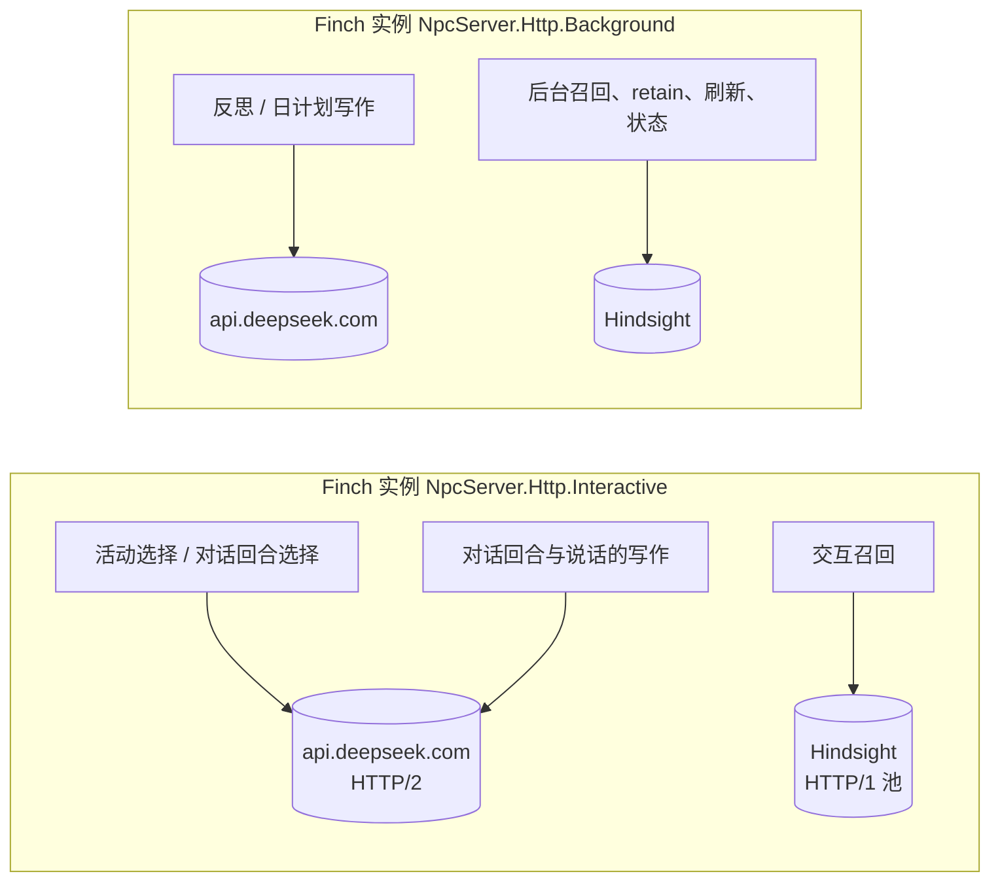

# NPC 出站 HTTP 换 Finch：车道隔离与显式排队（2026-11-18）

分类：npc_server 出站 HTTP 层的结构决策稿（新依赖、跨模块边界，按 AGENTS §3 第 8 条先写稿）。
状态：**待用户定 §5 各项；未实现。** 前置的 httpc 选择池隔离（D-1 的延伸）先落地，本稿在薄片四第三轮实跑之后、扩到更多 NPC 之前实施。
相关：[召回隔离决策稿](2026-11-16-npc-hindsight-recall-isolation-decision.md)（E1、D-1、D-1b、D-3a）、[统筹页](2026-11-11-npc-coordination.md) 薄片四两轮记录。

## 1. 问题

NPC 的所有外部请求——选择（Jev）、写作（反思、日计划、说话）、Hindsight（召回、retain、刷新、状态）——都经 Erlang `httpc`。
两次实跑都栽在同一个机制上：

| 时间 | 现象 | 证据 |
|---|---|---|
| 2026-11-16 S1-R10 | 召回排在同一 keep-alive 连接上 11–49 s 的同步 retain 后面，10 s 超时；超时的请求从未发出 | E1：缺省 profile 下 10 001 ms `{error,timeout}`，独立 profile 7.7 ms |
| 2026-11-18 slice4-02 | 选择请求排在写作 / retain 后面，5 次 10 s 超时，而上游没有一次超过 8 s；产品发 38 次、上游只收到 36 次 | 统筹页“薄片四第二轮” |

httpc 的官方缺省（inets `httpc` 文档，2026-11-18 核对）：每主机持久连接 `max_sessions` 2、每条连接排队 `max_keep_alive_length` 5、
不开管线时“always waits for the previous response before sending the next request”；只支持 HTTP/1.1（“an HTTP/1.1 compatible client”）。
所以不论多少 NPC、多少路思考在应用层并行，打到同一主机的请求都挤进 2 条连接串行，排队还是**隐式**的：请求悄悄进了一条正忙的连接，
既没有“取不到连接”的显式失败，也没有排队时长可观测。现行补法（每类请求一个 httpc profile）只能按约定把类别分开，同类内部仍是 2 条连接。
NPC 数量一上去（薄片四之后），选择请求之间就会互相排队。

## 2. 方案：Finch，按车道各起一个实例

[Finch](https://finch.hexdocs.pm/Finch.html)（“built on top of Mint and NimblePool”）的几条官方契约正对着上面的问题：

- 按 `{scheme, host, port}` 分池，池大小 `:size`、分片 `:count` 显式配置（缺省一个 50 条连接的池）。
- HTTP/1 池连接全忙时“further requests wait in the checkout queue until one is returned or `:pool_timeout`”（缺省 5 s）——排队**显式**、有上限，超了报错。
- `:protocols` 可含 `:http2`：“A single connection multiplexes streams per pool process”。DeepSeek 端点 ALPN 协商为 HTTP/2（2026-11-18 用 curl 实测，未带凭据，401）。
- Telemetry `[:finch, :queue, :stop]` 的 `:duration` 是“Time taken to check out a pool connection”——排队时长直接可观测。
- 底层 Mint 的 TLS：`:verify` 缺省 `:verify_peer`，文档建议 `cacerts: :public_key.cacerts_get()`，与现行 `NpcServer.Http` 的做法一致，不需要 CAStore。

- **车道由调用方给**（同现行召回的 `recall_kind`）：endpoint / config 带 `lane: :interactive | :background`，`NpcServer.Http` 是唯一出口，按车道选 Finch 实例。
  同一主机的选择与反思分在两个实例里，各有自己的池，结构上不可能互相排队。
- **为什么是两个实例而不是一个实例多个池**：Finch 的池键是 `{scheme, host, port}`，同主机只有一个池；车道隔离要靠实例分开。
  官方文档以 `:name` 标识实例，但没有明写多实例；实施第一步用最小用例确认（§4 T-0）。
- **Hindsight 适配器**（`Life.Hindsight`）不再自己起停 httpc profile，改经 `NpcServer.Http` 发请求；`start_recall_profiles` / D-1b 的 profile 起停随之删除。
- **不引入**：Tesla（中间件层，“The default adapter is erlang's built-in `httpc`”，池交给适配器，对我们只是多一层）；Req（建在 Finch 上，
  缺省带重试，与“显式失败、不自动重发”的约束相反，关掉后剩下的价值不足以多一层）。

## 3. 超时与取消契约（要改写 D-3a）

D-3a 现在的规则是“每路截止时间只有一个 owner：httpc 的 timeout；调用方不再套第二个超时，放弃的请求要真的取消”。换 Finch 后：

- 截止时间仍只有一个 owner：`request_timeout`（总墙钟）。但官方说明它在 HTTP/1 上是 best effort（“only checked between reads from the socket”），
  所以另设 `receive_timeout`（单块）不大于它，两者合起来才能保证 HTTP/1 不挂死。
- `pool_timeout` 是新增的、语义不同的上限：只管“取不到连接”，报出来是可诊断的排队失败（不是上游慢），进 `npc_model_request` 的 status。
- 取消：调用进程被杀时请求是否随之中止，要用替身实测（§4 T-3），不凭推断。

## 4. 测试矩阵（实施时先红后绿）

| # | 用例 | 判定 |
|---|---|---|
| T-0 | 两个具名 Finch 实例并存，各自对同一回环主机建池 | 两实例独立建连 |
| T-1 | 现有召回隔离 T-1 与选择池隔离用例改走 Finch | 继续绿（同主机慢请求不挡交互车道） |
| T-2 | 后台车道池占满，再来一个后台请求 | 在 `pool_timeout` 处显式失败，`npc_model_request` 记排队失败 |
| T-3 | 请求在途时杀调用进程 | 替身看到连接被关闭，请求不再完成 |
| T-4 | 真实 DeepSeek 选择与写作冒烟各一次（沿用 `live_jev_openai` / `live_reflect_openai`） | `finish_reason=stop`，协商为 HTTP/2 |
| T-5 | 排队时长进可观测面 | `npc_model_request` finished 事件带 `queue_ms`（来自 `[:finch, :queue, :stop]`） |

之后 npc_server 全套，再用薄片四驱动在同一场景复跑一轮对照。

## 5. 要用户定的

1. **D-1 换 Finch**（建议）／ 继续 httpc，只把每车道 profile 的 `max_sessions` 调大。后者改动最小，但排队仍是隐式的、仍只有 HTTP/1.1。
2. **D-2 车道划分**：交互＝选择、对话回合与说话的写作、交互召回；后台＝反思与日计划写作、后台召回、retain / 刷新 / 状态（建议）。
3. **D-3 DeepSeek 走 HTTP/2**（建议）／ 先只用 HTTP/1 池。
4. **D-4 池的初值**：交互、后台各一份，DeepSeek HTTP/2 `count` 1，Hindsight HTTP/1 `size` 8；`pool_timeout` 交互 2 s、后台 30 s。这些是原创取值，实跑后调。
5. **D-5 时机**：薄片四第三轮之后、扩到 5 个以上 NPC 之前（建议）。

## 6. 依赖

新增 `finch`（及其依赖 `mint`、`nimble_pool`、`nimble_options`；`telemetry` 现已在依赖树里）。版本与许可在实施时按 hex 记录写进 PR。
现在依赖树里没有 Finch、Req、Tesla 中的任何一个（`mix.lock` 2026-11-18 核对）。

## 7. 进度

- 2026-11-18：用户在对话里同意建议（先落 httpc 选择池隔离，换 Finch 另写稿）；本稿写成，等 §5 的答复。
