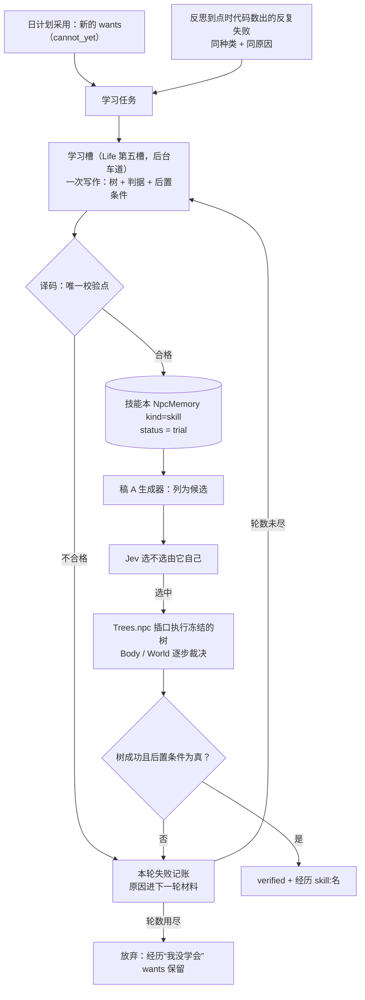
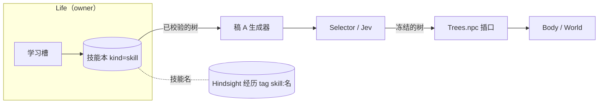

# NPC 学技能：每人一本技能本，在真实世界里试通（2026-11-18）

分类：统一形态 NPC 新增一层（学习）的结构决策稿（只定结构、所有权、信任边界、预算与测试矩阵，不调取值）。状态：**方向（§1）与细节（§6 全按建议，2026-11-18）均由用户定，实施待排（统筹页）。**
依赖 [`2026-11-18-npc-full-capability-coverage-decision.md`](2026-11-18-npc-full-capability-coverage-decision.md)（稿 A）：学来的树只能用稿 A 覆盖登记里
`offer` / `inside` 的能力，学会的技能经稿 A 的生成器缝成为候选。成本口径接 [`2026-11-18-npc-scale-and-qinglan-entry-decision.md`](2026-11-18-npc-scale-and-qinglan-entry-decision.md) §6 D-3。

## 1. 目标与用户已定的方向

用户 2026-11-18 的三条答复（统筹页“交接：第十八 → 第十九”）：① 技能 NPC **各自**学会；② 触发与反思放一起；③ 让 NPC 在真实世界自己试，失败自己排查完善。
用户问能否复用行为树：可以。目标：NPC 想做而做不到（日计划的 `cannot_yet`）或反复做不成的事，由一次后台写作调用写成一棵**行为树技能**，
在真实世界里试；失败原因回灌给下一轮改写；试通后成为它自己的一项可选活动。

不做：执行模型写的代码；学 Jev 的判断；NPC 之间直接交换树（“看 / 教”见 §6 Q-2）；新的世界动作（技能只组合已有能力）。

## 2. 现状事实（各附证据）

- **执行引擎现成**：节点是数据元组（`brain/tree.ex:11-20`），`act` 经 `Abilities.command/4` 构造命令（`:210-231`），`new/2` 构造期校验（`:63-80`、`:335-386`），
  失败写 `:last_failure`（`:310-311`），`halt/1` 取消在途技能（`:111-127`）。
- **缺口一（核实成立）**：条件 `{:cond, fun}`（`:163-164`）与函数形参数（`:211-216`）都是 Elixir 闭包，不能来自数据；`Trees.settler` 的条件与参数都是模块私有函数（`trees.ex:201-248`）。
- **缺口二（成立）**：没有 JSON → 节点的译码；`new/2` 对作者配置 raise（启动即失败），外部输入要的是显式 `{:error, 原因}`；技能叶子参数建树时不校验（`:34-36`）。
- **缺口三（成立）**：树在 `init/1` 时由 profile 一次建成（`:83-86`；`trees.ex:135-154` 按登记的候选逐个建分支），运行时新出现的树没有入口。
- **补一条缺口四**：树没有“界”——`{:repeat, :forever, _}`、任意长的 `wait` 都合法（`:371-375`），作者的树需要它们；学来的树一次试用必须会结束。
- **存储**：`DataService.NpcMemory` 按 `{cid, kind, key}` 唯一、可覆盖（`npc_memory.ex:5-7`、`:26-37`）；Life 的持久行就是其中的 `life/state`（`life.ex:4`）。
  保留上限只管 `note` 与 `event`（`npc_memory.ex:11-13`、`:35`），新 kind 要自己的上限。
- **触发材料**：日计划把 `cannot_yet` 存成 `wants`（`life/day_plan.ex:11`、`:128-134`），现在只展示在栏里、不触发任何动作（运行时 README“日计划”局限 ③）；
  一项活动失败的动作名与原因已经随下一次发问报给选择器（`trees.ex:177-185`）。反思槽是 Life 的第三个 worker 槽、规划槽是第四个，都“失败不挡选择”。
- **成本读数**：写作一篇日记约 10 s、3931 入 / 1042 出（真实 DeepSeek，统筹页“对话通道异步化”）；一个游戏日 = 现实 60 分钟（×24）。

## 3. 依据（2026-11-18 核对原文）

- **BehaviorTree.CPP** 官方文档 [behaviortree.dev](https://www.behaviortree.dev/docs/tutorial-basics/tutorial_01_first_tree)：
  “We must first register our custom TreeNodes into the BehaviorTreeFactory and then load the XML from file or text.”，
  “The identifier used in the XML must coincide with those used to register the TreeNodes.”；[XML 格式页](https://www.behaviortree.dev/docs/learn-the-basics/xml_format)：
  “The name of the tag is the ID used to register the TreeNode in the factory.”；[端口教程](https://www.behaviortree.dev/docs/tutorial-basics/tutorial_02_basic_ports)：
  端口在 `providedPorts` 声明，值是静态字符串或黑板条目。源码 [`src/xml_parsing.cpp`](https://github.com/BehaviorTree/BehaviorTree.CPP/blob/master/src/xml_parsing.cpp)（master）
  在加载时 `VerifyXML` 先校验，未登记的节点抛 “Node not recognized: …”。**对应**：条件与动态参数按名登记成封闭词汇，树是数据，加载边界校验。
  **取舍**：BT.CPP 加载与实例化各查一次；本项目按 AGENTS §2.2.6 只在译码边界查一次（译码即构造），之后 `Brain.Tree` 直接执行可信结构。
- **Unreal Engine 行为树**（官方 UE 5.9：[Overview](https://dev.epicgames.com/documentation/en-us/unreal-engine/behavior-tree-in-unreal-engine---overview)、
  [Tasks 节点参考](https://dev.epicgames.com/documentation/en-us/unreal-engine/unreal-engine-behavior-tree-node-reference-tasks)）：树是资产，
  “a separate asset called a Blackboard is used to store information”，Task 是动作、Decorator 是条件；“Run Behavior Dynamic … enables pushing subtrees on the execution stack”，
  “Subtree Asset can be assigned at runtime with the SetDynamicSubtree function”。**对应**：选中后把学来的树挂到 `Trees.npc` 的固定插口上执行（缺口三）。
- **Voyager**，Wang et al.，[arXiv:2305.16291](https://arxiv.org/abs/2305.16291) v2（ar5iv HTML）：技能是可执行代码，按描述嵌入索引、检索 top-5；
  §2.3 “self-verification validates the task's completion, at which point we add this new skill to the skill library”；反馈三种（环境反馈、执行错误、自我验证）；
  “If the agent gets stuck after 4 rounds of code generation” 就换任务；§3.4 去掉自我验证，发现物品数 −73%；§4 成本 “15× more expensive than GPT-3.5”。
  **对应**：技能本、试通才转正、失败原因回灌、轮数上限。**取舍**：(a) 代码 → 封闭词汇的树（服务端权威，不执行模型写的程序）；(b) 自我验证不问模型，由词汇里的
  后置条件让代码判（总纲“能算的归代码”）；(c) 不设自动课程，任务只来自 NPC 自己的 `cannot_yet` 与反复失败（用户定 ②）；(d) 每人一本（用户定 ①），Voyager 是单代理。
- **OWASP Top 10 for LLM Applications 2025，LLM05 Improper Output Handling**（[genai.owasp.org](https://genai.owasp.org/llmrisk/llm052025-improper-output-handling/)）：
  “Treat the model as any other user, adopting a zero-trust approach, and apply proper input validation on responses coming from the model to backend functions.”
  **对应**：模型写的树是外部输入，在译码边界校验一次；之后每一步仍由 Body / World 裁决。

## 4. 决策项

- **B-1 封闭词汇**：新模块（建议 `NpcServer.Brain.Vocabulary`）登记条件与参数源，每项 `%{name, description, args, eval}`；`args` 用 Abilities 的参数规格与译码
  （DRY，不另写 JSON Schema 校验器）。首批只登记学来的树确实要的、能从观察与黑板算出的，例如条件“余额至少 n”“上一步因某原因失败”“在某点附近”，
  参数源“某定义的缺料”“最近的某种天然格”“自己的站位”。**试用期只作用于自己或无主之物做成词汇的结构性质**：学来的树不能写字面目标句柄，句柄只能来自参数源，
  而参数源在 trial 状态只解析到无放置记录的天然格、自己放的构件、自己的余额——不另设运行时门禁，World 照常裁决受保护区等规则。手写的 `Trees` 以后可改写成同一词汇（不在本稿）。
- **B-2 JSON → 节点译码（唯一校验点）**：`Brain.Tree` 增 `decode/3 :: {:ok, 树} | {:error, 原因}`，节点 JSON 一一对应现有节点（`seq` / `sel` / `act` / 词汇条件 / 有限 `repeat` / `wait`）。
  检查：能力名必须在稿 A 登记里是 `offer` / `inside`（不能是 `withheld`，v1 不能调另一项学来的技能——避免递归与版本链）；静态参数当场经 Abilities 译码；词汇按名查、参数按其规格译码；
  界：节点 ≤ 40、深度 ≤ 6、`repeat` ≤ 8 次、`wait` ≤ 60 s、没有 `forever`（**原创取值**）。作者路径 `new/2` 照旧 raise，与 `decode/3` 共用同一组检查函数，只是失败形状不同。
  技能叶子参数仍原样透传，运行时 `invalid_skill_arguments` 记为一次试用失败并回灌。技能本读回是新的信任边界，按同一 `decode/3` 再校验一次（同 Registry 的持久化加载）。
- **B-3 技能本（每人一本）**：`DataService.NpcMemory` 新 kind `"skill"`、key = 技能名；行含 `criterion`（给 Jev 的一句英文）、`tree`（JSON 原文）、`postcondition`（词汇条件）、
  `status`（trial / verified / retired）、`origin`（self；第二批起 taught:<cid> / watched:<cid>）、`rounds`、`last_failure`、时刻。owner 是 Life（已是该 NPC 持久心智的 owner，
  载入与写回走 `life/state` 同一路径，不另起进程）；每人上限 12 行、同时 trial ≤ 2（原创取值），上限由 NpcMemory 拥有（同 note / event）。
  **与 Hindsight 互相引用只靠技能名**：开始学、试用结局、学会、放弃各写一条标准句经历（总纲“事件用标准描述”），tags `kind:learning`、`skill:<名>`；技能行不存 Hindsight 文档 id，召回按 tag 取，没有第二真值。
- **B-4 触发与学习调用（与反思放一起）**：两种来源：日计划采用时 `wants` 里的新条目；反思到点时由**代码**数出的反复失败（同一活动种类 + 同一原因本游戏日 ≥ 3 次，原创取值），
  不从日记正文里猜。学习槽紧跟反思槽之后起（同一时机，用户定 ②），单独一次后台写作调用（Writer，`NPC_REFLECT_*` 同一端点，后台车道，`operation: skill_learning`）。
  材料：反思“自己”一问的取材（复用，不复制）+ 想做的事与原因 + 可用能力与词汇清单（由稿 A 登记与 `Abilities.tools/1` 的说明生成，不手写）+ 已有技能名 + 上一轮的树与失败原因
  （即 Voyager 的“环境反馈 / 执行错误”：`:last_failure` 与权威拒绝原因）。一个任务至多 4 轮写作（Voyager 的数）。
- **B-5 在世界里试与自我验证**：trial 技能经稿 A 的生成器成为候选，与其它候选一起交 Jev——去不去试由 NPC 自己选（驱动力口径）。选中后，已译码的树随本轮应答冻结
  （同 `speak_to:` 冻结目标），挂到 `Trees.npc` 新加的插口节点（执行黑板里一棵已校验的树，UE Run Behavior Dynamic 的对应物）。一次试用至多 10 分钟墙钟，超时 `halt/1` 记 `trial_timeout`；
  被对话回合打断记 interrupted，不算轮次。树成功且后置条件为真 → verified（Voyager：一次通过即入库）；verified 后连续 3 次失败 → retired 并起一个改进任务（同额度）。
- **B-6 预算**：每次学习写作入约 4–6k（反思材料约 3.9k + 能力与词汇清单约 1–2k，估算）、出硬上限 4096（`max_tokens`）。额度：每人每游戏日 ≤ 2 个新任务、写作 ≤ 6 次、两次至少隔 3 分钟，
  写作前就失败的退回（沿用 `DayPlan.refund/1` 口径；**原创取值**）。上界：每人每现实小时 6 ×（6k + 4k）≈ 6 万 token；3 人 1 小时上界 18 万，占 M-4 硬上限 200 万的 9%。
  试用本身不加模型调用（只有照常的一次 Jev 选择）。用量照常经 `ModelUsage.request/4` 记账；每天花费上限等 M-4 实测后由用户定（扩人数稿 D-3）。

## 5. 测试矩阵（按 `../Voxim/Docs/Testing.md`）

| # | 层 | 证明什么 | 做法 |
|---|---|---|---|
| L-0 | 离线探索（不是验收） | 首批词汇与提示词够不够：译码通过率、失败原因分布 | 真实 S1-R8 / `slice4` 材料 + 真实写作模型写 10 份树，请求数事先定上限；导出的应答作 L-1、L-5 的夹具（测试数据必须是产品能产生的） |
| L-1 | 算法 | 译码合法即与手写元组相等；反例逐个显式失败带原因 | 反例：未知节点、未知能力、`withheld` 能力、调学来的技能、未知词汇名、参数不合规格、超节点 / 深度、`forever` / 超界 `repeat` / `wait`、字面目标句柄 |
| L-2 | 算法 | 词汇的条件与参数源；trial 不解析到他人之物 | 小观察手算；反例：别人放的构件、受保护区里的格 |
| L-3 | 算法 | 技能本状态机与额度 | trial → verified、失败回灌、4 轮用尽放弃、连续 3 次失败 retired、上限淘汰；跨日清零、写作前失败退回、崩溃按已发出计 |
| L-4 | 集成 | 触发 → 学习 → 落库 → 重启读回再校验 | 真实 Life + 独占 PostgreSQL；写作用回环替身回放 L-0 导出的真实应答 |
| L-5 | 集成 | 试用的完整链路与失败回灌 | 真实 Registry / Body / Scene / World；Jev 替身选 trial 候选 → 插口执行 → World 提交 → 后置条件 → verified 与带 `skill:` 的经历；失败路径用真实的 World 拒绝（如余额不足），原因进下一轮材料，替身给改写后第二次试通；另测试用中被对话回合 halt |
| L-6 | 真实客户端短场景 | 玩家能看到 NPC 自己学、自己试 | 一个 NPC、真实写作与 Jev；有限作者样本让 `wants` 合法产生；判定：学习调用次数与用量配对、树译码通过、被选中时权威事务双端可见、经历带 tag；不要求“必须学会”；≤ 10 分钟，资源规则同扩人数稿 §5 |

## 6. 要用户定的

**已定**（用户 2026-11-18 答复，经第十九个统筹会话转达，原话：“额度可以增加上限，其他都按你建议来。”）：Q-1–Q-5 全按下列建议；Q-6 见下。“额度可以增加上限”按第十九个统筹会话的转述理解为**每天花费上限可以上调**（不必为学习压掉学习），分档见花费额度稿 [`2026-11-18-npc-spend-budget-decision.md`](2026-11-18-npc-spend-budget-decision.md) §6 Q-6；若用户本意是“学习额度（Q-3）可以放宽”，在该稿一并请用户确认。

1. **Q-1 词汇首批**由 L-0 定，“试用期只作用于自己或无主之物”做成参数源的结构性质（建议：是）。
2. **Q-2 看 / 教**：v1 只自学；第二批做“教”——对话里的结构化请求，抄来的树进自己的技能本为 trial，仍须自己试通；“看”要先让观察里能看到别人在用哪项技能，再议（建议：照此）。
3. **Q-3 额度**：每人每游戏日 ≤ 2 个任务、≤ 6 次写作、每任务 ≤ 4 轮（建议：照此，实跑后调）。**已放宽**（用户 2026-11-18 答复，经第十九个统筹会话转达，原话：“1同意。2是的，都可以放宽”）：每人每游戏日 **≤ 4 个任务、≤ 12 次写作、每任务 ≤ 4 轮**，两次写作至少隔 3 分钟不变。依据：每任务 4 轮沿用 Voyager 原文（§3 “If the agent gets stuck after 4 rounds of code generation” 即换任务，B-6 已引），不放宽——任务数 × 轮数 = 16 > 12，写作次数先触顶，所以放宽面落在任务数与写作次数；两者各翻倍是**原创取值**（无同类产品的每日配额可循），实跑后按试通率调。上界：每人每现实小时 12 ×（6k + 4k）≈ 12 万 token，约 $0.079（高峰）；3 人每天约 $5.7，与 3 人全天高峰最坏 $51.6 合计 $57.3，在用户定的每天 $65 内（花费额度稿 §6 Q-6）。
4. **Q-4 转正**：一次试通即 verified，连续 3 次失败 retired（建议：照此）。
5. **Q-5 学来的技能互调**：v1 不允许（建议：是）。
6. **Q-6 每天花费上限**：沿用扩人数稿 D-3，本稿只给上界；用户 2026-11-18 答复没有准数，等 M-4 本机实测后按统筹会话给的几档选定。**已定 $65**（首批 3 人，花费额度稿 §6 Q-6）。

## 7. 进度

- 2026-11-18：初稿（第十九个统筹会话派写，排在稿 A 之后）；只读代码与原文，未改代码、未实跑。实施顺序建议：稿 A 批 0 之后即可开始，与稿 A 批 1–2 并行。等 §6 答复。
- 2026-11-18：用户答复 §6 全按建议（用户 2026-11-18 答复，经第十九个统筹会话转达，原话：“额度可以增加上限，其他都按你建议来。”）。按本稿 B-6 上界，学习每人每天约多花 $1（高峰价），3 人约 $3，已计入花费额度稿 Q-6 的分档。实施在稿 A 批 0 之后。
- 2026-11-18：用户定每天上限 $65，学习额度可放宽（用户 2026-11-18 答复，经第十九个统筹会话转达，原话：“1同意。2是的，都可以放宽”）；Q-3 放宽为 ≤ 4 任务 / ≤ 12 次写作 / 每任务 ≤ 4 轮（取值与依据见 §6 Q-3），3 人学习上界约 $5.7 / 天，合计最坏 $57.3，在 $65 内，直接采用。
