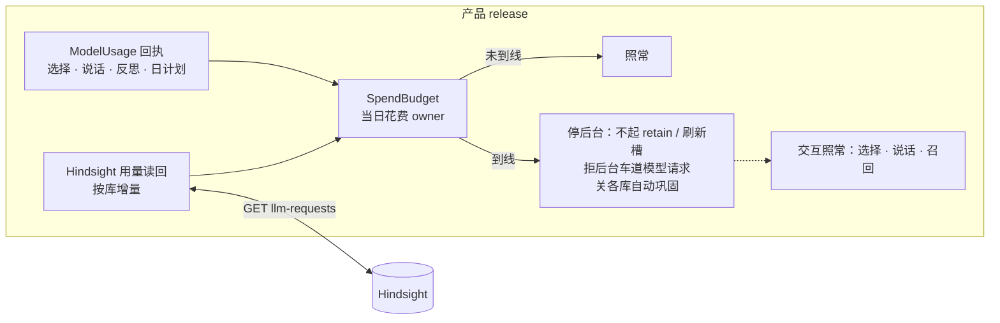

# NPC 每天模型花费额度：产品侧怎样连 Hindsight 一起兜住（2026-11-18）

分类：生产化入口的决策稿（只定计量口径、所有权、超额后的拒绝顺序与测试矩阵，不调取值）。状态：**待用户定 §6；未实施。**
上游：[`2026-11-18-npc-scale-and-qinglan-entry-decision.md`](2026-11-18-npc-scale-and-qinglan-entry-decision.md) §3（依据）、§7（D-3：进青岚首批 3 人，
每天模型花费上限 **$50**，用户 2026-11-18 定；超出即拒后台请求，要连 Hindsight 自己的用量一起覆盖）。进度见
[`2026-11-11-npc-coordination.md`](2026-11-11-npc-coordination.md)。

## 1. 目标

进青岚之后，NPC 一天（自然日）花在模型上的钱不超过用户定的上限；到上限后先停“没人在等”的工作，NPC 仍能被看见、能动、能回话。
这是 SRE *Handling Overload* 的“按客户定额、过载时按重要性先拒低优先级请求”在本仓的对应物（依据见 §3）。

不做：调取值（阈值、刷新间隔、思考档位都是后调项，本稿只给读数与推断）；NPC 之间分配额度（首批 3 人共用一个全局额度）；
改 Hindsight 源码或镜像。

## 2. 现状事实（各附证据）

### 2.1 钱花在哪：M-4 读数（`scale3-direct-02`，3 人、37.4 min、直连 deepseek-flash，按高峰价折算）

价目同扩人数稿 §7（DeepSeek 官方价目 2026-11-18 核对：每百万 token 入未命中 $0.3 / 命中 $0.006 / 出 $1.2，思考按输出计）。
产品侧来自 release 日志的 `npc_model_request` 回执；Hindsight 侧来自它自己的 `llm-requests` 追踪（`hindsight-llm.json`）。

| 来源 | 操作 | 车道 / 谁触发 | 37.4 min 花费 | 每 NPC 每天（全高峰） |
|---|---|---|---|---|
| Hindsight | 认识刷新 `refresh_mental_model`（32 次收尾 + 183 次工具调用） | 产品 Life 后台槽 | $0.639（48%） | $8.2 |
| Hindsight | 巩固 `consolidation`（78 次） | Hindsight 自己排队（每次 retain 后入队） | $0.347（26%） | $4.5 |
| Hindsight | 写入抽取 `retain_extract_facts`（140 次） | 产品 Life 后台槽（同步） | $0.134（10%） | $1.7 |
| 产品 | 活动选择（100 次，入 47.8 万，**缓存命中仅 128**） | 交互 | $0.150（11%） | $1.9 |
| 产品 | 说话（18 次） | 交互 | $0.033（2.5%） | $0.4 |
| 产品 | 反思（18 次）+ 日计划（3 次） | 后台 | $0.033（2.5%） | $0.4 |
| 合计 | | | $1.34 | $17.2（加权 $10.4） |

推论：**产品后台车道只占 2.5%**。若“拒后台请求”只拒产品后台车道，额度几乎拦不住任何花费；真正的大头（84%）是 Hindsight 的刷新、巩固与抽取——
它们在概念上都是“没人在等”的后台工作，只是不经产品的出站车道。额度必须能停住它们。

### 2.2 Hindsight 侧的控制面（0.10.3，容器内源码 `/app/api/hindsight_api/`，2026-11-18 只读核对）

- **没有花费 / token 预算，也没有按库配额**：只有进程级并发信号量 `HINDSIGHT_API_LLM_MAX_CONCURRENT`（默认 32，`config.py:163`）与按操作的并发项（默认不设）。
  有一个可装自写 Python 的 `OPERATION_VALIDATOR_EXTENSION`（文档原文 “Quota enforcement (pre-operation)”），但它对巩固的 `validate_consolidate` **没有调用点**，拦不住巩固。
- **认识刷新完全由产品触发**：产品建心智模型时写了 `refresh_after_consolidation: false`、不设 cron（`life/hindsight.ex:338-358`）。
  Life 在“有新写入（`dirty`）且距上次刷新 ≥ `@refresh_ms` 600 000 ms”时起刷新槽（`life.ex:1858-1860`），一次刷新串行刷 `self` / `relationships` / `world` / `commitments` 四个模型
  （`hindsight.ex:60-67`、`:136-146`）；每个模型在 `mode: "full"` 下从头跑一轮反思代理（最多 10 轮工具调用，`config.py:1913`）。
  “没有新事实就跳过”只在 `delta` 模式生效（`memory_engine.py:17806-17828`），而产品只在有新写入时才刷新，所以这条跳过对我们几乎不起作用。
- **retain 同步抽取，巩固异步入队**：产品 `POST /memories`、`async: false`（`hindsight.ex:115`）；抽取在请求内完成，之后把巩固入队（`memory_engine.py:6737`、`:6845`）。
  反思存档库 `npc-reflect-<cid>` 同样会抽取与巩固。巩固可按库 `PATCH /config` 设 `enable_auto_consolidation=false` 关掉（`config.py:3813-3814`），
  也可显式 `POST /consolidate` 按需跑。
- **用量能读回，但不是账本**：`GET /v1/default/banks/{bank}/llm-requests`（逐行：input / cached / output / thoughts）与 `/llm-requests/stats?period=1d`（滚动 24 h）。
  只按库查；追踪只留 1 天（`LLM_TRACE_RETENTION_DAYS`）；写入尽力而为、可能丢行；JSON 解析失败的重试被计费但只记最后一次（少计）。
- **对 402 / 429 的反应**：401 / 403 不重试；其余（含 DeepSeek 余额不足的 402）调用内重试 3 次、任务级再重试 3 次；**巩固无限重试**（5 s 起翻倍、封顶 1800 s）。
- 产品现有的 `Hindsight.status/1` 只加了 input 与 output，**漏了思考 token**（`hindsight.ex:231-237`），不能直接当计量来源。

### 2.3 供应商侧与产品侧

- DeepSeek 只有账户级预付余额：用完回 402 Insufficient Balance（`api-docs.deepseek.com/quick_start/error_codes`，2026-11-18 核对）。
  它是最后一道硬底，但按账户、不按天、不分轻重：一停就连选择与说话一起停。
- 产品所有出站 HTTP 已经只有一个出口 `NpcServer.Http`（两条车道），产品发起的模型请求都经 `NpcServer.ModelUsage.request/4`，
  回执里有完整 token 计数（`model_usage.ex`）。Hindsight 的工作由 Life 的后台任务槽发起（`life.ex:1846-1900`，同一时刻每人一个槽，retain 优先于刷新）。
- Life 的待写片段上限 8 段（`@max_fragments`），写不进 Hindsight 时丢最旧的并告警（`life.ex:1809-1838`）：暂停 retain 几个小时会丢经历。

## 3. 依据

- Google SRE Book，*Handling Overload*（sre.google，2026-11-18 核对，扩人数稿 §3 已引）：按客户定额，过载时 “accept only the requests that it can process
  and reject the rest gracefully”，并按请求重要性（criticality）先拒低优先级。对应本稿：额度是全局定额；交互请求（选择、说话、召回）是高重要性，
  后台工作（刷新、巩固、抽取、反思、日计划）是低重要性，额度用完先停后者。
- Hindsight 0.10.3 源码（§2.2 行号）：决定了哪些手段可行（产品控制触发，而不是依赖 Hindsight 自带上限）。
- 原创部分：计量口径（产品回执 + Hindsight 追踪读回、按自然日落库）与“停触发而不是拦请求”是本稿的组合，没有找到同形态的现成实践；风险与验证见 §5。

## 4. 方案

### 4.1 计量（谁记、记什么）

新增一个全局 owner（暂名 `NpcServer.SpendBudget`，每节点一个），只做一件事：维护“今天花了多少”。来源两条：

1. **产品请求**：`ModelUsage` 结束记录里的用量（已有），按价目表折成美元。
2. **Hindsight 用量**：按库（`npc-life-*`、`npc-reflect-*`）增量读 `llm-requests`（按 `started_at` 游标），折成美元累加。Hindsight 只留 24 h，
   所以累计必须由产品按自然日落库（PostgreSQL，`DataService` 现有 NPC 表或新表），重启不清零。

价目表（每模型的入未命中 / 入命中 / 出，思考按出计）是运行配置，不写死在代码里；高峰 / 非高峰按供应商的时段规则折算。
可观测面：一行 `npc_spend day= product_usd= hindsight_usd= threshold_usd= state=`（状态变化时与定期），CLI observe 同样读出。

### 4.2 到线后做什么（“拒后台”的具体含义）

到线（当日花费 ≥ 阈值）时，`SpendBudget` 进入“后台暂停”，到下一个自然日零点恢复：

| 工作 | 到线后 | 理由 |
|---|---|---|
| 认识刷新槽 | 不起 | 最大头（48%），由产品触发，停得住 |
| retain（写入抽取 + 引发巩固） | 见 Q-3 | 抽取 10% + 巩固 26%；但停 retain 会丢经历（§2.3） |
| Hindsight 自动巩固 | 各库 `enable_auto_consolidation=false`，次日恢复 | 巩固 Hindsight 自己排队，只有关掉才停得住 |
| 反思、日计划（后台车道写作） | 显式拒绝（`{:budget_exhausted, …}`，记一行），不发请求 | 2.5%，但同属后台 |
| 选择、说话、对话回合、召回 | **照常** | 交互，有人或 NPC 本身在等；召回在 Hindsight 侧不调模型 |

到线后的残余花费：交互请求每 NPC 每小时约 $0.10（高峰），3 人一天剩余时段最多约 $7；加上读回滞后（下一节）与在途的那一次刷新。
所以“$50”是后台的停止线，不是全部请求的硬上限——若要硬上限，见 Q-2 (b)。

### 4.3 读回滞后与少计

Hindsight 的用量是事后读到的：读回间隔内、以及到线那一刻在途的一次刷新（最多 4 个模型 × 10 轮）和已入队的巩固仍会花钱；追踪丢行与 JSON 重试少计也会让读数偏低。
处理：后台停止线设在上限下方留余量（例如 $50 的 90%，取值后调），并在收尾核对时用 Hindsight 的 `/metrics` 进程级计数器交叉核对少计比例。

### 4.4 不到线时的降本杠杆（只评估，取值后调）

| 杠杆 | 影响面 | 估计 | 代价 / 不确定 |
|---|---|---|---|
| 认识刷新间隔 10 → 30 min（`@refresh_ms`） | 刷新 48% | 若每次刷新成本不变，刷新约省 2/3，总花费约 −32%（3 人全高峰 $51.6 → 约 $35） | 认识最长 30 min（游戏钟 ×24 下约半个游戏日）才更新；刷新成本随库变大而变，未测 |
| 按需刷新（只在要读认识的时刻前刷） | 刷新 48% | 取决于读认识的频率；选择每次都读认识，按需刷新退化成“每次选择前刷”，反而更贵 | 不建议，除非改成“过期才刷”的读侧缓存，那与现状等价 |
| 刷新改 `delta` 模式 | 刷新 48% | 未知（只知无新事实时跳过；产品本来只在有新写入时刷） | 首次会回退 full；需实测 |
| 四个心智模型分频（如 `commitments` 每次、`world` 低频） | 刷新 48% | 按比例 | 改刷新单元，要先定哪些模型多久过期 |
| Hindsight 反思思考档位下调（`*_REFLECT_LLM_REASONING_EFFORT`） | 刷新与巩固的思考 token | 思考约占 Hindsight 出向 token 一半 | 认识质量；需实测 |
| 选择提示词前缀稳定以命中缓存 | 选择 11% | 入向从 $0.3 降到 $0.006 / 百万（命中部分） | 只改提示词顺序；DeepSeek 前缀缓存按字节前缀匹配 |

结论（推断，未实测）：只靠降本杠杆能把 3 人日花费压到 $50 以下的“常态”，但没有任何杠杆能保证“不超过”；额度（§4.1–4.2）仍是必须的，降本是减少触线的手段。

## 5. 测试矩阵（本层只验链路与概念，阈值只在测试侧）

| # | 层次 | 证明什么 | 做法 |
|---|---|---|---|
| T1 | 算法 | 价目折算：入未命中 / 命中 / 出 / 思考四项、高峰与非高峰、自然日边界 | 小例手算 |
| T2 | 集成 | 产品回执累加；Hindsight 增量读回不重不漏（游标、分页 ≤ 500、库不存在）；重启后当日累计从库恢复 | 回环 Hindsight 替身给 `llm-requests`，独占 PostgreSQL |
| T3 | 集成 | 到线后：不起刷新 / retain 槽、各库关自动巩固、反思与日计划显式 `budget_exhausted` 且不发请求；选择与说话照常；次日恢复（注入时钟） | 真实 Life / Registry + 回环替身 |
| T4 | 真实 release 短场景 | 正式 release 上把阈值设得很低（如 $0.05），3 人、真实模型直连，看到线时刻、到线后 Hindsight 新增用量只剩在途尾巴、选择继续成功 | 复用扩人数驱动，窗口 ≤ 10 min，UDP / 4266 守护同前 |

不覆盖：长期账单与供应商实际扣款的核对（上线后按 DeepSeek 账单对一次）；多节点（首批单节点）。

## 6. 要用户定的

1. **Q-1 计量来源**：(a) 产品回执 + Hindsight `llm-requests` 读回，产品按自然日落库（**建议**：不改 Hindsight，只读接口）；
   (b) 让 Hindsight 的模型请求改经产品可控的代理出站（`HINDSIGHT_API_LLM_BASE_URL` 指向它），实时计量、到线回 429 + `Retry-After`——更准、能拦在途，
   但要新增一条出站服务、改 Hindsight 部署环境；(c) Hindsight 内装 validator 扩展——拦不住巩固，要往镜像里装代码，不建议。
2. **Q-2 到线后的范围**：(a) 只停后台（§4.2 表），交互照常，残余每天约 $7（**建议**，与你说的“超出即拒后台请求”一致，NPC 不会在当天剩余时间里呆住）；
   (b) 另设一条更高的硬线（如 $60），到了连选择与说话一起拒，NPC 原地待着、说话失败有显式提示。
3. **Q-3 到线后 retain 怎么办**：(a) 暂停 retain，经历留在 Life 的待写片段里（上限 8 段），超出丢最旧的并告警（省抽取 10% + 新巩固）；
   (b) 继续 retain、只关自动巩固（只停巩固 26%，经历不丢，抽取继续花钱；次日开回巩固后由 Hindsight 每 300 s 的补漏扫描补跑积压——读源码所得 `maintenance.py:476`，未实测）（**建议**：经历是 NPC 的长期记忆，丢了不可恢复）。
4. **Q-4 后台停止线与余量**：建议在上限 $50 下方留 10%（$45 停后台），取值后按 T4 与上线后的账单再调；自然日按北京时间零点切。
5. **Q-5 降本杠杆先做哪一个**（§4.4，都是取值后调，不阻塞额度实施）：建议先量“刷新间隔 30 min”与“选择提示词缓存”两项的读数。

## 7. 进度

- 2026-11-18（第二十个统筹会话）：本稿写成。事实来源：M-4 `scale3-direct-02` 的 `release.log` 与 `hindsight-llm.json` 按操作拆分；Hindsight 0.10.3 容器内源码只读核对
  （只用 GET 与 `docker cp`，未改容器）；DeepSeek 错误码页。等 §6 答复后实施（先 T1–T3，再 T4）。
