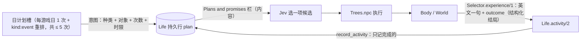
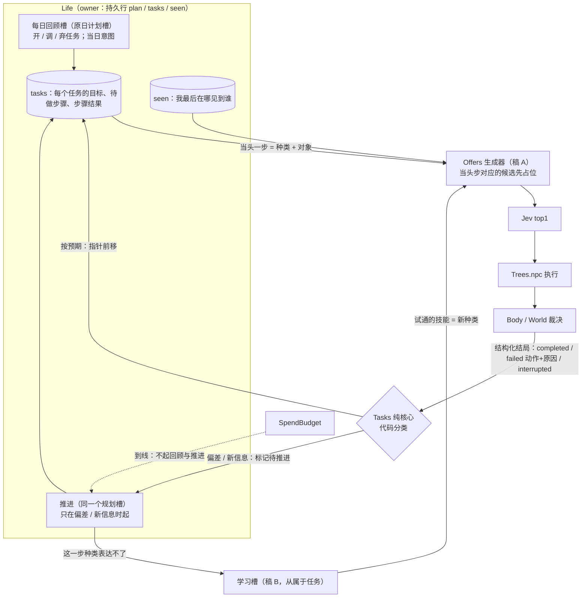
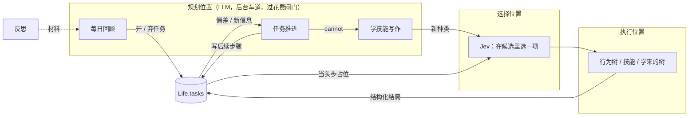

# NPC 长程任务闭环：任务由 Life 持有，偏差时才问 LLM，任务步作为 Jev 的候选（2026-11-19）

分类：统一形态 NPC 新增一层（任务层）的结构决策稿（只定结构、所有权、信任边界、触发、分批、预算与测试矩阵，不调取值）。状态：**概念已由用户定（2026-11-19，原话“全部同意”）；§6 Q-1–Q-6 全按建议（用户 2026-11-19 答复，原话：“全按建议”）；实施待排（统筹页）。**
概念五条见 [`2026-11-11-npc-coordination.md`](2026-11-11-npc-coordination.md)“第二十二个统筹会话的进展”第一条；总纲 [`2026-11-12-npc-architecture-overview.md`](2026-11-12-npc-architecture-overview.md)。
本稿**推翻**稿 A [`2026-11-18-npc-full-capability-coverage-decision.md`](2026-11-18-npc-full-capability-coverage-decision.md) A-5 的“不建目标层”，**重定位**稿 B [`2026-11-18-npc-skill-learning-decision.md`](2026-11-18-npc-skill-learning-decision.md)（学技能从属于任务），
并接手 S1-R8b 留下的规划提示词问题（`.demo/observe/npc-slice1-20261112/s1r8b-0b/results.md`）。成本口径接花费额度稿 [`2026-11-18-npc-spend-budget-decision.md`](2026-11-18-npc-spend-budget-decision.md) §4.2、§6 Q-6。

## 1. 目标与用户已定的概念

起因：S1-R8b 里模型因“Corvin 现在不在”不写 `speak_to`，8 条“问 Corvin”全进 `cannot_yet`；用户追问 NPC 怎样把能力组合成长程任务、按执行反馈规划下一步（“有点像闭环电机”）。
用户 2026-11-19 认可的五条（不改，只细化）：

1. **任务是一等对象，由 Life 持有**，每个 NPC 同时开着的任务有上限。
2. **步骤粒度 = 一项活动（种类 + 对象）**，不细到原语（同稿 A A-3）。
3. **下一步由 LLM 决定，只在偏差或新信息时问**：一次推进写出后两三步，按预期完成就接着做。
4. **任务步只是 Jev 的候选**：可不做、可被打断，interrupted 不算失败，不设执着程度。
5. **学技能改为扩充执行器**，从属于任务：推进时判定“这一步现有种类表达不了”才产生学习任务，学会的技能成为新种类。

连带：日计划退化为每日回顾（开 / 调 / 弃任务）；任务推进属后台车道，花费额度到线即冻结推进；缺口“去找某人”（位置只能来自自己的记忆）。

不做：Jev 逐原语组合；LLM 直接下达命令或绕过选择层；任务之间的依赖图与并行调度；NPC 之间共享任务；把任务写成 Hindsight 里的真值；“执着程度”或承诺加分。

## 2. 现状事实（各附证据，HEAD `abe56110`）

### 2.1 外环现在怎样闭合



- 触发：每帧观察查 `DayPlan.due/3`，只有 `:day`（当日还没采用过计划）与 `:event`（接纳了 `kind:event` 经历）两种（`life.ex:1618-1634`、`:1416-1446`；`day_plan.ex:317-331`）；当日 5 次、间隔 ≥ 3 分钟（`day_plan.ex:77-81`）。
- 闭合点只有一个计数：活动 **completed** 时按 `{种类, 对象}` 给当日意图 `done + 1`（`life.ex:1782-1799`、`day_plan.ex:469-492`）；失败不计，`done` 只由代码增。
- 规划只看材料与“今天已有的意图”（`life.ex:1667-1711`），不看任何一项活动是怎样失败的。

### 2.2 缺什么（四处，均已核实）

1. **没有跨活动的任务状态**。持久行只有当日意图 `{activity, object, times, by, why, done}` 与 `wants`（`day_plan.ex:100-104`、实现稿 §1）；意图之间没有次序与依赖，跨日整份换掉（`day_plan.ex:347-365`）。
   `wants` 只展示成一行 `I would like to …, but I cannot do that yet`（`mind.ex:148-158`），不触发任何动作。
2. **规划只能挑、不能组合**。意图 = 词表里的一个种类重复 n 次；“先找到 Corvin、再问他”写不出：说话候选只给此刻说话范围内的人（`offers.ex:198-216`），
   “去找某人”的候选只有 `distrusted` 选择器、只在此刻观察里找（`registry.ex:76-77`、`mind.ex:241-260`）。S1-R8b 的 8 条 `cannot_yet` 全是这一类，`why` 都是“人不在”。
   规划提示词把 `cannot_yet` 定义为“上面的种类表达不了的事”（`life/day_plan/prompt.ex:40`），与模型的实际用法（“现在做不到”）已经不符（S1-R8b 发现 2）。
3. **执行结果不结构化回外环**。Selector 自己的历史里有结构：`result: :completed | {:failed, 动作名, 原因文字} | {:interrupted, 原因文字}`（`selector.ex:46-50`、`:124-153`）；
   但交给 Life 的经历只有一句英文与 `completed` 布尔（`selector.ex:163-177`），失败的动作与原因只剩在句子里（`Mind.result/1`，`mind.ex:266-270`），Life 只读 `text` / `place` / `completed`（`life.ex:784-808`）。
   被对话打断的活动同样只是 `completed: false`（`runtime.ex:359-375`）。Selector 历史只留 5 条、只在 Runtime 内存（`selector.ex:67`）。所以 Life 分不清失败与打断，也数不出“同一原因失败几次”（稿 B 规划已记：真实运行里 `trigger=failed` 为 0）。
4. **总纲里“选择层都不合适 → 规划层”在代码里不存在**（总纲回路图 `S -->|都不合适| P`、位置表“规划…选择位置报告‘都不合适’”）。实际：Jev 只答 top1、没有弃权项（`selector.ex:260-290`）；
   候选为空时是 `{:error, :no_feasible_activity}`（`selector.ex:248`），按发问失败处理，树等 600 tick 再问（`trees.ex:46`、`:153`），不触发规划。

另记两条事实：所见的相遇条目只写“谁在附近待了多久、最近多少米”，**不记地点**，tags 只有 `kind:sight`、`actor:<cid>`（`life/sight.ex:21-39`、`:314`）——NPC 现在没有“我最后在哪见到某人”的记忆；
写作接口 DeepSeek 一路 `max_tokens` 写死 8192（`life/reflection/writer.ex:46`），S1-R8b 18 次规划应答出向 499–4,406 token（思考占 91%）。

## 3. 依据（2026-11-19 核对原文）

Orkin 与 Humphreys 两篇是下载 PDF 后逐页目视核对；ar5iv / arXiv 的几篇经网页抓取工具摘出原句（未逐页目视）。

- **Generative Agents**，Park et al. 2023，arXiv:2304.03442（ar5iv）。§4.3：“our approach starts top-down and then recursively generates more detail”，粗计划 “divided into five to eight chunks”，
  “recursively decompose this again into 5–15 minute chunks”；“plans are stored in the memory stream and are included in the retrieval process”；“Agents may change their plans midstream if needed.”
  §4.3.1：“We prompt the language model with these observations to decide whether the agent should continue with their existing plan”，反应时 “regenerate the agent's existing plan starting from the time when the reaction takes place”。
  **对应**：计划逐层分解、观察到变化时重排。**取舍**：(a) GA 对每条观察都问模型“要不要反应”——本项目按花费额度只在**代码判出的偏差**时问（§4 K-3）；(b) GA 的计划在记忆流里、可被召回——本项目任务的唯一真值在 Life 持久行，Hindsight 只收开 / 关任务的标准句经历（派生物，同稿 B B-3）；
  (c) 分解只到“一项活动”，不到 5–15 分钟的原语（稿 A A-3）。
- **Inner Monologue**，Huang et al. 2022，arXiv:2207.05608（ar5iv）。§3.2：“continually injecting information from the various sources of feedback into the LLM planning language prompts”；
  反馈三类（§3.3）：Success Detection、Passive Scene Description、Active Scene Description（后者限 “human responses”）；§1：“retry under observed stochastic failure, replan under systematic infeasibility”；
  §4.2 / 附录 A.1：成功检测 “after each step” / “after each policy execution” 回灌。§5 局限：“the LLM planners ignored the environment feedback and still proposed policy skills”，“we assume access to oracle scene descriptors”。
  **对应**：执行结果（成功 / 失败及原因、对方的回答）结构化回灌规划者——正是 §2.2 第 3 条的缺口。**取舍**：IM 每一步都回灌并问一次；本项目按预期完成的步骤不问（用户定 ③），成功检测由代码按 World 裁决的结局给（不另问模型，总纲“能算的归代码”）；
  “被动描述”= 推进时的材料（此刻、近期经历、召回），“主动描述”的对应物是 NPC 自己去看 / 去问（`look_for`、`speak_to` 成为任务步）。“模型无视反馈”的局限由校验点与“同一步连续失败”计数兜住（§4 K-3、K-4）。
- **Voyager**，Wang et al. 2023，arXiv:2305.16291（ar5iv）。§2.3 三种反馈 “Environment feedback … Execution errors … Self-verification”，前两者 “incorporated into GPT-4’s prompt for the next round of code refinement”；
  “If the agent gets stuck after 4 rounds of code generation, then we query the curriculum for another task.”；§2.1 课程的输入含 “Previously completed and failed tasks”，附录 A.1 伪代码 `add_completed_task` / `add_failed_task`；§1 “Complex skills can be synthesized by composing simpler programs”。
  **对应**：完成 / 失败的任务由代码记账并展示给出题者（每日回顾的材料）；推进卡住有轮数上限；学来的技能成为可组合的新种类（稿 B）。**取舍**：Voyager 的课程是自动出题；本项目任务只来自 NPC 自己的回顾与推进（不设自动课程，同稿 B 取舍 (c)）。
- **GOAP / F.E.A.R.**，Orkin，*Three States and a Plan: The A.I. of F.E.A.R.*，GDC 2006（gamedevs.org PDF）。p.6：“These goals compete for activation, and the A.I. uses the planner to try to satisfy the highest priority goal.”；
  老鼠没有攻击动作时 “fails to formulate any valid plan … and he falls back to the lower priority Patrol goal”；p.10 Benefit #3：“dynamic problem solving ability that re-planning gives the A.I.”，“re-planning while taking into account knowledge gained through previous failures”，障碍记进 “working memory”。
  **对应**：多个任务的下一步互相竞争（交 Jev 选）；失败原因记进任务、推进时带上。**取舍**：GOAP 的符号搜索只适合前置条件 / 效果可枚举的机械链——本项目这类链已放进技能（Settler 先例、稿 B）；开放目标（“弄清 Corvin 为什么拆我的屋”）没有可写的效果谓词，下一步交 LLM。
- **HTN**，Humphreys，*Exploring HTN Planners through Example*，Game AI Pro 第 12 章（gameaipro.com PDF）。§12.5：“If the task fails for some reason that is specific to the operator it's running, the plan also fails and forces a re-plan.”，
  “The plan can also fail if the current or any of the remaining task's conditions become invalid.”；§12.7 追丢敌人时 `NavToLastEnemyLoc` 走到 “the last place the enemy was seen”，位置来自 NPC 自己的传感器写进世界状态（`WsHasSeenEnemyRecently`）；§12.8 运行中的计划要有“优先级”，否则重规划会把正在做的步骤半途中止。
  **对应**：步骤失败即回规划者；“去找某人”= 走到**自己最后看见他的地方**（§4 K-8）。**取舍**：HTN 的计划执行器按序执行原语；本项目任务步只是候选，执行与否由 Jev 定，打断不算失败（用户定 ④），所以不需要 §12.8 的计划优先级机制。
- **ReAct**，Yao et al. 2022，arXiv:2210.03629（ar5iv）。摘要：推理 “help the model induce, track, and update action plans as well as handle exceptions”；§2：决策类任务里 “thoughts only need to appear sparsely in the most relevant positions of a trajectory”。
  **对应**：只在相关位置（偏差、新信息）想一次。**取舍**：ReAct 由模型自己决定何时想；本项目由代码判何时问（成本与可审计）。
- **ADaPT**，Prasad et al.，arXiv:2311.05772 v2（NAACL 2024 Findings；只核摘要）：“plans and decomposes complex sub-tasks as-needed, i.e., when the LLM is unable to execute them”。
  **对应**：只在执行不下去时才分解 / 重规划；“这一步现有种类表达不了 → 学技能”是同一思路下移到执行器。
- 已有核对沿用：SayCan（稿 A §3，可行性由另一方给、判断者只在技能里选）；Generative Agents 代码里计划“到点即完成”（日计划决策稿 §2）。

**未核到**：Orkin *Applying Goal-Oriented Action Planning to Games*（AI Game Programming Wisdom 2）、F.E.A.R. SDK 源码、ADaPT 正文、Inner Monologue 附录 A.1 原页（只经抓取工具）、Generative Agents 代码本轮未复读。

**原创决策**（检索范围：上列七篇与稿 A / 稿 B / 日计划决策稿已核来源；没有找到“LLM 规划者 + 封闭分类器选择 + 行为树执行”三层里任务层怎样放的现成做法）：
**任务由 Life 持有 + 代码判偏差才问 LLM + 任务步只作为 Jev 的候选**的组合。理由：GA / IM / ReAct 的规划者每步或每条观察都问模型，花费额度不允许（§4 K-9）；HTN / GOAP 的执行器按序执行计划，与“驱动力口径、可不做、可打断”（总纲 2026-11-13、用户定 ④）冲突；
Voyager 的反馈回灌与轮数上限可直接借，但它是单代理、自动课程。风险、不变量、验证见 §4 末与 §5。

## 4. 决策项



- **K-1 任务的数据形状与持久化**。Life 持久行新键 `"tasks"`（照 `"plan"` / `"reflection"` 的先例：初值、加载边界 `put_new` 补旧行、与其它键同一次保存；不另起 NpcMemory kind——开着的至多几个、行很小）。纯函数核心新模块 `NpcServer.Life.Tasks`（同 `Life.DayPlan` 的写法）：

  ```
  "tasks" => %{
    "open"   => [任务],                 # ≤ @max_open（3）
    "closed" => [任务的收尾小结],        # 最近 5 条，给回顾看（Voyager 的“完成 / 失败列给出题者”）
    "calls"  => %{"day", "n"},          # 本游戏日发出了写作请求的推进次数（额度见 K-9；口径同 DayPlan 的 admit / refund）
    "last_at_ms", "counts" => %{opened, advanced, done, dropped, expired, stuck, rejected, failed}
  }
  任务 = %{"id" => "t<日号>:<序号>", "goal", "why"（模型原文，英文，只给判断者读）, "opened_day", "expires_day",
          "steps" => [%{"kind", "object" | nil, "why"}],        # 待做，≤ 3，当头那条是此刻的候选
          "log"   => [%{"kind", "object", "outcome", "act", "reason", "at_ms"}],   # 最近 6 条步骤结局
          "waiting" => nil | 待推进的原因,  "head_since_ms", "head_failures", "rejected_in_row"}
  ```

  **与 `"plan"` / `wants` 的关系**：概念上当日意图 = “一步、可重复、当日到期”的任务（用户定）；存储上 v1 **不迁移** `"plan"` 的意图——生命周期不同（日内按次数到期 vs 跨日按步骤推进，AGENTS §2.2.2“生命周期不同不强行共用”），
  记账与 S1-R8 金标已稳定（见 §6 Q-1）。`wants` 改义为“连任务也写不出的事”（即学技能的来源之一）；“想问不在场的人”这类改由回顾开任务表达，S1-R8b 待定的 (a) / (b) 两个提示词改法都不再需要。
  **上限与过期**（原创取值）：开着的任务 ≤ 3；`expires_day = 开任务的日号 + 2`（游戏钟 ×24 下约现实 2 小时），到期由代码关为 `expired` 并写一条经历，不问模型；满了时回顾 / 推进再开新任务被校验拒绝（要先弃一个）。

- **K-2 结构化步骤结局（执行层补经历结构）**。`Selector.experience/1` 给 `outcome`：Selector 历史里已有的 `:completed | {:failed, 动作名, 原因文字} | {:interrupted, 原因文字}` 原样带出（不另造）；
  不另给 `completed` 布尔，“是否完成”由 `outcome` 推出（DRY）。`Life.activity/2` 在接纳活动经历的**同一次保存**里调 `Tasks.record_step/4`（与 `DayPlan.record_activity/4` 并列）：按 `{种类, 对象}` 找开着的任务里**当头一步**相同的，最早开的那个记账——
  不经 Selector 传任务 id（与意图记账同口径：碰巧做了同一件事也算数）。这一项无行为变化，先做（批 T-0）。

- **K-3 推进的触发：代码分类，只在偏差或新信息时问**（规则在 `Tasks` 纯核心；每条都是 Life 已经拿到的结构化数据，不解析文字）：

  | 结局 / 事件 | 判为 | 处理 |
  |---|---|---|
  | 当头步 completed，后面还有步骤 | 按预期 | 指针前移，不问 |
  | 当头步 completed，没有下一步了 | 新信息（步骤用完） | 待推进：模型判 done 或写后续步骤 |
  | failed，原因 ∈ `Brain.Tree.transient/0` 或 `world_timeout`（Settler 同口径，`trees.ex:231-232`） | 瞬态 | 步骤留着、不问；同一步连续第 2 次瞬态失败 → 偏差 |
  | failed，其它原因 | 偏差 | 待推进，带动作名与原因 |
  | interrupted | 不算失败（用户定 ④） | 步骤留着，不问，不计失败 |
  | 任务对象里的人对我说话（conversation 经历带 `actor:<对象>`） | 新信息（IM 的“人的回答”） | 待推进 |
  | `kind:event` 经历的 `actor:` / `place:` tag 落在任务对象里 | 新信息 | 待推进 |
  | 当头步满 6 游戏小时没被做（`head_since_ms`） | 停滞 | 待推进一次 |
  | 到期 | — | 关为 expired，写经历，不问 |

  “待推进”= 任务的 `waiting` 置上原因（同 `event_waiting` 的写法）；Life 在每帧观察上查（同 `maybe_plan/1`：槽空、有观察与身体状态、过最小间隔、额度、花费闸门），一次只推进一个任务（最早置上的）。
  6 游戏小时、“连续第 2 次”是**原创取值**。对话里的“边做边答”不改任务（那一轮活动没变）。

- **K-4 推进调用的输入输出契约（唯一信任边界）**。`Life.Tasks.Round.write/1`（同 `DayPlan.Round` 的结构：快照在起槽时取齐、worker 不回问 Life、写一次不重问、`wrote` 标记）。
  输入（英文）：人格卡；此刻一块与两路召回材料（复用规划的取材函数，不复制）；任务的目标与理由、已做步骤的结局（`Mind.result/1` 的写法，DRY）、这次为什么问（K-3 的原因）；任务对象是人时多一路按 `actor:<cid>` 的召回（`Mind.recall_queries` R1 同一问句）；
  可写的种类与对象（**与回顾共用同一份词表渲染**；T-2 之前任务词表就是 `Offers.plan_kinds/1`，T-2 加 `look_for` 时再立任务词表入口，见 §7 K-0 复测与评审修正）；其它开着的任务各一行。输出恰为一个 JSON 对象：

  ```
  {"task": "continue" | "done" | "drop", "steps": [{"activity", "object", "why"}], "cannot": null | {"want", "why"}, "note": "<一句，第一人称>"}
  ```

  校验 `Tasks.check/3`（**只此一处**）：围栏与 JSON 形状、键恰好这四个；`continue` 时 `steps` 1–3 条或 `cannot` 非空，`done` / `drop` 时两者皆空；每条步骤的种类与对象按词表核对——**抽出 `DayPlan.check/3` 现有的单条核对函数共用**，不另写一份。
  合格 → 采用（替换待做步骤、记 `note` 进 log、清 `waiting`、`rejected_in_row = 0`）；`cannot` → 交学习（K-7）；不合格 → `rejected`，任务不动、`waiting` 留着、`rejected_in_row + 1`，满 3 次关为 `stuck` 并写经历（Voyager“卡住 4 轮换任务”的对应，3 是**原创取值**）；写作失败 → `failed`，同日计划的失败处理与额度退回规则。
  采用之后的步骤是可信结构：生成器只按种类 + 对象去匹配本轮候选，不再解析。

- **K-5 每日回顾（原日计划退化）**。同一个规划槽、同一次 `:day` 触发；输出在 `intents` / `cannot_yet` 之外加 `tasks`：`{"open": [{"goal","why","steps"}], "drop": [任务 id]}`，材料加“开着的任务（含步骤与最近结局）”与“最近关掉的任务”（这两块与持久行渲染同批在 T-1 写，每行须带任务 id，模型才能写 `drop`；见 §7 K-0 评审修正）。
  `:event` 重排的职责转给 K-3 的“新信息”，回顾的当日额度从 5 降到 2（1 次日界 + 1 次事件），**原创取值**。模板改动使 S1-R8 金标测试要重定，先离线测（K-0）。`cannot_yet` 定义改为“连开一个任务也表达不了的事”。

- **K-6 任务步怎样进入 Jev（经稿 A 生成器缝，占 A-4 的 C）**。开着的任务各取当头一步 `{种类, 对象}`；`Offers.candidates/4` 生成本轮候选后，与当头步相同种类 + 对象的候选在 A-4 ③ 的总上限 C 里**先占位**（同“今日 open 意图点名的项”，至多 3 项）。
  当头步此刻不可行（没有对应候选，如 Corvin 不在说话范围）就不出现——候选只来自生成器，任务不造候选（稿 A A-1 的唯一来源）；所以模型要把“先去找”写成前一步。候选判据不改（同一生成器一处定义）；
  “这是哪个任务的哪一步”只进 `Plans and promises` 栏：每个任务一行 `Task: <goal> — next: <种类 名字>; done so far: <n> steps`，**不写该选什么**（用户 2026-11-13“靠内容涌现”）。是否选它由 Jev 定。

- **K-7 打断、恢复与学技能的接口**。打断（对话回合 halt、Jev 选了别的、Life 重启）都不动任务：步骤留着，下一轮照常是候选；任务状态只在持久行，重启后原样恢复。
  推进应答的 `cannot` = 稿 B 新的唯一学习来源之一（另一来源“反思时代码数出的反复失败”现在可以从 `log` 的结构化结局数，不再从文字猜）：学习任务挂在这个任务下（任务记 `"learning" => 技能名`），技能试通后成为新种类进词表，下一次推进可用；放弃则推进时看到“我没学会”。
  稿 B 的 B-1–B-6（词汇、译码、技能本、试用、预算）不变，只改 B-4 的触发来源。

- **K-8 新活动种类 `look_for`（去找某人）**。位置**只能来自 NPC 自己的感知**：Life 新增持久的 `"seen" => %{cid => %{"at_ms", "at" => [x, y, z]}}`——每帧观察只在内存里更新“这个人此刻在哪”（观察里本来就有，是 AOI 内的合法感知），
  在相遇结束（`Life.Sight` 写出相遇条目）的那次保存里落库；至多 16 人、按最近见到淘汰（**原创取值**）。生成器 `Offers.look_for/2`：对 `seen` 里此刻不在观察中的人各生成 `look_for:<cid>`，参数冻结为那个旧位置（同 `speak_to:` 冻结目标），
  判据 `Go to where I last saw <名字 (actor cid)> (<多久以前>, near <最近的地名>) and look for them.`；执行 = `travel` 到那里再等至多 N tick，期间此人进入观察即 completed，否则 failed `not_found`（偏差，回推进）。
  **不新增任何服务端查询**：不问 World / Scene 某人现在在哪（HTN §12.7 同理：走到最后见到的地方，不作弊）。“在某处等某人”（`wait_for`）放后一批，需要时再加。
  **待定（K-0 评审第 8 条）**：词表里可点名的人 = 关系 ∪ 此刻观察（Life 起槽时展开），所以回顾时在场、又不在关系里的人，到推进时若已离开，会从词表消失，
  任务里点名他的步骤届时核不过 `Tasks.check/3`。T-1 / K-8 设计 `seen` 时一并定：`seen` 里的人是否进词表（进则推进时仍可点名，与 `look_for` 的来源同一份）。

- **K-9 花费闸门与预算上界**。推进与回顾都是后台车道：Life 的 `background/2` 加一种 `:task`（回顾沿用 `:plan`），到线时在 `admit` 之前拒，`waiting` 留着，**已写好的步骤照样是候选**（执行不调模型），即“冻结推进、不冻结行动”。
  额度（原创取值）：**推进与学习写作共用每人每游戏日 12 次**（稿 B 放宽后已批准的 12 次写作，用户 2026-11-18 定），学习仍受“每任务 ≤ 4 轮”；推进两次至少隔 3 分钟（同日计划）。每次写作 `max_tokens` 4096（Writer 加按次参数，稿 B 规划 S-3 已列）。
  上界（DeepSeek 高峰价：入未命中 $0.3、出 $1.2 / 百万）：每次入 ≤ 6k、出 ≤ 4,096 ≈ $0.0067；3 人 × 24 游戏日 × 12 ≈ **$5.8 / 天**，与稿 B 原先给学习的 $5.7 同额——全天高峰最坏 $51.6 + $5.8 = **$57.4 < 停止线 $58.5**。
  回顾降到 2 次 / 游戏日再省约 $0.7（按 S1-R8b 实测每次约 $0.0034）。读数：S1-R8b 规划调用平均入 3.3k / 出 2.0k（约 $0.0034），18 次里 1 次出向 4,406 > 4096——上限 4096 时少数应答会被截断而记为失败（照扣额度），K-0 量这个比例。
  **若推进单独再开 12 次**：+$5.8 → $63.2，超停止线，须先报用户（花费额度稿 Q-6 的规则，不自行突破 $65）。



  **分工**：回顾一天一次，管“开哪些任务、今天的例行意图”；推进管“这个任务下一步”；反思照旧写日记（材料来源，不改任务）；学技能只在推进说表达不了时起；Jev 只在候选里选；执行层只回报结局。每份状态一个 owner：任务与 `seen` 归 Life，候选归 Offers，最近活动归 Selector，世界真值归 World。

- **K-10 分批与依赖**（每批先测后改 → 独立评审 → 提交；每批一条真实客户端短场景或说明为何不需要）：

  | 批 | 内容 | 依赖 / 与稿 A、B 的先后 |
  |---|---|---|
  | T-0 | K-2 结构化结局（无行为变化） | 无；可与稿 A 批 1 并行（触点 `selector.ex` 不同函数） |
  | K-0 | 离线探索（不是验收）：回顾新模板 + 推进提示词 | 只依赖 T-0 的形状；**取代** S1-R8b 待定的 (a) / (b) 离线重放 |
  | T-1 | `Life.Tasks` 纯核心、`"tasks"` 键、回顾输出 `tasks`、推进槽与 K-3 触发、花费闸门、Mind 栏、K-6 占位 | 在稿 A 批 1 之后（批 1 改 `Offers` 次序与冻结参数路径；占位要在同一处实现 C） |
  | T-2 | K-8 `seen` 与 `look_for` 生成器 / 树 | 在稿 A 批 1 之后（复用其“非说话候选的冻结参数”）；与稿 A 批 2 可并行 |
  | T-3 | 稿 B 按新定位开工：B-4 触发改为推进的 `cannot` | 稿 B 的 S-1a / S-2（词汇、译码、技能本，纯函数）现在即可并行；S-3–S-5 在 T-1 之后 |

**不变量**：① 任务只有一个 owner（Life 持久行），Mind / Hindsight 只读或收派生经历；② 任务状态只由代码按结构化结局与时钟改，LLM 只在回顾 / 推进的输出里新写、改写、关闭，且只经 `Tasks.check/3` 一处进入；
③ 任务步只经生成器的候选到达 Jev，不直接下命令，World 仍逐步裁决；④ 人在哪只来自本 NPC 观察过的位置；⑤ 推进失败、额度用完、花费到线都不挡选择与行动。
**风险**：模型写出永远不可行的步骤（只是不出现为候选，靠停滞与到期收掉）；推进频率被“新信息”放大（额度与最小间隔兜住）；Jev 不选任务步（驱动力口径下是合法结果，要实跑看）；`seen` 的旧位置让 NPC 白跑（自然结果，`not_found` 回推进）。

## 5. 测试矩阵（按 `../Voxim/Docs/Testing.md`）

| # | 层 | 证明什么 | 做法 |
|---|---|---|---|
| K-0 | 离线探索（不是验收） | 新模板下回顾能否把“问不在场的 Corvin”写成任务、推进能否按结局写出合法步骤；出向超 4096 的比例；入向量级 | 回顾：S1-R8 六份真实材料经产品渲染 × 3。推进：任务取回顾的真实输出，步骤结局取实跑导出里真实出现过的结局与原因（`select` 历史），不手写产品产生不了的结局。产品 `Tasks.check/3` 判；真实 DeepSeek，请求数事先封顶（约 40 次、约 $0.15），`plan.md` 发问前写、判定规则不改 |
| K-1 | 算法 | 校验点：合法即采用、反例逐条显式失败 | 反例：多键 / 缺键、未知种类、对象不在词表、`continue` 无步骤、`done` 带步骤、步骤 > 3、开任务超上限 |
| K-2 | 算法 | K-3 分类表每一行；记账只动当头步；到期、停滞、`stuck`；额度 admit / refund / 跨日 | 小例手算；含反例：interrupted 不计失败、瞬态失败第 1 次不推进、碰巧同种类同对象的活动也记账 |
| K-3 | 算法 | `look_for` 只从 `seen` 生成、不出现观察里的人、参数冻结；`seen` 上限淘汰 | 小观察序列手算；反例：从未见过的人没有候选 |
| K-4 | 集成 | Runtime → Selector → Life 的结构化结局（含对话打断） | 真实 Runtime / Life / 独占 PostgreSQL，Jev 替身；断言 Life 收到 `{:failed, 动作, 原因}` 与 `{:interrupted, …}` |
| K-5 | 集成 | 回顾开任务 → 当头步成为候选并占位 → 完成前移 → 失败触发推进 → 采用新步骤 → done 关闭；重启读回；到线冻结推进而步骤照常可选 | 真实 Registry / Body / Scene / World / Life / 独占 PostgreSQL；写作用回环替身回放 K-0 导出的真实应答；Jev 替身；花费结论注入 |
| K-6 | 真实客户端短场景 | 玩家能看到 NPC 为一件事连做几步并按结果改主意 | 一个 NPC、真实写作与 Jev；玩家角色拆一格 NPC 的建筑后走出视野；判定（驱动力口径，不要求“必须去找”）：任务开出、`look_for` / `speak_to` 出现在候选、被选中时权威结果可见、推进次数与用量配对、`seen` 不含未观察到的位置；≤ 10 分钟，UDP 基线与 Tcpip 4266 守护同扩人数稿 §5 |

不覆盖：多 NPC 之间的任务交互；长时间（跨多个游戏日）的任务完成率——它属于实跑读数，不是本层验收。

## 6. 要用户定的

**已定**（用户 2026-11-19 在对话里答复，原话：“全按建议”）：Q-1 (a) 分开存；Q-2 按 K-3 表；Q-3 共用 12 次写作、出向 ≤ 4096；Q-4 取值按原创初值、实跑后调；Q-5 v1 只做 `look_for`；Q-6 不实现“都不合适 → 规划”，总纲回路改为“执行结局偏差 → 任务推进”。

1. **Q-1 意图与任务的存储**：(a) v1 分开存，`"plan"` 意图不迁移（**建议**：生命周期不同，记账已稳定）；(b) 现在就把意图并成“一步可重复的任务”，一处存（要改记账与 S1-R8 金标，范围大一倍）。
2. **Q-2 推进的触发集合**：按 K-3 表（**建议**）；或再收窄为“只有失败与步骤用完”（更省，但听不到对方的回答）。
3. **Q-3 额度**：推进与学习共用每人每游戏日 12 次写作、每次出向 ≤ 4096（**建议**，上界 $57.4 在 $58.5 内）；或推进另开额度（须同时上调每日上限，超 $65 前不做）。
4. **Q-4 取值**（全部**原创取值、实跑后调**）：开着的任务 ≤ 3、一次推进 ≤ 3 步、任务 2 个游戏日到期、当头步 6 游戏小时停滞、连续 3 次不合格关为 `stuck`、瞬态失败连续 2 次算偏差、回顾每日 2 次、`seen` ≤ 16 人。
5. **Q-5 “去找某人”**：v1 只做 `look_for`（走到自己最后见到的地方看一看），`wait_for` 后做（**建议**）。
6. **Q-6 总纲“都不合适 → 规划”**：不实现（Jev 没有弃权项，加一个会改变选择分布、要先离线实验；任务层的偏差由执行结局触发），总纲那条箭头改为“执行结局偏差 → 任务推进”（**建议**）。

## 7. 进度

- 2026-11-19：初稿（第二十二个统筹会话派写）；只读代码与原文（§3 写明核到 / 未核到），未改代码、未调模型、未实跑。等 §6 答复；稿 A A-5、稿 B B-4 与总纲回路图的对应改写在用户定后由统筹会话同步。
- 2026-11-19：用户答 §6 全按建议（原话：“全按建议”）。实施顺序按 K-10：T-0 结构化结局（无行为变化）→ K-0 离线（开跑前报用量）→ T-1 / T-2（稿 A 批 1 之后）→ T-3（稿 B 按新定位）。稿 A A-5、稿 B B-4、总纲回路图由统筹会话同步改写。
- 2026-11-19：**T-0 实现**（基于 `a934c670`，未提交，待统筹评审）。
  - 改了什么：`Selector.experience/1` 去掉 `completed` 布尔，改给 `outcome`——Selector 历史里这一项的结局原样（`:completed | {:failed, 动作名, 原因文字} | {:interrupted, 原因文字}`），句子仍由同一份结局经 `Mind.result/1` 渲染；
    `Life` 的日计划记账改为 `outcome == :completed` 才记（与原来 `completed` 为真同义：失败、打断都不记）。Life 不新增任何状态（见偏差②）。
    经历句子、tags、计划记账、反思、Jev 请求体都没变。moduledoc（`Selector`、`Life`）与 `apps/npc_server/lib/npc_server/README.md` 同步。
  - 与稿件偏差：① 稿件写 `experience/2`，代码里是 `experience/1`（只有 `state` 一个参数），按代码（§2.1 图与 K-2 已改成现状）；② K-2 的 `Tasks.record_step/4` 属 T-1（`Life.Tasks` 尚不存在），T-0 不建。
    初版曾在 Life 加 `observe/1` 的 `last_activity` 与 `activity_pending.step`，按评审删除：它们复制了 Selector 历史已拥有的事实（K-9“最近活动归 Selector”），T-0 没有产品读者（AGENTS §2.2.1、§2.2.9）。
    `prepare_activity` 只把 `outcome` 交给日计划记账；Life 侧可观测面留到 T-1 以持久行 `tasks.log` 断言（`Tasks.record_step/4` 届时在同一次保存里直接读 `experience` / `outcome`）；
    ③ `completed` 不保留为派生字段，直接删（DRY：唯一读它的 Life 改读 `outcome`）。
  - 测试：`Selector.experience/1` 单测覆盖三种 `outcome`（失败 `{:failed, "travel", "no_path"}` / `{:failed, "eat", "insufficient_material"}`、完成 `:completed`、新增的打断 `{:interrupted, "to talk with Brann"}`）；
    集成用例读 `Runtime.observe/1`（`Body.observe/1` 同）的 `select` 历史 `result`，并断言对它求 `Selector.experience/1` 带出同一份 `outcome`：`npc_selector_test` 真实 Runtime + Tree + Life 的对话打断用例为 `{:interrupted, "to talk with Visitor"}`，`npc_offers_integration_test` 真实 World 拒绝进食用例为 `{:failed, "eat", "insufficient_material"}`。
    两个直接构造经历的单测夹具（`npc_life_test`、`npc_dialogue_life_test`）改为 `Selector.experience/1` 的形状（后者原先的 `%{text, place}` 是产品产生不了的输入）。
    评审修正后回归 `npc_selector` / `npc_offers_integration` / `npc_life` / `npc_dialogue_life` / `npc_life_day_plan_integration` / `npc_life_day_plan` / `npc_spend_life` / `npc_registry` 共 8 个文件 186 通过、1 排除、0 失败（WSL 本机 PostgreSQL 独占测试库，跑完删除）；
    `MIX_ENV=test mix compile --warnings-as-errors --force` 无警告；改动的 `.ex` / `.exs` 过 `mix format --check-formatted`。
- 2026-11-19：**K-0 离线探索**（基于 `f39047a7`，未提交，待统筹评审；规格 / 结果 `.demo/observe/npc-task-k0-20261119/plan.md`、`results.md`）。
  - 产品纯函数（未接进 Life / Runtime）：`Life.Tasks.check/3`（推进 `:advance` 与回顾 `{:review, 此刻分钟, 开着的任务}` 的唯一校验；单条种类 / 对象、`cannot`、意图与 `cannot_yet` 复用
    `DayPlan` 抽出的 `check_kind/3`、`check_want/1`、`check_lists/3` 等，`DayPlan.check/3` 行为不变）、`DayPlan.Prompt.review_system_prompt/2`（K-5 新模板）与 `user_message/2` 的任务两块、
    `Life.Tasks.Prompt`（推进提示词）、`Offers.task_kinds/1`（= `plan_kinds/1` + `look_for`，只是种类名，生成器属 T-2）；词表渲染从 `DayPlan.Round` 挪到 `DayPlan.Prompt.activities/1`，三者共用。
    单测：改前 27 项红，改后 6 个文件 147 通过、1 排除、0 失败。
  - 真实 DeepSeek（生产写作位置）40 / 40 应答（回顾 S1-R8 六份材料 × 3、推进 22：任务取回顾的真实输出，结局只取 S1-R7 / S1-Z / spend3-01 select 历史里真实出现过的），
    入 134,752（未命中 42,342）、出 39,109（思考 26,308），非高峰实价约 $0.03（全高峰约 $0.06）。
  - 判定：**Q1 回顾整份合法 12 / 18，落空**——6 份被拒全是 `{:unknown_object, "confront_wrecker", "actor …"}`（任务步把 Corvin 写成静态种类的对象；新格式行的 `object` 引起）；
    **Q2 成立**（R2–R7 合法 9 / 9 份都开了点名 Corvin 的任务，`look_for → speak_to` 一类；`cannot_yet` 不再以“人不在”为理由）；**Q3 推进合法 22 / 22、Q4 点名 0 错、Q5 出向 > 4096 为 0 / 40（最大 2,389）、Q6 入向最大 4,457，均成立**。
  - 提示词问题与建议（只建议）：① 两份模板的格式行把 `object` 限定为“列有名单的种类，否则 null”，回顾复测一轮（或统筹议 `confront_wrecker` 这类对人候选在 Offers 里可点名）；
    ② 失败原因是标识符会被误读（`gather: exhausted` = 候选用尽，2 / 2 被读成疲劳），建议 T-1 前单独议 `Mind.result/1` 的原因写法（同时影响 Jev，需另做对照）；
    ③ `look_for` 在 T-2 前做不了，停滞推进 5 / 5 原样保留它，建议 `look_for` 进词表与 T-2 生成器同批上线；④ 列表外的人（Tobin）1 / 18、`cannot_yet` 与任务重复（4 份）、开放式目标按此刻状态判 done（4 份）只记录。
    ⑤ K-9 的 4096 出向上限与“入 ≤ 6k”假设在本材料上成立；单次推进高峰价实测约 $0.0011。
- 2026-11-19：**K-0 复测**（回顾；未提交，待统筹评审；规格 / 结果 `.demo/observe/npc-task-k0-20261119/retest-1/plan.md`、`results.md`）。
  - 改法（统筹定）：回顾与推进格式行的 `"object"` 共用 `DayPlan.Prompt.object_slot/0`——`<null, unless the kind's line above lists names; then one of those names, in quotes>`，形状仍为“键在、值 null”（与 `Tasks.check/3` 一致），可点名范围不变；
    `look_for` 移出 `Offers.task_kinds/1`（T-2 之前 = `plan_kinds/1`，与 T-2 生成器同批上线），K-4 “含 `look_for`”届时成立。单测先红（3 项）后绿（`npc_life_tasks*`、`npc_life_day_plan_prompt` / `_day_plan` / `_day_plan_round` 5 个文件 125 通过）。
  - 真实 DeepSeek 24 / 24 发出（回顾 S1-R8 六份 × 3 = 18；推进格式行也变了，加抽测 6），入 79,081（未命中 30,191）、出 51,724（思考 42,825），非高峰实价约 $0.036（全高峰约 $0.071）。
  - 读数：**Q1 回顾整份合法 17 / 18，成立**（K-0 12 / 18；静态种类点名 6 → 0；唯一被拒 `{:too_many_items, 6}`：5 条意图 + 1 条 `cannot_yet`）；**Q2 11 / 15，成立**（Corvin 任务 12 个里 9 个是 `confront_wrecker → speak_to Corvin`）。
    另记：`cannot_yet` 17 条（11 条提 Corvin，0 条以“人不在”为理由）；任务与 `cannot_yet` 重复 6 份（K-0 同口径 3）；点名列表外的人 0（Tobin 进了 `cannot_yet`）。推进 5 / 5 应答合法，A02 `finish_reason=length`（8192 全是思考）。
  - 新发现（只建议，交统筹）：① 不点名的 `confront_wrecker`（判据“附近的那个人”）代替 `look_for` 成了 Corvin 任务的第一步，长思考也集中在这里，是 K-0 建议①的另一条路（对人登记候选可点名）的又一证据；
    ② `gather: exhausted` 误读仍在（推进 F 3 份里误读 2 份、读对 1 份），这次让 A02 思考跑满 8192，建议提前议 `Mind.result/1` 的原因写法；
    ③ 出向 > 4096 有 3 / 24（K-0 0 / 40），按 K-9 的 4096 上限，回顾合法会降到 15 / 18；先解决①②再议上限。
- 2026-11-19：**K-0 评审修正**（未提交，待统筹复核；方向按用户原话“记得专注happy path，其他外围兜底保护措施可以随着实验根据设计慢慢加”）。
  - `Tasks.check/3` 回顾的 `drop` 按 id 去重后再数“开着的任务 ≤ 3”，结果里的 `drop` 也是去重后的（反例：已开 3、弃同一 id 两次、再开 2 → `{:too_many_open, 4}`；改前被放行）。
  - 删 `Offers.task_kinds/1` 与其镜像单测（只有离线脚本一个调用方、恒等于 `plan_kinds/1`）：T-2 之前任务词表就是 `plan_kinds/1`，**T-2 加 `look_for` 时再立任务词表入口**；`task_k0.exs` 改调 `plan_kinds/1`。
  - 删 `DayPlan.Prompt.user_message/2` 的 `open_tasks` / `closed_tasks` 两块与其单测（没有调用方，K-0 也没用到）：推到 T-1 与持久行渲染同批，届时每行须带任务 id（模型写 `drop` 要用）。
  - `DayPlan.Prompt` 公开 `fill_template/3`（模板 + 人格卡 + 词表 + `"object"` 一栏），回顾与推进共用；`Tasks.Prompt.system_prompt/2` 改用它，`object_slot/0` 随之收回为模块属性；
    `Tasks.Prompt.task_line/2` 没有外部调用方，改私有。`DayPlan.Prompt` 模块说明改成现状（本模块渲染词表、`review_system_prompt/2` 直接收词表）。
  - 评审第 8 条（推进时可点名的人 = 关系 ∪ 此刻观察，回顾时在场、不在关系里的人推进时会从词表消失）记在 K-8，T-1 / K-8 设计 `seen` 时定。
- 2026-11-19（第二十二个统筹会话）：K-0 复测暴露的两项，用户定“都按建议做”（用户 2026-11-19 在对话里答复，原话：“都按建议做，开工”），排在 T-1 之前：
  ① **对人的登记活动改由生成器展开、可点名**（如 `confront_wrecker`）：同 `speak_to` 的做法，候选 `种类:<cid>`、对象 `%{"actor" => cid}`，此刻观察里满足作者条件的人才成为候选；计划 / 任务词表里该种类 `objects: :people`。
  ② **失败原因码改成直白英文**：执行结局的原因在给模型看的文字里（`Mind.result/1` 等，Jev 与规划 / 推进共用）改写成一句直白描述（如 `exhausted` → 这堆料采完了），改前后各做一次请求数封顶的离线对照。
- 2026-11-19：**① 对人的登记活动改由生成器展开、可点名**（实施子会话，基于 `8f260bc1`，未提交，待统筹评审；未调模型、未起 release）。
  - 源码事实：登记项 `{"person": "distrusted", "stay_ticks": n}` → `run: {:person, :distrusted, n}`（`registry.ex:673-684`，选择器表 `:77`）；作者条件**由代码判定**，就是
    `Mind.person(:distrusted, _)`：观察里 Life 信任 ≤ −0.2 的人（与快照写 `Distrusts` 同一界限 `@distrusts`，`mind.ex` 原 `:239-260`），原来在执行时（树的 `person_args`，`trees.ex` 原 `:176-183`）
    才选最低的一人、选不到以 `failed (travel: nobody_distrusted)` 结束；判据里“曾毁过我建的东西”只是作者写给 Jev 的英文（`s1r7/scripts/params-s1r7.exs:81-88`），代码的对应物是信任（规则模式一次破坏 −0.35）。
    所以作者条件能在 Offers 侧按人判定，不需要发明规则。`Offers.registered/2` 原样列出它（`kind` = 登记名、对象 nil），`plan_kinds/1` 给它 `objects: :none`。
  - 改法：`Mind.person/2` → `Mind.people/3`（选择器、观察、发问那一刻 Life 视图的 `relationships`；满足条件的人全列，信任低 → 近 → id 小在前，次序沿用原选人规则）；
    新生成器 `Offers.people/2`：每项对人的登记 × 满足条件的每个人一个候选，名字 `<登记名>:<cid>`（`vacant_name` 避让）、`kind` = 登记名、`object` = `%{"actor" => cid}`、
    判据 = 作者原句 + ` That person is <名字> (actor <cid>).`（**原创措辞**，未离线测）、登记的地名原样、冻结 `target` 与说话项同形（同一个 `person_target/1`）。
    `registered/2` 与 `kinds(:registered)` 不再列对人的项；`kinds(:people)` 给 `objects: :people`（Life 起槽展开可点名的人，与说话同一套，`life.ex` 的 `vocabulary/2` 不用改）。
    生成器次序 `[:registered, :people, :speak_to, :eat, :craft]`：`:people` **紧跟登记项**而不是追加在末尾——它展开的仍是作者登记的项，原来就排在登记项里；部署里 confront_wrecker
    是最后一项登记，放这里请求体次序不变（只是名字与判据带上人），说话 / 背包的相对次序也不变（说明写在 `@generators` 旁）。
    冻结路径：Runtime `frozen/1` 对带 `target` 的候选交 `%{kind:, target:}`（原来说话交 `speech: target`）；树的说话分支与对人分支共用守卫 `targeting?/3`（按冻结的 `kind` 分辨，种类名唯一由登记边界保证），
    对人分支 `travel` 到 `Map.take(target, ["entity_id", "entity_epoch"])` 再待登记的停留；`Offers.speak_kind/0` 是说话种类名的唯一定义。`Offers.candidates/4` 第 4 个参数由 `buildings` 改为这次发问的 Life 视图（读 `buildings` 与 `relationships`）。
  - 与要求的偏差（请统筹定）：(a) 覆盖登记 travel 改为 `{:offer, [:registered, :people]}`——一个条目由两个生成器给出，`{:offer, 生成器}` 允许写列表（`generators/1` 用 `List.wrap`），T-A1 用例随之放宽；
    不这样做 `:people` 进不了 `generators/1`（候选只从覆盖登记生成）。(b) 执行时的 `nobody_distrusted` / `life_not_ready` 不再产生（没有人满足条件就没有候选）；`stale_target` / `target_moved` 仍由 travel 报。
    (c) 对话回合里替换来话者说话候选的过滤原来按“有 `target` 且是来话者”，现在对人的候选也有 `target`，改为只换 `kind == speak_to` 的那一项（否则会误删 `confront:<来话者>`）。
    (d) `speak_to/2` 的推导式仍按 `entity_epoch` / `name` 过滤观察里的角色（原行为；有两个集成用例的手写观察不带 `entity_epoch`，一度因此让发问 worker 崩溃，已恢复原过滤）；`people/2` 不加这层过滤（真实观察总带）。
  - 测试（WSL；`cd apps/npc_server && mix test --no-start <文件>`；数据库 `npc-dev-pg-20261117`:55480，每个 VM 自建 `mmo_test_*` 独占库、跑完删；日志 `.demo/observe/npc-reason-wording-20261119/logs/p1-*.log`）：
    先红：`npc_offers_test` / `npc_mind_test` / `npc_life_day_plan_test` 共 13 红（`people/2`、`Mind.people/3`、生成器次序、覆盖登记、`registered/2` 不列对人项、`plan_kinds` 可点名），
    `npc_selector_test:731`（纯树：冻结目标 travel、说话目标不 travel）、`:1430`（新集成：真实 World 拆一格 → Life 信任 −0.35 → 下一问出现 `confront:<cid>`、判据写明对象、排在登记项之后；选中 → travel 参数恰为冻结身份；经历种类 / 对象）、
    `npc_registry_test:1519`（改写：没有人满足条件 → 候选里没有它）共 3 红。后绿：四个核心文件 151 通过 / 2 排除；`npc_registry_test` 23（另改一条断言：对话回合预选的 done data 由 `speech:` 改为 `kind` + `target`）、
    `npc_offers_integration_test` 3、`npc_life_day_plan_integration_test` 22、`npc_dialogue_world_test` 5，`npc_life_tasks` / `_tasks_prompt` / `_day_plan_prompt` / `_day_plan_round` / `npc_dialogue_life` / `npc_dialogue` / `npc_speak` / `npc_jev` / `npc_selection_lane` / `npc_spend_life` 共 88 通过 / 3 排除。
    扩大的理由：说话的冻结键由 `speech` 改为 `kind` + `target`，触及说话与对话回合链路（registry / dialogue / speak / dialogue_world）。
  - 文档：`Offers` / `Mind` / `Trees` / `Selector` / `Runtime` / `Brain` / `Registry` moduledoc 与 `apps/npc_server/lib/npc_server/README.md`（Offers 一段、统一形态参数、日计划种类）同步。
  - 评审修正（实施子会话，同一工作区，未提交；未调模型、未起 release）：
    (1) 偏差 (c) 的过滤原来没有测试证伪：`npc_selector_test` 的 `:1432` 集成用例（上文 `:1430`）末尾续写——Brann 来话起对话回合，候选里 `confront:<cid>` 仍在、
    `speak_to:<cid>` 只有 reply 那一项且排最后（信任来自同一用例里真实拆一格）。把过滤改回旧写法 `&1[:target]["entity_id"] == speaker_id` 时红（`confront:<cid>` 被误删），还原后绿。
    (2) 上文“经历种类 / 对象”原先只写在注释里、没有断言：同一用例在停留结束后的下一问补断言 `Selector.experience/1`（交给 Life 的那一份）为 `kind: "confront"`、`object: %{"actor" => cid}`。
    (3) 纯树用例 `:731` 的候选名 `confront:2_` 改为生成器真会产出的 `confront:2`。
    (4) 文档补现状：`life.ex` 日计划“词表”一条、`Life.DayPlan` moduledoc（对人的登记项是可点名人的种类，不再是静态种类）、`Selector.experience/1` 的 @doc（对人的登记项的种类与对象）、
    稿 A A-2 加一句指向本条。
- 2026-11-19：**② 失败原因直白英文**（实施子会话，接 ① 之后、同一工作区，未提交，待统筹评审；调了模型 12 次，未起 release）。
  - 映射位置与理由：原因码 → 一句直白英文只定义一处，`NpcServer.Mind` 的 `@reason_words`，由 `Mind.result/1` 查。`result/1` 是结局文字唯一的渲染处——
    Jev 的“最近做过的事”一栏、写进 Life 的活动经历（`Selector.experience/1`）、任务推进的“已做步骤的结局”（`Tasks.Prompt.user_message/4`）都经它；
    放在别处就会有一路漏掉或写法不一。结构化结局（树的 `:last_failure`、Selector 历史、Life 持久行）里的原因码不变，只换给模型读的那半句；写法仍是 `failed (<动作>: <句子>)`。
    按码查、不按“动作 + 码”：四个码在产品里各只有一个含义（下表的出处），同一句对任何报这个码的动作都成立。不在表里的码原样写（现有行为）。
  - 覆盖的码 = `.demo/observe/` 下实跑导出里出现过的全部 `failed (…)`（只计实跑的 release.log / 选择历史，计划稿里手写的不算）。措辞**原创**：

    | 码 | 实跑次数 | 句子 | 依据（产品源码里的含义） |
    |---|---|---|---|
    | `insufficient_material` | 427（build） | `I did not have enough material for it` | 放下 / 吃 / 合成要的余额不够：`apps/voxel_region/lib/voxel_region/world/prefabs.ex:214-218`、`production.ex:160`、`:177-178` |
    | `occupied` | 63（build） | `something else was already in the place where it had to go` | 要放的格或挂点已有东西：`prefabs.ex:411`、`:423`、`:430`、`:451` |
    | `exhausted` | 40（gather） | `there was nothing left there that I could cut, and I had less than I set out to gather` | 采石候选用尽、余额增量仍不到 units：`apps/npc_server/lib/npc_server/skills/gather.ex:22`、`:195` |
    | `no_path` | 36（travel） | `there was no way for me to walk there` | 段终点没有站得下的地面或现在没有路：`skills/travel.ex:9-10`、`:211`，`body.ex:559-560` |

    已存的历史经历原文（写入时的旧写法，如 `failed (build: insufficient_material)`）不改，那是已存的记忆。
  - 测试（WSL；同 ① 的入口与数据库；日志 `.demo/observe/npc-reason-wording-20261119/logs/p2-*.log`）：先红 7（`npc_mind_test` 新 `describe "result"` 2 条——四个码的句子、
    同一码跨动作同句 + 未登记码原样；快照全文 1 条；`npc_selector_test` 经历句 2 条与真实 Runtime 集成的 state 1 条；`npc_life_tasks_prompt_test` 用户消息 1 条），
    `npc_offers_integration_test` 的两处 state 断言同改。后绿：上述三文件 59 通过 / 2 排除；回归 `npc_mind` / `npc_selector` / `npc_offers` / `npc_offers_integration` /
    `npc_life_tasks*` / `npc_life_day_plan*` / `npc_registry` / `npc_dialogue_life` 共 265 通过 / 2 排除；`MIX_ENV=test mix compile --warnings-as-errors --force` 通过；改动文件 `mix format --check-formatted` 通过；
    跑完 `npc-dev-pg-20261117` 的库表与跑前相同（`mmo_dev`、`postgres` 与跑前已有的 `npc_dev_*` / `npc_sel_*`，没有 `mmo_test_*`）。
  - 离线对照（规格 `.demo/observe/npc-reason-wording-20261119/plan.md`，发问前写定未改；结果同目录 `results.md` / `results.json` / `raw/`）：K-0 复测带 `gather: exhausted` 的 3 个真实用例 × 旧 / 新 × 2 次 = 12 次，
    旧版在改 `Mind.result/1` 前由产品渲染、与复测请求逐字节相同，新版只差结局那一行。12 / 12 HTTP 200、`stop`；用量 prompt 28,642（缓存命中 25,846）+ completion 25,734 = 54,376 token（非高峰）。
    读数：合法 旧 6 / 6、新 6 / 6；读成疲劳 旧 1、新 **1**；读对 旧 3、新 4；不明 旧 2、新 1；`length` 都 0；出向 min / 中位 / max 旧 423 / 1,469 / 6,760、新 597 / 1,292 / 3,141。
    按结论规则“新版读成疲劳 > 0 → 措辞仍有问题，交统筹”：唯一一份（new-A01-r1）命中的是 `\brest\b`，出处 `cannot.why` 的 “gather **the rest of** the stone”，同一份 `note` 写 “the stone pile worked out”；
    判定不改，交统筹定。只记录：新当头步仍是 `gather_stone` 旧 2 / 6、新 0 / 6；思考里疲劳词旧 106 次、新 0 次。没测 build / travel 三个码的新句子、Jev 选择与回顾。
  - 文档：`Mind` moduledoc / `result/1` @doc 与 `apps/npc_server/lib/npc_server/README.md` 同步。
- 2026-11-19（第二十二个统筹会话，裁定 ②）：离线对照按发问前规则判“措辞仍有问题”（新版 1 份记为读成疲劳），**原判保留**；统筹会话读原文确认那份命中的是
  `cannot.why` 里 “the rest of the stone” 的 `rest`（规则正则的词面误中，同份 note 写 “the stone pile worked out”、思考疲劳词 0），且思考疲劳词 106 → 0、当头步重复 `gather_stone` 2/6 → 0/6。
  **裁定采用新措辞**。build / travel 三个码的新句子与对 Jev 的影响未离线测，按用户 happy path 方向留到下一次实跑观察；已存记忆的旧写法不迁移（新旧并存）。
- 2026-11-19：**T-1a 实现**（任务落进 Life；实施子会话，基于 `76157206`，未提交，待统筹评审；未调模型、未起 release。规划 `.demo/observe/npc-task-t1-20261119/plan.md`，T-1b 推进另批）。
  - 改了什么：`Life.Tasks` 加持久行与规则（`new/0`、`review/4` 开 / 弃、`record_step/4` 步骤记账与 K-3 分类、`people/1`、`note_news/3`、`tick/3` 到期 / 停滞、`column/1`）；
    Life 持久行加 `"tasks"`（初值与加载边界补齐），回顾接进 Life：`DayPlan.Round` 改用 `review_system_prompt/2` 与 `Tasks.check/3 {:review…}`，用户消息加“开着的 / 最近关掉的任务”两块（`Tasks.Prompt.review_open_lines/2`、`review_closed_lines/1`，每行带 id），
    落栏同一次保存里 `Tasks.review/4`，开 / 弃 / 到期各一句 `kind:task` 经历进未封存的尾部（`Reflection.score/1` 计 1 分）；活动经历同一次保存里 `record_step/4`；`accept/3` 读结构化字段记新信息（`kind:event` 的 `"actor"` → `event`，对话原消息 `speaker_id` ≠ 自己 → `heard`）；
    每帧 `tick/3`（有变化才写库）；`Life.mind/2` 与 `observe/1` 加 `tasks`；Mind `Plans and promises` 在意图后、`wants` 前加任务行；`Trees.transient_reasons/0` 成为瞬态集合唯一定义（Settler 的私有 `transient?/2` 与 K-3 共用）；
    回顾当日额度 5 → 2（`:day` 与 `:event` 触发都保留）；删 `DayPlan.Prompt.system_prompt/2`（S1-R8 模板）与 `DayPlan.check/3`（无产品调用方），金标按规划 §2.6 重定（系统提示词金标 = K-0 复测真实发出的回顾请求 R1 / R5，用户消息金标仍 S1-R8；Life 集成用例——任务集成测试与（经下条评审修正后的）日计划集成测试——逐字回放复测的真实回顾应答；单测给 S1-R8 应答补空 `tasks`，见下条偏差 D-9；来源记 `test/support/fixtures/day_plan/README.md`）；
    历史离线脚本 `tools/jev/s1r8b_0b.exs`、`s1r9_columns.exs` 只在头注释加一句“依赖已删除的 `DayPlan.check/3`，重跑需检出当时版本”。
  - 统筹裁定（实施依据）：① 推进时可点名的人并入 `Life.vocabulary/2` 一处（关系 ∪ 此刻观察 ∪ 开着的任务点名过的人 `Tasks.people/1`），K-3 判“任务里的人”共用；② 推进与回顾共用一个规划槽、都到点回顾先（推进槽属 T-1b，本批不做），保留 `:event`、回顾额度 5 → 2；
    ③ `record_step/4` 输入与 K-3 两行新信息的数据来源按规划 §2.3，`place:` 不做，log 记当头步；④ 瞬态集合 `Trees.transient_reasons/0` 唯一定义；⑤ 标准句、回顾两块（每行带任务 id）、Mind 任务行的措辞用户已认可，`kind:task` 反思计 1 分；
    ⑥ 删 `system_prompt/2` 与 `DayPlan.check/3`，金标按 §2.6 重定；⑦ K-6 不做占位；⑧ 偏差 D-3、D-4、D-5、D-7、D-8 采用。
  - 用户措辞认可（用户 2026-11-19 在对话里答复，原话：“措辞可以，继续推进”）；方向照用户原话“记得专注happy path，其他外围兜底保护措施可以随着实验根据设计慢慢加”，稿件没写的兜底不加。
  - 与稿件偏差（本批涉及的）：**D-1** K-6 当头步占位不做（总上限 C 未实现，可行的当头步必在候选里；占位与 C 在 X-1 同处做）；**D-2** K-3 只做 `actor`，`place:` 不做（任务对象现在只有人）；
    **D-5** `note` 是任务字段、不进 log（本批只建字段，写 `note` 的推进在 T-1b）；**D-6** log 记当头步本身的 `{kind, object}`（候选的实际对象可能是材料，`Mind.activity_label/3` 没有写法）；**D-7** 任务多 `completed`（Mind 行要准数，log 只留 6）与 `note`。
    D-3（最早开的等待任务先推进）、D-4（推进不加 `actor:` 召回）、D-8（`cannot` 只计数）已采用，落在 T-1b。
    **集成测试组合**：§5 K-5 写真实 Registry / Body / Scene；`npc_life_tasks_integration_test` 与日计划集成测试同一组合——Life 直接起 + 真实 `DataService.NpcMemory`（独占 PostgreSQL）/ 真实 World（`kind:event` 经 `LifeFixtures.damage/4` 正式入口），
    写作由回环替身回放 K-0 复测的真实回顾应答（`review-R1-r1.json`），测试自己发观察（`Life.observation/2`，Runtime 同一入口）。理由：Runtime 写进观察的游戏钟取墙钟、没有可注入的缝，回放应答的时限与开任务的日号要对上那份材料的此刻（第 1418 日 13:00）；
    候选这一环 T-1a 没改（K-6 不占位），候选与经历已由 `npc_selector_test` / `npc_offers_integration_test` 证过。同一段写在该测试的 moduledoc。
  - 测试（WSL；入口 `.demo/observe/npc-task-t1-20261119/mix.sh <日志> test --no-start <文件…>`，即 `cd apps/npc_server && MIX_ENV=test mix test --no-start …`；数据库 `npc-dev-pg-20261117`:55480，每个 VM 自建 `mmo_test_*` 独占库、跑完删；日志在同目录 `logs/`）：
    先红 `test-red.log`：10 个文件（`npc_life_tasks` / `_tasks_prompt` / `_day_plan_prompt` / `_day_plan_round` / `_day_plan` / `npc_mind` / `npc_reflection` / `npc_life_tasks_integration` / `npc_life_day_plan_integration` / `npc_offers_integration`）164 / 219 通过、55 失败、1 排除；
    后绿 `test-green.log`：同 10 个文件 219 通过、1 排除、0 失败。回归（另加 `npc_life` / `npc_dialogue_life` / `npc_selector` / `npc_spend_life` / `npc_registry` / `npc_life_interaction_gap` / `npc_life_sight` / `npc_emotion_life` / `npc_settler` / `npc_life_registry` / `npc_dialogue_world` / `npc_reflection_round`，共 22 个文件）：
    首轮 `test-regression.log` 354 / 355、1 失败（`npc_life_test.exs:558`，见下）；修后 `test-regression-2.log` **355 通过、2 排除、0 失败**。`MIX_ENV=test mix compile --warnings-as-errors --force` 通过（`compile-2.log`）；改动的 `.ex` / `.exs` 过 `mix format --check-formatted`（`format-check-2.log`、`format-check-3.log`）。
    跑完 `npc-dev-pg-20261117` 没有 `mmo_test_*` 库。
  - 回归失败的根因与修法：`npc_life_test.exs:558`（restored fragments 那条）直接调 `Life.handle_info/2`，手搭的 state 没有 `:journaling` 键；T-1a 的 `accept/3` 对任意一批经历都问 `planning?/1`（原先只在有 `kind:event` 时短路求值才问），于是 `FunctionClauseError`。
    产品 `init/1` 恒设 `journaling`（这个 profile 不带 `reflect` 时为 nil），没有任何路径产生无此键的 state，所以是测试数据不是产品能产生的形状：测试 state 补 `journaling: nil`，产品不加兜底子句。
    同类：`npc_selector_test.exs:2024`（`:live_jev`，默认排除）手搭给 `Mind.snapshot/4` 的 `life` 缺 `tasks`（产品 `Life.mind/2` 恒给），编译期类型检查已报警告，补 `tasks: []`（`test-selector-3.log` 27 通过、1 排除、无警告；live 用例本身未跑）。
  - 文档：`Life`（“每日回顾与任务”一节，额度 2 次）、`Life.Tasks`、`Tasks.Prompt`、`DayPlan`、`DayPlan.Prompt`、`DayPlan.Round`、`Mind`、`Trees`、`Reflection` moduledoc 与 `apps/npc_server/lib/npc_server/README.md`（日计划一节、任务层一节）同步。
- 2026-11-19：**T-1a 评审修正**（独立评审无阻塞；统筹定 7 条，同一工作区修，未提交；未调模型、未起 release）。路径相对 `apps/npc_server/`。
  - ① 崩溃：回顾在途时它要弃的任务被 `tick/3` 到期关掉，落栏时 `Tasks.review/4` 找不到它仍照关，`String.replace/4` FunctionClauseError。改为落栏时已不在 `open` 的 id 跳过（规划 §1.1 原意）。
    单测反例 `review(t10:1) → tick(第 13 日) → review(drop "t10:1")`：只开新任务、`closed` / 计数不变、不写“弃”的经历。
  - ② “任务里的人对我说话”原先判成“听到他说的任何一句”。改为与 Runtime 唤醒同一口径：`accept/3` 取对话经历原消息的说话人与对象，交 `Dialogue.direct?/2` 判（不另写一份）；
    统筹已确认改口径。集成反例：Corvin 对别人说话（我旁听，经历照常接纳），任务不置 `waiting`；随后对我说话才 `heard`。
  - ③ “可点名的人并入任务里的人”补可证伪的集成用例：第 1419 日 `:day` 回顾，任务未到期，帧里没有 Corvin、关系为空，系统提示词 `speak_to` 一行仍列 `"actor 1906495721474"`。
    先红的做法：临时删掉 `Life.vocabulary/2` 里的并入跑这个文件，红（`speak_to` 一行没有名字，`test-review-red-vocabulary.log`），再还原。
  - ④ 夹具：(a) `npc_life_day_plan_integration_test` 不再回放补过 `tasks` 的 S1-R8 正文（没有模型产出过的混合正文），改为逐字回放 K-0 复测同材料的真实回顾应答——不点名的 R1-r2（13:00）、R4-r2 / R4-r3（19:45），
    被拒用 R1-r3（`{:too_many_items, 6}`），配说话用 R1-r1（Corvin 在观察里）；新复制 `fixtures/day_plan/review-R4-r2.json`、`review-R4-r3.json`，来源记同目录 README。
    统筹点名的 R2-r2、R5-r1 没有用到（这些用例的材料时刻用上面几份已够），未复制。断言按新应答的实际内容改，契约不变：采用（R1-r2 4 条意图 1 条 wants）、记账（R4-r2 同名 `guard_hut` 两条：先记时限早的，过了时限记给晚的，失败不记）、
    在途重排（R1-r2 的 `confront_wrecker` 完成先落盘、R4-r3 重排保留它）、`:event` 重排（用户消息的今天 / wants 两块，后接任务一块）、额度、被拒原因、越日、落栏保存失败。
    待写经历条数各加 1（回顾开任务的一句 `kind:task`）。配说话的用例改证“真实应答点名的显示名换成对象落行”（R1-r1 点名只在任务步里）；**复测应答里没有点名的意图**，所以“点名的意图按种类 + 对象记账”只由
    `npc_life_day_plan_test` 的单测覆盖（写在该测试 moduledoc）。(b) 单测里给 S1-R8 应答补空 `tasks` 保留，记为偏差 **D-9**（下条）。(c) `fixtures/day_plan/README.md` 中 `requests-R1/R5.json` 一行改为现状（只作用户消息金标）。
    (d) 上条“T-1a 实现”里“集成用例回放复测真实回顾应答”一句按现状改写。
  - ⑤ 当头步完成前移时清掉在等的 `failed` / `stalled`（偏差已被化解），`heard` / `event` 是新信息、留着。单测反例：失败 → 再成功前移 → `waiting` 为 nil；停滞 → 前移 → nil；`heard` / `event` → 前移 → 留着。
  - ⑥ 只写文档：`Tasks` moduledoc 写明“连续”只数失败，`head_failures` 只在前移时清零，打断既不计也不清。
  - ⑦ 只写文档：任务集成测试 moduledoc 记 `confront_wrecker` 沿用 K-0 复测当时的词表、在那里是静态种类；部署里它已是可点名人的种类，“没点名的当头步收到点名经历”那条路径只由单测覆盖。
  - 偏差 **D-9**（统筹定，同记规划 §5）：规划 §2.6 写单测改调 `decode/1` + `check_lists/3`；实际单测（`npc_life_day_plan_test`、`npc_mind_test`、`npc_life_day_plan_round_test` 的计划栏渲染）给 S1-R8 真实应答补空 `"tasks"` 再经 `Tasks.check/3`。
    理由：校验器输入本是任意模型文本，补空 `tasks` 与这些用例里已有的手改应答变体同类；列表规则仍由 S1-R8 真实应答锁住。Life 集成用例不这样做。
  - 测试（同上条入口与数据库；日志 `.demo/observe/npc-task-t1-20261119/logs/`）：先红 `test-review-red.log`（`npc_life_tasks` / `npc_life_tasks_integration` / `npc_life_day_plan_integration` 3 个文件）62 / 66、4 失败——
    ① ② ⑤ 三条按预期红（`String.replace/4` 崩溃、旁听被判 `heard`、`waiting` 没清），另 1 条是新写的配说话断言把显示名次序写错（产品按显示名排序，`"Corvin (…)"` 在 `"actor …"` 前），改测试；
    ③ 的红见 `test-review-red-vocabulary.log`（1 / 3 红）。后绿 `test-review-green.log` 同 3 个文件 66 通过。回归 `test-regression-3.log`（文件集合同 `test-regression-2.log`，22 个文件）**357 通过、2 排除、0 失败、无警告**。
    `MIX_ENV=test mix compile --warnings-as-errors --force` 通过（`compile-3.log`）；改动文件 `mix format` 后过 `--check-formatted`（`format-check-5.log`；`format-check-4.log` 是格式化之前那次，两处换行）。跑完 `npc-dev-pg-20261117` 没有 `mmo_test_*` 库。
  - 文档：`Life` moduledoc（新信息一条）、`Life.Tasks` moduledoc 与 `review/4`、`note_news/3` 文档、`apps/npc_server/lib/npc_server/README.md` 任务层一节、两个集成测试的 moduledoc、`fixtures/day_plan/README.md`、规划 §5 同步。
- 2026-11-19：**T-1b 实现**（任务推进；实施子会话，基于 `c846bbcf`，未提交，待统筹评审；未调模型、未起 release。规划 `.demo/observe/npc-task-t1-20261119/plan.md` §1.2、§1.5、§2.2、§3 T-1b）。路径相对 `apps/npc_server/`。
  - 改了什么：
    `Life.Tasks` 加推进规则：`due/2`（距上次推进 ≥ 3 分钟、最早开的 `waiting` 任务）、`admit/3` / `refund/1`（每人每游戏日 12 次，持久行 `calls`；T-3 学习写作共用这一个计数，moduledoc 写明）、
    `adopt/5`（continue 换待做步骤、`note` 存进任务、清 `waiting`、`rejected_in_row` / `head_failures` 清零、当头步从此刻计时；done / drop 关闭，经历为标准句后接 `note`）、
    `reject/4`（`waiting` 留着，连续 3 次关为 stuck 并写经历）、`fail/1`、`write_max_tokens/0`（4096）；`counts` 加 `cannot`（`advanced` = 采用的推进，任一决定）。
    按日计数的额度规则从 `DayPlan.admit/3` 抽成 `DayPlan.charge_call/3` / `refund_call/1`，回顾与推进共用（各给自己的上限）。
    `DayPlan.Round` 抽出公开的 `ask/3`（取材 → 写一次 → 检查 → `wrote`）与 `usage_fields/1`；新模块 `Life.Tasks.Round.write/1` 只给推进提示词（`Tasks.Prompt`）与 `Tasks.check/3 :advance`。
    Life：规划槽加 `job: :review | :advance`（推进另带 `task`）；每帧上回顾到点先起回顾，回顾没有起（不到点、当日额度用完、花费到线）才查推进 →
    `background(s, :task)`（到线在 `admit` 之前拒）→ `Tasks.admit/3` 保存 → 起槽；快照的共用部分抽成 `planning_snapshot/4`（回顾与推进同一套材料与写作函数）；
    落栏按 `job` 分 `land_review` / `land_advance`；规划槽崩溃按 `job` 分（推进 → `Tasks.fail/1`，不退额度）。写作函数按次带参数：回顾与推进 `max_tokens: 4096` 并进 endpoint，
    `Reflection.Writer` 两种形状都取 `config[:max_tokens]`、缺省不变（反思仍 8192 / 2000）。
  - 可观测面：`Life.observe/1` 的 `tasks` = `%{row, running, task, calls, counts, error}`，`plan.running` 只说回顾；日志 `npc_task … event=start|end task= why=`（槽里）、
    `event=landed|persist_failed|crashed task=`（`landed` 带结局、决定、步骤数、`cannot` 原文、`wrote`、当日调用数、用量）、`npc_spend_refused kind=task`。
  - 与稿件 / 规划的偏差：
    ① 按规划已定的 D-3（最早**开**的等待任务）、D-4（不加 `actor:` 召回）、D-5（`note` 是任务字段）、D-8（`cannot` 只计数 + 进落栏日志，`counts` 因此多一个 `cannot` 键）。
    ② “回顾先起”落实为“回顾没有起才查推进”：若写成“回顾到点就不查推进”，当日 2 次用完后一条 `kind:event` 会让 `event_waiting` 一直为真，当天推进全被挡住。
    ③ 推进在途时任务被 `tick/3` 到期关掉：落栏 `adopt/5` / `reject/4` 原样返回、不计数（同 T-1a 评审修正 ① 的回顾弃任务；没有单独用例，`adopt/5` 单测里一行断言）。
    ④ 规划 §3 列的独立 `npc_life_tasks_round_test.exs` 没写：`Tasks.Round` 只是 `ask/3` + 提示词 + 检查，`ask/3` 由既有 `npc_life_day_plan_round_test` 覆盖，推进经它的全链路由集成测试覆盖。
    ⑤ 用户点名的 `raw/advance/A01.json`、`A06.json` 所述内容（采石 `exhausted` → continue；Corvin 任务步骤用完 → done）是复测 `retest-1/raw/advance/` 的那两份，按规划 §3 取复测的；
    被拒用例用 K-0 首轮的真实应答 `raw/advance/A17.json`（含 `look_for`，今天的词表里没有 → `{:unknown_activity, "look_for"}`），正文未改；K-0 / 复测的推进应答在当时的词表下全部合格，没有别的真实被拒样本。
    来源记 `test/support/fixtures/tasks/README.md`。
    ⑥ 推进当日 12 次用完不记 `skipped`、不打日志（稿件没写；`observe` 的 `tasks.calls` 看得到）。
  - 测试（WSL；入口 `.demo/observe/npc-task-t1-20261119/mix.sh <日志> test --no-start <文件…>`；数据库 `npc-dev-pg-20261117`:55480，每个 VM 自建 `mmo_test_*` 独占库、跑完删；日志同目录 `logs/t1b-*.log`）：
    算法层 `npc_life_tasks_test`：`due/2`（最早开的等待任务、3 分钟边界）、`admit/3` 12 次 / 第 13 次拒 / 跨日、`refund/1`、`adopt/5` continue / done / drop、`reject/4` 第 3 次 stuck、`fail/1`；
    `npc_reflection_writer_test`：config 带 `max_tokens: 4096` → `:openai` 请求体 4096（不带仍 8192 由原用例锁）。
    集成层 `npc_life_tasks_integration_test`（组合同 T-1a）：① 采石失败 → 推进（系统提示词与回顾同一词表、用户消息带直白失败原因与“为什么现在问”）→ 回放 A17 被拒（`waiting` 留着、`rejected_in_row` 1、调用照扣、
    observe `error`）→ 回放 A01 采用（步骤、`note`、等待清、`cannot` 计数、`calls.n` 2；`Life.mind/2` 任务栏的 next 就是新当头步）→ Corvin 任务 confront / 说话完成 → `steps_done` → 回放 A06 → done 关闭、经历进尾部 → 重启读回；
    ② 花费结论注入为到线：推进不起、不记调用（`calls` 仍为初值）、`spend_refused` 有 `:task`、`waiting` 留着、`Life.mind/2` 的当头步照常；恢复后下一帧起推进，写作失败 → `failed`、等待留着、调用照扣；
    ③ K-9：不替写作函数，真实 `Writer` 发给 `HttpStub`（本机 TCP，回放 R1-r1 / A01 原始回执字节）：回顾与推进请求体 `max_tokens` 都是 4096。
    先红 `t1b-test-red.log`（产品文件临时还原到 `c846bbcf`，跑这 3 个文件）：68 项里 55 通过、**13 失败**（算法 9、Writer 1、集成 3，都是功能不存在：函数未定义、等不到推进写作、`spend_refused` 为空、K-9 收到的回顾请求是 8192）；
    后绿 `t1b-test-green.log` 同 3 个文件 **68 通过、1 排除、0 失败**。回归 `t1b-test-regression.log`（`test-regression-3.log` 的 22 个文件 + `npc_reflection_writer_test`，格式化之后跑）**381 通过、3 排除、0 失败、无编译警告**。
    `MIX_ENV=test mix compile --warnings-as-errors --force` 通过（`t1b-compile.log`；只改文档注释之后再跑一次 `t1b-compile-2.log`）；改动文件 `mix format` 后过 `--check-formatted`（`t1b-format-check-1.log` 是格式化之前那次，`t1b-format-check-2.log` / `-3.log` 通过）。跑完 `npc-dev-pg-20261117` 没有 `mmo_test_*` 库。
  - 文档：`Life`（每日回顾与任务一节加“任务推进”“写作的出向上限”、视图与日志、花费额度表加 `:task` 一行）、`Life.Tasks`、`Life.Tasks.Round`（新）、`Life.Tasks.Prompt`、`DayPlan`（`charge_call/3`）、`DayPlan.Round`（`ask/3`）、
    `Reflection.Writer`（按次 `max_tokens`）moduledoc，`apps/npc_server/lib/npc_server/README.md` 任务层一节（含推进流程图），`test/support/fixtures/tasks/README.md`（新）。
  - 未决：推进与回顾共用的 `plan_not_before_ms` 防抖、推进 `cannot` 原文只在日志里（T-3 再定存处）；真实模型下推进的频率与 12 次额度是否够，属实跑读数。
- 2026-11-19：**T-1b 评审修正**（独立评审无阻塞；统筹定 7 条，同一工作区修，未提交；未调模型、未起 release）。路径相对 `apps/npc_server/`。
  - ① 推进在途时旧应答盖掉已有进展（反例：`gather_stone` 失败起推进，写作在途时 `gather_stone` 做成前移，A01 落栏把步骤整份换回 `[gather_stone, …]`；
    同类：只剩一步、在等 `heard`，写作在途时这一步做完）。改为**比对后采用**：起槽时 `Tasks.basis/2` 记这个任务的 `steps` 与 `completed` 存进槽，
    落栏 `Tasks.adopt/6` 比对（唯一一处，Life 不另写比较），任一项变了就不采用、三种决定都一样：任务原样，只计新键 `counts.stale`，不计 `rejected`、
    不清 `rejected_in_row`、`waiting` 是什么留什么，下一次到点照常再问；额度已扣不退。`adopt/6` 返回 `{:adopted | :stale | :gone, 行, 经历}`。
    只比这两项：`waiting`、log、连续失败数变了（又失败一次）不影响应答针对的那几步，照常采用（单测锁）。不合格的应答（`reject/4`）不比对，照旧计 `rejected`。
    依据：乐观并发控制的验证阶段（Kung & Robinson, *On Optimistic Methods for Concurrency Control*, ACM TODS 6(2), 1981：读时记下、提交时验证没有冲突才写，
    冲突则放弃这次写入）；对应：规划槽的快照即“读阶段”、落栏即“验证 + 写阶段”；取舍：冲突时不重跑写作（额度贵、下一次到点自然再问），只计数。
  - ② 偏差②“回顾没起成才查推进”补可证伪的用例：`npc_life_tasks_integration_test` 的 `kind:event` 用例续写——第 2 次回顾落栏后 Corvin 再 `damage/4`，
    `event_waiting` 为真；拨过间隔发一帧 → 收到推进写作、`plan.row.counts.skipped == 1`。先红的做法：临时把逻辑改成“回顾到点（`DayPlan.due/3` 非 nil）就不查推进”，
    红（等不到推进写作，`t1b-review-test-red-review-first.log`），再还原。
  - ③ 不修，只记：T-1a 时期存的行 `counts` 缺 `cannot`（本批又加 `stale`），`Map.update!` 会崩。T-1a / T-1b 从未起过 release，产品不会产生这种行，不加兼容；
    **本地跑过 T-1a / T-1b 的库要重建，T-1 实跑用新库。**
  - ④ 只改文档：`Tasks.due/2` 的“不会饿死”改为实际——被拒至多 3 次就关为 stuck；写作失败（与 stale）时等待一直留着，最早开的那个任务会一直排在最前（README 同步）。
  - ⑤ 推进落栏日志按实际结局打：`result=adopted|stale|gone|rejected|failed`（任务在途时已到期关掉为 `gone`，原先误打 `adopted`）。
  - ⑥ 测试里重复的 `await_review_write` 删掉，统一 `await_write(@review_marker)`。
  - ⑦ `test/support/fixtures/tasks/README.md` 的 A17 一行注明：T-2 `look_for` 进词表后这份应答的被拒原因会变，届时被拒用例要重定。
  - 测试（入口同上条；日志 `.demo/observe/npc-task-t1-20261119/logs/t1b-review-*.log`）：先红 `t1b-review-test-red.log`（`npc_life_tasks` + `npc_life_tasks_integration`）
    59 项 52 通过、**7 失败**（单测 6：`basis/2` / `adopt/6` 不存在、`counts` 没有 `stale`；集成 1：等不到 `stale`）；② 的红见上。
    后绿 `t1b-review-test-green.log` 同 2 个文件 **59 通过**，落栏日志有 `result=stale`。回归 `t1b-review-test-regression.log`（文件集合同 `t1b-test-regression.log`，23 个文件，
    格式化之后跑）**385 通过、3 排除、0 失败、无警告**。`MIX_ENV=test mix compile --warnings-as-errors --force` 通过（`t1b-review-compile.log`）；
    改动文件过 `--check-formatted`（`t1b-review-format-check-1.log` 是格式化之前那次，两个测试文件换行；`-2` / `-3` 通过）。跑完 `npc-dev-pg-20261117` 没有 `mmo_test_*` 库。
  - 文档：`Life.Tasks` moduledoc（推进一节加“比对后采用”、`counts` 加 `stale`、`basis/2`、`adopt/6`、`due/2`）、`Life` moduledoc（任务推进、日志）、
    `apps/npc_server/lib/npc_server/README.md` 任务层一节（流程图、持久行、落栏、日志、排队）、任务集成测试与任务单测 moduledoc、`fixtures/tasks/README.md`。
