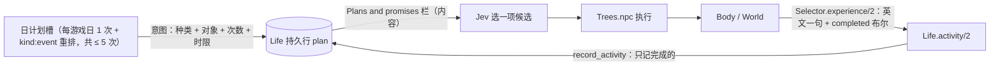
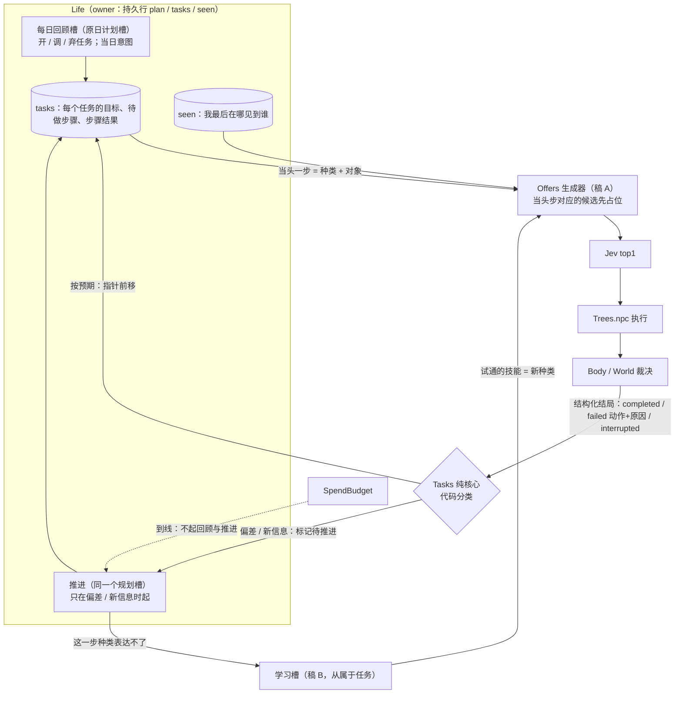
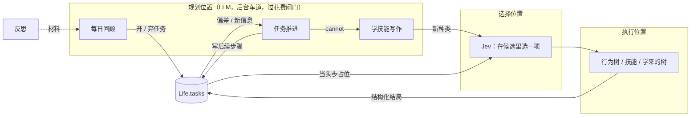

# NPC 长程任务闭环：任务由 Life 持有，偏差时才问 LLM，任务步作为 Jev 的候选（2026-11-19）

分类：统一形态 NPC 新增一层（任务层）的结构决策稿（只定结构、所有权、信任边界、触发、分批、预算与测试矩阵，不调取值）。状态：**概念已由用户定（2026-11-19，原话“全部同意”）；§6 Q-1–Q-6 全按建议（用户 2026-11-19 答复，原话：“全按建议”）；实施待排（统筹页）。**
概念五条见 [`2026-11-11-npc-coordination.md`](2026-11-11-npc-coordination.md)“第二十二个统筹会话的进展”第一条；总纲 [`2026-11-12-npc-architecture-overview.md`](2026-11-12-npc-architecture-overview.md)。
本稿**推翻**稿 A [`2026-11-18-npc-full-capability-coverage-decision.md`](2026-11-18-npc-full-capability-coverage-decision.md) A-5 的“不建目标层”，**重定位**稿 B [`2026-11-18-npc-skill-learning-decision.md`](2026-11-18-npc-skill-learning-decision.md)（学技能从属于任务），
并接手 S1-R8b 留下的规划提示词问题（`.demo/observe/npc-slice1-20261112/s1r8b-0b/results.md`）。成本口径接花费额度稿 [`2026-11-18-npc-spend-budget-decision.md`](2026-11-18-npc-spend-budget-decision.md) §4.2、§6 Q-6。

## 1. 目标与用户已定的概念

起因：S1-R8b 里模型因“Corvin 现在不在”不写 `speak_to`，8 条“问 Corvin”全进 `cannot_yet`；用户追问 NPC 怎样把能力组合成长程任务、按执行反馈规划下一步（“有点像闭环电机”）。
用户 2026-11-19 认可的五条（不改，只细化）：

1. **任务是一等对象，由 Life 持有**，每个 NPC 同时开着的任务有上限。
2. **步骤粒度 = 一项活动（种类 + 对象）**，不细到原语（同稿 A A-3）。
3. **下一步由 LLM 决定，只在偏差或新信息时问**：一次推进写出后两三步，按预期完成就接着做。
4. **任务步只是 Jev 的候选**：可不做、可被打断，interrupted 不算失败，不设执着程度。
5. **学技能改为扩充执行器**，从属于任务：推进时判定“这一步现有种类表达不了”才产生学习任务，学会的技能成为新种类。

连带：日计划退化为每日回顾（开 / 调 / 弃任务）；任务推进属后台车道，花费额度到线即冻结推进；缺口“去找某人”（位置只能来自自己的记忆）。

不做：Jev 逐原语组合；LLM 直接下达命令或绕过选择层；任务之间的依赖图与并行调度；NPC 之间共享任务；把任务写成 Hindsight 里的真值；“执着程度”或承诺加分。

## 2. 现状事实（各附证据，HEAD `abe56110`）

### 2.1 外环现在怎样闭合



- 触发：每帧观察查 `DayPlan.due/3`，只有 `:day`（当日还没采用过计划）与 `:event`（接纳了 `kind:event` 经历）两种（`life.ex:1618-1634`、`:1416-1446`；`day_plan.ex:317-331`）；当日 5 次、间隔 ≥ 3 分钟（`day_plan.ex:77-81`）。
- 闭合点只有一个计数：活动 **completed** 时按 `{种类, 对象}` 给当日意图 `done + 1`（`life.ex:1782-1799`、`day_plan.ex:469-492`）；失败不计，`done` 只由代码增。
- 规划只看材料与“今天已有的意图”（`life.ex:1667-1711`），不看任何一项活动是怎样失败的。

### 2.2 缺什么（四处，均已核实）

1. **没有跨活动的任务状态**。持久行只有当日意图 `{activity, object, times, by, why, done}` 与 `wants`（`day_plan.ex:100-104`、实现稿 §1）；意图之间没有次序与依赖，跨日整份换掉（`day_plan.ex:347-365`）。
   `wants` 只展示成一行 `I would like to …, but I cannot do that yet`（`mind.ex:148-158`），不触发任何动作。
2. **规划只能挑、不能组合**。意图 = 词表里的一个种类重复 n 次；“先找到 Corvin、再问他”写不出：说话候选只给此刻说话范围内的人（`offers.ex:198-216`），
   “去找某人”的候选只有 `distrusted` 选择器、只在此刻观察里找（`registry.ex:76-77`、`mind.ex:241-260`）。S1-R8b 的 8 条 `cannot_yet` 全是这一类，`why` 都是“人不在”。
   规划提示词把 `cannot_yet` 定义为“上面的种类表达不了的事”（`life/day_plan/prompt.ex:40`），与模型的实际用法（“现在做不到”）已经不符（S1-R8b 发现 2）。
3. **执行结果不结构化回外环**。Selector 自己的历史里有结构：`result: :completed | {:failed, 动作名, 原因文字} | {:interrupted, 原因文字}`（`selector.ex:46-50`、`:124-153`）；
   但交给 Life 的经历只有一句英文与 `completed` 布尔（`selector.ex:163-177`），失败的动作与原因只剩在句子里（`Mind.result/1`，`mind.ex:266-270`），Life 只读 `text` / `place` / `completed`（`life.ex:784-808`）。
   被对话打断的活动同样只是 `completed: false`（`runtime.ex:359-375`）。Selector 历史只留 5 条、只在 Runtime 内存（`selector.ex:67`）。所以 Life 分不清失败与打断，也数不出“同一原因失败几次”（稿 B 规划已记：真实运行里 `trigger=failed` 为 0）。
4. **总纲里“选择层都不合适 → 规划层”在代码里不存在**（总纲回路图 `S -->|都不合适| P`、位置表“规划…选择位置报告‘都不合适’”）。实际：Jev 只答 top1、没有弃权项（`selector.ex:260-290`）；
   候选为空时是 `{:error, :no_feasible_activity}`（`selector.ex:248`），按发问失败处理，树等 600 tick 再问（`trees.ex:46`、`:153`），不触发规划。

另记两条事实：所见的相遇条目只写“谁在附近待了多久、最近多少米”，**不记地点**，tags 只有 `kind:sight`、`actor:<cid>`（`life/sight.ex:21-39`、`:314`）——NPC 现在没有“我最后在哪见到某人”的记忆；
写作接口 DeepSeek 一路 `max_tokens` 写死 8192（`life/reflection/writer.ex:46`），S1-R8b 18 次规划应答出向 499–4,406 token（思考占 91%）。

## 3. 依据（2026-11-19 核对原文）

Orkin 与 Humphreys 两篇是下载 PDF 后逐页目视核对；ar5iv / arXiv 的几篇经网页抓取工具摘出原句（未逐页目视）。

- **Generative Agents**，Park et al. 2023，arXiv:2304.03442（ar5iv）。§4.3：“our approach starts top-down and then recursively generates more detail”，粗计划 “divided into five to eight chunks”，
  “recursively decompose this again into 5–15 minute chunks”；“plans are stored in the memory stream and are included in the retrieval process”；“Agents may change their plans midstream if needed.”
  §4.3.1：“We prompt the language model with these observations to decide whether the agent should continue with their existing plan”，反应时 “regenerate the agent's existing plan starting from the time when the reaction takes place”。
  **对应**：计划逐层分解、观察到变化时重排。**取舍**：(a) GA 对每条观察都问模型“要不要反应”——本项目按花费额度只在**代码判出的偏差**时问（§4 K-3）；(b) GA 的计划在记忆流里、可被召回——本项目任务的唯一真值在 Life 持久行，Hindsight 只收开 / 关任务的标准句经历（派生物，同稿 B B-3）；
  (c) 分解只到“一项活动”，不到 5–15 分钟的原语（稿 A A-3）。
- **Inner Monologue**，Huang et al. 2022，arXiv:2207.05608（ar5iv）。§3.2：“continually injecting information from the various sources of feedback into the LLM planning language prompts”；
  反馈三类（§3.3）：Success Detection、Passive Scene Description、Active Scene Description（后者限 “human responses”）；§1：“retry under observed stochastic failure, replan under systematic infeasibility”；
  §4.2 / 附录 A.1：成功检测 “after each step” / “after each policy execution” 回灌。§5 局限：“the LLM planners ignored the environment feedback and still proposed policy skills”，“we assume access to oracle scene descriptors”。
  **对应**：执行结果（成功 / 失败及原因、对方的回答）结构化回灌规划者——正是 §2.2 第 3 条的缺口。**取舍**：IM 每一步都回灌并问一次；本项目按预期完成的步骤不问（用户定 ③），成功检测由代码按 World 裁决的结局给（不另问模型，总纲“能算的归代码”）；
  “被动描述”= 推进时的材料（此刻、近期经历、召回），“主动描述”的对应物是 NPC 自己去看 / 去问（`look_for`、`speak_to` 成为任务步）。“模型无视反馈”的局限由校验点与“同一步连续失败”计数兜住（§4 K-3、K-4）。
- **Voyager**，Wang et al. 2023，arXiv:2305.16291（ar5iv）。§2.3 三种反馈 “Environment feedback … Execution errors … Self-verification”，前两者 “incorporated into GPT-4’s prompt for the next round of code refinement”；
  “If the agent gets stuck after 4 rounds of code generation, then we query the curriculum for another task.”；§2.1 课程的输入含 “Previously completed and failed tasks”，附录 A.1 伪代码 `add_completed_task` / `add_failed_task`；§1 “Complex skills can be synthesized by composing simpler programs”。
  **对应**：完成 / 失败的任务由代码记账并展示给出题者（每日回顾的材料）；推进卡住有轮数上限；学来的技能成为可组合的新种类（稿 B）。**取舍**：Voyager 的课程是自动出题；本项目任务只来自 NPC 自己的回顾与推进（不设自动课程，同稿 B 取舍 (c)）。
- **GOAP / F.E.A.R.**，Orkin，*Three States and a Plan: The A.I. of F.E.A.R.*，GDC 2006（gamedevs.org PDF）。p.6：“These goals compete for activation, and the A.I. uses the planner to try to satisfy the highest priority goal.”；
  老鼠没有攻击动作时 “fails to formulate any valid plan … and he falls back to the lower priority Patrol goal”；p.10 Benefit #3：“dynamic problem solving ability that re-planning gives the A.I.”，“re-planning while taking into account knowledge gained through previous failures”，障碍记进 “working memory”。
  **对应**：多个任务的下一步互相竞争（交 Jev 选）；失败原因记进任务、推进时带上。**取舍**：GOAP 的符号搜索只适合前置条件 / 效果可枚举的机械链——本项目这类链已放进技能（Settler 先例、稿 B）；开放目标（“弄清 Corvin 为什么拆我的屋”）没有可写的效果谓词，下一步交 LLM。
- **HTN**，Humphreys，*Exploring HTN Planners through Example*，Game AI Pro 第 12 章（gameaipro.com PDF）。§12.5：“If the task fails for some reason that is specific to the operator it's running, the plan also fails and forces a re-plan.”，
  “The plan can also fail if the current or any of the remaining task's conditions become invalid.”；§12.7 追丢敌人时 `NavToLastEnemyLoc` 走到 “the last place the enemy was seen”，位置来自 NPC 自己的传感器写进世界状态（`WsHasSeenEnemyRecently`）；§12.8 运行中的计划要有“优先级”，否则重规划会把正在做的步骤半途中止。
  **对应**：步骤失败即回规划者；“去找某人”= 走到**自己最后看见他的地方**（§4 K-8）。**取舍**：HTN 的计划执行器按序执行原语；本项目任务步只是候选，执行与否由 Jev 定，打断不算失败（用户定 ④），所以不需要 §12.8 的计划优先级机制。
- **ReAct**，Yao et al. 2022，arXiv:2210.03629（ar5iv）。摘要：推理 “help the model induce, track, and update action plans as well as handle exceptions”；§2：决策类任务里 “thoughts only need to appear sparsely in the most relevant positions of a trajectory”。
  **对应**：只在相关位置（偏差、新信息）想一次。**取舍**：ReAct 由模型自己决定何时想；本项目由代码判何时问（成本与可审计）。
- **ADaPT**，Prasad et al.，arXiv:2311.05772 v2（NAACL 2024 Findings；只核摘要）：“plans and decomposes complex sub-tasks as-needed, i.e., when the LLM is unable to execute them”。
  **对应**：只在执行不下去时才分解 / 重规划；“这一步现有种类表达不了 → 学技能”是同一思路下移到执行器。
- 已有核对沿用：SayCan（稿 A §3，可行性由另一方给、判断者只在技能里选）；Generative Agents 代码里计划“到点即完成”（日计划决策稿 §2）。

**未核到**：Orkin *Applying Goal-Oriented Action Planning to Games*（AI Game Programming Wisdom 2）、F.E.A.R. SDK 源码、ADaPT 正文、Inner Monologue 附录 A.1 原页（只经抓取工具）、Generative Agents 代码本轮未复读。

**原创决策**（检索范围：上列七篇与稿 A / 稿 B / 日计划决策稿已核来源；没有找到“LLM 规划者 + 封闭分类器选择 + 行为树执行”三层里任务层怎样放的现成做法）：
**任务由 Life 持有 + 代码判偏差才问 LLM + 任务步只作为 Jev 的候选**的组合。理由：GA / IM / ReAct 的规划者每步或每条观察都问模型，花费额度不允许（§4 K-9）；HTN / GOAP 的执行器按序执行计划，与“驱动力口径、可不做、可打断”（总纲 2026-11-13、用户定 ④）冲突；
Voyager 的反馈回灌与轮数上限可直接借，但它是单代理、自动课程。风险、不变量、验证见 §4 末与 §5。

## 4. 决策项



- **K-1 任务的数据形状与持久化**。Life 持久行新键 `"tasks"`（照 `"plan"` / `"reflection"` 的先例：初值、加载边界 `put_new` 补旧行、与其它键同一次保存；不另起 NpcMemory kind——开着的至多几个、行很小）。纯函数核心新模块 `NpcServer.Life.Tasks`（同 `Life.DayPlan` 的写法）：

  ```
  "tasks" => %{
    "open"   => [任务],                 # ≤ @max_open（3）
    "closed" => [任务的收尾小结],        # 最近 5 条，给回顾看（Voyager 的“完成 / 失败列给出题者”）
    "calls"  => %{"day", "n"},          # 本游戏日发出了写作请求的推进次数（额度见 K-9；口径同 DayPlan 的 admit / refund）
    "last_at_ms", "counts" => %{opened, advanced, done, dropped, expired, stuck, rejected, failed}
  }
  任务 = %{"id" => "t<日号>:<序号>", "goal", "why"（模型原文，英文，只给判断者读）, "opened_day", "expires_day",
          "steps" => [%{"kind", "object" | nil, "why"}],        # 待做，≤ 3，当头那条是此刻的候选
          "log"   => [%{"kind", "object", "outcome", "act", "reason", "at_ms"}],   # 最近 6 条步骤结局
          "waiting" => nil | 待推进的原因,  "head_since_ms", "head_failures", "rejected_in_row"}
  ```

  **与 `"plan"` / `wants` 的关系**：概念上当日意图 = “一步、可重复、当日到期”的任务（用户定）；存储上 v1 **不迁移** `"plan"` 的意图——生命周期不同（日内按次数到期 vs 跨日按步骤推进，AGENTS §2.2.2“生命周期不同不强行共用”），
  记账与 S1-R8 金标已稳定（见 §6 Q-1）。`wants` 改义为“连任务也写不出的事”（即学技能的来源之一）；“想问不在场的人”这类改由回顾开任务表达，S1-R8b 待定的 (a) / (b) 两个提示词改法都不再需要。
  **上限与过期**（原创取值）：开着的任务 ≤ 3；`expires_day = 开任务的日号 + 2`（游戏钟 ×24 下约现实 2 小时），到期由代码关为 `expired` 并写一条经历，不问模型；满了时回顾 / 推进再开新任务被校验拒绝（要先弃一个）。

- **K-2 结构化步骤结局（执行层补经历结构）**。`Selector.experience/2` 多给 `outcome`：Selector 历史里已有的 `:completed | {:failed, 动作名, 原因文字} | {:interrupted, 原因文字}` 原样带出（不另造）；
  `completed` 布尔改由 `outcome` 推出（DRY）。`Life.activity/2` 在接纳活动经历的**同一次保存**里调 `Tasks.record_step/4`（与 `DayPlan.record_activity/4` 并列）：按 `{种类, 对象}` 找开着的任务里**当头一步**相同的，最早开的那个记账——
  不经 Selector 传任务 id（与意图记账同口径：碰巧做了同一件事也算数）。这一项无行为变化，先做（批 T-0）。

- **K-3 推进的触发：代码分类，只在偏差或新信息时问**（规则在 `Tasks` 纯核心；每条都是 Life 已经拿到的结构化数据，不解析文字）：

  | 结局 / 事件 | 判为 | 处理 |
  |---|---|---|
  | 当头步 completed，后面还有步骤 | 按预期 | 指针前移，不问 |
  | 当头步 completed，没有下一步了 | 新信息（步骤用完） | 待推进：模型判 done 或写后续步骤 |
  | failed，原因 ∈ `Brain.Tree.transient/0` 或 `world_timeout`（Settler 同口径，`trees.ex:231-232`） | 瞬态 | 步骤留着、不问；同一步连续第 2 次瞬态失败 → 偏差 |
  | failed，其它原因 | 偏差 | 待推进，带动作名与原因 |
  | interrupted | 不算失败（用户定 ④） | 步骤留着，不问，不计失败 |
  | 任务对象里的人对我说话（conversation 经历带 `actor:<对象>`） | 新信息（IM 的“人的回答”） | 待推进 |
  | `kind:event` 经历的 `actor:` / `place:` tag 落在任务对象里 | 新信息 | 待推进 |
  | 当头步满 6 游戏小时没被做（`head_since_ms`） | 停滞 | 待推进一次 |
  | 到期 | — | 关为 expired，写经历，不问 |

  “待推进”= 任务的 `waiting` 置上原因（同 `event_waiting` 的写法）；Life 在每帧观察上查（同 `maybe_plan/1`：槽空、有观察与身体状态、过最小间隔、额度、花费闸门），一次只推进一个任务（最早置上的）。
  6 游戏小时、“连续第 2 次”是**原创取值**。对话里的“边做边答”不改任务（那一轮活动没变）。

- **K-4 推进调用的输入输出契约（唯一信任边界）**。`Life.Tasks.Round.write/1`（同 `DayPlan.Round` 的结构：快照在起槽时取齐、worker 不回问 Life、写一次不重问、`wrote` 标记）。
  输入（英文）：人格卡；此刻一块与两路召回材料（复用规划的取材函数，不复制）；任务的目标与理由、已做步骤的结局（`Mind.result/1` 的写法，DRY）、这次为什么问（K-3 的原因）；任务对象是人时多一路按 `actor:<cid>` 的召回（`Mind.recall_queries` R1 同一问句）；
  可写的种类与对象（**与回顾共用同一份词表渲染**，含 `look_for`）；其它开着的任务各一行。输出恰为一个 JSON 对象：

  ```
  {"task": "continue" | "done" | "drop", "steps": [{"activity", "object", "why"}], "cannot": null | {"want", "why"}, "note": "<一句，第一人称>"}
  ```

  校验 `Tasks.check/3`（**只此一处**）：围栏与 JSON 形状、键恰好这四个；`continue` 时 `steps` 1–3 条或 `cannot` 非空，`done` / `drop` 时两者皆空；每条步骤的种类与对象按词表核对——**抽出 `DayPlan.check/3` 现有的单条核对函数共用**，不另写一份。
  合格 → 采用（替换待做步骤、记 `note` 进 log、清 `waiting`、`rejected_in_row = 0`）；`cannot` → 交学习（K-7）；不合格 → `rejected`，任务不动、`waiting` 留着、`rejected_in_row + 1`，满 3 次关为 `stuck` 并写经历（Voyager“卡住 4 轮换任务”的对应，3 是**原创取值**）；写作失败 → `failed`，同日计划的失败处理与额度退回规则。
  采用之后的步骤是可信结构：生成器只按种类 + 对象去匹配本轮候选，不再解析。

- **K-5 每日回顾（原日计划退化）**。同一个规划槽、同一次 `:day` 触发；输出在 `intents` / `cannot_yet` 之外加 `tasks`：`{"open": [{"goal","why","steps"}], "drop": [任务 id]}`，材料加“开着的任务（含步骤与最近结局）”与“最近关掉的任务”。
  `:event` 重排的职责转给 K-3 的“新信息”，回顾的当日额度从 5 降到 2（1 次日界 + 1 次事件），**原创取值**。模板改动使 S1-R8 金标测试要重定，先离线测（K-0）。`cannot_yet` 定义改为“连开一个任务也表达不了的事”。

- **K-6 任务步怎样进入 Jev（经稿 A 生成器缝，占 A-4 的 C）**。开着的任务各取当头一步 `{种类, 对象}`；`Offers.candidates/4` 生成本轮候选后，与当头步相同种类 + 对象的候选在 A-4 ③ 的总上限 C 里**先占位**（同“今日 open 意图点名的项”，至多 3 项）。
  当头步此刻不可行（没有对应候选，如 Corvin 不在说话范围）就不出现——候选只来自生成器，任务不造候选（稿 A A-1 的唯一来源）；所以模型要把“先去找”写成前一步。候选判据不改（同一生成器一处定义）；
  “这是哪个任务的哪一步”只进 `Plans and promises` 栏：每个任务一行 `Task: <goal> — next: <种类 名字>; done so far: <n> steps`，**不写该选什么**（用户 2026-11-13“靠内容涌现”）。是否选它由 Jev 定。

- **K-7 打断、恢复与学技能的接口**。打断（对话回合 halt、Jev 选了别的、Life 重启）都不动任务：步骤留着，下一轮照常是候选；任务状态只在持久行，重启后原样恢复。
  推进应答的 `cannot` = 稿 B 新的唯一学习来源之一（另一来源“反思时代码数出的反复失败”现在可以从 `log` 的结构化结局数，不再从文字猜）：学习任务挂在这个任务下（任务记 `"learning" => 技能名`），技能试通后成为新种类进词表，下一次推进可用；放弃则推进时看到“我没学会”。
  稿 B 的 B-1–B-6（词汇、译码、技能本、试用、预算）不变，只改 B-4 的触发来源。

- **K-8 新活动种类 `look_for`（去找某人）**。位置**只能来自 NPC 自己的感知**：Life 新增持久的 `"seen" => %{cid => %{"at_ms", "at" => [x, y, z]}}`——每帧观察只在内存里更新“这个人此刻在哪”（观察里本来就有，是 AOI 内的合法感知），
  在相遇结束（`Life.Sight` 写出相遇条目）的那次保存里落库；至多 16 人、按最近见到淘汰（**原创取值**）。生成器 `Offers.look_for/2`：对 `seen` 里此刻不在观察中的人各生成 `look_for:<cid>`，参数冻结为那个旧位置（同 `speak_to:` 冻结目标），
  判据 `Go to where I last saw <名字 (actor cid)> (<多久以前>, near <最近的地名>) and look for them.`；执行 = `travel` 到那里再等至多 N tick，期间此人进入观察即 completed，否则 failed `not_found`（偏差，回推进）。
  **不新增任何服务端查询**：不问 World / Scene 某人现在在哪（HTN §12.7 同理：走到最后见到的地方，不作弊）。“在某处等某人”（`wait_for`）放后一批，需要时再加。

- **K-9 花费闸门与预算上界**。推进与回顾都是后台车道：Life 的 `background/2` 加一种 `:task`（回顾沿用 `:plan`），到线时在 `admit` 之前拒，`waiting` 留着，**已写好的步骤照样是候选**（执行不调模型），即“冻结推进、不冻结行动”。
  额度（原创取值）：**推进与学习写作共用每人每游戏日 12 次**（稿 B 放宽后已批准的 12 次写作，用户 2026-11-18 定），学习仍受“每任务 ≤ 4 轮”；推进两次至少隔 3 分钟（同日计划）。每次写作 `max_tokens` 4096（Writer 加按次参数，稿 B 规划 S-3 已列）。
  上界（DeepSeek 高峰价：入未命中 $0.3、出 $1.2 / 百万）：每次入 ≤ 6k、出 ≤ 4,096 ≈ $0.0067；3 人 × 24 游戏日 × 12 ≈ **$5.8 / 天**，与稿 B 原先给学习的 $5.7 同额——全天高峰最坏 $51.6 + $5.8 = **$57.4 < 停止线 $58.5**。
  回顾降到 2 次 / 游戏日再省约 $0.7（按 S1-R8b 实测每次约 $0.0034）。读数：S1-R8b 规划调用平均入 3.3k / 出 2.0k（约 $0.0034），18 次里 1 次出向 4,406 > 4096——上限 4096 时少数应答会被截断而记为失败（照扣额度），K-0 量这个比例。
  **若推进单独再开 12 次**：+$5.8 → $63.2，超停止线，须先报用户（花费额度稿 Q-6 的规则，不自行突破 $65）。



  **分工**：回顾一天一次，管“开哪些任务、今天的例行意图”；推进管“这个任务下一步”；反思照旧写日记（材料来源，不改任务）；学技能只在推进说表达不了时起；Jev 只在候选里选；执行层只回报结局。每份状态一个 owner：任务与 `seen` 归 Life，候选归 Offers，最近活动归 Selector，世界真值归 World。

- **K-10 分批与依赖**（每批先测后改 → 独立评审 → 提交；每批一条真实客户端短场景或说明为何不需要）：

  | 批 | 内容 | 依赖 / 与稿 A、B 的先后 |
  |---|---|---|
  | T-0 | K-2 结构化结局（无行为变化） | 无；可与稿 A 批 1 并行（触点 `selector.ex` 不同函数） |
  | K-0 | 离线探索（不是验收）：回顾新模板 + 推进提示词 | 只依赖 T-0 的形状；**取代** S1-R8b 待定的 (a) / (b) 离线重放 |
  | T-1 | `Life.Tasks` 纯核心、`"tasks"` 键、回顾输出 `tasks`、推进槽与 K-3 触发、花费闸门、Mind 栏、K-6 占位 | 在稿 A 批 1 之后（批 1 改 `Offers` 次序与冻结参数路径；占位要在同一处实现 C） |
  | T-2 | K-8 `seen` 与 `look_for` 生成器 / 树 | 在稿 A 批 1 之后（复用其“非说话候选的冻结参数”）；与稿 A 批 2 可并行 |
  | T-3 | 稿 B 按新定位开工：B-4 触发改为推进的 `cannot` | 稿 B 的 S-1a / S-2（词汇、译码、技能本，纯函数）现在即可并行；S-3–S-5 在 T-1 之后 |

**不变量**：① 任务只有一个 owner（Life 持久行），Mind / Hindsight 只读或收派生经历；② 任务状态只由代码按结构化结局与时钟改，LLM 只在回顾 / 推进的输出里新写、改写、关闭，且只经 `Tasks.check/3` 一处进入；
③ 任务步只经生成器的候选到达 Jev，不直接下命令，World 仍逐步裁决；④ 人在哪只来自本 NPC 观察过的位置；⑤ 推进失败、额度用完、花费到线都不挡选择与行动。
**风险**：模型写出永远不可行的步骤（只是不出现为候选，靠停滞与到期收掉）；推进频率被“新信息”放大（额度与最小间隔兜住）；Jev 不选任务步（驱动力口径下是合法结果，要实跑看）；`seen` 的旧位置让 NPC 白跑（自然结果，`not_found` 回推进）。

## 5. 测试矩阵（按 `../Voxim/Docs/Testing.md`）

| # | 层 | 证明什么 | 做法 |
|---|---|---|---|
| K-0 | 离线探索（不是验收） | 新模板下回顾能否把“问不在场的 Corvin”写成任务、推进能否按结局写出合法步骤；出向超 4096 的比例；入向量级 | 回顾：S1-R8 六份真实材料经产品渲染 × 3。推进：任务取回顾的真实输出，步骤结局取实跑导出里真实出现过的结局与原因（`select` 历史），不手写产品产生不了的结局。产品 `Tasks.check/3` 判；真实 DeepSeek，请求数事先封顶（约 40 次、约 $0.15），`plan.md` 发问前写、判定规则不改 |
| K-1 | 算法 | 校验点：合法即采用、反例逐条显式失败 | 反例：多键 / 缺键、未知种类、对象不在词表、`continue` 无步骤、`done` 带步骤、步骤 > 3、开任务超上限 |
| K-2 | 算法 | K-3 分类表每一行；记账只动当头步；到期、停滞、`stuck`；额度 admit / refund / 跨日 | 小例手算；含反例：interrupted 不计失败、瞬态失败第 1 次不推进、碰巧同种类同对象的活动也记账 |
| K-3 | 算法 | `look_for` 只从 `seen` 生成、不出现观察里的人、参数冻结；`seen` 上限淘汰 | 小观察序列手算；反例：从未见过的人没有候选 |
| K-4 | 集成 | Runtime → Selector → Life 的结构化结局（含对话打断） | 真实 Runtime / Life / 独占 PostgreSQL，Jev 替身；断言 Life 收到 `{:failed, 动作, 原因}` 与 `{:interrupted, …}` |
| K-5 | 集成 | 回顾开任务 → 当头步成为候选并占位 → 完成前移 → 失败触发推进 → 采用新步骤 → done 关闭；重启读回；到线冻结推进而步骤照常可选 | 真实 Registry / Body / Scene / World / Life / 独占 PostgreSQL；写作用回环替身回放 K-0 导出的真实应答；Jev 替身；花费结论注入 |
| K-6 | 真实客户端短场景 | 玩家能看到 NPC 为一件事连做几步并按结果改主意 | 一个 NPC、真实写作与 Jev；玩家角色拆一格 NPC 的建筑后走出视野；判定（驱动力口径，不要求“必须去找”）：任务开出、`look_for` / `speak_to` 出现在候选、被选中时权威结果可见、推进次数与用量配对、`seen` 不含未观察到的位置；≤ 10 分钟，UDP 基线与 Tcpip 4266 守护同扩人数稿 §5 |

不覆盖：多 NPC 之间的任务交互；长时间（跨多个游戏日）的任务完成率——它属于实跑读数，不是本层验收。

## 6. 要用户定的

**已定**（用户 2026-11-19 在对话里答复，原话：“全按建议”）：Q-1 (a) 分开存；Q-2 按 K-3 表；Q-3 共用 12 次写作、出向 ≤ 4096；Q-4 取值按原创初值、实跑后调；Q-5 v1 只做 `look_for`；Q-6 不实现“都不合适 → 规划”，总纲回路改为“执行结局偏差 → 任务推进”。

1. **Q-1 意图与任务的存储**：(a) v1 分开存，`"plan"` 意图不迁移（**建议**：生命周期不同，记账已稳定）；(b) 现在就把意图并成“一步可重复的任务”，一处存（要改记账与 S1-R8 金标，范围大一倍）。
2. **Q-2 推进的触发集合**：按 K-3 表（**建议**）；或再收窄为“只有失败与步骤用完”（更省，但听不到对方的回答）。
3. **Q-3 额度**：推进与学习共用每人每游戏日 12 次写作、每次出向 ≤ 4096（**建议**，上界 $57.4 在 $58.5 内）；或推进另开额度（须同时上调每日上限，超 $65 前不做）。
4. **Q-4 取值**（全部**原创取值、实跑后调**）：开着的任务 ≤ 3、一次推进 ≤ 3 步、任务 2 个游戏日到期、当头步 6 游戏小时停滞、连续 3 次不合格关为 `stuck`、瞬态失败连续 2 次算偏差、回顾每日 2 次、`seen` ≤ 16 人。
5. **Q-5 “去找某人”**：v1 只做 `look_for`（走到自己最后见到的地方看一看），`wait_for` 后做（**建议**）。
6. **Q-6 总纲“都不合适 → 规划”**：不实现（Jev 没有弃权项，加一个会改变选择分布、要先离线实验；任务层的偏差由执行结局触发），总纲那条箭头改为“执行结局偏差 → 任务推进”（**建议**）。

## 7. 进度

- 2026-11-19：初稿（第二十二个统筹会话派写）；只读代码与原文（§3 写明核到 / 未核到），未改代码、未调模型、未实跑。等 §6 答复；稿 A A-5、稿 B B-4 与总纲回路图的对应改写在用户定后由统筹会话同步。
- 2026-11-19：用户答 §6 全按建议（原话：“全按建议”）。实施顺序按 K-10：T-0 结构化结局（无行为变化）→ K-0 离线（开跑前报用量）→ T-1 / T-2（稿 A 批 1 之后）→ T-3（稿 B 按新定位）。稿 A A-5、稿 B B-4、总纲回路图由统筹会话同步改写。
