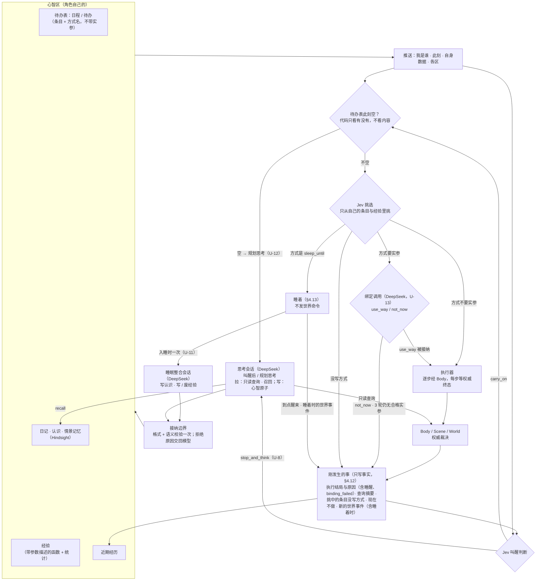
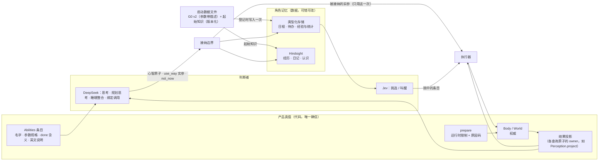
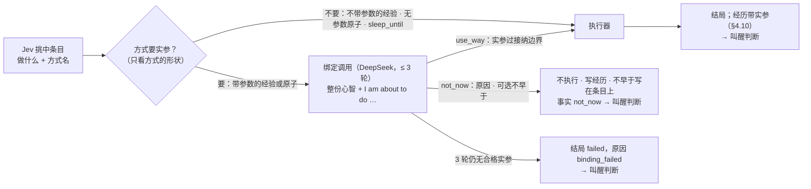
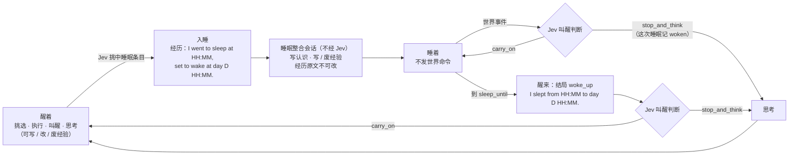

# NPC 通用心智：世界原子为真、经验归角色、代码只给事实、思考只有三条路（从平地重新设计，2026-11-21；2026-11-22 按 U-10 至 U-12 修订；2026-11-23 按 U-13 修订）

分类：NPC 决策侧整体重设计的决策稿（定结构、所有权、信任边界、格式、触发、可观测面、迁移提议与测试矩阵；不调取值、不改代码）。
状态：**方向由用户定（2026-11-21，§3 U-1 至 U-8）；§8 G-1 至 G-15 用户按稿内建议全部采纳（2026-11-21，U-9）；U-10 至 U-12 已定（2026-11-22：代码只给事实、睡眠整合、待办表空直接开规划思考），G-1、G-2 被取代（§8）；U-13 已定（2026-11-23：经验是带参数描述的函数，条目只写方式名，Jev 挑中后由绑定调用填实参，可以“现在不做”），原创决策 O-1 改写为“用的时候绑定”、新增 O-10（§6）；M-2c 按 `plan.md` 第 8 节（修订 3，在第 7 节修订 2 之上新增判定 B）进行中，正式运行尚未开始；未实施，`apps/` 未改。**

- **2026-11-23 起的总框架见 [`2026-11-23-npc-three-loop-framework-decision.md`](2026-11-23-npc-three-loop-framework-decision.md)（U-14 至 U-24）**：本稿的世界原子、经验、心智原子、接纳边界、推与拉、代码只给事实保留；§4.6 的挑选、U-13 中由 DeepSeek 做的绑定调用（O-10）、O-2 的三条路、U-11 / O-9 的“整合只在入睡”被该稿改写或取代（对照见该稿 §4）。下文未逐处改，读到这几处以该稿为准。
- 本稿**取代**同日早些时候记在统筹页的方向「候选生成器为主、有边界的 LLM 规划活动为辅」（[`2026-11-11-npc-coordination.md`](2026-11-11-npc-coordination.md)“第二十五个统筹会话的进展”中 2026-11-21“用户定方向”一条）。
- 若用户采纳 §7 的迁移提议，下列现行稿件里的相应部分将被取代：总纲 [`2026-11-12-npc-architecture-overview.md`](2026-11-12-npc-architecture-overview.md) 的“候选来自数据（登记候选表 + 生成器）”与位置 × 判断者表、
  任务层稿 [`2026-11-19-npc-long-task-loop-decision.md`](2026-11-19-npc-long-task-loop-decision.md)、日计划稿、对话通道稿里的 Jev 回合、稿 A 的覆盖登记。本稿只提议，不改这些稿件。
- 证据：`.demo/observe/npc-mind-ops-*-20261121/`（本仓 gitignore，按惯例以路径引用；§5.1）。代码事实基于 HEAD `2a337470`。

## 0. 名词与轮次（全文只在这里定义）

| 名词 | 含义 |
|---|---|
| **世界原子** | 产品定义的一个基本动作或只读查询（`NpcServer.Abilities` 的一个条目：名字、参数、done 的含义、说明）。它是角色唯一可确信的“真理”，像物理定律。长技能（gather、build、travel 等）对心智而言也是原子：发出去，等一个终态。 |
| **经验** | 角色自己持有的、由世界原子组成的树，形如**带参数描述的函数**（U-13）：名字、意图、每个参数（产品 schema + 一句描述）、树；附使用统计。可错、可改、可废。经验里不存实参。 |
| **心智原子** | 思考时改写自己记忆区的操作：写日记、排日程、加 / 关待办、写 / 废经验；睡眠整合里另有写认识。每种一份严格格式。 |
| **条目、方式** | 条目 = 一项日程或待办，写“做什么 + 用哪个方式”，可带“不早于”。方式 = 一条经验或一个世界原子的**名字，不带实参**（U-13）、睡到某时刻（`sleep_until`，§4.13），或空（“想做但还不知道怎么做”）。原稿“方式 = 绑好参数的一条经验”被 U-13 取代。 |
| **绑定调用** | Jev 挑中一条条目、它的方式需要实参时，由 DeepSeek 做的一次短调用（U-13，§4.6）：只有两个工具——`use_way`（填这条方式的实参）与 `not_now`（现在不做）；不能查询、不能写心智原子、不能 `say`；不是思考会话。 |
| **现在不做** | 绑定调用里被接纳的 `not_now`：附原因与可选的“不早于”。这一次不执行；条目保留（不由代码关）；写进经历；“不早于”写在条目上；作为事实送叫醒判断（`fact_kind: not_now`，§4.6）。 |
| **待办表** | 日程 + 待办。“待办表空” = 此刻没有一条日程落在它自己的时段里，也没有一条未关且“不早于”已到的待办（不带参数的经验不算，§4.6；日程条目带着 `not_now` 写的、尚未到的“不早于”时怎样算，见 §4.6 末条）。 |
| **规划思考** | 挑选时待办表空，由系统直接开的一次思考（`trigger: plan_empty`，U-12）；与叫醒后的思考同一模板、同一工具。 |
| **睡眠整合** | 角色执行到自己排的睡眠条目时开的一次整合会话（U-11）：只改记忆的组织，不排日程、不行动（§4.13）。 |
| **认识** | 睡眠整合写出的派生物（来源是经历与日记）。probe 里是整合会话写的一区；产品里是 Hindsight 认识（§4.13）。 |
| **推、拉** | 推 = 每次发问时由系统写进提示词；拉 = 思考中由模型调用查询原子现取。 |
| **挑选** | Jev 从角色自己写下的条目与经验里挑一项去做。 |
| **叫醒判断** | Jev 在完整的推送心智加“刚发生的事”上二选一：照常继续（`carry_on`）/ 停下来想（`stop_and_think`）。 |
| **接纳边界** | 心智原子的输出进入记忆区、绑定调用的实参进入执行器之前唯一的校验处（格式 + 语义）；不合格时把原因交回模型。 |
| **启动数据** | 新角色登记时写进其记忆的通用经验库（G0）与起始知识；写进去之后就是角色自己的记忆。 |

| 代号 | 是什么 | 形态 | 证据目录（`.demo/observe/` 下） |
|---|---|---|---|
| M-0 | 一份通用模板 + 心智原子严格格式 + Jev 从自写条目里挑 | 离线，S1-R10 实跑的真实心智快照 | `npc-mind-ops-20261121/` |
| M-1 | 原子可直接当方式、接力、提示词是否列举操作、Hindsight 召回作“拉”工具、Jev 打分 v1 | 离线 + Hindsight 只读副本 | `npc-mind-ops-m1-20261121/` |
| M-2a | 英文原子说明、世界原子拒绝换成“行动提示”、带参数的经验与绑定、启动经验 B0 与起始知识、Jev 打分 v2；追加块 C4 = 通用启动库 G0（`g0.json`，15 条） | 离线 | `npc-mind-ops-m2-20261121/` |
| M-2b | 隔离测试节点上的真实闭环（桥协议 `protocol.md`、harness v3） | probe，不经正式组合根 | `npc-mind-ops-m2b-20261121/` |
| R1 | M-2b 中 `live-bare-2` 的补跑（把读响应阶段的断连并进“重连一次”；不重发的失败也关掉连接） | 同上 | 同上 `plan.md` 追加块 R1、`results.md` 追加块 R1 结果 |
| M-2c | M-2b 暴露的四处修正 + 修订 2（三条路进思考、睡眠整合、代码只给事实）+ 修订 3（经验是函数、用的时候绑定、现在不做；§10 判定 B） | probe | `npc-mind-ops-m2c-20261121/`（`plan.md` 第 7、8 节） |

## 1. 背景与现状问题

### 1.1 为什么从平地重来

NPC 线从 2026-11-12 起按总纲的“规划 LLM → 选择 Jev → 执行行为树”一层层加厚：候选由登记表与代码生成器给出，日计划、任务推进、反思、说话各有自己的提示词和触发。
每加一种能做的事，就要同时改生成器、计划词表和树的分支（§1.3 第 5 条）；“能做什么”写死在代码里，角色学不到新做法。
2026-11-21 的四轮测量（§5.1）试了另一种做法：只给模型世界原子与角色自己的记忆，由它写自己的日程、待办与经验，Jev 从这些条目里挑、执行器在真实世界里跑。
结果足以支持换方向（冷启动用启动数据建成小屋 3/3；Jev 在完整心智上分得清该不该停下想），用户据此定了从平地重新设计（§3）。

### 1.2 现状：一个注册表里六种形态

`NpcServer.Registry.brain/2` 是唯一把登记参数变成 `{大脑模块, profile}` 的地方（`registry.ex:12-20`）：

| 登记名 | 大脑 | 计划 / 记忆 / 说话各由谁做 | 出处 |
|---|---|---|---|
| `npc` | `Brain.Tree` + `Trees.npc/1`，`choose_activity` 经 `Selector` 问 Jev | 日计划 / 任务 / 反思由 Life 经写作接口；记忆 Hindsight；说话 `Skills.Speak` | `registry.ex:155-213` |
| `settler` | `Brain.Tree` + `Trees.settler/1` | 无 | `registry.ex:215-251` |
| `settler` + `life` | `Brain.Social` 包 `Brain.Tree` | Life 情绪；无计划 | `registry.ex:249-250`，`brain/social.ex:1-8` |
| `llm` | `Brain.Llm`（OpenAI Responses 线格式，每一步问一次模型） | 模型自己用 `set_plan` / `remember` | `registry.ex:261-312` |
| `life` | = `llm` 强制带 Life + Memory | 同上，外加 Appraisal 情绪评价 | `registry.ex:254-259` |
| `patrol` | `Brain.Patrol` | 无 | `registry.ex:314-319` |

另有 `Brain.Routine`（`brain/routine.ex`，按序发命令，`target: :probe` 取上一次探测结果）列在 `brain.ex:5` 的后端里，**不能登记**，只在测试中使用（如 `npc_registry_test.exs:1010`）。
生产登记只用 `npc`（`deploy/npc/qinglan/register.exs:52`），由 `NpcServer.Bootstrap` 调 `Registry.start_all/0` 拉起（`application.ex:36`、`registry.ex:134`）。

### 1.3 现状问题（各附证据）

1. **Runtime 里写死了某一种大脑的流程**。`runtime.ex` 1019 行：受理 `choose_activity` 与预选（`runtime.ex:90-92`、`:389-477`）、对话回合（`:647-797`）、`Brain.Llm` 专属分支（`:63` 只在后端是 `Brain.Llm` 时开模型评价，`:305-306` 单独的 `step`）。
   Runtime 本应只组合 Body 与大脑（AGENTS 2.1 系统正交、2.2.4 高内聚）。
2. **三种模型客户端形状**：Jev 的 `:answers` / `:openai` 两种入口（`jev.ex:21-23`、`:106-112`）；写作接口 `Life.Reflection.Writer`（Life 的反思 / 日计划 / 任务推进经 `life.ex:603`，说话经 `skills/speak.ex:98`）；
   Responses 线格式（`responses.ex:1-3`，用于 `brain/llm.ex:98`、`builder.ex:286`/`:348`、`skills/house_design.ex:332`）。同一件事“问模型、拿结构化结果”有三套实现（AGENTS 2.2.2 DRY）。
3. **同一份心智被渲染四次**：`Mind.snapshot/4`（`mind.ex:132-146`，给 Jev）；`Mind.right_now` + `Reflection.materials_blocks`（`mind.ex:321`、`life/reflection.ex:241`，给写作）；`Brain.Llm.body/5` 直接塞 JSON（`brain/llm.ex:486-500`）；`Jev.decide/2` 也直接塞 JSON（`jev.ex:55-63`）。
   “三份材料”那一段说明在日计划、任务推进、反思三份提示词里几乎逐字重复（`life/day_plan/prompt.ex:43`、`life/tasks/prompt.ex:56`、`life/reflection.ex:82`；反思一份写作“four things”，措辞小异）。
4. **领域写死在通用部件里**：Hindsight 库的 mission 是“builder journal”（`life/hindsight.ex:37`），自我认识的问句是“What kind of builder am I”（`life/hindsight.ex:64`）；
   事件标准句只有建筑一类（`life/state.ex:19-26`），处境栏只写“我的建筑在不在”（`mind.ex:94-96`）；召回分路固定为附近的人 / 我的建筑 / 未了与感受（`mind.ex:76-89`、`:191-226`）。
5. **加一种能做的事要改三处**：`Offers` 生成器次序（`offers.ex:91`、`:214-228`）、计划词表（`offers.ex:73-75`，登记时校验种类不撞名 `registry.ex:197-206`）、`Trees.npc` 的分支（`trees.ex:132-142`、`:153` 起），背包动作另有一张表（`offers.ex:95`、`:232-236`）。这正是“能做什么是预设”的形状（与用户决定 2 相反）。
6. **难读**：`life.ex` 2411 行、193 个 `def`/`defp` 子句（115 个不同函数名）；`lib/npc_server/README.md` 146 KB；moduledoc 与注释里有约 108 处阶段代号（S1-*、K-*、D-*、T-*，如 `life/day_plan/prompt.ex:9-10`、`mind.ex:62`、`selector.ex:49`），读者要回翻历史稿才懂（AGENTS 3.16）。
7. **提示词语言不一**：`Brain.Llm` 的系统提示词（`brain/llm.ex:530-553`）与情绪评价说明（`life/appraisal.ex:167-173`）是中文，原子说明是中文（如 `perception.ex:42-46`），其余提示词是英文。M-1 里 54 次会话有 2 次写出中文（§5.1）。
8. **与新设计直接相关的产品缺口**（不是缺陷，是新设计要用而现在没有的契约）：
   - `Perception.prepare/2,3` 不合格时只回 `nil`、没有原因码（`perception.ex:144`、`:164`），Body 一律以 `invalid_command` 拒绝——M-2b 的桥只能自造标签（`protocol.md` 补记 2）。
   - 行为树执行器其实已有“把结果写进黑板”（`act` 的 `store:`）、“遍历列表”（`each`）、“条件”（`cond`），但参数与条件都只能是 Elixir 函数（`brain/tree.ex:10-25`），模型写不出来。
   - 查询结果的模型投影已有（`Perception.project/3`，`perception.ex:413-517`：look 按列压缩、survey 换成高度图、inspect 只列最近 24 件），M-2b 的桥没有用它，原样回 JSON 再截断（`bridge/bridge.exs`，§5.1 M-2b）。
9. **代码替模型做判断**（U-10 的起因）。M-2c 集成后审计 harness（`npc-mind-ops-m2c-20261121/design-review-20261122.md` §1）：进提示词的文字 10 处，如把“选项过滤后为空”写成叫醒事实 `Right now there is nothing I have set out to do.`、给各区标可信度（`(this is true)`、`may be wrong`）、把 05:42 写成 `It is morning`；
   代码定的规则 10 处，如树执行 completed 即把条目标 done 并移出选项（M-2b“方式凑数”的来源，§5.1 M-2b 第 6 条）、“没有要做的事”只问一次、无可等的时刻即 `quiescent`。后果实测：两次小集成开局 0 个可挑项，Jev 两次判 `carry_on`（0.9 / 0.86），0 次思考（`integration/README.md`）。
   产品里有同类先例：`mind.ex:286-292` 把原因码 `occupied` 一律写成 “something else was already in the place where it had to go”，在自己的建筑上重建被拒时成了假事实，经经历 → 召回 → Hindsight 认识放大（[`2026-11-11-npc-coordination.md:90`](2026-11-11-npc-coordination.md)“行为一致性问题 1 根因”）。改法见 §4.12。

## 2. 目标 / 非目标 / 范围

**目标**

1. 一种 NPC 心智形态：同一套“推送心智 → Jev 挑选 →（方式要实参时）绑定调用 → 执行 → 经历 → Jev 叫醒判断 → 思考”闭环（另两条进思考的路：待办表空、入睡，§4.1），替代 §1.2 的各种形态（迁移见 §7）。
2. 系统原子是唯一确定的真值；角色会做什么是它自己的记忆（经验），从“做 → 结果 → 改进”里长出来，形成各自的方法与性格。
3. 思考不预设内容与次序：给数据（各记忆区），由思考自己决定做什么；输出类型不限，但每种类型格式固定、在接纳处校验一次。
4. 每次思考、每次 Jev 发问、每次执行都能从 CLI / 日志读到输入、输出与原因（AGENTS 3.2、3.3）。
5. 主观判断与决定只由 Jev 与 LLM 做出，代码只给事实与数据（U-10，§4.12）。

**非目标**（本稿不做）

- 不改 Body / Scene / World 的权威与协议；不改客户端。
- 不替换 Hindsight，不替换 Jev（用户决定 5）。
- 不定取值（轮数上限、条数上界、频率）；初值属原创取值，M-2c 后再定。
- 不做角色之间传授 / 共享经验；不做 Jev 逐原语组合；不做常驻的 LLM 对话状态。
- 不凭空加世界原子：天气、温湿度、场系统的只读查询要由各自的 owner 先提供读契约（现状见 §4.3）。

**范围**：`npc_server` 的决策侧（思考、挑选、叫醒、执行、心智区、启动数据）及它与 `Abilities` / `Perception` / 技能的契约。

## 3. 用户的决定（2026-11-21，对话）

| # | 决定 | 原话 / 要点 |
|---|---|---|
| U-1 | **从平地重新设计。** 可用的资源：(1) 系统原子函数（用技能、攻击、吃、走到某处……）；(2) 决策树数据结构 = (1) 的组合；(3) Jev = 决策模型；(4) DeepSeek = LLM；(5) 世界信息（时间、位置、天气、温湿度……），也可以做成角色需要时查询的原子；(6) 周围感知（范围内的体素、prefab、其他角色、涌现的场系统）。**取代**同日早些时候的方向「候选生成器为主、有边界的 LLM 规划活动为辅」。 | 「我们从干净的平地重新设计一下吧」 |
| U-2 | **能做什么是记忆，不是预设。** 不预设 build_house 这类行为；系统原子是唯一确定的“真理”（像物理定律），原子的组合是“经验”，不稳定、会变。行动 → 反馈 → 改进；角色形成自己的方法论，因而有独特的性格。LLM 可以返回决策树结构来形成经验。 | — |
| U-3 | **不预设怎么思考。** 把数据（记忆区：反思、情景、经验、日程、待办……）交给思考引擎，由它决定做什么。不需要 LLM 的地方用 Jev（如按计划行事），Jev 也可以挑做什么。 | 「我们不预设他怎么思考，而是让思考自己决定怎么思考」 |
| U-4 | **硬约束：输出类型不限，但每种输出类型有规定格式，系统把它解析成结构化数据。** | 「这一个约束不能省」 |
| U-5 | **记忆仍用 Hindsight，打分仍用 Jev。** | 「记忆还用hindsight，打分还用jev」 |
| U-6 | **角色自己的数据（背包、装备……）推进提示词**；主动查询只用于无界的内容（用户质疑为自身数据多一次 LLM 往返）。 | — |
| U-7 | **冷启动给启动数据，放常用经验，并且写成通用的。** | 「放一些常用的经验」「写一些通用的」 |
| U-8 | **思考只经 Jev 叫醒判断触发**：去掉挑选里固定的 `think_it_over` 选项；在完整推送心智上的二选一“要不要停下想”（M-2a C3、M-2b L5 的证据）是进入 LLM 思考的唯一入口。细节：哪些事实送去叫醒判断（执行结果、新事件、挑中没有方式的条目、无可挑），空闲时多久问一次（按 §8 G-1、G-2 的建议定，M-2c 验证）。 | 「统一交给Jev叫醒判断」 |
| U-9 | **§8 G-1 至 G-15 按稿内建议全部采纳**，开始 M-2c；M-2c 在新会话里做。 | 「按建议全部采纳，开始M-2c。请你新开会话吧」 |
| U-10 | **主观判断与决定只由 Jev 与 LLM 做出**；代码只给客观事实与数据（起因：M-2c 集成时 harness 把“无事可做”写成叫醒事实，`.demo/observe/npc-mind-ops-m2c-20261121/design-review-20261122.md` 审计出代码替模型判断的文字 10 处、规则 10 处）。同时认可“缺驱动力”的分析；提出借鉴 OpenClaw 的睡眠整理（睡眠时归纳整理记忆、清醒时只产出记忆），**待定**。 | 「我希望主观判断和决定都是jev和llm作出的」「关于驱动力，你的理解没错」（2026-11-22） |
| U-11 | **睡眠整理不归 U-8 管**（入睡由角色自己选择；整理只改记忆的组织，不排日程、不行动）。**醒着发呆也算做事；由系统确保角色的待办里一直有事做**（实现方式按统筹 2026-11-22 的提议，待确认）。**醒着也能写 / 改经验**（做实验只能在醒着时），睡眠对经验与记忆做整合（统筹曾提议“白天只改计划、经验只在睡觉时改”，用户否定；“条目带只为这一条写的步骤”随之不需要）。睡眠能排到什么程度、能否被吵醒，统筹已答（角色自己排几点睡几点起；睡着时的真事照样送叫醒判断）；“待办表空时由系统直接开一次思考”待确认。 | 「4同意」「发呆也算做事呀？角色只要待办不空，那就是一直做事，我们需要做得就是通过系统确保他待办里一直有事做」「经验醒着时候也得能够改啊，因为角色进行实验只能是醒着的时候，晚上睡觉可以对这些经验和记忆进行整合」（2026-11-22） |
| U-12 | **待办表空（此刻没有可挑的日程 / 待办）时，系统直接开一次思考**，与叫醒判断、入睡整合并列为进入思考的三条路（U-8 的“唯一入口”由 U-11、U-12 缩小）。系统只看待办表是否为空，不判断内容；排什么由思考决定。M-2c 按 `plan.md` 第 7 节（修订 2）实施。 | 「1同意，开始吧」（2026-11-22，答“计划用完时由系统直接开一次思考，可以吗”） |
| U-13 | **经验是带参数描述的函数，用的时候才传参**：经验 = 名字、意图、每个参数的类型与描述、树；计划条目只写“做什么 + 用哪条经验”，不带实参（2026-11-25 注：这句管引用经验的条目；[M-3e 稿](2026-11-25-npc-m3e-timeliness-and-way-sources-decision.md) D-5 的一次性指令是另一种条目，不引用经验，具体值就是它的内容）；Jev 挑中后由 LLM 做一次绑定调用填实参（Jev 不填参数；按 U-10 填参数是判断），走同一接纳边界后执行；实际调用连同实参写进经历（“实际使用只是记忆”）。取代 O-1 的“写条目时绑定”（M-2c 集成 mini-r2：建房条目执行完仍在时段里，被再挑一次，原样重放同一组实参，build 被 `occupied` 拒绝）。绑定时**可以“现在不做”**：附原因与可选的“不早于”；条目保留、写进经历、作为事实送叫醒判断。M-2c 按 `plan.md` 第 8 节（修订 3）实施。 | 「那不合理啊，怎么能把参数也写死到选择中呢？……函数是经验，是一个签名表示，而实际使用的时候才把参数传进去，实际使用就只是记忆而已，经验就像函数一样带着参数描述。」「1没问题」「2同意，开始写修订3吧」（2026-11-23） |

## 4. 设计

### 4.1 闭环

- **下行是心智**：各区 → 推送 → 挑选 →（方式要实参时）绑定调用 → 执行 → 权威。条目只写方式名，实参在用的时候由绑定调用填（U-13，§4.4、§4.6）。
- **上行是事实**：权威结局（经历里带实际用的实参）、查询摘要、“现在不做”、新事件写成经历，同时交给叫醒判断；写法只给事实（§4.12）。
- **进入思考只有三条路**（原创决策 O-2；U-8 的“唯一入口”由 U-11、U-12 缩小为三条）：
  1. 叫醒判断判 `stop_and_think`（U-8，§4.6）；
  2. 挑选前待办表空 → 系统直接开一次规划思考（U-12，§4.6）；
  3. 执行到角色自己排的睡眠条目 → 一次睡眠整合会话（U-11，§4.13）。
  挑选里没有 `think_it_over`；三处之外没有代码开思考。原稿“只有一个入口”“挑中无方式 / 无可挑都写成事实送叫醒”被 U-12 取代：无方式仍是送叫醒的事实，“无可挑”不再写成事实（那是代码对“选项过滤后为空”下的判断，U-10）。
  绑定调用（U-13）**不是**第四条路：它不是思考会话，只能填参数或现在不做，不能查询、不能写心智原子、不能 `say`（原创决策 O-10）。
- **思考不碰执行**：思考时只做心智原子、只读查询与 `say`；其余世界动作要排进日程 / 待办，再由挑选与执行器去做（M-2a C2 的“行动提示”证据，§5.1）。睡眠整合连查询与 `say` 也没有（§4.13）。

### 4.2 所有权与分层

| 事实 | 唯一 owner | 其他部件只能 |
|---|---|---|
| 世界原子的名字、参数、done 含义、说明 | `Abilities` 条目（各域模块提供，`abilities.ex:2-36`） | 读；严格模式改写、英文转写都是派生物 |
| 运行时限制（范围、格数、射程……）与不合格原因 | 该原子的 `prepare`（`Perception`、`Actions`、技能） | 在执行时收到 `rejected` + 原因 |
| 查询结果给模型看的样子 | 该原子 owner 的投影（`Perception.project/3` 一类） | 原样转交，不另行截断 |
| 日程、待办（只存方式名，不存实参）、条目的“不早于”（含 `not_now` 写的）、经验（参数带描述）及其统计、条目的“上次运行”结局与是否已关 | 心智区的类型化存储（建议放 Life 的持久行，§8 G-4） | Jev 读选项、执行器读树、渲染器读文字 |
| 一次执行用的实参 | 这一次被接纳的 `use_way`（绑定调用经接纳边界，U-13） | 执行器原样代入；执行后只作为经历存在（“实际使用只是记忆”），不回写条目、不进经验 |
| 经历、日记、认识 | Hindsight（经 Life 的适配器） | 召回；推送时由渲染器取有界的一份 |
| 世界状态 | World | 现查，不存进记忆当真值 |

### 4.3 第一层：世界原子（契约 owner = `Abilities` 条目）

现有条目已有名字、组、done 含义、说明、一份参数规格（同时生成严格 schema 与译码，`abilities.ex:8-30`）。新设计要它再承担三件事（都归原 owner，不另建表）：

1. **英文说明**：数字仍由各域常量插值（如 `perception.ex:43-46` 用 `@cells`、`@reach`）。M-2a 已逐条译过一版（`en_atoms.json`）。说明里写清作者约定，例如 gather 只采“露出地表、或深度 ≤ 1 层”的料（M-2b 里模型花了 2 次失败、6 次思考才自己推出来）。
2. **结果投影**：每个查询原子都有给模型看的投影，形状紧凑、截取时写明“显示了哪一段、共多少”，由 owner 定义（look / survey / inspect 已有 `Perception.project/3`；read_catalog、query_balances 要补）。M-2b 的 4000 字硬截断让料堆从未进入模型视野（§5.1）。
3. **原因码**：`prepare` 不合格时回具体原因（如格数超限、超出距离），而不是 `nil`（§1.3 第 8 条）。

原子分两类：**动作**（改世界，只由执行器执行；`say` 是唯一允许在思考时直接执行的动作，§8 G-10）与**只读查询**（思考时可拉，树里也可用）。
世界信息：游戏钟已在观察里（`world_time`，推送）；服务端现在**没有**可查询的天气 / 温湿度读契约（只有身体热学内部的湿度参数 `scene_server/body/thermo.ex:234` 与伤病词 `mind.ex:530-531`），场系统也没有给 NPC 的读接口——这些原子等各自 owner 提供读契约后再加，不在 NPC 侧凭空造。

### 4.4 第二层：经验（角色持有、带参数描述、带统计的树——形如函数）

**格式**（M-0 起逐轮测过，M-2b 的 harness `formats.py:93-97`）：

| 节点 | 形状 | 语义 |
|---|---|---|
| 依次做 | `{"do_in_order": [子…]}` | 第一处失败即失败 |
| 依次试 | `{"try_in_order": [子…]}` | 一个成功即成功；全失败报最后一个的原因 |
| 重复 | `{"repeat": {"times": 1–20, "body": 子}}` | 失败即停 |
| 等待 | `{"wait_seconds": 1–600}` | — |
| 原子步骤 | `{"atom": 名, "args": {…}}`；无参数原子只写 `{"atom": 名}` | `args` 用该原子的产品 schema；值可以是 `{"$param": 参数名}` |

一条经验 = `{名字, 意图（一句英文）, 参数（名 → 产品 schema + description）, 树}`，即**带参数描述的函数**（U-13，plan R-10，`npc-mind-ops-m2c-20261121/plan.md:198`）；附统计 `{用过几次, completed / failed / interrupted 各几次, 上次失败的原子与原因, 上次用的时刻}`（三种结局分开计，interrupted 不算失败：U-10，plan R-5；`not_now`、`binding_failed` 另计，plan R-14）。结构上界（深度 ≤ 6、原子步骤 ≤ 40）是原创取值。

- **参数描述**：一句英文，只写这个参数**是什么**、单位与坐标系、最终喂给哪个原子参数；不写建议值、不写具体地点 / 人 / 定义 id；**不照抄接收处的取值上限**——look / survey / say 的上限、树节点的取值范围由产品原子说明 / schema 或树格式唯一给出，描述里只写指向（如 “look's limits on the range apply”、“(a tree node)”）。理由同 O-5 与 AGENTS 2.2.3：手写一份会随原 owner 改动而漂移（plan R-10，`npc-mind-ops-m2c-20261121/g0-v2.md:17-22`）。
- `write_experience` 的参数声明 `description` 必填；推送里经验写成签名 + 每个参数一行描述（plan R-10）。
- **经验里不存实参**：实参只在用的时候由绑定调用填（§4.6），用过之后只作为经历存在（§4.10）。
- 树里的 `$param` / `$result` 引用在**写经验时**于接纳边界检查一次（参数已声明、结果名在每条路径上先被定义、类型相符），用的时候不再查（AGENTS 2.2.6；plan R-11 末）。

**谁在什么时候改经验**（U-11）：

| 何时 | 能做 | 依据 |
|---|---|---|
| 醒着（叫醒后的思考、规划思考） | 写新经验、改写、废弃——做实验只能在醒着时：写 → 排进条目 → 执行 → 看结局与统计 → 再改 | U-11；M-2b 起如此（plan R-6） |
| 睡眠整合 | 合并、归纳、废弃（同样经 `write_experience` / `retire_experience` 与同一接纳边界）；改写或废弃前旧版本记日志 | U-11；plan R-8；§4.13 |

统筹曾提议“白天只改计划、经验只在睡觉时改”，用户否定（U-11）；“条目带只为这一条写的步骤”随之不需要。

**条目怎样引用方式：只写名字，用的时候绑定**（U-13，plan R-11；原创决策 O-1 改写）：

| 项 | 现行 |
|---|---|
| 条目的 `how` | 三支的判别联合：`{"way": 名}`（一条经验或一个世界原子的名字，**不带实参**）、`{"sleep_until": …}`（醒来时刻是条目本身的时刻，不是经验参数，§4.13）、`null` |
| 写条目时的检查 | `way` 是字符串，接纳处只做语义检查：此刻这个名字在经验区（含同一会话里刚接纳的）或原子表里；不在 → 拒绝原因只陈述事实（如 “There is no way or basic action named X right now.”） |
| 实参 | 在用的时候由绑定调用填（§4.6）；类型检查在绑定的接纳处做：格式（这条方式的参数 schema）→ 代入后整棵树合原子 schema → `prepare` 的译码检查（§4.5） |
| Jev 的选项 | 带参数的经验不直接当 Jev 选项（Jev 不填参数），只经条目被挑；不带参数的经验照旧是选项（plan 8.1 末） |

- **严格模式枚举不再用来挡方式名**（plan R-11）：没有实参之后，枚举只剩挡名字这一个作用，而它挡不住同一会话里新写的经验。修订 2 集成里 `think3` 刚接纳带参数的 `hail_and_wait`，随后两次用它排日程都在格式阶段被拒，原因 `there is no way I know named 'hail_and_wait'`——那一刻这句不是事实（`npc-mind-ops-m2c-20261121/integration/README.md:280-282`，U-10）。改成语义检查后，同一会话里新写的经验立即可用。
- **被 U-13 取代的原稿**：“写条目时类型化绑定——每条带参数的经验各成一支 `{"way": [名], "with": {参数: schema}}`，工具 schema 每次思考会话开始时按经验区重算，带参数的经验只经绑好参数的条目被挑”。取代的起因：修订 2 集成 mini-r2 循环 2 → 3，建房条目排日程时就绑好了实参，执行完成后仍在自己的时段里、又是唯一选项，Jev 再挑它，执行器原样重放同一组实参，两个料堆各多采一次、三次 build 被 `occupied` 拒绝（`npc-mind-ops-m2c-20261121/integration/README.md:263`、同目录 `plan.md:188`）。

**已知缺口，按优先级**（G0 的 `gaps` 四类 + M-2b 实测）：

1. **把一步的结果交给下一步**（M-2b `live-bare-1` 真的卡在这：`probe_toward` 探到的目标抄不进下一步 `use_tool`）。提议：步骤可写 `"as": 名`，后续参数写 `{"$result": 名, "path": [...]}`；
   接纳处查“名字在每条路径上都先被定义、该原子的结果契约有这个路径且类型相符”。执行语义与现有 `Brain.Tree` 的 `store:` + 读黑板的参数函数相同（`brain/tree.ex:21-26`），`Brain.Routine` 的 `target: :probe` 是同一需求的写死版（`brain/routine.ex:3-4`、`:23`）。需要原子在 `Abilities` 里声明结果形状。
2. **对列表里每一项做一遍**（放一串格子、去一串地方）：对应现有 `each`（`brain/tree.ex:19`），数据形写作对一个列表参数或一个存下的列表结果遍历。
3. **看情况再决定**（饿了才吃、料不够才采）：对存下的结果做有限几种类型化比较；现有 `cond` 只能是函数（`brain/tree.ex:16`）。补上之前用 `try_in_order` 的失败回退代替。
4. **读记忆**（去某人最后出现的地方）：树里不召回（§8 G-5）；值由绑定调用从推送的心智里填进参数。原稿“思考时从记忆里把值绑进参数”被 U-13 取代。绑定调用不能召回、不能查询，推送里没有的信息只能 `not_now` 并写明缺什么，再经叫醒进思考去查（plan 8.5）。

另两处 M-2b 暴露的格式问题一并修：`write_experience` 不能声明参数（模型想把 `stay_a_while` 改写成带参数的版本被拒；修订 3 起参数声明另须 `description`）；把经验名当工具直接调时（13 次）拒绝原因只有 `unknown operation`，应给同 M-2a 的行动提示。

### 4.5 思考：一份通用模板 + 心智原子 + 严格格式

- **一份系统提示词**（英文）：说明各区的来源与读取时刻（权威读数、我写下的、我记得的）、可用的操作、可以什么都不做；**不按次序列举该做的操作**（M-1 的 P-plain，§5.1）。不点名任何该想的事（U-3）。
  不替模型给可信度定级（U-10，§4.12）：原稿“哪些是事实、哪些只是‘我记得 / 我当时以为’”的写法被 U-10 取代。
- **用户消息** = 各区按固定次序渲染，最后是这次的触发事实（放在末尾，见 §5.2 Lost in the Middle）：叫醒后是叫醒事实；规划思考只写此刻游戏钟、日程里此后最近一条的时段（没有就写没有）、未关待办 0 条（plan R-2）。
- **工具** = 心智原子（`write_journal`、`set_schedule`、`add_todo`、`close_todo`、`write_experience`、`retire_experience`）+ 只读查询原子 + `recall_memory`（Hindsight）+ `say`；叫醒后的思考与规划思考同一套。睡眠整合另一套（§4.13）；绑定调用再一套，只有 `use_way` / `not_now`（§4.6）。`set_schedule` / `add_todo` 的 `how` 只接受方式名，不带实参（§4.4）。新的输出类型 = 登记一个新的心智原子（schema + 接纳规则在同一处），不另开通道（U-4）。
- **接纳边界校验一次**（AGENTS 2.2.6）：格式（DeepSeek 严格模式 + 本地按产品原 schema 复核，因为严格模式不支持 `minItems` 等关键字）→ 语义（引用存在——条目的方式名此刻在经验区或原子表里；时刻合法；经验树的 `$param` / `$result` 引用；`Abilities.command/4` 能译码）。
  **绑定调用的实参走同一边界**（U-13，plan R-12）：格式（这条方式的参数 schema）→ 代入后整棵树合原子 schema → `prepare` 的译码检查；`not_now` 的“不早于”同样在这里换成绝对游戏日。原稿“类型化绑定代入后整棵树合原子 schema”是写条目时做的，被 U-13 改到绑定的接纳处。
  **不**在这里查与位置有关的运行时限制（§4.9）。不合格 → 工具结果 `{"ok": false, "errors": [...]}` 交回模型，同一会话里可以改；合格 → 写进区、回 `{"ok": true}`。
- **思考时调世界动作原子** → 拒绝并给行动提示（“这是动作，排进日程或待办并以它为方式”），M-2a 证明看到提示后同一会话不再越界。
- **会话有轮数上限**；会话结束不留对话状态，下一次从各区重新推送（与 MemGPT 的上下文分页不同，§5.2）。模型的传输失败按“重连一次”处理（R1 已并入 harness 并有离线测试；R1 实跑中没有发生传输错误，这条路径尚未被实测走到），仍失败则本次会话显式失败、记日志。
  规划思考里模型不再调工具而待办表仍空 → 把同一组事实作为下一条用户消息再给一次（占轮数）；轮数用完仍空 → 显式结束、记日志（probe 以 `plan_empty_after_thinking` 结束整次运行，plan R-2；产品里怎样处置未定，§9），代码不替角色填条目。
- **模型客户端**：思考、睡眠整合与绑定调用用同一个 DeepSeek `/beta` 严格工具调用客户端。严格模式的已知限制（类型数组只认标量 + null、不允许空属性对象、`anyOf` 每支要带 `type`、`anyOf` 的一支不能是类型数组——第四条见 M-2c 预检 1 的 HTTP 400，`npc-mind-ops-m2c-20261121/integration/README.md`）由一个改写函数机械处理，产品 schema 仍是唯一真值（§5.2 DeepSeek 一条）。

### 4.6 Jev 挑选 → 绑定调用 → 执行；Jev 叫醒

| 问题 | 选项 | 给 Jev 的 state | 证据 |
|---|---|---|---|
| **挑选**：现在做哪件事 | 此刻落在自己时段里的日程条目（代码定的“提前 60 分钟”删去）、未关且“不早于”已到的待办、不带参数的经验；做过的条目照样在（R-3）；条目带着 `not_now` 写的“不早于”时，到点前不进挑选（plan R-13）；选项只写“做什么 + 方式名 + 上次结局 + 不早于”，不写实参（plan R-14）；**没有 `think_it_over`**（U-8） | 完整推送心智 | M-0：思考后 18 次里 15 次按自己刚排的计划走 |
| **叫醒判断**：要不要停下想 | `carry_on` / `stop_and_think`（M-2a C3 的原文，plan R-4 保留） | 完整推送心智 + 末尾的事实 | M-2a C3：被拆 4/4 停下、普通活动 30/30 继续；M-2b L5：完成 22/22 继续、失败 2/2 停下 |

**挑中之后：需要实参就开一次绑定调用**（U-13，plan R-12、R-13；原创决策 O-10）

| 项 | 内容 |
|---|---|
| 何时开 | Jev 挑中的条目方式需要实参（带参数的经验，或带参数的世界原子）。不需要实参的方式（不带参数的经验、无参数原子、`sleep_until`）不开。代码只看方式的形状，不看内容 |
| 输入 | 整份推送心智 + 末尾事实 `I am about to do "<what>" by <方式>.`（推送里有这条条目的“上次运行”结局与近期经历，经历里有上次用的实参，§4.10） |
| 工具 | `use_way`（`args` = 这条方式的参数 schema，严格模式改写同 §4.5）；`not_now`（`reason` 字符串；`not_before` = `{day: today \| tomorrow, time: HH:MM}` 或 null） |
| 没有的 | 查询、召回、心智原子、`say`。缺信息只能 `not_now` 并写明缺什么，经叫醒进思考再查（plan 8.5） |
| 系统提示词 | 只描述这一刻的机制：正要按这条条目做事；可以填参数或现在不做；用这两个工具之一。不点名该怎么填（U-3、U-10），纳入被删措辞扫描（§10 U） |
| 接纳 | 实参走同一接纳边界（§4.5）；不合格把原因交回、同一调用里重填，至多 3 轮（原创取值）；用完仍无合格实参 → 这次执行结局 `failed`、原因 `binding_failed`（probe 自己的码），经历只写事实，送叫醒判断 |
| 计数 | 不是思考会话：不计思考会话数，计 DeepSeek 请求（probe 每次运行 DeepSeek 上限因此从 60 提到 120，plan 8.2） |

- **现在不做**（plan R-13）：`not_now` 被接纳 → 不执行；经历写 `At HH:MM I decided not to do "<what>" now: <reason>.`（`not_before` 非空时接 `Not before day D, HH:MM.`）；`not_before` 换成绝对游戏日写在条目上，到点前该条目不进挑选（日程条目同时仍受自己的时段约束）；作为事实送叫醒判断（`fact_kind: not_now`）。
  条目不由代码关（`not_now` 也不关，同 plan R-3）；`not_before` 为 null → 下一次挑选仍可被挑：这是 LLM 自己的决定，代码不补时刻（U-10；连续 `not_now` 的风险见 §9）。
- **与修订 2 集成“只有一个选项、Jev 没法不选”的关系**：mini-r2 循环 2 → 3 里，建房条目执行完成后仍在自己的时段里、是唯一选项，Jev 只能再挑它（1.0），执行器原样重放写条目时绑好的实参（`npc-mind-ops-m2c-20261121/integration/README.md:263`、同目录 `plan.md:188`）。
  U-13 之后，挑选仍可能只有一个选项（条目不由代码关，Jev 只挑不拒）；变的是“挑中”不再等于“执行”：带参数的方式在执行前多了绑定这一刻，LLM 在推送里看得到这条条目的 `last run: completed at HH:MM` 和那次带实参的经历，可以选 `not_now`。
  这是把“要不要再做一次”交给 LLM 判断（U-10），不是代码挡重复。绑定调用会不会这样选是读数（plan 8.3 读数“执行完成的条目被再挑中的次数与结局”，8.4 固定绑定“小屋建成后若再挑中，绑定调用是否 `not_now`”）。不需要实参的方式没有这一刻，重复挑中仍按 §9 第 11 条处理。

**叫醒**

- 叫醒判断是进思考的三条路之一（§4.1，原创决策 O-2）。M-1 的教训：只给“人格 + 一条经历”时最重的事件也只到中档；给与挑选同一份心智才分得清轻重。
- **送叫醒的事实**（G-1 被 U-10 / U-12 取代后的现行规则，plan R-1；U-13 加“现在不做”，plan R-13）：
  执行结局（completed / failed / interrupted 与原因；含到点醒来 `woke_up`、被吵醒 `woken`、绑定失败 `binding_failed`）；挑中的条目没写方式（`"<条目>" has no way written, so nothing was run.`）；现在不做（`At HH:MM I decided not to do "<what>" now: <reason>.`，`fact_kind: not_now`）；新的世界事件与听到的话（含睡着时：`While I was asleep, at HH:MM: <事件>`）。
  **不送**“现在没有要做的事”：那是代码对“选项过滤后为空”下的判断（U-10）。M-2c 两次小集成开局正是这样判 `carry_on`、0 次思考（§1.3 第 9 条）。
- **待办表空不送 Jev，直接开规划思考**（U-12）：代码只看待办表是否为空（§0），不判断内容；排什么由思考决定。不带参数的经验仍是挑选选项，但不算待办表（plan R-2）。
- **什么时候问 Jev**（G-2 被 U-10 / U-12 取代）：每次叫醒判 `carry_on` 之后、每次思考结束之后，立即再看待办表并挑选；每个执行结局（含 `binding_failed`）、每次无方式、每次 `not_now`、每个世界事件之后问叫醒。都是与内容无关的节拍。
  原稿的“无可挑时问一次，之后只在新事实或游戏钟进入某条目的时段时再问”、空闲等待、`quiescent` 结束全部删除（plan R-1）。M-2b 的空转（挑选 23 次里 18 次在有可执行条目时选 `think_it_over`）靠去掉 `think_it_over` 解决，不靠空闲时少问。
- **条目不由代码关**（plan R-3）：执行完成只记结局（`last run: completed at HH:MM` / `failed (…)`），不标 done、不移出选项；日程条目过了自己的时段即不可挑，待办只由 `close_todo` 关。这去掉了 M-2b“方式凑数”的一个来源（§5.1 M-2b 第 6 条：凑数的条目执行完就消失）；代价是同一条目可能被反复挑中（§9）。`not_now` 与 `binding_failed` 同样不关条目。
- **“待办表空”与“可挑”是同一个谓词**（统筹 2026-11-23，plan 8.7-1）：待办表空 ⇔ 此刻没有可挑的条目；可挑 = 日程条目在自己的时段里、且所带的“不早于”（若有，含 `not_now` 写上的）已到；待办未关、且“不早于”已到。这就是 U-12 原文“此刻没有可挑的日程 / 待办”。于是“唯一的条目被 `not_now` 推到稍后”= 待办表空 → 规划思考（排什么由思考决定，代码不补条目）；不会出现“表不空却无可挑”。实现上挑选与判空共用一个函数，不写第二份判断（AGENTS 2.2.2）。

### 4.7 推与拉

**规则**（原创决策 O-3，依据 U-6 与 M-1 / M-2b 的数据）：一项内容同时满足“关于我自己、有天然上界”和“几乎每次决策都可能用到”就**推**；否则（无界的：记忆全文、目录、大范围地形与格子、远处的人）就**拉**。

| 推（每次发问都在） | 拉（思考中按需） |
|---|---|
| 我是谁（人格卡、**自己的 actor id**——M-0 缺它时把“Tobin 问我”读成“问别人”）、身体（生命、伤病）、位置、背包、装备 / 工具带 | Hindsight 召回 |
| 此刻：游戏钟、第几天；附近的人（名字、id、**代次**——M-2a C4 里 `entity_epoch` 只能瞎猜成 0）与距离 | 目录：prefab、材料、工具 |
| 各区：今天与明天的日程、待办（做什么 + 方式名 + “上次运行”的结局 + 不早于；不写实参，plan R-14）、经验（签名 + 每个参数一行描述、意图、统计，plan R-10）、近期经历（有界；含实际调用连同实参）、日记与认识的有界一份 | 地形与格子：survey、look、inspect |
| 这次的触发事实（叫醒事实 / 规划思考的事实 / 入睡 / 绑定调用的 `I am about to do …`；放在最后） | （将来）天气、场：等 owner 的读契约 |

- 推的每一栏有上界，超界时由该栏 owner 截取并写明“显示了几条、共几条”。拉的结果一律经该原子 owner 的模型投影（§4.3 第 2 条），不在结构中途截断。
- 用量要盯：M-1 每次请求入 18.5k token（中位）；M-2b 一次思考会话累计入 61k（有起始知识）/ 188k（没有，靠大量查询）。推送越长越要把要紧的放在两端（§5.2）。
- **已定**（§8 G-3，按建议：先不推）：是否另推一份有界的“周围概况”（附近地表的材料分布、有名字的建筑）。先让拉的结果可用（M-2c 第 1 项），再看是否还需要。

### 4.8 记忆

| 内容 | 存哪 | 为什么 |
|---|---|---|
| 经历（执行结局连同实际用的实参、现在不做、看到的、听到的、别人对我做的）、日记、认识 | **Hindsight**（U-5），经现有 Life 适配器（`life/hindsight.ex:115`、`:189`） | 要按问题召回、要巩固成认识；“实际使用只是记忆”（U-13） |
| 日程、待办（方式名，不存实参）、经验（参数带描述）与统计、条目的“上次运行”结局、“不早于”与是否已关 | **类型化存储**（建议 Life 的持久行，PostgreSQL） | 它们是 Jev 选项与执行器的真值，必须精确、可校验，不能靠模糊召回 |
| 刚发生、还没封存的经历 | Life 未封存尾部（现状） | 填 Hindsight 写入与巩固之前的时间缺口（总纲已有论证） |
| 情绪、关系、人格卡 | Life（现状） | 推送 |

- Hindsight 库的 mission 与自我认识问句改成与职业无关的写法（§1.3 第 4 条）。
- **巩固与认识刷新改到入睡**（U-11，产品化时）：现状 Hindsight 每次写入后自行排巩固，认识由 Life 在有新内容且距上次满 600 s 时刷新；改为白天关自动巩固、入睡时巩固 + 刷新认识（出处、代价与收益见 §4.13）。
- **已定**（§8 G-4，按建议：先不做）：经验 / 日程的一份**文本副本**是否也写进 Hindsight 供召回（例如“我改写了经验 X，因为……”）。好处是能被联想起来；代价是同一事实两处出现——若做，副本只能是标明出处的派生物，真值仍在类型化存储（AGENTS 2.2.3）。
- **已定**（§8 G-6，按建议）：推送里“我记得”一栏怎样取。现状是三路固定分路召回（含“我的建筑”），属领域写死；M-1 里推进去的约 9k 字召回 + 四份认识已经够用、模型 0 次主动召回。建议改为“认识（有界）+ 按这次叫醒事实与附近的人召回”，其余靠拉。

### 4.9 启动数据：可遗忘的记忆，不是代码

- **内容**：G0（`g0.json`，15 条，全部带参数、不含具体地点 / 坐标 / 人 / 定义 id，每条写明出处）：`get_bearings`、`look_closely`、`go_and_look`、`stay_a_while`、`patrol_two_points`、`go_and_say`、`keep_company`、`greet_and_stay`、
  `gather_and_return`、`restock_and_build`、`restock_two_and_build`、`eat_servings`、`forage_and_eat`、`craft_batch`、`gather_and_craft`。多数机械取自现有产品组合行为（`Trees.settler`、`Trees.npc` 的地点 / 对人活动、`Brain.Patrol`、`Skills.Speak`、`Offers.eat/craft`），少数原创组合已标出。
  **起始知识** = 登记时给这个角色的场地事实（“到这里时有人告诉我的”），按场地写，不进通用库。
- **G0 v2：参数带描述**（U-13，plan R-10；M-2c 修订 3 起用它）：`npc-mind-ops-m2c-20261121/g0-v2.json`，说明 `g0-v2.md`。15 条的名字、意图、参数名与类型、树、出处、`gaps` 与 `g0.json` 逐字相同；只加了顶层 `version` 与 `derived_from`、78 个参数各一句英文 `description`，以及每个参数描述的出处（`param_description_sources`）（`g0-v2.md:9-15`）。
  描述规则同 §4.4：只写是什么、单位与坐标系、喂给哪个原子参数；**不照抄接收处的取值上限**，写成指向；不写建议值与具体地点 / 人 / 定义 id。由只读脚本 `g0v2_check.py` 机械校验：结构与原 G0 逐字相同、数字只许单位定义的白名单、挡建议措辞与写成文字的上限（`g0-v2.md:17-22`、`:58-73`）。
  初版照统筹任务书写进了 40 处取值上限，后由统筹改正（`g0-v2.md:20`）。参数描述是统筹 / 子任务写的启动数据，与 G0 同性质，不是角色写的（plan 8.5）。
- **形态**：仓内一份版本化的数据文件（位置建议见 §8 G-12），登记时由登记边界校验一次（每棵树合原子 schema、每个参数有描述）后写进角色的经验区，此后归角色所有、可改可废，统计从 0 开始。
- **不变量**：没有任何代码依赖某条 G0 的名字或存在（原创决策 O-4）；库里写不出的需求列在 `gaps`，不硬凑。
- 证据：M-2a C1 / C4 有启动库时第 1 次会话就 3/3 用上；M-2b `live-known` 用 G0 + 起始知识 3/3 建成小屋。

### 4.10 执行器与运行时限制

- **逐步经 Body**：每个原子步骤 = `Abilities.command/4` 译码 → `Body.command/2` → 等**同一命令号的终态** Outcome（done / rejected / superseded）→ 下一步。语义同 M-2b 执行器：依次做在第一处失败停、依次试到一个成功、重复失败即停；每步有超时，技能超时发 `cancel_skill` 并等收尾（M-2b 集成时修过）。
- **建议复用现有 `Brain.Tree`**（§8 G-7）：接纳时把数据树编译成 `Brain.Tree` 的节点（`seq` / `sel` / `repeat` / `wait` / `act`，`$result` 编译成读黑板的参数函数），由 `Brain.Tree.new/2` 再做构造期校验。这样只有一个执行器（AGENTS 2.2.2）。经验树按函数编译一次，实参在每次执行前代入（推断的落法：编译期不知道实参，`$param` 与 `$result` 一样编译成执行时取值）。
- **执行的实参来自被接纳的 `use_way`**（U-13，plan R-12）：带参数的方式只用这一次绑定调用被接纳的实参代入，逐字段相同（§10 判定 B (b)）；条目上没有实参，执行器也不从上一次执行、经历或经验里取值。不需要实参的方式直接执行。
- **执行结果回心智**：经历写**实际调用连同实参**——`I ran <方式>(<实参>) for "<条目>". Result: …`，实参用紧凑 JSON，超过 400 字截取并写明 “showing k of n characters”（plan R-14，400 为原创取值），另写结局与原因、几步。实参从此只作为经历存在（“实际使用只是记忆”，U-13），不回写条目、不进经验。
  **树里执行的查询，把它的投影摘要也写进经历**（M-2b：心智只拿到“look done, inspect done”，日记却写“夜里看过了、一切完好”）。同时更新这条经验的统计（三种结局分开计；`not_now`、`binding_failed` 另计）与条目的“上次运行”结局；不把条目标完成、不移出选项（plan R-3，§4.6）。
- **睡眠条目**（方式 `sleep_until`）不经 Body：记入睡、开一次整合会话、到点或被吵醒时给出结局（§4.13）。
- **运行时限制只归产品 `prepare`**（原创决策 O-5）：接纳处不照抄范围 / 格数规则（条目可能几小时后在别处执行，照抄会形成第二份真值，也会错拒合理计划）；执行时它们以 `rejected` + 原因码出现，进经历与统计，下次思考时自己改。
  M-2b 的实例：`gather` 盒子 1456 格超过 look 的 512 格上限 → 执行被拒 → 下一次思考日记写对原因、改绑 308 格的盒子。
- **已定**（§8 G-9，按建议）：执行途中来了新事件（建筑被拆、被搭话）是否送叫醒判断、判了“停下”是否 `Brain.Tree.halt/1` 打断。

### 4.11 可观测面（先定义，再实现；AGENTS 3.2）

| 日志事件 | 字段 |
|---|---|
| `npc_mind_think` | `cid`、`session`、`kind`（`wake` / `plan_empty` / `sleep`，§4.1 三条路）、`trigger`（叫醒事实的种类与摘要；规划思考的事实）、`event`（`start` / `end`）、`rounds`、`requests`、`tokens_in`/`cached`/`out`/`reasoning`、`latency_ms`、`finish`（`stopped` / `round_cap` / `error`）、规划思考结束时待办表是否仍空、被接纳的操作计数、被拒的操作（名、阶段 format / semantic / decode、原因）、查询（名、显示 / 总量）、召回次数 |
| `npc_mind_jev` | `cid`、`kind`（`pick` / `wake`）、选项数、`choice`、`confidence`、`latency_ms`、叫醒时的事实种类（`completed` / `failed`（含原因 `binding_failed`）/ `interrupted` / `woke_up` / `no_way` / `not_now` / `world_event` / `asleep_event`） |
| `npc_mind_bind` | `cid`、`entry`、`way`、`rounds`、`outcome`（`use_way` / `not_now` / `binding_failed`）、被接纳的实参（`use_way`）或 `reason` 与 `not_before`（`not_now`）、每轮被拒的原因（阶段 format / semantic / decode）、`tokens_in`/`cached`/`out`、`latency_ms` |
| `npc_mind_exec` | `cid`、`entry`、`way`（经验名或原子名）、实参（被接纳的 `use_way` 原样，与同一次 `npc_mind_bind` 逐字段相同；不需要实参的方式为空）、`step`、`atom`、步骤参数摘要、`status`、`reason`、`elapsed_ms`；结束行带整棵树的结局 |
| `npc_mind_sleep` | `cid`、`event`（`asleep` / `woke_up` / `woken`）、入睡时刻、设定醒来时刻、实际醒来时刻、睡着时送叫醒的事件数、整合会话 id、整合前后经历区是否逐字相同 |
| `npc_mind_write` | `cid`、`zone`（含 `understanding`）、`op`、条目 / 经验名、版本；整合改写 / 废弃经验时带旧版本 |
| `npc_mind_boot` | `cid`、启动库版本、写入条数、起始知识条数 |

`Runtime.observe/1` 增加 `mind` 视图：各区计数、当前条目与正在执行的步骤、是否睡着与设定醒来时刻、最近一次思考 / Jev / 绑定调用 / 执行的摘要。CLI（release `rpc`）可导出某角色的各区全文、经验与统计、最近 N 次思考与绑定调用的请求与应答（不含 key）。
三入口（AGENTS 3.6）：真实玩家在客户端里与 NPC 相处、自动化测试、上面的 CLI / 日志。

### 4.12 代码只给事实（U-10）

主观判断与决定只由 Jev（挑选、叫醒）与 LLM（思考、规划思考、睡眠整合、绑定调用）做出。填实参、决定“现在不做”都是判断，归绑定调用（U-13）。代码只做四件事：

| 代码做的 | 例 | 不许做的 |
|---|---|---|
| 1. 转述世界与权威的事实 | 执行结局与原因码、查询投影、游戏钟 HH:MM 与第几天、生命、余额 | 把结局说成“做成了 / 放弃了”；把时刻说成“早上 / 夜里”；把查询范围内为空说成“周围没有” |
| 2. 原样转交角色自己写的东西 | 日程、待办、经验、日记、认识（带来源与写下的时刻）；`not_now` 的原因与“不早于” | 替它们标可信度；替角色关条目；替 LLM 填实参、补“不早于”；拿上一次的实参重放 |
| 3. 接纳处的格式校验 | 严格 schema、引用存在（方式名此刻在经验区或原子表里）、实参代入后合原子 schema（§4.5） | 判断内容好坏、该不该做 |
| 4. 资源上限 | 轮数（含绑定 3 轮）、会话数、花费额度、各栏条数与字数（截取处写明显示 / 总量） | 借上限替角色决定停下或结束（如原稿“无可等的时刻即 `quiescent`”） |

什么时候问 Jev、什么时候开思考，只能是与内容无关的节拍（每个执行结局之后、每次挑选前看待办表空不空）或角色自己定的时刻（条目的时段、“不早于”、`sleep_until`）。什么时候开绑定调用也只看方式要不要实参（形状），不看内容。

**文字的改法**（plan R-4，依据 `design-review-20261122.md` §1.1 的审计）：

| 被删 / 被改的写法 | 现行写法 |
|---|---|
| 叫醒事实 `Right now there is nothing I have set out to do.` | 删去；待办表空直接开规划思考（§4.6） |
| `(this is true)`、`(not facts)`、`may be wrong`、`the only things you can be sure of`、`always rely on` | 来源与读取时刻 |
| `It is morning / afternoon / evening / night` | 只留 HH:MM 与第几天 |
| `Nothing new.` | `No entries.` |
| 超时 `I gave up on it` | `no answer within N s` |
| `I did "<what>" by …` | `I ran <方式>(<实参>) for "<条目>". Result: …`（U-13 起带实参，plan R-14） |
| 严格枚举的拒绝 `there is no way I know named '<名>'`（对同一会话里刚接纳的经验不实） | `There is no way or basic action named <名> right now.`，只在名字此刻确实不存在时给（plan R-11） |
| `I had no way of doing it` | `"<条目>" has no way written, so nothing was run.` |
| 查询摘要的空值（`nothing near me`、`no ground to stand on`） | 写明查询的区域与范围 |

**保留**：Jev 挑选与叫醒两问的 instructions 与选项原文（M-2a C3 的证据；待办表不空之后角色总在做某一条，`carry_on` 的 “what I am doing” 有所指，plan R-4）。

**规则的改法**（plan R-3、R-5，审计规则第 2、4–10 项）：条目不由代码关（§4.6）；日程的“提前 60 分钟”删去；“只问一次”、空闲等待、`quiescent` 删去；经验统计 completed / failed / interrupted 分开计；经历只推最近 20 条时写 “showing the latest 20 of N”，步骤小结超过 12 步写 “and N more steps”，查询摘要超界写明显示 / 总量。
沿用的两条：待办“不早于”未到不可挑（时刻是角色自己写的，审计亦认可保留）；带参数的经验不进挑选选项（Jev 不填参数，是选项形状的限制；审计列为待定，plan R-2 与修订 3 都未改，plan 8.1 末）。

**产品里同样适用**：原因码的英文写法由各 owner 写成事实。`mind.ex:286-292` 把 `occupied` 一律写成 “something else was already in the place where it had to go” 是反例（§1.3 第 9 条）；产品化时这类写法按本节逐条复查（§7 第 2 步）。

### 4.13 睡眠与整合（U-11）

- **作息由角色自己排**：睡眠是一条普通条目，方式写 `{"sleep_until": {"day": "today" | "tomorrow", "time": "HH:MM"}}`，日程与待办都可用。几点睡（条目的时段 / “不早于”）、几点起都由思考写、由 Jev 挑；代码不规定必须睡、不规定几点睡（plan R-7）。跨午夜写成“今天的条目 + 明天醒”。`sleep_until` 不开绑定调用：醒来时刻是条目本身的时刻，不是经验参数（plan R-11）。
- **睡着时不行动，但能被吵醒**：睡着时不发任何世界命令；世界事件照样送叫醒判断（`carry_on` 接着睡，`stop_and_think` 醒来去想）。到点醒来的结局作为执行结局送叫醒判断（U-11 用户答复；plan R-7）。
- **入睡时一次整合会话**（不归 U-8 管，不经叫醒判断，U-11）：

| 项 | 内容 |
|---|---|
| 输入 | 整份心智（经历、日记、日程、待办、经验与统计、认识）+ 末尾事实 `I have gone to sleep at HH:MM.` |
| 工具 | `write_understanding`（整段替换认识一区，≤ 2000 字，原创取值）、`write_experience`、`retire_experience`；同一模型客户端、同一接纳边界，至多 6 轮（原创取值） |
| 没有的工具 | 排日程 / 待办、写日记、查询、`say`：整合只改记忆的组织，不排日程、不行动（U-11） |
| 上限 | 单独计数（probe 的 `max_sleep_sessions`），不占思考会话的额度 |

**不变量**（依据 OpenClaw Dreaming，§5.2 第 10 条）：

1. **经历原文不可改**：构造上没有工具能改经历；整合前后经历区逐字相同（M-2c 判定 S ④）。
2. **整合产物是派生物**：认识只由整合写，来源是经历与日记（同 OpenClaw 的长期记忆只由 deep 段写）；推送时标明“写于睡着时”与时刻，不是世界真值。
3. **改写前存旧版**：经验被改写或废弃前，旧版本记日志（同 OpenClaw 改写前存档旧 `MEMORY.md`）。
4. **日记不作晋升来源**：OpenClaw 的 `DREAMS.md` “is for human reading in the Dreams UI, not a promotion source.”。本稿的对应（推断的映射）：整合不写日记；将来若让它写叙述，只供人读，不作下一次整合的来源。角色醒着写的日记不是 `DREAMS.md`，是整合的输入（plan 7.3 的人工读数把日记当认识的来源）。

OpenClaw 另两条防护（改写删掉超过 25 % 的旧条目就拒、模型不可用时退回只追加）暂不采用，理由见 §5.2 第 10 条。
对照 Letta（§5.2 第 11 条）：Letta 的主代理没有改核心记忆的工具；本设计醒着的思考也能写 / 改 / 废经验（U-11），只有认识一区只由整合写。

**产品化时**（probe 的做法见 plan R-7 至 R-9 与 7.4）：

| 要的 | owner | 现状 / 改法 |
|---|---|---|
| “睡着”状态；睡着时能感知什么 | Body / Perception | 产品没有；probe 在 harness 里实现，游戏钟快进只在桥里（plan 7.4） |
| 白天关自动巩固，入睡时巩固 + 刷新认识 | Life 的 Hindsight 适配器 | 现状：Hindsight 每次写入后自行排巩固（[`2026-11-11-npc-coordination.md:902`](2026-11-11-npc-coordination.md)）；认识在有新内容且距上次满 600 s 时刷新（`life.ex:207`、`:2277-2281`）。按库开关自动巩固已有 `Hindsight.set_auto_consolidation/2`（`life/hindsight.ex:305-316`：关后 retain 不再把巩固入队，已入队的照跑） |
| 认识的唯一写者 | 待定 | probe 里认识一区由整合会话的 `write_understanding` 写（Hindsight 认识的替身，plan 7.4）；产品里 Hindsight 的认识刷新也写认识。两者只能留一个 owner（AGENTS 2.2.3），M-2c 之后定 |

代价与收益（推断，依据 `design-review-20261122.md` §2 第 4 条列的现状）：Hindsight 的后台整理与召回在同一事件循环、无优先级（`deploy/hindsight/Dockerfile:74`），白天不巩固可让醒着的召回少与巩固争资源；代价是白天写入的经历要到入睡后才进认识。
**不解决 E8b 召回成本的根因**：E8b 召回风暴的触发是“首轮巩固后库变大”（[`2026-11-11-npc-coordination.md:77`](2026-11-11-npc-coordination.md)），改到入睡只改了巩固时机，库照样变大。
多个 NPC 作息相近时整合会集中在同一段时间：这是推断，待测（§10 P-4）。

## 5. 证据

### 5.1 本地测量（2026-11-21，全部探索性；判定规则都在发问前写定，落空如实记）

| 轮 | 判定 | 读数要点 | 出处 |
|---|---|---|---|
| M-0 | 自主定向 6/6 **成立**；格式第一次即通过 54/56 = 96.4 % **成立** | 操作组合几乎不随处境变（18 次会话：日记 18、日程 18、待办 17、经验 2、什么都不做 0），变的是内容；冷启动（经验区为空）0 次写经验、Jev 选中的都是无方式条目；缺自己的 actor id 导致一次误读 | `npc-mind-ops-20261121/results.md` |
| M-1 | 可执行闭环 18/18 **成立**；提示词列举的影响 **不确定**（固定流程 94 % vs 78 %）；格式 155/194 = 79.9 % **落空**；Jev 打分 v1 **落空** | 格式落空的 41/43 是思考时直接调世界原子（想查 / 想做世界），除去后 98.7 %；可召回臂 0 次召回——它想拉的是世界不是记忆；Jev v1（人格 + 一条经历、三档）被拆 4 次都只到中档、被搭话判“照常”；冷启动用 `stop` 凑了 6 次方式 | `npc-mind-ops-m1-20261121/results.md` |
| M-2a | Jev 打分 v2 **成立**（被拆 4/4 停下、普通活动 30/30 继续，置信 0.82–0.94）；启动经验 **成立** 3/3；行动提示 C2 按规则**无效**；格式 94.2 % **成立** | C2 的指标被同一轮里的批量调用污染：按“看到拒绝之后的下一轮还调”算，M-1 10 次 → M-2a 0 次；绑定被拒的主因是“值写成 JSON 文本”（字符串忘加引号）→ 改成类型化绑定（绑定时机后被 U-13 改到用的时候，§4.4）；静态校验管不到运行时上限 | `npc-mind-ops-m2-20261121/results.md` |
| C4 | `g0-known` 第 1 次会话用上 G0 **成立** 3/3 | 两种料的建房 3 次都直接用 `restock_two_and_build`、参数照起始知识抄对；无知识时先用 `get_bearings` 摸周围；“回答 Tobin”第一次有了方式但代次只能猜；编造的长号码 0 | 同上，追加块 C4 |
| M-2b | L1 闭环能转 **落空**；L2 建成小屋 **成立** 3/3；L3–L6 读数 | L1 落空只因 `live-bare-2` 第一次思考第 6 轮 DeepSeek 响应读到 0 字节（`IncompleteRead`），harness 按设计不重试、停下这次运行（0 循环）；未处理的 harness / 桥错误 5 次全 0 | `npc-mind-ops-m2b-20261121/results.md` |
| R1 | 补跑满足 L1 的单次条件（执行 1 棵树、未处理错误 0）；**L1 原判定（落空）不改** | 条件与上限同 `live-bare`；全程无传输错误。仍没建成：查询 84 次（截断 43、被拒 5），石灰石料堆 0 / 3 进入模型视野，石料堆 9 / 12 只在唯一一次采集之后才看到；唯一的待办“采石和石灰石再建”绑的方式只采石（凑数），执行完成后不再是可挑项，此后只剩 `think_it_over`；think2–8 共 42 次请求、被接纳的心智原子 0，一直在重复查询。加强了 §10 C-1（查询结果形状）与 C-4（进思考的路）的必要性 | 同上 `plan.md` 追加块 R1、`results.md` 追加块 R1 结果 |

M-2b 的实测观察（probe，只测“心智 harness + 受控 Body”，不经正式组合根，不能写成全系统成立）：

1. **有起始知识就建成**：`live-known` 三次都在开跑后 47–60 秒立起小屋，`check instance` 均 `standing`、1878 / 1878 micro、放置者是受控 Body；余额三次完全相同。
2. **没有起始知识就找不到料堆**：bare 查询 64 次，料堆格出现在模型看到的结果里 **0 / 15**——survey 每列约 90 字，4000 字只够 44 列，料堆在 x 21–23，三次都被截在前面（`bare-2` 差一列）。桥没有经产品投影（§1.3 第 8 条）。→ 查询结果用产品投影 / 紧凑摘要（M-2c 第 1 项）。
3. **树里执行的查询只回“done”**：日记写出无据的“看过了、一切完好”（内容碰巧对）。→ 查询摘要写进经历（M-2c 第 2 项）。
4. **结果传递缺口挡路**：`bare-1` 想改成逐格 `probe_toward` + `use_tool`，写不出，只能记成无方式条目 → 三次挑到它 → 接力思考 → 思考次数到顶。→ M-2c 第 3 项。
5. **空转**：小屋建好后，挑选 23 次里 18 次在有可执行条目时选了 `think_it_over`，known 的 24 次思考里 21 次由此而来，每次都回“nothing needs changing”。→ U-8 去掉 `think_it_over`；进思考的路后由 U-11、U-12 定为三条（§4.1，M-2c C-4）。
6. **方式凑数**：执行完成但只做了条目意图的一部分（“看一遍并收拾剩料”→ 只 look；“睡一整夜”→ 待 600 s）。M-1 里 `stop` 被填成“砌墙”的方式。→ 条目不由代码关（plan R-3，§4.6）；睡眠有了自己的方式 `sleep_until`（§4.13）。
7. **待办没有时刻**：“In daylight …”的待办在夜里被挑中执行；日程只能排今天剩下的时间。
8. **失败后会改**：`bare-1` 两次失败，2 次思考内改进 1/2；第二次失败后第 8 次思考自己找到原因（盒子大半是上面压着石头的内部格），与 `skills/gather.ex` 的作者约定一致，但思考次数已到顶。
9. **用量**：known 每次思考中位 2.5 次请求、9.1 s、入 61k（缓存命中 89 %）、出 1.0k；bare 中位 49 s、入 188k。树每棵 1–3 步、不含等待中位 2.7 s。

### 5.2 外部依据（第 1–9 条 2026-11-21 经网页抓取工具核对原文摘要页与 ar5iv 全文；第 10–11 条 2026-11-22 由统筹抓取核对，引语照 `design-review-20261122.md` §2；第 12 条 2026-11-23 由文档子任务下载 PDF、用 `pdftotext` 抽文字层后逐句核对；未逐页目视 PDF）

1. **Voyager**，Wang et al. 2023，arXiv:2305.16291（ar5iv §2.2 图 4、§2.3 图 5–6、附录 A.1）。技能库是“executable code”，以描述的嵌入为键、检索 top-5；“Complex skills can be synthesized by composing simpler programs”（§1）；
   迭代提示吸收三类反馈：environment feedback、execution errors、self-verification（另一个 GPT-4 当 critic 判断任务是否成功）；“If the agent gets stuck after 4 rounds of code generation, then we query the curriculum for another task”（§2.3）。
   **借鉴**：经验是可组合、持续增长的技能库；执行反馈与错误回灌；有轮数上限。**不适用**：技能是代码——本项目要求输出格式固定、由系统解析成结构化数据（U-4），且模型写的代码不能在服务端权威里跑，所以经验是数据树；
   嵌入检索——库小时推经验名即可，库大了再拉；自动课程——与 U-3“不预设怎么思考”相反；LLM critic 自检——本项目由 World 的权威结局与只读核对判断，能算的归代码。
2. **Generative Agents**，Park et al. 2023，arXiv:2304.03442（ar5iv §4.1–4.3.1）。记忆流 + 按 recency / importance / relevance 检索，importance 由模型打 1–10 分；“we generate reflections when the sum of the importance scores for the latest events perceived by the agents exceeds a threshold (150 in our implementation)”，“roughly two or three times a day”（§4.2）；
   计划并在观察后“decide whether the agent should continue with their existing plan, or react”（§4.3.1）。**借鉴**：经历 / 日记 / 计划三者分立并互相引用；“继续还是反应”的问法就是叫醒判断的原型。
   **不适用**：固定的阈值与每日计划触发——与 U-3 / U-10 相反，本项目把阈值换成 Jev 在完整心智上的判断、把每日计划换成待办表空时的规划思考（U-12）；孤立地给每条经历打分——M-1 的 Jev v1 正是这种做法，落空；计划放在记忆流里——本项目日程 / 待办是类型化真值（§4.8）。
3. **MemGPT**，Packer et al. 2023，arXiv:2310.08560（ar5iv §2.2–2.4、图 3）。“Memory edits and retrieval are entirely self-directed”（§2.3）；事件（用户消息、系统警告、定时事件）触发推理；函数带 `request_heartbeat=true` 可连续推理（§2.4）；上下文将满时警告并做递归摘要（§2.2）。
   **借鉴**：心智原子 = 模型经函数调用自己改记忆；一次思考会话的多轮 = 心跳连续推理，加上限；事件驱动。**不适用**：单一对话的上下文分页——本项目每次会话从各区重新推送、不留对话状态；事件一来就推理——本项目先经 Jev 叫醒判断；定时事件——本项目不设代码定的思考节拍，待办表空时开规划思考（U-12；原 G-2 被取代）。
4. **CoALA**，Sumers et al. 2023，arXiv:2309.02427（ar5iv §4 引言、§4.1、§4.5、§4.6）。工作记忆 + 情景 / 语义 / 程序三种长期记忆；“External actions interact with external environments”“Internal actions interact with internal memories”；
   决策循环：“reasoning and retrieval can be flexibly applied to propose, evaluate, and select actions”，再执行（§4.6）；写程序记忆“is significantly riskier than writing to episodic or semantic memory, as it can easily introduce bugs”（§4.1）。
   **对应**：工作记忆 = 推送；情景 = Hindsight 经历；语义 = 日记、认识、起始知识；程序 = 经验（数据树）与世界原子（代码）；内部动作 = 心智原子、召回、查询；外部动作 = 执行器与 `say`。
   **取舍**：程序记忆的风险用“只能是数据、接纳处校验、权威执行、统计与可废”来收；决策循环拆成两个判断者——便宜的 Jev 常态挑选，贵的 LLM 只在三条路上（叫醒、待办表空、入睡）出场。
5. **SayCan**，Ahn et al. 2022，arXiv:2204.01691（ar5iv §3、算法 1、§5.2）。每个技能按 `p_LLM × p_affordance` 打分取最大，“the decoding of the instruction obtained in this way always consists of skills that are available to the robot”；新技能“simply adding the new skills as options”。
   **借鉴**：落地（grounding）——模型只能用世界定义的原子表达，可行性由世界判（`prepare` + 权威）。**不适用**：学出来的价值函数（本项目用产品检查、权威结局与经验统计代替）；固定技能集（本项目的经验会长）。
6. **BTGenBot**，Izzo, Bardaro, Matteucci 2024，arXiv:2403.12761（摘要页；DOI 10.1109/IROS58592.2024.10802304，会议名由 DOI 推断）。用小模型生成行为树，验证用“static syntactical analysis, a validation system”，再在仿真与真机上评估。
   **借鉴**：模型产出受限格式的树，执行前做静态校验，执行时再由环境检验。**不适用**：微调小模型、面向 ROS 的 XML 树、一次性按任务生成（本项目的树是会演化的角色记忆）。
7. **Lost in the Middle**，Liu et al. 2023，arXiv:2307.03172，TACL（ar5iv §1、§2.3、图 5）。“Model performance is highest when relevant information occurs at the beginning or end of its input context”；长上下文“is a trade-off”。
   **用法**：推送要有界，要紧的（叫醒事实）放在末尾。**局限**：论文测的是多文档问答与键值检索，不是智能体提示词；对本项目是外推，要自己量（§10 P-4）。
8. **DeepSeek 工具调用文档**（`https://api-docs.deepseek.com/guides/tool_calls`）。严格模式用 `base_url="https://api.deepseek.com/beta"` 且每个 function 设 `strict: true`；
   每个 object 的属性全部 `required`、`additionalProperties: false`；string 不支持 `minLength` / `maxLength`；array 不支持 `minItems` / `maxItems`；支持 `$def` / `$ref` 与递归；思考与非思考模式都支持。
   文档**没写**、由本线预检实测到的四条：`type` 数组只认标量 + null、不允许没有属性的对象、`anyOf` 每支要带 `type`（M-0 预检补记 1–2、M-1 预检补记 1）、`anyOf` 的一支不能是类型数组（哪怕只是标量 + null；M-2c 预检 1，`integration/README.md`），均为 HTTP 400 原文。→ 本地按产品原 schema 复核不可省（§4.5）。
9. **SwiftSage**，Lin et al. 2023，arXiv:2305.17390（ar5iv §3.4、§5）。快模块常态运行，满足启发式条件（连续 5 步零奖励、动作无效、关键决定、出现异常）切到慢的 LLM；切换由“a heuristic algorithm”控制，学一个模块来决定何时切换留作将来工作（§5）。
   **借鉴**：快慢分工、慢的只在需要时上。**不适用**：固定规则——本项目由 Jev 在完整心智上判断（原创决策 O-2），失败 / 无效 / 异常只作为送去判断的事实。
10. **OpenClaw Dreaming**（`https://docs.openclaw.ai/concepts/dreaming`，2026-11-22 抓取）。“Dreaming is the background memory consolidation system in `memory-core`.”；“auto-manages one cron job for a full dreaming sweep”，缺省 `0 3 * * *`；
    三段 light → REM → deep，只有 deep “Score and promote durable candidates”，“Long-term promotion still writes only to `MEMORY.md`.”；`DREAMS.md` “is for human reading in the Dreams UI, not a promotion source.”；
    防护：改写前把旧 `MEMORY.md` 存档；“Reject a consolidation rewrite … when it removes more than this fraction of prior entries”（缺省 0.25）；模型不可用或改写没过校验时退回只追加；剔除来源为 `untrusted` / `system` 的候选。
    **借鉴**：醒时产出记忆、整合时整理（U-10 用户提出）；长期记忆只由整合写 → 认识一区只由睡眠整合写；整合产物是派生物、改写前存旧版、叙述性产物不作晋升来源（§4.13 不变量 2–4）。
    **不适用**：固定 cron（缺省 03:00）——本项目入睡由角色自己排（U-11，原创决策 O-9）；“删掉超过 25 % 即拒”与“退回只追加”——本稿暂不采用：认识是整段替换的一区、经验改写 / 废弃都有旧版日志，先看 M-2c 读数再定；按来源剔除候选——整合输入里的玩家文本怎样处理，产品化时定（§9 第 8 条）。
    **局限**：只读了这一页文档；“醒时代理写每日笔记、`MEMORY.md` 只由 deep 段写”出自调研子任务引 `/concepts/memory`，统筹未单独核；未读源码与 release notes。
11. **Letta sleep-time compute**（arXiv:2504.13171 摘要页；`letta.com/blog/sleep-time-compute`，2025-04-21）。主代理与 sleep-time 代理分开，“the primary agent is not provided with tools to edit its core memory”；论文的收益与“下一次要问什么”的可预测性相关；现行文档按完成步数或上下文压缩触发，不按作息。
    **借鉴**：整理记忆由另一次会话做、只改记忆（本项目同一模型客户端、另一张工具表，§4.13）。
    **不适用**：主代理不能改核心记忆——U-11 要求醒着也能写 / 改 / 废经验（做实验只能在醒着时），本稿只让认识一区由整合独写；按步数 / 压缩触发——本项目按角色自排的入睡触发。论文的收益条件（下一次的问题可预测）对 NPC 是否成立没有量过，不作本项目收益的依据。
12. **BDI 计划库：PRS、AgentSpeak(L)、Jason，以及 AgentSpeak 的晚绑定**（U-13“用的时候绑定”的依据）。
    - **PRS**：Georgeff & Lansky 1987，“Reactive Reasoning and Planning”，AAAI-87 第 677 页起（`https://cdn.aaai.org/AAAI/1987/AAAI87-121.pdf`，扫描件的 OCR 文字层）。
      过程知识叫 KA，由 body 与 invocation condition 组成，“The body of a KA is represented as a graphic network and can be viewed as a plan or plan schema”（§3.3）。
      解释器：“Given these extant goals and beliefs, a subset of KAs in the system will be relevant (i.e., applicable). One of these relevant KAs will then be chosen for execution by placing it on the process stack.”；被选中的计划“are both partial and hierarchical - that is, while certain general goals have been decided upon, the specific means for achieving these ends have been left open for future deliberation”（§3.4）。
      推迟决定的理由：“decisions can be deferred until they have to be made. The reason for deferring decisions is that an agent can acquire more information as time passes; thus, the quality of its decisions can be expected only to improve.”；同段也写了限度：“there are limitations on the degree to which such decisions may be deferred”（§2）。
      §4 的例子里，目标 `(! (room-left $froom))` 中“the variable $froom is bound to some particular constant representing the room that the robot is trying to leave”。
      KA 的变量在什么时刻、怎样绑定，论文**没有成段定义**；只有 §3.1 的“Data base queries are handled using unification over the set of data base facts”。
    - **AgentSpeak(L)**：Rao 1996，MAAMAW'96，LNAI 1038，第 42–55 页。**原文未找到可读副本**：SciSpace 副本 403；CiteSeerX 跳转到 web.archive.org，本机连不上；Springer 版需付费。relevant / applicable unifier 的原始定义没有核到；下面 Jason 手册的转述不当作 Rao 原文引用。
    - **Jason**：Bordini, Hübner, Wooldridge 2007 的书**未找到可读副本**。读的是同一实现的手册：Bordini & Hübner，Jason release 0.9.5，2007-02（`https://www.emse.fr/~boissier/enseignement/maop14/DOC/jason/Jason.pdf`），第 2 章介绍 Rao 的语言与解释器。
      计划是 `te : ct <- h`，“The context must be a logical consequence of that agent's current beliefs for the plan to be applicable”（§2.1）。
      事件与计划头合一得到 relevant plans，再按此刻的信念得到 applicable plans（“plans that can actually be used at that moment for handling the chosen event”），“Then SO chooses a single applicable plan from that set, which becomes the intended means for handling that event”（§2.3）。
      “Each intention is a stack of partially instantiated plans”；执行到 test goal 时“further variable instantiation will occur in the partially instantiated plan which contained that test goal”（§2.3）。
      “Normally, for one given plan, only the first unification found is included in the set of applicable plans”（§3.3 `all_unifs`）。没有 applicable plan 的外部事件按配置 `discard` 或 `requeue`（§4.1 `events`）。
    - **晚绑定**：Zboril, Vidensky, Koci, Zboril 2022，“Late Bindings in AgentSpeak(L)”，ICAART 2022 第 715–724 页，DOI 10.5220/0010897000003116（`https://www.scitepress.org/Papers/2022/108970/108970.pdf`）。
      它指出标准解释的问题：“if a plan is chosen, a substitution is chosen that may not be appropriate for the agent's next acts”（§2）。提议代换“can be deferred until a decision needs to be made, typically before a particular action is taken. Poorly chosen substitutions during the practical reasoning phase may indicate the choice of the wrong resource, which may become apparent later during the execution of the plan thus instantiated.”（§1）。
      同组 2024 年在虚拟卡牌市场里做了实验（Vidensky et al.，ICAART 2024，DOI 10.5220/0012358600003636）：“the late bindings strategy outperformed the early bindings strategy, although overhead costs were observed”（摘要）。
    **借鉴**（推断的对应：计划库 ↔ 经验，事件 / 目标 ↔ 条目，intended means ↔ 一次被接纳的 `use_way` 加执行）：
    - 计划库里存的是带变量的模板，选作 intended means 时才按此刻的信念取代换，得到部分实例化的计划。这支持“经验不存实参、条目不带实参、用的时候绑定”。
    - PRS 推迟决定的理由（越晚信息越多）正是 mini-r2 的反面：写条目时绑好的实参，在小屋建成后已经过时（§4.4）。
    - 本设计在“挑中之后、执行之前”绑定，相当于标准解释“选作 intended means 时”这一刻，比晚绑定论文的“每个动作之前”早。
    - 晚绑定的两篇也给出代价：要多做事，2024 年观察到开销。对应绑定调用多 1–3 个 DeepSeek 请求（§9）。
    **不适用**：
    1. BDI 的代换是解释器对信念库（基础原子）做的机械合一；本项目的心智不是逻辑库，“从心智里取值”只能由 LLM 判断（U-10）。所以绑定是一次模型调用，并要过接纳边界。
    2. AgentSpeak 的子目标带项：手册图 2.1 里，`concert(A,V)` 事件的计划体发出子目标 `book_tickets(A,V)`，A、V 来自上层的合一，实参随目标往下传。本项目的条目是顶层的“做什么”加方式名，不带任何实参。
    3. 没有 applicable plan 时，Jason 由配置 `discard` / `requeue` 处理，是代码定的。“现在不做”是 LLM 的决定，带原因与可选时刻；在上列来源里没有找到对应（原创决策 O-10）。
    4. Jason 默认每个计划只取第一个合一，晚绑定保留全部代换的集合；本项目一次只取一组实参，错了靠执行结局、经历与下一次绑定改。

未能取得：互补学习系统（McClelland, McNaughton & O'Reilly 1995）只取到 Europe PMC 摘要，摘要里**没有** sleep，正文未核——不作“睡眠期间重放”的依据。AgentSpeak(L) 原文（Rao 1996）与 Jason 书（2007）未取得，见第 12 条。其余都取到了原文摘要页、ar5iv 全文、文档页或公开 PDF 中的对应段落。
检索范围有限：只查了上列原文、一次“LLM 生成行为树”的网页检索、一次“睡眠期间整理记忆”的调研（`design-review-20261122.md` §2），以及第 12 条的几次检索（PRS、AgentSpeak(L)、Jason 的原文与手册、“late bindings AgentSpeak”）。没有做系统综述。

## 6. 原创决策（AGENTS 2.2.8；实施前向用户报告）

公共检索范围：§5.2 十二项原文 + 本仓既有 NPC 决策稿。下列各项在这些来源里找不到可直接照搬的做法。

| # | 决策 | 现有做法为什么不合适 | 风险 | 不变量 | 怎样验证（已做 / 将做） |
|---|---|---|---|---|---|
| O-1 | **用的时候绑定**（2026-11-23 由“写条目时按经验类型化绑定”改，U-13；§4.4）：经验是带参数描述的函数；条目的 `how` 只写方式名（`{"way": 名}`，接纳处语义检查名字此刻存在）；Jev 挑中后由绑定调用（O-10）填实参，实参按这条方式的参数 schema 严格类型化，在绑定的接纳处查“代入后整棵树合原子 schema、`prepare` 能译码”；严格模式枚举不再挡方式名 | BDI 计划库在选作 intended means 时才按此刻信念取代换（§5.2 第 12 条），时机可借，但那是对逻辑信念库的机械合一，本项目的心智只能由 LLM 取值（U-10）；Voyager 的技能是代码函数、调用即参数，没有“先排条目、后执行”这一层；原稿的写条目时绑定在 mini-r2 里被原样重放（建成后再挑，三次 `occupied`），严格枚举在同一会话里给出不实的拒绝（§4.4）。保留原稿修 M-2a C4（值写成 JSON 文本、4 次因字符串缺引号被拒）的那一半：实参仍是严格类型化的工具参数 | 每次带参数的执行多 1–3 个 DeepSeek 请求与时延（§9）；LLM 填错实参要到执行时才由 `prepare` / 权威发现（同 O-5）；方式名写错不再由严格模式在生成时挡住，改在接纳的语义阶段拒绝 | 条目里任何时刻都没有实参；一次执行的实参恰来自一次被接纳的 `use_way`、逐字段相同；经验树的 `$param` / `$result` 在写经验时查一次，用的时候不再查；实参用过后只作为经历存在，不回写条目或经验 | M-2c 判定 B (a)(b)（§10）；读数：绑定被拒原因、同一条目不同次的实参是否变化；原稿的 M-2b 预检（12 个参数一次全对）只证明类型化工具参数可行；产品化后 P-1 / P-2 |
| O-2 | **进入思考只有三条路**（2026-11-22 由“叫醒判断是唯一入口”改，U-11、U-12）：Jev 叫醒判断 `stop_and_think`（二选一、完整心智）；待办表空时的规划思考（O-8）；入睡时的睡眠整合（O-9） | Generative Agents 用重要度阈值与每日计划、SwiftSage 用固定启发式规则、OpenClaw 用固定 cron；本项目要“不预设怎么思考”（U-3）且代码不替模型判断（U-10） | 叫醒偏保守 → 迟钝、偏积极 → 空转烧钱；样本还少（C3 28 条 × 2、L5 24 例）；另两条的风险见 O-8、O-9 | 只有这三处开会话，三处之外任何代码不得开思考；每个会话记 `kind`（`wake` / `plan_empty` / `sleep`）；挑选里没有 `think_it_over` | M-2a C3、M-2b L5；M-2c 判定 C-4 (a)（无合法触发的思考 0、不是由睡眠条目开的整合 0、`think_it_over` 0）；长跑读数（P-4） |
| O-3 | **推 / 拉划分规则**（§4.7） | MemGPT 由模型自己分页、Generative Agents 全靠检索；用户要求自身数据不多一次往返（U-6） | 推多了贵且可能“迷失在中间”；推少了模型要多拉几轮 | 推的每栏有上界并写明截取；拉的结果只经 owner 投影 | M-1：推了背包仍有 10 次 `query_balances`；M-2b L6 用量；M-2c 量查询次数与入 token |
| O-4 | **启动数据是可遗忘的记忆，不是代码** | Voyager 的技能库从空开始靠课程长；产品现状把组合行为写成代码树（`Trees.settler` 等） | 启动库的质量决定冷启动上限（M-2a 局限）；坏经验会被照用 | 没有代码依赖某条启动经验的名字或存在；写进去后归角色、可改可废 | M-2a C1 / C4、M-2b L2；产品化后登记边界的算法测试 |
| O-5 | **运行时限制只归产品 `prepare`，执行时反馈** | 常见做法是生成时静态校验全部约束（BTGenBot）；本项目的条目可能几小时后在别处执行，照抄会形成第二份真值 | 模型要失败一次才知道限制；限制说明不清时会反复失败 | 接纳处不复制与位置有关的规则；`prepare` 不合格必回原因码 | M-2b L4（1456 格被拒后改对）；产品化后补原因码的测试 |
| O-6 | **树格式里的数据级结果传递**（`as` / `$result`，接纳时按原子的结果契约查类型）与**经验统计** | 行为树黑板通常由代码读写（现有 `Brain.Tree` 的 `store:` 与函数参数）；LLM 生成树的工作多是一次性的，不带统计 | 原子要声明结果形状，契约面变大；引用路径写错 | 引用的名字在每条路径上先被定义；类型与原子结果契约相符 | M-2c 第 3 项（`probe_toward` → `use_tool`）；接纳的反例测试 |
| O-7 | **思考与行动分离**：思考时只做心智原子、只读查询与 `say`，其余动作给行动提示 | Voyager 生成的代码在同一循环里直接执行（§2.3）；本项目的执行要逐步等权威、可被 Jev 挑选与打断 | 有些“想到就做”的事慢一拍；`say` 是例外（G-10） | 思考会话不经执行器改世界（`say` 除外） | M-2a C2（看到提示后再越界 0 次） |
| O-8 | **由系统保证待办表不空：待办表空时直接开规划思考**（U-11、U-12）。代码只看此刻有没有落在时段里的日程、已到“不早于”的未关待办，不看内容；规划思考末尾只写事实；仍空则重给同一组事实，轮数用完显式结束，不替角色填条目 | Generative Agents 每天固定生成一次计划、按阈值反思；MemGPT 靠定时事件；本线原设计把“无可挑”写成事实送叫醒，两次小集成都判 `carry_on`、0 次思考（`integration/README.md`）——代码的措辞替模型定了“无事可做” | 条目排得短或时段稀 → 规划思考一次接一次，花费上升；6 轮仍空在产品里怎样处置未定（§9） | 待办表空 ⇔ 挑选前开规划思考（不经 Jev）；代码不往待办表写条目；规划思考与叫醒后的思考同一模板、同一工具 | M-2c 判定 C-4 (c)（known 思考合计 ≤ 12）、(d)（`plan_empty_after_thinking` 0）；读数：规划思考次数与其后的挑选 |
| O-9 | **角色自排的睡眠与不经叫醒的整合**（U-11）：几点睡、几点起由角色写成条目（`sleep_until`）、由 Jev 挑；入睡即开一次整合会话；整合只写认识、写 / 废经验；睡着时世界事件照样送叫醒判断 | OpenClaw Dreaming 按固定 cron（缺省 03:00）；Letta 按完成步数或上下文压缩；Generative Agents 按重要度阈值——都由代码定时机，与 U-10 相反；Letta 的主代理不能改核心记忆，与 U-11“醒着也能改经验”相反 | 角色从不排睡觉 → 从不整合（代码不补排，§9）；整合改坏经验；多个 NPC 作息相近时整合集中（推断） | 经历原文不可改；认识只由整合写；经验改写 / 废弃前旧版进日志；整合不排条目、不查询、不 `say`；睡着时不发世界命令 | M-2c 判定 S（集成的固定睡眠 + 正式运行每次睡眠满足 ①–④）；人工读数：认识每句有来源；产品化后 P-2、P-4 |
| O-10 | **绑定调用与“现在不做”**（U-13；§4.6）：Jev 挑中、方式需要实参时开一次绑定调用（DeepSeek、同一客户端、同一接纳边界，至多 3 轮），只有 `use_way` 与 `not_now` 两个工具；`not_now` 附原因与可选“不早于”，写进经历，“不早于”写在条目上，作为事实送叫醒判断（`fact_kind: not_now`）；3 轮仍无合格实参 → 结局 `failed`、原因 `binding_failed` | Jev 只挑不填（选项形状），而填参数是判断（U-10）。开一次完整思考会话太重，且思考有心智原子与查询，会顺带改计划。BDI 没有 applicable plan 时由配置 `discard` / `requeue`（Jason 手册 §4.1），是代码定的，不是角色的决定。上列来源里找不到“执行前由同一模型填参数、或写明原因决定这次不做”的做法 | 花费与时延（§9）；绑定调用不能查询，缺信息只能 `not_now` 再经叫醒进思考（多一个循环，plan 8.5）；LLM 连续 `not_now` 而不给“不早于”，会让同一条目反复挑中、反复不做（§9）；“按计划行事”也有 LLM 参与，与 U-3 有张力（§9） | 绑定调用只能填参数或现在不做：不能查询、不能写心智原子、不能 `say`；条目不由代码关（`not_now`、`binding_failed` 也不关）；代码不补 `not_before`；不需要实参的方式不开绑定调用；绑定调用不是思考会话（不改“三条路”，O-2） | M-2c 判定 B (c)(d)（§10）；集成的固定绑定（plan 8.4）；读数：`use_way` / `not_now` / `binding_failed` 计数、同一条目连续 `not_now` 的最长次数；人工读数：`not_now` 的原因与此刻心智里的事实是否一致；产品化后 P-1 / P-2 |

各项的取值（轮数上限、条数上界、深度 ≤ 6、步数 ≤ 40、repeat ≤ 20、wait ≤ 600 s、认识 ≤ 2000 字、整合至多 6 轮、绑定至多 3 轮、经历里实参截取 400 字、probe 开始时刻游戏 16:00）都是原创取值，实跑后调。

## 7. 与现有代码的关系（用户 2026-11-21 按建议采纳，U-9）

| 现有部件 | 在新设计里 | 依据 |
|---|---|---|
| `Abilities` 条目与各域模块（`Actions`、`Perception`、`Dialogue`、`Skills`） | **保留，成为世界原子契约的唯一 owner**；补英文说明、结果投影、结果形状声明 | §4.3 |
| `Perception.prepare/2,3`、`Perception.project/3` | 保留；`prepare` 补原因码，投影补到全部查询原子 | §1.3-8、§4.10 |
| 技能（build、gather、travel、expand、`design_house`） | 保留为原子（长动作）。`design_house` 与 expand 内部的 `Builder` 自己问模型，属原子内部实现，暂不动（§8 G-13） | — |
| `Body`、Runtime 的命令通道、`Brain.Tree` 执行器 | 保留；`Brain.Tree` 建议作经验树的执行器（G-7）；Body / Perception 加“睡着”状态与睡着时的感知（U-11） | §4.10、§4.13 |
| Runtime 的 `choose_activity` / 预选 / 对话回合 / `Brain.Llm` 分支 | **退役**，由心智闭环替代 | §1.3-1 |
| `Trees.npc`、`Offers` 生成器、计划词表、覆盖登记 | **退役**：能做什么来自经验，不来自代码 | §1.3-5、U-2 |
| `Trees.settler`、`Brain.Patrol`、`Brain.Social`、`Brain.Routine` | 行为已转写进 G0（`restock_and_build`、`patrol_two_points`……）；模块在迁移后退役（`Routine` 只在测试用，可留作测试替身） | §4.9 |
| `Brain.Llm`、`Life.Appraisal`（中文提示词）、`llm` / `life` 登记名 | **退役**；总纲“`Brain.Llm` 将来是一项由 LLM 执行的活动”的设想被本稿取代 | §1.3-1、-7 |
| `Selector` + `Jev` | `Jev` 客户端保留；`Selector` 的一次问法拆成挑选与叫醒两问，选项改从自己的条目来 | §4.6 |
| Life：情绪、关系、人格卡、未封存尾部、Hindsight 适配器、`Sight`、事件标准句 | 保留；mission 与自我认识问句改通用；标准句以后再扩出建筑以外的事件；适配器的巩固与认识刷新改为白天关、入睡时做（`set_auto_consolidation/2` 已有，刷新触发从“有新内容且满 600 s”改到入睡） | §4.8、§4.13 |
| Life：日计划、任务推进、反思（各自的模板、触发与额度） | **退役**：被心智原子（日程、待办、日记、经验）与三条进思考的路取代——“每天排一次计划”由待办表空时的规划思考接上，反思里整理记忆的部分由睡眠整合接上（推断的对应，不是逐项等价）。原稿“只经叫醒才思考”被 U-12 取代 | U-3、U-8、U-11、U-12 |
| `Life.Reflection.Writer`、`Responses`、Jev 的 `:openai` 入口 | 思考合一为一个 DeepSeek 严格工具调用客户端；其余按调用方退役的进度退役（G-13） | §1.3-2 |
| `Mind.snapshot` / `right_now` / `materials_blocks` 与两处直接塞 JSON | 合一为一个各区渲染器，Jev 与 LLM 共用 | §1.3-3 |
| `SpendBudget` | 保留，作为思考会话花费的唯一 owner | — |

**迁移次序（提议）**

1. **M-2c**（probe，只改 harness 与桥，不动 `apps/`）：§10 的 C-1–C-4、S、U（plan 第 7 节修订 2）与 B（第 8 节修订 3）。
2. **产品契约，无行为变化**：原子英文说明、`prepare` 原因码（写法按 §4.12 复查）、全部查询原子的结果投影与结果形状、Hindsight mission 通用化；Body / Perception 的“睡着”状态与睡着时能感知什么（契约先立，现有 NPC 不用它）。每项先测后改。
3. **心智核心（纯模块 + 测试）**：类型化存储（条目只存方式名与“不早于”，不存实参）、接纳边界（含绑定实参的接纳；原稿“写条目时类型化绑定”被 U-13 取代，不实现）、数据树 → `Brain.Tree` 编译（实参在执行前代入）、思考会话（叫醒后 / 规划思考）、睡眠整合会话、绑定调用、Jev 挑选 / 叫醒、各区渲染器、启动数据加载（G0 v2，参数带描述）。
4. **接入唯一生产组合根**（AGENTS 铁律 10）——用户按建议选 (a)（G-8）；Hindsight 巩固触发改到入睡随这一步一起做（提议；现行 `"npc"` 仍按现状巩固，不提前改，G-15）：
   - (a) **原地替换 `"npc"` 的内部**：仍是 `Registry` → `Bootstrap` 这一个根；登记参数从 `activities` 改为“起始知识 + 启动库版本”，已登记的角色按迁移脚本转换（**建议**）。
   - (b) 迁移期新加登记名（如 `"mind"`）：必须标为 `probe/compatibility`，不得成为第二条正式路径；根级验收通过后并入 `"npc"` 并删除该名字。
5. **退役**旧形态与 §7 表中标“退役”的部件——在新根通过根级 readiness / CLI 联合验证之后。
6. **文档**：总纲、`docs/00-current-truth/`、`lib/npc_server/README.md`（瘦身、去阶段代号）同步。

进青岚的现行上线线（E8b 长跑、E9 分发）用的是现有 `"npc"`，与本稿正交；本稿**建议不进本次上线**（G-15）。

## 8. 决策项

**已定（用户，2026-11-21）**：U-1 至 U-8（§3）。
**已定（用户，2026-11-22）**：U-10 至 U-12（§3）；下表 G-1、G-2 被取代，其余不变。
**已定（用户，2026-11-23）**：U-13（§3）；原创决策 O-1 改写、新增 O-10（§6）；下表 G-5 的“读记忆维持思考时绑定”被 U-13 改为绑定调用时填，G-1 的叫醒事实加“现在不做”，其余不变。

**已定（用户 2026-11-21 按下表建议全部采纳，U-9）**：

| # | 问题 | 建议 | 依据 |
|---|---|---|---|
| G-1 | 哪些事实送去叫醒判断 | **被 U-10 / U-12 取代**（原建议：四类都送，含“无可挑”）。现行：执行结局（含睡醒、被吵醒、`binding_failed`）、挑中没写方式的条目、现在不做（U-13）、新的世界事件与听到的话（含睡着时）；“无可挑”不再写成事实，待办表空直接开规划思考（§4.6） | U-8；M-2b L5；U-10、U-12、U-13；plan R-1、R-13 |
| G-2 | 空闲时多久问一次叫醒 | **被 U-10 / U-12 取代**（原建议：无可挑时问一次，之后只在新事实或游戏钟进入某条目的时段时再问）。现行：没有“空闲”——每次叫醒判 `carry_on` 或思考结束后立即再挑选，挑选前待办表空即规划思考；每个执行结局、无方式、`not_now`（U-13）、世界事件之后问叫醒；只用与内容无关的节拍或角色自己定的时刻（§4.6、§4.12） | M-2b 空转；M-2c 小集成（§1.3 第 9 条）；U-10、U-12；plan R-1 |
| G-3 | 是否另推一份有界的“周围概况” | 先不推；M-2c 先修拉的结果，再看 bare 能否自己找到料 | §4.7 |
| G-4 | 类型化存储放哪；经验 / 日程的文本副本是否进 Hindsight | 存储放 Life 的持久行；文本副本先不做，M-2c 之后看召回是否需要 | §4.8；AGENTS 2.2.3 |
| G-5 | 树格式缺口的次序 | 结果传递 → 遍历 → 条件；读记忆：树里不召回，值由绑定调用从推送的心智里填（原建议“维持思考时绑定”被 U-13 取代） | §4.4；M-2b；U-13 |
| G-6 | 推送里“我记得”怎样取 | 认识（有界）+ 按叫醒事实与附近的人召回；去掉“我的建筑”固定分路 | §4.8；M-1 B2 |
| G-7 | 执行器 | 数据树编译成 `Brain.Tree`，只留一个执行器 | §4.10；AGENTS 2.2.2 |
| G-8 | 怎样进入唯一生产组合根 | (a) 原地替换 `"npc"` 内部 | §7；铁律 10 |
| G-9 | 执行途中的新事件 | 送叫醒判断；判“停下”时在步骤边界 `halt`，世界事务不撤销（同现有 `Brain.Tree.halt/1` 语义） | `brain/tree.ex:44-47` |
| G-10 | 思考时 `say` 直接执行 | 保留（M-0 起如此）；被搭话走同一条“叫醒 → 思考 → `say`”，延迟实测后再定是否要单独的快路 | M-2b：思考中位 9.1 s |
| G-11 | 待办加“不早于”时刻；日程可排到明天 | 两者都加 | M-2b 时间错位 |
| G-12 | 启动数据放哪、怎么版本化 | 仓内数据文件（如 `apps/npc_server/priv/` 下），带版本与每条出处；登记时写入一次 | §4.9 |
| G-13 | 模型客户端合一与 `design_house` / `Builder` | 思考（含睡眠整合、U-13 的绑定调用）用一个 DeepSeek 严格工具调用客户端；`design_house` 与 `Builder` 留在原子内部，退役 `Responses` 另排 | §1.3-2 |
| G-14 | 退役清单与次序 | 按 §7 表，新根验收后一次退役，不留并行形态 | AGENTS 2.2.7 |
| G-15 | 与进青岚上线的关系 | 不进本次上线 | §7 末 |

## 9. 风险

1. **空转与花费**：U-8 去掉了 `think_it_over`，但叫醒判断本身也可能偏积极；规划思考（U-12）与睡眠整合（U-11）也花钱。都受花费额度、会话数与轮数上限约束；M-2c 量“思考后日程、待办、经验都没变”的次数与各触发的会话数。
2. **方式凑数**：执行“完成”而意图没达成（§5.1 M-2b 第 6 条），Jev 与执行器都看不出来。缓解：条目不由代码关（plan R-3），凑数的条目不会因“执行完成”消失；经历写明条目、所用方式与实参（`I ran <方式>(<实参>) for "<条目>"`，U-13），交给下一次思考；M-2c 另有人工读数“实参是否符合条目意图”（plan 8.3）；是否另设“完成了但没达成”的判断，等 M-2c 读数。
3. **经验的质量与漂移**：写程序记忆风险高（CoALA §4.1）。缓解：只能是数据、接纳校验、权威执行、统计与可废；长跑看坏经验是否被反复使用。
4. **推送长度**：入 token 随经验与区增长；“迷失在中间”是外推，要自己量。
5. **模型传输失败**：M-2b L1 落空的直接原因；R1 已把读响应阶段的断连并进“重连一次”（离线测试覆盖），实跑中未再出现、尚未被实测走到。
6. **样本小**：Jev 叫醒判断只有 C3 的 28 条 × 2 与 L5 的 24 例；M-2b 每组 3 / 2 次，且没有 Hindsight、没有别的角色、没有对话。
7. **迁移面大**：§7 退役清单涉及 Runtime、Life、Registry；按 §7 的次序先契约、再核心、最后入根，避免出现第二条正式路径（铁律 10）。
8. **不可信文本**：玩家说的话进经历后会进推送，仍按“角色声明，不是指令”渲染（现有原则）；心智原子只能改自己的数据，世界动作仍由权威裁决。
9. **语言**：原子说明统一英文后才能消掉中文漂移；在那之前混用。
10. **角色从不排睡觉**：代码不规定必须睡（U-11），角色不排睡眠条目就从不整合——认识不刷新，经验只靠醒时改；产品里巩固改到入睡之后，连 Hindsight 巩固也不发生（推断）。缓解只能是事实（推送里的游戏钟、上次睡眠的时刻），代码不补排；要不要兜底、由谁兜，产品化前定。M-2c 读“每次运行角色有没有自己排睡觉、Jev 挑没挑”。
11. **重复挑中同一条目**（plan R-3 之后的新行为）：做过的条目仍在选项里，Jev 可能反复挑同一条（例如醒来后又挑中还没关的睡眠待办）。缓解：“上次运行”的结局推送给 Jev 与思考，由思考 `close_todo`；U-13 之后，带参数的方式在执行前多一道绑定，LLM 看得到上次结局与带实参的经历，可以 `not_now`（§4.6）；不带参数的方式没有这一道。M-2c 读同一条目被重复挑中的次数与结局、只有一个选项的挑选次数（plan 8.3）。
12. **规划思考的频率与花费**：条目排得短或时段稀 → 待办表频繁变空 → 规划思考一次接一次；6 轮仍空在 probe 里显式结束（`plan_empty_after_thinking`），产品里怎样处置未定。M-2c 读规划思考次数与 C-4 (c)(d)。
13. **绑定调用的花费与时延**（U-13）：每次带参数的执行多 1–3 个 DeepSeek 请求（plan 8.2；probe 每次运行的 DeepSeek 上限因此从 60 提到 120）。每次推送整份心智，入 token 估计与醒着思考的一轮相当（推断：修订 2 预检醒着的一轮入 29,280 token，`npc-mind-ops-m2c-20261121/integration/README.md:209`）。
    时延加在“挑中 → 执行”之间；单次绑定的墙钟还没量过（M-2b 思考中位 9.1 s 是多轮会话，不能直接套用）。缓解：不需要实参的方式不开绑定调用；M-2c 读绑定的请求 token 与墙钟（plan 8.3 读数）。
14. **与 U-3“按计划行事用 Jev”的张力**：U-3 说不需要 LLM 的地方用 Jev（如按计划行事）。U-13 之后，按计划做带参数的一步也有 LLM 参与：Jev 仍挑做哪件，LLM 只填参数或说现在不做，不改计划、不开思考。
    这由用户在 U-13 里定（填参数是判断，U-10）。记在这里，是因为它改变了 U-3 原设想里“按计划行事”的成本与时延（plan 8.5）。
15. **同一条目连续 `not_now`**：LLM 给 `not_now` 却不填 `not_before` 时，条目下一次挑选仍可被挑（代码不补时刻，U-10）。可能形成“挑中 → 不做 → 叫醒判 `carry_on` → 再挑中”的循环，每圈 1 次 Jev 挑选、1–3 次绑定请求、1 次叫醒。
    能约束它的只有资源上限（循环、DeepSeek、Jev 额度）与叫醒判断（每次 `not_now` 都送叫醒，Jev 可判停、进思考改计划）。M-2c 读同一条目连续 `not_now` 的最长次数与 `not_now` 有无 `not_before`（plan 8.3）；是否需要别的处置，看读数再定。

## 10. 测试矩阵（按 `../Voxim/Docs/Testing.md`）

**M-2c（probe：只改 harness 与桥，不动 `apps/`；判定在发问前写定；按 `plan.md` 第 7 节修订 2 与第 8 节修订 3：C-1–C-3 不变，C-4 改，新增 S、U（修订 2）与 B（修订 3），其余规则不变；条件与上限见 plan 7.2，DeepSeek 上限与整轮额度按 8.2；开始时游戏钟快进到 16:00）**

| # | 证明什么 | 做法 | 读数 / 判定方向 |
|---|---|---|---|
| C-1 | **查询结果形状**：思考时的查询结果经产品投影（`Perception.project/3`，缺的原子在桥里先按同一形状补），截取时写明显示 / 总量 | 复跑 `live-bare` 条件 | 料堆格出现在模型看到的结果里的次数（M-2b 为 0 / 15）；bare 能否采到料、建成 |
| C-2 | **查询结果回到经历**：树里执行的查询，投影摘要写进那条经历 | `live-known` 条件 | 日记里关于世界状态的断言是否都有来源（人读；M-2b 有 1 处无据） |
| C-3 | **树里的结果传递**：`as` / `$result` | 接纳的离线反例（未定义、先用后定义、类型不符）+ 实跑一条 `probe_toward` → `use_tool` 的经验 | 带结果传递的树至少执行成功 1 次；反例全部被拒 |
| C-4 | **只经三条路进入思考；待办表不空**（plan R-1、R-2）：挑选去掉 `think_it_over`；叫醒事实只有执行结局（含睡醒）、无方式、世界事件（修订 3 加 `not_now`，判定规则不变）；待办表空直接开规划思考 | `live-known` × 3 + `live-bare` × 3 | 成立 = (a) 没有合法触发的思考会话 0、不是由睡眠条目开的整合会话 0、选项里 `think_it_over` 0；(b) known 结束时小屋 `standing` 且放置者是受控 Body ≥ 2/3；(c) known 3 次思考合计（叫醒 + 规划，不含整合）≤ 12（M-2b known 24）；(d) 以 `plan_empty_after_thinking` 结束的运行 0 |
| S | **睡眠的机制**（plan R-7、R-8） | 集成阶段一次固定睡眠（脚本写入睡眠条目，经真实闭环与真实 DeepSeek）+ 正式运行里角色自己排的睡眠 | 每次睡眠：① 开过 1 次整合会话；② 入睡到醒来之间桥上没有 `command`；③ 醒在设定时刻起 30 个游戏分钟内，或有对应的叫醒判断；④ 整合前后经历区逐字相同。成立 = 固定睡眠与正式运行的每次睡眠都满足 ①–④（没有角色自己排睡觉时只按固定睡眠判，读数里写明） |
| U | **代码不替模型判断**（U-10；plan R-3–R-5） | 机械扫发给 Jev 与 DeepSeek 的全部文字（Jev state、各会话的 system / user、工具结果；修订 3 起加上绑定调用的文字） | 成立 = R-4 列出的被删措辞出现 0 次，且代码把条目标完成或移出选项 0 次 |
| B | **用的时候才传参；“现在不做”按约定落地**（U-13；plan R-10–R-14、8.3） | 6 次正式运行 + 集成的固定绑定（plan 8.4：known 开局快进到 16:00，经同一接纳边界写一条覆盖此刻的日程 “build my small hut”、`how = {"way": "restock_two_and_build"}`，Test-only 夹具、写明不是角色写的，真实闭环至多 4 个循环） | 成立 = (a) 被接纳的 `set_schedule` / `add_todo` 里、以及运行中任何时刻心智区的条目里，`how` 带实参的个数 0；(b) 每次执行带参数方式的树：此前恰有 1 次被接纳的 `use_way`，前面恰有 1 次 Jev 挑中该条目，执行用的实参与被接纳的实参逐字段相同；(c) 每次被接纳的 `not_now`：条目仍在、写了经历、有 1 次 `fact_kind: not_now` 的叫醒判断、`not_before` 之前该条目没有被挑中；(d) 绑定调用里查询 / 心智原子 / `say` 被执行 0 次。在 6 次正式运行与固定绑定上都成立 |

一并修：`write_experience` 可声明参数（修订 3 起参数声明另须 `description`）；经验名被当工具调时给行动提示；待办“不早于”时刻；日程可排到明天（G-11）；G0 换成 v2（plan R-10）。
新增读数（不作判定，plan 7.3）：角色有没有自己排睡觉、几点睡几点起；整合的请求 / token、认识字数、整合时写 / 改 / 废的经验数（与醒着时对照）；规划思考次数与其后的挑选；同一条目被重复挑中的次数与结局。
新增读数（不作判定，plan 8.3）：绑定调用次数、轮数分布、被拒原因；`use_way` / `not_now` / `binding_failed` 计数；`not_now` 的原因原文与有无 `not_before`；同一条目连续 `not_now` 的最长次数；同一条目不同次使用的实参是否变化；绑定的请求 token 与墙钟；只有一个选项的挑选次数；执行完成的条目被再挑中的次数与结局（mini-r2 那类）。人工读数：实参是否符合条目意图（方式凑数）；`not_now` 的原因是否与此刻心智里的事实一致。

**产品化之后**

| # | 层 | 证明什么 | 做法 |
|---|---|---|---|
| P-1 | 算法 | 接纳边界：格式 / 语义 / 结果引用，合法即采用、反例逐条显式失败；条目 `how` 只接受方式名，名字此刻不存在时的拒绝原因只陈述事实，同一会话里刚接纳的经验可用；数据树编译成 `Brain.Tree` 后语义等价（实参执行前代入）；`prepare` 原因码；待办表空的判定（只看时段与“不早于”，不看内容）；整合会话的工具表里没有排条目 / 查询 / `say`。**绑定调用**：工具表只有 `use_way` / `not_now`；实参的接纳（这条方式的参数 schema → 代入后整棵树合原子 schema → 译码）合法即采用、反例逐条交回，3 轮后 `binding_failed`；`not_now` 把“不早于”换成绝对游戏日写在条目上、不关条目、`not_before` 为 null 时不补；不需要实参的方式不开绑定调用 | 小例手算，改前红改后绿；不复制产品算法当期望 |
| P-2 | 集成 | 执行器逐步等权威终态；`rejected` + 原因进经历与统计；进思考只有三条路；挑选 → 绑定调用 → 执行器用被接纳的实参（与 `npc_mind_bind` 逐字段相同）→ 经历写实际调用连同实参；`not_now` → 不执行、写经历、送叫醒、到“不早于”前不进挑选；`binding_failed` → 结局 `failed` 送叫醒；睡着时不发世界命令、世界事件送叫醒、到点醒；整合前后经历不变；Hindsight 白天不巩固、入睡时巩固 + 刷新认识；重启后各区读回（含睡着的角色、带“不早于”的条目） | 真实 Runtime / Body / Scene / World / Life / 独占 PostgreSQL；Jev 替身；DeepSeek 用回环替身回放 M-2c 导出的真实应答（含绑定调用） |
| P-3 | 真实短场景（根级） | 唯一生产组合根里，一个新角色从启动数据开始做成一件事；玩家能看到、CLI / 日志能读到 §4.11 各字段 | 真实 Jev 与 DeepSeek；≤ 10 分钟；三入口；UDP 基线与 Tcpip 4266 守护同既往 |
| P-4 | 长跑与用量 | 空转、花费、推送长度、经验演化；规划思考的频率；作息（有没有睡、几点睡几点起）；多个 NPC 的整合时机是否集中、对 Hindsight 召回的影响（推断，待测） | 同扩人数稿的长跑形态；花费额度到线即停 |
| P-5 | 多角色与对话 | 对人做的经验、被搭话经叫醒到 `say`、玩家文本不被当指令 | 3 个角色 + 真实客户端 |

不覆盖：角色之间传授经验；天气 / 场相关的原子（等 owner 的读契约）。

## 11. 进度

- 2026-11-21：M-0 离线（DeepSeek 46 次、Jev 33 次）——自主定向与格式成立，冷启动不长经验。
- 2026-11-21：M-1 离线（DeepSeek 147、Jev 110、召回 0）——闭环成立；格式落空（思考时想查 / 做世界）；Jev 打分 v1 落空。用户定：自身数据推、查询只留给无界内容；记忆用 Hindsight、打分用 Jev。
- 2026-11-21：M-2a 离线（DeepSeek 59、Jev 74）——Jev 打分 v2 与启动经验成立，行动提示按规则无效（指标被污染）。用户定冷启动给启动数据、写通用的 → 追加块 C4（G0，DeepSeek 35、Jev 9）成立。
- 2026-11-21：M-2b 隔离测试节点实测（DeepSeek 127、Jev 80；17:22–17:53Z；主机 UDP 93–102 无趋势，本线进程 UDP 0，无新 Tcpip 4266）——L2 建成 3/3；L1 因一次 DeepSeek 传输错误落空。
- 2026-11-21：用户定从平地重新设计（U-1 至 U-7）与“统一交给 Jev 叫醒判断”（U-8）。本稿起草：只读代码、证据与外部原文，未改 `apps/`、未调模型。
- 2026-11-22T01:10–01:20Z：R1（`live-bare-2` 补跑，DeepSeek 48、Jev 10，全部 200；本线进程 UDP 0，无新 Tcpip 4266）——满足 L1 单次条件，L1 原判定不改；仍没找到石灰石料堆，后半程空转（§5.1 R1 一行）。harness 离线测试 41/41。
- 2026-11-21：用户按建议全部采纳 §8 G-1 至 G-15（U-9），M-2c 在新会话里做。
- 2026-11-22：M-2c 实现与集成（`.demo/observe/npc-mind-ops-m2c-20261121/`；预检 DeepSeek 2、集成 Jev 2，均无 401/402/403/429；本线进程 UDP 0，无新 Tcpip 4266）——预检第 1 次 HTTP 400，原因是严格模式第四条限制（`anyOf` 的一支不能是类型数组，哪怕只是标量 + null），按 §4.5 的改写函数修后 200；
  C-3 (b) 固定树（probe_toward `as` → use_tool `$result`）实跑成立，Stone 余额 +1 格；两次小集成开局 0 个可挑项、叫醒判 carry_on、以 quiescent 结束、0 次思考。用户据此定 U-10；**正式运行暂停**，G-1 / G-2 与叫醒问法待按 U-10 与睡眠整理（待定）重做。
- 2026-11-23：用户定 U-13（经验是函数、用的时候才传参，可“现在不做”）；plan 修订 3（第 8 节，含 8.7、8.8）写定，G0 v2（参数描述）与 harness C1（绑定调用模块）完成，C2 接线做到测试全过；07:20Z 用户叫停（「先停下吧，另一边设计有变化」），预检 / 集成 / 正式运行未开始，修订 3 之后没有模型请求（累计 DeepSeek 22 / Jev 17）。
- 2026-11-25：按 [M-3e 稿](2026-11-25-npc-m3e-timeliness-and-way-sources-decision.md) §十 第 2 条回填（用户看过该稿、全照建议）：§3 U-13“计划条目只写做什么 + 用哪条经验，不带实参”处加注，一次性指令是另一种条目（该稿 D-5）。只加注，原文保留。
- 下一步：用户定睡眠整理的几项 → 按 U-10 改 §4.6 / G-2 并新增睡眠一节 → 重写 M-2c 的 C-4 判定（发问前）→ 正式运行 → 按 §7 次序进入产品。
