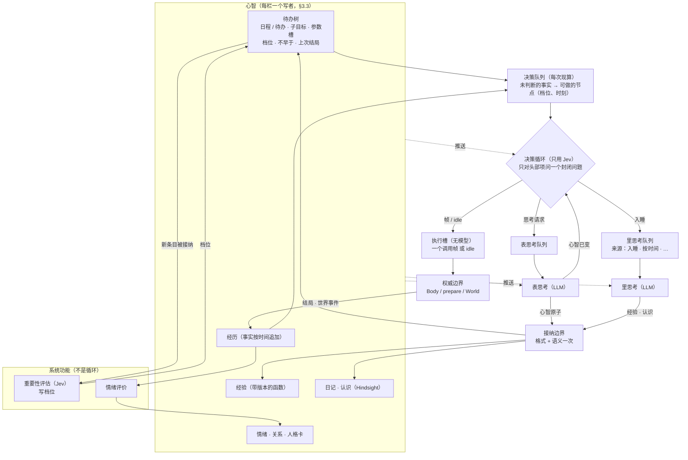
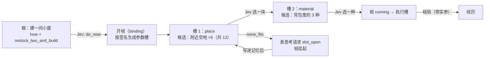

# NPC 三循环框架：执行槽、决策循环、表 / 里思考，加一份心智与通信时机（2026-11-23）

分类：NPC 决策侧的总框架决策稿（定部件、所有权、数据定义、通信时机、迁移与测试矩阵；不调取值、不改代码）。
状态：**框架方向由用户定（2026-11-23，§2 U-14 至 U-26）；X 组离线对照已完成（§9，结果见 `.demo/observe/npc-three-loop-bind-20261123/results.md`），U-26 据此定绑定方式与 H-1；§7 其余待定项未定；M-3 probe 计划中；未实施，`apps/` 未改。**

- 本稿在 [`2026-11-21-npc-generic-mind-decision.md`](2026-11-21-npc-generic-mind-decision.md)（下称“通用心智稿”）之上收口：通用心智稿的世界原子、经验、心智原子、接纳边界、代码只给事实（U-10）、推与拉都**保留**；它的“挑选”“三条路进思考”“绑定调用”“睡眠整合只在入睡时”**被本稿改写或取代**（逐项见 §4）。
- 决定编号接着通用心智稿往下排（U-14 起），两稿共用一套 U 编号。
- 本稿验证可行后（§9 M-3），总纲 [`2026-11-12-npc-architecture-overview.md`](2026-11-12-npc-architecture-overview.md)、任务层稿、日计划稿、对话通道稿里被取代的部分一次归档（U-22），不两套规范并用。

## 0. 名词（全文只在这里定义）

| 名词 | 含义 |
|---|---|
| **心智** | 一个 NPC 的全部数据：通用心智稿的各区（日程、待办、经验、经历、日记、认识）加本稿的待办树、调用帧、档位。每栏只有一个写者（§3.3）。它是状态，不是循环。 |
| **执行槽** | 执行侧唯一的位置，同一时刻只放一个**调用帧**或 `idle`。按步跑经验树，每步经 Body 等权威终态。不调任何模型。 |
| **决策循环** | 每次从**决策队列**取头部项，问 Jev 一个封闭问题，按答案改执行槽或投思考请求。只用 Jev。 |
| **表思考** | 有意识的思考：LLM 会话，能写全部心智原子（日程、待办、经验、日记），能只读查询、召回、`say`。 |
| **里思考** | 潜意识的整理：LLM 会话，只写经验与文本记忆（认识），不写日程 / 待办，不查询、不 `say`。通用心智稿的“睡眠整合”成为它的一种来源。 |
| **决策队列** | 从真值数据**每次现算**的有序视图（不另存，AGENTS 2.2.9）：未判断的事实在前，按时间；其后是此刻可做的待办节点，按档位、再按时刻。 |
| **待办树** | 日程与待办的条目可以有子节点：**子目标**（表思考拆的）与**参数槽**（代码按方式签名机械生成的）。“我想做什么”的树；与“怎么做”的经验树不是一回事。 |
| **参数槽** | 一次调用里一个语义参数（如“地点”“材料”“对象”）的待定值。Jev 从代码列出的候选里挑一个。 |
| **调用帧** | 一次正在进行的方式调用：所属条目、方式名与版本、已定的实参、执行到第几步。帧走到终态即丢；实参只作为经历留下（U-13 的“实际使用只是记忆”）。 |
| **档位** | 条目的重要程度，4 档（建议取值，§7 H-2），由系统功能“重要性评估”写；排序只按它，不按内容。 |
| **事实** | 执行结局、世界事件、听到的话、“现在不做”、“没写方式”等，只写客观内容（通用心智稿 §4.12）。按时间追加进经历，决策循环按游标读未判断的部分。 |
| **系统功能** | 用了模型但不属于角色自主意识的机制：情绪评价、重要性评估、Body 的反射。不在三循环里，结果写进心智的固定栏。 |
| **idle** | “什么都不做”这个动作本身。执行槽在没有帧时就是 `idle`；思考期间、待办表空时都落在这里。 |

## 1. 背景：为什么再收一次

用户 2026-11-23：“我们现在各种概念很细碎，感觉没有形成很完善的抽象。”

细碎的来源有两个：

1. **两代概念叠着**。2026-11-12 总纲是“规划 LLM → 选择 Jev → 执行行为树”加“位置 × 判断者”表；2026-11-21 通用心智稿又有挑选、叫醒、三条路进思考、绑定调用、睡眠整合、接纳边界。总纲尚未归档，两套说法并存。
2. **同一类工作分给了不同的模型、同一种机制有多个入口**。例如“现在做哪件、用什么实参”这件事，挑选归 Jev、绑定归 DeepSeek（通用心智稿 O-10）；进思考有三条路，各有自己的规则；睡眠整合独立成一个概念。

本稿的收法：**按“用哪种模型”分成三个部件，部件之间只传消息，共享一份每栏单写者的心智**。原有的每个概念都落进某个部件的一步（§4 对照表），不再单独成概念。

## 2. 用户的决定（2026-11-23，对话）

| # | 决定 | 原话 / 要点 |
|---|---|---|
| U-14 | **三循环 + 数据定义 + 通信机制**是 NPC 的总框架：执行（Body 跑系统逻辑，不涉及 AI）、决策（Jev 决定下一步）、思考（从思考队列取出思考、形成新记忆）。三循环是动态的，另需数据定义与通信机制。 | 「三循环是动态循环，还需要有数据定义以及通信机制」 |
| U-15 | **一类工作只由一种模型接手**：执行无模型；决策只用 Jev；思考只用 LLM。部件按模型分，权限按“能写哪几栏”分。 | 「既然一个模型能做一块专门的事……那我建议就一类工作就由一种模型来接手」 |
| U-16 | **绑定规约成决策**：一次调用是一个待办条目，确定实参时创建多个参数子待办；决策循环深度优先，让一次调用尽快完成，但保留中途被打断的能力。单个参数的值能否靠类型推导出候选、只由 Jev 出，先试；太难时调 LLM“也无可厚非”（由离线对照定，U-24）。决策自己能完成的尽量不跨到思考。**取代** U-13 中“绑定由 DeepSeek 调用”的部分与原创决策 O-10。 | 「确定绑定值的过程也可以变为决策过程」「如果决策能够自己完成的事就尽量不跨循环通信」「待办条目是不是可以设计成可嵌套的」 |
| U-17 | **思考同时至多两个会话**：表思考模拟有意识思考，不受形式限制；里思考模拟潜意识，只能产出经验和文本记忆，不能产生待办。 | 「一个表思考模拟有意识思考，一个里思考模拟潜意识」 |
| U-18 | **里思考醒着也跑，并做成队列**：每一种触发（入睡、按时间、情绪阈值……）是队列里的一种条目来源；先只做一种。**改写** U-11 中“整合只在入睡时做”。 | 「1可以，而且我觉得里思考也做成队列……每一种都是队列里的一个条目」 |
| U-19 | **思考与执行彻底拆开**；不做事本身是一种动作（`idle`），只有执行槽里是 `idle` 时思考才与执行“重叠”。 | 「思考是思考，执行是执行，除非正在执行的动作是idle，把不做事本身也当作一种动作」 |
| U-20 | **情绪评价是系统功能**，不放进三循环：虽然用了模型，但和 NPC 的自主意识无关，属于系统动作和数据。**重要性评估同属此类**（见 U-23）。 | 「这属于系统功能，虽然用了llm，但和npc的自主意识没有半毛钱关系」 |
| U-21 | **执行容量要小**：动作不会排太多，机械的动作序列在经验树里。 | 「从设计上执行循环的容量就不能太大」 |
| U-22 | **新思路验证可行后，旧思路归档**，不两套规范混用。 | 「如果新的证明可行，那旧的思路就应该归档」 |
| U-23 | **决策队列按优先级排序，Jev 只取头部项决策**；真值数据带优先级字段，用来实现打断与重新规划。优先级由**重要性评估**写：每条新形成的决策条目先单独过一次 Jev（固定提示词，或加人格卡），像 Generative Agents 的 importance 那样；它是系统功能，不是循环。 | 「jev每次只取决策队列中的头部项进行决策，而头部项是通过条目按优先级排序得来的」「形成的决策条目可以先单独过一下jev，像心理评估一样算系统功能不算循环」 |
| U-24 | **先做离线对照再定绑定方式**：DeepSeek 绑定 vs 逐槽 Jev（含换模型的一组），尤其看复杂函数（盖较复杂的房子）。 | 「可以，看看不同效果，我也有点拿不准这块，尤其复杂函数」 |
| U-25 | **选址只限两个量：区域与点位**（§3.5.1）。建什么、多大、打算建在哪个区域由表思考写进建房计划（或 Jev 从记得的区域里挑）；点位由系统函数在区域内按足迹等约束列出可行候选（复用产品 `Skills.Expand.site/4` 的客观判定），交 Jev 选。地理数据不进推送心智（无上界、真值在 World），区域作为记忆里的一栏。起因：X 组全量里 Jev 的 `none_fits` 集中在区域（5/15）与建房位置（3/15）。 | 「我建议我们直接限制死这块的功能，就两个量：区域和点位，llm和jev可以选区域，然后系统函数允许根据大小等约束选点位形成候选列表」「同意」（2026-11-23） |
| U-26 | **按 X 组结果定两项**：(1) U-16 的绑定实现为**逐槽 Jev**（候选由列举器给出，`none_fits` / `not_now` 两个固定项），取代 DeepSeek 绑定调用（O-10）；Flash 逐槽不用。(2) §7 H-1：重要性评估给 Jev **完整推送心智 + 这一条**。依据：两位盲评（Claude 子任务、GPT-6.2-Astra）逐项一致 93 %；J-2 第一位成立，GPT 口径在统筹按 `skills/gather.ex:108` 更正 6 项“整格结局相同”的扣分后成立（B 1.87 / 89 % vs A 1.89 / 93 %，墙钟中位 0.63 s vs 3.0 s，花费相同）；D 组两位盲排下完整心智都明显优于“固定提示词 + 人格卡”（Spearman 差 +0.71 / +0.79）。 | 「认可，开始吧」（2026-11-23，答“认可 6 项更正，就定下逐槽 Jev 与完整心智，进入 M-3”） |
| U-27 | **M-3 计划按建议批准**（`.demo/observe/npc-three-loop-m3-20261123/plan.md` §11）：(1) `stop_and_think` / `plan_empty` 之后到“心智已变”之前不开新帧（事实照常判），`slot_open` 只挡住那一个根；(2) 设计候选不按“此刻材料够”筛，每个写明所需材料与此刻余额；(3) 起始知识正文不改，“我的地块”取小屋足迹的列范围，“建成小屋”按任意位置的 `check placed` 判；(4) known 3 + bare 3 次正式运行，整轮 DeepSeek ≤ 543、Jev ≤ 1,492、花费硬上限 15 美元，用 M-2b 隔离节点，结束复位后保留。(1)–(3) 的正文与 plan §12 的其余漏洞，M-3 之后回填本稿。 | 「都同意，开始吧」（2026-11-23） |
| U-28 | **改写 U-27 (3)：起始知识只写区域，不写锚点**。M-3 固定建房实跑里，起始知识写死的锚点 micro (200, 4087, 288) 与 `site/4` 给的 (200, 4088, 288) 数字不同（同一宏格），Jev 在点位槽选 `none_fits`，小屋改由表思考写死实参的新经验建成，点位判定不成立。起始知识“我的地块”一句改为只写列范围 (24, 35)–(26, 37)，与 U-25“点位只来自系统函数”一致；其余各句不变。代价是 known 起始知识与 M-2b / M-2c 不再逐字相同。明细 `.demo/observe/npc-three-loop-m3-20261123/integration/README.md`、plan §12 第 24 条。 | 「同意，按建议改，继续跑」（2026-11-23） |
| U-29 | **计划节点的问题加选项“已经做完了”**（§3.4）：条目有上次结局时，“现在做不做”多一个选项 `already_done`；Jev 选它 → 写一条事实、这个节点此后不可做（与“没写方式”同一种结构性挡法，由决策循环写在自己的一栏），代码不判断做没做完、不关条目，关条目仍只由表思考做；别无可做时自然落到“待办表空”→ 表思考。起因：M-3 小集成-2 里 33 次“现在做不做”全答 `do_now`，条目行写着“上次运行：已完成”仍被再做，约 78 / 118 次 Jev 花在这个循环上（通用心智稿风险 11 在逐槽 Jev 之后重现：原来由绑定调用的 LLM 看上次结局说 `not_now`）。 | 「继续。选A」（2026-11-23） |

## 3. 框架

### 3.1 总图

- **向下是意图**：待办树 → 决策队列头部 → 调用帧 → 权威。
- **向上是事实**：权威结局与世界事件写进经历，成为决策队列里“未判断的事实”。
- **心智只经接纳边界被模型改写**；系统功能写自己的固定栏（档位、情绪）。
- **只有两条边界**：权威边界（执行槽改世界的唯一出口）与接纳边界（模型输出进心智或执行槽的唯一入口）。

### 3.2 四个部件

| 部件 | 模型 | 由什么驱动 | 读 | 只有它能写 | 容量 |
|---|---|---|---|---|---|
| 执行槽 | 无 | 决策循环放进的帧；每步等权威终态 | 帧、经验树 | 经历里的执行结局；经验的使用统计；帧的进度 | 1 个帧或 `idle`（U-21） |
| 决策循环 | Jev | 事件：新事实、帧到终态、思考结束、“不早于”到点、游戏钟进入某条目的时段 | 推送心智 + 头部项 | 帧的实参（参数槽选定的值）；条目的“不早于”（`not_now`）；条目的“上次结局” | 同一时刻 1 次 Jev 请求 |
| 表思考 | LLM | 表思考队列 | 推送 + 拉（查询、召回） | 日程、待办（含子目标）、经验、日记；`say` 是唯一的世界动作 | 同一时刻 1 个会话；队列有上限 |
| 里思考 | LLM | 里思考队列 | 推送（不拉） | 经验、认识 | 同一时刻 1 个会话；队列有上限 |

- 每个 NPC 同时至多 2 个思考会话（表、里各一，U-17）。多个 NPC 共用的 DeepSeek / Jev 并发与花费额度在模型客户端统一管，不在单个 NPC 里。
- 执行槽不是队列：机械的动作序列在经验树里，不在执行侧排队（U-21）。它是按步推进的状态机，所以准确地说是“两个循环 + 一个执行槽”，本稿仍沿用用户的“三循环”称呼。
- 决策循环**不轮询**：只由上表的事件推动；没有事件就不问 Jev（与通用心智稿 R-1 删去空闲等待一致）。

### 3.3 数据定义与写者

**待办节点**

| 字段 | 内容 | 写者 |
|---|---|---|
| `id`、`parent` | 节点身份；根节点 `parent = nil` | 表思考（子目标、根）；代码（参数槽，按签名机械生成） |
| `kind` | `schedule` / `todo`（根）、`subgoal`、`slot` | 同上 |
| `what` | 做什么（角色自己的话） | 表思考；参数槽由代码写“选 <参数描述>” |
| `how` | 方式名（经验或原子），不带实参；可为空（“想做但还不知道怎么做”） | 表思考 |
| `window` / `not_before` | 日程的时段；“不早于”（表思考写，或决策循环的 `not_now` 写） | 表思考；决策循环 |
| `tier` | 档位（§3.4） | 重要性评估（系统功能）；子节点继承根 |
| `last_run` | 上次结局与时刻 | 执行槽 |
| `closed` | 是否已关 | 表思考（`close_todo`）；参数槽随所属帧结束而删除 |

**调用帧**（执行槽与决策循环共用的一次调用）：`node`（所属根或子目标）、`way` 与 `way_version`、`bound`（参数槽 → 已选值）、`step`、`state`（`binding` / `running` / `suspended` / 终态）。

- 帧在 `binding` 时由决策循环逐槽填 `bound`；全部定了转 `running` 放进执行槽。
- 帧到终态即丢；`bound` 只经执行结局写进经历（`I ran <方式>(<实参>) for "<条目>". Result: …`，沿用通用心智稿 §4.12）。条目与经验里任何时刻都没有实参（U-13 的不变量保留）。

**经验**：沿用通用心智稿 §4.4（名字、意图、带描述的参数、树、统计），新增两项：

- `version`：每次写 / 改加一。表、里思考都能写经验，接纳边界查“基于第 N 版改”，版本不符把原因交回模型（§6 T-6）。
- 参数的 `sem`（语义类型，§3.5）：决定参数槽的候选从哪来。

**事实**：`at`（游戏钟）、`kind`、标准句、引用的对象（名字 + id）。按时间追加进经历；决策循环与里思考各持一个**游标**（已读到哪条），游标之后的就是“未判断 / 未整理”。

**表思考请求**：`reason`（`stop_and_think` / `plan_empty` / `slot_open`）、触发事实的游标区间、合并键。**里思考请求**：`source`（`sleep` / `clock` / …）、投递时刻。

### 3.4 决策队列与 Jev 的三种问题

**队列怎么来**（每次现算，不另存；AGENTS 2.2.9“队列只承担运输与调度，不得成为第二真值”）：

1. 决策游标之后的事实，按时间。**事实总在计划节点前面**（§7 H-3）：事实没有角色写的档位，若由代码给事实定档就是代码在判断（U-10），所以用一条与内容无关的固定规则。
2. 此刻**可做**的待办节点：日程在自己的时段里、“不早于”已到、未关、所属帧不在执行中。这是客观条件过滤，与“待办表空”是同一个谓词（通用心智稿 §4.6 末条），实现上共用一个函数。
3. 节点排序：档位高的在前；同档按时刻（日程开始时刻，或条目被接纳的时刻）；**一个节点的子节点紧跟它，在同档里排最前**——所以一件事的整棵子树先做完（深度优先，U-16）。

**Jev 只对头部项问一个封闭问题**（U-23）：

| 头部是 | 问题 | 选项 | 选中后 |
|---|---|---|---|
| 事实 | 要不要停下来想（沿用 M-2a C3 的问法） | `carry_on` / `stop_and_think` | `carry_on`：游标前移，再取头部。`stop_and_think`：执行槽在步骤边界换成 `idle`，投表思考请求（附游标区间） |
| 计划节点（根或子目标），方式不要实参 | 现在做不做 | `do_now` / `not_now` + 档位化的“不早于”（如 30 分钟后 / 2 小时后 / 明天，§7 H-4）；条目有上次结局时另有 `already_done`（U-29） | `do_now`：开帧放进执行槽。`not_now`：写“不早于”，写一条事实。`already_done`：写一条事实，节点此后不可做（不关条目） |
| 计划节点，方式要实参 | 同上 | 同上 | `do_now`：开帧（`binding`），按签名生成参数槽子节点，它们排到最前 |
| 参数槽 | 选哪个值 | 代码列出的候选 + `none_fits` + `not_now` | 选值：写进帧的 `bound`。`none_fits`：投表思考请求（`slot_open`，附列过的候选），帧挂起。`not_now`：整个帧作废，根节点写“不早于” |
| 计划节点，没写方式 | — | — | 不问 Jev；代码写事实 `"<条目>" has no way written, so nothing was run.`，它进入队列头部，下一轮按“事实”问 |

- **`not_now` 必须带一个大于零的“不早于”**：否则这个节点立刻又排回头部，Jev 会被反复问同一件事（这是结构性要求，不是替角色定时刻；档位里没有“马上”一项）。
- **`already_done` 只挡、不关**（U-29）：选项只在条目有上次结局时出现；选中后节点不再可做，由决策循环在自己的一栏记下（同“没写方式”的挡法），条目照旧留在待办树里，关条目、重排仍由表思考做。是否“做完”是 Jev 在完整心智上的封闭判断，代码只看形状（有没有上次结局）。
- **待办表空**（队列里没有可做的计划节点，也没有未判断的事实）：执行槽本来就是 `idle`；投表思考请求 `plan_empty`。代码不往待办树写条目（通用心智稿 O-8 保留）。
- **打断**：计划节点只在一个情况下抢占正在执行的帧——它的档位**严格高于**帧所属根的档位；在执行步骤的边界把帧挂起（`suspended`，留在树里），新帧进槽。同档不抢占。事实不抢占，但事实总在头部，Jev 判 `stop_and_think` 即在步骤边界停（通用心智稿 G-9 的 `halt` 语义）。这是机械比较，不看内容。
- **挂起的帧恢复**：它再次成为头部时，沿用已定的 `bound` 继续；世界若已变，由 `prepare` / 权威拒绝，拒绝写成事实，不静默重放（通用心智稿 mini-r2 的教训）。
- **取消“挑选”**：Jev 不再在几件事之间权衡（通用心智稿 §4.6 的挑选取消）。M-0“思考后 18 次挑选里 15 次照计划走”的证据是在“挑选”下得到的，不能直接沿用；新结构下“照计划走”由档位与时刻决定，Jev 只答“做 / 现在不做”。

### 3.5 绑定即决策：语义类型与候选

`Abilities` 的参数规格（`abilities.ex` moduledoc：`:integer`、`:hex32`、`{:enum,…}`、`:belt`、`{:list,…}`、`{:map,…}`……）只描述线格式，推不出候选。经验参数与原子参数各加一个语义类型 `sem`，候选按 `sem` 由对应事实的 owner 列出：

| `sem` | 候选来源（owner） | 截取（只按客观顺序，写明“列了几个、共几个”） | Jev 能出 |
|---|---|---|---|
| `enum` / `belt` | 规格本身 / `profile.tools` | 不截 | 能 |
| `person` | 附近感知到的人（Perception）+ 记得的人（经历里出现过的名字 + id） | 按距离，再按最近一次出现 | 能 |
| `place` | 自己的建筑、知道的地点、感知到的空地（一个候选给齐 `x0,z0,x1,z1` 这类整组坐标） | 按距离 | 能 |
| `region` | 记忆里的“我知道的区域”一栏（地名、看过的范围、自己的地块；U-25） | 按距离 | 能 |
| `site` | 系统函数按所选区域与足迹列出的可行点位（§3.5.1） | 按离自己的距离 | 能 |
| `item` / `material` | 背包；目录只列背包里有的与经历里出现过的 | 按数量 / 最近 | 能 |
| `prefab` | 目录里此刻材料够的 + 经历里用过的 | 按最近 | 能 |
| `amount` / `duration` | 分档（少 / 一些 / 很多；30 分钟 / 2 小时 / 到傍晚） | 不截 | 能，粒度粗 |
| `text` / `design` | 列不出：台词、名字、房屋设计、格子列表 | — | 不能 |

- **按语义参数拆槽，不按线字段拆**：一个 `place` 候选一次给出整组坐标。
- **后槽依赖前槽**：先选“修哪座建筑”，再列“用什么材料”；深度优先的次序正好保证这一点。槽的次序就是签名里参数的次序（写经验时定）。
- **代码只列事实、不排好坏**：截取只按距离、时间、数量这类客观量（U-10）。
- **开放类型（`text` / `design`）走表思考，再回到决策**：这个槽一律产生 `slot_open` 请求；表思考把产物（一份设计、一句要说的话）写进记忆（经验或带名字的记录），下一次这个槽的候选里就有它。这样“思考写记忆、决策从记忆里挑”的分工不破（U-15、U-16）。
  `say` 例外：思考里直接 `say` 仍保留（通用心智稿 G-10），对话不走槽。
- **复杂函数**（如较复杂的房子）的代价在于开放槽要跨一次循环；能不能接受由离线对照的 X-3 读数定（§9）。离线对照若显示逐槽 Jev 不可靠，退路是“这一类槽由表思考填”，而不是恢复 DeepSeek 绑定调用（那会让决策循环里出现第二种模型，违反 U-15）。

### 3.5.1 选址：区域与点位（U-25）

选址只认两个量。“看哪里、去哪里、建在哪里”这类空间参数都归到这两个语义类型，不另造第三种。

| 量 | 谁定 | 怎么来 |
|---|---|---|
| 建什么、多大 | 表思考 | 写建房计划时选定设计（决定足迹大小），作为条目的子目标或经验参数 |
| 区域 `region` | 表思考写进计划，或 Jev 从候选里挑 | 候选是心智里“我知道的区域”一栏：地名、看过的范围、自己的地块。这一栏是类型化记忆，不是起始知识正文里的一句话；写入者是表思考（经接纳边界）与执行结局（查询过的范围由执行槽记下） |
| 点位 `site` | Jev 从系统函数列出的候选里选 | 系统函数：对所选区域做一次 survey，按足迹在区域内逐个地块跑 `Skills.Expand.site/4`（`apps/npc_server/lib/npc_server/skills/expand.ex`）；通过的地块按离自己的距离排序，截取时写明“列了 n 个、共 m 个”，每个候选给齐锚点、朝向与站位 |

- **`site/4` 只做客观判定**（依次：`crowded` 挨着任何人的建筑或别人铺的地；`no_ground` 没有站得下的地面；`uneven` 高差超限；`no_stand` 四个站位都站不下），不替角色决定“哪块更好”，符合 U-10。没过的地块不列，但按原因计数写进候选说明（如“共 40 块，通过 6 块；crowded 20、uneven 14”），让判断者知道为什么少。
- **区域大小封顶为一次 survey 的上限**：`Perception.survey_columns/0` 每边 32 列，且各边离自己不超过 `Perception.reach/0`（32 米）。超出的区域由表思考缩小，不做分块查询（§7 H-10）。
- **区域在 survey 够不着的地方**：列举器列 0 个，并写事实“这个区域离我 d 米，超出 survey 的范围”；Jev 只能选 `none_fits` / `not_now`，由表思考排一条先走过去的条目。代码不替角色走过去。
- **`none_fits` 回表思考**：换区域或换大小；表思考写进记忆的新区域下一次就是 `region` 的候选。
- 地理数据（地形、格子、料堆分布）**不进推送心智**：无上界（M-2b：一列 survey 约 90 字，4000 字只装得下 44 列），真值在 World、会变（总纲“眼前的处境现查，不存进记忆当真值”）。进记忆的只有“我知道的区域”这类有界的名字与范围。
- 现状：`site/4` 只在 `Skills.Expand` 的扩张流程里用；把它包成“区域 + 足迹 → 候选列表”的系统函数是产品化时的一步（与列举器同一 owner）。X 组的原型没有这一步，`design_site` 槽只列了起始知识里的地块与设计，是全量里 `none_fits` 3/15 的来源。

### 3.6 思考：两个队列

**表思考**（沿用通用心智稿 §4.5 的模板、心智原子、接纳边界与工具表）：

- 请求来源只有三种，都由决策循环投：`stop_and_think`、`plan_empty`、`slot_open`。代码之外的地方不开表思考。
- 同一时刻一个会话；会话进行中来的新事实不另开会话，并入下一次请求的触发事实；同 `reason` 的请求合并。队列满时并入同类请求并记日志。
- 会话结束发“心智已变”给决策循环：槽里是 `idle` 就立即重算队列；否则下一个步骤边界重算。
- 表思考的每个心智原子经接纳边界一次写完；决策循环每次取头部都重读心智；已在执行的帧不受影响（U-19 之后思考与执行可以并行，这是新的并发面）。

**里思考**（U-17、U-18）：

- 只写经验（`write_experience` / `retire_experience`）与认识（`write_understanding`）；不写日程 / 待办 / 日记，不查询，不 `say`。经历原文不可改（通用心智稿 §4.13 的四条不变量全部保留）。
- **队列条目**：`source` + 投递时刻。每种来源有一个投递器，投递器是系统机制，只管“什么时候投”，不管“想什么”。
- **游标**：每次会话读“上次里思考之后的新事实”，不管被哪种来源触发，同一件事不被整理两遍。
- 同一时刻一个会话；同 `source` 的请求排队时合并；队列有上限（§7 H-6）。顺序按投递时间：里思考的调度是系统层面的事，没有角色写的档位，不用决策队列那套排序。
- **来源的次序**（U-18“先只做一种”）：
  1. **入睡**：把通用心智稿的睡眠整合迁成第一种来源，行为不变，只换机制。睡眠本身仍是角色自排的条目（方式 `sleep_until`），决策循环开帧时顺手投这个请求。
  2. **按游戏时间**（第二种，建议）：每 N 个游戏小时投一次（§7 H-5）。与内容无关、每个 NPC 每天次数有上限、好测。
  3. 暂不做：情绪过阈值（要等情绪评价在新结构里定义好、阈值有数据）；每条事实一投（花费随活动量涨）。
- **Hindsight 自己的巩固**：通用心智稿计划“白天关自动巩固、入睡时巩固”。里思考醒着也跑之后，这一条要重新定（§7 H-8）。

### 3.7 执行槽与 `idle`

- 槽里只有一个帧或 `idle`。`idle` 不是空，是“不做事”这个动作（U-19）；思考期间、待办表空、判 `stop_and_think` 之后，槽里都是它。
- `idle` 在以下任一事件时结束：决策循环放进新帧（“心智已变”之后重算队列、新事实被判 `carry_on` 之后有可做节点、“不早于”到点）。
- 执行槽不调模型（U-15）。现有 `skills/house_design.ex:332` 在执行中途问 LLM，与此冲突：新结构里“设计”是 `design` 类型的槽，由表思考产出（§3.5），`design_house` 退化为只执行一份已有设计的原子。退役次序在产品化时定（通用心智稿 G-13 改写，§4）。
- 睡眠是一个普通帧（方式 `sleep_until`）：睡着时不发世界命令，世界事件照样成为事实、进决策队列头部（通用心智稿 §4.13 保留）。

### 3.8 系统功能：重要性评估、情绪评价、反射

这三样用模型或规则产出数据，但不是角色的自主决定，不在三循环里（U-20）。

**重要性评估**（U-23）：

| 项 | 内容 |
|---|---|
| 何时 | 一个根节点（日程 / 待办）或子目标被接纳之后，立即一次；参数槽不评（继承根） |
| 谁 | Jev，固定提示词；选项 = 4 个档位与各自一句判据（§7 H-2） |
| 输入 | **待定（§7 H-1）**：用户提的是“固定提示词（或加人格卡）+ 这一条”；证据倾向“完整推送心智 + 这一条”，见下 |
| 写哪 | 节点的 `tier`；重要性评估是这个字段的唯一写者 |
| 失败 | Jev 超时 / 拿不准：节点按最低档入队并记日志（显式失败，不静默；档位缺失时节点不可做也是一种选择，§7 H-1 一并定） |

输入的证据（本线已有，§5.1）：M-1 的 Jev 打分 v1 正是“人格 + 一条经历、三档”，自家小屋被拆 4 次都只评到中档、被搭话判“照常”，判定落空；M-2a 的 v2 改成给与挑选同一份完整心智后成立（被拆 4/4 停下、普通活动 30/30 继续）。
Generative Agents 论文的 importance 提示词只有那一条记忆；官方代码另带人物设定（identity stable set），正是用户提的“固定提示词 + 人格卡”（§5.2 第 1 条）。通用心智稿把“孤立打分”列为不适用，依据是 M-1 的这次落空。
v1 打的是“经历有多要紧”，这里打的是“自己写的计划有多要紧”，对象不同，结论不能直接搬；所以两种输入都进离线对照（§9 X-4），用数据定。

**情绪评价**：现状在 Life（规则模式只认 World 来源的建设被帮助 / 被破坏）。新结构里它读经历、写情绪栏，推送时给各判断者读。用哪个模型、什么时候评，产品化时另定，本稿只定它的位置。

**反射**：Body 的物理反应（落水、被推开）照旧归 Body，不经决策循环；结果作为事实进经历。

### 3.9 通信时机

| 时机 | 从 → 到 | 消息 | 接收方做什么 |
|---|---|---|---|
| 执行步骤到终态（完成 / 失败 / 被打断 / 醒来） | 执行槽 → 心智（经历） | 事实（结局、原因码、实参） | 决策循环被唤起，重算队列：事实在头部 |
| 世界事件、听到的话、睡着时的事 | Body → 心智（经历） | 事实 | 同上 |
| 头部是事实，Jev 判 `carry_on` | 决策循环内部 | — | 游标前移，再取头部 |
| 头部是事实，Jev 判 `stop_and_think` | 决策 → 执行槽；决策 → 表思考队列 | 换成 `idle`；请求（`stop_and_think`，游标区间） | 槽在步骤边界停；表思考排队 |
| 头部是计划节点，Jev 判 `do_now`，不要实参 | 决策 → 执行槽 | 帧 | 槽是 `idle` 就直接放；否则仅当档位严格更高时在步骤边界抢占，不然这个节点不会是头部 |
| 头部是计划节点，要实参 | 决策循环内部 | 开帧、生成参数槽 | 参数槽排到最前，逐槽问 Jev |
| 所有参数槽都定了 | 决策 → 执行槽 | 帧（`running`） | 同上 |
| 参数槽选 `none_fits`，或槽是开放类型 | 决策 → 表思考队列 | 请求（`slot_open`，槽与列过的候选） | 帧挂起；决策可取下一个头部 |
| Jev 判 `not_now` | 决策 → 心智（待办树、经历） | “不早于”；事实 | 节点到点前不在队列里 |
| 待办表空 | 决策 → 表思考队列 | 请求（`plan_empty`） | 槽本来就是 `idle` |
| 开 `sleep_until` 帧 | 决策 → 执行槽；决策 → 里思考队列 | 睡眠帧；请求（`sleep`） | 里思考排队 |
| 游戏钟到投递点 | 里思考的时间投递器 → 里思考队列 | 请求（`clock`） | 排队（同来源合并） |
| 表思考结束 | 表思考 → 决策 | 心智已变 | 槽是 `idle` 立即重算；否则下一个步骤边界重算 |
| 里思考结束 | — | 不通知 | 新写的经验 / 认识在下一次推送里出现 |
| 新的根节点或子目标被接纳 | 接纳边界 → 重要性评估 | 节点 | 写 `tier`；写完之前该节点不进队列 |
| 情绪评价、反射 | 系统 → 心智的固定栏 | 不是循环间的消息 | 下一次推送读到 |

实现上（产品化时定）：每个部件是一个进程，消息走 mailbox；mailbox 只是运输（AGENTS 2.2.9），排序与“该做什么”都从心智现算，进程重启后从心智与游标恢复，不依赖 mailbox 里残留的消息。

## 4. 与通用心智稿的关系

| 通用心智稿的概念 | 在本框架里 | 状态 |
|---|---|---|
| 世界原子、经验（函数）、心智原子、接纳边界、推与拉、代码只给事实（U-10）、启动数据 G0 | 原样保留；经验加 `version` 与参数 `sem` | 保留 |
| Jev 挑选（§4.6） | 取消；由决策队列排序 + Jev 对头部项的 `do_now` / `not_now` 代替 | **取代** |
| Jev 叫醒判断 | 头部是事实时的问题，问法不变 | 保留，换位置 |
| 进思考的三条路（O-2） | 叫醒 → 表思考 `stop_and_think`；待办表空 → 表思考 `plan_empty`；入睡 → 里思考 `sleep`；新增 `slot_open` 与里思考的时间来源 | **改写** |
| 绑定调用（U-13 的 DeepSeek 部分、O-10） | 参数槽 + 逐槽 Jev（U-16、U-26）；`not_now` 改为 Jev 的选项 + 档位化“不早于”，不再写原因文字 | **取代**（X 组已确认，U-26） |
| U-13 的其余部分：经验是函数、条目只写方式名、实参只在用时、实参只作为经历留下 | 由调用帧承载 | 保留 |
| 睡眠整合（U-11、O-9、§4.13） | 里思考的第一种来源；四条不变量保留；“只在入睡时”改为醒着也跑（U-18） | **改写** |
| G-10 思考时 `say` 直接执行 | 表思考唯一的世界动作 | 保留 |
| G-13 `design_house` 留在原子内部 | 设计改由表思考产出、作为 `design` 槽的候选；`design_house` 只执行已有设计 | **改写**（产品化时） |
| 原创决策 O-8（待办表空 → 规划思考） | 表思考请求 `plan_empty` | 保留 |

总纲（2026-11-12）的“规划 → 选择 → 执行”与“位置 × 判断者”表、任务层稿、日计划稿、对话通道稿里的 Jev 回合：本稿验证后一次归档（U-22），归档清单在 §10 的迁移一步里列。

## 5. 证据

### 5.1 本地（均出自通用心智稿 §5.1，不另跑）

| 证据 | 用在哪 |
|---|---|
| M-1 Jev 打分 v1：人格 + 一条经历、三档，被拆 4 次都只到中档、被搭话判“照常”，落空 | 重要性评估的输入（§3.8、§7 H-1） |
| M-2a Jev 打分 v2：完整心智，被拆 4/4 停下、普通活动 30/30 继续，置信 0.82–0.94 | 头部是事实时的问法沿用；重要性评估倾向完整心智 |
| M-2b L5：完成 22/22 继续、失败 2/2 停下 | 同上 |
| M-0：思考后 18 次挑选里 15 次照计划走 | 只证明“挑选”时代，新结构下不沿用（§3.4） |
| M-2b：思考中位 9.1 s、每次 2.5 个请求；树每棵 1–3 步，不含等待中位 2.7 s | 时延估计：逐槽 Jev 约 0.6 s / 槽（`jev.ex` moduledoc 与总纲的量级）vs 一次 DeepSeek 绑定；需 X 组实测 |
| M-2c mini-r2：写条目时绑好的实参在小屋建成后被原样重放，三次 `occupied` | 调用帧到终态即丢、挂起帧恢复时由 `prepare` 拒绝而不静默重放 |
| M-2c 之后 DeepSeek 绑定调用从未真跑过（修订 3 之后 0 次模型请求） | A 组也是第一次实测，不是已知基线 |

### 5.2 外部依据

沿用通用心智稿 §5.2 已核对的条目：Generative Agents（importance 由模型打 1–10 分；“继续还是反应”）、BDI 的 PRS / Jason（“Each intention is a stack of partially instantiated plans”，选作 intended means 时才取代换）、晚绑定、CoALA（决策循环与内部 / 外部动作）、SwiftSage（快慢分工）、OpenClaw Dreaming 与 Letta sleep-time（整理记忆由另一次会话做）。

本稿新用到的四项（2026-11-23 由核对子任务下载 PDF / HTML 抽文字后逐字摘录；GA 与 sleep-time 论文写 arXiv PDF 页，Jason 与 SHOP2 写印刷页；未逐页目视）：

1. **Generative Agents importance**（arXiv:2304.03442 §4.1，PDF 第 9 页）。提示词原文：“On the scale of 1 to 10, where 1 is purely mundane (e.g., brushing teeth, making bed) and 10 is extremely poignant (e.g., a break up, college acceptance), rate the likely poignancy of the following piece of memory. Memory: … Rating: <fill in>”；“The importance score is generated at the time the memory object is created.”
   **论文与官方代码的输入不同**：论文的提示词只有那一条记忆；官方仓库 `joonspk-research/generative_agents` 的 `persona/prompt_template/v3_ChatGPT/poignancy_event_v1.txt` 开头是 “Here is a brief description of !<INPUT 0>!. !<INPUT 1>! On the scale of 1 to 10, … rate the likely poignancy of the following event for !<INPUT 2>!.”，`run_gpt_prompt.py` 传入 `persona.scratch.get_str_iss()`（姓名、年龄、性格等 identity stable set）；另有 `poignancy_chat_v1.txt` 给对话打分。
   §4.3（PDF 第 11 页）：计划只有 “a location, a starting time, and a duration”，**没有优先级 / 重要度字段**（全文检索 priority / urgent 无命中）；分解是 “starts top-down and then recursively generates more detail … first into hour-long chunks of actions … We then recursively decompose this again into 5–15 minute chunks”。
   检索加权：论文写 “all αs are set to 1”、recency 按游戏小时衰减 0.995；官方代码 `retrieve.py` 实为 `gw = [0.5, 3, 2]`、按序号衰减、`recency_decay = 0.99`（本稿不用检索加权，记此仅作“论文与代码有出入”的提醒）。
   **借鉴**：条目被接纳时打一次重要度（“generated at the time the memory object is created”）；官方代码带人物设定打分——即用户 U-23 提的“固定提示词 + 人格卡”。**不同**：GA 给记忆打分、用于检索与反思阈值，计划本身不带优先级；本稿给计划条目打档位、用于排序，对象与用途都不同，属原创（T-2）。输入取舍仍按本线 M-1 / M-2a 证据走 X-4（§7 H-1）。
2. **Jason 手册**（Bordini & Hübner，Release 0.9.5，2007-02）。§2.3（第 3 页）：三个选择函数 SE / SO / SI 在抽象语义里 “undefined, hence the choices made by them are supposed to be non-deterministic”；脚注 2 提到可用 “decision-theoretic task scheduling to guide the choices made by the intention selection function”。
   §5.1（第 16–17 页）缺省实现：`selectEvent(Queue<Event> events) { … return events.poll(); }`、`selectOption(…) { … return((Option)optList.remove(0)); }`、`selectIntention(Queue<Intention> intentions) { // … make sure no intention will "starve"!!! return intentions.poll(); }`——都取队首；第 18 页：用户可写 `MyAgClass extends Agent` 重定义 `selectEvent` 等并在 `.mas2j` 里指定。手册未出现 FIFO / round-robin 字样，intention 执行一步后是否放回队尾未写。
   挂起（第 17–18 页）：“waiting for an action feedback makes an intention to become suspended. Only after the feedback from the environment is received, that intention can be selected again for execution”。§4.1（第 14 页）：`requeue` 把事件 “inserted back at the end of the list of events”。
   **借鉴**：“判断者每次只处理队首一项、队列次序由可替换的选择函数决定”正是 BDI 解释器的形状（U-23）；按优先级定制 SI 有出处（脚注 2），但手册未给做法。缺省代码的注释 “make sure no intention will starve” 对应本稿风险 5 与 T-8 的饿死问题。**不同**：Jason 的队列由解释器维护、可写状态；本稿的决策队列每次从心智现算（AGENTS 2.2.9）。
3. **SHOP2 / HTN**（Nau et al. 2003，JAIR 20:379–404，arXiv:1106.4869）。§2（第 380 页）：“a set of methods, each of which is a prescription for how to decompose a task into subtasks … Planning proceeds by using the methods to decompose tasks recursively into smaller and smaller subtasks, until the planner reaches primitive tasks”。§6.2（第 395 页）：有序任务分解 “plans for tasks in the same order that the tasks will later be performed”。§3.2（第 386 页）：“if the current method m has any subtasks, SHOP2 should generate one of those subtasks before generating any other subtasks in the task network.”
   **借鉴**：待办树的子目标 / 参数槽按序、子树先展开（深度优先，U-16）。**不同**：SHOP2 是离线规划器、方法由领域作者写；本稿的分解由表思考（子目标）与签名（参数槽）产生，边分解边执行，可被打断。
4. **Letta sleep-time**（博客 `letta.com/blog/sleep-time-compute` “MemGPT 2.0: Sleep-time agents in Letta”）：“Letta actually creates two agents under the hood: a primary agent and a sleep-time agent.”；“Offloading memory to a sleep-time agent allows memory management to happen asynchronously.”；“the sleep-time agent modifies the memory in an "anytime" fashion - so the primary agent can read from this memory whenever, without having to wait for the sleep-time agent to finish its reasoning.” 论文 arXiv:2504.13171 §1（PDF 第 2 页）只定义 sleep-time compute 为 “inference is done between interactions with the model while it would otherwise be idle”，**没有**双代理的表述，其中 “parallel” 指并行采样。
   **借鉴**：表 / 里两个会话、里思考在后台异步改记忆、表思考随时读而不等它（U-17、U-18）。**局限**：两处原文都没有直接写两个代理 “run in parallel”，用词是 asynchronously / in the background / anytime；并发写同一份记忆时怎样避免冲突，博客未说，本稿用经验版本号自定（T-6）。

## 6. 原创决策（AGENTS 2.2.8；实施前向用户报告）

检索范围：通用心智稿 §5.2 的十二项原文 + 本稿 §5.2 的四项（已核）。下列各项在这些来源里没有找到可照搬的整套做法；有部分对应的写在“为什么不照搬”一栏。

| # | 决策 | 为什么不照搬 | 风险 | 不变量 | 怎样验证 |
|---|---|---|---|---|---|
| T-1 | 执行是单槽，不是队列 | 行为树 / BDI 的 intention 可以并行多个；本项目一个身体一次只做一件事，序列在经验树里 | 想“边走边说”时要靠 `say` 例外 | 槽里至多一个帧或 `idle` | 产品化后 P-1 的槽状态机测试 |
| T-2 | 决策队列每次现算：事实在前（按时间），计划节点按档位、再按时刻，子节点紧跟父节点 | Jason 缺省 `selectEvent` / `selectIntention` 取队首、可由用户类重定义，脚注提到可按 decision-theoretic scheduling 选 intention（§5.2 第 2 条）——“只处理队首、次序由选择函数定”可借；但没有给出按档位排序的做法，队列是解释器的可写状态。Generative Agents 的计划没有优先级字段（§5.2 第 1 条）。SHOP2 的最左分支先展开（§5.2 第 3 条）对应“子节点紧跟父节点” | 档位退化（都写成一档）→ 只按时间；事实太多时计划节点长期得不到处理 | 队列不另存；排序只看档位、时刻、树结构；“待办表空”与“可做”同一谓词 | M-3 读档位分布与同档比例；离线 X-4 |
| T-3 | Jev 只对头部项问封闭问题；`not_now` 必带大于零的档位化“不早于” | 通用心智稿的挑选让 Jev 在多项里权衡；用户定只取头部（U-23） | Jev 失去“几件事比较”的机会，比较只在写档位时发生一次 | 头部之外的项不进 Jev 请求；`not_now` 之后该节点到点前不在队列 | M-3 读 `not_now` 比例与连续次数 |
| T-4 | 参数槽是待办树的子节点，由代码按签名机械生成；候选由各 `sem` 的 owner 列出、只按客观量截取 | 晚绑定由解释器对信念库合一；本项目心智不是逻辑库，选值是判断，但判断限在列出的候选里 | 候选列错或截掉了对的那个；粒度粗（数量分档） | 候选只来自事实 owner；截取写明“列了几个、共几个”；帧到终态丢实参 | 离线 X-1 至 X-3 |
| T-5 | 开放类型的槽经表思考写进记忆、再成为候选，而不是让决策调 LLM | 一类工作一种模型（U-15） | 复杂函数多一次跨循环，时延变长 | 决策循环内只有 Jev 请求 | 离线 X-3 读跨循环次数与总时延 |
| T-6 | 表、里思考都能写经验，经验带版本号，接纳边界按“基于第 N 版”检查 | Letta 的主代理不改核心记忆；本项目醒着也要改经验（U-11） | 两边改同一条经验时一方被拒、重写 | 经验每次写版本加一；版本不符必拒并给原因；正在执行的帧绑定的版本在帧内不变 | P-1 接纳边界的并发反例 |
| T-7 | 里思考按游标读新事实，来源只决定时机 | Letta 的 sleep-time agent 在后台异步改记忆、主代理随时读（§5.2 第 4 条）——两个会话分工可借；但触发是单一来源（OpenClaw 用 cron、Letta 按步数），没有多来源队列与游标 | 多来源同时投时排队；游标丢失会重复整理 | 每个 NPC 一个里思考游标；同一来源排队时合并 | M-3 读重复整理次数（应为 0） |
| T-8 | 抢占只在档位严格更高时、步骤边界；挂起的帧留在树里、恢复时不重验 | Jason 的 intention 在等动作反馈时挂起、反馈到了才可再选（§5.2 第 2 条），那是等待式挂起，不是按优先级抢占；缺省代码注释要求 “make sure no intention will starve”，未给做法 | 高档条目频繁出现时，低档的事长期挂起 | 同档不抢占；挂起帧恢复后世界变化由 `prepare` 拒绝 | P-2 的抢占与恢复测试 |

## 7. 待定项（建议值，等用户定）

| # | 问题 | 建议 | 依据 |
|---|---|---|---|
| H-1 | 重要性评估给 Jev 看什么 | **已定（U-26）：完整推送心智 + 这一条**；离线 X-4 把“固定提示词 + 人格卡 + 这一条”一并比，数据不支持再改 | M-1 v1 落空、M-2a v2 成立（§3.8）；GA 官方代码用“人物设定 + 一条”（§5.2 第 1 条），即 X-4 的 (i) |
| H-2 | 档位数与各档判据 | 4 档；判据写“对我有多要紧”的英文短句，不写“该做什么” | 档位少则同档多、排序退化为按时间；多则 Jev 难分（推断，X-4 读分布） |
| H-3 | 事实与计划节点的先后 | 事实总在前，事实之间按时间 | U-10：代码不给事实定档 |
| H-4 | `not_now` 的“不早于”档 | 30 分钟后 / 2 小时后 / 明天同一时刻 / 明天早上 6 点（游戏钟） | 必须大于零（§3.4）；取值是原创，M-3 后调 |
| H-5 | 里思考的第二种来源 | 按游戏时间，每 4 个游戏小时一次 | 与内容无关、次数有上限 |
| H-6 | 两个思考队列的上限与满时处理 | 表思考 4、里思考 2；满时并入同类请求并记日志 | AGENTS 2.2.9 |
| H-7 | 档位缺失（重要性评估失败） | 节点按最低档入队并记日志 | 显式失败、不阻塞；另一选项是“评完才可做”，代价是 Jev 不可用时整张表停住 |
| H-8 | Hindsight 自动巩固的时机 | 每次里思考会话开始前触发一次巩固 + 认识刷新，白天其余时间关 | 原计划“只在入睡”随 U-18 失效 |
| H-9 | 认识的唯一写者（通用心智稿遗留） | 里思考的 `write_understanding`；Hindsight 的认识刷新改为它的输入 | AGENTS 2.2.3 |
| H-10 | 区域超出一次 survey 时怎么办 | 封顶：区域每边 ≤ 32 列且在 reach 内；超出由表思考缩小，不分块查询。代价是大范围选址要多次思考 | U-25；`Perception.survey_columns/0`、`reach/0` |

## 8. 风险

1. **档位退化**：LLM 写的条目如果都被评成同一档，排序退化为按时间；读档位分布与同档比例（X-4、M-3）。
2. **候选覆盖不到对的值**：列举器只按客观量截取，对的那个可能在截取线外；`none_fits` 会把它送去表思考，代价是一次跨循环。读 `none_fits` 比例（X 组）。
3. **复杂函数的时延**：开放槽要等表思考（M-2b 思考中位 9.1 s），再回到决策；X-3 量总时延。
4. **思考与执行并行后的一致性**：表思考可能在帧执行时关掉或改写它所属的条目。规则：已在执行的帧跑到终态，结局照写；它的根已关就不再成为头部。P-2 覆盖。
5. **事实淹没计划**：事实总在前，事件密集时计划节点迟迟轮不到；每条事实只问一次 Jev（约 0.6 s），读“事实问 Jev 次数 / 计划节点问 Jev 次数”。
6. **两种思考的花费**：每个 NPC 至多 2 个会话；全局并发与额度在客户端统一管。按时间来源的次数有上限。
7. **语义类型的维护面**：每个原子与经验参数都要写 `sem`；`sem` 缺失的参数一律当开放类型，走表思考（显式，不猜）。
8. **样本**：Jev 在“做 / 现在不做”与参数槽上的表现目前没有任何数据，全靠 X 组。

## 9. 测试矩阵（按 `../Voxim/Docs/Testing.md`）

**离线对照（X 组；计划在 `.demo/observe/npc-three-loop-bind-20261123/plan.md`，起草中；判定在发问前写定；用户审过再跑）**

| # | 证明什么 | 做法 | 读数 / 判定方向 |
|---|---|---|---|
| X-1 | 简单调用（1 个可枚举槽）逐槽 Jev 是否可靠 | 三组：A = DeepSeek 绑定调用（现行 harness）；B = 逐槽 Jev（`:answers`）；C = 逐槽、同 B 选项格式、模型换 DeepSeek Flash（`:openai`）。B / C 分开“拆成封闭选择”与“换模型”两个变量 | 合法率、盲评合理性、`not_now` / `none_fits` 比例、请求数 / token / 墙钟 |
| X-2 | 中等调用（2–3 槽、后槽依赖前槽） | 同上 | 同上 + 槽间不一致的次数 |
| X-3 | 复杂房子（含 `design` 槽） | B / C 里 `design` 槽经表思考产出、写进记忆、再由 Jev 挑；A 一次填齐 | 同上 + 跨循环次数与总时延 |
| X-4 | 重要性评估的输入（H-1） | 用已录下的、思考写出的真实条目：(i) 固定提示词 + 人格卡 + 一条；(ii) 完整心智 + 一条 | 档位分布、同档比例、与人工排序的一致性 |

输入只用产品 / 现有代码路径产生的数据（录下的心智快照、思考写出的条目；复杂房子若无真实设计产出，先用产品 `design_house` 跑一次导出，不手写）。资源：并发 ≤ 2、按组设请求上限、运行前后记主机 UDP 基线。

**probe（M-3：三循环 harness；在 X 组之后）**

| # | 证明什么 | 读数 / 判定方向 |
|---|---|---|
| M3-1 | 决策队列现算、只取头部、事实在前、子树先做完 | 每次 Jev 请求里只有头部项；同一根的参数槽之间没有插入别的计划节点（事实除外） |
| M3-2 | 一类工作一种模型 | 决策循环内 DeepSeek 请求 0；执行槽内模型请求 0 |
| M3-3 | 思考与执行拆开 | 表思考期间执行槽只在 `idle` 或跑已开的帧；里思考写入的只有经验与认识 |
| M3-4 | 里思考队列与游标 | 同一事实被里思考整理两次 0；入睡来源行为与通用心智稿判定 S 一致 |
| M3-5 | 代码不替模型判断 | 通用心智稿判定 U 的扫描范围加上重要性评估与参数槽的文字 |

**产品化之后**：沿用通用心智稿 §10 的 P-1 至 P-5，P-1 加槽状态机、队列排序、版本检查的算法测试，P-2 加抢占与恢复。

## 10. 进度

- 2026-11-23：用户提出三循环抽象（U-14），两轮讨论定 U-15 至 U-24。本稿起草：只读代码、文档与已有证据，未改 `apps/`、未调模型。离线对照 plan 交子任务起草中。外部原文四项核完，补入 §5.2，§6 的 T-2、T-7、T-8 相应改写。
- 2026-11-23：X 组 plan 写定，用户批准（「没问题，开始」，按统筹建议：思考写的经验也带语义类型；先只跑试点、不扩复杂房子；不核 `prepare`；盲评由独立子任务做、用户抽查；明细见 plan §8 末）。第一阶段（重建绑定时刻、列举器、离线测试、dry，不调模型）交子任务进行中。
- 2026-11-23：X 组第一阶段完成（25 个绑定时刻可用：干净 10、补算核对通过 15；mini-r2 6 个因渲染函数已改无法核对而剔除；离线测试 20/20）。试点 11 个时刻（含建小屋 1 个），A 12 / B 37 / C 40 / D 24 次请求，0 错误；读数见 `.demo/observe/npc-three-loop-bind-20261123/results.md`（Jev 逐槽每次绑定 0.3–2 s、DeepSeek 一次填齐中位 2.7 s；逐槽每次绑定入 token 约为一次填齐的 2.5 倍；数量槽列举漏列；重要性评估 (i) 12/12 同档）。
- 2026-11-23：用户定数量槽加“起始知识写明的需要量”候选、不压 token。X 组全量（25 时刻 × 3 次；A 78 / B 208 / C 219 / D 258 次请求，0 错误，合计 $0.409）+ 独立子任务盲评（223 项）与盲排：**J-2 Jev 逐槽对一次填齐成立**（1.90 / 92 % vs 1.87 / 93 %，墙钟中位 0.63 s vs 3.0 s，花费相同）；Flash 逐槽不成立（1.53 / 68 %）；复杂房子同口径 B 与 A 相同（各 3 次，只作方向）；**重要性评估看完整心智**（与盲排 Spearman +0.32 vs −0.40）。列举器在区域 / 建房位置上仍漏列。明细 `.demo/observe/npc-three-loop-bind-20261123/results.md`；评分只有一位（子任务），用户抽查待做。
- 2026-11-23：用户定 U-25（选址只限区域与点位；点位由系统函数复用 `Skills.Expand.site/4` 列候选，Jev 选），写入 §3.5.1、§7 H-10。盲评抽查单 `.demo/observe/npc-three-loop-bind-20261123/blind-review/spot-check.md`（15 项，仍盲）待用户填写；改动 ≥ 3 项则换口径重评全部 223 项。
- 2026-11-23：用户嫌抽查量大，改为再开第二位盲评（GPT-6.2-Astra，max，经本机 Codex CLI，只看盲评材料）。两位逐项一致 93 %、加权 kappa 0.88。J-2：第一位成立；GPT 口径不成立（B 2 分比例 79 % vs A 93 %），其中 6 项扣分理由是“采 8,388,608 比需要的 6,660,096 多”，按 `skills/gather.ex:108` 的 `ceil(units / cost)` 两者都挖 4 格、结局相同；统筹据此更正这 6 项后 GPT 口径也成立（B 1.87 / 89 %）。Flash 逐槽三种口径都不成立；重要性评估看完整心智两位都成立（+0.71 / +0.79）。明细 `results.md` 末节与 `report/combined.md`。
- 2026-11-23：用户认可综合判断与 6 项更正（「认可，开始吧」），定 U-26（逐槽 Jev 绑定；重要性评估看完整心智）。M-3 计划交子任务起草（`.demo/observe/npc-three-loop-m3-20261123/plan.md`），不调模型、不起节点。
- 2026-11-23：M-3 plan 写定，用户批准（U-27）；按 plan §10 开始实施（离线第 1 步与桥 `sites` 冒烟并行）。
- 2026-11-23：M-3 第 1–6 步完成（离线 harness 与判定器，测试 162 + 67；桥 `sites` 冒烟在真实节点上成立）。第 7 步预检通过；固定建房小屋立住，但 Jev 因起始知识写死的锚点与 `site/4` 不一致拒绝了点位候选 → 用户定 U-28，改起始知识后从固定建房重跑。累计花费 $0.062。
- 2026-11-23：固定建房-2（区域与点位全部成立）、固定睡眠-2（4 (b) 全部成立）、小集成-2（0 读数 / 2 / 3 / 5 成立）通过；修了输出上限、点位候选文字、决策循环的游戏钟、停止后的工具调用、多角色 `sem` 分组与点位前的区域槽（plan §12 第 28–38 条）。小集成-2 暴露“做完的条目被反复挑中”→ 用户定 U-29。累计花费 $0.367。
- 2026-11-23：U-29 实现后小集成-3 成立（判定器 1 (a) 在 06:00 的误判修正后离线重判）。harness 冻结（指纹 `3b8f1e0af8d21523`）后跑完 M-3 第 8 步：固定建房-3、固定睡眠-3、known × 3、bare × 3。**汇总判定 0–5、区域与点位、建成小屋（known 3/3）全部成立**（9 次运行：这 8 次 + 小集成-3；明细 `.demo/observe/npc-three-loop-m3-20261123/results.md`）。M-3 模型花费累计 $1.38。行为上暴露 5 个问题：正式运行 3–8 分钟就停在表思考会话上限（没走到夜里、没有自排睡眠与里思考）；写死锚点的无参方式绕开 U-25；槽一直 0 个候选时同一帧反复回到同一槽（自己看到的料不进类型化记忆）；重要性评估约占 Jev 一半；同一件事在日程与待办各写一条。
- 2026-11-24：M-3b（probe plan §13）。用户定 M-3 暴露的问题按统筹建议处理、正式运行表思考会话上限放宽到 72、不另设“我知道的料源”一栏（料源同点位：区域 → 系统函数现查 survey 列候选），`requires` 声明式类型依赖留到产品化。已在 probe 里实现：B-1 上限、B-2 建房锚点必须是点位参数、B-3 料源经区域列举与 0 候选挡根、B-4 日程增量、B-6 推送心智日记 / 查过的区域显示上限（Jev 每问 32k token）。小集成与第一次系列暴露两处结构缺口并补上：B-7 收窄槽（料源 / 点位前的区域槽）的下一槽都不合适时回到收窄槽重选、试过的区域不再列；B-8 未执行的调用再也做不成（时段已过或条目已关）时取头部前作废，等表思考的帧除外（放行时再判，守 slot_open 挡根直到思考答复）。主机出现一条新的 Tcpip 4266（129325，未归因，那一刻本线无实跑），用户确认远程未断、认可放宽看护：本线进程 / 被看护进程树持 UDP 照旧即停，新 4266 留按进程快照不停，全机 UDP 拦停线 +1000。正式系列尚未开始，下一步小集成-4 成立即直接开（用户定）。
- 2026-11-24：M-3b 后半（probe plan §13 B-9–B-12，用户逐项同意）。正式系列第二、三次开跑各暴露 harness 缺口并停系列：推送心智长到 91 KB 使 Jev 超过每问 32k（B-9：请求体超过 80,000 字节时带 TypeSafe 长上下文头，依据官方 `docs.typesafe.ai/models`）；表思考用原子 `prefab place` 写死锚点绕过 B-2（B-10：放设计只经 build 步骤）；DeepSeek 输出 16,384 不够长运行（B-11：32,768、超时 240 s）；点位几乎全被 Jev 拒——反事实重发定位为“点位有两个来源”：表思考从包围盒与 survey 自算点位写进心智，与 `site/4` 列的不同，只改心智里那几个数就 18 / 18 翻成选中（B-12：表思考的只读查询 `find_places`，与点位槽同一个函数，点位只剩一个来源；表思考仍不能指定点位）。冻结版 `051c0195c340d404` 上第四次开跑（固定建房、固定睡眠、小集成-6、known × 3、bare × 3）：**判定 0–5、区域与点位、建成小屋（known 3/3）全部成立**；判定 4 (b) 第一次汇总因判定器按“里思考队列收下请求”的日志位置找入睡请求而误判 1/70，改为按投递消息定位（先红后绿）后离线重判 0/70，M-3 系列重判结论不变。4 / 6 次正式运行跑满 72 次表思考会话（36–105 分钟，游戏钟走 1–2 天，自排入睡 12 次、里思考 55 次），重要性评估占 Jev 27.8 %（M-3 48.6 %）。新暴露：known-3、bare-3 各被一轮 32,768 个推理 token 截停——表思考被困在坑 / 台地后手算台阶与走道；点位在心智自写站位时仍会被拒；同一槽反复交表思考（最多 9 次）。用户提出加“脱困函数”（走路规划不出路线时报错、再脱困），待定。M-3b 花费 $13.34（15 美元线内），全程无新的 Tcpip 4266。明细 `.demo/observe/npc-three-loop-m3-20261123/results.md` M-3b 一节与 `report-m3b/`。
- 下一步：用户定 M-3b 新暴露的三项（脱困函数与走路回退、点位仍被拒、同一槽反复交表思考）→ 回填本稿（U-27 (1)–(3)、U-28、U-29、plan §12 与 §13 B-1–B-12 的处理）→ 按通用心智稿 §7 的次序进入产品 → 归档旧稿（U-22）。
