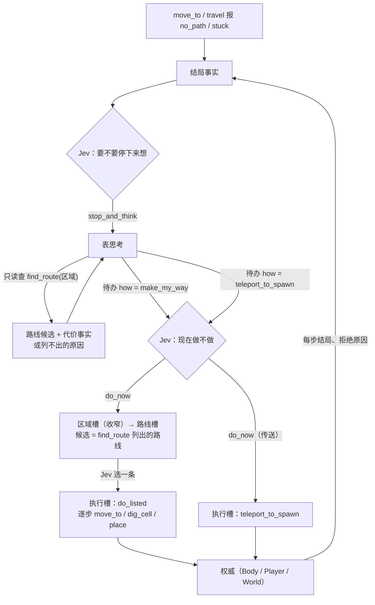

# NPC 走不通时：系统函数列路线、经验逐步执行，加一个传送原子（2026-11-24）

分类：NPC 能力的决策稿（定契约、所有权、依据、测试矩阵与实施次序；不改代码）。
状态：**方向由用户定（2026-11-24，三循环稿 U-30、U-31）；§9 第 1、2 步已实施（产品代码 + 测试 + 文档），第 3 步（harness 新版本，`.demo/observe/npc-three-loop-m3c-20261124/`）已实施，见 §10；第 4 步的准备已做（隔离节点换代码、场景与冒烟、M-3c 计划与判定，0 次模型请求），冒烟发现第 2 步上台阶时挖格次序的缺陷，已按用户定修好并在隔离节点上复验（§10）；另记 `move_to` 的一处已知限制（§10 同日）。M-3c 实跑已完成（2026-11-25）：产品部分按契约工作，C1 不成立——表思考把路线坐标写死进自写经验、没走路线槽，困住后仍在推理里逐格算几何；用户定“每种输出都要有提示词约束段”，统筹提案待用户定（§10 末条）。**

- 上位：[`2026-11-23-npc-three-loop-framework-decision.md`](2026-11-23-npc-three-loop-framework-decision.md)（下称“三循环稿”）的 U-30（脱困分两层）与 U-31（本稿的五项决定）。
- 起因：M-3b 正式系列 N-1——角色挖料挖成坑、或走上台地后，表思考按 look 的逐格高度在推理里手算台阶与走道，known-3、bare-3 各有一轮把 32,768 个输出 token 全用在这种推算上，运行停（`.demo/observe/npc-three-loop-m3-20261123/results.md` M-3b 一节）。
- **做法的原则（用户 2026-11-24）**：不为某个具体问题造专门的解决方案，而是往已经设计好的框架里填内容——加系统函数、加原子、加方式树节点、加语义类型；“走不通”不另设分支，统一交给表思考判断。

## 1. 目标与范围

**目标**：角色走不通时，表思考能拿到“自己敲出一条路要花多少”的客观事实，并在两种做法之间自己选：

1. **自己造路**：一条经验（方式），由走、敲、放三种原子组成；“具体敲哪格、在哪放”由只读系统函数列成路线候选，Jev 选，执行槽逐步调原子。
2. **传送回出生点**：一个世界原子，有读条和冷却；用不用由表思考判断（U-10）。

**范围**（产品改动 + 新一版 harness）：

| 部件 | 改什么 | owner |
|---|---|---|
| `SceneServer.Movement.Path` | 加可选的“敲一格”“放一格”两种带代价的移动；代价由调用方给，Path 仍是纯函数、仍是站立 / 迈步 / 下落规则的唯一定义处 | scene_server |
| `SceneServer.Movement.Player` | 正式接口“传送回出生点”：读条、冷却、落地复用现有 `relocate/2` | scene_server |
| 只读查询 `find_route` | 起点、区域 → 路线候选与代价事实；代价按产品同一公式算 | npc_server |
| 原子 `dig_cell`、`teleport_to_spawn` | `dig_cell` 包装现有 `Skills.Gather.mine/3`；`teleport_to_spawn` 经 Body 调 Player | npc_server |
| 原子表 `atoms.json` | 重新导出（加两个原子及英文说明） | npc_server |
| harness（新版本） | 方式树节点 `do_listed`、语义类型 `route`、起始方式一条、表思考只读查询 `find_route` | probe |

**不做**：玩家的传送入口与线协议（没有调用方）；走路失败后的机械回退（U-30 取代了它）；单独的“脱困”技能；按领域名词新增语义类型。

## 2. 本地事实（2026-11-24 核对，只读）

| 事实 | 出处 |
|---|---|
| 走：`move_to` 绝对坐标、单次水平 ≤ 32 m，拒绝 `no_path` / `stuck` / `too_far`；`travel` 分段 ≤ 30 m。敲：`probe_toward` 按方向取命中格 → `use_tool`。放：`place` 绝对坐标、花余额。没有传送原子 | 原子表 `.demo/observe/npc-mind-ops-20261121/atoms.json` 与英文说明 |
| 方式树只有 `do_in_order` / `try_in_order` / `repeat`（固定次数），没有“按清单逐项做” | harness `executor.py:4-5`、`formats.py:212-214` |
| 产品有“硬度”：每击伤害 = max(0, 工具威力 − 材料防御) × 倍率（按动作名最长前缀取倍率）；伤害为 0 时 World 拒绝 `ineffective_tool` | `VoxelRegion.Damage.amount/3`（`damage.ex`）、`world/tools.ex:216` |
| NPC 只有镐子（工具 1：威力 30、间隔 0.5 s、射程 8 格）。按一份运行副本的材料表（`npc-e8-20261120/.../e8b-02/world-root/properties.json`，91 种）：天然宏格 53 种 5 击、13 种 3 击、23 种 1 击；**伤害为 0 的只有锚心石**（信标材料，倍率 0）。隔离节点上的那份实施时再核 | 同上 |
| 另一种“敲不动”是保护区：角色只能改野外和自己持有的区域，否则 `protected_region`；有只读判断 `Access.writable?/3` | `access.ex:216-232` |
| NPC 能读的目录 `read_catalog`：材料只有名称、可食、配方；工具只有动作、射程、间隔——没有威力、防御、血量，表思考算不出每格要敲几下 | `Perception.read/3`（`perception.ex:101-112、310-348`） |
| 挖一格的完整流程已是产品公开函数：`Skills.Gather.mine/3` 沿眼点 → 格心 `probe_toward`，命中恰是这一格的天然宏格才逐击 `use_tool`，按工具间隔控节奏，`look` 确认成了空气才算挖掉；扩张平整地块也用它 | `skills/gather.ex` 模块说明 |
| 走路寻路 `SceneServer.Movement.Path`：纯函数，4 邻接、每步代价 1、上 1..step 格、任意下落；“能站在哪、能迈到哪”只在这里定义，冻结样例 `test/fixtures/movement_path_cases.json` | `path.ex` 模块说明 |
| Player 已有正式的瞬移流程 `relocate/2`：死亡复活回会话出生柱、传送信标落地都用它（`find_spawn` 现找落脚处，流送会话先装覆盖落点的碰撞窗口，发 `Voxel.Relocate`，记事件）。`gm_teleport` 只测试、直接改位置、不走这套 | `player.ex:183-188、492-524、1664-1748` |
| 传送信标（0x87）要求站在源信标可达距离（3 m）内、目的已调谐，困住时用不上 | `world/beacons.ex` `prepare/3` |
| NPC 的会话出生柱 = Body 启动时给定的出生点（`spawn`，Scene 把它作为 `probe`）；死亡复活回这里 | `scene.ex:492-540`、`body.ex:166、268` |
| Body 的位置来自每帧 `OwnerAck`，瞬移后自然更新；`Voxel.Relocate` 落到 Body 的兜底 `handle_info`（忽略） | `body.ex:406-415、638` |
| 游戏钟倍率 24（`MmoContracts.WorldTime`） | harness `clock.py` 模块说明 |

更正三循环稿 §10 与 plan §13 的初查：“产品里没有硬度 / 敲不动的现成概念”不对（见上）；传送不借 `gm_teleport`，复用 `relocate/2`。

## 3. 外部依据（AGENTS 2.2.8；2026-11-24 取原文）

1. **mineflayer-pathfinder**（`PrismarineJS/mineflayer-pathfinder` README）：特性 “Can break/place blocks as part of its deplacement.”“Each movement can have a different cost.”；`Movements` 的 `canDig` “Boolean to allow breaking blocks.”、`digCost` “Additional cost for breaking blocks.”、`placeCost` “Additional cost for placing blocks.”、`blocksCantBreak` “Set of block id's pathfinder cannot break. Includes chests and all unbreakable blocks.”、`dontCreateFlow` “Do not break blocks that touch liquid blocks.”（缺省 true）；结果 `noPath` “no path was found.”、`timeout` “timed out.”。
   **借鉴**：敲、放是寻路里带代价的移动；不能敲的格不走；挨着液体的格不敲。
2. **Baritone**（`cabaletta/baritone` 源码）：`ActionCosts` “These costs are measured roughly in ticks”、`COST_INF = 1000000`；`MovementHelper.getMiningDurationTicks`：挖一格的代价 = `1 / strVsBlock`（工具对这格的效率）加附加代价再乘倍率，效率 ≤ 0、在禁挖表里、世界边界外都返回 `COST_INF`；`avoidAdjacentBreaking` 对液体做检查。
   **借鉴**：代价用时间量；敲不动 = 无穷代价。本项目对应：次数 = ⌈血量 / `Damage.amount/3`⌉，时间 = 次数 × 工具间隔。
3. **Mindcraft**（`kolbytn/mindcraft`，让 LLM 玩 Minecraft 的代理，`src/agent/library/skills.js`）：模型调用技能 `goToPosition(x, y, z)` 只给目标；路线由 mineflayer-pathfinder 算——`goToGoal` 先用“不破坏”的一组移动（`digCost = 10`、`placeCost = 2`、玻璃不挖），找不到再用允许破坏的缺省组；手里工具挖不动时停下并记 “Cannot break”。
   **借鉴**：**LLM 代理不自己逐格算路线**，由系统寻路器算（正是 N-1 的反面）；“先只走、再允许破坏”按客观类别分候选。
4. **ESO 官方帮助**（help.elderscrollsonline.com a_id 20246）：“/stuck … For a small fee in gold, this will attempt to port you to the closest safe point.”“This is typically the closest Wayshrine.”“You can only use this command once per hour.”；主机版 “Get me Unstuck” “relocate them to a nearby wayshrine”。
   **借鉴**：脱困 = 送到固定的安全点，有代价、有冷却。
   WoW 的官方文章（Blizzard Support 000032275）要登录，未读到原文，不作依据。没有找到“随机传送到能走的位置”的官方先例。

**与本项目约束的对应与取舍**：Baritone / Mindcraft 由寻路器“算完就自己执行到底”；本稿把“算”与“做”拆开——算由只读系统函数做、结果作为参数槽候选交 Jev 选，做由方式树逐步调原子、每步经权威——为的是守 U-30 (1)“世界只由原子改、造路是经验”与 U-25“空间量只来自系统函数”。这一拆分是原创（§7 O-1）。

## 4. 用户的决定（U-31，2026-11-24）

| # | 决定 |
|---|---|
| D1 | 造路经验的路线由只读系统函数 `find_route` 列候选（Jev 选），不由表思考在推理里逐格算，也不写成通用的相对步骤方式 |
| D2 | 传送落点 = 回出生点（死亡复活的同一落点，不死、不掉落），不用随机落点 |
| D3 | 读条 10 s（移动超过 0.25 m 打断，与施法 / 信标 / 分选共用动作槽）、冷却 1 小时、不收材料；原子说明只写事实；先只给 NPC，不加玩家线协议 |
| D4 | “敲不动”的事实：执行时由权威拒绝原样写进结局；规划时由 `find_route` 的代价与列不出的原因给出；不往 `read_catalog` 加硬度数据 |
| D5 | 新原子与查询按产品代码写（先测后改），再在隔离节点上用新一版 harness 跑小验证（M-3c），通过后再按通用心智稿 §7 进产品；新开账本，额度到时先报用户 |

原话：「全部按推荐来。我们的原则就是不为每个特定问题产出特定解决方案，而是按照我们已经设计好的框架往里填内容实现功能的完备。……路走不通，那我们就加系统函数，加行为树，都是提前设计好的结构，没有针对走路设计额外分支，而是统一交给表思考处理。」

## 5. 设计

### 5.1 链路总图

三循环本身不改：触发链（走不通 → 事实 → Jev → 表思考）在 M-3b 已经这样走（known-3 判停 0.88）；新增的只是框架里已有种类的内容。

### 5.2 只读查询 `find_route`

| 项 | 内容 |
|---|---|
| 输入 | 起点 = 身体的权威位置（同 `move_to` 的 `trusted_start`）；目标 = 一个区域 `x0,z0,x1,z1`，到达区域里任一站立格即算到。区域与起点都须在一次 survey 的范围内（每边 ≤ 32 列、离自己 ≤ 32 m，同三循环稿 H-10），超出写原因 |
| 地形 | 一次 `World.material_snapshot/3`（与 look、`move_to` 同一只读入口），用完即丢、不留副本；盒子上限实施时按该入口的上限定，超出写原因 |
| 移动 | 站立、迈步、下落全部用 `Path` 现有规则。新增两种：**敲**——迈进下一列时身体要占的格或头顶净空里有实心格，先把它们敲掉；**放**——下一列脚下缺一个站立格（一格深的洞、要垫一级台阶），在那里放一格 |
| 代价（时间，秒） | 走一步 = `1 / speed` 秒（权威下发的移动 profile，1 格 = 1 米；现行 speed 8 → 0.125 s）；敲一格 = ⌈血量 / `Damage.amount/3`⌉ × 工具间隔（产品同一公式与同一份目录，不另立硬度表）；放一格 = 一个工具间隔（World 不限放置频率，按“一个工具动作”计），材料另计（格数 × 每格单位）。交给 `Path` 时除以走一步的秒数（§10） |
| 不敲的格（代价无穷） | 保护区（`Access.writable?/3` 为假）；伤害为 0；不是天然宏格（`Gather.mine/3` 只挖天然宏格）；有别人的放置记录；挨着液体（mineflayer `dontCreateFlow`、Baritone 的液体检查） |
| 放的材料 | 余额里能放（非液体、挡路、够一格）的生产材料中，够放格数最多的一种，同数取材料号小的（只看数量，U-10）；候选写明用哪种、要多少、余额够不够 |
| 候选 | 按客观类别各列最省的一条：**只走**、**允许敲**、**允许敲和放**（Mindcraft 先不破坏、再允许破坏）；某一类的结果与更简单的一类相同就不重复列。至多 3 条，不截 |
| 每条写明 | 逐步清单（`move_to` / `dig_cell` / `place` 的实参）；步数；要敲几格（按材料分）、约几击、约几秒；要放几格、用哪种料多少、余额够不够；终点 |
| 列不出 | 写原因与计数（同 `site/4` 的写法）：超出范围（`region_too_large` / `too_far`，命令即拒）、没有这类路线（`no_path`；规划盒有界、搜索穷尽，不设节点上限，所以不会出现 `search_limit`，§10）、没有能放的材料（`no_material`）、与更简单的一类相同（`same_as_walk` / `same_as_dig`）；被挡格按原因计数（保护区 n、敲不动 n、别人放的 n、挨水 n） |
| 用途 | 路线槽的列举器；表思考的只读查询（与路线槽同一个函数、逐字同一份回答，同 B-12 `find_places`）。不写世界、不进心智 |

`Path` 的扩展方式：调用方传一个“改格代价”函数（`cell, :dig | :place → 秒 | :forbidden`），`Path` 只负责在搜索里把“敲 / 放之后能站、能迈”按自己的规则判，仍不认识 World、不调 World。代价函数由 npc_server 用 World 的公开只读口（目录、保护区、余额）构造；保护区若 World 尚无公开只读口，由 World 加一个，不穿透内部 state（AGENTS 2.6，实施时核）。

### 5.3 方式树节点 `do_listed` 与语义类型 `route`

- **`do_listed`**：“依次做这份清单里的原子调用；第一个失败就停，整体失败（带那一步的原子与原因）”——与 `do_in_order` 同一语义，只是子节点来自一个参数的值。这是方式树的一个通用节点：任何“系统函数产出的原子调用清单”都可以用它执行，路线是第一个用途。
- **接纳边界**：`do_listed` 引用的参数必须是“由列举器产出清单”的语义类型（目前只有 `route`）；清单内容只来自候选，表思考写不进去（同 B-2 / B-10 守点位的做法）。
  （2026-11-25 这条并入 [M-3e 稿](2026-11-25-npc-m3e-timeliness-and-way-sources-decision.md) D-6 的经验参数来源契约，唯一定义处 `semantic_types.json` 的 `arg_sources.nodes.do_listed`。）
- **估算不作门（三循环稿 U-32）**：`do_listed` 每一步只按那个原子的权威结局判成败——不按 `find_route` 的估计设时限，
  不因实际比估计长或短判失败（`dig_cell` 本来就敲到成空气为止，不按估计击数封顶）；路线槽列候选也不按估计值设阈值筛掉，
  估计值原样作为候选的事实给 Jev，由它比较。
- **`route`**：带 `region_from` 的收窄组（同料源、点位：先选区域，再列这个区域的路线；B-7 回退照用）。候选 = `find_route` 对所选区域列出的路线；列不出时按 B-3 写 `no_candidates` 事实并挡住条目，原因句即 `find_route` 的原因。
  （2026-11-25 M-3e 稿 D-7 收窄 B-7：经验参数声明里写了区域名的固定区域槽不走 B-7 回退——区域是固定的，Jev 答都不合适时投 `slot_open` 请表思考。）
- **起始方式（G0）加一条** `make_my_way(region, route)`：`do_listed(route)`。名字、说明在实施时按 G0 的写法定。

### 5.4 原子 `dig_cell`

- `dig_cell(x, y, z)`：从此刻站的位置挖掉一格天然宏格。实现是产品 `Skills.Gather.mine/3` 的原子包装（扩张平整地块也用它，不复制）。
- 结局：挖掉（材料进余额）；拒绝原样来自 `mine/3` 与权威（够不着、被挡、不是天然宏格、`protected_region`、`ineffective_tool` 等）。
- 路线里每个 `dig_cell` 前面有一步 `move_to` 到规划的站位；同一步要敲的几格按离站位眼睛由近到远敲（`Route.dig_order/3`：上台阶时先下后上，
  §10 2026-11-25），“从这里挖得到”由此保证，权威仍是最终裁决。身体是否真到了站位看 `move_to` 的结局——它只按水平容差判完成（已知限制，§10 同日）。

### 5.5 原子 `teleport_to_spawn`

- **owner**：`SceneServer.Movement.Player` 的正式接口（与 `beacon_travel/4`、`ore_sort/4` 同形：异步排进，结果恰好一个回复）。Body 调它，同施法，不经 World（不写世界）。
- **读条**：10 s，与施法 / 信标 / 分选共用动作槽；移动超过 0.25 m 打断。
- **冷却**：游戏钟 1 小时（倍率 24 → 现实 150 s）。理由：NPC 的事实、日程、睡眠都按游戏钟，原子说明里的“1 hour”角色读来就是游戏钟；ESO 的“每小时一次”是给按现实时间过日子的玩家的。冷却由 Player 自己持有（上次传送的时刻），会话重建后清零——已知限制，写进 README。
- **落地**：放行后 `relocate(state, state.probe)`——死亡复活的同一落点与同一流程（流送窗口、`Voxel.Relocate`、事件），不死、不掉落。找不到落脚处与复活同一处理。
- **拒绝原因**：冷却中（带可再用的游戏钟时刻）、读条被打断、死亡、动作槽被占、会话状态不对；落点问题沿用 `relocate` 的显式失败。
- **原子说明（英文，只写事实）**：大意 “Teleport back to my spawn point, where I first arrived. I must stand still for 10 s; moving cancels it. Afterwards it cannot be used again for 1 hour.” 不写“最后才用”之类判断词（`REMOVED_WORDING` 扫描）。
- **结局事实**：成功写从哪到哪（坐标）；失败写权威原因。

### 5.6 可观测面（AGENTS 3.2，先定义）

| 位置 | 读得到什么 |
|---|---|
| Player 结构化日志 / `character_event` | 传送开始、打断、拒绝（原因）、落地（from、to、apply_tick）；relocate 的事件带原因（death / beacon / teleport），不另起一套事件 |
| Body Outcome | `dig_cell`、`teleport_to_spawn` 的完成 / 拒绝原因 |
| `find_route` | 一行事件：调用方（路线槽 / 表思考）、起点、区域、每类候选的代价摘要、列不出的原因与计数、搜索节点数 |
| harness | `route` 事件（同 `sites`）；`do_listed` 每步的原子、实参、结局 |

## 6. 测试矩阵（按 `../Voxim/Docs/Testing.md`）

**契约**：§5 各表。**不覆盖**：玩家入口（没有）；客户端呈现（NPC 无客户端；别的玩家看到瞬移走的是现有 `relocate` 复制，已有覆盖）；长时演化。

| 层 | 证明什么 | 做法 | 依赖 |
|---|---|---|---|
| 2.1 算法 | `Path` 的敲 / 放移动：三格深的坑能敲出台阶、墙能敲穿、要垫一级才上得去时用放；保护区 / 伤害为 0 / 别人放的 / 挨水的格不敲；三类候选各取最省；`search_limit` 不冒充没路；不给改格代价函数时结果与现有冻结样例逐条相同 | 冻结样例扩充（手算的小网格，期望来自手算，不复制产品算法） | 无 |
| 2.1 算法 | 代价换算：次数 = ⌈血量 / 每击伤害⌉，按 1 / 3 / 5 击三种材料与伤害为 0 各一例手算 | 纯函数 | 无 |
| 2.2 集成 | `find_route`：真实 World 的 `material_snapshot`、目录、保护区读口；列不出原因的句子；路线槽与表思考查询逐字相同 | npc_server 测试，世界状态经正常公共入口（作者入口 / 原子）建立 | World |
| 2.2 集成 | `dig_cell`：天然格挖掉、余额增加；保护区拒绝 `protected_region` | 经 Body 原子入口 | World、Scene |
| 2.2 集成 | 传送：读条到点落在出生柱的落脚处（非流送与流送会话各一）；移动打断；冷却中拒绝并给时刻；死亡中拒绝；事件字段 | scene_server Player 测试，经正式接口 | Scene、World |
| harness 离线 | `do_listed` 语义同 `do_in_order`；接纳边界拒绝表思考写清单内容；`route` 的收窄与 B-7 回退、B-3 挡条目；表思考 `find_route` 与路线槽同一回答；`teleport_to_spawn` 说明无评价词 | 五个测试文件，先红后绿，循环 10 次每次失败留名字与堆栈；dry | 假桥 |
| M-3c 隔离节点 | 困住后不再手算几何：判停 → 表思考查 `find_route` → 造路或传送 → 走出去；读数：DeepSeek 单轮最长输出、`length` 截停次数、两种做法各被选几次 | 计划另写（判定在发问前写定）；“困在坑里”的前提由产品原子在场景准备阶段挖出来，不手写世界；需要“造路走不通”的情形用作者入口装保护区 | 隔离节点 `npcm2b`、新账本 |

## 7. 原创决策（实施前已向用户报告，2026-11-24）

| # | 决策 | 为什么不照搬 | 风险 | 不变量 | 怎样验证 |
|---|---|---|---|---|---|
| O-1 | 路线由只读系统函数算成候选、交 Jev 选，由方式树逐步调原子执行 | Baritone / Mindcraft 的寻路器算完自己执行；本项目要“世界只由原子改、造路是经验”（U-30）、“空间量只来自系统函数”（U-25） | 执行到一半世界变了（别人放了格） | 每步经权威；被拒写成事实交 Jev，不静默重放（通用心智稿 mini-r2） | 2.2 集成、M-3c |
| O-2 | 通用节点 `do_listed`：子节点来自列举器产出的清单参数 | 现有节点只有写死的子树；行为树 / HTN 文献里没有“子树来自参数”的现成形式可照搬 | 清单内容被表思考篡写 | 清单只来自候选，接纳边界拒绝手写 | harness 离线 |
| O-3 | 候选按“只走 / 允许敲 / 允许敲和放”三类各取最省 | Mindcraft 是先后两次尝试，不列给判断者；这里按同样的客观类别列给 Jev | 三类都列不出时只剩传送 | 截取只按客观类别与代价，不排好坏（U-10） | 2.1、M-3c 读数 |
| O-4 | 传送冷却按游戏钟计 | ESO 是现实时间、给玩家 | 冷却过短使传送成为常用的移动方式 | 冷却由 Player 自己维护 | M-3c 读传送次数 |

## 8. 风险

1. **路线过期**：规划后世界变了 → 某步被权威拒绝 → 帧失败、事实交 Jev（与现有失败同一条路）。
2. **挖开后掉进新坑 / 引水**：挨水的格不敲；掉落靠 `Path` 的下落规则计入路线。
3. **传送后在途输入**：读条要求站定；Body 下发的未来输入槽在瞬移后若仍有移动命令，会把角色带离落点或打断读条——实施时由 Body 在发起传送前停下移动（零输入），2.2 测试覆盖。
4. **冷却不持久**：会话重建清零（§5.5）。
5. **表思考仍会手算**：查询给了它现成的路线，但它仍可能在推理里算；M-3c 读 DeepSeek 单轮最长输出与 `length` 截停。

## 9. 实施次序（每步先报用户）

1. `Path` 的改格移动 + 冻结样例（scene_server，纯函数）。
2. `find_route`、`dig_cell`、`teleport_to_spawn`（npc_server + Player 接口）与 2.2 测试；原子表重新导出。
3. harness 新版本：`do_listed`、`route`、G0 一条、表思考查询；离线先红后绿、dry；重算指纹。
4. 隔离节点换上新代码（只动本线的隔离节点，不碰受保护对象），写 M-3c 计划与判定、报额度，用户定后实跑。
5. 通过后回填三循环稿，按通用心智稿 §7 进产品。

## 10. 进度

- 2026-11-24：用户定 U-30（脱困分两层）。统筹核对本地事实（§2，更正初查两处）、取外部原文（§3），向用户提案 D1–D5；用户「全部按推荐来」，定 U-31 与“往框架里填内容、不为特定问题造专门方案”的原则。本稿起草，未改代码、未实跑、未调模型。
- 2026-11-24：用户确认冷却按游戏钟（「冷却按游戏钟」），§9 第 1 步完成：`SceneServer.Movement.Path.find_with_edits/7`（带权 A*，每个节点带着这一路的改格，后续走法在“原地形 + 改格”上判，所以给出的路线按顺序执行时每步都成立；不保证有改格时全局最省）。World 放普通材料不要求下方有支撑（`world/production.ex` `plant_support/2`“其余材料不看下方”），所以“搭一格过空”是合法走法。冻结样例 `movement_path_cases.json` 加 `edit_cases` 8 条（手算：敲一格成台阶、放一级出坑、只敲不放出不了一维的坑、敲得快就穿墙 / 敲得慢就绕路、禁敲的格绕开且先敲头顶、液体不敲不放、搭一格过空），并把原有 20 条没有 `goal_y` 的样例在“不许改格”下逐条对照 `find/7`。改前红（`path.ex` 换回 HEAD：61 个里新增 30 个失败，原有 31 个过），改后 61 / 61；命令 `wsl.exe -e bash .demo/observe/mixtest-scene.sh test/scene_server/movement/path_test.exs`（worktree 自己的 `_build/test`，OTP 29.1.2 + Elixir 1.20.5）；`mix format --check-formatted` 通过。
- 2026-11-24：§9 第 2 步完成（新统筹会话；用户授权「继续开新会话做第二步吧」）。提交 `8f28855f`（World 只读口）、`a0d204d3`（Player 传送接口），npc_server 部分与本条同一笔。
  - **开工核对的三件事**：(a) World 没有保护区的公开只读口——`Access.writable?/3` 要 World 内部的 `state.protection`。按 AGENTS 2.6 在 World 加
    `World.protected_cells(server, cid, cells)`（与写意图同一判定、主体 `{:character, cid}`，保护区常驻内存不装页），`Access` 登记 `:read`、`Closure` 登记无页。
    (b) Player 拿游戏钟：`MmoContracts.WorldTime` 是纯函数；冷却 = 两个墙钟时刻的游戏时间差（墙钟差 × 倍率 24，与 Test-only 偏移无关）满 1 游戏小时，
    从放行时刻起算；起点 `teleported_at_us` 由 Player 持有，随 Scene 移交带走（`@carried_fields`），会话重建清零。(c) 代价单位：走一步 = `1 / speed` 秒
    （移动 profile，现行 0.125 s）；放置在 World 里不限频（`world/production.ex` `build_material` 只查射程、余额、格子），放一格按一个工具间隔计（§5.2 已改）。
  - **实施取舍**：`dig_cell` 做成内置技能 `Skills.DigCell`（`Gather.mine/3` 是探测 → 逐击 → 复探 → look 的多步流程，Body 只执行单条命令；技能壳不复制流程），
    要在 `profile.skills` 里配。`find_route` 是 `:sense` 组只读条目（新模块 `NpcServer.Route`，Body 的只读请求，在执行进程里算）；`teleport_to_spawn` 是 `:move` 组 Body 动词。
    规划盒 = 起点列与区域的外接盒外扩 `Body.path_margin/0`（6），竖直脚上下 6；快照多取一圈，只用来判“挨着液体”。三类候选的“相同”按**没用上这一类多出的能力**判
    （允许敲却没敲 = `same_as_walk`；允许放却没放 = `same_as_dig` 或 `same_as_walk`），不按步序逐项比较。`calls` 里只走的连续几步合成一次 `move_to`，但每段都落在
    `move_to` 自己的取盒里（外接盒外扩 6、单程 ≤ 32 m），执行时它按自己的盒也找得到这段路。
    **不设节点上限**：最坏情形（最大规划盒 45×13×45 全岩体、处处可敲、目标不可达）穷尽搜索一次 477 ms，上限 20 000 时 392 ms，10 000 时 163 ms
    （2 个调度器，`.demo/observe/npc-route-u31-20261124/bench_path.exs`）。上限省不了多少时间，却会把确定的“没有”变成“算到上限”，所以不截；三类合计最坏约 1.5 s，在 Body 的执行进程里。
    Player 的传送与施法 / 信标 / 分选共用动作槽，不经 World（非流送 Scene 也可用）；回执在 `Voxel.Relocate` 生效的那个 tick（`relocated/1`）。
    Body 先按 `stop` 停稳再交给 Player；收到回执后等 OwnerAck 到达 apply_tick（位置缓存与 Brain 的观察都已是落点）才报完成，避免紧接着的 `move_to` 从旧位置算路（§8 风险 3）。
    冷却拒绝的可再用时刻由 Body 换成游戏钟（`WorldTime.at/1` 加 Runtime 同一份 Test-only 偏移），并给出还要等的游戏分钟。
    瞬移事件 `revive_relocate` / `revive_relocated` 带 `reason`（death / beacon / teleport），另有 `teleport_channel` / `teleport_depart` / `teleport_rejected`。
  - **对现有行为的影响（要用户知道）**：`teleport_to_spawn`（`:move`）与 `find_route`（`:sense`，要工具带）随组授予。授 `:move` / `:sense` 组的 LLM 后端 profile
    （Demo 的 groups，以及 `groups: nil` 的登记行）会看到这两个工具（`npc_abilities_test` 的 Demo 工具表、`npc_body_world_test` 的接缝参数表已随之补）；
    统一形态（Offers）把三者都登记为 withheld（还没有生成器）。产品条目说明与其它条目一样写中文；harness 用的英文说明在第 3 步随新 harness 写（同 M-2a 的
    `en_atoms.json` 做法），不写评价词。
  - **原子表导出**：`.demo/observe/npc-route-u31-20261124/atoms.json`（`dump_atoms.exs`，profile 同 M-0，加 `dig_cell` 技能）共 43 条：新增 `teleport_to_spawn`、`find_route`、
    `dig_cell`，其余 40 条与 M-0 的 `.demo/observe/npc-mind-ops-20261121/atoms.json` 逐字相同。M-0 那份未动（冻结 harness 仍读它），第 3 步的新 harness 切到新路径。
  - **测试（先红后绿；命令都在 WSL 里跑：`.demo/observe/mixtest-app.sh <app> <文件…>` 或 `mixtest-scene.sh`，用 worktree 自己的 `_build/test`，OTP 29.1.2 + Elixir 1.20.5）**：
    voxel_region `protection_world_test`“作者保留区域”一例加只读口断言：实现换回 HEAD 时 `UndefinedFunctionError`（0/1），改后连同 `access_test`、`closure_entries_test` 12/12。
    scene_server 新 `teleport_to_spawn_test`（非流送 / 流送落点、回执恰好一次、冷却时刻、动作槽、打断、死亡、事件字段）：HEAD 时 0/3，改后 3/3；连同 `beacon_travel`、`revive_relocation` 15/15。
    npc_server 新 `npc_route_test`（2.1 代价手算表；2.2 真实 World 上三类路线的手算期望、照 calls 做能走出沟、保护区 78 / 敲不动 2 / 别人放的 1 的计数、`dig_cell` 入账与
    `protected_region`；Body 传送先停后读条、完成时 Brain 已看到落点、冷却给游戏钟时刻），加上 `npc_abilities_test`（Demo 工具表、逐条目手写期望表补两行）：
    实现换回 HEAD 时 35/40（失败的恰是这 5 个）；改后连同 offers、skills、gather、两个施法、两个 Body 测试共 104/104（7 个按标签排除的是原有的 live / 浸泡类）。
    `mix format --check-formatted` 对本次改的、HEAD 时已格式化的文件全部通过；voxel_region 的 `world.ex`、`access.ex`、`world/closure.ex`、`protection_world_test.exs`
    在 HEAD 时就不是 `mix format` 排版，新增行跟随原文件风格，没有重排整个文件。编译无新告警。
  - **残余风险**：“挨液体不敲”没有集成测试（夹具不开液体模拟；`Path` 的液体规则由 2.1 冻结样例覆盖）；敲的次数按满血估（快照不带已受的伤）；作者 prefab 宏格在快照里看不出，
    规划时当天然格，执行时 `dig_cell` 以 `foreign` 拒绝；传送冷却不持久；路线过期照 §8 第 1 条处理；Body 的传送只在非流送 Scene 上集成测过（流送落点由 Player 测试覆盖）。
- 2026-11-24：用户定三循环稿 U-32（估算值只是参考，不作门）。核对本稿第 2 步的代码：没有估算当门槛的地方（秒数只在 `Path` 里比较哪条更省；
  `dig_cell` 不按估计击数封顶；读条与冷却是游戏规则，不是估算）。`find_route` 回答的估算字段改名 `estimated_seconds` / `estimated_hits`，
  说明写明“估计值，实际会有出入，只作比较参考”；§5.3 加第 3 步的约束（`do_listed` 与路线槽不按估算设时限、不按估算筛候选）。
  `npc_route_test` 随字段名更新（命令同上条）。
- 2026-11-24：§9 第 3 步完成（用户「可以开始第三步」）。同一句里用户问“为什么要挡住”（上一条“对现有行为的影响”）：不挡——两个都是通用原子，
  每一步经权威裁决、用不用由 NPC 判断，按“往框架里填内容”不另加授予条件，保持随组授予。
  - **新版 harness**：`.demo/observe/npc-three-loop-m3c-20261124/harness/`，由 M-3 的 harness 复制（那份冻结，指纹仍是 `051c0195c340d404`，M-3b 的系列与报告绑着它），
    `configs/` 与判定器一并复制。改动明细与自定的取舍在该目录 `README.md` 末节，要点：原子表换成第 2 步的导出（M-0 的 40 条逐字保留）、两个新原子的英文说明照产品中文
    逐条译出；G0 加 `make_my_way(route)`，树只有 `{"do_listed": {"$param": "route"}}`；通用节点 `do_listed`（语义同 do_in_order，写下的方式里只接参数）；参数类型
    `calls`；语义类型 `route`（区域槽 → 路线槽，B-7 回退、B-3 挡条目照用，写下的方式里同样自动加区域槽）；路线列举与表思考的 `find_route` 查询是同一个函数、逐字同一份
    回答（同 B-12）；接纳边界的清单规则（do_listed 的参数、calls 类型、route 语义三者互相绑定，清单只来自路线候选）。
  - **取舍**：find_route 不进方式树的原子表（结果没有契约、树里用不上；路线只经路线槽进方式，同点位只经 sites），表思考仍能直接查；路线槽不另设工具槽，按工具带上
    每把工具各问一次（现在只有镐子）；候选文字里估计值写成 “estimated about …”，不按估计筛候选，`do_listed` 不按估计设时限（U-32）。
  - **证据**（先红后绿，`python -m unittest`，Windows miniconda 3）：复制后的 M-3 代码上新增 15 个用例全红（test_m3 7、test_slot_think 1、test_decide 7），
    改后 test_m3 79 / test_slot_think 66 / test_decide 83 / test_run 51 / test_report 109 全绿；随本步改了预期的 3 条只钉本步有意改变的事实（事件种类、G0 条数、
    语义类型集合）。执行槽跑 make_my_way 帧的用例写在实现之后，由变异证红（去掉执行器的 do_listed 分支 → 它与 3 个执行器用例都红，恢复后逐字节相同）。
    `run.py dry`：三种预设未处理错误 0、`REMOVED_WORDING` 0、评价词 0、严格模式问题 0；表思考工具 15 种、里思考 3 种。五个文件循环 10 次：50 次全绿、0 失败（`.demo/observe/npc-three-loop-m3c-20261124/runs/loop-u31-step3/summary.txt`）。
    harness 指纹 `224e3c688344165f`。
  - **第 4 步要做的**：受控 Body 的 profile 加 `dig_cell` 技能（`profile-m2b.exs` 与在跑的隔离节点共用，在 M-3c 的新环境里另写一份，不改它）；桥服务端不用改
    （经 `Abilities.command/4` 转发任意原子）；隔离节点换上第 1–2 步的代码（只动本线的隔离节点）；写 M-3c 计划与判定（判定器加 routes 事件、do_listed 每步结局、
    传送的读数；“困在坑里”的前提由产品原子在场景准备阶段挖出来，需要“造路走不通”时用作者入口装保护区）；新开账本、额度先报用户。
- 2026-11-25：§9 第 4 步的准备（用户「可以，开始第四步的准备」；0 次模型请求，花费 0）。计划、判定、冒烟记录都在
  `.demo/observe/npc-three-loop-m3c-20261124/plan.md`（下称 M-3c plan）。
  - **环境**：M-3c 目录另起 `env/`（`profile-m3c.exs` = m2b 那份加 `dig_cell`；`body-m3c.exs`、`reset-world-m3c.sh` 只换起 Body 的 profile）与 `bridge/`
    （复制 M-3 桥，读 profile-m3c，body.json 登记的 profile 不对就显式失败）；m2b 的 profile 与 M-3 的桥没动。账本缺省改成 `runs/spend-ledger-m3c.json`。
    harness 多一个可观测字段：observe 的 `bridge` 事件写那一刻身体的位置（判定器据此判“出了坑”）。
  - **隔离节点换代码**：`reset-world-m3c.sh` 在 UDP 看护下跑一次，增量编译 voxel_region 4 / scene_server 2 / npc_server 14 个文件、无告警，93 s；
    本线进程 UDP 0、没有新的 Tcpip 4266；新 Body 的技能含 `dig_cell`。
  - **场景（Test-only 夹具 `scripts/trap.py`，不手写世界）**：经桥 `move_to` 到坑口、逐层 `dig_cell` 挖 3 层（坑挖在出生点之外：传送的落点就是出生点）；
    walled 变体再经 `World.author_regions/2` 装作者保留区。前提用 `find_route` 核对。第一次只挖一列时胶囊搭在邻列的棱上没掉下去
    （`move_to` 落在容差内、偏格心 0.146 m），改为挖脚下圆盘覆盖的全部列（这次是 2×1）。
  - **冒烟（看护下，0 次模型请求）**：坑：walk no_path，dig 与 dig_place 都列出；照 dig_place 的 calls 逐个做，4 步全 done、走到地块；传送读条 10.6 s、
    落在出生点，紧接着第二次回 `teleport_cooldown` 与可再用的游戏钟时刻；walled：三类都 no_path、protected 97，传送出坑。
  - **发现（第 2 步的缺陷）**：照 dig 路线的 calls 做，第一步 `dig_cell` 被拒 `blocked`。`Path.find_with_edits` 一步里的身体格自上而下列，
    `NpcServer.Route` 照这个次序发 `dig_cell`；`dig_cell`（`Gather.mine/3`）从眼睛（脚 + 1.5）向格心探测，上台阶时眼睛与下格同高，
    看上格的视线先碰到还没敲的下格。平走时先上后下是对的，上台阶时应先下后上——§5.4“从这里挖得到由路线保证”在上台阶时不成立。
    第 2 步的集成测试只走了平沟，没抓到。建议修法（待用户定，M-3c plan §4.1）：`Route` 把同一步里的 `dig_cell` 按离规划站位眼睛的远近由近到远发
    （视线只会被比目标更近的格挡住），先补上台阶的反例（现在红）再改；Path 不动。
  - **M-3c 计划与判定**（发问前写定，M-3c plan §5，判定器 `scripts/report_m3c.py` 与 13 个反例 / 正例，6 条规则的变异都被抓到）：
    C0 运行有效、前提成立；C1 正式 5 次里 ≥ 4 次经路线或传送出坑；C2 正式运行 DeepSeek `length` 截停 0；C3 判定 1、2、3、5 不回退。
    读数：DeepSeek 单轮最长输出、两种做法各被选几次、出坑用时等。运行：小集成 1 次 → 冻结 harness → 正式 5 次（pit 3、walled 2）；
    驱动 `scripts/series_m3c.sh`。花费：新账本，整轮 15 美元线不变，现实估计约 2–3 美元。实跑未开始，等用户定（M-3c plan §9）。
- 2026-11-25：修挖格次序（用户「那肯定得排序啊，从能挖到远处挖不到的。至于能挖到的先挖谁，无所谓啊」）。提交 `3eed8b08`。
  - **修法**：`NpcServer.Route.dig_order/3`——同一步要敲的格按格心离规划站位眼睛（站在格心时的 `Player.eye_position/1`，与执行时
    `dig_cell` 同一个眼点）由近到远发出；视线只会被比目标更近的格挡住，所以先敲近的，这一步的格之间不会互相挡。眼下都瞄得到的几格先后不论
    （用户：「能挖到的先挖谁，无所谓」）。`Path` 不动；查询的 plan 多 `half_height`。
  - **测试**（`npc_route_test`）：2.1 手算次序（上台阶先下后上、平走先上后下）；2.2 三格深的沟、NPC 出生在沟底，手算唯一最省的“允许敲”路线
    （51 步 = 6.375 s），断言上台阶那一步先敲 (6,62) 再敲 (6,63)，照 calls 做走得出去。旧实现上 3/5（两条新用例红，2.2 只差这两格的先后），
    改后 5/5；`mix format --check-formatted` 通过。
  - **复验**（隔离节点换代码后，看护下，0 次模型请求）：同一个坑、同一个站位（x 29.39，修之前在这里被拒），先敲 (28,507) 再敲 (28,508)，
    上台阶后脚在 507，再敲 (27,508)，走到地块，7 步全 done（`.demo/observe/npc-three-loop-m3c-20261124/runs/smoke-pit-escape-dig-2/`）；之后复位。
  - **另一处发现：`move_to` 只按水平容差判完成（已知限制，未改，待用户定）**。写 2.2 时诊断出：从柱顶 `move_to` 一格宽的沟底，胶囊（半径 0.35）
    偏格心超过约 0.15 m 就搭在沟沿的棱上停住，脚在 63.86 而不是沟底，`move_to` 仍报 done、`within_tolerance: true`——Body 的完成判据只看水平
    距离（`body.ex` `finish_settled_move/3`、`distance/2`），给的 `y` 只用来选规划到哪一层。第 2 步那条“照 calls 做能走出沟”其实是身体悬在沟上方、
    从那里把一格挖穿走过去的，不证明到过沟底（测试注释已更正）。影响：路线里“落进一格宽的洞”那一步可能没落下去却报完成，后面的步骤在错的位置上做
    （按 §8 风险 1 被拒、写成事实，不会卡死）。M-3c 不受影响：坑两列宽、身体在坑底（observe 核实），出坑的两类路线都没有这种下落。
    修它要动 `move_to` 的完成判据（如给了 `y` 时到那一层才算到，到不了显式失败）或 `Path` 的下落规则，影响 travel / gather / expand，
    另立一项、核依据后再定。
- 2026-11-25：用户定（「move_to 先记着，额度同意，小集成过了直接开正式」）：`move_to` 只按水平容差判完成记为已知限制、以后另立一项处理；
  M-3c 实跑范围与额度照 M-3c plan §9 的建议（小集成 1 次 + 正式 5 次，新账本，整轮硬上限 15 美元）；小集成成立就直接开正式系列。
  harness 冻结在 `1e238a2472c3f61f`，小集成成立的口径在开跑前写进 M-3c plan §6。
- 2026-11-25：**§9 第 4 步实跑完成，M-3c 的 C1 不成立**。细节、命令与产物见 M-3c plan §10 后四条与 `report/`。
  - **运行**：小集成-1 因 DeepSeek 余额不足（HTTP 402）立即停，花费 0，保留原始失败、不进汇总；充值后小集成-2 成立（C0、C3）。
    正式系列 pit-1 → walled-1 → pit-2 → walled-2 → pit-3 在 05:36–07:21Z 跑完，5 次都停在表思考会话上限 20；
    未处理错误 0，看护每次 `DONE rc=0 stop=[]`，本线 UDP 0，没有新的 Tcpip 4266。账本累计 $2.167（DeepSeek 一律按高峰价，有意多计）。
  - **判定**（发问前写定，未改）：C0 成立（6/6）；**C1 不成立**（经路线或传送出坑 2/5，要求 ≥ 4）；C2 成立（`length` 截停 0 / 511）；
    C3 成立。
  - **实际发生了什么**：5 次都出了坑、建好了小屋。walled 两次靠 `teleport_to_spawn` 出坑（读条完成，没有被拒）。
    pit 三次，表思考都只把 `find_route` 当作只读查询来用：从没写过 how = make_my_way 的待办，路线槽一次没开，Jev 一次没选路线；
    它把 dig 路线的格写成字面值，抄进自写经验的 `do_in_order`，再接采料、建屋，判定器记 other。
    pit-2 推理原文说明了原因：它考虑过 make_my_way，但以为路线要在写待办时就给（“the route value must be given when used, not now…
    awkward”），不知道执行时由路线槽从当时所在位置重新列出候选、交 Jev 选。
  - **人工读数**：困住之后，推理里仍在逐格推几何。它会算眼睛到格心的视线、核对每格是空气还是实心、站上去脚在多高；
    最密的一轮推理 12,943 token，188 个坐标。N-1 那种截停没有再出现，但 §8 风险 5（“表思考仍会手算”）成立：
    字面步骤的经验要它自己核对每一步，所以几何推算又回来了。
  - **结论**：§9 第 4 步的产品部分（`find_route`、`dig_cell`、`teleport_to_spawn`、挖格次序）在实跑中都按契约工作：
    照路线敲出的台阶走得出去，传送落点对。失败的是心智侧：表思考没有用框架里的路线槽，而是把具体参数写死进了经验。
    这与 B-2 / B-10（锚点写死）同类。
  - **用户定（2026-11-25，系列进行中）**：「关于把具体参数也放进经验，这个要靠提示词约束的，针对每一种输出都要有约束段」。
    统筹提案（**待用户定**）：(1) 列出表思考与入睡整合能写的每种输出（心智原子与入睡整合原子），以及 Jev 在槽里交回的选择，
    每种在提示词 / 工具说明里写一段约束，只写合格输出的形式与适用条件，不写该做什么（与 U-10 不冲突）。
    (2) write_experience 一段写明：取决于此刻位置或世界的值（站位、要敲或要放的格、路线、地点）声明成带语义类型的参数，
    执行时从当场列出的候选里取，不写字面值；字面值只用于按定义不变的东西（工具号、设计号）；
    并说明“路线在执行时才列出、由 Jev 选”。(3) 代码侧先不加专门的拒绝规则，下一轮看约束段是否被遵守。
    (4) 改了就是新的 harness 指纹，另开一轮小验证（判定先写定）。§9 第 5 步（进产品）等这一项有结论之后再做。
  - 用户答复提案：「可以，按这个方案开始写约束段」。盘点、依据与约束段原文另起一稿：
    [`2026-11-25-npc-output-constraint-sections.md`](2026-11-25-npc-output-constraint-sections.md)。
- 2026-11-25：按 [M-3e 稿](2026-11-25-npc-m3e-timeliness-and-way-sources-decision.md) §十 第 4 条回填 §5.3（用户看过该稿、全照建议），只加注、原文保留：
  `do_listed` 只收列举器清单类型这条并入经验参数来源契约（`arg_sources.nodes.do_listed`，D-6）；B-7 收窄回退不用于写了区域名的固定区域槽（D-7）。

