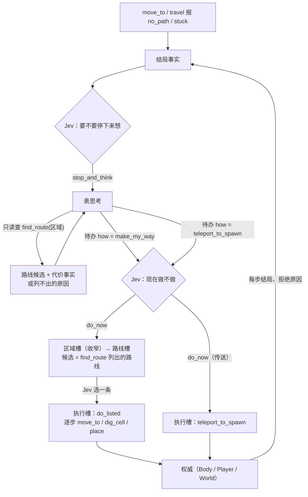

# NPC 走不通时：系统函数列路线、经验逐步执行，加一个传送原子（2026-11-24）

分类：NPC 能力的决策稿（定契约、所有权、依据、测试矩阵与实施次序；不改代码）。
状态：**方向由用户定（2026-11-24，三循环稿 U-30、U-31）；未实施，`apps/` 未改。**

- 上位：[`2026-11-23-npc-three-loop-framework-decision.md`](2026-11-23-npc-three-loop-framework-decision.md)（下称“三循环稿”）的 U-30（脱困分两层）与 U-31（本稿的五项决定）。
- 起因：M-3b 正式系列 N-1——角色挖料挖成坑、或走上台地后，表思考按 look 的逐格高度在推理里手算台阶与走道，known-3、bare-3 各有一轮把 32,768 个输出 token 全用在这种推算上，运行停（`.demo/observe/npc-three-loop-m3-20261123/results.md` M-3b 一节）。
- **做法的原则（用户 2026-11-24）**：不为某个具体问题造专门的解决方案，而是往已经设计好的框架里填内容——加系统函数、加原子、加方式树节点、加语义类型；“走不通”不另设分支，统一交给表思考判断。

## 1. 目标与范围

**目标**：角色走不通时，表思考能拿到“自己敲出一条路要花多少”的客观事实，并在两种做法之间自己选：

1. **自己造路**：一条经验（方式），由走、敲、放三种原子组成；“具体敲哪格、在哪放”由只读系统函数列成路线候选，Jev 选，执行槽逐步调原子。
2. **传送回出生点**：一个世界原子，有读条和冷却；用不用由表思考判断（U-10）。

**范围**（产品改动 + 新一版 harness）：

| 部件 | 改什么 | owner |
|---|---|---|
| `SceneServer.Movement.Path` | 加可选的“敲一格”“放一格”两种带代价的移动；代价由调用方给，Path 仍是纯函数、仍是站立 / 迈步 / 下落规则的唯一定义处 | scene_server |
| `SceneServer.Movement.Player` | 正式接口“传送回出生点”：读条、冷却、落地复用现有 `relocate/2` | scene_server |
| 只读查询 `find_route` | 起点、区域 → 路线候选与代价事实；代价按产品同一公式算 | npc_server |
| 原子 `dig_cell`、`teleport_to_spawn` | `dig_cell` 包装现有 `Skills.Gather.mine/3`；`teleport_to_spawn` 经 Body 调 Player | npc_server |
| 原子表 `atoms.json` | 重新导出（加两个原子及英文说明） | npc_server |
| harness（新版本） | 方式树节点 `do_listed`、语义类型 `route`、起始方式一条、表思考只读查询 `find_route` | probe |

**不做**：玩家的传送入口与线协议（没有调用方）；走路失败后的机械回退（U-30 取代了它）；单独的“脱困”技能；按领域名词新增语义类型。

## 2. 本地事实（2026-11-24 核对，只读）

| 事实 | 出处 |
|---|---|
| 走：`move_to` 绝对坐标、单次水平 ≤ 32 m，拒绝 `no_path` / `stuck` / `too_far`；`travel` 分段 ≤ 30 m。敲：`probe_toward` 按方向取命中格 → `use_tool`。放：`place` 绝对坐标、花余额。没有传送原子 | 原子表 `.demo/observe/npc-mind-ops-20261121/atoms.json` 与英文说明 |
| 方式树只有 `do_in_order` / `try_in_order` / `repeat`（固定次数），没有“按清单逐项做” | harness `executor.py:4-5`、`formats.py:212-214` |
| 产品有“硬度”：每击伤害 = max(0, 工具威力 − 材料防御) × 倍率（按动作名最长前缀取倍率）；伤害为 0 时 World 拒绝 `ineffective_tool` | `VoxelRegion.Damage.amount/3`（`damage.ex`）、`world/tools.ex:216` |
| NPC 只有镐子（工具 1：威力 30、间隔 0.5 s、射程 8 格）。按一份运行副本的材料表（`npc-e8-20261120/.../e8b-02/world-root/properties.json`，91 种）：天然宏格 53 种 5 击、13 种 3 击、23 种 1 击；**伤害为 0 的只有锚心石**（信标材料，倍率 0）。隔离节点上的那份实施时再核 | 同上 |
| 另一种“敲不动”是保护区：角色只能改野外和自己持有的区域，否则 `protected_region`；有只读判断 `Access.writable?/3` | `access.ex:216-232` |
| NPC 能读的目录 `read_catalog`：材料只有名称、可食、配方；工具只有动作、射程、间隔——没有威力、防御、血量，表思考算不出每格要敲几下 | `Perception.read/3`（`perception.ex:101-112、310-348`） |
| 挖一格的完整流程已是产品公开函数：`Skills.Gather.mine/3` 沿眼点 → 格心 `probe_toward`，命中恰是这一格的天然宏格才逐击 `use_tool`，按工具间隔控节奏，`look` 确认成了空气才算挖掉；扩张平整地块也用它 | `skills/gather.ex` 模块说明 |
| 走路寻路 `SceneServer.Movement.Path`：纯函数，4 邻接、每步代价 1、上 1..step 格、任意下落；“能站在哪、能迈到哪”只在这里定义，冻结样例 `test/fixtures/movement_path_cases.json` | `path.ex` 模块说明 |
| Player 已有正式的瞬移流程 `relocate/2`：死亡复活回会话出生柱、传送信标落地都用它（`find_spawn` 现找落脚处，流送会话先装覆盖落点的碰撞窗口，发 `Voxel.Relocate`，记事件）。`gm_teleport` 只测试、直接改位置、不走这套 | `player.ex:183-188、492-524、1664-1748` |
| 传送信标（0x87）要求站在源信标可达距离（3 m）内、目的已调谐，困住时用不上 | `world/beacons.ex` `prepare/3` |
| NPC 的会话出生柱 = Body 启动时给定的出生点（`spawn`，Scene 把它作为 `probe`）；死亡复活回这里 | `scene.ex:492-540`、`body.ex:166、268` |
| Body 的位置来自每帧 `OwnerAck`，瞬移后自然更新；`Voxel.Relocate` 落到 Body 的兜底 `handle_info`（忽略） | `body.ex:406-415、638` |
| 游戏钟倍率 24（`MmoContracts.WorldTime`） | harness `clock.py` 模块说明 |

更正三循环稿 §10 与 plan §13 的初查：“产品里没有硬度 / 敲不动的现成概念”不对（见上）；传送不借 `gm_teleport`，复用 `relocate/2`。

## 3. 外部依据（AGENTS 2.2.8；2026-11-24 取原文）

1. **mineflayer-pathfinder**（`PrismarineJS/mineflayer-pathfinder` README）：特性 “Can break/place blocks as part of its deplacement.”“Each movement can have a different cost.”；`Movements` 的 `canDig` “Boolean to allow breaking blocks.”、`digCost` “Additional cost for breaking blocks.”、`placeCost` “Additional cost for placing blocks.”、`blocksCantBreak` “Set of block id's pathfinder cannot break. Includes chests and all unbreakable blocks.”、`dontCreateFlow` “Do not break blocks that touch liquid blocks.”（缺省 true）；结果 `noPath` “no path was found.”、`timeout` “timed out.”。
   **借鉴**：敲、放是寻路里带代价的移动；不能敲的格不走；挨着液体的格不敲。
2. **Baritone**（`cabaletta/baritone` 源码）：`ActionCosts` “These costs are measured roughly in ticks”、`COST_INF = 1000000`；`MovementHelper.getMiningDurationTicks`：挖一格的代价 = `1 / strVsBlock`（工具对这格的效率）加附加代价再乘倍率，效率 ≤ 0、在禁挖表里、世界边界外都返回 `COST_INF`；`avoidAdjacentBreaking` 对液体做检查。
   **借鉴**：代价用时间量；敲不动 = 无穷代价。本项目对应：次数 = ⌈血量 / `Damage.amount/3`⌉，时间 = 次数 × 工具间隔。
3. **Mindcraft**（`kolbytn/mindcraft`，让 LLM 玩 Minecraft 的代理，`src/agent/library/skills.js`）：模型调用技能 `goToPosition(x, y, z)` 只给目标；路线由 mineflayer-pathfinder 算——`goToGoal` 先用“不破坏”的一组移动（`digCost = 10`、`placeCost = 2`、玻璃不挖），找不到再用允许破坏的缺省组；手里工具挖不动时停下并记 “Cannot break”。
   **借鉴**：**LLM 代理不自己逐格算路线**，由系统寻路器算（正是 N-1 的反面）；“先只走、再允许破坏”按客观类别分候选。
4. **ESO 官方帮助**（help.elderscrollsonline.com a_id 20246）：“/stuck … For a small fee in gold, this will attempt to port you to the closest safe point.”“This is typically the closest Wayshrine.”“You can only use this command once per hour.”；主机版 “Get me Unstuck” “relocate them to a nearby wayshrine”。
   **借鉴**：脱困 = 送到固定的安全点，有代价、有冷却。
   WoW 的官方文章（Blizzard Support 000032275）要登录，未读到原文，不作依据。没有找到“随机传送到能走的位置”的官方先例。

**与本项目约束的对应与取舍**：Baritone / Mindcraft 由寻路器“算完就自己执行到底”；本稿把“算”与“做”拆开——算由只读系统函数做、结果作为参数槽候选交 Jev 选，做由方式树逐步调原子、每步经权威——为的是守 U-30 (1)“世界只由原子改、造路是经验”与 U-25“空间量只来自系统函数”。这一拆分是原创（§7 O-1）。

## 4. 用户的决定（U-31，2026-11-24）

| # | 决定 |
|---|---|
| D1 | 造路经验的路线由只读系统函数 `find_route` 列候选（Jev 选），不由表思考在推理里逐格算，也不写成通用的相对步骤方式 |
| D2 | 传送落点 = 回出生点（死亡复活的同一落点，不死、不掉落），不用随机落点 |
| D3 | 读条 10 s（移动超过 0.25 m 打断，与施法 / 信标 / 分选共用动作槽）、冷却 1 小时、不收材料；原子说明只写事实；先只给 NPC，不加玩家线协议 |
| D4 | “敲不动”的事实：执行时由权威拒绝原样写进结局；规划时由 `find_route` 的代价与列不出的原因给出；不往 `read_catalog` 加硬度数据 |
| D5 | 新原子与查询按产品代码写（先测后改），再在隔离节点上用新一版 harness 跑小验证（M-3c），通过后再按通用心智稿 §7 进产品；新开账本，额度到时先报用户 |

原话：「全部按推荐来。我们的原则就是不为每个特定问题产出特定解决方案，而是按照我们已经设计好的框架往里填内容实现功能的完备。……路走不通，那我们就加系统函数，加行为树，都是提前设计好的结构，没有针对走路设计额外分支，而是统一交给表思考处理。」

## 5. 设计

### 5.1 链路总图

三循环本身不改：触发链（走不通 → 事实 → Jev → 表思考）在 M-3b 已经这样走（known-3 判停 0.88）；新增的只是框架里已有种类的内容。

### 5.2 只读查询 `find_route`

| 项 | 内容 |
|---|---|
| 输入 | 起点 = 身体的权威位置（同 `move_to` 的 `trusted_start`）；目标 = 一个区域 `x0,z0,x1,z1`，到达区域里任一站立格即算到。区域与起点都须在一次 survey 的范围内（每边 ≤ 32 列、离自己 ≤ 32 m，同三循环稿 H-10），超出写原因 |
| 地形 | 一次 `World.material_snapshot/3`（与 look、`move_to` 同一只读入口），用完即丢、不留副本；盒子上限实施时按该入口的上限定，超出写原因 |
| 移动 | 站立、迈步、下落全部用 `Path` 现有规则。新增两种：**敲**——迈进下一列时身体要占的格或头顶净空里有实心格，先把它们敲掉；**放**——下一列脚下缺一个站立格（一格深的洞、要垫一级台阶），在那里放一格 |
| 代价（时间，秒） | 走一步按 `Path` 每步代价换算；敲一格 = ⌈血量 / `Damage.amount/3`⌉ × 工具间隔（产品同一公式与同一份目录，不另立硬度表）；放一格 = 一次放置的时间，另计一个单位材料 |
| 不敲的格（代价无穷） | 保护区（`Access.writable?/3` 为假）；伤害为 0；不是天然宏格（`Gather.mine/3` 只挖天然宏格）；有别人的放置记录；挨着液体（mineflayer `dontCreateFlow`、Baritone 的液体检查） |
| 放的材料 | 余额里的一种可放材料，按客观规则取（实施时定规则，只看数量等客观量，U-10）；候选写明用哪种、要多少、余额够不够 |
| 候选 | 按客观类别各列最省的一条：**只走**、**允许敲**、**允许敲和放**（Mindcraft 先不破坏、再允许破坏）；某一类的结果与更简单的一类相同就不重复列。至多 3 条，不截 |
| 每条写明 | 逐步清单（`move_to` / `dig_cell` / `place` 的实参）；步数；要敲几格（按材料分）、约几击、约几秒；要放几格、用哪种料多少、余额够不够；终点 |
| 列不出 | 写原因与计数（同 `site/4` 的写法）：超出范围、搜索上限（`Path` 的 `search_limit`，不冒充没路）、被挡格按原因计数（保护区 n、敲不动 n、别人放的 n、挨水 n）、料不够 |
| 用途 | 路线槽的列举器；表思考的只读查询（与路线槽同一个函数、逐字同一份回答，同 B-12 `find_places`）。不写世界、不进心智 |

`Path` 的扩展方式：调用方传一个“改格代价”函数（`cell, :dig | :place → 秒 | :forbidden`），`Path` 只负责在搜索里把“敲 / 放之后能站、能迈”按自己的规则判，仍不认识 World、不调 World。代价函数由 npc_server 用 World 的公开只读口（目录、保护区、余额）构造；保护区若 World 尚无公开只读口，由 World 加一个，不穿透内部 state（AGENTS 2.6，实施时核）。

### 5.3 方式树节点 `do_listed` 与语义类型 `route`

- **`do_listed`**：“依次做这份清单里的原子调用；第一个失败就停，整体失败（带那一步的原子与原因）”——与 `do_in_order` 同一语义，只是子节点来自一个参数的值。这是方式树的一个通用节点：任何“系统函数产出的原子调用清单”都可以用它执行，路线是第一个用途。
- **接纳边界**：`do_listed` 引用的参数必须是“由列举器产出清单”的语义类型（目前只有 `route`）；清单内容只来自候选，表思考写不进去（同 B-2 / B-10 守点位的做法）。
- **`route`**：带 `region_from` 的收窄组（同料源、点位：先选区域，再列这个区域的路线；B-7 回退照用）。候选 = `find_route` 对所选区域列出的路线；列不出时按 B-3 写 `no_candidates` 事实并挡住条目，原因句即 `find_route` 的原因。
- **起始方式（G0）加一条** `make_my_way(region, route)`：`do_listed(route)`。名字、说明在实施时按 G0 的写法定。

### 5.4 原子 `dig_cell`

- `dig_cell(x, y, z)`：从此刻站的位置挖掉一格天然宏格。实现是产品 `Skills.Gather.mine/3` 的原子包装（扩张平整地块也用它，不复制）。
- 结局：挖掉（材料进余额）；拒绝原样来自 `mine/3` 与权威（够不着、被挡、不是天然宏格、`protected_region`、`ineffective_tool` 等）。
- 路线里每个 `dig_cell` 前面有一步 `move_to` 到规划的站位，所以“从这里挖得到”由路线保证，权威仍是最终裁决。

### 5.5 原子 `teleport_to_spawn`

- **owner**：`SceneServer.Movement.Player` 的正式接口（与 `beacon_travel/4`、`ore_sort/4` 同形：异步排进，结果恰好一个回复）。Body 调它，同施法，不经 World（不写世界）。
- **读条**：10 s，与施法 / 信标 / 分选共用动作槽；移动超过 0.25 m 打断。
- **冷却**：游戏钟 1 小时（倍率 24 → 现实 150 s）。理由：NPC 的事实、日程、睡眠都按游戏钟，原子说明里的“1 hour”角色读来就是游戏钟；ESO 的“每小时一次”是给按现实时间过日子的玩家的。冷却由 Player 自己持有（上次传送的时刻），会话重建后清零——已知限制，写进 README。
- **落地**：放行后 `relocate(state, state.probe)`——死亡复活的同一落点与同一流程（流送窗口、`Voxel.Relocate`、事件），不死、不掉落。找不到落脚处与复活同一处理。
- **拒绝原因**：冷却中（带可再用的游戏钟时刻）、读条被打断、死亡、动作槽被占、会话状态不对；落点问题沿用 `relocate` 的显式失败。
- **原子说明（英文，只写事实）**：大意 “Teleport back to my spawn point, where I first arrived. I must stand still for 10 s; moving cancels it. Afterwards it cannot be used again for 1 hour.” 不写“最后才用”之类判断词（`REMOVED_WORDING` 扫描）。
- **结局事实**：成功写从哪到哪（坐标）；失败写权威原因。

### 5.6 可观测面（AGENTS 3.2，先定义）

| 位置 | 读得到什么 |
|---|---|
| Player 结构化日志 / `character_event` | 传送开始、打断、拒绝（原因）、落地（from、to、apply_tick）；relocate 的事件带原因（death / beacon / teleport），不另起一套事件 |
| Body Outcome | `dig_cell`、`teleport_to_spawn` 的完成 / 拒绝原因 |
| `find_route` | 一行事件：调用方（路线槽 / 表思考）、起点、区域、每类候选的代价摘要、列不出的原因与计数、搜索节点数 |
| harness | `route` 事件（同 `sites`）；`do_listed` 每步的原子、实参、结局 |

## 6. 测试矩阵（按 `../Voxim/Docs/Testing.md`）

**契约**：§5 各表。**不覆盖**：玩家入口（没有）；客户端呈现（NPC 无客户端；别的玩家看到瞬移走的是现有 `relocate` 复制，已有覆盖）；长时演化。

| 层 | 证明什么 | 做法 | 依赖 |
|---|---|---|---|
| 2.1 算法 | `Path` 的敲 / 放移动：三格深的坑能敲出台阶、墙能敲穿、要垫一级才上得去时用放；保护区 / 伤害为 0 / 别人放的 / 挨水的格不敲；三类候选各取最省；`search_limit` 不冒充没路；不给改格代价函数时结果与现有冻结样例逐条相同 | 冻结样例扩充（手算的小网格，期望来自手算，不复制产品算法） | 无 |
| 2.1 算法 | 代价换算：次数 = ⌈血量 / 每击伤害⌉，按 1 / 3 / 5 击三种材料与伤害为 0 各一例手算 | 纯函数 | 无 |
| 2.2 集成 | `find_route`：真实 World 的 `material_snapshot`、目录、保护区读口；列不出原因的句子；路线槽与表思考查询逐字相同 | npc_server 测试，世界状态经正常公共入口（作者入口 / 原子）建立 | World |
| 2.2 集成 | `dig_cell`：天然格挖掉、余额增加；保护区拒绝 `protected_region` | 经 Body 原子入口 | World、Scene |
| 2.2 集成 | 传送：读条到点落在出生柱的落脚处（非流送与流送会话各一）；移动打断；冷却中拒绝并给时刻；死亡中拒绝；事件字段 | scene_server Player 测试，经正式接口 | Scene、World |
| harness 离线 | `do_listed` 语义同 `do_in_order`；接纳边界拒绝表思考写清单内容；`route` 的收窄与 B-7 回退、B-3 挡条目；表思考 `find_route` 与路线槽同一回答；`teleport_to_spawn` 说明无评价词 | 五个测试文件，先红后绿，循环 10 次每次失败留名字与堆栈；dry | 假桥 |
| M-3c 隔离节点 | 困住后不再手算几何：判停 → 表思考查 `find_route` → 造路或传送 → 走出去；读数：DeepSeek 单轮最长输出、`length` 截停次数、两种做法各被选几次 | 计划另写（判定在发问前写定）；“困在坑里”的前提由产品原子在场景准备阶段挖出来，不手写世界；需要“造路走不通”的情形用作者入口装保护区 | 隔离节点 `npcm2b`、新账本 |

## 7. 原创决策（实施前已向用户报告，2026-11-24）

| # | 决策 | 为什么不照搬 | 风险 | 不变量 | 怎样验证 |
|---|---|---|---|---|---|
| O-1 | 路线由只读系统函数算成候选、交 Jev 选，由方式树逐步调原子执行 | Baritone / Mindcraft 的寻路器算完自己执行；本项目要“世界只由原子改、造路是经验”（U-30）、“空间量只来自系统函数”（U-25） | 执行到一半世界变了（别人放了格） | 每步经权威；被拒写成事实交 Jev，不静默重放（通用心智稿 mini-r2） | 2.2 集成、M-3c |
| O-2 | 通用节点 `do_listed`：子节点来自列举器产出的清单参数 | 现有节点只有写死的子树；行为树 / HTN 文献里没有“子树来自参数”的现成形式可照搬 | 清单内容被表思考篡写 | 清单只来自候选，接纳边界拒绝手写 | harness 离线 |
| O-3 | 候选按“只走 / 允许敲 / 允许敲和放”三类各取最省 | Mindcraft 是先后两次尝试，不列给判断者；这里按同样的客观类别列给 Jev | 三类都列不出时只剩传送 | 截取只按客观类别与代价，不排好坏（U-10） | 2.1、M-3c 读数 |
| O-4 | 传送冷却按游戏钟计 | ESO 是现实时间、给玩家 | 冷却过短使传送成为常用的移动方式 | 冷却由 Player 自己维护 | M-3c 读传送次数 |

## 8. 风险

1. **路线过期**：规划后世界变了 → 某步被权威拒绝 → 帧失败、事实交 Jev（与现有失败同一条路）。
2. **挖开后掉进新坑 / 引水**：挨水的格不敲；掉落靠 `Path` 的下落规则计入路线。
3. **传送后在途输入**：读条要求站定；Body 下发的未来输入槽在瞬移后若仍有移动命令，会把角色带离落点或打断读条——实施时由 Body 在发起传送前停下移动（零输入），2.2 测试覆盖。
4. **冷却不持久**：会话重建清零（§5.5）。
5. **表思考仍会手算**：查询给了它现成的路线，但它仍可能在推理里算；M-3c 读 DeepSeek 单轮最长输出与 `length` 截停。

## 9. 实施次序（每步先报用户）

1. `Path` 的改格移动 + 冻结样例（scene_server，纯函数）。
2. `find_route`、`dig_cell`、`teleport_to_spawn`（npc_server + Player 接口）与 2.2 测试；原子表重新导出。
3. harness 新版本：`do_listed`、`route`、G0 一条、表思考查询；离线先红后绿、dry；重算指纹。
4. 隔离节点换上新代码（只动本线的隔离节点，不碰受保护对象），写 M-3c 计划与判定、报额度，用户定后实跑。
5. 通过后回填三循环稿，按通用心智稿 §7 进产品。

## 10. 进度

- 2026-11-24：用户定 U-30（脱困分两层）。统筹核对本地事实（§2，更正初查两处）、取外部原文（§3），向用户提案 D1–D5；用户「全部按推荐来」，定 U-31 与“往框架里填内容、不为特定问题造专门方案”的原则。本稿起草，未改代码、未实跑、未调模型。
- 2026-11-24：用户确认冷却按游戏钟（「冷却按游戏钟」），§9 第 1 步完成：`SceneServer.Movement.Path.find_with_edits/7`（带权 A*，每个节点带着这一路的改格，后续走法在“原地形 + 改格”上判，所以给出的路线按顺序执行时每步都成立；不保证有改格时全局最省）。World 放普通材料不要求下方有支撑（`world/production.ex` `plant_support/2`“其余材料不看下方”），所以“搭一格过空”是合法走法。冻结样例 `movement_path_cases.json` 加 `edit_cases` 8 条（手算：敲一格成台阶、放一级出坑、只敲不放出不了一维的坑、敲得快就穿墙 / 敲得慢就绕路、禁敲的格绕开且先敲头顶、液体不敲不放、搭一格过空），并把原有 20 条没有 `goal_y` 的样例在“不许改格”下逐条对照 `find/7`。改前红（`path.ex` 换回 HEAD：61 个里新增 30 个失败，原有 31 个过），改后 61 / 61；命令 `wsl.exe -e bash .demo/observe/mixtest-scene.sh test/scene_server/movement/path_test.exs`（worktree 自己的 `_build/test`，OTP 29.1.2 + Elixir 1.20.5）；`mix format --check-formatted` 通过。
