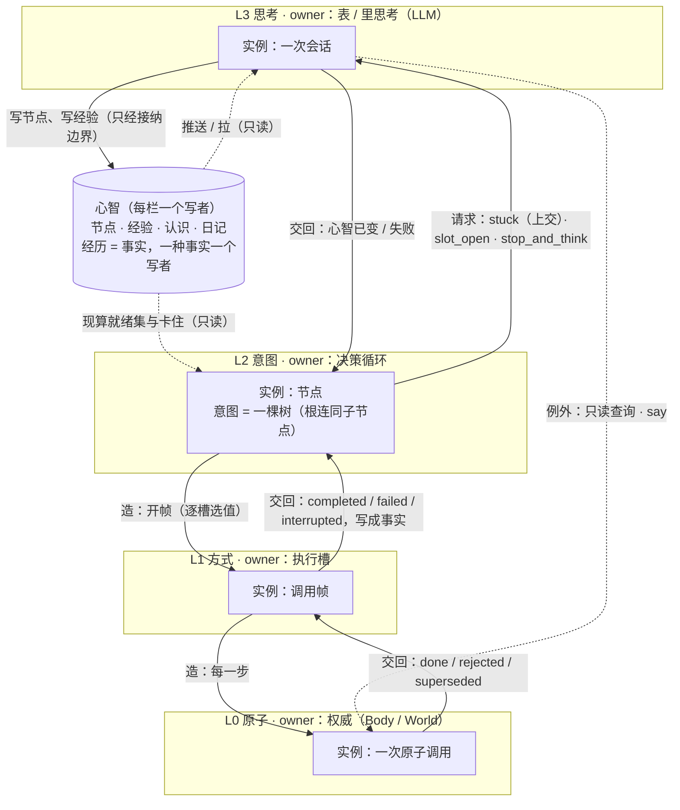
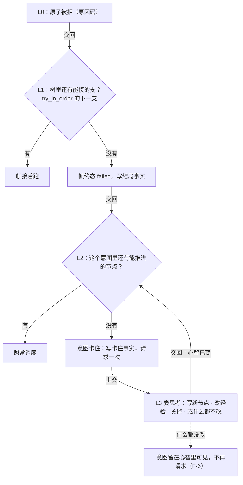

# NPC 总框架：四层、一条实例约定、四条跨层规则（2026-11-25）

分类：NPC 心智的总框架决策稿（定层、实例约定、跨层规则、扩展纪律、与现行稿的关系、测试矩阵与实施衔接；不改代码）。
关系：吸收意图图稿 [`2026-11-25-npc-intention-graph-decision.md`](2026-11-25-npc-intention-graph-decision.md)（未提交新稿，作 L2 这一行，逐条见 §4.1）；
三循环稿 [`2026-11-23-npc-three-loop-framework-decision.md`](2026-11-23-npc-three-loop-framework-decision.md) 是 L1–L3 的 owner 视图；
通用心智稿 [`2026-11-21-npc-generic-mind-decision.md`](2026-11-21-npc-generic-mind-decision.md) 给 L0 / L1 的模板与接纳边界；总纲 [`2026-11-12-npc-architecture-overview.md`](2026-11-12-npc-architecture-overview.md) 的三个位置落在 L1–L3（§3.9）。
状态：**决策稿，用户已定：U-34 定方向与骨架六题，U-35 定全稿照建议（§3 的 F-n 与 §7 全部待定项）。未实施、未实跑；0 次模型请求。实施从 M-3e 第 11a 步接着做，次序见 §10。**
依据：骨架 `.demo/observe/npc-framework-20261125/skeleton.md`；原文核对与编号清点 `.demo/observe/npc-framework-20261125/consult/`（本仓 gitignore，按惯例以路径引用）。

## 0. 名词（全文只在这里定义；其余沿用三循环稿 §0 与意图图稿 §0；标"改"的是本稿推广或改写的词）

| 名词 | 含义 |
|---|---|
| **层** | 按"回答什么问题、由谁推进"分的四段：L0 原子、L1 方式、L2 意图、L3 思考（§3.2）。 |
| **实例** | 一层里的一份工作：L0 一次原子调用，L1 一个调用帧，L2 一个节点，L3 一次思考会话。 |
| **模板** | 造实例所依的定义：L0 世界原子，L1 经验，L3 会话模板（代码写的系统提示词、工具表与推送渲染）。L2 没有模板（U-34 (2)）。L1 帧也可以不用经验模板：方式直接写原子名（一步）、`sleep_until`、一次性指令的 `calls`（已落地的步骤）。 |
| **造它的一方** | 让一个实例开始的那一方：L0 由 L1 的一步（另有表思考直调只读查询与 `say` 两条例外，F-3），L1 由 L2 开帧，L2 由表思考写入，L3 由 L2（经请求）或里思考的投递器。 |
| **owner** | 推进一个实例的唯一部件：权威（Body / World）、执行槽、决策循环、表 / 里思考。任何时刻只有一个；转手只经消息。帧在选值时还不是 L1 实例（由决策循环选值，节点记 `running`），进了执行槽才是、归执行槽；被抢占挂起时由决策循环保管，只能恢复或作废。三循环稿的"写者"管心智的栏，owner 管实例。 |
| **终态**（改） | 实例进入后，owner 不会让它离开的状态；每层一个封闭集合（§3.2）。意图图稿的终态是 L2 这一层的集合，本稿推广到每层。能改它意义的只有造它的一方的关闭（F-2 第 3 条、F-7）。 |
| **交回** | 把实例的终态送给造它的一方。 |
| **上交** | 造它的一方用本层控制流接不住，再往上一层送一次。 |
| **请求** | 向 L3 开一次会话。表思考的请求只有三种，发出方等答复：`stop_and_think`（Jev 判一条事实之后）、`stuck`（一个意图卡住，或此刻没有可做的事，即 `plan_empty`）、`slot_open`（一个根的参数槽要补内容）。里思考的请求叫**投递**（入睡、按时），发出方不等（三循环稿 §3.6"里思考结束不通知"）。 |
| **意图**（改） | 一个根节点连同它的子节点（F-H-5 定为保留子目标）；`after` 边可以跨意图。本稿的"意图"只指这一种；不指总纲"意图清单"、BDI 的 intention、经验的 `intent` 字段（一句用途，通用心智稿 §4.4）。 |
| **卡住**（改） | 一个意图走不下去了，要请求表思考；判据与去重只在 §3.5 F-8 写。取代意图图稿 §0 的定义。 |
| **备忘** | 没写 `how`、也没有子节点的节点：不就绪、不算卡住，状态 `no_way`（意图图稿 H-10，U-34 (3)）。 |
| **造不出帧** | 节点该开帧时开不出：参数槽列出 0 个候选、引用的经验已被丢弃、补过一次的槽仍填不上。节点进终态 `failed`（F-7）。 |
| **判断点** | 要做主观选择的固定位置；每个点一个判断者（§3.4 F-5）。 |
| **进行中的状态** | 实例到终态之前的状态（帧到第几步、节点 `running` / `suspended`）。由 owner 写进心智，上层只读（F-3）。 |
| **登记边界** | 角色登记时写入初始内容（G0、起始知识、起始区域）的入口，只用一次（通用心智稿 §4.9）。 |
| **漏洞** | F-11 列的六处框架没有直接写好的地方，分缺种类、缺实例、已定例外、待退役的旧做法四种。 |

## 1. 起因与用户的决定

**起因**（用户 2026-11-25 原话）：

> 我的目标是一套清晰明了的框架框住整个npc逻辑，就像我设计三循环结构一样，用一个足够灵活而且概念简单的结构框住所有可能的逻辑条线。请你帮我深入设计。

**经过**：意图图稿（U-33"先写稿"）给"做什么"这一层补了终态与"卡住"。之后 Fable 会话起草"四层阶梯、每层五个同样的部位（模板、实例、绑定、控制流、终局）"的方向，写到一半中断，用户未认可。本稿接手：先读全部现行稿与 harness，取外部原文，再用一页纸骨架与用户对方向。用户追问"新方案好在哪、能不能把之前的零碎问题兜住"（答复见 §2.2），之后定 U-34。

| # | 决定 | 原话 / 要点 |
|---|---|---|
| U-34 | **骨架六题全照建议**：(1) 总框架 = 四层 + 一条实例约定 + 四条跨层规则，取代 Fable 方向的"每层五个同样的部位"；规则 R3 的判断点表里没有"计划节点现在做不做"，由此推出意图图稿 H-1（它改 U-3 后半与 U-23，骨架没写明，列 F-H-14 请用户确认）；(2) L2 不加模板（"习惯"），格子留空，读"每游戏日用于重写日常的会话占比"；(3) 卡住改从终态现算，造不出帧算节点 `failed`，`slot_open` 每槽一次（改意图图稿 E-2、E-4）；(4) 框架里找不到格子的六处只列不补，各写读数与将来的填法（F-11 按性质细分，第 5、6 条没有读数）；(5) L3 重复的上界先只靠现有会话上限加读数，每意图上交强度作备选；(6) 参数槽上的 `not_now` 取消（改 U-26 (1)），前提是实跑里用得少——实数 M-3 至 M-3d 共 996 次槽问、0 次选它（§5.1）。 | 「可以，都照建议，开始写」（2026-11-25） |
| U-35 | **全稿照建议**：§3 的 F-1–F-13 与 §7 的 F-H-1–F-H-15 全照建议。要点：`after` 收列表，改 M-3e 已定 ②；`after` 指向非 done 终态拒、指向以 done 关闭的照收，改 D-3 `after_closed`；子目标保留、只表示属于哪件事，有方式的节点不挂子节点；卡住事实的文本不用 stuck；此刻没有可做的事按 U-12 原义，名字 `plan_empty`，待办树有变化才再请求；计划节点不问 Jev，改 U-3 后半与 U-23；M-3e Q4 原样；三个计划工具合一推迟，上交强度按触发线再提，Jev 失败在产品化时定。§10 的衔接与 §11 的回填照做；之后由另一个执行会话按本稿继续实施与测试。 | 「太多了，全都按建议来吧。写好之后我让之前正在做测试的另一个执行会话继续基于新文档开测」（2026-11-25） |

## 2. 诊断

### 2.1 现有概念落在哪一格

这张表把七份现行稿的名词与主要机制逐个放进四层框架：左列是现行概念，"落在哪"写层与部位（用 §0 的词），"状态"写保留 / 改名 / 取消 / 漏洞；表大致按 L0 → L1 → L2 → L3 → 旁排，相近的合成一行；表后列出清点时发现、已据此改稿的各处。

| 概念 | 出处 | 落在哪 | 状态 |
|---|---|---|---|
| 世界原子（`Abilities` 条目）；动作 / 只读查询两类；长技能也是原子；结果投影 | 通用心智稿 §0、§4.3 | L0 模板；两类是 L0 的种类（F-10）；一次调用是 L0 实例，长技能的步骤在 owner 内部；结果随 `done` 交回 L1 | 保留 |
| `prepare` 与运行时限制（O-5）；原因码；权威边界（世界真值只在 World） | 通用心智稿 §4.3、§4.10；总纲"不变的边界"；三循环稿 §3.1 | L0 owner（权威，经 `prepare`）；终态 `rejected` + 原因码；边界：权威边界在 L0 底下 | 保留 |
| Body 结局 `done` / `rejected` / `superseded`；技能超时发 `cancel_skill` 再等收尾 | 通用心智稿 §4.10；产品 `npc_server/brain.ex:141` | L0 终态 | 保留（F-1 已补 `superseded`；超时见 F-2 第 4 条） |
| `dig_cell`、`teleport_to_spawn`（读条 10 s、冷却按游戏钟）；脱困两层（U-30） | 路线稿 §5.4、§5.5；三循环稿 U-30 | L0 模板（动作，F-10 种类里的实例）；用不用传送由表思考判断 | 保留 |
| 系统函数：`find_route`、`find_places`、`site/4` 包装；列不出的原因；`estimated_*`（U-32） | 路线稿 §5.2；三循环稿 §3.5.1、U-32 | L0 只读查询，同一函数作 L1 列举器（F-10）；原因与估算是候选里的事实（U-10）；列出 0 个 → 造不出帧 | 保留 |
| 经验（带参数描述的函数；`version`；参数 `sem`；`intent` 字段）；使用统计 | 通用心智稿 §0、§4.4；三循环稿 §3.3、T-6 | L1 模板（表思考写，经接纳边界）；帧固定开帧那一刻的版本（F-2 第 1 条）；统计是心智的栏（写者 执行槽） | 保留；`intent` 字段不是 §0 的"意图"（§0 已注） |
| 树格式：`do_in_order`、`try_in_order`、`repeat`（≤ 20）、`wait_seconds`、原子步骤；`as` / `$result`（O-6）；`do_listed` | 通用心智稿 §4.4；路线稿 §5.3、O-2 | L1 层内控制流；树节点是 L1 的种类（F-10）；上界在 F-6 | 保留 |
| 执行器 / 执行槽；单槽（T-1）；执行容量要小（U-21） | 通用心智稿 §4.10；三循环稿 §0、T-1 | L1 owner | 保留（通用心智稿的"执行器"改名为执行槽） |
| 调用帧；帧的 state `binding` / `running` / `suspended` / 终态；`last_run` 与 `last_run.status` | 三循环稿 §0、§3.3；M-3e §3.0 | L1 实例；state 是进行中的状态（owner 写，F-3）；终态 `completed` / `failed` / `interrupted`，写成事实 `outcome`，写者 执行槽（F-7） | 保留；选值中的帧还不是 L1 实例（§0、F-9） |
| 方式直接写原子名；`sleep_until`（睡眠帧）；一次性指令的 `calls` | 通用心智稿 §0、§4.13；M-3e D-5 | L1 实例，没有经验模板；睡眠帧的事实 `fell_asleep` / `woke_up`（F-9） | 保留；这三种不用经验模板（§0、F-1 已注） |
| idle（"什么都不做"这个动作，U-19） | 三循环稿 §0、§3.7 | L1：执行槽没有帧时的样子，不是实例（§3.9） | 保留 |
| 语义类型 `sem`（含 `region`、`site`、`route`、开放类型 `text` / `design`）与列举器；选址两个量（U-25）；契约 `arg_sources`（D-6、⑤） | 三循环稿 §3.5、§3.5.1；路线稿 §5.3；M-3e D-6 | L1 种类：语义类型与列举器、参数来源契约行（F-10）；契约在接纳边界查；开放类型 → 请求 `slot_open` | 保留 |
| 区域名（`sem.region`）、命名区域表、`note_region`、重名拒（D-7、Q5、Q6）；"我知道的区域" | M-3e D-7；三循环稿 §3.5.1 | L1 模板字段；区域表是心智的栏（记下的写者 表思考，查过的写者 执行槽）；名字不在表 → 造不出帧（`region_unknown`） | 保留 |
| 决策循环；调度器；选择器（何时问、保持多久）；驱动事件（新事实、帧终态、心智已变、到点） | 三循环稿 §0、§3.2；意图图稿 §0；总纲 | L2 owner；由消息唤起，消息只是运输（F-3） | 保留（"调度器""选择器"改名为决策循环） |
| 条目（日程 sN、待办 tN、一步 gN、一次性指令 cN）与待办节点字段；意图清单 | 通用心智稿 §0；三循环稿 §3.3；M-3e §3.0；总纲 | L2 实例（节点），表思考经接纳边界写入 | 改名（节点） |
| 待办树；意图（根 + 子目标）；子目标 / 一步 | 三循环稿 §0；意图图稿 §0 | L2 意图（§0：根连同子节点）；子目标是节点，只表示"属于哪件事"（F-H-5） | 改名（意图）；父节点按 F-7 |
| 方式 `how`；没写方式（"想做但还不知道怎么做"）；`no_way` 事实 | 通用心智稿 §0；三循环稿 §3.4 | L2 节点字段，指向 L1 模板；空 = 备忘（状态 `no_way`，不就绪、不算卡住） | 改名（备忘）；`no_way` 事实取消（F-9） |
| 一次性指令（`command`、`add_command`、`calls`、保留名 `one_time_command`；①③④） | M-3e D-5 | L2 节点，自带落地步骤；它的帧是 L1 实例；`calls` 不是模板（§0）；被打断进 `failed`（F-7） | 保留 |
| 前驱 `after`（单个，②）；边（`after[]`）；做成（Q4） | M-3e D-3；意图图稿 §0、E-1 | L2 层内控制流（`after` 边）；做成 = `done`，含以 done 关闭（F-7） | 保留；`after` 收列表（F-H-1） |
| 条目状态 9 种（`item_status`）；前驱状态 5 种（`after_state`）；意图图稿状态 12 种 | M-3e §3.0、D-3；意图图稿 E-2 | L2 进行中的状态与终态：F-7 的 14 种（含 `waits_for_steps`），唯一定义处仍是 `item_status` | 改名（`can_start` → `ready`，`waits_for_after` → `blocked`，`window_ended` → `expired`，`started` → `running` / `suspended`，`not_taken_up` 拆成终态与备忘；`after_state` 改读前驱的 F-7 状态） |
| 终态（意图图稿五种），再做一次由表思考写新节点；关闭（`close_todo`、`closed_outcome`）；节点层不做环与重试（E-7） | 意图图稿 §0、E-2、E-7；M-3e §3.0 | L2 终态，推广到每层（F-2 第 3 条）；以 done 关闭算 `done`（F-7）；重复的上界在 F-6 | 保留 |
| 决策队列（现算，事实在前，T-2、H-3）；头部 / 队头；可做 / 可挑；就绪集 | 三循环稿 §0、§3.4；M-3e §3.0；通用心智稿 §4.6；意图图稿 §0 | L2 层内控制流：未判事实在前，计划部分是就绪集 | 保留（"可做""可挑"改称 `ready`） |
| 档位（4 档）；抢占只在档位严格更高、步骤边界（T-8）；挂起与恢复不再问 Jev（E-8） | 三循环稿 §0、§3.4；意图图稿 E-8 | L2 节点字段（写者 系统功能）；档位抢占是 L2 层内控制流；`suspended` 是进行中的状态 | 保留 |
| 时段 `window`、不早于 `not_before`（G-11）、谓词 `window_ended`；误过时间（E-6） | 三循环稿 §3.3；M-3e §3.0；意图图稿 E-6 | L2 节点字段与就绪条件（F-10）；时段过了 → 终态 `expired`；误过时间是 `expired` 的读数 | 保留（`not_before` 只由表思考写） |
| 转移事实 `window_ended_unstarted`、`after_not_done`；过窗作废（B-8）；被抢占后作废的帧 | M-3e D-2；意图图稿 E-5；M-3 plan B-8 | 事实（写者 决策循环，F-9），对应终态 `expired` / `upstream_failed`；作废的帧补一条结局 `interrupted`（F-9） | 保留；结局由执行槽写，决策循环发消息请它写（F-H-9） |
| `no_candidates` 事实（`region_unknown` / `none_listed`）；`WAY_GONE_FACT`；0 候选挡根（B-3） | M-3e §3.0、D-7；M-3 plan B-3 | 造不出帧：节点终态 `failed`，事实 `cannot_start`（F-7、F-9） | 改名（`cannot_start`，F-H-8） |
| 卡住（意图图稿 E-4 的定义与 8 种 `reason_kind`） | 意图图稿 §0、E-4 | L2 → L3 上交：请求 `stuck`；定义、原因、去重按 F-8 | 保留（定义改）；8 种 `reason_kind` 取消（F-8 收为终态与原因码） |
| 参数槽（T-4："待办树子节点"）；逐槽 Jev（U-16、U-26）；`none_fits` | 三循环稿 §0、§3.5、T-4 | L2 开帧的判断点"参数槽选值"；槽属帧的选值，不是节点（意图图稿 §0） | 保留（"子节点"的说法不再用） |
| `slot_open`（`none_fits` 或开放类型 → 帧挂起，只挡那一个根） | 三循环稿 §3.4、U-27 (1) | 请求 `slot_open`，每槽一次（F-7）；等待只挡那一个根（F-4） | 保留 |
| 收窄回退（B-7：料源 / 点位 / 路线槽 `none_fits` → 撤区域槽重选，`tried_regions`） | M-3 plan B-7；路线稿 §5.3；M-3e D-7；harness `decide.py:38-42` | L2 开帧（选值中）的层内控制流（F-1、F-6、F-7 已写进） | 保留 |
| 叫醒判断；头部是事实时的问题；事实判停（`carry_on` / `stop_and_think`；G-9 在步骤边界停） | 通用心智稿 §0、G-9；三循环稿 §3.4；意图图稿 E-3 | L2 判断点"事实判停"（Jev，F-5）；选 `stop_and_think` 发请求，等待挡全部（F-4） | 改名（事实判停） |
| Jev（只做选择题；重要性评估也用它）；评档失败按最低档（H-7） | M-3e §3.0；三循环稿 U-15、§3.8、H-7 | 判断者：F-5 的三个判断点；不是层（§3.9） | 保留；判断点失败时见 F-5 与 F-H-12 |
| 等表思考期间不开新帧（U-27 (1)）；"判停"（意图图稿两义之一）；"等表思考"栏 | 三循环稿 U-27 (1)；M-3e D-1、Q1；意图图稿 E-3、E-6 | 跨层：规则 F-4（等待范围 = 请求范围） | 保留（范围按 F-4） |
| 挑选；绑定调用（DeepSeek，`use_way` / `not_now`）；现在不做（`not_now` 各处、H-4 四档、`not_now` 事实） | 通用心智稿 §0、§4.6、O-10；三循环稿 §3.4、H-4、U-26 (1) | — | 取消（挑选：三循环稿 §3.4；绑定调用：U-16、U-26，改为参数槽选值；`not_now`：F-5、U-34 (6)，推迟只由表思考写 `not_before`） |
| 计划节点"现在做不做"（`do_now`；`already_done` 与 `judged_done` 栏；计划侧 `stop_and_think`、`stopped_to_think`、`stop_asked`；Q1、Q2） | 三循环稿 §3.4、U-23、U-29；M-3e D-1 | — | 取消（F-5 取消的判断点、F-9；M-3e 第 12 步不做 D-1）；`append_judged_fact` 留给卡住事实（F-8） |
| 节点即实例、L2 没有模板（E-O-1）；日常每天由表思考重写 | 意图图稿 E-O-1、§8 第 9 条 | L2 模板：无（F-1、F-12） | 漏洞（F-11 第 4 条） |
| 表思考、里思考（D-9 独立模板：评价 / 丢弃经验、改写认识）；思考会话；睡眠整合 | 三循环稿 §0、U-17；M-3e D-9；通用心智稿 §0、§4.13 | L3 owner；一次会话是 L3 实例；表思考、里思考是 F-5 的判断点 | 保留（"睡眠整合"改名为里思考的入睡投递） |
| 进思考的三条路（O-2）；思考只经叫醒触发（U-8）；待办表空 → 规划思考（U-12、O-8）；表思考请求原因 `stop_and_think` / `plan_empty` / `slot_open` | 通用心智稿 §4.1、O-2、O-8；三循环稿 §3.3、§3.6 | 请求（§0 三种）；`plan_empty` = 请求 `stuck`，根为空（F-8）；里思考的来源是投递 | 改名（`stop_and_think` / `stuck`（含 `plan_empty`）/ `slot_open`，另有投递） |
| 里思考队列 `source`（`sleep` / `clock`）与投递器（U-18、H-5）；里思考游标（T-7） | 三循环稿 §3.6、T-7、H-5 | L3 的造它的一方（投递器，F-10 L3 种类）；游标是心智的栏 | 保留；投递是不等答复的请求（§0、F-3） |
| 思考队列、合并键、队列上限（H-6）；轮次（⑩ 6 轮）、会话数、花费额度（`SpendBudget`） | 三循环稿 §3.6、H-6；M-3e ⑩；通用心智稿 §4.12 | 跨层：规则 F-6 的 L3 行；F-13 | 保留 |
| 心智已变（`MindChanged`）；会话出错 | 三循环稿 §3.6、§3.9；harness `outer.py:203-205` | L3 终态（心智已变，含 0 条写入 / 失败），交回 L2（F-2 第 4 条） | 保留（失败也交回，产品化时做） |
| 心智原子（日记、日程、待办、关闭、写 / 废经验、`note_region`、`add_command`、`evaluate_experience`、`write_understanding`）；"输出" | 通用心智稿 §0、§4.5；M-3e D-5、D-9；约束段稿 §3 | L3 种类：心智原子（F-10），经接纳边界写心智 | 保留 |
| 会话模板：系统提示词（P-plain）、工具表、推送渲染；思考强度（D-10）；`OUTPUT_TEXT`（D-8）；约束段 | 通用心智稿 §4.5；M-3e D-8、D-10；约束段稿 §4、§5 | L3 模板（代码写） | 保留；约束段改名为 `OUTPUT_TEXT` 的一段完整说明（D-8） |
| 推 / 拉（O-3）；推送心智；心智快照（七栏）；召回 `recall_memory` | 通用心智稿 §0、§4.7；M-3e §3.0；总纲 | L3 的输入：推送（推送分区是 L3 种类，owner 渲染器）与拉（只读查询、召回）；Jev 在判断点读同一份推送心智；"我正在做什么"一栏是进行中的状态 | 保留（"心智快照"改名为推送心智） |
| 眼前的处境（附近的人和物，World 现查） | 总纲 心智快照；通用心智稿 §4.7 | 推送分区"此刻"；变化不一定成为事实 | 漏洞（F-11 第 2 条） |
| 思考不碰执行（O-7）：思考时只做心智原子、只读查询与 `say`（G-10）；行动提示 | 通用心智稿 §4.1、O-7、G-10；M-3e D-5 | 跨层：F-3 的两个例外 | 漏洞（F-11 第 5 条） |
| `design_house` 在原子内部问模型；`design` 槽由表思考产出（G-13 改写） | 总纲 位置 × 判断者表；通用心智稿 G-13；三循环稿 §3.7 | F-5 判断点表外的旧判断 | 漏洞（F-11 第 6 条） |
| 会话进行中来的新事实不另开会话，并入下一次请求 | 三循环稿 §3.6 | L3 实例开始后不可打断 | 漏洞（F-11 第 1 条） |
| 接纳边界（格式 + 语义一次，原因交回）；回执带游戏钟（D-4）；过期日程整条拒（Q3）；`accept.RULES` | 通用心智稿 §0、§4.5；三循环稿 §3.1；M-3e D-4、§3.0 | 边界：接纳边界在 L3 写心智的出口 | 保留；"实参进执行槽"那一半随绑定调用取消 |
| 心智（每栏一个写者）；事实、经历（只追加）；一种事实一个写者；决策游标 | 三循环稿 §0、§3.3；M-3e §3.0；harness `store.py:196-201` | 旁：心智；经历是心智的栏，事实种类见 F-9；游标是心智的栏 | 保留 |
| 日记、认识；评价记录 `way_judgments`（D-9） | 通用心智稿 §0、§4.13；M-3e D-9 | 旁：心智的栏（日记 表思考写；认识 里思考写；评价记录由接纳边界代提交） | 保留；认识的唯一写者待定（三循环稿 H-9） |
| 人格卡、情绪、关系（Life）；Hindsight；"上下文提供者" | 总纲；通用心智稿 §4.8 | 旁：心智的栏 | 保留；改写它们的后台过程归系统功能（F-10） |
| 启动数据（G0 16 条、起始知识、起始区域；G-12） | 通用心智稿 §0、§4.9；M-3e §3.0、D-6 | 写进心智的栏（经验、区域、起始知识）；登记时由登记边界写一次，不是任何层的实例（F-3） | 保留 |
| 系统功能：重要性评估（写档位）、情绪评价、Body 的反射 | 三循环稿 §0、§3.8；U-20、U-23 | 旁：系统功能；评档、情绪评价是 F-5 的判断点 | 保留；评档与情绪评价是系统功能，各自那次选择是判断点（F-5）；产品里没有叫"反射"的部件（§3.8） |
| 代码只给事实（U-10）；名字层与编号层；事件用标准描述；公共常识 | 通用心智稿 §4.12；总纲 | 跨层：规则（沿用，F-5 末条）；标准句由各种事实的写者写（F-9）；公共常识在 L3 模板 | 保留 |
| 三循环（U-14）、四个部件、一类工作一种模型（U-15）、思考与执行拆开（U-19）；控制链（规划 → 选择 → 执行）与时间尺度表 | 三循环稿 §2、§3.2；总纲 | 执行槽、决策循环、表 / 里思考 = L1–L3 的 owner；规划 / 选择 / 执行 = L3 / L2 / L1，权威 = L0（§3.9）；时间尺度见 F-1 | 保留；控制链改名为 L3 / L2 / L1 |
| 通信时机表；部件之间只传消息、mailbox 只是运输；向下是上下文、向上是经历与例外；做不下去交上一层；慢层从不阻塞快层 | 三循环稿 §3.9；总纲 一句话、回路 | 跨层：规则 F-3（实例、终态、请求、结束或挂起的要求，其余经心智）；上交（F-2 第 5 条）；F-4 | 改名（造实例 / 交回 / 上交）；"慢层从不阻塞快层"取消（F-4：`stop_and_think` 期间不开新帧） |
| 位置 × 判断者表；判断者按问题类型分（代码 / Jev / LLM）；Jev 在技能内部的封闭判断 | 总纲 | 跨层：规则 F-5 | 取消（被 F-5 判断点表取代；代码不作判断者，U-10；执行无模型，U-15） |
| 候选来自数据（技能、去处、意图条目），代码先按可行性过滤 | 总纲 | 值候选：L1 列举器 → L2 判断点"参数槽选值"；活动候选：— | 取消活动候选（挑选已取消，三循环稿 §3.4）；值候选保留 |
| 紧急避险（选择位置上由代码先处理） | 总纲 | —（代码不判断，U-10；反射只管物理反应） | 漏洞（F-11 第 3 条） |

### 2.2 零碎问题落在哪（答用户 2026-11-25 的追问；设计层面判断，未实跑）

程度：**根治** = 结构上不再发生；**封顶** = 还会发生但至多一次；**拦住** = 错的进不了心智，原因交回模型；**缩小** = 根还在、波及面变小；**管不到** = 不在这一环；**大部分** = 主要情形根治、其余仍由 Jev 判；**预防** = 实跑还没出现、规则先挡住；**有机制，行为待测** = 机制已在、模型用不用待实跑；**还没兜** = 定为推迟、先读数。
结构这一族的根治大半来自意图图稿（终态 + 卡住）；本稿的增量是推广到每层、补意图图稿自己的矛盾（§2.3）、给以后的问题定去处（F-10）。

| 问题（出处） | 新方案下 | 程度 |
|---|---|---|
| 做完的条目被反复挑中：Jev 33 次全答 `do_now`，118 次里 78 次白问（U-29） | `done` 是终态；Jev 不再问计划节点 | 根治 |
| 出坑失败后采石照常开帧，在坑里失败 6 次（M-3e D-1） | 写了 `after`：采石直接 `upstream_failed`；没写：失败一次就进终态 | 根治 / 封顶 |
| 同一槽交表思考最多 9 次（N-3）；0 候选时同一帧反复回到同一槽（M-3） | 造不出帧即 `failed`；`slot_open` 每槽一次；卡住每组终态一次 | 封顶 |
| `not_now` 最短 30 分钟，短时段等于放弃（D-1）；被抢占的帧恢复时又问 Jev（M-3 plan §12 第 8 条） | 这一问取消 | 根治 |
| "走不下去"要靠 Jev 从整份心智里看出来（用户提的"停下来想"） | 卡住从终态算出、只请求一次；外来事件仍由 Jev 判 | 大部分 |
| 过窗没开始、前驱没做成不留记录（B-8、D-2） | 决策循环判出的、没有帧的终态写事实（更远的后继、打断后才过期的、表思考关掉的不写） | 根治 |
| 规划思考后仍空，反复投 `plan_empty` 直到会话数上限（M-3e harness `outer.py` 模块说明） | 没有可做的事时，待办树没有变化就不再请求（F-8） | 封顶 |
| 等表思考时全部停帧，身体为不相干的事空等（意图图稿 E-6） | `stuck` 不挡别的意图；外来大事才全停 | 大部分 |
| 会话出错后等待解除不了（产品里会整个停住） | 失败也交回 | 预防（harness 出错时停整轮，实跑看不到） |
| 思考误过决策时间：接纳时已过期 35 / 203，一次会话约 11–42 游戏分钟（M-3d） | 无世界时限的事用 `after`；过期整条拒并回执游戏钟（D-4）；等待只挡相关意图 | 缩小 |
| 经验写死坐标 156 格（M-3d）、路线照抄（M-3c）、点位两个来源（U-28、B-12） | 模板里不许有实例的值，契约整条拒（D-6）；空间值只在开帧时由系统函数列 | 拦住 |
| 一次性的事只能写成经验；思考时直接调世界动作 14 次（M-3d） | 一次性指令是自带落地步骤的 L2 节点（D-5）；表思考只直调查询与 `say` | 拦住 |
| 困在坑里手算台阶，推理 token 截停（N-1） | `find_route`、`do_listed`、传送已是现有实例（U-31） | 有机制，行为待测 |
| 不知道 "one is chosen" 谁选、拿旧的写死经验当先例、里思考调没有的工具 9 次 | 提示词与视图（D-8、D-9） | 管不到 |
| 会话用满 6 轮（47 / 100）、正式运行停在会话上限、推送心智 91 KB、评档约占 Jev 请求四成（M-3d 227 / 530） | 去掉白花的循环、上限写明；需求没减 | 管不到（略减） |
| 同一件事在日程与待办各写一条（M-3） | 数据上已是同一种节点；工具合并推迟（F-H-10） | 还没兜 |

M-3d 按环节诊断断在两处：理解约束段、日程到执行的计时。本稿对后者起一半作用，对前者不起作用（那一环靠 D-6 契约与提示词）。

### 2.3 意图图稿内部与对现行稿的矛盾（编号清点 `consult/id-inventory.md` 查出，与本稿相关的已对照原文核实）

| 清点查出的 | 本稿的答案 |
|---|---|
| E-3 / V-8 说等表思考时全停，E-6 / V-14 说只挡所属意图 | F-4：取 E-6 / V-14 |
| `slot_open` 并进卡住后跟着全停，违背 U-27 (1)"只挡那一个根" | F-4：只挡那一个根 |
| E-2：`ready` 要求"没有 `last_run`"，又说被打断的节点回到 `ready` | F-7：`ready` 看节点有没有进终态，不看有没有 `last_run` |
| 被打断的一次性指令按 E-2 回到 `ready`，违背已定 ① | F-7：被打断后只有执行内容里没有写死的值的节点回 `ready`（引用方式的节点、`sleep_until` 节点）；一次性指令进 `failed` |
| 只剩"等时段"节点的意图按 E-4 字面算卡住 | F-8：卡住从终态算 |
| `none_fits` 从三循环稿的"帧挂起"改成"作废"，未列出 | F-7：帧在选值中等补槽，每槽一次；补过仍填不上 → `failed` |
| 以 done 关闭的前驱、带未关子目标的父节点，状态表没覆盖 | F-7：以 done 关闭算 `done`（M-3e Q4，不论之前是否已进终态，F-H-15）；父节点记 `waits_for_steps` |
| 三循环稿 §3.2 说"上次结局"由决策循环写，§3.3 说由执行槽写 | F-7：结局的写者是执行槽，不随 owner 变 |
| 意图图稿与任务书写 M-3e"到第 4 步"，实际到第 10 步 | F-H-1：`after` 改列表等于回头改第 1、3、5 步已提交的代码（§10） |
| 取消参数槽上的 `not_now` 未列进关系表，而它是 U-26 (1) 定的 | U-34 (6) |

## 3. 框架

**一句话**：四层、一条约定。NPC 每一层的工作都是"实例"——上一层造它、一个 owner 推进它、它只结束一次、结局交回造它的一方；接不住的往上交一层。判断只在列了名的判断点上，代码只给事实（U-10）。三循环正是 L1–L3 的三个 owner；意图图稿是 L2 这一行。

### 3.1 总图

向下造实例、提结束或挂起的要求，向上交终态与请求；其余一律经心智（F-3）。两条边界不变：权威边界在 L0 底下，接纳边界在 L3 写心智的出口（三循环稿 §3.1）；登记边界只在角色登记时用一次（F-3）。

### 3.2 F-1 四层

| 层 | 回答的问题 | 实例 · owner | 造它的一方 | 模板（谁写） |
|---|---|---|---|---|
| L0 原子 | 这一下成不成 | 一次原子调用 · 权威（Body / World，经 `prepare`） | L1 的一步；L3 直调只读查询与 `say`（例外） | 世界原子（产品代码 `Abilities`） |
| L1 方式 | 这件事下一步怎么做 | 调用帧 · 执行槽 | L2 开帧 | 经验（表思考写，带版本，T-6）；方式是原子名、`sleep_until`、一次性指令时不用经验模板 |
| L2 意图 | 现在轮到哪件事 | 节点 · 决策循环 | 表思考经接纳边界写入 | 无（U-34 (2)） |
| L3 思考 | 我要什么、怎么做、学到什么 | 一次会话 · 表思考 / 里思考 | L2 的请求；里思考的投递器 | 会话模板（代码） |

| 层 | 层内控制流 | 终态（封闭集合） | 接不住时 |
|---|---|---|---|
| L0 | 无（owner 内部） | `done` / `rejected` + 原因码 / `superseded`（被新命令顶替，通用心智稿 §4.10） | 原样交回 L1 |
| L1 | `do_in_order` · `try_in_order` · `repeat` · `wait_seconds` · `do_listed` | `completed` / `failed` / `interrupted` | 结局写成事实交回 L2 |
| L2 | `after` 边 · 档位抢占 · 时段 / 不早于；开帧时逐槽选值与收窄回退（B-7） | `done` / `failed` / `expired` / `upstream_failed` / `closed` | 意图卡住 → 请求表思考一次 |
| L3 | 模型自己的推理，轮次有上限 | 心智已变（含 0 条写入）/ 失败 | 没有上一层：留在心智里可见，重复由预算封顶（F-13） |

- 各层内部不同，对外同一条约定（F-2）。依据见 §5.2：Gat 主张控制架构各层异构、按怎样处理内部状态分层；行为树能任意组合子树，靠的是统一的返回状态接口。
- 时间尺度：L0 一步（秒级），L1 一项活动（秒到分钟），L2 一件事（分钟到几天）；L3 一次会话本身墙钟十秒到百秒（M-3d 折合十几到四十几游戏分钟），它写的节点管到几天。Albus 1991 的层按规划视野等每层约差一个数量级（§5.2），本稿的 L2、L3 不按这个分。
- 一个身体同时只做一件事：L1 只有一个执行槽（T-1）。L2 可以同时有多个意图，L3 同时至多表、里各一个会话（U-17）。

### 3.3 F-2 实例约定（每层同一条）

1. **造**：一个实例只有一个造它的一方。L1 帧固定在开帧那一刻的经验版本（T-6）。
2. **推进**：任何时刻只有一个 owner 推进它，别的部件只读；转手只经消息（帧进了执行槽才是 L1 实例、归执行槽；被抢占挂起时由决策循环保管，只能恢复或作废；结局的写者始终是执行槽，F-7）。
3. **结束**：恰好一次。终态取自本层的封闭集合；进了终态，owner 不会让它再开始，再来一次就造新实例（意图图稿 E-2 的终态语义推广到每层）。能改它意义的只有造它的一方：表思考以 done 关闭一个 L2 节点算做成，因它进 `upstream_failed` 的后继随之重新现算（M-3e Q4，F-7）。
4. **交回**：成功、失败、被打断、出错，每条路径都把终态交给造它的一方；那一方的等待只由这份终态解除。造它的一方可以请求结束（技能超时发 `cancel_skill`），实例仍由 owner 结束、终态照常交回（通用心智稿 §4.10）。harness 的步骤超时由桥回 `timeout`、执行器记这一步失败（`executor.py:10-12`），技能那边是否已停没有交回，实施时先核桥的超时语义（风险 12）。里思考的投递方不等：终态记在会话结束日志，队列放行下一条。
5. **上交**：造它的一方先用本层控制流接；接不住的再往上交一次。

| 实例的终态 | 交给谁 | 那一方怎样接 |
|---|---|---|
| L0 `rejected` / `superseded` | L1 帧 | `try_in_order` 试下一支；`do_in_order` / `do_listed` 第一处失败即帧 `failed`；`repeat` 失败即停 |
| L1 `completed` / `failed` | L2 节点 | 节点进 `done` / `failed`（终态）；同意图别的节点照常 |
| L1 `interrupted` | L2 节点 | 执行内容里没有写死的值的节点回 `ready`（引用方式的节点、`sleep_until` 节点）；一次性指令进 `failed`（①）；时段已过进 `expired`（F-7） |
| L2 造不出帧 | L2 自己 | 节点进 `failed`，写 `cannot_start`（F-7、F-9） |
| L2 意图卡住 / 此刻没有可做的事 | L3 | 请求 `stuck` 一次（F-8） |
| L3 心智已变 / 失败 | L2 | 解除等待，重算（F-4） |

### 3.4 跨层规则

另沿用三条：每栏一个写者（三循环稿 §3.3）、两条边界（同 §3.1；登记边界只在登记时用一次）、代码只给事实（通用心智稿 §4.12，U-10）。

**F-3（R1）层与层之间只传四样东西**：

- 实例：向下造。
- 终态：交回造它的一方。
- 请求：向 L3 开会话；投递是不等答复的请求。
- 结束或挂起的要求：向下要 owner 停下（技能超时发 `cancel_skill`、`stop_and_think` 后发 `GoIdle`、抢占时挂起、挂起帧作废时请执行槽写结局），实例仍由 owner 结束。

其余一律经心智：

- 模板与节点由表思考经接纳边界写入。
- 初始内容在登记时由登记边界写一次，之后归角色：起始知识与区域的写者是 `BOOT`（`store.py:157`），G0 是存储构造时的初始快照（`store.py:739-745`）。这是模板、节点与区域在接纳边界之外唯一的写入口。
- 结局与世界事件由各自的写者写成事实；一种事实一个写者，harness 已在存储里强制（`store.py:196-201`）。
- 进行中的状态由 owner 写进心智，上层只读（行为树父节点也收得到 Running，§5.2）。

消息只是运输（AGENTS 2.2.9）。例外两条，都已定：表思考直调只读查询（拉，O-3）与 `say`（G-10）。

**F-4（R2）等待的范围 = 请求的范围**

| 请求 | 等待期间挡什么 | 依据 |
|---|---|---|
| `stop_and_think`（Jev 判一条事实之后） | 全部：不开新帧、不选值；在跑的帧到步骤边界停（G-9）；事实照常判 | U-27 (1)；外来事实可能改写一切 |
| `stuck`（一个意图） | 不挡任何别的意图（卡住的意图本身已没有能推进的节点） | 意图图稿 E-6 / E-O-6；U-34 (1) |
| `stuck`（此刻没有可做的事，`plan_empty`） | 全部：不开新帧（沿用 U-27 (1) 对 `plan_empty` 的判停） | U-27 (1)、F-H-13 |
| `slot_open`（一个根） | 只挡那一个根 | U-27 (1) |
| 里思考投递 | 不挡（睡着由睡眠帧本身表达） | 三循环稿 §3.6 |

表思考答复时顺手改了别的意图，而那个意图已开帧：帧跑到终态、结局照写，根已关就不再成为头部（三循环稿风险 4，不变）。

**F-5（R3）判断点是一张封闭表**

| 判断点 | 在哪 | 判断者 | 问什么 | 选项 | 失败时 | 出处 |
|---|---|---|---|---|---|---|
| 事实判停 | L2 | Jev | 这条事实之后要不要停下来想 | `carry_on` / `stop_and_think` | harness 抛 `JevFailed`、停整轮（`decide.py:59`，探针口径）；产品化时定（F-H-12） | M-2a C3；三循环稿 §3.4 |
| 参数槽选值 | L2 开帧 | Jev | 选哪个候选 | 代码列的候选 + `none_fits` | 同上 | U-16、U-26；`not_now` 取消（U-34 (6)） |
| 评档 | 系统功能（节点接纳后） | Jev | 这一条对我多要紧 | 4 档 | 按最低档写并记日志（`importance.py:10`；三循环稿 H-7 待定） | U-20、U-23、U-26 |
| 表思考 | L3 | LLM | 开放 | 心智原子、只读查询、`say` | 会话失败也交回（F-2 第 4 条） | U-15、U-17 |
| 里思考 | L3 | LLM | 评价 / 丢弃经验、改写认识 | 3 个工具 | 同上 | M-3e D-9 |
| 情绪评价 | 系统功能 | 待定 | 待定 | 待定 | 待定 | U-20；三循环稿 §3.8 |

评档与情绪评价是系统功能（U-20、U-23），不在四层里；它们各自的那次选择仍算判断点。

- 取消的判断点：计划节点"现在做不做"（`do_now` / `not_now` 四档 / `already_done` / 计划侧 `stop_and_think`，意图图稿 E-3）、参数槽 `not_now`（U-34 (6)）。挂起的帧恢复时不再问（意图图稿 E-8）。
- 表外的旧判断都在产品里已定退役的部分：`design_house` 在原子内部问模型（三循环稿 §3.7）；Runtime 的 `choose_activity`、预选、对话回合问 Jev（对话回合见 `npc_server/runtime.ex:10-17`）；`Brain.Llm` 由 LLM 逐步做决定（通用心智稿 §7）。见 F-11 第 6 条。
- 加判断点 = 改框架，先写决策稿（F-10）。代码在判断点之外只做四件事：转述事实、原样转交角色写的东西、接纳处的格式校验、资源上限（U-10）；开帧与抢占只按节点字段机械比较（档位由系统功能写；时段、不早于、`after` 由表思考写），与内容无关（U-10），不是判断。

**F-6（R4）每种重复都有上界，上界来自结构或资源，不来自代码对内容的判断**

| 层 | 什么会重复 | 上界 | 出处 |
|---|---|---|---|
| L1 | 树里的重复与备选 | `repeat` ≤ 20；`try_in_order` 每支一次 | 通用心智稿 §4.4 |
| L1 → L2 | 帧结束后再开 | 节点进终态就不再开；被打断回 `ready` 只限执行内容里没有写死的值的节点 | 意图图稿 E-2、E-7；F-7 |
| L2 → L3 | 卡住请求 | 同一意图里出现新的触发节点才再一次；没有可做的事时待办树有变化才再一次 | F-8 |
| L2 → L3 | 补槽 | 每槽一次 | U-34 (3) |
| L2 开帧 | 收窄回退（料源 / 点位 / 路线槽答 `none_fits` → 换区域重选） | 每个区域至多一次，受可列区域数限；固定区域槽不走它 | M-3 plan B-7；M-3e D-7 |
| L3 | 会话 | 每次 6 轮（M-3e ⑩）；每次运行的会话数；花费额度（`SpendBudget` 唯一 owner） | 三循环稿 §3.2；通用心智稿 §7 |
| L3 → L2 | 同一做法反复失败 | 现在只靠会话上限；每意图上交强度作备选（F-13、F-H-11） | U-34 (5) |

### 3.5 L2 这一行的改正（意图图稿 E-2、E-4、E-5 按 U-34 (3) 与 §2.3 改）

**F-7 节点状态表**（唯一定义处仍是 `queue_view.item_status`，从真值现算、不另存）

| 状态 | 含义（只写事实） | 从哪些真值算 | 终态 |
|---|---|---|---|
| `done` | 最近一次帧 `completed`；或它（或关掉它的祖先）以 done 关闭；或有子节点且子节点全部 `done` | `last_run.status`、`closed_outcome`、子节点状态 | 是 |
| `closed` | 它或它的祖先被表思考以 given_up 关闭 | `closed_outcome` | 是 |
| `failed` | 最近一次帧 `failed`；或造不出帧；或一次性指令的帧被打断（①） | `last_run.status`、`cannot_start` 事实、节点种类 | 是 |
| `upstream_failed` | 它或它的祖先的某个前驱进了 `failed` / `expired` / `upstream_failed` / `closed` | `after` + 前驱状态 | 是 |
| `expired` | 它或它的祖先的时段已结束，没做成，也没有帧在执行槽里（在跑的帧跑到终态为止，B-8） | `window_ended` + `last_run` + 帧 | 是 |
| `no_way` | 备忘：没写 `how`，也没有子节点 | `how` 为空 | 否；不就绪、不算卡住 |
| `waits_for_steps` | 有子节点，子节点没全部 `done` | 子节点状态 | 否 |
| `not_rated` | 还没评档 | `tier` 缺 | 否 |
| `waits_for_thinking` | 它的根有 `slot_open` 在等答复（帧在选值中等补槽） | 帧（选值中，这一槽请过） | 否 |
| `running` | 帧在选值中（还不是 L1 实例）或在执行槽里 | 帧 | 否 |
| `suspended` | 帧被抢占挂起 | 帧 | 否 |
| `blocked` | 它或它的祖先有前驱还没 `done`，且没有一个前驱进了非 done 的终态 | `after` + 前驱状态 | 否 |
| `waits_for_time` | 它或它的祖先的时段没到，或它的不早于没到 | `window.from`、`not_before`、游戏钟 | 否 |
| `ready` | 以上都不成立 | — | 否 |

- **怎样取**：表思考的关闭优先：它自己或祖先被关，按表中 `done` / `closed` 两行算，不论之前是否已进终态（M-3e Q4，F-H-15）。没被关的，终态取最早成立的那一个（按真值上的时刻：`last_run` 的时刻、时段结束、前驱进终态的时刻），之后不再因时间或别的结局而变（如先 `failed`、后时段结束，仍是 `failed`）。前驱被以 done 关闭后，因它进 `upstream_failed` 的后继按此刻的真值重新现算（harness `after_status` 现在就这样判，`queue_view.py:220-227`）。决策循环自己不会让终态节点再开帧。非终态按表序取第一条成立的。被打断的节点看"是不是终态"，不看有没有 `last_run`。
- **被打断**：看节点的执行内容里有没有写死的值。没有的回 `ready`：引用方式的节点下一次开帧重新取实参（U-13）；`sleep_until` 节点的醒来时刻是它自己的字段（harness 现状同此，`queue_view.py:237-247`）。有的进 `failed`：一次性指令的 `calls` 是写死的值（①；写死的值被原样重放见通用心智稿 mini-r2）。打断后时段已过的进 `expired`。
- **造不出帧**：参数槽列出 0 个候选（含区域名不在表里，M-3e D-7）、引用的经验已被丢弃、`slot_open` 补过一次仍是 `none_fits`（开放类型的槽：补过一次仍列不出候选）→ 帧作废，节点进 `failed`，写一条 `cannot_start`（F-9）。与 harness 现状"0 候选后节点永久不可做"（`decide.py:46-49`）一致，只是把它写成终态。
- **`slot_open`**：带收窄的槽（料源、点位、路线）答 `none_fits` 先走收窄回退 B-7 换区域，换无可换 → 造不出帧；其余槽答 `none_fits`、或槽是开放类型 → 帧在选值中等补槽，只挡那一个根，请求表思考补一次；答复后从同一槽再问（三循环稿 §3.4、harness `decide.py:43-44` 现状）。"这一槽请过"记在帧自己身上，帧结束后没人再读（同 B-7 `tried_regions` 的做法）。
- **以 done 关闭算 `done`**：前驱"做成"沿用 M-3e Q4，它自己或关掉它的祖先以 done 关闭都算（M-3e D-3），不论它之前是否失败。被关的节点自己不再开帧，后继是第一次开始，所以不会带回"反复失败"（见"怎样取"）。
- **`expired` 与"误过时间"**：状态 `expired` 不分开始过没有；转移事实 `window_ended_unstarted` 只为从没进过执行槽的节点写（M-3e D-2 不变），"误过时间"的三类读数照意图图稿 E-6。
- **结局的写者**：帧的结局（`outcome` 事实与 `last_run`）由执行槽写，不随 owner 变；挂起帧作废时由决策循环请执行槽写（F-H-9）。三循环稿 §3.2 部件表"决策循环写上次结局"按此改（§11 回填）。
- **有子节点的节点**：子目标保留，只表示"属于哪件事"（F-H-5）。见表中 `done` 与 `waits_for_steps` 两行（`waits_for_steps` 是 M-3e §3.0 已有的名字），不按 `no_way` 算；有 `how` 或 `calls` 的节点不能再加子节点，接纳时拒（F-H-6）。子节点之间的先后只由 `after` 表达。

**F-8 卡住**

- **定义**：意图 I 卡住 ⇔ I 里至少一个节点处在**触发卡住的终态** ∧ I 里其余每个节点都是终态、`no_way`，或 `waits_for_steps`。触发卡住的终态是 `failed`、`expired`，以及沿 `after` 追到的源头是这两种的 `upstream_failed`。表思考关过的节点（它自己或祖先被关，不论以 done 还是 given_up）不触发，源头是被关节点的 `upstream_failed` 也不触发——关它的正是表思考自己。只剩等时段、等前驱、等评档、等补槽、在跑或挂起的节点时都不算。I 是一棵树（根连同子节点，F-H-5）；`after` 边可以跨树，因别的树里的前驱而进 `upstream_failed` 的节点按它所在的树计。
- **此刻没有可做的事**（`plan_empty`，F-H-13）：就绪集空、执行槽 idle、没有在等答复的请求或评档 → 请求 `stuck`，根为空，原因 `plan_empty`（U-12 原义，三循环稿 T-2 同一谓词；通用心智稿 O-8）。意图图稿 E-3 第 7 条的口径（所有节点都结束才请求，记 `no_intention`）不用。
- **原因**：事实与请求里写引起卡住的触发节点与各自的终态（`failed` 写原因码或 `cannot_start` 的 `reason_kind`，`upstream_failed` 写源头）。意图图稿 E-4 的八种 `reason_kind` 收掉：`failed` / `expired` / `upstream_failed` 本身就是终态；`no_candidates` / `way_gone` / `slot_open` 变成 `failed` 的原因（`cannot_start` 的 `reason_kind`：`no_candidates`、`way_gone`、`slot_unfilled`）；`no_way` 不算卡住；没有意图单列。
- **去重**（F-6）：同一意图里，只有出现以前的 `stuck` 事实没记过的触发节点，才再请求；"请求过"从 `stuck` 事实现算（事实里记那组节点），不另开一栏。表思考加的节点又失败 → 出现新的触发节点 → 再请求一次；表思考关掉触发节点 → 不再请求。没有可做的事时（口径见 F-H-13）：自上一次这种请求之后待办树有过变化——表思考写了或关了节点，或有节点进了终态（比较那条 `stuck` 事实里记下的节点与终态）——才再请求；世界事件、听到的话只经 Jev 判停（F-5），不触发这一请求。
- **写法**：卡住事实由决策循环写，写下即判过（M-3e 第 1 步已实现的 `append_judged_fact`；游标不在日志末尾时被拒，下一轮重算），它已带着请求，不再交 Jev 判停。转移事实 `window_ended_unstarted`、`after_not_done` 与 `cannot_start` 照 M-3e Q4 进队头交 Jev 判。同一轮里同一意图既被判停又卡住，请求按现有合并键合并。

**F-9 事实种类**（L2 部分；一种事实一个写者，新种类同样在存储里登记）

| 种类 | 写者 | 变化 |
|---|---|---|
| `outcome`、`world_event`、`fell_asleep`、`woke_up` | 执行槽 | 不变 |
| `said` | 表思考 | 不变 |
| `window_ended_unstarted`（→ `expired`）、`after_not_done`（→ `upstream_failed`） | 决策循环 | 不变（M-3e D-2）；`after_not_done` 只写直接后继，更远的后继进 `upstream_failed` 不另写，状态在推送里现算（D-3）；前驱被打断不再写（被打断的方式节点回 `ready`，不算没做成；改 M-3e `after_status` 把 interrupted 算作 failed 的口径） |
| `cannot_start`（新，F-H-8） | 决策循环 | 节点造不出帧；`reason_kind` ∈ `no_candidates`（细分 `region_unknown` / `none_listed`）/ `way_gone` / `slot_unfilled`；取代 `no_candidates` 与 `no_way` 里"方式已丢"那一半；同转移事实，进队头交 Jev 判（M-3e Q4） |
| `stuck`（新） | 决策循环 | 写下即判过 |
| `not_now`、`judged_done`、`stopped_to_think`、`no_way` | — | 取消（判断点取消；备忘不写事实）；`beyond_survey`、`sites_failed` 早已不写，删常量 |

被抢占挂起、之后作废的帧（B-8）现在不写事实；按约定第 3、4 条要有一条结局（`interrupted`，原因写节点已关 / 时段已过），由执行槽写，经哪条消息实施时定（F-H-9）。只在选值中被作废的帧没进过执行槽，不是 L1 实例，不写。

### 3.6 F-10 扩展纪律

新条线 = 往已有种类里加实例，由该种类的 owner 加，走它已有的接纳与测试。新种类（新的层、新的终态、新的判断点、新的请求种类、新的跨层通道）= 改框架，先写决策稿。下表只列今天已有实例的种类，不预建空的（AGENTS 2.2.7）。这是"往框架里填内容"（U-31）的落脚点。

| 层 | 种类 | 现有实例（举例） | owner |
|---|---|---|---|
| L0 | 世界原子：动作 / 只读查询 | `move_to`、`dig_cell`、`place`、`teleport_to_spawn`、`say`；`look`、`survey`、`find_route`、`find_places` | 产品 `Abilities` 与各域模块 |
| L0 | 原因码 | `no_path`、`ineffective_tool`、`protected_region`、`occupied` | 各原子的 `prepare` 与权威 |
| L0–L2 | 事实种类 | 见 F-9 | 每种一个写者 |
| L1 | 树节点 | `do_in_order`、`try_in_order`、`repeat`、`wait_seconds`、`do_listed` | 树格式与执行器（harness `formats` / `executor`，产品化后 `Brain.Tree`） |
| L1 | 语义类型与列举器 | `region`、`site`、`route`、`material`…… | `semantic_types.json` + 列举器 / 系统函数 |
| L1 | 参数来源契约行 | `arg_sources` | `semantic_types.json`（M-3e D-6） |
| L2 | 节点字段与就绪条件 | `after`、`window`、`not_before` | 存储 + `queue_view` |
| L3 | 里思考的投递来源 | 入睡、按时 | 投递器（U-18） |
| L3 | 心智原子 | `add_todo`、`add_schedule_entry`、`add_command`、`write_experience`、`evaluate_experience`…… | 格式 + 接纳边界 |
| L3 | 推送分区 | 我是谁、此刻、日程、待办、经验…… | 渲染器 |
| 旁 | 系统功能 | 重要性评估（harness `importance.py`）、情绪评价（产品 `Life.Appraisal`）；后台改写心智的过程：情绪衰减、人格漂移、Hindsight 的巩固与认识刷新（认识的唯一写者待三循环稿 H-9） | 各自；输出写固定栏，要驱动行为就成为一种事实 |

表思考的请求种类（`stop_and_think` / `stuck` / `slot_open`）、各层的终态集合、判断点、F-3 的四样东西都是封闭的，不在可加之列；里思考的投递来源可加（上表"里思考的投递来源"一行）。

### 3.7 F-11 六处漏洞，与两项用户已定的取舍（F-12、F-13）

**F-11 六处漏洞只列不补**（U-34 (4)）。按性质分：缺种类（要改框架）只有第 1、4 条；第 2、3 条是缺实例（种类已有，在 F-10 里补）；第 5 条是已定的例外；第 6 条是待退役的旧做法。

| # | 漏洞 | 性质 | 读数（实跑时读，不作判定） | 将来的填法与线索 |
|---|---|---|---|---|
| 1 | L3 会话不能打断：会话中来的急事要等它结束（M-3d 表思考中位 45 s；产品对话 120 s 没回话即失效） | 缺种类：要一条"作废会话"的跨层通道 | Jev 判 `stop_and_think` 的事实从写下到被会话处理的游戏分钟数 | 会话依赖的情况变了就作废重开：Soar 子状态依赖的上层元素一变就重建、Gat 1992 的思考器 "may be terminated before completion"、Albus "Emergency replanning begins immediately"（§5.2） |
| 2 | 外来变化只有一部分、在一部分时间里成为事实：harness 只转写"附近的人增减"，且只在执行槽有帧时（`slot.py:314-329`）；产品 Body 收到进出、受击、伤病、死亡都只更新缓存（`npc_server/body.ex:429-500`、`678`） | 缺实例：事实种类是已有种类；写者沿用今天收这些事件的一方（Body 事件：产品 Body、harness 执行槽；World 事件流：Life），同一内容不另立第二个写者 | 推送里"附近的人"变化而经历里无对应事实的次数（离线复算） | 转写者任何时候都转写，按 §3.8 补事实种类（被击中、伤病变化、听到的话、死亡 / 复活、收到东西、我建的东西被动了） |
| 3 | 等一件事发生（"等 Brann 来"）没有就绪条件，只能经事实 → 判停 → 表思考；事先写好、不经 L3 的快速反应也因此没有 | 缺实例：F-10"L2 节点字段与就绪条件"的新实例 | 表思考为"等某事"写不早于或只写日记的次数 | 就绪条件"某种事实、引用某个对象到了"（按种类与引用的 id 比较，不看文字；今天的 `world_event` 不带人的引用，`slot.py:328`）；要一并定它与 F-4 全局判停的先后（Jev 判 `stop_and_think` 时，事先写好的反应节点也被挡）；Rao & Georgeff 的意图栈可 "suspended until some condition occurs"（§5.2） |
| 4 | L2 没有模板：日常每天由表思考重写 | 缺种类（有意留空，U-34 (2)） | 每游戏日用于重写日常条目的会话占比 | 读数过半时另写决策稿；外部依据未检索（Bratman 1989 personal policies 只是线索） |
| 5 | 表思考直调 L0 的两个例外：只读查询与 `say` | 已定例外 | — | 不填：两者都已定（O-3、G-10），F-3 写明 |
| 6 | 产品里 F-5 表外的判断：`design_house` 在原子内部问模型；Runtime 的 `choose_activity`、预选、对话回合问 Jev；`Brain.Llm` 逐步做决定 | 旧做法，已定退役 | — | `design_house` 改为 `design` 槽由表思考产出（三循环稿 §3.7）；其余随 Runtime 旧分支退役（通用心智稿 §7） |

**F-12 L2 不加模板**（U-34 (2)）：不设"习惯"（周期性节点模板）。理由：与通用心智稿 O-8（代码不往待办树写条目）冲突；没有失败证据（意图图稿风险 9 无读数）；多一个概念（AGENTS 2.2.1、2.2.7）。读数见漏洞 4。

**F-13 L3 重复的上界**（U-34 (5)）：表思考坚持同一做法时会"失败 → 卡住 → 新节点 → 再失败"。现在只靠会话轮次、每次运行的会话数与花费额度封顶；读同一意图连续卡住次数、同一 `how` 连续失败次数。到 F-H-11 的触发线再提每意图上交强度（OTP Maximum Restart Intensity 的做法；Armstrong：原样重启上一层一般没用，"Cascading restarts do not work"（p.176），纠错不成就改做更简单的事（§2.3 p.16）；§5.2）。

### 3.8 每条线的走法（硬案例）

这张表把每条线放进框架走一遍，用来检验框架：写它经哪一层、哪些既有槽位，缺的是 F-10 哪一种类的新实例，还是碰到 F-11 的哪条漏洞；不为任何案例加分支。
路径写法：不带目录的 `*.py`、`semantic_types.json` 在 harness 目录 `.demo/observe/npc-three-loop-m3e-20261125/harness/`；`npc_server/…`、`scene_server/…`、`mmo_contracts/…` 是 `apps/<app>/lib/` 之后的部分；`atoms.json` 是 `.demo/observe/npc-route-u31-20261124/atoms.json`（harness 原子表的来源，`formats.py:54`）。

| 案例 | 走法 | 要不要新东西 | 现状证据 |
|---|---|---|---|
| 被攻击 / 逃跑 | Body 写"被击中""伤病变化"事实 → Jev 判停 `stop_and_think` → 在跑的帧到步骤边界 `interrupted` → 表思考写节点（`teleport_to_spawn`，或引用带 `region` / `route` 槽的方式）→ Jev 评档 → 开帧。不经思考的反应 = 事先写好、等这种事实就绪的节点；Jev 判了 `stop_and_think` 时 F-4 不开新帧，这个节点也等会话交回。 | 填实例：事实种类"被击中""伤病变化"，Body 写；漏洞 1；漏洞 3 | 受击回执 `ToolState` 编码给双方（`scene_server/movement/tool_action.ex:188-194`，`mmo_contracts/session/types.ex:179-180`），NPC Body 没有它的分支，落进兜底（`npc_server/body.ex:678`）；`BodyState` 只存缓存、不调 `think`（`npc_server/body.ex:429-439`、`901-909`）；Brain 只收四种事件（`npc_server/brain.ex:211-212`）；没配战斗范围的世界不许角色来源的作用（`scene_server/movement/harm.ex:8-12`）；F-10 举的"Body 的反射"产品里没有（grep `反射`、`reflex` 在 `apps/**/*.ex` 0 命中）。harness 无受击事实（grep `injur`、`伤病`、`died` 0 命中）。 |
| 饥饿 | Body 写"伤病变化"事实（`nutrition.hunger` 出现 / 消失）→ Jev 判停 `stop_and_think` → 表思考写节点（`how` 引用带 `held_material` 槽的 `eat` 方式，或一次性指令 `eat`）→ 评档 → 开帧 → 原子 `eat`。阈值在权威里，代码只转述。 | 填实例：事实种类"伤病变化"（同案例 1），Body 写；推送分区"此刻"加伤病一句，渲染器加 | 蛋白质低于上限 20% 出现 `nutrition.hunger`，蛋白质只在修复时消耗、不随时间降（`scene_server/body.ex:182-186`、`533`、`539`、`552`）；NPC Body 只缓存（`npc_server/body.ex:429-439`）；产品"此刻"一块写成 hunger（`npc_server/mind.ex:320-329`、`534`）；`eat` 原子（`npc_server/actions.ex:156-162`，`atoms.json:409-425`），`eat.material` 可取 `held_material`（`semantic_types.json:88-93`、`988-990`）。harness：`eat` 在原子表（`formats.py:63` 的 `inventory` 组）；推送"此刻"写生命、不写伤病（`mind.py:205-217`）；无饥饿事实（grep `hunger`、`饥饿` 0 命中）。 |
| 对话（被搭话、多轮） | Body 写"听到的话"事实 → Jev 判停 `stop_and_think` → 表思考读经历、直调 `say`（F-3 例外）→ `said` 事实（表思考写）。多轮 = "听到"事实与会话交替；会话进行中来的话等会话交回。 | 填实例：事实种类"听到的话"，Body 写；漏洞 1；漏洞 5（已定） | 产品：别人直接叫我才投 `{:heard, …}`，旁听只更新尾部（`npc_server/body.ex:441-454`，`npc_server/runtime.ex:173-185`，`npc_server/dialogue.ex:47-49`）；回话抄来话的 `conversation_id`，会话空闲 120 s 失效（`atoms.json:1073`），表思考会话中位 45 s（M-3e 稿 D-10 的 M-3d 基线）；产品另有对话回合，在回合里问 Jev（`npc_server/runtime.ex:10-17`），这一问不在 F-5 表里。harness：`say`、`said` 在（`formats.py:388-389`，`store.py:190`、`199`）；经验里 `say.conversation_id` 只能是 null（`semantic_types.json:1027-1031`）；无"听到"事实（grep `heard`、`听到` 0 命中）。 |
| 交易（言语 + 给 / 取） | 讲价走案例 3；成交时帧调原子"给 / 取"，结局交回节点；等对方先给 = 等一件事发生；对方给我的东西只改余额，留在推送快照里。 | 填实例：世界原子 give / take（产品 `Abilities` 与 World）；事实种类"收到东西"，Body 写；漏洞 2（同一填法）；漏洞 3 | 产品里没有给 / 取 / 交易原子：Brain 命令表（`npc_server/brain.ex:79-104`）与世界事务动词（`npc_server/world_request.ex:20-33`）里背包动作只有 `craft`、`eat`；grep `give`、`trade`、`barter`、`gift`（词边界、不分大小写）在 `apps/**/*.ex` 只命中提示词里的英文动词。给谁可用 `person` 类型（`semantic_types.json:63-69`）。harness 原子表同源（`formats.py:54`），也没有。 |
| 跨多日的大工程 | 表思考写一组 `after` 相连的节点（写在同一个父节点下是一个意图，写成几个根是几个），用时段 / 不早于分到各天；每个节点开一帧；一个节点 `failed` → 后继 `upstream_failed` → 意图卡住 → `stuck` 请求一次；两天之间由睡眠节点隔开，节点与经历留在心智里。 | 不需要（`after` 收列表，F-H-1；终态节点显示 12 游戏小时，F-H-3） | harness：`after` 是单个 id 或 null（`formats.py:903`），日程与待办都带（`formats.py:1136`、`1146`）；待办有不早于（`formats.py:374-376`）；前驱状态与条目状态（`queue_view.py:53-72`、`220-281`）。 |
| 睡眠与被吵醒 | 表思考写 `how` = `sleep_until` 的节点 → 决策循环开睡眠帧、投里思考（来源 sleep，不挡）→ 睡着时执行槽每段快进 observe 一次，附近的人增减写成 `world_event` → Jev 判停 `stop_and_think` → `GoIdle` → 睡眠帧 `interrupted`，写 `woke_up`。能吵醒的只有已有的事实种类（今天只有附近的人增减）。 | 不需要（被打断回 `ready`，F-7） | harness：开睡眠帧并投里思考（`decide.py:231`、`254-255`），判停发 `GoIdle`（`decide.py:226`），睡眠帧与叫醒（`slot.py:243-269`），睡着时的世界事件（`slot.py:82`、`262`、`327`）；"不再拿起"只对一次性指令（`queue_view.py:237-247`），被打断的睡眠节点照常可再开帧。 |
| 死亡与复活 | 死亡期间帧的下一步被权威以原因码 `dead` 拒绝 → 帧 `failed` → 节点 `failed` → 意图卡住 → `stuck`；复活落在出生点，之后开的帧按新位置现取实参。"我死了 / 复活了"写成事实，Jev 才判得到。 | 填实例：事实种类"死亡 / 复活"，Body 写；原因码 `dead` 已有 | 产品：`body_state.status` 0 存活 / 1 濒死 / 2 死亡（`npc_server/brain.ex:53-56`），死亡期间世界动作被拒（`npc_server/brain.ex:111`，`npc_server/brain/llm.ex:539`）；死亡、复活在 Scene 只写日志（`scene_server/movement/player.ex:1768-1787`，`character_event` 进 `Logger`，`2392-2411`），`{:body_death, …}` 发给 World 管掉落（`player.ex:1773-1774`）；NPC Body 只缓存 `BodyState`（`npc_server/body.ex:429-439`）；产品所见不做倒下 / 死亡（`npc_server/life/sight.ex:91`）。harness 无（grep `died`、`死亡`、`revive`、`复活` 0 命中）。 |
| 情绪过阈值 | 系统功能"情绪评价"读事实、写固定栏；过阈值要驱动行为 → 写成一种事实 → Jev 判停 → 请求 → 表思考。 | 填实例：事实种类"情绪过阈值"，情绪评价写；F-5"情绪评价"一行的判断者、问法、选项待定 | 产品：`Life.State` 有 anger、gratitude，"活跃"阈值 0.1（`npc_server/life/state.ex:48`、`63`、`124-131`），模型评价（`npc_server/life/appraisal.ex:1-5`）。harness 无（grep `emotion`、`情绪` 0 命中）。 |
| 学习（表思考写经验、里思考评价与丢弃） | 表思考 `write_experience`（带 `based_on`，新版本）；帧固定在开帧那一刻的版本，统计只记同一版本；里思考写评价、丢弃经验；经验被丢后，引用它的节点造不出帧 → `failed`（`cannot_start`，`way_gone`）→ 意图卡住 → `stuck`。 | 不需要 | harness：统计只记同一版本（`slot.py:300-302`）；评价工具已定义（`formats.py:1043-1050`），进里思考工具表是第 17 步（`formats.py:1042`），现在里思考三种工具是 `write_understanding`、`write_experience`、`retire_experience`（`formats.py:1165-1170`）；评价与丢弃的记录（`store.py:168-175`）；方式已丢现写 `no_way`（`decide.py:232-234`）。 |
| 多个 NPC | 每个 NPC 各有四层与心智；NPC 之间只经世界与言语（对方 `say` 到我这里是"听到"事实，对方走近是附近的人增减），没有心智之间的通道；花费额度由 `SpendBudget` 一处管。 | 不需要（用到案例 3、15 的事实） | 产品：`Speech` 按接收者投递、带 `speaker_kind`（`mmo_contracts/session/types.ex:203-218`），实体 kind 0 玩家 / 1 NPC（`npc_server/brain.ex:59-61`）。harness：世界里没有别的角色（`slot.py:57`），桥单实例、一次一个在途请求（`bridge.py:18`）。 |
| 日常重复 | L2 没有模板；每天的日程由表思考在会话里重写（`add_schedule_entry`，day 为 today / tomorrow）；里思考按时投递，不写节点。 | 不需要；漏洞 4 | harness：`add_schedule_entry`（`formats.py:1138-1139`），日程条目的 day（`formats.py:10`、`367`）；里思考每 4 游戏小时投一次，三种工具都不写节点（`inner.py:5`、`13`）。 |
| 等一件事发生（"等 Brann 来"） | 就绪条件只有 `after`、时段、不早于；"Brann 来了"只能是事实 → Jev 判停 → 请求 → 表思考写节点；Brann 走近成为事实，还要执行槽里正有帧。按种类匹配的就绪条件分不出来的是不是 Brann。 | 填实例（漏洞 2 的事实种类；漏洞 3 的就绪条件是 F-10"L2 节点字段与就绪条件"的新实例）；漏洞 2；漏洞 3 | harness：条目状态只看评档、等思考、时段 / 不早于、`after`（`queue_view.py:53-63`、`250-281`）；定时只有 `not_before`、`window_open`（`messages.py:80-83`）；槽空闲时不 observe（`slot.py:57`）；附近的人增减的 `world_event` 不带人的 refs（`slot.py:328`）。 |
| 别人下令（玩家或别的 NPC） | 同案例 3：命令是"听到"事实 → Jev 判停 `stop_and_think` → 表思考写待办或一次性指令 → 评档 → 开帧；听不听由表思考定。"等到 X 再做"落进漏洞 3。 | 填实例：事实种类"听到的话"（同案例 3），Body 写；漏洞 1；漏洞 3 | 产品：只有直接叫我的话投 `{:heard, …}`（`npc_server/runtime.ex:179-182`），`speaker_kind` 分玩家 / NPC（`mmo_contracts/session/types.ex:211`）。harness：一次性指令 `add_command`（`formats.py:1029-1034`）；无"听到"事实。 |
| 做完的事被世界毁掉（小屋建成后被拆） | 建屋节点已 `done`，终态不再回来；"屋被拆了"写成事实 → Jev 判停 → 请求 → 表思考写新节点重建（新实例）。 | 填实例：事实种类"我建的东西被动了"，读 World 事件流的一方写 | 产品：`Life.State` 从 World 事件写 "removed the entire building … that I built" 等经历（`npc_server/life/state.ex:19-26`），`Life.Sight` 写附近的拆除（`npc_server/life/sight.ex:41-58`），都在 Life 的记忆里，不是三循环的事实；产品说明写 Life 的建筑伤害评价能唤醒大脑（`npc_server/README.md:800`）。harness：`world_event` 只有附近的人增减（`slot.py:314-329`），无拆除事实（grep `removed`、`destroy`、`building` 在 `slot.py`、`mind.py`、`store.py`、`decide.py` 0 命中）。 |
| 感知到有人走近 | 每次 observe 比对附近的人 → 增减写成 `world_event`（执行槽写）→ Jev 判停；执行槽空闲时不 observe，这段时间的增减不成为事实。 | 填实例：事实种类，转写 Body 事件的一方写（漏洞 2 的填法）；漏洞 2 | harness：`slot.py:314-329`、`mind.py:220-226`（"came near me" / "is no longer near me"），步骤边界才 observe（`slot.py:20-21`），idle 不 observe（`slot.py:57`）。产品：`EntityEnter` / `EntityLeave` 只改 Body 缓存、不调 `think`（`npc_server/body.ex:456-500`）；`Perception` 只有查询条目（`npc_server/perception.ex:1-13`，grep `entities`、`nearby`、`approach` 0 命中）；`Brain.Llm` 自己按 6 m 叫醒（`npc_server/brain/llm.ex:47-49`）；`Life.Sight` 写相遇经历，不触发重新选择（`npc_server/life/sight.ex:21-39`、`90`）。 |
| 困在坑里（造路或传送） | 原子被拒（原因码 `no_path` 等）→ 帧 `failed` → 节点 `failed` → 意图卡住 → `stuck` → 表思考直调 `find_route`（只读查询）→ 写一次性指令（照抄路线 `calls`）或引用带 `route` 槽的方式（`do_listed`）→ 开帧；或写 `teleport_to_spawn` 节点，冷却中被拒（`teleport_cooldown`，带 `ready_at`）。 | 不需要（U-31 已有机制，行为待测）；漏洞 5（已定） | harness：`find_route` 作列举器与只读查询、`do_listed`（`formats.py:24-31`、`1188-1195`），一次性指令例子 "Climb out of the pit"（`formats.py:1029-1034`，其中 `calls` 例子未填，`formats.py:1027`）；`teleport_to_spawn`、`dig_cell` 在原子表（`atoms.json:44`、`1212`）。产品：`npc_server/actions.ex:72`，冷却拒绝带 `ready_at`（`npc_server/brain.ex:179-182`），读条 10 s、冷却 1 游戏小时（`npc_server/README.md:188`、`201-203`）。 |

- **F-11 以外的新种类：没有。** 漏洞 2、3 的填法落在 F-10 已有种类（事实种类；L2 节点字段与就绪条件），漏洞 1、4 的填法不在 F-10 种类表里（会话作废重开；L2 模板）。
- 落进漏洞：1 — 被攻击、对话、别人下令（每条"事实 → 判停 → 表思考"的线在会话进行中都要等，这三条的结局取决于等多久）；2 — 感知走近、等 Brann、交易；3 — 等 Brann、交易、别人下令、被攻击；4 — 日常重复；5 — 对话、困在坑里；6 — 对话（产品 Runtime 的对话回合问 Jev；harness 原子表无 `design_house`）。
- 填实例：事实种类 — 被击中、伤病变化（案例 1、2），听到的话（3、13），收到东西（4），死亡 / 复活（7），情绪过阈值（8），我建的东西被动了（14），写者为 Body、情绪评价或读 World 事件流的一方；世界原子 give / take（4）；推送分区"此刻"加伤病（2）。harness 今天写进经历的外来变化只有附近的人增减（`slot.py:323-328`），产品 Brain 只收观察、结局、听到、对话尾部四种事件（`npc_server/brain.ex:211-212`）。

### 3.9 现有说法在这张图上的位置

- **三循环**（U-14）：执行槽、决策循环、表 / 里思考就是 L1、L2、L3 的 owner；"三循环 + 数据定义 + 通信机制"不变，本稿补的是纵向的约定与规则。
- **总纲**：规划 / 选择 / 执行 = L3 / L2 / L1，权威 = L0；"位置 × 判断者"表由 F-5 的判断点表取代。
- **通用心智稿**：世界原子、经验 = L0、L1 的模板；心智原子与接纳边界 = L3 写心智的出口；推 / 拉 = L3 的输入。
- **Jev** 不是层，也不是循环：它是三个判断点上的判断者。
- **idle**（三循环稿 §0、U-19）：执行槽没有帧时的样子，不是实例（不造、不交回、不写事实）；"不做事也是一种动作"照旧。按时投递器是系统机制，也不属任何层（三循环稿 §3.6）。
- **系统功能**不在四层里：读事实或节点、写固定栏；输出要驱动行为，就成为一种事实。
- **意图图稿** = L2 这一行，按 §3.5 改。

## 4. 与现行文档的关系

### 4.1 与意图图稿：整份吸收为 L2 这一行

意图图稿是未提交的新稿，本稿不删它，回填时在它页首加注（§11）。

| 意图图稿 | 在本稿里 | 关系 |
|---|---|---|
| E-1 `after` 收列表 | F-H-1 定为列表（U-35；回头改 M-3e 已做的三步，§10 第 11a 步） | 已定 |
| E-2 生命周期与终态 | 终态语义保留并推广到每层（F-2）；状态表按 F-7 改 | 改写 |
| E-3 调度规则 | 保留；Jev 只剩事实判停、选值、评档（F-5）；第 4、5 条的等待范围按 F-4 | 改写 |
| E-4 卡住 | 定义、原因与去重按 F-8 | 取代 |
| E-5 转移事实 | 保留，并按 F-9 增删种类 | 保留并扩 |
| E-6 时间与"误过时间" | 定义与读数保留；"判停范围跟请求范围走"推广为 F-4 | 保留并推广 |
| E-7 节点层不做环与重试 | 并入 F-6 | 保留 |
| E-8 抢占与恢复 | 保留 | 保留 |
| E-O-1、E-O-3、E-O-5 | 保留 | 保留 |
| E-O-2 卡住的定义与八种原因 | 由 F-O-3 取代 | 取代 |
| E-O-4 `interrupted` 回 `ready` | 收窄为只限执行内容里没有写死的值的节点（F-O-7） | 改写 |
| E-O-6 判停范围跟请求范围走 | 推广为 F-O-5 | 保留并推广 |
| H-5、H-10 | 由 U-34 第 1、3 题推出（等待范围；备忘不算卡住） | 已定 |
| H-1 | 由 U-34 第 1 题的判断点表推出（计划节点不问 Jev）；改 U-3 后半与 U-23，U-35 确认（F-H-14） | 已定 |
| H-2、H-3、H-4、H-6、H-7、H-8、H-9 | 转为 F-H-1–F-H-7，U-35 定 | 已定 |
| 风险 1–11 | 1–5、7、8 并入 §8；6（`expired` 三类）留作 §9 读数；9 转 F-11 第 4 条；10（被打断从头重开帧）为 §8 风险 13；11（边跨树）随 F-H-5 | — |
| V-1–V-14 | 按 §9 对照 | — |

### 4.2 逐条关系（U / D / E / O / T / H 编号）

这张表按现行稿的编号查它在本稿下的处理："在本稿里"写由本稿哪一处接住，"关系"只取保留 / 改写 / 取代 / 不涉及；不受影响的按连续区间合成一行，同为保留的几条合成一行时用分号分写去处；意图图稿的编号见 §4.1。

| 编号（带稿名） | 一句话内容 | 在本稿里 | 关系 |
|---|---|---|---|
| U-1–U-2（通用心智稿） | 从平地重设计，资源是原子、树、Jev、DeepSeek、世界信息与感知；能做什么是经验，原子是唯一真理 | 资源分落各层：原子是 L0 模板，经验（树）是 L1 模板，Jev 在 L2 的判断点，LLM 在 L3（F-1、§3.9） | 保留 |
| U-3（通用心智稿） | 不预设怎么思考；不需要 LLM 的地方用 Jev，如按计划行事 | 计划节点不再问 Jev，由决策循环按档位、时刻、`after` 开帧（F-5）；"不预设怎么思考"不变 | 改写 |
| U-4（通用心智稿） | 输出类型不限，每种格式固定、由系统解析 | 模板与节点只经接纳边界写入（F-3）；格式校验是代码在判断点外的四件事之一（F-5） | 保留 |
| U-5–U-7（通用心智稿） | 记忆用 Hindsight、打分用 Jev；自身数据进推送；冷启动给启动数据 | — | 不涉及 |
| U-8（通用心智稿） | 思考只经 Jev 叫醒判断触发 | 已被 U-11、U-12 与三循环稿 §3.6 改写；本稿请求只三种（§0），其中 `stuck` 由决策循环从终态算出、不经 Jev（F-8） | 改写 |
| U-9（通用心智稿） | G-1–G-15 全按建议采纳 | — | 不涉及 |
| U-10（通用心智稿） | 主观判断只由 Jev 与 LLM 做，代码只给事实 | 沿用：判断点是封闭表，代码在判断点外只做四件事（F-5） | 保留 |
| U-11–U-12（通用心智稿） | 醒着能改经验、入睡整合，系统确保待办里一直有事做；待办表空时系统直接开一次思考 | 待办表空的口径不变（F-H-13）：作为 `stuck` 的一种，名字沿用 `plan_empty`；待办树有变化才再请求（F-8）；整合与醒着改经验不涉及 | 改写 |
| U-13（通用心智稿） | 经验是带参数描述的函数，条目只写方式名，实参用时才给，绑定时可现在不做 | 实参开帧时现取，是 F-7 被打断的引用方式节点回 `ready` 的依据（F-O-7）；"可现在不做"早被 U-16、U-26 取代 | 保留 |
| U-14（三循环稿） | 三循环 + 数据定义 + 通信机制是 NPC 总框架 | 三循环是 L1–L3 的 owner（§3.9）；"总框架"所指改为四层 + 约定 + 规则（U-34 (1)），三循环是它的 owner 视图 | 改写 |
| U-15（三循环稿） | 一类工作只由一种模型接手 | 执行槽无模型，决策循环只问 Jev，表 / 里思考用 LLM（F-1、F-5） | 保留 |
| U-16（三循环稿） | 绑定规约成决策：参数子待办、深度优先、可被打断，太难时交 LLM | 逐槽选值是 F-5 的判断点，选值中的帧归决策循环（F-2 第 2 条）；交表思考补槽每槽一次，补过仍填不上即节点 `failed`（F-7、U-34 (3)） | 改写 |
| U-17–U-18（三循环稿） | 思考至多表、里两个会话；里思考醒着也跑，按来源排队 | U-17：L3 至多表、里各一个会话（F-1）；U-18：里思考的来源改称投递，不挡（§0、F-4），来源是 F-10 的种类 | 保留 |
| U-19–U-22（三循环稿） | 思考与执行拆开；情绪评价、重要性评估是系统功能；执行容量小；新思路验证后旧思路归档 | U-19：分属 L3、L1 两个 owner；U-20：系统功能不在四层里（§3.9、F-10），情绪评价列入 F-5、判断者待定；U-21：L1 单执行槽（F-1）；U-22：总纲加注随归档处理（§11 第 5 条） | 保留 |
| U-23（三循环稿） | 决策队列按优先级排序，Jev 只取头部项决策；优先级由重要性评估写 | 排序与评档保留（F-5）；头部是计划节点时不再问 Jev（F-5、§11 第 2 条） | 改写 |
| U-24–U-25（三循环稿） | 先做 X 组再定绑定；选址只限区域与点位 | — | 不涉及 |
| U-26（三循环稿） | (1) 逐槽 Jev，固定项 `none_fits` / `not_now`；(2) 评档看完整心智 | (1) 固定项 `not_now` 取消，只剩 `none_fits`（U-34 (6)、F-5）；(2) 不变 | 改写 |
| U-27（三循环稿） | (1) 等思考时不开新帧、`slot_open` 只挡根，M-3e 扩到计划侧；(2)–(4) M-3 计划细节 | (1) 等待范围按请求分（F-4）：`stop_and_think` 全挡，`stuck` 不挡别的意图，`slot_open` 只挡根；计划侧一句随 D-1 取消；(2)–(4) 不涉及 | 改写 |
| U-28（三循环稿） | 起始知识只写区域、不写锚点 | — | 不涉及 |
| U-29（三循环稿） | 计划节点加选项 `already_done`，只挡不关 | 选项与 `judged_done` 栏取消，`done` 是终态（F-7），计划节点不问 Jev（F-5）；关条目仍只由表思考做 | 取代 |
| U-30–U-31（三循环稿） | 脱困两层（造路是经验、传送兜底）；按提案采纳，往框架里填内容 | `find_route`、`do_listed`、传送是 F-10 的现有实例（§2.2）；"往框架里填内容"落在 F-10、F-O-8 | 保留 |
| U-32（三循环稿） | 估算值只是参考，不作门 | — | 不涉及 |
| U-33（意图图稿） | 先写意图图稿，不改代码 | 意图图稿整份吸收为 L2 一行（§4.1）；本稿同样不改代码 | 保留 |
| D-1（M-3e 稿） | 计划到队头由 Jev 判合不合时宜，加 `stop_and_think`，每条一次 | 取消（F-5）；第 12 步改做卡住（§10）；§11 第 3 条加注 | 取代 |
| D-2（M-3e 稿） | 两种一次性事实 `window_ended_unstarted`、`after_not_done` | 不变，分别是进 `expired`、`upstream_failed` 的转移事实（F-9），照 Q4 交 Jev 判（F-8） | 保留 |
| D-3（M-3e 稿） | 前驱 `after`：单个可空、做成判据、`failed` 非终局、不做环检测 | 字段、做成判据与无环论证保留；`failed` 是终态，"重做后放开"取消，后继进 `upstream_failed`（F-7）；`after` 收列表（F-H-1），指向非 done 终态拒、指向 done 照收（F-H-7），以 done 关闭算做成不论之前是否失败（F-H-15） | 改写 |
| D-4（M-3e 稿） | 回执带游戏钟；过期日程整条拒 | 不变；§2.2 用作"误过决策时间"的缩小手段 | 保留 |
| D-5（M-3e 稿） | 一次性指令：只作根、至多执行一次、到队头照常问 Jev、不受契约管 | 是自带落地步骤的 L2 节点，`calls` 不是模板（§0）；到队头不问 Jev，被打断进 `failed`（F-7、§10 第 13 步） | 改写 |
| D-6（M-3e 稿） | 经验参数来源契约，不合格整条拒 | 契约行是 F-10 的 L1 种类；§2.2 记为"拦住" | 保留 |
| D-7（M-3e 稿） | 区域名、命名区域表、重名拒；固定区域槽预绑、三种失败分开报、不收窄 | 接纳侧不变；名字不在表、列 0 个 → `cannot_start`，节点 `failed`；`none_fits` → `slot_open` 一次，补过仍不合 → `cannot_start`（F-7、F-9、§10 第 14 步） | 改写 |
| D-8–D-9（M-3e 稿） | 提示词简化，唯一定义 `OUTPUT_TEXT`；里思考独立模板，只评价、丢弃经验与改写认识 | D-8：按 F-H-4 在 `OUTPUT_TEXT` 加一句；D-9：里思考判断点（F-5） | 保留 |
| D-10（M-3e 稿） | 思考强度：表思考 low、里思考 high | — | 不涉及 |
| ①（M-3e 稿） | 一次性指令任何结局之后都不再到队头 | 被打断也进 `failed`（F-7、F-O-7）；§11 第 3 条加注 | 保留 |
| ②（M-3e 稿） | 前驱只写一个、可空，几件事串成链 | F-H-1 改为列表（可空），U-35 定 | 取代 |
| ③–⑨（M-3e 稿） | 指令只作根；只列原子个数；8 原子不进经验；评价范围；强度与读数；理由不限长 | — | 不涉及 |
| ⑩（M-3e 稿） | 表思考每次会话至多 6 轮 | L3 会话的上界之一（F-6） | 保留 |
| ⑪（M-3e 稿） | 指令说明的例子取真实 `find_route` 回答 | — | 不涉及 |
| Q1–Q2（M-3e 稿） | 计划侧"先停下想"后沿用判停；每条只请一次 | 随 D-1 取消 | 取代 |
| Q3–Q4（M-3e 稿） | 过期日程整条拒、没开始写事实；前驱做成 = 完成或以 done 关闭，没做成写事实交 Jev | Q3 同 D-4、D-2；Q4：以 done 关闭算 `done`（F-7），转移事实交 Jev 判（F-8） | 保留 |
| Q5–Q7（M-3e 稿） | 固定地点写在参数声明；区域名重名拒；schema 不删字面分支 | — | 不涉及 |
| O-1（M-3e 稿） | 条目状态的枚举与写法，`doable` 由 `item_status` 派生 | `item_status` 仍是唯一定义处，九种状态换成 F-7 的十四种（含 `waits_for_steps`） | 改写 |
| O-2（M-3e 稿） | "先停下想"记成已判过的事实、条件提交，"请过"从事实现算 | 计划侧取消；`append_judged_fact` 与"从事实现算"改给卡住事实（F-8、§10） | 改写 |
| O-3（M-3e 稿） | 前驱只一个、可空，只指向更早、未关、非祖先的条目，不做环检测 | 无环论证不变；单个改列表（F-H-1），指向非 done 终态拒、指向 done 照收（F-H-7） | 改写 |
| O-4（M-3e 稿） | 前驱没做成不自动跳过后继、只写一次事实；`failed` 非终局 | `failed` 是终态，后继进 `upstream_failed`（F-7）；只写一次事实由 D-2 保留 | 取代 |
| O-5–O-6（M-3e 稿） | 指令只作根、至多一次、帧用保留名；"时段过了没开始"按有无帧进过执行槽认 | O-5：被打断进 `failed`，仍至多一次（F-7）；O-6：`window_ended_unstarted` 只为没进过执行槽的节点写（F-7） | 保留 |
| O-7–O-8（M-3e 稿） | 契约逐格取值；经验评价是只追加的记忆 | — | 不涉及 |
| T-1（三循环稿） | 执行是单槽，不是队列 | L1 只有一个执行槽（F-1） | 保留 |
| T-2（三循环稿） | 队列每次现算：事实在前，计划按档位、时刻，子节点紧跟父节点；"待办表空"与"可做"同一谓词 | 现算与排序保留，"可做"改为 `ready`（F-7）；"待办表空"与"可做"仍是同一谓词（F-H-13）；"子节点紧跟父节点"保留（F-H-5 保留子目标） | 改写 |
| T-3（三循环稿） | Jev 只对头部项问封闭问题；`not_now` 必带不早于 | 计划节点不问，`not_now` 取消（F-5、§11 第 2 条） | 取代 |
| T-4（三循环稿） | 参数槽按签名生成，候选由 `sem` 的 owner 列 | 语义类型与列举器是 F-10 的 L1 种类；"参数槽是待办树子节点"不再用（槽属帧的选值） | 改写 |
| T-5（三循环稿） | 开放类型的槽经表思考写进记忆，再成为候选 | 每槽只请一次 `slot_open`，补过仍是开放类型或 `none_fits` → 节点 `failed`（F-7、U-34 (3)） | 改写 |
| T-6（三循环稿） | 经验带版本号（M-3e D-9 起只有表思考写） | 帧固定在开帧时的经验版本（F-2 第 1 条） | 保留 |
| T-7（三循环稿） | 里思考按游标读新事实，来源只决定时机 | — | 不涉及 |
| T-8（三循环稿） | 抢占只在档位严格更高、步骤边界；挂起帧留在树里 | 规则不变；恢复时不问 Jev（F-5、§11 第 2 条）；挂起后作废的帧由执行槽写 `interrupted`（F-9、F-H-9） | 改写 |
| H-1–H-3（三循环稿） | 评档给 Jev 看完整心智；4 档；事实总在前 | 评档判断点 4 档（F-5）；事实先判（意图图稿 E-3 第 3 条） | 保留 |
| H-4（三循环稿） | `not_now` 的不早于四档 | 随 `not_now` 取消（F-5） | 取代 |
| H-5、H-6、H-8、H-10、X-1–X-4（三循环稿） | 里思考第二来源、队列上限、巩固时机、区域封顶；X 组离线对照 | X 组结论经 U-26 沿用 | 不涉及 |
| H-7、H-9（三循环稿） | 档位缺失按最低档；认识的唯一写者 | F-5"失败时"一栏与 F-H-12 引 H-7；F-10 系统功能引 H-9；两项仍待定 | 保留 |
| O-1（通用心智稿） | 用的时候绑定，条目 `how` 只写方式名 | "只写方式名"保留；mini-r2 的原样重放是 F-7 被打断规则的依据 | 保留 |
| O-2（通用心智稿） | 进入思考只有三条路 | 三循环稿 §4 已改写；本稿为表思考三种请求加里思考投递（§0），`plan_empty` 改为 `stuck`（F-8） | 改写 |
| O-3（通用心智稿） | 推 / 拉划分 | 表思考直调只读查询（拉）是 F-3 的两条例外之一 | 保留 |
| O-4–O-6（通用心智稿） | 启动数据是记忆；运行时限制只归 `prepare`；树的结果传递与经验统计 | — | 不涉及 |
| O-7（通用心智稿） | 思考与行动分离：思考只做心智原子、只读查询与 `say` | 即 F-3 的两条例外；F-11 漏洞 5 不填 | 保留 |
| O-8（通用心智稿） | 待办表空时直接开规划思考，代码不往待办表写条目 | `plan_empty` 作为 `stuck` 的一种，谓词不变（F-H-13），去重按 F-8；"代码不写条目"保留，是 F-12 不加模板的理由；§11 第 4 条 | 改写 |
| O-9–O-10（通用心智稿） | 自排睡眠、入睡整合；绑定调用 | 本稿不改；§11 第 4 条代 M-3e D-9 给"写经验"补注 | 不涉及 |
| G-1–G-2（通用心智稿） | 哪些事实送叫醒判断、何时问 | "现在不做""没写方式"两种事实取消（F-9）；`stuck` 写下即判过，转移事实照送（F-8） | 改写 |
| G-3–G-6（通用心智稿） | 不另推周围概况；存储位置；树格式缺口次序；"我记得"取法 | — | 不涉及 |
| G-7（通用心智稿） | 数据树编译成 `Brain.Tree`，只留一个执行器 | L1 树节点由树格式与执行器 owner 管（F-10） | 保留 |
| G-8（通用心智稿） | 原地替换 `"npc"` 内部 | — | 不涉及 |
| G-9–G-11（通用心智稿） | 执行途中新事件送叫醒、步骤边界停；思考时 `say` 直接执行；待办加不早于 | G-9：`stop_and_think` 时帧到步骤边界停（F-4）；G-10：F-3 例外；G-11：`not_before` 是 L2 就绪条件（F-7、F-10） | 保留 |
| G-12（通用心智稿） | 启动数据放仓内数据文件 | — | 不涉及 |
| G-13（通用心智稿） | 模型客户端合一；`design_house` 留在原子内部 | 按三循环稿 §4 改写不变；列为 F-5 表外的旧判断、F-11 漏洞 6 | 保留 |
| G-14–G-15（通用心智稿） | 新根验收后一次退役；不进本次上线 | — | 不涉及 |
| D1–D5（路线稿） | `find_route` 列路线候选；传送回出生点；读条与冷却；"敲不动"来自权威拒绝与代价；按产品代码写 | 产物是 F-10 的现有 L0 实例（`find_route`、`teleport_to_spawn`、`dig_cell`、原因码 `ineffective_tool` / `protected_region`），未改 | 保留 |
| O-1–O-4（路线稿） | 路线由系统函数列、Jev 选、方式树执行；`do_listed`；三类候选；冷却按游戏钟 | `do_listed` 是 L1 层内控制流（首败即帧 `failed`，F-2），语义类型 `route` 是 F-10 实例；未改 | 保留 |
| 约束段稿 §1–§9 | 每种输出一段约束；§2、§4、§5 已被 M-3e 取代，现为 `OUTPUT_TEXT` | 按 F-H-4 只在表思考说明加一句，走 D-8 的唯一定义处 | 不涉及 |
| 总纲：一句话、五个组件各在什么位置、共享心智、回路（含已确认的决定第 1 条） | 控制链规划 → 选择 → 执行、权威在底，时间尺度表；心智快照七栏，"我打算做什么"是意图清单；做不下去往上交 | 规划 / 选择 / 执行 = L3 / L2 / L1，权威 = L0，时间尺度按量级分（§3.9、F-1）；往上交即上交（F-2 第 5 条）；"意图清单"不再叫意图，对应 L2 节点（§0）；§11 第 5 条 | 改写 |
| 总纲：位置 × 判断者表（含已确认的决定第 5 条） | 判断者按问题类型分；选择位置只有 Jev 一个判断者 | 由 F-5 判断点表取代；L2 轮到哪件由档位、时刻、`after` 定，不问 Jev | 取代 |
| 总纲：其余各节（世界知识、现状、薄片、已确认的决定第 2–4、6、7 条、2026-11-13 补充） | 人格单一来源、情绪评价的位置、薄片一不说话、名字层与编号层等 | — | 不涉及 |
| 意图图稿 E-1–E-8、E-O-1–E-O-6、H-1–H-10 | — | 见 §4.1 | 见 §4.1 |

### 4.3 与 Fable 会话的方向

- **保留**：四层、事实是主线、失败逐层上交、封闭的扩展清单、用硬案例检验。
- **改**："每层五个同样的部位" → "每层同一条实例约定，内部各异"。L2 没有模板，L3 的"绑定"一格硬凑；外部依据支持接口一致；"部位同名"只有 Albus RCS 一例（每个节点同样四种模块），Gat 明说各层机制应异构（§5.2）。
- **改**："每层只与相邻层通信" → "造实例只跨一层（表思考直调只读查询与 `say` 两条例外），数据经心智"（表思考本来就直接写经验与节点）。
- **不加**"习惯"（F-12）；**推迟**三种计划工具合一（F-H-10）；"L3 会话终局写成事实并带预算"改为"失败也交回"（F-2 第 4 条）加会话上限（F-13）。

## 5. 证据

### 5.1 本地（只读，不另跑）

| 证据 | 用在哪 |
|---|---|
| M-3 至 M-3d 全部实跑日志（`.demo/observe/npc-three-loop-m3*/runs/*/log.jsonl` 的 `jev` 事件，统筹 2026-11-25 用只读脚本数）：参数槽问了 996 次（M-3 含 M-3b 756、M-3c 143、M-3d 97），选 `not_now` **0 次**；选 `none_fits` 226 / 24 / 10 次 | U-34 (6)、F-5；风险 6 |
| 同上，M-3d 6 次运行 Jev 请求 530 次：评档 227、现在做不做 103、事实判停 103、参数槽 97；计划节点上选 `not_now` 12 次 | F-5：取消"现在做不做"后 Jev 请求预期少约两成；风险 11 |
| harness 存储按种类限定事实的写者，非写者抛 `WriterError`（M-3e harness `store.py:196-201`） | F-3、F-9 |
| harness 0 候选：帧作废、写一条 `no_candidates`、节点此后永久不可做（`decide.py:46-49`） | F-7 |
| harness `slot_open`：帧等表思考、只挡那一个根，答复后从同一槽再问（`decide.py:43-44`） | F-4、F-7 |
| harness 表思考会话出错 → 停整轮；正常结束 → `MindChanged`（`outer.py:203-205`）。M-3 至 M-3d 共 52 次运行，有 5 次就这样停掉（都在 M-3 / M-3b，会话里的 DeepSeek 请求失败；各次日志末行 `summary.reason`） | F-2 第 4 条、F-O-2 |
| 同上 52 次运行：决策循环的 Jev 请求没有失败过；评档失败 2 次，按最低档写（`jev` 事件 `fallback: true`） | F-5"失败时"一栏、F-H-12 |
| harness 执行槽写帧的进行中状态：进槽、步骤、挂起、终态（`slot.py:34`） | F-3 |
| 意图图稿 §5.1 的七条（U-29 33 / 33、walled-1 失败 6 次、N-3 9 次、M-3d 过期 35 / 203 等） | 沿用，§2.2 |

### 5.2 外部依据

取证方式：外部原文由三路核对子任务于 2026-11-25 下载 PDF / HTML、抽文字层后逐字核对，结果在 `.demo/observe/npc-framework-20261125/consult/` 的 `citations-bdi-acting.md`（下称 bdi）、`citations-layers.md`（layers）、`citations-cogarch.md`（cogarch）；OTP 的 monitor 与重启策略同日另取 erlang.org 文档 v29.1.3 补核（`citations-otp-extra.md`，下称 otp-extra）；上位稿已核的沿用原稿与 `.demo/observe/npc-three-loop-m3d-20261125/consult/citations-check.md`（下称 citations-check），不重取。摘句照核对表的英文原文，页码口径见各表“取证方式”，“#n”是核对表的行号。

**(一) 上位稿已核、本稿沿用**

1. **Jason 手册**（Bordini & Hübner，Release 0.9.5，2007-02，§2.3；通用心智稿 §5.2 第 12 条）：“Each intention is a stack of partially instantiated plans”。用在 F-1、F-2：L1 帧是经验的实例。
2. **Kinny & Georgeff**（“Commitment and Effectiveness of Situated Agents”，IJCAI-91 §3.4；citations-check 表后说明）：“reacting to any new hole is worse than blind commitment”。用在 F-5：取消计划节点“现在做不做”，重想只在事实判停与卡住时发生。
3. **Bratman, Israel & Pollack 1988 §4 的 filter override**（citations-check #7）：“The filter override mechanism encodes the agent's sensitivities to problems and opportunities in her environment—that is, the conditions under which some portion of her existing plans is to be suspended and weighed against some other option.” 用在 F-5 的事实判停（借鉴，不是同构）。
4. **APA §2.6.1**（Ghallab, Nau & Traverso 手稿 2024-09-16；citations-check #12；意图图稿 §5.2 第 4 条）：“Run-Lazy-Lookahead executes each plan π as far as possible, calling Lookahead again only when π ends or a plan simulator says that π will no longer work properly.” 用在 F-8：计划不再能做成才请求重想。
5. **Apache Airflow Tasks**（稳定版官方文档；意图图稿 §5.2 第 5 条）：`upstream_failed` “An upstream task failed and the Trigger Rule says we needed it”。用在 F-7 的终态；F-2 第 3 条（实例有生命周期）。
6. **SHOP2**（Nau 等 2003，JAIR 20 §6.2；三循环稿 §5.2 第 3 条）：“plans for tasks in the same order that the tasks will later be performed”。用在 §6 的检索范围；本稿不另借。
7. **Letta sleep-time 博客**（三循环稿 §5.2 第 4 条）：“Offloading memory to a sleep-time agent allows memory management to happen asynchronously.” 用在 F-4：里思考投递不挡。
8. **Generative Agents §4.1**（arXiv:2304.03442；三循环稿 §5.2 第 1 条）：“The importance score is generated at the time the memory object is created.” 用在 F-5 的评档（U-23 的依据，不变）。

**(二) 本稿新核**

1. **Rao & Georgeff 1995**，“BDI Agents: From Theory to Practice”，ICMAS-95 pp.312–319（AAAI 扫描本，摘句对照页面图核过；bdi #1–#3）。
   原文：p.316 “Next, the agent modifies the intention and desire structures by dropping all successful desires and satisfied intentions, as well as impossible desires and unrealizable intentions.”；p.317 “Multiple intention stacks can coexist, either running in parallel, suspended until some condition occurs, or ordered for execution in some way.”
   **借鉴**：意图有“做成 / 做不成”两种终局，每轮循环丢掉（F-2 第 3 条）；多个意图并存、可挂起到某条件成立（F-1“L2 可以同时有多个意图”；F-11 漏洞 3 的线索）。
   **不同 / 局限**：只丢掉做不成的意图，不上交；没讲失败后换计划、重试或交上层，也没给怎样判定 impossible（bdi #3）。“意图栈”是简化后的实用系统（PRS 类）的表示，抽象解释器里只有 intention structure（bdi #2）。
2. **Bratman, Israel & Pollack 1988**，“Plans and Resource-Bounded Practical Reasoning”，*Computational Intelligence* 4(4)，“clearer” 重排版的印刷页（bdi #10、#25）。
   原文：p.9 “This means that an agent's plans should be reasonably stable, i.e., they should be relatively resistant to reconsideration and abandonment.”；p.14 “In this case, the agent's larger plan will be threatened with means-end incoherence, which would normally trigger reasoning of the sort we have already described.”
   **借鉴**：意图应抗重考，支持取消计划节点“现在做不做”（F-5）；手段计划被放弃后，上一层计划失去手段—目的一致，触发上一层推理——“接不住的往上交”的概念依据（F-2 第 5 条）。
   **不同 / 局限**：只到概念层，同页承认监控旧计划的办法没有展开。“hierarchical”“filter of admissibility” 是 Bratman 1987 原书的说法，原书取不到（bdi #7、#8、#11），本稿不用这两个词。
3. **PRS**：Georgeff & Lansky 1987，“Reactive Reasoning and Planning”，AAAI-87；Georgeff & Ingrand 1989，“Decision-Making in an Embedded Reasoning System”，IJCAI-89 pp.972–977（都是 OCR 文字层，摘句对照页面图核过；bdi #13–#17）。
   原文：GL87 §3.3 p.679 “The body of a KA is represented as a graphic network and can be viewed as a plan or plan schema.”；GI89 §4.3 p.976 “In PRS, the basic system interpreter tries, exactly once, every possible KA instance that can possibly achieve the goal.”；p.977 “Thus, the actions it takes cannot be withdrawn and alternative approaches tried in their stead.”
   **借鉴**：KA 是模板，意图是 KA 实例的栈（F-1 模板 / 实例）；每个实例只试一次，理由是做过的动作撤不回（F-2 第 3 条、F-6、F-O-4）。
   **不同 / 局限**：PRS 在同一目标下把每个适用的 KA 实例各试一次，目标会 “reestablished”，全部失败才丢掉目标（p.976）；本稿 L2 节点一次帧失败即终态，换做法交表思考。“失败沿 KA 栈往上传”原文没有明文，只能推出（bdi #16）；全部失败后由元层 KA 接手是可选的（p.977）。Ingrand 等 1992 原文取不到（bdi #12）。
4. **APA**：Ghallab, Nau & Traverso，*Automated Planning and Acting*，作者手稿 2024-09-16 版（章节号可能与 2016 印本略有出入；bdi #19–#22）。
   原文：§1.2.2 p.5 “Performing a task may involve refining it into lower-level steps, issuing subtasks to other components below it in the hierarchy, issuing commands to be executed by the platform, and reporting to the component that issued the task.”；§3.2 p.73 “Otherwise, Retry calls itself recursively on the topmost stack element, which is the one that generated τ as a subgoal.”；p.74 “However, RAE does not attempt to retry method instances that it has already tried.”；§3.1.2 p.67 “An instance of a method template is given by the substitution of its variables arg1, . . . , argk by constants.”
   **借鉴**：向发任务的那一方报告（F-2 第 4 条）；本层先换没试过、当前可用的方法，没有了再递归到生成它的那一层（F-2 第 5 条）；已试过的实例不再试（F-6、F-O-3）；方法模板代换参数得到实例（F-1）。
   **不同 / 局限**：Retry 对栈顶递归，上一层仍在同一个方法库里换方法；本稿上交到另一种部件（表思考会话）。RAE 重试时按当前状态重列方法（p.74 “It cannot rely on the set of Instances(ℳ, τ, ξ) computed earlier, because some of these may no longer be applicable, while new methods may be applicable.”）；本稿 L2 节点进终态后不再开帧，由表思考写新节点。REAP 每次选方法都调规划器，不是卡住才调（bdi #22）。
5. **Jason 手册**：Bordini & Hübner，Jason Release Version 0.9.5（2007-02），§3.1 p.11（bdi #23）。
   原文：“If no such plan is available, the whole intention is discarded and a warning is printed out to the console.”；坚持目标的写法 “suffices it to include a plan -!g : true <- !g. in the plan library.”
   **借鉴**：计划失败生成 `-!g` 事件，先交回同一个意图处理——失败先在本层接（F-2 第 5 条）。
   **不同 / 局限**：没有失败计划时丢掉整个意图，不交父目标，也不上交；`-!g : true <- !g.` 是不设上界的重试，正是 F-6 要排除的。手册自称失败事件 “not formalised in the semantics yet”；更晚的版本怎样处理要看 2007 年的书，书未取到。
6. **Gat 三层架构**：Gat 1998，“On Three-Layer Architectures”（Kortenkamp, Bonasso & Murphy 编，*Artificial Intelligence and Mobile Robots*，AAAI Press）；Gat 1992，“Integrating Planning and Reacting in a Heterogeneous Asynchronous Architecture for Controlling Real-World Mobile Robots”，AAAI-92。都用作者手稿页（layers #1–#8）。
   原文：1998 §2 p.3 “Three-layer architectures organize algorithms according to whether they contain no state, contain state reflecting memories about the past, or contain state reflecting predictions about the future.”；1992 §6 p.7 “Robot control architectures should be heterogeneous.”；1992 §3.3 p.3 “The deliberator performs computations under the control of the sequencer - all deliberative computations are initiated (and may be terminated before completion) by the sequencer.”
   **借鉴**：各层内部各异、对外同一条约定（F-1、F-O-1）；思考由下一层（顺序器）发起，对应 L3 由 L2 的请求开会话（F-3）；思考可以中途终止，是漏洞 1 的线索（F-11）。
   **不同 / 局限**：Gat 按内部状态分层，本稿按“回答的问题 × owner”分；Gat 自认划分来自经验观察（1998 §3.4 p.5 “not derived from fundamental theoretical considerations”）。Gat 的思考器输出只作建议（1992 §6 p.7 “Plans should be used to guide, not control, action.”），本稿 L3 经接纳边界直接写心智。
7. **Gat 1999**，“Non-Linear Sequencing”，IEEE Aerospace Conference（出版信息据作者主页条目），手稿页（layers #6）。
   原文：摘要 “A cognizant failure architecture is divided into components whose contract is to either achieve (or maintain) a certain condition, or report that they have failed to do so.”；§3 “In our implementation, recovery procedures are dynamically scoped, and have a limited number of invocations before they "expire" and propagate a failure out to their enclosing dynamic scope (if any).”
   **借鉴**：部件的契约是“做成，或报告没做成”（F-2 第 4 条）；恢复有次数上限，用完再往外传（F-6；F-O-4 的每槽一次）。
   **不同 / 局限**：“外层”是顺序器内部嵌套的动态作用域，不是跨层上交；最外层进安全模式，本稿 L3 之上没有层，结果留在心智里可见（F-1 表）。
8. **Albus 1991**，“Outline for a Theory of Intelligence”，*IEEE Trans. SMC* 21(3):473–509，期刊页（layers #9–#12；p.481 一句只经 OCR 文字核对）。
   原文：§V p.477 “Each node in the organizational hierarchy contains four types of computing modules: behavior generating (BG), world modeling (WM), sensory processing (SP), and value judgment (VJ) modules.”；§V p.478 “Status reports are communicated back upward through the world model from lower level subordinate BG modules to the upper level supervisor BG modules from which commands were received.”；§X p.483 “If no solution can be found, the planners report failure to the job assignment submodule, and a new job assignment may be tried, or failure may be reported to the next higher level BG module.”；§VII p.481 “Emergency replanning begins immediately upon the detection of an emergency condition.”
   **借鉴**：状态报告回到下命令的那个上级（F-2 第 4 条），经世界模型上行（F-3 的“经心智”）；本模块先应急、重规划、换分派，都不行才报上一级（F-2 第 5 条）；急事立即重规划是漏洞 1 的线索（F-11）。
   **不同 / 局限**：RCS 每个节点有同样四种模块，是“部位同名”的先例，本稿不要求（U-34 (1)）。上层另有感知上行通路（SP 到 SP），不只看下级的状态报告（layers #11）。约 10 倍挂在控制带宽、感知分辨率、目标范围与规划视野、模型范围上（p.480），没有挂在实例时长上（layers #10）。
9. **行为树**：Colledanchise & Ögren，*Behavior Trees in Robotics and AI*，arXiv:1709.00084（arXiv 版 PDF 生成于 2022-10-25），书内印刷页（layers #13–#16）。
   原文：§2.6.1 p.38 “BTs are modular, since each subtree of a BT can be seen as a module in the above sense, with a standard interface given by the return statuses.”；§1.3 p.6 “The child immediately returns Running to the parent, if its execution is under way, Success if it has achieved its goal, or Failure otherwise.”
   **借鉴**：统一的返回状态让子树能放在任何位置——各层对外一条约定（F-2、F-O-1）；父节点也收得到 Running——进行中的状态上层可读（F-3）。
   **不同 / 局限**：原文说的是 “a standard interface” 和 “the same interface”，没说“唯一”接口；书里没有讨论子树之间的数据通道（“blackboard” 出现 0 次）。Running 不是终态。层级来自树的嵌套，各级是同一种节点语义，不按职责分层。
10. **OTP 监督**：Erlang/OTP 文档 OTP Design Principles（Erlang System Documentation v29.1.3），Supervisor Behaviour 页首与 “Maximum Restart Intensity” 节（layers #17、#18）。
    原文：“A supervisor is responsible for starting, stopping, and monitoring its child processes.”；“If more than MaxR number of restarts occur in the last MaxT seconds, the supervisor terminates all the child processes and then itself.”；“When the supervisor terminates, then the next higher-level supervisor takes some action.”
    **借鉴**：启动子进程的一方也监视并处理它的终止——造它的一方接终局（F-2 第 1、4 条）；本层重启有上界，超了交上一级（F-2 第 5 条、F-6；F-13 与 F-H-11 的每意图上交强度）。
    **不同 / 局限**：上界是时间窗内的重启次数（缺省 MaxR = 1、MaxT = 5 秒）；上一级的动作是重启它或自己也终止。本稿 L1 / L2 不重试、进终态即止，上交是请求表思考改心智，不是重启。
11. **OTP 重启策略与重启类型**（本次补核）：Supervisor Behaviour 的 “Restart Strategy”“Child Specification” 节，v29.1.3（otp-extra #3、#6；与 layers #19 一致）。
    原文：one_for_one “If a child process terminates, only that process is restarted.”；one_for_all “If a child process terminates, all remaining child processes are terminated. Subsequently, all child processes, including the terminated one, are restarted.”；“A temporary child process is never restarted”；“A transient child process is restarted only if it terminates abnormally”
    **借鉴**：一个实例出事后，影响范围有“只它 / 全部”两种（F-4 的形状、F-O-5）；按子进程声明的类型决定终止后重不重启（F-7 被打断后按节点种类回 `ready` 或进 `failed`、F-O-7）。
    **不同 / 局限**：重启策略定的是哪些子进程被终止并重启，不是等待范围；两页都没写按什么选策略（otp-extra #5）。缺省是 one_for_one。
12. **erlang:monitor/2**（本次补核）：erts 参考手册 `erlang` 模块 `monitor/2`（OTP 29.1.3，erts 17.1.2）；Erlang 参考手册 Processes 章 “Monitors” 节（v29.1.3）（otp-extra #1、#2）。
    原文：“Monitors are fired when the monitored process or port terminates, does not exist at the moment of creation, or if the connection to it is lost.”；“If Pid2 terminates with exit reason Reason, a 'DOWN' message is sent to Pid1:”；“If Pid2 does not exist, the 'DOWN' message is sent immediately with Reason set to noproc.”
    **借鉴**：被监视的进程终止（不限原因，消息里带退出原因）或根本不存在，监视方都收到一条 'DOWN'，并且 “triggered only once”——对应“每条路径都交回，且只交回一次”（F-2 第 4 条、F-O-2）。
    **不同 / 局限**：断连也发 'DOWN'，此时 “we do not know if it still exists”，'DOWN' 不等于实例已结束。'DOWN' 发给建监视的一方，不一定是造它的一方。文档没有规定监视方的等待怎样解除，“等待只由交回解除”是本稿的要求。
13. **Armstrong 2003**，“Making reliable distributed systems in the presence of software errors”，KTH 博士论文，论文印刷页（layers #20–#22）。
    原文：§4.3 p.104 “Let some other process do the error recovery.”；§2.3 p.16 “If we cannot correct the error we immediately abort the current task and start performing a simpler task.”；§8.3 p.176 “Put simply "Cascading restarts do not work."”，同段 “restarting a failed process with the same arguments often worked, but that if the simple restart procedure failed, then cascading restarts (ie restarting the level above) generally did not help.”
    **借鉴**：错误交给别的部件处理（F-2 第 4 条）；同层简单重启失败后，再重启上一层一般没用，纠错不成就改做更简单的事（F-13、F-H-11）。
    **不同 / 局限**：原文没有字面写“上层”，处理者是“另一个进程”（监督树里即父节点）。同层“用同样参数重启”常常有效；本稿 L2 失败即终态、被打断的一次性指令不重放，依据是本项目的 mini-r2，不是外部。原文没给次数。
14. **Soar**：Laird 等，*The Soar User's Manual* Version 9.6.5（封面 “Draft of: May 5, 2026”，印刷页）；Laird, Newell & Rosenbloom 1987，“Soar: An Architecture for General Intelligence”，CMU 技术报告 AIP-9，报告页（OCR 文字层，未逐页目视；cogarch #1a–#1f）。
    原文：SM965 §2.1.2 p.14 “When the knowledge to perform the problem-solving functions is not directly available in productions, Soar is unable to make progress and reaches an impasse.”；§2.7.1 p.35 “There are four types of impasses that can arise from the preference scheme.”；§2.7.3 p.38 “In order to resolve impasses, subgoals must generate results that allow the problem solving at higher levels to proceed.”；LNR87 §1.5 p.8 “In Soar, goals are created only in response to impasses.”；SM965 §2.7.7.3 pp.42–43 “Whenever any of the WMEs in the dependency set of a substate change, the substate is regenerated.”
    **借鉴**：上交的原因是架构定的封闭集合（F-5、F-10：请求种类封闭）；子目标只在架构定的时机建立（F-O-6）；结果回到发问的那一层（F-2 第 4 条）；子状态依赖的上层元素一变就重建，是漏洞 1 的线索（F-11）。
    **不同 / 局限**：impasse 来自决策缺知识，不是执行结局；本稿的卡住从终态算（F-8），只借“封闭原因 + 结果回原层”两点。种类集合随版本改过：LNR87 是 Tie、Conflict、No-change、Rejection，9.6.5 是 tie、conflict、constraint-failure、no-change（cogarch #1b）。子状态没解决也会被 eliminated 或 regenerated（#1d）。chunk 由架构自动生成，9.6.5 里默认关闭（#1e）。
15. **ACT-R**：Anderson & Douglass 2001，“Tower of Hanoi evidence for the cost of goal retrieval”，*JEP:LMC* 27(6):1331–1346；正文用 ACT-R 网站的作者稿（页眉 “August 20, 2002”），稿件页（cogarch #2b-1、#2b-2）。
    原文：p.7 “To announce our main conclusion up front, goal memory does not seem different from other memories. Therefore, it does not seem necessary to assume a separate goal stack, perfect or fallible.”
    **借鉴**：意图不另设栈，放在心智里、从真值现算（F-3、F-7）。
    **不同 / 局限**：讲的是人的目标记忆（取回要时间、会遗忘）；本稿的心智是可靠存储。“ACT-R 架构取消了 goal stack”只有 2001 年工作坊讲稿明说，不是同行评审。
16. **CoALA**：Sumers, Yao, Narasimhan & Griffiths，“Cognitive Architectures for Language Agents”，arXiv:2309.02427v3（2024-03-15，TMLR camera ready），印刷页（cogarch #3b、#3d、#3e）。
    原文：§4.1 p.10 “Finally, while learning new actions by writing to procedural memory is possible (Section 4.5), it is significantly riskier than writing to episodic or semantic memory, as it can easily introduce bugs or allow an agent to subvert its designers' intentions.”
    **借鉴**：模板（经验 = 程序性记忆）只经接纳边界写（F-1 表“模板（谁写）”、F-10）。
    **不同 / 局限**：CoALA 只有一层决策循环，决策过程是 “the top-level or "main" agent program”（§4.6 p.12）；没有分层，也没有“每层同样部件”的主张。同一句通用心智稿 §5.2 第 4 条用过，本次补了页码。

未取到、未用：Bratman 1987 原书；Ingrand 等 1992；Bordini 等 2007 年的 Jason 书；Firby 1989；4D/RCS 2.0（NISTIR 6910）；LNR87 期刊版（见各核对表“取证方式”）。检索只到上列原文，没有做系统综述。第 1、3、15、16 条的题名来源见 otp-extra 的“取证方式”一节；第 2 条题名见 citations-check #7；GL87 的题名没在核对表里留来源。

## 6. 原创决策（AGENTS 2.2.8；实施前向用户报告）

检索范围：§5.2 全部条目，加上位稿已核的 Kinny & Georgeff、Airflow、SHOP2、APA §2.6.1。下列各项没有可照搬的整套做法。表中 #n 是 `consult/` 下核对表的行号（bdi、layers、cogarch、otp-extra、citations-check 见 §5.2 开头）。

| # | 决策 | 为什么不照搬 | 风险 | 不变量 | 怎样验证 |
|---|---|---|---|---|---|
| F-O-1 | 四层按"回答的问题 × owner"切，顶层是按需开的 LLM 会话；各层对外同一条约定、内部各异 | Gat 按内部状态分三层（layers #1），思考器的计算都由顺序器发起、可中途终止（#7）；Albus 按目标与任务在时间、空间上的分解分层（#10）；行为树各级子树与单个动作同接口（#15、#16），层级来自树的嵌套。三者都不按"回答的问题 × owner"切，顶层也不是经接纳边界写心智的语言模型会话 | 层切错（如 L1 / L2 该合）会让约定在边界上别扭 | 每个实例恰属一层、任何时刻恰有一个 owner | F-V-1、F-V-2；§3.8 硬案例逐条走通 |
| F-O-2 | 约定第 4 条：每条路径都交回，等待只由交回解除 | OTP supervisor 启动子进程，也处理它的终止（layers #17）；Erlang monitor 在被监视进程终止、不存在时都发一条 'DOWN'（otp-extra #1、#2），"每条路径都通知"可借。不照搬的是：断连时 'DOWN' 不等于已结束；文档不规定等待方怎样解除等待——"等待只由交回解除"是本项目要求 | 某条路径漏交回 → 永远等（正是要防的） | 每个请求恰好一次交回；等待栏只由交回清 | F-V-2 |
| F-O-3 | 卡住从终态现算，按"引起卡住的终态节点集合"去重；没有意图时按"待办树有没有变化"去重 | Soar 的 impasse 种类由架构定、结果回上层，但 impasse 来自决策缺知识，不是执行结局（cogarch #1a–#1c）。APA 有判据：Run-Lazy-Lookahead 只在"π 结束或模拟器判定 π 不再能做成"时再调规划器（citations-check #12），本稿改为从终态现算；去重按方法实例：RAE 不再试已试过的方法实例（bdi #21），PRS 每个 KA 实例只试一次（bdi #15）。按"引起卡住的终态节点集合"与"待办树有没有变化"去重是本项目的 | 去重键太粗 → 该再问的没问；太细 → 重复问 | 同一组终态至多一次请求 | F-V-3、F-V-9 |
| F-O-4 | 造不出帧即节点 `failed`；补槽每槽一次 | PRS 每个 KA 实例只试一次（bdi #15）。缺内容向上一层要有先例：Soar 无候选时建子状态取知识、可向外部代理求助（cogarch #1a、#1c），Gat 的顺序器向思考器发查询（layers #7）；恢复次数有上限见 Gat 1999（layers #6）。"每槽恰一次、补过仍填不上即节点终态"是本项目的 | 偶发的 0 候选也让节点终结，要表思考重写 | 节点不重开帧；每槽至多一次 `slot_open` | F-V-4 |
| F-O-5 | 等待范围 = 请求范围 | OTP 的重启策略定一个子进程终止后哪些子进程被终止并重启：one_for_one "only that process is restarted"，one_for_all "all remaining child processes are terminated"（otp-extra #3），文档没写按什么选；它管重启范围，不管等待范围。意图图稿 E-O-6 的两条理由（Letta 后台会话随时读；BDI 的挂起是等动作反馈）照旧 | 表思考答复时改了已开帧的别的意图——由"帧跑到终态、根已关不再成为头部"接住 | 等 `stuck` 时别的意图照常开帧；等 `stop_and_think` 时不开新帧 | F-V-7 |
| F-O-6 | 判断点是封闭表，加点 = 改框架 | U-10 只规定代码不判断；Soar 只在架构定的时机建子目标；判断点清单是本项目的 | 漏列的判断藏进代码 | 每个模型请求的标签都在表里 | F-V-8 |
| F-O-7 | 被打断后回 `ready` 只限执行内容里没有写死的值的节点（引用方式的节点、`sleep_until` 节点） | 外部有两处相近：OTP 按子进程的重启类型决定终止后重不重启（otp-extra #6）；APA RAE 重试时按当前状态重列方法（bdi #21）。"按执行内容里有没有写死的值来分"是本项目的划线，依据 U-13 与 mini-r2；Armstrong 记同参数重启常常有效（layers #22），所以这条取舍以本项目的证据为准 | 一次性指令被打断就要表思考重写 | 一次性指令至多执行一次（①） | F-V-5 |
| F-O-8 | 扩展纪律：新实例由该种类 owner 加；新种类先写决策稿 | 结构上有先例：Soar 的 impasse 种类由架构固定（cogarch #1b）、行为树返回状态全局预定（layers #16）、PRS 决策过程固定在解释器而元层 KA 可加（bdi #17）。外部没有的是"加种类先写决策稿"这条流程，这一条是本项目的（U-31、AGENTS 3.8）；Soar 的种类集合随版本改过（cogarch #1b），说明种类也会改，要有改的流程 | 种类划得太粗，实质的新机制混作实例 | 种类表只列今天已有实例的种类 | 之后每份决策稿自查 |

## 7. 待定项（已全部定：2026-11-25 用户全照建议，U-35）

由 U-34 推出、不再列：意图图稿 H-5（等待范围，第 1 题的 R2）、H-10（备忘不算卡住，第 3 题）。H-1 改了 U-3 后半与 U-23，骨架没写明，列 F-H-14。下表"建议"一栏即 U-35 定下的值；F-H-10、F-H-11、F-H-12 定的是推迟、触发线与产品化时再定。

| # | 问题 | 建议 | 依据 |
|---|---|---|---|
| F-H-1（原 H-2） | `after` 收列表还是维持单个（改 M-3e 已定 ②，要用户重定） | **列表**（可空）。harness 里约 80 行生产代码、约 140 行测试提到 `after`（按行粗数），其中 `item_status` 在 12a 本来要按 F-7 重写、`after_closed` 本来要按 F-H-7 改；增量主要是 schema（`["string", "null"]` 改为字符串数组，严格模式支持，`calls` 已是数组）、逐个前驱的检查与测试夹具；环照样写不出来 | ② 定的时候 `failed` 还不是终态：链上前一件失败，后一件只是等它重做；现在后继直接进 `upstream_failed`（终态），硬串成链会把不相干的事一起判死。"两件都做完再做第三件"只能靠多前驱表达（用户起因原话"可以形成有向无环图"） |
| F-H-2（原 H-3） | 卡住事实的文本 | 不用 stuck 一词：`Nothing more in "<根 what>" [<id>] can start: <节点与终态>.`；节点与终态按状态名一张表（如 `"<what>" [<id>] failed at HH:MM (<原因码>)`、`"<what>" [<id>] waits on "<what>" [<id>], which failed`），只写事实词 | `stuck` 已是 `move_to` 的拒绝原因码（产品原子表：stuck = 路上被堵住；M-3d 结局事实里 0 次），坑、围墙场景里 "I got stuck" 也容易读成身体被困；新句只陈述调度算出的事实，同 `has no way written, so nothing was run.` 的写法（通用心智稿 §4.12）；过评价词扫描 |
| F-H-3（原 H-4） | 终态节点在推送心智里显示多久 | 终态后 12 游戏小时内照旧显示（行末写终态与时刻），之后不进推送心智，数据照留 | 无界增长会撞 Jev 长上下文门槛（M-3e 风险 4） |
| F-H-4（原 H-6） | 表思考说明加"先后写 `after`，时段只给世界要求时刻的事"一句 | 加 | 意图图稿 E-6；`npc-prompt-plain` |
| F-H-5（原 H-7） | 取消子目标、只留根 + 边？ | **保留子目标**，只表示"属于哪件事"：档位只评根、子节点继承，卡住按树算，在推送里排在一起；不表示先后，先后只由 `after` 表达（F-H-4 那一句） | 取消后每一步各评一次档（M-3d 评档已占 Jev 请求 227 / 530），同一件事的各步还可能被评成不同档、被别的事从中间抢占；模型在用：已接纳条目里子目标 M-3（含 M-3b）27%、M-3c 51%、M-3d 7%，这一轮变量已多，再拿掉一个常用写法读数更难归因（M-3e 风险 3）；"属于"与"先后"是两种关系，不算重复（AGENTS 2.2.2）；意图图稿担心的"兄弟之间没写边就并行"，是计划本身这样写的 |
| F-H-6（原 H-8） | 带 `how` 又带子节点的节点 | 有 `how`（或 `calls`）的节点不能再加子节点，接纳时整条拒，原因写那个节点已有方式 | 有子节点的节点按 F-7 等子节点全 `done` 就算 `done`，它自己的 `how` 永远不跑，不拒就是静默丢掉（AGENTS 铁律 8）；同 M-3e 第 2 步已实现的"一次性指令不能当 parent" |
| F-H-7（原 H-9） | `after` 指向终态节点 | **拒**非 done 的终态，原因写那个节点的终态与时刻；指向 `done`（含以 done 关闭）照收——改 M-3e D-3 的 `after_closed`（现拒一切已关的，第 5 步已实现） | 否则新节点一接纳就 `upstream_failed` |
| F-H-8 | 造不出帧的事实名 | `cannot_start`，`reason_kind` ∈ `no_candidates` / `way_gone` / `slot_unfilled` | 编号清点：代码里 `no_way` 兼指"没写方式"与"方式被丢" |
| F-H-9 | 挂起后被作废的帧由谁写结局 | 执行槽写 `outcome`（`interrupted`，原因写节点已关 / 时段已过）；决策循环发消息请它写 | 约定第 3、4 条；`outcome` 归执行槽 |
| F-H-10 | 三种计划工具（日程 / 待办 / 一次性指令）合一 | **推迟**；读"同一件事在日程与待办各写一条"的次数，多了再定 | 数据上已是同一种 L2 节点 |
| F-H-11 | 每意图上交强度（U-34 (5) 的备选）何时提 | 同一意图连续卡住 ≥ 3 次，或同一 `how` 连续失败 ≥ 3 次的意图出现时提案定 k、T | OTP Maximum Restart Intensity；Armstrong |
| F-H-12 | 产品里判断点失败（Jev 无答、答了不在选项里的键）怎样 | 产品化时定；原则：显式失败、写成事实，不重试、不替它默认选项（评档沿用三循环稿 H-7 的最低档另议） | AGENTS 铁律 8；实跑 52 次里决策循环的 Jev 没失败过、评档失败 2 次已按最低档写（§5.1），没有可依的失败样本；harness 是停整轮（探针口径） |
| F-H-13 | "没有意图"的口径与名字（F-8） | **B**：此刻就绪集空、执行槽 idle、没有在等答复的请求或评档（U-12 原义，T-2 同一谓词），名字沿用 `plan_empty`；去重按 F-8（待办树有变化才再请求；世界事件只经 Jev 判停、不触发），不会循环，也不绕过 Jev 判的 `carry_on`；等待期间全挡（U-27 (1)） | U-12、T-2、U-27 (1) 是用户定的；A（意图图稿 E-3 第 7 条，记 `no_intention`）在只剩将来的事时让身体 idle 到时段，改了 U-12 却没列出（编号清点） |
| F-H-14 | 计划节点不再问 Jev"现在做不做"（意图图稿 H-1；改 U-3 后半"按计划行事用 Jev"与 U-23） | **确认取消**：开帧与抢占按节点字段机械比较；外来事实仍由 Jev 判停 | 骨架 R3 的判断点表已不含这一问，但骨架没写明它改 U-3、U-23；M-3 33 / 33 答 `do_now`（U-29 起因）；M-3d 这一问占 Jev 请求 103 / 530（§5.1）；Bratman 等 1988 意图"抗重考"、Kinny & Georgeff 大胆型（§5.2） |
| F-H-15 | M-3e Q4"以 done 关闭算做成"对已进终态的节点还生效吗 | **生效，Q4 原样**：以 done 关闭的前驱算做成，不论它之前是否失败；因它进 `upstream_failed` 的后继重新现算。不变量写成"决策循环自己不让终态节点再开帧；能改它意义的只有造它的一方的关闭"（F-2 第 3 条、F-7） | Q4 是用户定的，harness 第 3 步的 `after_status` 已这样判（`queue_view.py:220-227`）；若不生效，表思考把失败的一步以 done 关闭、想让下一步接着做，结果什么都不发生，源头被关又不再触发卡住，一个明确的动作被静默吞掉；被关的节点自己不再开帧、后继是第一次开始，不会带回"反复失败"（独立通读查出矛盾，统筹复核后改） |

## 8. 风险（每条带读数）

1. **开帧前没有 Jev 否决**（意图图稿风险 1）：世界变了只能等权威拒绝后再判。读数：开帧后首步即被权威拒绝的比例，对照 M-3e。
2. **失败即终态，意图里没别的能走时每次失败一次表思考**（意图图稿 E-7）：读数：每游戏小时 `stuck` 请求数，按终态与原因码分；瞬时原因码（如 `occupied`）占比。多了先在经验树里加 `try_in_order`（F-2 第 5 条"先在本层接"）。
3. **表思考坚持同一做法**（F-13）：读数：同一意图连续卡住次数、同一 `how` 连续失败次数；到 F-H-11 的线就提案。
4. **意图永久卡着**：表思考答复时没改它。终态后 12 游戏小时内照旧显示（F-H-3），之后不进推送心智、数据照留。读数：运行结束时卡着的意图数与时长。
5. **`upstream_failed` 连锁**：读数：每次失败连带进终态的节点数。F-H-1 定列表后连锁只沿真实依赖传。
6. **取消参数槽 `not_now`**：Jev 觉得此刻不合适时只能选 `none_fits`，多一次表思考。M-3 至 M-3d 槽上 0 / 996 选过它，预期影响小。读数：`none_fits` 与 `slot_open` 次数，对照 M-3d（`none_fits` 10 / 97）。
7. **偶发的 0 候选让节点终结**（F-O-4）：读数：`cannot_start` 按 `reason_kind` 计，及其后表思考重写同一件事的次数。
8. **没有可做的事时 NPC 空等**：口径按 F-H-13；待办树有变化才再请求，世界事件只经 Jev 判停。读数：就绪集空且执行槽 idle 的游戏时长，与其间的请求数。
9. **回头改 M-3e 已完成的步骤**（F-H-1、F-7）：第 1、3、5 步的测试改预期。
10. **第 12 步变大**：状态表、卡住、事实种类、判断点、等待范围一起改。做法：拆成几个子步，各自先红后绿（§10）。
11. **样本**：Jev 只剩三个判断点的组合没有实跑数据。M-3d 里"现在做不做"占 Jev 请求 103 / 530（§5.1），取消后请求预期少约两成。读数：Jev 请求数按问法，对照 M-3d。
12. **harness 的步骤超时**：桥回 `timeout` 后执行器记这一步失败（`executor.py:10-12`），技能那边是否已停没有交回；若没停，同一身体上会有两个原子重叠，与约定第 4 条不符。读数：先核桥的超时语义，再离线复算超时之后的命令序列。
13. **被打断后从头重开帧**（意图图稿风险 10）：引用方式的节点被打断回 `ready`，下一次开的是新帧、从第一步做起。读数：被打断后同一节点重开帧时重做的步数。

## 9. 测试矩阵（按 `../Voxim/Docs/Testing.md`；按环节判，整体达没达目的只当症状）

**契约**：每个进过执行槽的帧恰好一条结局；每个请求恰好一次交回、等待只由它解除；节点状态由 `item_status` 唯一现算、决策循环不让终态节点再 `ready`（表思考以 done 关闭前驱时，后继按 Q4 重新现算）；卡住从终态算、同一组终态至多一次请求；等待范围 = 请求范围；判断点只有 F-5 那几个；一种事实一个写者。
**层次**：算法测试（`queue_view` 纯函数，构造快照）；模块集成（`decide` 接真存储、假桥、脚本化 Jev）；闭环（`run.py` 组合 + 假桥 + 脚本化模型）。不启动节点、不调模型。
**不覆盖**：表思考会不会用 `after`、会不会关终态节点、会不会换做法——那是实跑读数。会话出错的交回在 harness 里是停整轮（探针口径），F-V-2 的失败路径归产品化的 P 组。

| # | 环节 | 要证伪的说法 | 最小用例（先红后绿） | 机械证据 |
|---|---|---|---|---|
| F-V-1 | 模块 | 进过执行槽的帧没留结局或留了两条 | 完成、失败、被打断、挂起后作废各一例 → 每个帧恰一条 `outcome`；变异：删掉作废路径的写入 → 抓到 | `fact`、`frame` |
| F-V-2 | 模块 | 请求没交回、等待一直挡着 | 会话按正常、0 条写入两种结束 → 等待栏清；（产品化：失败也清）；变异：某路径不交回 → 抓到 | `msg`、存储快照 |
| F-V-3 | 算法 | 卡住判定错 | 只剩等时段 / 等前驱 / 等评档 / 等补槽 / 有 `ready` / 有挂起 → 不卡；`failed` 或 `expired` + 其余为终态或备忘 → 卡；源头是 `failed` 的 `upstream_failed` + 其余 `done` → 卡；`done` + 备忘 → 不卡；全部 `done` → 不卡；源头是以 given_up 关掉的节点的 `upstream_failed` + 其余 `done` → 不卡；失败后又被表思考关掉的节点 → 不触发；根以 given_up 关 → 不卡 | 纯函数返回值 |
| F-V-4 | 算法 + 模块 | 造不出帧的节点又开帧 / 补槽请了两次 | 0 候选、经验已丢 → `failed` + 一条 `cannot_start`；`slot_open` 答复后仍 `none_fits` → `failed`、不再请求；答复后选中 → 帧继续 | `fact`、`msg`、`frame` |
| F-V-5 | 算法 | 被打断后状态错 | 方式节点、`sleep_until` 节点被打断 → `ready`；一次性指令被打断 → `failed`；被打断后时段已过 → `expired` | 纯函数返回值 |
| F-V-6 | 算法 | 关闭结局算错 | 前驱以 done 关 → 后继可 `ready`；以 given_up 关 → `upstream_failed`；已 `failed` 的前驱再以 done 关 → 前驱算 `done`、后继重新现算为 `ready`（F-H-15）；变异：关闭不改终态 → 抓到 | 纯函数返回值 |
| F-V-7 | 模块 | 等待范围错 | A 以 `stuck` 等、B 有 `ready` → B 开帧；根 R 以 `slot_open` 等、别的根有 `ready` → 开帧；`stop_and_think` 等 → 都不开；变异：`stuck` 改成全挡 → 抓到 | `frame`、`msg` |
| F-V-8 | 模块 | 判断点越出封闭表 | 全套夹具：每个 Jev 请求的问法 ∈ {fact, slot, importance}；槽选项里没有 `not_now`；会话种类 ∈ {outer, inner} | `jev`、`session_start` |
| F-V-9 | 模块 | 卡住重复请求 | 卡住 → 1 条 `stuck` + 1 次请求；答复没改 → 0 条新的；表思考关掉其中一个触发节点 → 0 条新的；新节点又失败 → 1 条新的；没有可做的事且之后只有世界事件或系统功能写栏 → 不再请求；表思考写了节点、或有帧结束 → 再一次；去重变异被抓到 | `fact`、`msg` |
| F-V-10 | 记忆 | 事实种类与写者不对 | 新种类只由登记的写者写；非写者 → `WriterError`（沿用 `store.py:196-201`） | 异常、`write` 日志 |
| F-V-11 | 闭环 | 失败 → 卡住 → 新节点 → 开帧这条链断 | 假桥让 t1 失败；脚本 Jev 对失败事实答 `carry_on` → 意图卡住 → 请求 → 假表思考写 t2 → t2 开帧；t1 再无帧 | 日志链 `fact(outcome)` → `jev(fact, carry_on)` → `fact(stuck)` → `msg ThinkRequest` → `session_start` → `MindChanged` → `frame(t2)` |
| F-V-12 | 闭环 | 0 候选 → 卡住 → 换区域这条链断 | 区域里列 0 个 → `cannot_start` → 脚本 Jev 答 `carry_on` → 卡住 → 假表思考写换区域的新节点 → 开帧 | 同上形状 |
| F-V-13 | 闭环（诊断） | 诊断脚本数不清各层 | 按层计：实例数、终态分布、交回 / 上交次数、卡住按终态种类；构造日志各给一例；反例：缺事实报"断在记忆" | 诊断输出 |
| F-V-14 | 提示词 | 新文字带评价词 | 14 种状态、`stuck`、`cannot_start` 文本各渲染一行，过 `EVALUATION_WORDS` | 文本断言 |

与意图图稿 V-1–V-14 的对照：V-1（`after` 列表无环）保留（F-H-1 定为列表；"指向已关 → 拒"按 F-H-7 改预期）；V-2 按 F-7 改预期（一次性指令被打断进 `failed`）；V-3、V-4、V-9、V-12 保留；V-11 由 F-V-11 取代；V-5 并入 F-V-8；V-6 由 F-V-3 取代；V-7 由 F-V-9 取代；V-8、V-14 由 F-V-7 取代；V-10 由 F-V-14 取代；V-13 由 F-V-13 取代。

**实跑读数**（不作判定）：`stuck` 请求数按终态种类；`cannot_start` 按 `reason_kind`；每次失败连带的终态节点数；运行结束时卡着的意图数与时长；开帧后首步即被拒的比例；`expired` 按 E-6 三类；Jev 请求数按问法；`none_fits` 与 `slot_open` 次数；表思考会话数与每游戏小时会话数；漏洞 1–4 的读数；整体结果（出没出坑、屋建没建成）只当症状。

## 10. 与 M-3e 实施次序的衔接（用户定本稿之后生效）

M-3e 第 0–10 步已完成（指纹 `4ac4e20efda2f5d2`），第 11 步起曾按用户定暂停等意图图稿。本稿 U-35 已定，按下表接着做，次序：11a → 11 → 12a → 12b → 12c → 13 → … → 21。做法仍按 M-3e §八：每步一个单独代理会话、先红后绿、原位变异、不跑 live、不调模型；全部完成后重算指纹，实跑前另写计划并报额度。

| M-3e 步 | 本稿下 | 用例 |
|---|---|---|
| 11a（新；回头改第 1、3、5 步的代码，先于第 11 步） | `after` 收列表（F-H-1：store、queue_view、accept、formats 与测试夹具）；`after_closed` 按 F-H-7；有 `how` 或 `calls` 的节点不能再加子节点（F-H-6）；`stop_asked` 删；`append_judged_fact` 留给卡住事实（状态表在 12a 改） | V-1（按 F-H-7 改预期）；F-H-6 拒挂子节点一例 |
| 11 一次性事实 | 照做；前驱被打断不写 `after_not_done`（F-9） | M-3e V-22、V-23 |
| 12 先停下想 | **不做 D-1**；换成"卡住"，拆三个子步：12a 状态表与卡住（F-7、F-8；此刻没有可做的事按 F-H-13，名字 `plan_empty`；关闭优先、以 done 关闭算做成，F-H-15，`after_status` 已如此）；12b 事实种类与挂起帧作废的结局（F-9、F-H-9）、取消计划节点问 Jev（F-H-14）与参数槽 `not_now`（F-5）；12c 等待范围（F-4） | F-V-1、F-V-3–F-V-10 |
| 13 指令帧 | 照做，改两处：到队头不问 Jev；被打断进 `failed`（①） | F-V-5 |
| 14 固定区域使用侧 | 照做；区域名不在表、区域里列 0 个 → `cannot_start`；Jev 答 `none_fits` → `slot_open` 一次，补过仍不合 → `cannot_start`（`slot_unfilled`） | F-V-4 |
| 15–16 render | 状态段按 F-7；`stuck`、`cannot_start` 文本（F-H-2、F-H-8）；终态节点显示时长（F-H-3） | F-V-14 |
| 17、18 | 照做；第 18 步提示词加 F-H-4 那一句 | — |
| 19 闭环 | 加 F-V-11、F-V-12 | — |
| 20 诊断脚本 | 加 F-V-13 | — |
| 21 全量离线 | 照做 | — |

## 11. 对现行文档的回填清单（2026-11-25 已回填：只加注、原文保留）

1. 意图图稿（未提交）：页首加注"已被本稿吸收为 L2 一行；E-2、E-4 按本稿 F-7、F-8 改；H 项转为本稿 F-H"，不删。
2. 三循环稿：U-14 加注"三循环是 L1–L3 的 owner（本稿 §3.9）"；§0"决策循环""事实"两条与"层、实例"指向本稿；U-23 加注计划节点不问 Jev；U-26 (1) 加注参数槽 `not_now` 取消（U-34 (6)）；U-16、T-5 与 §3.4 参数槽一行加注 `slot_open` 每槽一次、补过仍不合即节点 `failed`（U-34 (3)）；U-27 (1) 加注等待范围按 F-4；U-29、H-4 加注被终态取代、`not_now` 取消；T-2"待办表空与可做同一谓词"按 F-H-13 加注；§3.2、§3.3"不早于"的写者只剩表思考，"上次结局"由执行槽写（F-7）；§3.3 请求一行与 §3.6 请求原因改为 `stop_and_think` / `stuck` / `slot_open`，里思考的叫投递；§3.4 计划节点问题表加注被取代；§3.9 `do_now` / `not_now` / `plan_empty` 各行加注；T-3 取消、T-8 恢复不问 Jev；T-4 加注参数槽不再是待办树子节点；§10 进度加一条。清单外另补：§3.4"待办表空""取消挑选"两条、§3.5.1 第 3 条、§3.9"要实参"与 `slot_open` 两行。
3. M-3e 稿：D-1、Q1、Q2、O-1、O-2 加注"被取代：第 12 步改做卡住；`append_judged_fact` 留给卡住事实"；D-3、O-3、O-4 加注"`after` 收列表（F-H-1，改已定 ②）、`failed` 为终态、`upstream_failed` 取代'不自动跳过后继'、`after_closed` 按 F-H-7"；D-5 加注"到队头不问 Jev"，① 加注"被打断进 `failed`"；D-7 使用侧三种失败、D-9 经验丢后的 `WAY_GONE_FACT` 加注改为 `cannot_start`（F-9）；§3.0 加注状态名、事实种类、Jev 选项与 `jev.withheld`；§八 第 11 步起按本稿 §10。清单外另补：§二"前驱不收列表"、§3.0 节点字段 `after`。
4. 通用心智稿：U-3 后半加注"按计划行事不再问 Jev"；U-8、O-2、G-1、G-2 加注"进表思考的路为本稿 §0 的请求与投递，送判停的事实按 F-9"；U-11、U-12、O-8 加注"`plan_empty` → `stuck`，口径见 F-H-13"；睡眠整合"写经验"几处加注指向 M-3e D-9（编号清点矛盾 5）。
5. 总纲：页首加注"规划 / 选择 / 执行 = L3 / L2 / L1；位置 × 判断者表由本稿 F-5 取代；'慢层从不阻塞快层'自 U-27 (1) 起已不成立，按 F-4"，U-22 归档时一并处理。
6. M-3e harness 各模块说明随代码改（不另列）。
7. M-3e `plan.md`（`.demo/`，不进 git）：状态行与进度末尾加注，暂停解除、第 11 步起按本稿 §10 继续。

## 12. 进度

- 2026-11-25：接手 Fable 会话中断的"总框架深入设计"。读现行七份稿、测试规则与 harness；外部原文分三路核对（BDI / PRS / APA / Jason；Gat / Albus / 行为树 / OTP / Armstrong；Soar / ACT-R / CoALA），编号与名词清点一路（结果在 `consult/`；harness 现状一路因服务端 502 失败，由统筹自己核）。一页纸骨架与用户对方向；用户追问"好在哪、能不能兜住零碎问题"后定 U-34（六题全照建议）。统筹只读数 M-3 至 M-3d 日志：参数槽 `not_now` 0 / 996。写成本稿。0 次模型请求；未改 `apps/`、harness 与现行文档；未提交。
- 2026-11-25：统筹写 §0、§1、§2.2–§2.3、§3（除 §3.8）、§4.1、§4.3、§5.1、§6–§12；四个子任务分别起草 §2.1 概念对表、§3.8 硬案例（含产品现状核对）、§4.2 逐条关系、§5.2 外部依据（含 OTP 两项补核与 §6 核对），草稿在 `.demo/observe/npc-framework-20261125/drafts/`。合稿时按它们查出的问题改：F-7 补 `sleep_until` 与父节点；F-11 分性质；L0 补 `superseded`；F-5 加"失败时"一栏与 F-H-12；B-7 进 F-1、F-6、F-7；启动数据进 F-3；§6 七条按原文改弱或改正；F-H-1、F-H-7 标出改动已定 ② 与 D-3；新增 F-H-13（"没有意图"的口径，意图图稿改了 U-12 却没列出）；§11 回填补全。
- 2026-11-25：独立子任务通读（49 条，`drafts/review.md`；代码行号抽查约 70 处、§5.2 摘句 58 条逐字一致）后改：终态取最早成立的那一个，M-3e Q4 收窄列 F-H-15；卡住的触发集合排除表思考关过的节点；F-7 补"自己或祖先"、`waits_for_thinking` 排到 `running` 前、加 `waits_for_steps`；F-3 补第四样"结束或挂起的要求"；U-34 (1) 不再把改 U-3、U-23 记成已定，列 F-H-14；§4.2 的 U-12、T-2 按 F-H-13 改；其余名词、编号与合稿残留按清单改。
- 2026-11-25：用户问各待定项的建议与理由。统筹逐项复核，只读查了数据（已接纳条目里子目标按 id 前缀的占比；`after_status` 对以 done 关闭的判法；`stuck` 已是 `move_to` 的原因码；M-3 至 M-3d 共 52 次运行：决策循环的 Jev 失败 0 次，评档失败 2 次已按最低档写，另有 5 次因表思考会话出错停整轮），改五项建议：F-H-5 改为保留子目标（只表示属于哪件事），F-H-6 随之改写；F-H-15 改为 Q4 原样生效，F-2 第 3 条、§0 终态与 F-7 的写法相应改；F-H-2 的文本不用 stuck；F-H-13 的去重改为待办树有变化、世界事件不触发。
- 2026-11-25：用户定 U-35（全稿照建议）。统筹把本稿改为已定的写法：§1 加 U-35，§7 标已全部定，去掉各处条件写法，§10 加第 11a 步并写明次序。按 §11 回填五份现行稿，由三个子任务分头做，统筹另补清单外 7 处。统筹逐份核对：原文按序全部保留（只有插入），表格列数与 mermaid 块数不变，没有一份混用换行（入库统一为 LF，按 `.gitattributes`）。M-3e `plan.md` 状态行与进度末尾已加注。0 次模型请求；未改 `apps/` 与 harness；未提交。
- 下一步：执行会话按 §10 从第 11a 步做起，次序 11a → 11 → 12a → 12b → 12c → 13–21。做法照 M-3e §八：每步先红后绿、原位变异、不跑 live、不调模型。全部完成后重算指纹；实跑前另写计划，报用户额度。
