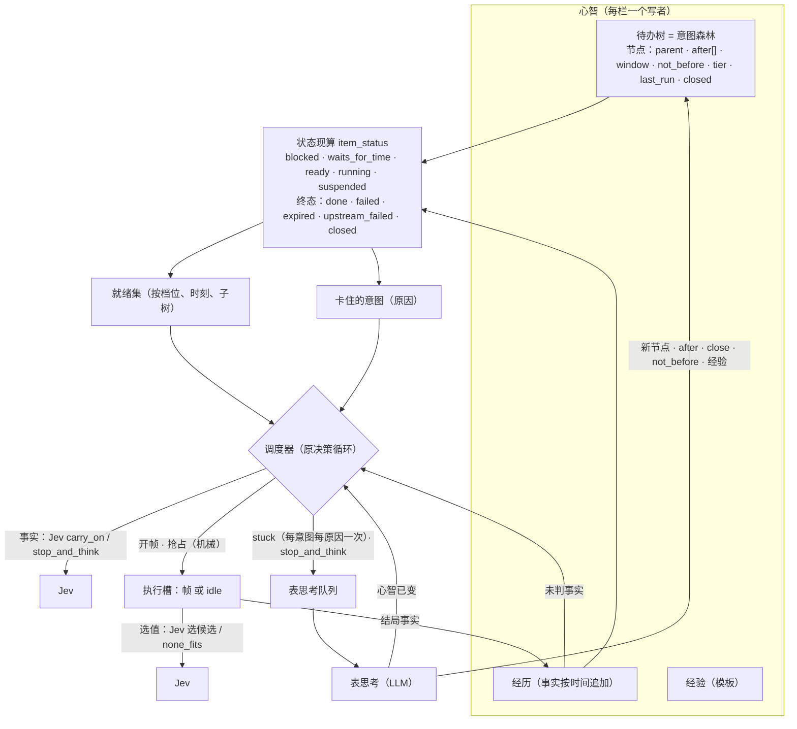

# NPC 意图图：条目有终态、按边推进、"卡住"是唯一的内生重规划信号（2026-11-25）

分类：NPC 决策侧的结构决策稿（重定决策循环的职责与待办树的语义；定部件、数据定义、取代关系、测试矩阵与实施次序；不改代码）。
上位：三循环稿 [`2026-11-23-npc-three-loop-framework-decision.md`](2026-11-23-npc-three-loop-framework-decision.md)。
同系列最近一份：M-3e 稿 [`2026-11-25-npc-m3e-timeliness-and-way-sources-decision.md`](2026-11-25-npc-m3e-timeliness-and-way-sources-decision.md)（离线实施进行中，已到第 4 步）。
状态：**决策稿，未实施、未实跑。用户只定了"先写稿"（§1 U-33）；§3 各决策项与 §7 待定项都等用户定。** 代码锚点指 M-3e 当前副本 `.demo/observe/npc-three-loop-m3e-20261125/harness/`（第 4 步之后）。

（2026-11-25 被 [总框架稿](2026-11-25-npc-four-layer-framework-decision.md) 整份吸收为 L2 这一行（其 §4.1）：E-2、E-4 按其 F-7、F-8 改；H-5、H-10 由其 U-34 定，H-1 由 U-34 推出、经其 F-H-14 确认；H-2–H-4、H-6–H-9 转为其 F-H-1–F-H-7；该稿 2026-11-25 由用户全稿照建议定（U-35）。本稿保留作记录。）

## 0. 名词（全文只在这里定义；其余沿用三循环稿 §0）

| 名词 | 含义 |
|---|---|
| **意图** | 待办树里的一棵树：一个根条目（日程 / 待办 / 一次性指令）连同它的子目标。"我打算做成的一件事"。档位挂在根上，子节点继承（现有）。（H-7 若定为取消子目标，则意图 = 由 `after` 边连成的连通分量，没有 `parent`；本稿其余处的"意图"两种定义下都成立。） |
| **节点** | 意图里的一个条目（根、子目标）。参数槽不是节点，它是帧选值过程的一部分（现有）。 |
| **边** | 节点上的 `after`：这个节点要等哪几个节点**做成**之后才能开始。只能指向接纳那一刻已存在的节点，所以写不出环（M-3e D-3 的论证，扩到多个前驱后不变）。 |
| **状态** | 一个节点此刻在生命周期里的位置，**从真值现算、不另存**（AGENTS 2.2.9；M-3e 第 3 步的 `item_status` 就是这件事）。见 §3.2。 |
| **终态** | 节点一旦进入就不再离开的状态：`done`、`failed`、`expired`、`upstream_failed`、`closed`。**同一个节点不会再次可做**；要再做，由表思考写一条新节点。 |
| **就绪集** | 此刻全部 `ready` 的节点。决策循环只看它，不看"所有未关节点"。 |
| **卡住** | 一个意图：根没关、没有 `ready` 节点、没有在跑或挂起的帧、又不是全部做成。它走不下去了，附带原因。 |
| **调度器** | 决策循环在本稿里的职责：按机械规则把就绪节点放进执行槽、处理抢占、把事实交 Jev、把卡住交表思考。它不再对计划节点问"现在做不做"。 |

## 1. 起因与用户的决定

**起因**（用户 2026-11-25 原话）：

> 我现在在反思，我们关于决策循环的设计是不是过于简单了？决策循环的用途具体是什么？从待办的一堆任务中挑一个最高优先级的来执行。但在现实生活中，一件事情分解成任务，这些任务实际上是有结构的，比如可以形成有向无环图或者允许有环但有跳出条件的图，整件事情是按照图的顺序一步步做的，而不简单是挑优先级最高的。所以我想，是不是我们可以把这块的设计抽象成更整齐的结构，而不是在一堆的具体问题上缝缝补补？比如之前遇到的思考误过决策时间问题、决策停下来想问题、决策反复选中同一条导致反复失败的问题，如果设计合理的抽象的话，是不是能从根本上解决这些零零碎碎的问题？

| # | 决定 | 原话 / 要点 |
|---|---|---|
| U-33 | **先写决策稿，不改代码**。统筹的看法（见下 §2）用户听过后定"可以，请你先写稿"。本稿的决策项、取代关系与实施次序**都还没有被用户定**；本稿写出来是为了让用户定。 | 「可以，请你先写稿」（2026-11-25） |

统筹当时给用户的看法，本稿 §2 展开：病根不是"该用图不该用优先级"，而是两处缺口——**条目没有终态**（做完、失败之后还会回到队头），和**"计划走不下去了"没有统一信号**（散成十来个各带触发条件与去重键的机制）。

## 2. 诊断：现有机制清单与它们的共同根

三循环稿把决策队列定为"事实在前，其后是此刻可做的节点，按档位、再按时刻，子树先做完"（§3.4）。这个定义本身已经是树加深度优先，不是扁平列表；M-3e D-3 又加了前驱。所以"没有结构"不准确。下面把 M-3 以来围着决策循环加的机制逐条列出，看它们各自在补什么。

| 机制 | 出处 | 它在补什么 | 本稿如何处理 |
|---|---|---|---|
| `not_now` 必带大于零的"不早于"，四档 | 三循环稿 §3.4、T-3、H-4 | 节点判过之后仍可做，不写时刻就立刻回到队头 | **取消**（节点进了终态或 `blocked` 就不在就绪集；推迟由表思考写 `not_before`） |
| `already_done` + `judged_done` 栏 | U-29；`decide.py:86,100,390` | `last_run` 完成的节点仍可做，Jev 33 / 33 答 `do_now` | **取消**（`done` 是终态） |
| B-8 过窗作废 | M-3 plan §13 | 时段过了的节点仍可做 | **并入**终态 `expired` |
| 0 候选挡根（B-3）、`slot_open` 挡根、"没写方式"事实、`WAY_GONE_FACT` | M-3 plan §11 / §13、三循环稿 §3.4 | 四种"这条此刻做不成"，各挡各的 | **并入**卡住原因 |
| `plan_empty` | 通用心智稿 O-8 | 没有任何可做的，交表思考 | **并入**卡住信号（原因 `no_intention`） |
| 计划侧 `stop_and_think`、`stop_asked`、`append_judged_fact` 条件提交、`jev.withheld` | M-3e D-1、O-1、O-2；`queue_view.py:354` | 让 Jev 从完整心智里看出"采石排在出坑之后、出坑刚失败" | **取消**（前驱失败是机械状态 `upstream_failed`，不用 Jev 看出来） |
| `after_not_done` 事实 | M-3e D-2 | 前驱没做成时让表思考知道 | **保留**，含义改为 `upstream_failed` 的转移事实 |
| `window_ended_unstarted` 事实 | M-3e D-2、O-6 | 时段过了没开始时让表思考知道 | **保留**，含义改为 `expired` 的转移事实 |
| `after` 单前驱、`failed` 非终局 | M-3e D-3、O-3、O-4 | 顺序 | **保留边、改语义**：`after` 收列表；`failed` 是终态 |
| N-3 同一槽反复交表思考（最多 9 次）；M-3 "槽一直 0 个候选时同一帧反复回到同一槽" | 三循环稿 §10 2026-11-23 / 11-24 条 | 卡住没去重 | **并入**卡住信号的去重（每个意图、每种原因一次） |
| B-7 收窄槽回退 | M-3 plan §13 | 槽与槽之间的依赖 | **不动**（它在选值过程里，不在节点层） |

**共同根有两个：**

1. **节点没有生命周期。** "怎么做"这一层早就分开了：经验是模板，调用帧是实例，帧到终态即丢（三循环稿 §3.3）。"做什么"这一层没有：一个条目既是"我打算做的"又是"这一次做的记录"，`last_run` 只是附在它身上的一个字段，做完、失败、过期之后它仍然"可做"。于是只能靠 Jev 看着"上次结局"再判一次，而 Jev 在这一问上的数据是 33 / 33 `do_now`（U-29 起因）、出坑失败后采石在坑里 `unreachable` 失败 6 次（M-3e §3.1）。
2. **"走不下去了"没有一个名字。** 上表里至少七个机制在说同一件事——这个意图此刻推进不了，得有人重新想。它们各自触发、各自去重、各自决定要不要问 Jev、各自写不写事实。每遇一种新的"走不下去"（前驱失败、时段过期、槽无候选、方式被丢），就要加一个机制。

用户点的三个问题落在这两处的情况：

| 问题 | 根在哪 | 本稿能解到什么程度 |
|---|---|---|
| 决策反复选中同一条导致反复失败 | 没有终态 | **根治**：`failed` / `done` / `expired` 对节点是终态，不再回到就绪集；再做一次要表思考写新节点，是一次显式决定 |
| 决策停下来想 | 没有统一信号；靠 Jev 从心智里看出"卡住" | **大部分**：内生的卡住变成机械信号，直接投表思考；外来事件仍由 Jev 判 `carry_on` / `stop_and_think`（M-2a 有数据，保留） |
| 思考误过决策时间 | 表思考一次会话折合 11–42 游戏分钟（M-3e §一），而日程按绝对时段写——包括出坑这类世界并没有给时限的事 | **大部分**（2026-11-25 用户追问后改写，定义见 E-6）：没有世界时限的事不再写时段，无所谓误过；有世界时限的事过期是 `expired` + 事实，是角色结局不是系统缺陷；唯一的系统性残余是等表思考期间的全局判停，E-6 提出按请求范围收窄（H-5） |

## 3. 决策项（编号 E-n，只在本稿内用）

### 3.1 E-1 意图是图，边收多个前驱

- 节点字段 `after` 从"一个 id 或 null"改为 **id 列表，可空**（M-3e D-3 定单个是"几件都做完就串成链"，已定 ②；本稿改为列表，理由见 §5 E-1）。
- 边只能指向接纳那一刻已存在、未关、不是自己祖先的节点（D-3 现有三条检查不变）。每条边都从新节点指向更早的节点，**创建次序就是拓扑序，环写不出来，不做环检测**（D-3 的论证对列表同样成立）。
- 一个节点开始的条件只有一种：**全部前驱 `done`**。不做"任一前驱成功""前驱全部结束"之类的变体（Airflow 的 `all_success` 是缺省，其余触发规则本项目没有需求，AGENTS 2.2.7）。
- 祖先的前驱约束子孙（D-3 现有）。
- 树结构（`parent`）照旧：子目标紧跟父节点、同档排最前（三循环稿 §3.4 第 3 条）。边与树是两种关系：树说"属于哪件事"，边说"先后"。

### 3.2 E-2 节点有生命周期，终态不再回来

状态从真值现算（`item_status` 已有九种，M-3e §3.0），本稿把它们重新归成一张生命周期表，**唯一定义处仍是 `queue_view.item_status`**：

| 状态 | 含义（只写事实） | 从哪些真值算出 | 终态？ |
|---|---|---|---|
| `not_rated` | 还没评档 | `tier` 缺失 | 否 |
| `blocked` | 有前驱还没 `done`，且那些前驱都没进终态 | `after` + 前驱状态 | 否 |
| `waits_for_time` | 日程时段未到 / `not_before` 未到 | `window.from`、`not_before`、游戏钟 | 否 |
| `ready` | 可以开始 | 以上都不成立、无帧、无 `last_run` | 否 |
| `running` | 有帧在执行槽或选值中 | 帧 | 否 |
| `suspended` | 帧被更高档抢占挂起 | 帧 | 否 |
| `waits_for_thinking` | 所属意图卡住、已投表思考、等答复 | "等表思考"栏 | 否 |
| `done` | 最近一次执行结局为完成 | `last_run.status = completed` | **是** |
| `failed` | 最近一次执行结局为失败 | `last_run.status = failed` | **是** |
| `expired` | 自己的时段已结束而没开始过 | `window_ended` + 没有帧进过执行槽 | **是** |
| `upstream_failed` | 某个前驱进了 `failed` / `expired` / `upstream_failed` / 以 given_up 关闭 | `after` + 前驱状态 | **是** |
| `closed` | 表思考关了它或它的祖先 | `closed` | **是** |

- **`interrupted` 不是终态**：帧被打断（`last_run.status = interrupted`，M-3e）的节点回到 `ready`，因为那不是这件事做不成，是被更要紧的事挤开。这是 `last_run` 三种状态里唯一不进终态的。
- **取代 O-4 "`failed` 不是终局、前驱重做完成后后继放开"**：节点不能重做，所以也没有"重做完成"；要重做由表思考写新节点、新的后继用新的边。
- **`done` 由代码从结局现算，不是代码判断"做完了"**（U-10）：`completed` 是权威给的结局，代码只读它。表思考仍可以认为没做好而另写一条；也仍是唯一能 `close` 的人（U-29 保留）。
- 一个意图**全部叶节点 `done`** 就自然不再有就绪节点、也不卡住，它从队列里消失；关不关由表思考做。`already_done` 没有存在的必要。
- `not_before` 只由表思考写（原来还有 `not_now` 写）。

### 3.3 E-3 就绪集与调度规则

决策循环每一轮做的事，按次序：

1. 重读游戏钟；作废再也做不成的未执行帧（现有 B-8）。
2. **补写转移事实**（E-5）：这一轮新进 `expired` 或 `upstream_failed` 的节点各写一条（现有 `one_shot_facts_due`，去重从事实现算）。
3. 决策游标之后有未判事实 → 取最早一条问 Jev `carry_on` / `stop_and_think`（现有，不变）。`stop_and_think` → 执行槽到步骤边界停、投表思考请求（现有）。
4. **"等表思考"栏非空** → 本轮不开新帧、不选值（U-27 (1) 现有判停，不变）。
5. **卡住的意图**（E-4）→ 每个意图每种原因投一次表思考请求、写一条事实，然后同第 4 条。
6. **就绪集非空**：取档位最高、同档按时刻、同根子节点在前的那一个。执行槽 `idle` → 开帧（要实参则先逐槽问 Jev，现有）。执行槽有帧且该节点的根档位**严格高于**帧的根 → 步骤边界抢占（现有 T-8）。否则不动。
7. 就绪集空、没有未判事实、没有卡住、没有活帧、也没有任何未关的意图 → 卡住原因 `no_intention`（原 `plan_empty`）。

**Jev 在决策循环里只剩两种问题**：

| 头部是 | 问题 | 选项 |
|---|---|---|
| 事实 | 要不要停下来想（M-2a C3 问法，不变） | `carry_on` / `stop_and_think` |
| 参数槽 | 选哪个值（X 组 J-2 成立，不变） | 代码列的候选 + `none_fits` |

**取消**"计划节点：现在做不做"这一问，连带 `do_now` / `not_now` 四档 / `already_done` / 计划侧 `stop_and_think`。参数槽上的 `not_now` 一并取消（选值中帧作废的情形只剩 `none_fits` → 卡住 `slot_open`，与经验改版、0 候选三种，都是卡住原因）。
重要性评估仍是系统功能，不在循环里（U-20、U-23 不变）。

### 3.4 E-4 卡住：唯一的内生重规划信号

**定义**：意图 I 卡住 ⇔ I 的根未关 ∧ I 里没有 `ready` 节点 ∧ I 里没有 `running` / `suspended` 的帧 ∧ 不是全部叶节点 `done`。

**原因**（写在请求与事实里，只写事实词，`reason_kind` 枚举）：

| `reason_kind` | 何时 | 它取代的现有机制 |
|---|---|---|
| `failed` | 最后一个能推进的节点进了 `failed`，没有别的就绪节点 | 原来靠 Jev 对事实判停，或靠 D-1 |
| `expired` | 同上，进的是 `expired` | B-8 作废后的"什么都不发生" |
| `upstream_failed` | 剩下的节点都因前驱而终止 | D-1、D-2 的 Jev 再判 |
| `no_way` | 就绪节点没写方式（**H-10 建议改为不算卡住**：没写 `how` 的节点是备忘，状态 `no_way`、不就绪、不触发请求；用户定 H-10 后此行删或留） | "没写方式"事实 → 队头 → Jev |
| `way_gone` | 就绪节点引用的经验已被丢弃 | `WAY_GONE_FACT` |
| `no_candidates` | 开帧选值时某槽列出 0 个 | B-3 挡根 |
| `slot_open` | 某槽是开放类型，或 Jev 答 `none_fits` | `slot_open` 挡根 |
| `no_intention` | 没有任何未关意图 | `plan_empty` |

- **去重**：同一意图、同一 `reason_kind`、同一节点（或槽）只投一次；"投过"从事实现算（经历里有这条 `stuck` 事实），不另开一栏（同 D-1 的做法，但对象是意图而不是每条计划）。表思考答复（`MindChanged`）之后重算；若它什么都没改、意图仍以同一原因卡着，**不再投**，意图留在心智里直到表思考改它。这就是 N-3"同一槽反复交表思考"的根治。
- **请求**：`ThinkRequest(reason = stuck, root, reason_kind, node_or_slot, facts = 游标区间)`。表思考请求的三种原因（`stop_and_think` / `plan_empty` / `slot_open`，三循环稿 §3.6）合并为两种：`stop_and_think`（Jev 对外来事实的判断）与 `stuck`（结构）。
- **卡住与事实判停的关系**：节点失败时执行槽已经写了结局事实，它排在队头，Jev 先判它（第 3 条）。若 Jev 判 `stop_and_think`，请求投出；同一轮算到卡住时请求合并（同根，现有合并规则）。若 Jev 判 `carry_on` 而意图卡住，仍投 `stuck`。所以"Jev 没看出来"不再导致意图在原地反复。
- **卡住时执行槽本来就是 `idle`**（定义里没有活帧），别的意图的就绪节点照常开帧——除非"等表思考"栏非空（第 4 条）。这是现有 U-27 (1) 的判停，不改。用户第三轮口径"不用整个停决策循环，但要区分合不合时宜"（M-3e §一）在这里的形状：**卡住的意图不挡别的意图；等表思考挡所有新帧**。前一句是本稿的，后一句是现有的。

### 3.5 E-5 转移事实：没有帧的终态转移各写一条

执行槽为每个帧写结局事实（现有）。节点不经帧就进终态的只有两种，各写一条、每节点一次：`window_ended_unstarted`（→ `expired`）、`after_not_done`（→ `upstream_failed`）。都是 M-3e D-2 已定、第 3 步已实现的纯函数，**保留不改**；只把 D-2 "照常进队头交 Jev 判继续 / 停下想"这一句保留为现有的事实判停，不再另有"Jev 看出前驱失败"的期待。
`stopped_to_think` 事实（D-1）取消；新增 `stuck` 事实（E-4），文本见 §7 H-3。

### 3.6 E-6 时间：边表达先后，时段只给锚定时间的事；"误过时间"的定义与残余

- 数据不变：日程有 `window`，待办有 `not_before`，一次性指令两者都没有（D-5）。
- **什么叫误过时间**（2026-11-25 用户追问"什么情况才算误过时间"后定义）：一个节点的时段是**世界要求的**，它在时段内曾经 `ready`，却直到 `window_ended` 都没有帧进过执行槽。三条缺一不是误过：没有世界时限的事（出坑、采石）写了时段而过期，是计划写法的问题，不是调度问题；时段内从未 `ready`（前驱没做成、`not_rated`）是被挡住，各有自己的事实；进过执行槽的帧跑到终态为止，不因时段结束而算误过（B-8 只作废未执行的帧）。
- 按这个定义，M-3d 的 35 / 203 过期日程几乎全是第一类——自设时限（walled-1 的 10 条出坑日程，M-3e §3.2）。意图图下它们是带边的待办，没有时段可以误过。
- 剩下的真锚点（吃饭、天黑前回家、约好的时刻），时段内 `ready` 却没开始只有两种原因：(a) 执行槽里是档位不低于它的帧——这是角色自己的优先级（T-8 只在严格更高时让路），过期成为 `expired` + 事实、由表思考回应，是结局不是缺陷；(b) "等表思考"栏非空、全局不开新帧（U-27 (1)）——**唯一的系统性残余**：身体为一个与它无关的意图的思考而空等。
- 对 (b)：**判停的范围跟请求的范围走**。`stuck` 请求带根，表思考的答复预期只改那个意图，等待期间只挡那个意图的节点，别的意图的就绪节点照常开帧；`stop_and_think`（外来事实，表思考可能改写一切）仍全局挡。表思考若顺手改了别的意图，沿用三循环稿风险 4 的规则：已开的帧跑到终态、结局照写，根已关就不再成为头部。备选是维持全局挡（H-5）。
- 表思考的说明（M-3e D-8 的 `OUTPUT_TEXT`）加**一句**：先后关系写 `after`，只有世界要求在某个时刻做的事才写时段。按 `npc-prompt-plain` 的口径，不写防御性条款。
- 时段过了就是 `expired`，终态；D-4 回执带游戏钟与过期整条拒绝不变。
- **不**加"时段结束"定时、**不**暂停游戏钟、**不**把表思考时延写进规则（U-32：估算不作门）。
- **读数**：`expired` 条数按三类拆开——时段内从未 `ready`、`ready` 时槽里有同档或更高档的帧、`ready` 时被等表思考挡住。只有第三类是系统的；从每轮 `queue.open_items` 日志里的状态序列复算，不加字段。

### 3.7 E-7 不在节点层做环与重试

- 用户提到"允许有环但有跳出条件"。经验树已有 `repeat`、`try_in_order`、`do_in_order`（怎么做这一层的控制流）。**节点层不加循环节点、不加重试次数字段**：同一语义两处定义违反 AGENTS 2.2.2；"直到有 20 块石头"写成一个节点，方式用带 `repeat` 的经验；"A 不行就 B"在方式层用 `try_in_order`，在节点层由表思考拿到 `stuck(failed)` 之后写新节点。
- 代价：失败即卡住，每次失败都要一次表思考（M-3d 中位 45 s 墙钟 ≈ 18 游戏分钟）。这是读数（§10），不是判定；如果实跑显示大量失败是瞬时的（如 `occupied`），修复点在经验树里加 `try_in_order` 或 `repeat`，不在节点层。

### 3.8 E-8 抢占与恢复（不变，只换说法）

T-8 不变：只有根档位严格更高才抢占，步骤边界挂起，挂起的帧留在树里、恢复时沿用 `bound`、世界变了由 `prepare` / 权威拒绝。被抢占的节点状态是 `suspended`，它再次成为就绪集里档位最高的那个时直接恢复，**不再问 Jev"现在做不做"**（原 plan §12 第 8 条"再成为头部时照常问"取消）。

### 3.9 总图

向下是意图、向上是事实、两条边界（权威、接纳）都不变（三循环稿 §3.1）。变的只有中间那一格：决策循环从"对头部项问一个封闭问题"变成"按状态调度，只在两处问 Jev"。

## 4. 与现行文档的关系

| 现行条目 | 在本稿里 | 状态 |
|---|---|---|
| 三循环稿 U-23 "决策队列按优先级排序，Jev 只取头部项决策" | 队列排序与"只取头部"保留；头部是计划节点时**不再问 Jev**，直接按机械规则开帧 / 抢占 | **改写** |
| 三循环稿 §3.4 "计划节点：现在做不做"一行、`not_now` 必带不早于、H-4 四档、T-3 | 取消 | **取代** |
| U-29 `already_done` 只挡不关、`judged_done` 栏 | 取消；`done` 是终态 | **取代** |
| U-27 (1) 等表思考期间不开新帧 | 保留；范围收窄：`stuck` 只挡所属意图，`stop_and_think` 仍全局挡（E-6、H-5） | 保留，范围改 |
| 三循环稿 T-2 队列现算、事实在前、子树先做完 | 保留；"可做"改为 `ready`，由 `item_status` 现算 | 保留，换说法 |
| 三循环稿 T-8 抢占 | 保留；恢复时不再问 Jev | 微改 |
| 三循环稿 §3.6 表思考请求三种原因 | 合并为 `stop_and_think` 与 `stuck` | **改写** |
| 通用心智稿 O-8 待办表空 → 规划思考 | `stuck(no_intention)` | 保留，换名 |
| M-3e D-1 计划侧 `stop_and_think`、O-1 状态枚举、O-2 条件提交 | D-1 取消；O-1 的状态表改为 §3.2；O-2 的 `append_judged_fact` 不再有调用方 | **取代**（第 12 步不做） |
| M-3e D-2 两种一次性事实、O-6 | 保留，含义为终态转移事实（E-5） | 保留 |
| M-3e D-3 前驱、O-3 单前驱、O-4 `failed` 非终局 | 边保留；`after` 收列表；`failed` 是终态 | **改写** |
| M-3e D-5 一次性指令至多执行一次（已定 ①） | 推广为所有节点的终态语义；指令不再是特例 | 保留，成为通例 |
| M-3e D-4、D-6–D-10 | 不涉及 | 不变 |
| M-3 plan B-3、B-8；N-3 | 并入卡住信号与终态 | **取代** |
| M-3 plan B-7 收窄回退 | 不动 | 不变 |
| U-30–U-32、U-31 稿 D1–D5 | 不涉及 | 不变 |

## 5. 证据

### 5.1 本地（均出自已有运行记录，不另跑）

| 证据 | 用在哪 |
|---|---|
| M-3 小集成-2：33 次"现在做不做"全答 `do_now`，条目行写着"上次运行：已完成"仍被再做，约 78 / 118 次 Jev 花在这个循环上（三循环稿 U-29） | E-2：`done` 必须是终态；Jev 不擅长"做没做完"这一判断 |
| M-3e §3.1：walled-1 出坑失败之后采石照常开帧，在坑里 `unreachable` 失败 6 次 | E-2 / E-4：`failed` 终态 + `upstream_failed` 机械状态，不靠 Jev 看出 |
| M-3b：同一槽反复交表思考最多 9 次；M-3：槽一直 0 个候选时同一帧反复回到同一槽（三循环稿 §10） | E-4 去重 |
| M-3d：表思考一次会话 26–105 s 墙钟 ≈ 11–42 游戏分钟；接纳时时段已过的日程 35 / 203（M-3e §一） | E-6 只能部分解；本稿不声称解决时间尺度 |
| M-2a Jev 打分 v2：被拆 4 / 4 停下、普通活动 30 / 30 继续（三循环稿 §5.1） | E-3 保留事实判停这一问 |
| X 组 J-2：逐槽 Jev 对一次填齐成立（三循环稿 U-26） | E-3 保留参数槽这一问 |
| M-3 plan §12 第 8 条：挂起的帧再成为头部时照常问"现在做不做" | E-8 取消这一问 |

### 5.2 外部依据

已在上位稿核过原文、本稿直接沿用的四项（出处与页码见三循环稿 §5.2、M-3e 稿 `consult/citations-check.md`）：

1. **Jason / BDI**（Bordini & Hübner 手册 §2.3、§5.1）："Each intention is a stack of partially instantiated plans"；缺省选择函数取队首；注释 "make sure no intention will starve"。**借鉴**：意图是计划的实例、调度器每次只处理一项。**不同**：Jason 的 intention 失败后由 `-!g` 失败事件交回计划库选别的 plan，本稿交回表思考。
2. **Kinny & Georgeff IJCAI-91 §3.4**：大胆型（只在目标消失时重规划）在各变化率下优于谨慎型，"reacting to any new hole is worse than blind commitment"。**借鉴**：E-3 取消对每个计划节点再问一次；重考只在卡住与外来事实判停时发生。
3. **SHOP2 §3.2 / §6.2**：有序任务分解、最左子任务先展开。**借鉴**：子树先做完（现有）。
4. **Ghallab, Nau & Traverso APA §2.6.1** Run-Lazy-Lookahead："calling Lookahead again only when π ends or a plan simulator says that π will no longer work properly"。**借鉴**：E-4 卡住 = "π 不再能按原样做成"，是重规划的唯一内生触发。

本稿新核的一项（统筹 2026-11-25 经 WebFetch 取 Apache Airflow 稳定版官方文档原文，逐字摘录；页面无版本号标注，取"stable"）：

5. **Apache Airflow — Tasks / Dag Runs / Dags**（`airflow.apache.org/docs/apache-airflow/stable/core-concepts/{tasks,dag-run,dags}.html`）。
   - 实例与状态（tasks.html "Task Instances"）："the tasks under a Dag are instantiated into Task Instances."；"An instance of a Task is a specific run of that task for a given Dag"；"They are also the representation of a Task that has state, representing what stage of the lifecycle it is in."；状态表：`none` "The Task has not yet been queued for execution (its dependencies are not yet met)"、`scheduled` "The scheduler has determined the Task's dependencies are met and it should run"、`success` "The task finished running without errors"、`failed` "The task had an error during execution and failed to run"、`upstream_failed` "An upstream task failed and the Trigger Rule says we needed it"、`up_for_retry` "The task failed, but has retry attempts left and will be rescheduled."
   - 重试是显式配置（tasks.html "Retry Policies"）："By default, Airflow retries failed tasks with a fixed count and delay regardless of the error type."；`retries` "Still the maximum retry count."
   - 运行是实例（dag-run.html）："A Dag Run is an object representing an instantiation of the Dag in time."；"Each Dag Run is run separately from one another"；状态 "`success` if all of the leaf nodes states are either `success` or `skipped`"、"`failed` if any of the leaf nodes state is either `failed` or `upstream_failed`."
   - 触发规则（dags.html "Trigger Rules"）："By default, Airflow will wait for all upstream (direct parents) tasks for a task to be successful before it runs that task."；`all_success` "(default): All upstream tasks have succeeded"；另有 `all_failed`、`all_done`、`one_failed`、`one_success`、`none_failed` 等。
   - **借鉴**：(a) 任务与任务实例分开，实例有生命周期、`failed` 与 `upstream_failed` 是实例的状态（E-2）；(b) 缺省只等全部上游成功（E-1 只做这一种）；(c) 重试是任务上的显式最大次数，不是调度器的缺省再试——本稿连这个字段也不加，重试交给方式层与表思考（E-7）；(d) 整个运行的成败从叶节点状态派生（E-2"全部叶节点 `done`"）。
   - **不同 / 局限**：Airflow 的 DAG 是代码里写死的模板、每次运行完整实例化；本稿的意图由表思考边写边执行、可被打断，节点本身就是实例，没有"同一模板多次运行"（所以不需要 Dag Run 这一层，见 §6 E-O-1）。Airflow 有 `skipped` 与分支算子，本稿没有节点层分支（E-7）。Airflow 文档未写明 DAG 必须无环的处理方式，本稿的无环靠边只指向更早节点（D-3 论证）。Airflow 的 `retries` 是对本稿"失败即终态"的反例做法，本稿选不加的理由写在 E-7，按读数再定。

## 6. 原创决策（AGENTS 2.2.8；实施前向用户报告）

检索范围：§5.2 五项。它们给了"实例有生命周期、失败与上游失败是终态""只等全部上游成功""重试显式""只在计划不再能做成时重规划""大胆型优于谨慎型"。下列各项没有可照搬的整套做法。

| # | 决策 | 为什么不照搬 | 风险 | 不变量 | 怎样验证 |
|---|---|---|---|---|---|
| E-O-1 | 节点即实例，没有模板层；再做一次 = 表思考写新节点 | Airflow / BDI 都有模板与实例两层；本项目"做什么"的模板是表思考的记忆与经验，不是存起来的对象，加一层是 2.2.7 的过度设计 | 日程类重复的事每天要表思考写新条目（现状已如此） | 同一节点 id 至多一个终态、进入后不变 | V-2、V-3 |
| E-O-2 | "卡住"的定义与八种原因；每意图每原因每节点只投一次，投过从事实现算 | APA 只说"计划不再能做成时重规划"，不给判据与去重；Airflow 没有"把问题交回规划者"的概念 | 表思考不改心智时意图永久卡着（可见、不隐藏） | 卡住的意图不产生帧；同一（根, 原因, 节点）至多一条 `stuck` 事实 | V-6、V-7、V-8 |
| E-O-3 | 取消对计划节点的"现在做不做"；Jev 在循环里只剩事实判停与选值 | Kinny & Georgeff 支持大胆型，但没有"哪一问该省"的做法；U-23 原定对头部项问封闭问题 | 失去 Jev 在开帧前凭完整心智否决的机会（§8 风险 1） | 决策循环内对计划节点 0 次 Jev 请求 | V-5；实跑读"不该开的帧" |
| E-O-4 | `interrupted` 回 `ready`，其余 `last_run.status` 进终态 | Airflow 的 `restarting` 是外部请求重启，不是被抢占 | 被反复抢占的节点一直做不完（T-8 既有风险） | 只有 `interrupted` 的节点能再次 `ready` | V-4 |
| E-O-5 | 节点层不做循环、分支、重试字段 | Airflow 有 `retries` 与分支算子；BT 有 Sequence / Fallback——它们都在"怎么做"那一层，本项目对应经验树 | 瞬时失败也要一次表思考 | 节点字段里没有控制流 | 实跑读失败后表思考会话数与 `try_in_order` 使用数 |
| E-O-6 | 判停范围跟请求范围走：`stuck` 只挡所属意图，`stop_and_think` 全局挡 | Letta / sleep-time 只说后台会话异步改记忆、主代理随时读（三循环稿 §5.2 第 4 条），没有"等答复期间哪些计划冻结"的做法；BDI 的 intention 挂起是等动作反馈，不是等规划者 | 表思考在 `stuck` 答复里改了别的意图，而那个意图已开帧——由现有"帧跑到终态、根已关不再成为头部"兜住；读数见 E-6 第三类 | 等待期间被挡的节点集合 ⊆ 请求所属意图；`stop_and_think` 期间 `FrameStart` 为 0 | V-8、V-14 |

## 7. 待定项（建议值，等用户定）

| # | 问题 | 建议 | 依据 |
|---|---|---|---|
| H-1 | 计划节点就绪时还问不问 Jev | **不问**（E-3）。备选：问一次，只有 `do_now` / `stop_and_think`，每节点一次 | Kinny & Georgeff；M-3 33 / 33；备选保留 Jev 否决权但多一次请求与一套去重 |
| H-2 | `after` 收列表还是维持单个 | **列表**。单个时"几件都做完再做"只能串成链，而链会把本来并行的两件事硬排成先后，前面一件失败就连带后面的 `upstream_failed` | D-3 已定 ② 的理由是极简；多前驱的无环论证不变 |
| H-3 | `stuck` 事实的文本 | `I got stuck on "<根 what>" [<id>]: <原因句>.` 原因句按 `reason_kind` 一张表（如 `"<节点 what>" failed and nothing else in it can start`）；只写事实词 | 通用心智稿 §4.12 标准句；判定 5 评价词扫描 |
| H-4 | 终态节点在推送心智里显示多久 | **有界**：终态后 N 游戏小时内照旧显示（行末写终态与时刻），之后不进推送心智，数据照留、仍可查；N 建议 12。不关条目（U-29） | 2026-11-25 用户问"还有哪些没考虑"后改：原"显示直到表思考关它"是无界增长，表思考不关时推送心智逐日变长、Jev 请求撞长上下文门槛（M-3e §七 风险 4） |
| H-7 | 树与边两套先后语义怎么统一 | **取消子目标树，只留根 + 边**：表思考把一件事写成几个根、用 `after` 接；"属于哪件事"由边的连通分量定义，不再有 `parent`。备选：保留子目标，兄弟节点缺省隐含链式边 | 否则子目标之间没写边就是并行就绪，前一个失败后一个照常开帧，正是 `upstream_failed` 要消灭的情形；备选多一条隐含规则 |
| H-8 | 带 `how` 又带子节点的根怎么算 | 随 H-7 取消子目标后不存在；若保留子目标，则有子节点的根不得有 `how`（接纳拒） | "全部叶 done 即完成"对带 `how` 的父节点没有定义 |
| H-9 | `after` 指向已进终态（`failed` / `expired` / `upstream_failed`）的节点要不要拒 | **拒**，原因写该节点的终态与时刻；指向 `done` 的照收（立即满足） | 否则新节点一接纳就 `upstream_failed`；表思考多半想指它刚写的重试节点（D-3 只拒已关的） |
| H-10 | 没写方式的节点算不算卡住 | `no_way` **不算**卡住原因；没写 `how` 的节点状态为 `no_way`（非终态、不就绪），是放着的备忘，表思考任何时候可补 `how` 或关掉；只有整个心智没有任何就绪、活帧、卡住以外的东西时才作为 `no_intention` 的一部分报 | 否则表思考顺手写的"改天去看看"一接纳就触发下一次会话；模糊想法与计划要在结构上区分 |
| H-5 | 卡住时别的意图照常开帧吗；等表思考期间挡多大范围 | **照常**（E-4 末条）；判停范围跟请求范围走：`stuck` 只挡所属意图，`stop_and_think` 全局挡（E-6）。备选：维持 U-27 (1) 全局挡 | 用户第三轮"不用整个停决策循环"；E-6 的误过时间定义下这是唯一的系统性残余；备选少一条规则但身体为无关意图空等 |
| H-6 | 要不要给表思考说明加"先后写 `after`、时段只给锚定时间的事"一句 | 加一句（E-6） | `npc-prompt-plain`；D-8 口径 |

## 8. 风险

1. **失去开帧前的否决**：原来 Jev 在每个计划节点到队头时看一次完整心智。取消后，一个就绪节点在世界已变（如下雨、附近有人）时照常开帧，错误由权威拒绝成为事实、再由 Jev 判停。读数：实跑里"开帧后首步即被权威拒绝"的比例，与 M-3e 对照。若明显上升，H-1 改备选。
2. **失败即卡住，表思考次数上升**：每次失败一次会话（M-3d 中位 45 s）。读数：每小时游戏钟的 `stuck` 请求数、按 `reason_kind` 分布。修复点在经验树（E-7），不在节点层。
3. **意图永久卡着**：表思考答复时没改那个意图，它以同一原因留在心智里不再投请求。可见、不隐藏；读数：运行结束时卡着的意图数与卡了多久。
4. **`upstream_failed` 连锁**：一个前驱失败，整条链进终态，表思考要逐条关或重写。读数：每次失败平均连带的终态节点数。H-2 定列表后连锁只沿真实依赖传播，比链少。
5. **与 M-3e 进行中步骤的衔接**：第 12 步（D-1）不做；第 3 步的 `item_status` 状态名要改；第 11、13–15 步按本稿调整。见 §10。
6. **`expired` 不会归零，但只有一类是系统的**：按 E-6 的定义，第一类（自设时限）若实跑仍多，说明表思考照旧给无时限的事写时段，修复点在说明与接纳（D-4、E-6 那一句），不在调度；第二类是角色优先级；第三类（等表思考挡住）才是本稿要压的，H-5 定收窄后应接近 0，读数按三类分列对照 M-3e。
7. **样本**：Jev 在"事实判停 + 选值"两问之外全部退出决策循环，这个组合没有任何实跑数据；只有 M-2a、X 组对这两问各自的数据。
8. **没有收敛保证**（2026-11-25 补）：失败 → 卡住 → 表思考写新节点（新 id）→ 同一方式再失败 → 再卡住。表思考坚持同一做法时是每轮约 45 s 墙钟的循环，旧设计里 Jev 的 `not_now` 还能偶然打断，本稿没有任何结构能挡。读数：同一 `how` 连续失败的节点数、每小时游戏钟的 `stuck` 请求数；若实跑出现，候选处理是每小时游戏钟的表思考会话预算，超出即显式失败并写事实，不自动放弃。
9. **日常重复没有模板层**（E-O-1 的代价）：睡觉、吃饭每天要表思考重写。没算过它占每天多少会话；读数：每游戏日用于重写日常条目的会话数占比。若过半，E-O-1 拒绝"模板 + 每日实例"那一层就拒错了，届时另写决策。
10. **`interrupted` 从头重开帧**：回 `ready` 后开的是新帧，不是续跑（现有行为）；挖到一半被叫停、想完没改计划就从第一步再来。与"该停的地方能停"合起来看，停的代价比表面大。读数：`interrupted` 后同节点重开帧的步数回退量。
11. **边跨树、卡住按树算**：待办 after 一条别的树里的日程，边可以跨树（D-3 允许指向任何更早节点），"意图"按 `parent` 树算卡住就不是边的连通分量。H-7 取消子目标后，意图 = 边的连通分量，这条消失；保留子目标则要明说。

## 9. 测试矩阵（按 `../Voxim/Docs/Testing.md`；按环节判，整体达没达目的只当症状）

**契约**：节点状态由 `item_status` 唯一现算，终态不再 `ready`；边收列表、无环靠构造；就绪集与卡住同源；决策循环对计划节点 0 次 Jev 请求；每（根, 原因, 节点）至多一条 `stuck` 事实与一次请求；转移事实每节点一条。
**层次**：算法测试（`queue_view` 纯函数，构造快照）；模块集成（`decide` 接真存储、假桥、脚本化 Jev）；闭环（`run.py` 组合 + 假桥 + 脚本化模型）。不启动节点、不调模型。**不覆盖**：表思考会不会用 `after` 列表、会不会关终态节点——那是实跑读数。

| # | 环节 | 要证伪的说法 | 最小用例（先红后绿） | 机械证据 |
|---|---|---|---|---|
| V-1 | 记忆 | `after` 列表收了环或指向祖先 | 列表含自己祖先 → 拒；含不存在 / 已关 → 拒；含两个兄弟 → 收；按创建序任意写都无环（性质测试：随机创建序列，检查每条边指向更早 id） | 回执；快照 |
| V-2 | 模块 | 终态节点回到就绪集 | 快照：t1 `completed` / `failed` / 过窗没开始 / 前驱 failed / 已关 → `ready` 节点集合不含 t1；改 `last_run` 为 `interrupted` → 含 | `compute` 结果 |
| V-3 | 模块 | 同一节点开了两次帧 | 脚本化：t1 完成后再跑 10 轮 → `FrameStart(t1)` 恰 1 次；"失败后再问 Jev"变异（把 failed 从终态表删掉）被抓到 | 消息列表 |
| V-4 | 模块 | `interrupted` 进终态 / 恢复时问了 Jev | t1 被抢占挂起、高档帧结束 → t1 恢复、`jev` 事件里没有 do_now 问法 | `frame`、`jev` |
| V-5 | 模块 | 决策循环对计划节点问了 Jev | 全套 `test_decide` 夹具跑完，`jev.question ∈ {fact, slot, importance}`；`do_now` 问法 0 | `jev` 事件 |
| V-6 | 模块 | 卡住判定错 | 八种原因各一个快照 → `stuck(root) == (True, reason_kind, node)`；有 `ready` 节点 / 有挂起帧 / 全部叶 done / 根已关 → 不卡 | 纯函数返回值 |
| V-7 | 模块 | 卡住重复投请求 | 卡住 → 1 条 `stuck` 事实 + 1 条 `ThinkRequest`；`MindChanged` 后未改 → 0 条新的；表思考加了新节点后以别的原因再卡 → 1 条新的；去重变异被抓到 | `fact`、`msg` |
| V-8 | 模块 | 卡住挡了别的意图 | 意图 A 卡住、意图 B 有就绪节点、"等表思考"栏为空 → B 开帧；栏非空 → 不开 | `frame` |
| V-9 | 记忆 | 转移事实多写 / 漏写 | 沿用 M-3e V-22、V-23 用例不改预期；新增：前驱 `expired` → 后继 `after_not_done` 1 条 | `fact` |
| V-10 | 提示词 | 状态段写了评价词 / 写错 | 十二种状态各渲染一行，过 `EVALUATION_WORDS`；与 `item_status` 一致 | 文本断言 |
| V-11 | 闭环 | 失败 → 卡住 → 表思考 → 新节点 → 开帧 这条链走不通 | `run.py` 组合：假桥让 t1 失败；脚本 Jev 对失败事实答 `carry_on`；意图卡住投请求；假表思考写 t2（after 空）；t2 开帧；t1 再无帧 | 日志链 `fact(failed)` → `jev(fact)` → `fact(stuck)` → `msg ThinkRequest` → `session_start` → `MindChanged` → `frame(t2)` |
| V-12 | 闭环 | 过期 → 转移事实 → Jev 判停 这条链断 | 日程过窗没开始；`window_ended_unstarted` 到队头；脚本 Jev 答 `stop_and_think`；请求投出 | 同上形状 |
| V-13 | 闭环（诊断） | 诊断脚本认不出新链 / 统计不到卡住 / `expired` 不分类 | 诊断脚本加 V-11、V-12 的链与 `stuck` 按原因计数；`expired` 按 E-6 三类从 `queue.open_items` 状态序列复算，构造日志各给一例；反例：事实缺失 → 报"断在记忆" | 诊断输出 |
| V-14 | 模块 | 判停范围错 | 意图 A 以 `stuck` 等表思考、意图 B 有就绪节点 → B 开帧、A 的节点不开；换成 `stop_and_think` 等待 → 两者都不开；"范围"变异（把 `stuck` 也改成全局挡）被 B 的用例抓到 | `frame`、`msg` |

**实跑读数**（不作判定）：`stuck` 请求数按 `reason_kind`；每次失败连带的终态节点数；运行结束时仍卡着的意图数与时长；开帧后首步即被权威拒绝的比例（对照 M-3e）；`expired` 条数（对照 M-3e）；Jev 请求数按问法（事实 / 槽 / 重要性）；表思考会话数与每小时游戏钟会话数；`after` 列表长度分布；终态节点被表思考关掉的比例与延迟；整体结果（出没出坑、屋建没建成）只当症状。

## 10. 与 M-3e 实施次序的衔接（用户定本稿之后才生效）

M-3e 第 0–4 步已完成（store 计划侧与心智侧、`queue_view`、契约数据）。本稿只碰计划一侧；心智一侧 D-6–D-10 不受影响。

| M-3e 步 | 本稿下 | 说明 |
|---|---|---|
| 5–10（接纳：钟 / Q3 / `after`、契约、区域名、指令、评价、强度） | **照原计划做** | 第 5 步 `after` 透传改收列表（随 H-2） |
| 3（`queue_view`，已完成） | **再改一次**：状态表改为 §3.2；`after_status` 改为对列表求全部 `done`；加 `stuck(snap, root, now)`、`ready_set(snap, now)`；`stop_asked` 删 | 先红后绿；现有 `QueueTest` 改预期 |
| 1（`store`，已完成） | `after` 字段改列表；`append_judged_fact` 没有调用方时删 | 同上 |
| 11（一次性事实） | 照原计划做（E-5） | 不变 |
| 12（计划侧 `stop_and_think`） | **不做**；换成"卡住"一步：`decide` 加卡住判定、请求、事实、去重；删 `_plan` 的 do_now 问法、`not_now_options`、`already_done`、`judged_done` | V-5、V-6、V-7、V-8 |
| 13（指令帧） | 照原计划做，去掉"到队头照常问 Jev"一句 | — |
| 14（固定区域使用侧） | 照原计划做；三种失败并入卡住原因（`no_candidates` / `slot_open`） | — |
| 15–16（render） | 状态段按 §3.2 十二种；`stuck` 事实文本 | V-10 |
| 17–21 | 照原计划做；第 19 步闭环加 V-11、V-12；第 20 步诊断加 V-13 | — |

实施仍按 M-3e §八的做法：每步一个单独代理会话、先红后绿、原位变异、不跑 live、不调模型；全部完成后重算指纹，实跑前另写计划并报额度。

## 11. 对现行文档的回填清单（用户定后由统筹改，只加注、原文保留）

1. 三循环稿：§0 名词加意图 / 终态 / 就绪集 / 卡住；U-23 加注"头部是计划节点时不问 Jev"；§3.4 计划节点问题表三行加注"被本稿 E-3 取代"；U-29 加注"`already_done` 被终态取代、关条目仍只由表思考做"；§3.6 请求原因合并；T-3、T-8 加注；§10 下一步。
2. M-3e 稿：D-1 加注"被本稿取代，第 12 步不做"；D-3 加注"`after` 收列表、`failed` 为终态"；O-1–O-4 加注；§八第 12 步与 §3.11 表。
3. 通用心智稿 O-8 加注"`plan_empty` → `stuck(no_intention)`"。
4. M-3 / M-3b plan（`.demo/`，不进 git）：B-3、B-8、N-3 的处理指向本稿。
5. M-3e harness 各模块说明随代码改。

## 12. 进度

- 2026-11-25：用户提出决策循环的抽象是否过于简单（§1 原话）；统筹只读三循环稿、M-3e 稿与 M-3e harness 的 `queue_view.py` / `decide.py`，给出 §2 的诊断；用户定 U-33"先写稿"。本稿写成：取 Airflow 官方文档原文一项（§5.2 第 5 条），其余依据沿用上位稿已核项；0 次模型请求、未改 `apps/`、未改 harness、未改现行文档。
- 2026-11-25：用户追问"什么情况才算误过时间；有了图结构、该停的地方能停，是不是就不存在误过时间"。统筹认可这一反驳：原 §2 把它写成时间尺度问题是说重了，时延只在时段是调度手段时才伤人。改写 §2 该行、E-6 加定义（世界时限 + 时段内曾 `ready` + 从未进槽）与唯一残余（等表思考全局判停）及收窄方案、H-5 加备选、§4 U-27 (1) 行、§6 加 E-O-6、§8 风险 6、§9 加 V-14 与 V-13 的 `expired` 分类。仍未实施、未改代码。
- 2026-11-25：用户问"还有哪些问题没有考虑到"。统筹补：§7 H-4 改为有界显示（原写法是无界增长）、新增 H-7（树与边语义统一，建议取消子目标只留根 + 边）、H-8（带 `how` 的父节点）、H-9（`after` 指向终态节点拒）、H-10（`no_way` 不算卡住）；§8 加风险 8–11（无收敛保证、日常重复无模板层、`interrupted` 从头重开、边跨树与按树算卡住）；§0 意图定义与 E-4 `no_way` 行加注指向 H-7 / H-10。仍未实施、未改代码。
- 2026-11-25：本稿被[总框架稿](2026-11-25-npc-four-layer-framework-decision.md)吸收（U-34、U-35），按其 §11 第 1 条只加页首注，原文保留。
- 下一步：用户定 §3 E-1–E-8 与 §7 H-1–H-10 → 按 §11 回填 → 按 §10 衔接 M-3e（第 5 步起可以先做，第 3 步重改与第 12 步替换等本稿定后做）。
