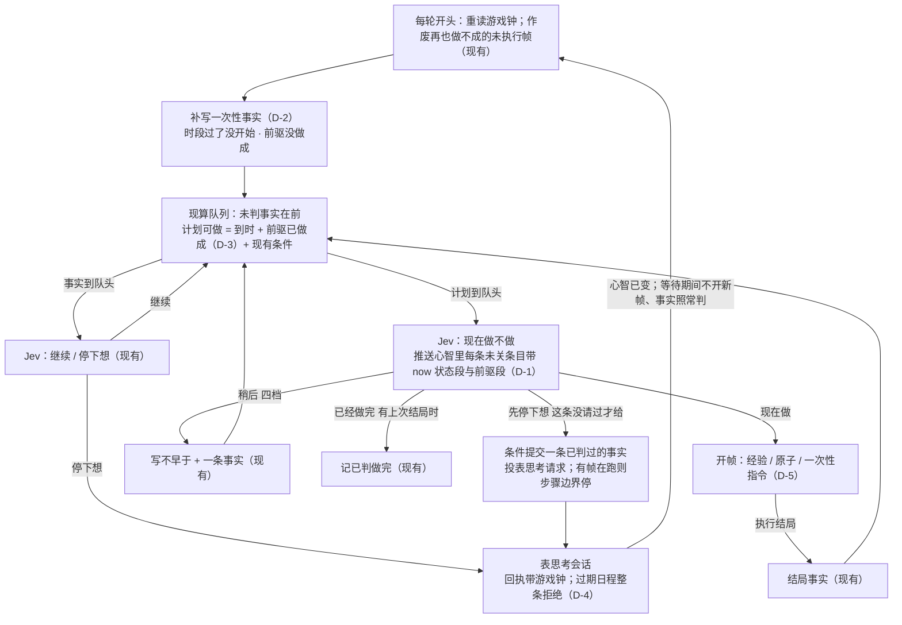
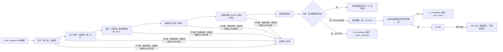
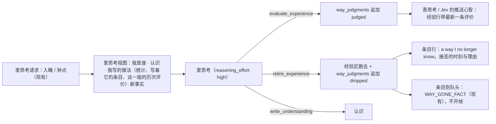
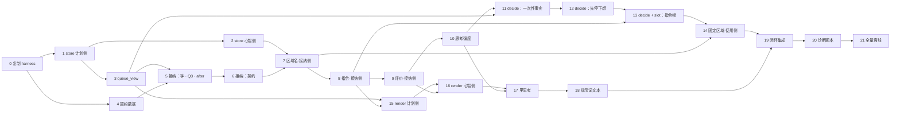

# NPC 下一轮（M-3e）：计划合不合时宜、前驱与一次性指令，经验参数来源契约与里思考评价（2026-11-25）

分类：NPC 心智侧的决策稿（定目标、范围、决策项、测试矩阵、风险、实施次序与待定项）。上位：三循环稿
[`2026-11-23-npc-three-loop-framework-decision.md`](2026-11-23-npc-three-loop-framework-decision.md)；上一份同系列稿
[`2026-11-25-npc-output-constraint-sections.md`](2026-11-25-npc-output-constraint-sections.md)（M-3d）。
附录（契约逐格表、各段提示词原文、文本模板）：[`2026-11-25-npc-m3e-timeliness-and-way-sources-appendix.md`](2026-11-25-npc-m3e-timeliness-and-way-sources-appendix.md)。
出处：两份起草稿 `.demo/observe/npc-three-loop-m3d-20261125/next-round/draft-plan-exec.md`（计划与执行）、`draft-mind-prompts.md`（心智与提示词），
综合稿 `consult/synthesis.md`、出处核对 `consult/citations-check.md`（同目录）。本稿是两份起草稿的合成，决策以本稿与附录为准。
状态：**决策稿，未实施、未实跑；原待定 11 题用户都已定（§一 已定 ①–⑪）。** 代码锚点指 M-3d 冻结版 harness（离线试验台，指纹 `464f047c848998fa`）。

## 一、起因与用户的决定

**起因**：M-3d（上一轮隔离节点小验证，2026-11-25，5 次正式运行）按环节诊断（`.demo/observe/npc-three-loop-m3d-20261125/report/per-link.md`）：
提示词、记忆 → 推送心智（127 次会话 0 处不符）、系统函数、模块、事实闭环都对，断在两处：

1. **理解约束段**（per-link §3）：模型逐字引用约束段，仍把坑壁、料堆、地块的格读成“在世界里位置不变”的值，写进自写经验（字面格 156 个）；
   另有“一次性的计划只能写成经验”“不知道 one is chosen 由谁选”“自己先前的字面经验当先例”。
2. **日程 → 执行的计时**（per-link §4，M-3c 起就有）：游戏钟是墙钟的 24 倍，表思考一次会话 26–105 s 墙钟 ≈ 11–42 游戏分钟；
   被接纳时时段已过的日程正式 5 次 35 / 203，不执行、也不留事实；最急的那条（出坑）最先过期。

另：里思考入睡会话调它没有的工具 9 次（推送心智列了它用不了的动作）。

**用户的决定**（2026-11-25，原话以 `.demo/observe/npc-three-loop-m3d-20261125/plan.md` §10 为准）：

| 轮次 | 要点 |
|---|---|
| 系列进行中 | 测试口径：测各独立环节对不对，整体是否达到目的只当症状，出问题定位到环节——「可以，按环节写报告，下一轮再改计划」 |
| 系列后第一轮 | 一次性具体动作“算是一种指令，和其他指令并列”；**回执带上游戏钟**；“有些思考必须阻塞决策循环……前趋条件不满足，后面的照理来说就应该不能执行”；“靠提示词规定格式，然后由程序校验格式，我们只取满足格式的内容，写死的参数就可以丢弃掉” |
| 第二轮 | 提示词“过于抠细节和复杂了，简化，不要防御性行文，就明确告诉模型需要输出什么内容，出于什么目的，举个例子就行”；指令“表思考通过正常塞指令到决策队列不行吗”；**里思考与表思考不用同一套模板；里思考不直接创造经验，而是根据记忆历史评价表思考形成的经验** |
| 第三轮 | **不用整个停决策循环，但要区分合不合时宜**（例：吃饭排在中午，可前面的待办都卡住了，这时不应直接去吃饭），“得有一个机制”；置信度 **1–10 整数 + 理由文字**；**里思考可以丢掉经验**，界限靠模型；**评价挂在经验旁边**，属于正常记忆、不是经验结构本身；位置类值与方法本身的值界限难把握，交外部咨询 |
| 咨询之后 | 「都照建议。然后关于思考，表思考用low思考强度，里思考用high」：Q1–Q7 全照综合稿建议（见下），表思考 `reasoning_effort` low、里思考 high |
| 起草稿之后 | 「都照建议」：两份起草稿的 8 个待定细节全照建议（见下“已定 ①–⑧”） |
| 决策稿之后 | 「都照建议」：合成时新发现的 3 题全照建议（见下“已定 ⑨–⑪”） |

Q1–Q7（综合稿 §七 的建议，用户已定）：Q1 Jev 在计划队头选“先停下想”后，等待期间沿用现有判停；Q2 每条计划只能从队头请一次思考（表思考关掉另写的新条目可再请）； （2026-11-25 被 [总框架稿](2026-11-25-npc-four-layer-framework-decision.md) F-5、F-H-14 取代：Q1、Q2 随 D-1 取消，计划节点到队头不再问 Jev）
Q3 接纳时时段已过的日程整条拒绝、原因交回同一会话，接纳后时段过了没开始的写一条事实；Q4 前驱“做成”= 最近一次执行结局为完成或被表思考以 done 关闭，
没做成写事实、由 Jev 判要不要停下想；Q5 固定地点这一轮写在经验的参数声明上（区域名），计划条目仍只写方式名；Q6 区域名已用过就整条拒绝；
Q7 工具 schema 这一轮不删字面分支，只在接纳边界按契约校验。仍有效的旧决定：U-30–U-32、D1–D5、UDP 看护放宽档等。

**用户已定（2026-11-25，原话「都照建议」，记在 plan.md §10 末条）**：两份起草稿列的 8 个待定细节全照建议，正文以下引用为“已定 ①–⑧”：

1. ① 一次性指令任何结局之后都不再到队头，要再做由表思考另写一条； （2026-11-25 被 [总框架稿](2026-11-25-npc-four-layer-framework-decision.md) F-7 改写：被打断即节点 `failed`（终态））
2. ② 前驱只写一个、可空，几件事串成链； （2026-11-25 被 [总框架稿](2026-11-25-npc-four-layer-framework-decision.md) F-H-1 取代：`after` 收列表（可空），用户 2026-11-25 定（U-35））
3. ③ 一次性指令只作根，与别的条目用 `after` 接；
4. ④ 推送心智里一次性指令只列原子个数；
5. ⑤ 契约下 8 个原子（move_to、dig_cell、place、pour、attach、scoop、detach、prefab 的 remove / replace）不能直接写进经验，经路线参数或一次性指令做；
6. ⑥ 里思考评价与丢弃只限表思考写的当前版本，G0 原版不列进里思考视图；
7. ⑦ 表思考 low、里思考 high，不用 max；
8. ⑧ 不单独量强度效果，只按会话类型与强度分列读数。

**用户已定（2026-11-25，原话「都照建议」，记在 plan.md §10 末条）**：合成时新发现的 3 题（原 §九 第 1–3 题）全照建议：

9. ⑨ 评价理由不限长；读 `jev.request_bytes` 与带长上下文头的次数，出现了再定；
10. ⑩ 表思考 `think_round_cap` 维持 6；用满轮次的占比与每次会话的拒绝数作读数；
11. ⑪ 一次性指令说明里例子的两步：实跑前的准备里在出生点附近（不在坑场景）只读查一次 find_route，取第一条路线的前两步写进例子，再冻结指纹。 （2026-11-25 用户补定：例子的 `what` / `why`（原文 “Climb out of the pit” / “to get to the stone”）随 ⑪ 一起换，按出生点附近那条路线实际去向写，理由同 ⑪——例子不与被测场景重合；实跑准备时与两步一并定，整个例子报用户看过再冻结指纹。）

## 二、目标与范围

**目标**（各对应 §三 一项）：

- 计时这一环：回执带游戏钟、过期日程整条拒绝（D-4）；时段过了没开始、前驱没做成各写一次事实（D-2）；计划可写前驱（D-3）；
  计划到队头时由 Jev 判断合不合时宜，可选“先停下想”（D-1）。
- 理解这一环：一次性具体动作有自己的写法（D-5）；经验里每个参数允许的来源写成一份契约，接纳边界整条拒绝不合格的（D-6）；
  固定地点用区域名（D-7）；提示词简化（D-8）。
- 里思考改角色：独立模板，只评价、丢弃经验与改写认识（D-9）；思考强度按会话类型分开（D-10）。

**不做**：

- 不删工具 schema 的字面分支（Q7）；不从契约派生 strict schema（以后实测再定）。
- 不整个停决策循环；不加“时段结束”的定时；不为某个场景（吃饭、出坑）写专门分支。
- 前驱不收列表（已定 ②）；一次性指令不带 parent（已定 ③）。 （2026-11-25 被 [总框架稿](2026-11-25-npc-four-layer-framework-decision.md) F-H-1 改写：前驱收列表（可空），改已定 ②；③ 不变。）
- 地点类参数（`travel.x / z`）不加区域名，“去某处”用“区域名 + 路线”；世界地标、地块归属这一轮不进命名区域表。
- 不改表思考的系统提示词（`think.SYSTEM`）与 Jev 现有问法、选项文字（`JUDGE_OPTIONS` 里的 should 是 M-2c 冻结措辞，不在本稿范围）。
- 不设评价阈值、不按置信度自动丢经验；不给 inspect 加结果契约、不加“建筑实例”语义类型（已定 ⑤）。
- 里思考不用 max；不单独量强度的效果（已定 ⑦、⑧）。
- 产品里已存经验的迁移（换契约版本时离线过一遍、不合格的退役并写事实）留给产品化决策稿。
- 不改 `apps/` 产品代码；实施只在新目录复制的 harness 里做。

## 三、决策项

### 3.0 用语与统一命名

用语（全文只在这里解释）：**Jev** 是决策循环用的便宜选择模型，只做选择题。**表思考**是推理模型的会话，写日程、待办和经验；**里思考**是入睡或按钟点触发的后台整理会话。
**条目**是计划里的一项（日程 `sN`、待办 `tN`、一步 `gN`，本稿新增一次性指令 `cN`）；**帧**是一条计划按一种方式做一次。**队头**是决策队列此刻排第一的那项
（未判的事实总排在计划前面）。**推送心智**是每次发给模型的那份“我是谁、此刻、经历、日程、待办、经验”。**事实**是经历里只追加的客观记录。
**接纳边界**是模型产出进心智前唯一的检查与提交处（`accept.py`）。**G0** 是启动经验库（16 条）。**契约**指 D-6 的“原子参数允许来源”表。

**统一命名**（两稿合成时定；实施以此为准）：

| 类 | 名字 |
|---|---|
| 条目种类 / 工具 | 种类 `command`（id 前缀 `c`，只作根）；工具 `add_command`，字段 `what`、`why`、`calls`、`after`；英文称 one-time command。工具 `evaluate_experience`，字段 `name`、`version`、`confidence`、`reason` |
| 帧上的方式保留名 | `one_time_command` |
| 节点字段 | `after`（一个条目 id 或 null） （2026-11-25 被 [总框架稿](2026-11-25-npc-four-layer-framework-decision.md) F-H-1 改写：改为条目 id 的列表，可空。）；`calls`（指令的调用列表，冻结）；关闭时存 `closed_outcome`（done / given_up）、`closed_at`；`last_run` 多 `status`（completed / failed / interrupted） |
| 谓词 | `queue_view.window_ended(window, now)` ⇔ `now ≥ to`（左闭右开，唯一定义；队列、作废、Q3 都用它） |
| 条目状态 `state` | `not_rated`、`waits_for_thinking`、`waits_for_time`、`window_ended`、`waits_for_after`、`not_taken_up`、`started`、`waits_for_steps`、`can_start` （2026-11-25 被 [总框架稿](2026-11-25-npc-four-layer-framework-decision.md) F-7 取代：换成 F-7 的 14 种状态，唯一定义处仍是 `item_status`） |
| 前驱状态 `after_state` | `done`、`given_up`、`failed`、`window_ended`、`not_run` （2026-11-25 被 [总框架稿](2026-11-25-npc-four-layer-framework-decision.md) F-7 取代：改读前驱的 F-7 状态） |
| 新事实种类（提交方决策循环） | `stopped_to_think`、`window_ended_unstarted`、`after_not_done`；现有 `no_candidates` 在日志多 `reason_kind`（`region_unknown` / `none_listed`） （2026-11-25 被 [总框架稿](2026-11-25-npc-four-layer-framework-decision.md) F-9 改写：`stopped_to_think` 取消；新增 `stuck`、`cannot_start`，`cannot_start` 取代 `no_candidates`） |
| 记忆栏 | `way_judgments`（只追加；记录种类 `judged` / `dropped`） |
| Jev 选项 | `stop_and_think` （2026-11-25 被 [总框架稿](2026-11-25-npc-four-layer-framework-decision.md) F-5 取代：计划侧的 `stop_and_think` 取消，事实判停的 `stop_and_think` 照旧） |
| 拒绝规则码（唯一定义 `accept.RULES`） | 计划一侧 `window_ended`、`after_missing`、`after_closed`、`after_ancestor`、`command_calls`、`command_decode`、`reserved_name`；契约 `literal_not_allowed`、`atom_not_in_ways`、`param_sem_not_allowed`、`result_pair_not_allowed`、`not_one_group`、`one_of_on_spatial`、`bounds_on_spatial`；区域名 `region_on_wrong_type`、`region_differs_in_group`、`region_unknown`、`region_name_taken`；评价 `way_unknown`、`version_mismatch`、`given_at_start` |
| 游戏钟 | 回执给模型的键 `game_time`（字符串，`mind.moment` 写法，如 `day 2, 12:07`）；日志一律 `game_minute`（绝对游戏分钟，整数） |
| 日志字段 | `queue.open_items`；`jev.withheld`；`session_end.accepted / rejected[]` 多 `game_minute`、`rules`（列表，本轮新检查的码；空表 = 本轮以前就有的检查）；`session_start` 多 `reasoning_effort`、`game_minute`；`session_end` 多 `game_minute`；`deepseek` 多 `reasoning_effort`；新事件 `experience_check`；`boot` 多 `contract_sha`、`named_regions`；`listing` 多 `region_fixed`、`region_source`；`fact` 多 `reason_kind` （2026-11-25 被 [总框架稿](2026-11-25-npc-four-layer-framework-decision.md) F-5 改写：`jev.withheld` 随 D-1 取消） |
| 配置 | `deepseek.reasoning_effort: {"outer": "low", "inner": "high"}` |

**两稿对齐时定下的事**：

| # | 两稿各写了什么 | 定为 | 理由 |
|---|---|---|---|
| A-1 | 计划稿：工具 `add_command`、字段 `steps`、“one-time command”；心智稿：例子里字段 `calls`、“one-shot command” | `add_command`、字段 `calls`、“one-time command”；契约拒绝原因里的称呼随之统一 | 每项 `{"atom", "args"}` 与 find_route 回答里的 `calls` 逐字同形，可原样抄；经验的 `steps` 是树（`$param`、`as`、控制节点），两者不同类，不共用一个名字 |
| A-2 | 计划稿把指令说明放进 `OUTPUT_CONSTRAINTS`；心智稿用 `OUTPUT_TEXT` 取代整张表 | 只有 `OUTPUT_TEXT` 一张表；`AFTER_TEXT`、`REPLY_GAME_TIME` 各定义一次，接在日程、待办、指令三段（心智稿的待办缺这两句、日程把回执句写在正文里） | 说明只定义一次（AGENTS 2.2.2） |
| A-3 | 心智稿的 close_todo 说明只列日程、待办、一步 | 补“一次性指令”；字段说明 `ITEM_ID` 补 `c4` | 指令也只由表思考关（U-29） |
| A-4 | 计划稿 `time_ended`（状态）、`window_passed`（事实与规则码）并存 | 状态、前驱状态、规则码都用 `window_ended`；事实种类 `window_ended_unstarted` | 同一谓词同一个名字 |
| A-5 | 计划稿原子记录多 `game_time`；心智稿会话多 `game_minute` | 日志统一 `game_minute`（整数）；`game_time` 只是给模型的回执键 | 日志字段可机算；时刻写法只在 `mind.moment` 一处 |
| A-6 | 计划稿 `rule` 单值；心智稿 `experience_check.violations[].rule` | 一张 `accept.RULES`；`session_end.rejected[].rules` 是列表；`experience_check` 取同一张表 | 一次写经验可同时违反几条 |
| A-7 | 计划稿说条目状态在 Jev、表思考、里思考三处推送心智；心智稿的里思考视图不列日程待办 | 状态段只在 Jev 与表思考两处；里思考视图里“写着它的未关条目”只写 id 与 what | 里思考只列它用得上的（D-9） |
| A-8 | 心智稿 write_experience 说明写 “which cells to dig or place … are parameters”；契约里 dig_cell / place 的 x / y / z 不收任何参数 | 改为 “cells to dig or place come in a route”（附录 B.1） | 原句会让模型声明格参数、再被拒 |
| A-9 | 心智稿只改了 `sem` 的存储 | `render._kind` 在经验参数行写出 `region "my plot"` | 否则记忆 → 推送心智这一环看不到区域名 |
| A-10 | 心智稿写 `think.py` 不改；计划稿改 `think.HINT` | `think.SYSTEM` 不改，`think.HINT` 改一句（附录 B.12） | 两稿说的是同文件的不同常量 |
| A-11 | 两稿都改 `accept._check_write_experience` | 检查次序：名字（原子名、保留名）→ sem 与区域名 → 契约 → 树与引用 → prepare 译码 | 先查便宜的，原因按次序至多 8 条 |
| A-12 | 计划稿“每次接纳只读一次游戏钟”；心智稿评价、丢弃记录带 `at` | 回执、`accepted_at`、评价与丢弃记录的 `at` 都取 `Acceptor.accept` 开头那一读 | 同一次提交只有一个此刻 |
| A-13 | 条目行加状态段（计划稿）、经验行加评价行（心智稿），都进 Jev 每问的推送心智 | 两段没有共用的字数预算、推送心智也不按大小截断，不会互相挤掉；但会叠加，M-3d 最大的 Jev 请求离长上下文门槛只差约 4 KB（§七 风险 4；理由不限长，已定 ⑨） | M-3d 日志只读复算 |
| A-14 | 指令说明的例子：计划稿“从真实 find_route 回答摘”，心智稿手写坐标 | 只取真实回答；但 M-3d 的 find_route 回答起点全在坑里，例子会就是测试场景自己的出坑路线 → 已定 ⑪ | 测试数据要是产品能产生的；例子不与被测场景重合 |
| A-15 | 两稿都改 `store`、`accept`、`formats`、`render`、`decide`、`session`、`logschema` | 逐函数对过，改的是不同函数或同一函数的不同检查，没有相反的改法；按 §八 的次序串行改 | — |

### 3.1 D-1 合不合时宜：Jev 在开帧前判断，加“先停下想”

**问题与证据**：计划到队头时 Jev 只有“现在做 / 四档稍后 / 已经做完”（`decide.py:236-241`）；稍后最短 30 游戏分钟（`decide.py:92`），对 10–15 分钟的时段等于放弃；
稍后还写一条事实，下一轮 Jev 只看得到“推迟到几点”（综合稿核对表第 3、4 条）。条目行只写档位、不早于、上次结局、已判做完（`render.py:216-236`），
Jev 看不到“采石排在出坑之后、出坑刚失败”：walled-1 出坑失败之后采石照常开帧，在坑里 `unreachable` 失败 6 次（per-link §4、plan §10 walled-1 条）。

**定了什么**： （2026-11-25 被 [总框架稿](2026-11-25-npc-four-layer-framework-decision.md) F-5、F-H-14 取代：计划节点不再问 Jev，第 12 步不做 D-1，改做“卡住”（总框架稿 §10 的 12a–12c）；`append_judged_fact` 留给卡住事实（F-8））

- **谁判断**：Jev，在计划到队头、开帧之前，用完整推送心智 + 这一条（与现在“现在做不做”同一份输入）。代码不判断合不合适，只给客观状态（U-10）。
- **新选项** `stop_and_think`，文字 `Not now: stop and think over my plans first.`，排在现有选项之后（现有键、文字、次序不变）。
- **何时给**（Q2）：这条条目的 id 还没从队头请过思考。“请过”从事实现算：经历里有引用它的 `stopped_to_think` 事实（同 `held_by_fact` 的做法，不另开一栏）。
- **选中之后**：①条件提交一条**已判过**的事实（下条）；②有被抢占挂起的帧就作废（同 not_now）；③在“等表思考”栏记下请求，投
  `ThinkRequest(reason = stop_and_think, facts = (这条, 这条))`；④执行槽里有帧在跑（只可能是抢占情形）就发 `GoIdle(reason = stop_and_think, fact_seq = 这条)`。
- **已判过的事实**：存储新入口 `append_judged_fact`，同一把锁里**只当决策游标正好在日志末尾时**追加并把游标推过它；否则返回 `Rejected`、什么都不写，
  决策循环不投请求、不发 GoIdle，直接再取一轮（这时队头是那条新到的事实）。这是存储现有“提交时心智已变 → 拒绝 → 调用方重算”的语义，代价是那一次 Jev 白问。
  不用“写事实 + 推游标”两步：两步之间执行槽可能追加别的事实，推一格会把那条当成判过（综合稿核对表第 12 条）。
- **等待**（Q1）：沿用现有判停——“等表思考”栏非空时队列不给计划与参数槽，事实照常判，在跑的帧在步骤边界停；对应的“心智已变”到了才放行（现有，不改）。
  请求原因复用 `stop_and_think`，触发事实就是那条已判过的事实，所以 `messages.py`、`outer.py`、`store._awaiting_add` 的原因白名单都不用改
  （与综合稿的出入：综合稿提议给 GoIdle 加原因、给表思考加计划侧的末尾）。
- **条目状态**：`queue_view` 新增纯函数 `item_status(snap, node_id, now) → (state, detail)`，按现有 `doable` 的次序逐条查（前驱插在“到时”之后），
  取第一条成立的；对条目，`doable ⇔ state == can_start`，队列、推送心智、日志、判定器只经这一处。状态与写法见 §3.0 与附录 C.1；全部未关条目都写一段
  `— now: …`，写法一样；条目自己写了 `after` 时另有前驱段 `— after [t3] (t3: …)`。只写事实词，评价词扫描口径同现有判定 5。

**owner**：`queue_view`（`item_status`、`stop_asked`）、`decide._plan`（选项与分支）、`store`（`append_judged_fact`、事实种类）、`render._line`（两段）。
**日志**：`queue.open_items = [{id, kind, state, detail, after, after_state}]`（与这一轮推送心智同一份快照、同一个此刻）；`jev.withheld`（问法 do_now 时
`{"stop_and_think": "asked_before"}` 或 `{}`，其余问法 null）。链条：`jev(do_now, choice = stop_and_think)` → `fact(stopped_to_think)` → `msg ThinkRequest` →
`session_start` → `MindChanged` → 下一轮 `queue`；被拒时 `jev` → `write(column = facts, accepted = false)` → 下一轮 `queue`。
**依据**：Kinny & Georgeff, IJCAI-91 §3.4（citations-check 成立）：加“目标消失时才重规划”的大胆型在各变化率下优于更谨慎的，“reacting to any new hole is worse than
blind commitment”——重考只在 Jev 明确选择时发生、每条一次。Park 等 UIST 2023 §4.3.1（成立；按核对表第 14 条更正，原文是每个时间步都问“继续还是反应”）——支持“到点时再问一次”。
Bratman, Israel & Pollack 1988（部分成立）只作借鉴：过滤覆盖要 “neither overly cautious nor overly bold”。Schut & Wooldridge 2001（成立）只作类比。
原文都不给选项个数与去重键：状态枚举与写法、“请过一次”从事实现算、条件提交是**原创决策 O-1、O-2**（§五）。

### 3.2 D-2 两种一次性事实

**问题与证据**：被接纳时时段已过的日程正式 5 次 35 / 203，不执行、不留事实（`decide.py:51-58`、`queue_view.py:119-129`）；walled-1 的 10 条出坑日程里
6 条接纳时已过期、3 条只剩 1–2 游戏分钟没轮到，推理里反复是 “the teleport window left no result in the history”。采石排在出坑之后，出坑失败后采石照常开帧，
表思考看到的历史里只有采石失败，没有“出坑那条没做”（plan §10 “细化 walled-1 的计时问题”条）。

**定了什么**：两种事实都只在“这条已不可能按原样做成”时写，每条只写一次，照常进队头交 Jev 判“继续 / 停下想”（Q4：不直接请表思考）。 （2026-11-25 被 [总框架稿](2026-11-25-npc-four-layer-framework-decision.md) F-9 改写：新事实 `cannot_start`（节点造不出帧）同样进队头交 Jev 判）

- **时段过了没开始** `window_ended_unstarted`：决策循环每一轮，在作废再也做不成的帧之后、算队列之前，问纯函数 `queue_view.one_shot_facts_due(snap, now)`。
  条目 N 应写 ⇔ 自己与祖先都没关；N **自己**有时段且 `window_ended`；N 与全部子孙**都没有帧进过执行槽**；经历里还没有引用 N 的这种事实。
  “开始”按“有帧进过执行槽”认，不按“有上次结局”：一步跑过、日程本身只是父条目时算开始过；选值中被作废的帧没进过槽，算没开始。
  事实时刻 `at` 取写下它的这一轮的此刻，时段写在文本里（免得事实时刻倒序）。
- **前驱没做成** `after_not_done`：同一处。条目 X 应写 ⇔ 自己与祖先都没关；X **自己**写了 `after = P`；`after_status(P)` 是 `failed`、`given_up` 或 `window_ended`；
  经历里还没有引用 (X, P) 的这种事实。只看 X 自己的前驱：祖先的前驱没做成，事实写在祖先上。`refs` 带两个 id。 （2026-11-25 被 [总框架稿](2026-11-25-npc-four-layer-framework-decision.md) F-9 改写：前驱被打断不再写 `after_not_done`，被打断的方式节点回 `ready`、不算没做成）
- **去重**从事实现算，不另开一栏。不加“时段结束”的定时：事实在窗尾之后决策循环的第一轮写，在那之前条目行已由 `item_status` 现算成 `window_ended`。
- **与现有“过窗只作废、不写事实”**（M-3 plan B-8，统筹当时的决定）：作废这一步不变；另由本项对从没开始的条目写一次。开始过的不写（已有结局事实）。
  两种事实都**不挡**条目：时段已过的本来永久不可做；前驱的挡法由 `item_status` 现算。

**owner**：`queue_view.one_shot_facts_due`（判定器复用）；`decide.handle`（作废之后写，写后重取快照再算队列）；`store`（两种事实种类）。文本见附录 C.2。
**日志**：`fact.fact_kind` 新取值，`refs` 如上；机械检查：同一 `(fact_kind, refs)` 至多一条。
**依据**：Ghallab, Nau & Traverso, APA §2.6.1（成立）：Run-Lazy-Lookahead “calling Lookahead again only when π ends or a plan simulator says that π will no longer work
properly”——只在计划不再能按原样做成时交回重规划；Kinny & Georgeff §3.4（触发要窄）。写成事实、交 Jev 判是本项目的分工（U-10、Q4）。“按有没有帧进过执行槽认、
时刻取写下那一刻”是**原创决策 O-6**。

### 3.3 D-3 前驱

**问题与证据**：同 D-2 第二点；用户原话“前趋条件不满足，后面的照理来说就应该不能执行”。harness 里没有前驱字段（综合稿核对表第 2 条）。

**定了什么**：

- **形状**：`add_todo`、`add_schedule_entry`、`add_command` 各加必填可空字段 `after`：一个条目 id 或 null，不收列表（几件都先做完就串成链；已定 ②）。 （2026-11-25 被 [总框架稿](2026-11-25-npc-four-layer-framework-decision.md) F-H-1 改写：`after` 收列表（可空），改已定 ②）
  存在条目节点上，写一次之后不变（条目不能原地改）。可指向待办、日程、一步、一次性指令；不能指向参数槽、帧。
- **做成**（Q4）：`queue_view.after_status(snap, P, now)` 取第一条成立的——`done`（最近一次结局为完成，或 P / 关掉它的祖先以 done 关闭）、`given_up`（已关、不是以 done 关）、
  `failed`（有上次结局、不是完成）、`window_ended`（P 或祖先的时段已结束）、`not_run`（其余，含正在跑）。 （2026-11-25 被 [总框架稿](2026-11-25-npc-four-layer-framework-decision.md) F-7、F-H-15 改写：前驱状态改读前驱的 F-7 状态；以 done 关闭算做成，不论之前是否失败，Q4 原样）
- **可做**：`item_status` 在“到时”之后查自己与全部祖先的 `after`，任何一个不是 `done` → `waits_for_after`（detail = 第一个没做成的前驱）。祖先的前驱约束子孙。
- **没做成之后**：`given_up`、`failed`、`window_ended` 都写一次 D-2 的事实；后继**不关、不自动跳过**（关条目只由表思考做，U-29）。`failed` 不是终局：P 重做完成后后继放开。 （2026-11-25 被 [总框架稿](2026-11-25-npc-four-layer-framework-decision.md) F-7、F-H-15 取代：`failed` 是终态，P 不再开帧，后继进终态 `upstream_failed`；P 被表思考以 done 关闭时后继重新现算）
  连锁时只给直接后继写事实，更后面的条目行写 `waits for [X]`。一次性指令至多执行一次（D-5），所以它作前驱时失败就不会再变成 done，后继等表思考关或另写。
- **要补的数据**：`close_todo` 存 `closed_outcome` 与 `closed_at`（现在只记 `closed = true`）；`last_run` 另存 `status`（判据读它，不从结局文字反解）。
- **环与死锁**：`after` 只能指向接纳那一刻已存在的条目，条目又不能改，每条边都从新条目指向更早的条目，创建次序就是拓扑序，**环写不出来，不做环检测**。 （2026-11-26 更正，用户定：这条无环论证只看了 `after` 边，漏了“父条目要等它的一步”这一种等待——一步加 `after` 能绕成互等的环（例：X 的一步 after Q、Q 的一步 after X；M-3e 第 12a 步实施时查出）。用户定把 `after_ancestor` 扩到间接情形：新条目的某个前驱经“等前驱 / 等一步”最终要等新条目的某个祖先，就整条拒，码仍是 `after_ancestor`。）
  要拒的是指向自己的祖先（祖先有未关的一步就不可做，这一步又等祖先做成，永远互等）。校验在 `store._tree_add`（与 `parent` 同一把锁），原因由接纳边界交回：
  `after_missing`、`after_closed`（指向已关条目一并拒，含以 done 关的）、`after_ancestor`（原文见附录 C.5）。 （2026-11-25 被 [总框架稿](2026-11-25-npc-four-layer-framework-decision.md) F-H-7 改写：`after_closed` 改为拒指向非 done 终态的，指向 `done`（含以 done 关闭）的照收）

**owner**：`store`（字段与提交时检查、关闭结局、`last_run.status`）、`queue_view`（`after_status`、`item_status`）、`accept`（透传与原因）、`formats`（`AFTER` 字段）。
**日志**：`queue.open_items[].after / after_state`；`session_end.rejected[].rules`。
**依据**：RFC 9253 §4 `RELTYPE=FINISHTOSTART`“Task-B cannot start until Task-A finishes”（起草员 2026-11-25 取原文，https://www.rfc-editor.org/rfc/rfc9253.html）：取“完成才开始”；
RFC 9253 把关系写在前驱上，本稿写在后继上，环因此不可能。GitHub Actions `jobs.<job_id>.needs`“must complete successfully before this job will run”（起草员取原文，
https://docs.github.com/en/actions/writing-workflows/workflow-syntax-for-github-actions）：取“须成功完成”，**不取**“前驱失败则自动跳过后继”（本项目代码不替判断）。
SHOP2 §6.2（成立）只支持“有先后的子任务”。单个可空前驱、不做环检测、`failed` 非终局、不自动跳过是**原创决策 O-3、O-4**。

### 3.4 D-4 回执带游戏钟；过期日程整条拒绝（Q3）

**问题与证据**（per-link §4 “断的三处”）：①回执只回 `{"ok": true, "id"}`，不说接纳时几点；②接纳边界只查 from < to（`accept._check_add_schedule_entry`）；③没做的不留事实（D-2）。

**定了什么**：

- **每一次接纳只读一次游戏钟**：`Acceptor.accept` 开头读，显式传给各 `_check_*` / `_apply_*`；回执、判据、`accepted_at`、日子换算、评价与丢弃记录的 `at` 都用它。
  不存成实例属性：表、里思考共用同一个 `Acceptor`、会并发调用（`run.py:225`；M-3d 每次运行 3–5 处重叠）。
- **回执**：心智原子的回执（接纳与拒绝都算）一律多 `game_time`，统一加在 `Acceptor.accept` 出口一处（附录 C.5）。只读查询与 say 不经接纳边界，不带。
- **Q3 判据**：`add_schedule_entry`（含带 parent 的一步）换算出的时段 `window_ended`（`to ≤ now`）→ 整条拒绝，什么都不写；接纳边界导入 `queue_view.window_ended`，不另写一份。
  时段部分已过（`from < now < to`）照收，回执里的游戏钟让模型看得到还剩多少。待办的 `not_before` 已过不拒（它只是“不早于”）。原因只写时段与此刻。
- **提示词**：三种计划条目的说明各接共用句 `REPLY_GAME_TIME`；过期被拒的规则不写进提示词（被拒时原因与此刻随回执回到同一会话）。

**owner**：`accept`（读钟、Q3、回执出口）、`formats`（共用句）、`session`（原子记录）。
**日志**：`session_end.accepted / rejected[]` 多 `game_minute`、`rules`（Q3 的码 `window_ended`）。
**依据**：RFC 5545 §3.6.1（成立）：DTEND 不含在内，`to ≤ now` 即整段已过。整条拒绝、原因交回同一会话是用户定的口径。

### 3.5 D-5 一次性指令

**问题与证据**（per-link §3 第 2、4 点）：框架里没有“现在就做这一串具体动作”的写法，模型只能写一条只适用于此处的经验（“writing ‘dig_way_up’ with fixed values is
acceptable as a one-off?”，pit-3 outer2 r2）；写下的字面经验又成了先例（“the system earlier had ‘quarry_hut_stone’ with literal coordinates, so that seems acceptable
practice”，pit-2 outer4 r2）。表思考在思考时直接调世界动作 14 次（per-link §2）。用户定：一种计划条目，和待办、日程并列，照常经决策队列，按序执行、失败即停、结局成事实。

**定了什么**：

- **工具** `add_command {what, why, calls, after}`，全部必填（严格模式），只给表思考。`calls` 每项 `{"atom": 名, "args": {…}}`，用现有
  `formats.atom_step_branches(in_tree=False, params=False)` 生成各支（原子名枚举 + 参数 schema，不许 `$param`、`$result`、`as`）；原子范围与经验相同（`formats.ATOMS`，24 个）。
- **存储**：待办树新根种类 `command`（只作根，不带 parent、时段、不早于；已定 ③），节点字段 `calls` 冻结、`how = null`；`store.ROOT_KINDS` 加上它，重要性评估照常评档。
- **校验**：格式（工具 schema + 本地校验）；`formats.tree_problems({"do_in_order": calls})`（至少一步、至多 40 步）；`Acceptor._prepare_steps` 只有译码失败算拒绝，
  与位置有关的不合格只记 notes、留给执行时由权威裁决（同经验）；`after` 同 D-3。**不受契约管**；不查“值是否过时”（由执行结局给出，U-32 同理）。
- **执行**：到队头照常问 Jev（含“先停下想”），没有参数槽。`do_now` （2026-11-25 被 [总框架稿](2026-11-25-npc-four-layer-framework-decision.md) F-5 改写：到队头不问 Jev、直接开帧，没有 `do_now` 这一答） → `decide._plan` 在“没写方式”检查之前按种类分支：开帧，方式记保留名 `one_time_command`、版本 0、
  树 `{"do_in_order": calls}`、参数 `[]`，直接 `FrameStart`。`write_experience` 用这个保留名整条拒绝。执行器 `do_in_order` 第一个失败就停（`executor.py:69-74`）；
  被抢占时挂起、重放恢复（现有）。**至多执行一次**：有了上次结局就 `not_taken_up`，不再到队头（被打断的也一样，要再做由表思考另写一条；已定 ①）；不自动关。 （2026-11-25 被 [总框架稿](2026-11-25-npc-four-layer-framework-decision.md) F-7 改写：有了上次结局即进终态，被打断即节点 `failed`；已定 ① 不变）
- **结局**：走 `slot._end` 现有路径写结局事实（`I ran my one-time command [c40] for "…". Result: … Steps: …`，只列原子名与结局，不写实参）；`last_run` 带 `status`；不记经验统计。
- **它不是经验、不当先例**：不进经验区、不出现在推送心智的经验一区、不能被条目的 how 引用（`accept._how` 不变）；推送心智里它的行只写原子个数（已定 ④），
  具体值只在写它的那次会话（工具调用与回执）与心智快照里。
- **与“条目只写方式名”（U-13 / harness C2）**：不变，它约束的是引用一种方式的条目；一次性指令是另一种条目，没有 how，具体值就是它的内容（回填见 §十）。
- **行动提示**：`think.HINT` 改为 `To do it, put it in my schedule, a todo or a one-time command.`。

**owner**：`formats`（工具）、`accept`（检查与提交、保留名）、`store`（种类）、`decide._plan`（指令分支）、`slot`（帧的 `by` 文字、`last_run.status`）、`render`（指令行）、
`outer.plan_facts`（未关待办把指令数进去）、`think.HINT`。提示词原文见附录 B.4。
**日志**：`frame.way = one_time_command`；`write(column = tree, op = add)` 的目标可为 `cN`；`session_end.rejected[].rules`（`command_calls`、`command_decode`、`reserved_name`）。
**依据**：BehaviorTree.CPP SequenceNode 文档（起草员取原文，https://www.behaviortree.dev/docs/nodes-library/SequenceNode/）：“If any child returns FAILURE, the sequence is aborted.”——
与现有 `do_in_order` 同一语义，直接复用。GitHub Actions `continue-on-error`（同上页）：缺省时一步失败整个 job 失败。APA §2.1.3（部分成立，只用“模板与落地实例分开”）：
经验是带参数的模板，指令是已落地的一串动作，分开存、分开用。只作根、至多执行一次、推送心智只列原子个数、保留名是**原创决策 O-5**。

### 3.6 D-6 经验参数来源契约

**问题与证据**（per-link §3）：约束段在提示词里、模型逐字引用，经验里仍写字面格（C4 156 个），原因四种（§一）。接纳边界的漏洞（综合稿核对表）：字面坐标在 schema 层完全合法、
`$result` 只按类型匹配（`probe_toward.material` 能填进坐标）（#20）；sem 为 null 的参数照收、用时成开放槽（#21）；`one_of` / 上下界相等能把空间参数缩成常量（#19，潜在口子）；
G0 不经接纳边界（#26）。用户定：“靠提示词规定格式，然后由程序校验格式……写死的参数就可以丢弃掉”；Q7。

**定了什么**：

- **划界**：工具号、材料号、设计号、数量、次数、时长可写值（方法常量）；位置、格、范围、料堆、建造点位、人物句柄在经验里一律不收字面值，只收指定类型与角色的参数
  或契约列出的结果来源；单格动作（move_to、dig_cell、place 等 8 个原子）**整条不能**作经验的直接步骤，只经 do_listed 的路线或一次性指令出现（已定 ⑤）。
- **契约**：24 个原子的 70 个参数与 3 个树节点位置逐格写明允许的来源（字面 / null / 不许；`$param` 的类型与角色；`$result` 对；成组），加附加规则
  （空间类型参数不许 `one_of`、界限只能等于使用处原子 schema 的；sem 为 null 不合格）。逐格表、存放形状、原因模板见**附录 A**。
- **唯一定义处**：`semantic_types.json` 新一节 `arg_sources`（语义类型与角色名就在同一文件）。读者：接纳边界（唯一裁决者）、离线测试、诊断脚本。
- **怎样查**：`accept.contract_problems` 由 `_check_write_experience` 调（次序见 A-11），走整棵树（含 `try_in_order` 各支与 `repeat` 体）；不合格**整条拒绝**，
  原因带路径与允许来源（至多 8 条），交回同一会话。工具 schema 不删字面分支（Q7）。
- **并进来的现有规则**：`accept.build_site_problems`（原 B-2 建造锚点来自点位组、B-10 放设计只经 build）与 `accept.listed_problems` 查树的一半由契约覆盖，删掉；
  `listed_problems` 查参数声明（类型 calls ⇔ sem route）的一半、`candidates.sem_slots` 的“点位组要有设计”保留（它们管声明，不管树里的值）。
- **G0**：不经接纳边界，所以在离线测试里整份过契约（起草时试算 16 / 16 通过）。每次运行从 G0 起、运行之间不带记忆，运行开始时心智里没有不合格的经验。

**owner**：`semantic_types.json`（数据）、`accept`（裁决）。
**日志**：新事件 `experience_check`（每次 write_experience 写一行）：`session`、`which`、`name`、`based_on`、`ok`、`violations: [{rule, path, atom, arg, got, allowed}]`、
`contract_sha`（`arg_sources` 规范化 JSON 的 sha256 前 16 位）；`got` ∈ `value` / `null` / `param:<类型>.<角色>` / `param:none` / `result:<原子>.<路径>`。`boot.contract_sha`。
**依据**：Voyager（#5 成立、#15 部分成立）：习得技能把材料与数量写成常量（`await mineBlock(bot, "cobbled_deepslate", 10)`），位置在运行时用 `findBlock` / `exploreUntil` 求——
对应“方法常量写值，位置类不收字面”；Voyager 不支持“固定地点用名字”。Agent Workflow Memory（#16 部分成立、#24 成立）：从具体轨迹抽出可复用步骤、抽掉实例值。
DeepSeek Tool Calls strict 模式（#20 部分成立、#23 成立）只保证输出合 schema，没说删分支后模型怎么答，所以 Q7 维持现状。逐格取值、8 个原子整条不能、成组推广到
look / survey / gather / travel、空间参数界限规则是**原创决策 O-7**（检索范围：上述出处与四份咨询答复，没有找到按原子参数逐格规定来源的现成做法）。

### 3.7 D-7 区域名（固定地点，Q5、Q6）

**问题与证据**：用户第三轮“地点方位有时确实要写死”；固定去“我的地块”“广场”时，经验要能指一块确定的区域，而当时的路线、料堆、点位照旧按当时的世界列。
现有“我知道的区域”按列范围去重会吞别名（#15）；`note_region` 不防重名（#14）；区域类型没有角色，不能声明为参数（#16）；G0 槽表会盖掉经验自己的 sem（#22）。

**定了什么**：

- **形状**：经验参数声明的 `sem` 多必填可空字段 `region`（区域名），只写在 route、source、site 类型上（附录 B.10）；不是值，不进步骤实参。地点类不加。
- **命名区域表**（唯一定义处 `store.named_regions(snap)`，接纳边界与列举器都调它）= 启动数据的 `regions` + 角色记下的 `regions_noted`，按名字取；不含执行时查过的匿名区域
  （它们照旧进 Jev 选区域的候选）。启动数据里只有 “my plot” 和两块料堆区，没有广场（`presets.py:286-290`）。
- **接纳时查**（`accept._sem_problems` 加三条）：类型不对 `region_on_wrong_type`；同一组各参数的 region 不同 `region_differs_in_group`；名字不在命名表 `region_unknown`。
  同一会话先 `note_region` 再写经验可以（每个心智原子独立提交）。
- **重名**（Q6）：`note_region` 的名字已在命名表里（启动的或记下的）→ 整条拒绝 `region_name_taken`，原因写这个名字属于哪一块、来源。名字按原样字符串比较。
- **使用时**：开帧时 sem 里写了 region 的区域槽直接绑成命名表此刻那一块，不问 Jev；在那块里按此刻的世界列路线 / 料堆 / 点位（现有列举器），由 Jev 选。三种失败分开报：
  ①名字不在表里（本轮正常运行碰不到：启动区域固定、记下的只追加、名字不重用、没有删除；解析函数仍显式返回，单测覆盖）→ `no_candidates` 事实、`reason_kind = region_unknown`；
  ②区域里列出 0 个 → `no_candidates`、`none_listed`；③Jev 答都不合适 → 投 `slot_open` 请表思考，**不走**收窄回退（原 B-7：撤掉区域换别的区域重问），因为区域是固定的。 （2026-11-25 被 [总框架稿](2026-11-25-npc-four-layer-framework-decision.md) F-7、F-9 改写：①② 改为节点 `failed`、写 `cannot_start`（`reason_kind` `no_candidates`，细分 `region_unknown` / `none_listed`）；③ 投 `slot_open` 一次，补过仍不合 → 节点 `failed`、写 `cannot_start`（`slot_unfilled`））
- `candidates.slots_for`：经验的 sem 里有任何非 null 的 region 时一律按 sem 成槽；没写区域名的 G0 与改写版照旧走槽表。
- 推送心智：`render._kind` 在经验参数行写出区域名（A-9）。

**owner**：`store.named_regions`、`accept`（三条与重名）、`formats.sem_decl`、`candidates`（成槽、`fixed_region`）、`decide`（预绑、三种失败、不收窄）、`render._kind`。
**日志**：`listing.region_fixed`（区域名或 null）、`listing.region_source`（`fixed` / `jev` / null）；`fact.reason_kind`；`boot.named_regions`。
**依据**：Google Places API “Place IDs”（#4 成立）：“You can store the place ID and use it to retrieve the same place details later”，ID 过时回 `NOT_FOUND`——存身份、用时解析、可显式失败；
ISO 19112（#18 部分成立、#22 成立）：空间参考分坐标与地理标识符，标识符经地名录间接定位。**限度**：两者都不支持“名字稳定唯一”（Google 原文还写同一地点可有多个 ID），
名字唯一是用户定的 Q6。Kuipers 空间语义层级（#19 部分成立）拓扑层有 places / regions，只作旁证。

### 3.8 D-8 简化后的提示词

**问题与证据**：per-link §3 ①：约束段里两句对“固定地形上的格”给出相反答案（`a number written into a step is for a value that stays the same wherever and whenever …`）；
③：“one is chosen” 没说谁选。用户第二轮：简化、不要防御性行文、只写输出什么、为了什么、举个例子（跨会话记忆 `npc-prompt-plain`）。

**定了什么**：

- 表思考的全部心智原子（write_journal、add_schedule_entry、add_todo、close_todo、write_experience、retire_experience、say、note_region）+ add_command，
  里思考的三种（D-9），每种**一段完整说明**，整段替换原“M-2c 现有说明 + M-3d 约束段”两截。原文与中文对照见**附录 B**，删了什么、为什么见附录 B.16。
- 唯一定义处 `formats.OUTPUT_TEXT`，取代 `OUTPUT_CONSTRAINTS`、`with_constraint`、`VALUES_CHOSEN_WHEN_USED`、`BUILD_SITE_TEXT` 的拼接；共用句 `AFTER_TEXT`、`REPLY_GAME_TIME` 各定义一次。
- 字段级说明不动，只改附录 B.10 列的几处。只读查询的说明不改；`think.SYSTEM` 不改。
- 新增的文字（说明、Jev 新选项、条目状态段、新事实、评价行）评价词与被删措辞照旧为 0（`candidates.EVALUATION_WORDS`、`mind.REMOVED_WORDING`）。

**owner**：`formats.OUTPUT_TEXT`。**日志**：`session_start.tools` 与 `deepseek.request.tools` 的摘要。
**依据**：用户口径（不是外部实践）。约束段稿 §2 当时依据的 Anthropic《Define tools》“Provide extremely detailed descriptions”被用户本轮口径取代；
M-3d 读数（约束段逐字被引用却引出“stays the same”的误读）是取代的理由之一。

### 3.9 D-9 里思考的新模板与经验评价

**问题与证据**：用户第二、三轮（§一）。per-link §2：里思考入睡会话调它没有的工具 9 次（pit-1 2、walled-1 1、pit-2 1、walled-2 2、pit-3 3），推理原文
“the basic actions … are listed as text but not as callable tools”；原因是 `inner.Inner.step` 用的是表思考同一份 `render.thinking`（带基本动作区）与 `think.SYSTEM`。

**定了什么**：

- **系统提示词**独立（`inner.INNER_SYSTEM`，附录 B.13）。**工具恰三种**：`evaluate_experience`（新）、`retire_experience`（与表思考同一段）、`write_understanding`；
  去掉 `write_experience`（用户定：里思考不直接创造经验）。其余名字照旧回 `think.UNAVAILABLE`。
- **推送心智**新视图 `render.inner_view`：我是谁、认识、我写的做法（名字、参数、版本、意图、步骤、使用统计、写着它的未关条目、这一版的历次评价）、上次回顾以来的事实；
  不列此刻、区域、设计、日记、日程、待办、已开始的调用、基本动作、查询（附录 C.4）。“我写的”= 当前版本由表思考写入的，G0 原版不列（已定 ⑥）。
- **评价记录**：新栏 `store.WAY_JUDGMENTS = "way_judgments"`，只追加；写者是接纳边界，代里思考提交评价，代表 / 里思考提交丢弃记录。经验区的记录形状不变。两种记录：
  `{"kind": "judged", "name", "version", "confidence", "reason", "at"}`、`{"kind": "dropped", "name", "version", "reason", "at", "by"}`；按（名字, 版本）与经验关联；
  经验改写后版本加一，旧版本的评价留在栏里、不再显示。
- **接纳检查**（`accept._check_evaluate_experience`）：名字此刻在经验区（`way_unknown`）；`version` 等于此刻版本（`version_mismatch`）；不是启动给的原版
  （`given_at_start`，已定 ⑥）；置信度 1–10 由 schema 与本地校验管。**丢弃记录**：`_apply_retire_experience` 在经验删除提交成功之后追加 `dropped`（表、里思考都写）；
  第二次提交被拒只可能是 harness 缺陷，按异常暴露。
- **表思考与 Jev 怎样看到**：经验行在使用统计之后写当前版本最新一条评价（没有就不写）；被丢方式的条目行在 “a way I no longer know” 后接丢的时刻与理由（附录 C.3）。
  Jev 读的也是同一份推送心智，所以“现在做不做”时也看得到评价——它是事实，不是指示（U-10）。
- **丢掉经验的规则不新造**：被引用的经验丢掉后，条目到队头写 `WAY_GONE_FACT`、不开帧；在跑的帧绑定的版本在帧内不变（三循环稿原创决策 T-6）；选值中的帧遇到经验已变按现有规则作废。 （2026-11-25 被 [总框架稿](2026-11-25-npc-four-layer-framework-decision.md) F-7、F-9 改写：被引用的经验丢掉后，条目到队头开帧时节点进 `failed`、写 `cannot_start`（`way_gone`），不再写 `WAY_GONE_FACT`）
  丢不丢、丢哪条由模型判断，代码不设阈值、不按置信度自动丢。

**owner**：`inner`（模板、工具表、视图接线）、`render`（`inner_view`、`_ways`、`_how`）、`store`（新栏）、`accept`（评价、丢弃记录）、`formats`（`EVALUATE_EXPERIENCE`、`m3_inner_ops`）、`run.py`（接线）。
**日志**：`write(column = way_judgments, op = append, on_behalf_of)` 已能区分提交者，不加字段。
**依据**：Park 等 UIST 2023 §4.1（起草员取 arxiv.org/html/2304.03442 原文）：“On the scale of 1 to 10, where 1 is purely mundane …”——借“让模型给 1–10 整数”的形式，对象不同（它评记忆重要性）；
§4.2 反思“store the statement as a reflection in the memory stream, including pointers to the memory objects that were cited”——借“评价是记忆流里的一条记录、与对象关联”。
ExpeL（Zhao 等 AAAI-24 §4.2，起草员取原文）：洞见有 UPVOTE / DOWNVOTE，计数到零删除——借“经验可被后续评价、可被淘汰”；**不同**：本稿是模型写的置信度 + 理由、丢弃由模型显式做。
Voyager §2.3 只在自检成功后入库，入库后没有再评分——本稿的持续评价在 Voyager 里没有对应。评价记忆的形状与读法是**原创决策 O-8**。

### 3.10 D-10 思考强度

**官方文档**（统筹 2026-11-25 核对，https://api-docs.deepseek.com/api/create-chat-completion）：`reasoning_effort` 合法取值 `none / low / high / max`，缺省 `high`；
“For compatibility with existing software, `minimal` is accepted and mapped to `low`, and `medium` / `xhigh` are accepted and mapped to `high`.”
所以 M-3d 两种会话发的 `medium`（`config.py:63`）实际都是 `high`：用户定的“里思考 high”等于现状（不用 max，已定 ⑦），**“表思考 low”是唯一的实际变化**。文档没有给 low 与 high 的 token 差，效果要实测。

**定了什么**：

- `config.py`：`DEFAULTS["deepseek"]` 改为 `{"max_tokens": 32768, "timeout_s": 240, "reasoning_effort": {"outer": "low", "inner": "high"}}`；`load` 查一次：键恰好是 outer、inner，
  值属于 `("none", "low", "high", "max")`，别名载入即 `ValueError`（如 `deepseek.reasoning_effort.outer: 'medium' is not one of none, low, high, max (the API maps medium to high)`）——
  响应不回显所用强度，只收实际取值才能让日志里的值就是实际值。
- `models.py`：`chat(messages, tools, tag, effort)`；`deepseek_client(which)` 返回绑定了强度的门面。`run.py`：表、里思考各拿一个门面。
- 读数按会话类型与实际强度分列；对照 M-3d 时注明 M-3d 是“发 medium、实为 high”。

**owner**：`config`、`models`、`run`、`session`。
**日志**：`deepseek.reasoning_effort`；`session_start.reasoning_effort`、`game_minute`；`session_end.game_minute`。
**M-3d 基线**（起草员只读复数 `log.jsonl`；两种会话实际都是 high）：

| | 请求数 | 推理 token（均值 / 中位 / p90 / 最大） | 单次延迟 | 每次会话的模型耗时（均值 / 中位 / p90） |
|---|---|---|---|---|
| 表思考 | 521 | 1,405 / 588 / 3,666 / 13,859 | 均值 10.2 s、中位 5.7 s、p90 24.5 s | 52.9 s / 45.1 s / 106.2 s（≈ 21 / 18 / 42 游戏分钟） |
| 里思考 | 51 | 702 / 213 / 1,848 / 3,988 | 均值 7.2 s、中位 4.8 s | 18.3 s / 16.0 s / 30.2 s |

### 3.11 要改的模块（以 M-3d 冻结版为锚点；新目录复制后改）

| 模块 | 计划一侧（D-1–D-5） | 心智一侧（D-6–D-10） | 步（§八） |
|---|---|---|---|
| `store.py` | 种类 command、`after` 与提交时检查、关闭结局、`last_run.status`、三种事实、`append_judged_fact` | `way_judgments` 栏、`named_regions` | 1、2 |
| `queue_view.py` | `window_ended`、`after_status`、`item_status`、`stop_asked`、`one_shot_facts_due`；`doable` 改由 `item_status`；`record.open_items` | — | 3 |
| `semantic_types.json` | — | `arg_sources` | 4 |
| `accept.py` | 读钟一次、回执出口、Q3、`after`、关闭结局、`add_command`、保留名、`RULES` | `contract_problems`（并掉 B-2 / B-10 / do_listed 查树）、区域名三条、重名、评价、丢弃记录、`experience_check` | 4–9 |
| `formats.py` | `AFTER`、`add_command`、`ITEM_ID` | `sem_decl.region`、`OUTPUT_TEXT`、`EVALUATE_EXPERIENCE`、`m3_inner_ops` | 5、7、8、9、17、18 |
| `decide.py` | 每轮写一次性事实；`_plan` 的 `stop_and_think` 与指令分支；`jev.withheld` | 固定区域预绑、三种失败、固定区域不收窄 | 11–14 |
| `candidates.py` | — | `slots_for`、`sem_slots`、`listing` 字段 | 14 |
| `render.py` | `_line` 的状态段与前驱段、指令行、`_started` | `_kind`、`_ways`、`_how`、`inner_view` | 7、15、16 |
| `slot.py` | 指令帧 `by` 文字、`last_run.status` | — | 1、13 |
| `inner.py` | — | `INNER_SYSTEM`、工具表、`inner_view` | 17 |
| `think.py` / `outer.py` | `HINT` 一句；`plan_facts` 数指令 | — | 8、15 |
| `session.py` | 原子记录 `game_minute`、`rules` | `reasoning_effort`、`game_minute` | 5、10 |
| `config.py` / `models.py` / `run.py` | — | 强度、两个门面、里思考视图接线 | 10、17 |
| `logschema.py` | §3.0 的字段与取值（各步加自己的） | 同 | 各步 |
| 诊断脚本（新一轮复制改名） | 闭环链、`open_items` 复算 | `experience_check`、字面空间值按 `arg_sources`、unavailable 计数、强度分列 | 20 |
| 不改 | `messages.py`、`importance.py`、`executor.py`、`clock.py`、`mind.py`、`presets.py` | | |

## 四、流程图

**图 1　计划到队头 → 状态 / 前驱 / 时段 → Jev 判断 → 做 / 稍后 / 停下想 → 事实回到思考**

**图 2　写经验的接纳边界与使用时的区域名**

**图 3　里思考的评价回路**

## 五、原创决策汇总（AGENTS 2.2.8；实施前报用户）

检索范围：`consult/citations-check.md` 的 24 条出处；起草员另取原文的 RFC 9253、GitHub Actions 工作流语法（`needs`、`continue-on-error`）、BehaviorTree.CPP SequenceNode、
Generative Agents §4.1 / §4.2、ExpeL §4.2、Voyager §2.3；DeepSeek 官方 API 文档。这些来源给了“完成才开始”“须成功完成”“序列首败即止”“模板与落地实例分开”“到点再问一次”
“重考触发要窄”“方法常量写死、位置用时现求”“身份经目录解析、可显式失败”“1–10 整数打分”“经验可被淘汰”；下表各项没有可照搬的做法。
O-1–O-6 出自计划与执行稿，O-7、O-8 出自心智与提示词稿；编号只在本稿内用（与通用心智稿的 O-n、三循环稿的 T-n 无关）。测试编号 V-n 见 §六。

| # | 决策 | 为什么不照搬 | 风险 | 不变量 | 怎样验证 |
|---|---|---|---|---|---|
| O-1 | 条目行状态的枚举与写法；`doable` 改由 `item_status` 派生 （2026-11-25 被 [总框架稿](2026-11-25-npc-four-layer-framework-decision.md) F-7 改写：状态换成 F-7 的 14 种，`can_start` 改名 `ready`；`item_status` 仍是唯一定义处） | Park 等的计划只有地点、开始时刻、时长，没有状态；BDI 出处不涉及给判断者看什么 | 行变长，Jev 请求接近长上下文门槛（§七 风险 4） | 条目可做 ⇔ 状态为 `can_start`；状态只写事实词 | V-7、V-32；实跑读 `jev.request_bytes` |
| O-2 | “先停下想”记成一条已判过的事实，经条件提交（游标在末尾才写）；“请过一次”从这条事实现算 （2026-11-25 被 [总框架稿](2026-11-25-npc-four-layer-framework-decision.md) F-5、F-8 改写：计划侧随 D-1 取消；条件提交 `append_judged_fact` 与“从事实现算”留给卡住事实） | 出处不给去重键；按 id 一次是用户定的（Q2），机制是本项目的 | 并发时 Jev 白问一次 | 这条事实写入即判过；同一 id 至多一条 | V-9、V-24、V-35 |
| O-3 | 前驱只有一个、可空；只能指向接纳时已存在、未关、非祖先的条目，因此不做环检测 （2026-11-25 被 [总框架稿](2026-11-25-npc-four-layer-framework-decision.md) F-H-1、F-H-7 改写：前驱改列表（可空）；指向非 done 终态的拒，指向 `done`（含以 done 关闭）的照收；无环论证不变） | RFC 9253 与 GitHub Actions 都允许多个、都没写环的处理；本项目条目不可改，创建次序就是拓扑序 | 真要“几件都做完”时只能串成链，多等 | 前驱边总指向更早的条目 | V-14、V-33 |
| O-4 | 前驱没做成不自动跳过后继，只写一次事实；`failed` 不是终局，按最近一次结局放开 （2026-11-25 被 [总框架稿](2026-11-25-npc-four-layer-framework-decision.md) F-7 取代：`failed` 是终态，后继进终态 `upstream_failed`；只写一次事实由 D-2 保留） | GitHub Actions 自动跳过后继；本项目代码不替判断（U-10）、关条目只由表思考做 | 后继长期挂在计划里 | 每对 (X, P) 至多一条事实；做成即放开 | V-23、V-33 |
| O-5 | 一次性指令是只作根的新种类，至多执行一次，推送心智只列原子个数，帧用保留名 | BT 的 Sequence、Actions 的 steps 都会重跑；它们没有“写给自己看的计划会被当先例”的问题 | 表思考看不到自己写过的具体步骤，诊断失败要重查 find_route | 具体值不进经验区、经历与推送心智 | V-8、V-29、V-34 |
| O-6 | “时段过了没开始”按有没有帧（含子孙）进过执行槽认，事实时刻取写下的那一刻 | RFC 5545 只定时段边界 | 窗尾到写下之间有延迟（到下一次决策循环被唤起） | 每条至多一条；开始过的不写 | V-22 |
| O-7 | 契约的逐格取值：位置类一律不收字面；8 个原子整条不能进经验；成组推广到 look / survey / gather / travel；空间参数界限只能等于使用处原子 schema | Voyager、AWM 只给“方法常量写死、实例值抽掉”的方向，没有按参数逐格的表；用户要“格式由程序校验”，需要一张可机械判的表 | 被拒次数多、占轮次（离线试算 M-3d 64 条里 55 条会被拒，§七 风险 1）；8 个原子的合法用途进不了经验 | 被接纳的经验里字面空间值为 0；G0 全过 | V-16、V-17、V-18、V-26 |
| O-8 | 经验评价是与经验分开、按（名字, 版本）关联、只追加的记忆；里思考写，表思考与 Jev 只读当前版本最新一条；里思考视图只列它能用的 | Generative Agents 评的是记忆重要性、创建时打一次；ExpeL 是机械计数到零自动删；Voyager 入库后不再评 | 评价与实际脱节（模型凭少量事实打分）；理由文字使推送心智变长 | 评价不改经验记录；丢弃必留记录；旧版本评价不显示 | V-10、V-20、V-27、V-45、V-46 |

## 六、按环节的测试矩阵（按 `../Voxim/Docs/Testing.md`）

**契约**：D-1–D-10 写的行为：条目可做与状态同源；三种新事实每条只写一次；Q3 与前驱、指令、契约、区域名、评价的不合格整条拒绝且原因回到同一会话；
被接纳的经验里每个值位置的来源都在 `arg_sources` 允许的范围内；里思考只能评价、丢弃、改写认识，视图只列它能用的；表思考请求强度 low、里思考 high。
**层次**：算法测试（`store` / `queue_view` / `named_regions` 纯函数，构造快照）；模块集成（`decide` / `accept` / `slot` / `inner` 接真存储与假桥、脚本化 Jev 与假模型；
`run.py` 组合 + 假桥 + 脚本化模型）。不启动节点、不调模型。**不覆盖**：模型会不会用这些写法——那是实跑的读数，不作判定。
**做法**：每行先写用例、在未改的代码上看到红，再实现到绿；判据处另做原位变异，确认被抓到后逐字节恢复。最小充分（AGENTS 3.14）：只在改到的共享契约上补用例，不扩大既有 suite。

| # | 环节 | 要证伪的说法 | 最小用例（先红后绿） | 机械证据 | 步 |
|---|---|---|---|---|---|
| V-1 | 提示词 | 表思考的说明仍是“原说明 + 约束段”、仍含 `stays the same wherever and whenever` | 每个输出名的说明 == `OUTPUT_TEXT[名]`，旧约束段句子 0 处 | `session_start.tools` 摘要 | 18 |
| V-2 | 提示词 | 新文字含评价词或被删措辞 | 说明、Jev 新选项、状态段、新事实、评价行过 `EVALUATION_WORDS` / `REMOVED_WORDING` | `run.py dry` 扫描 0 | 18、21 |
| V-3 | 提示词 | Q7：字面分支被顺手删了 | write_experience schema 里 `dig_cell.x`、`travel.x`、`gather.box` 仍有字面一支（结构断言，不再比指纹） | 断言 | 7 |
| V-4 | 提示词 | 新字段 / 新工具违反严格模式限制 | `after`、`sem.region`、`add_command`、`evaluate_experience` 加入后 `strict_problems == []`；先放一个违反限制的写法确认能红 | dry 严格模式问题 0 | 5、7、8、9、18 |
| V-5 | 提示词 | 工具分配错 | `add_command` 只在表思考；里思考工具恰 evaluate / retire / understanding | `session_start.tools` | 8、17 |
| V-6 | 提示词 | 里思考视图仍有基本动作、日程等区 | `inner_view` 的区标题集合 == 附录 C.4；不含 `ATOMS_TITLE` | 里思考 `deepseek.request.messages[1]` | 16 |
| V-7 | 提示词 | 状态段与前驱段写错 | 快照：t3 上次 failed、t4 after t3 → t4 行含前驱段与 `now: waits for [t3]`；s12 过窗没进槽 → `now: its time ended at …, not started`；同一快照的 `item_status` 与行末一致 | `Render.mind` 文本 | 15 |
| V-8 | 提示词 | 指令的具体值进了推送心智 | c40 的 calls 含 `"x": 30` → Jev 与表思考两版推送心智里没有这些坐标串，指令行写原子个数 | 文本断言 | 15 |
| V-9 | 提示词 | “先停下想”请过还给 | 第一次到队头含 `stop_and_think`；已有它的 `stopped_to_think` 事实 → 不含、`withheld = {"stop_and_think": "asked_before"}`；新 id 又有 | `jev.options`、`jev.withheld` | 12 |
| V-10 | 记忆 → 提示词 | 接纳了的评价没出现在经验行，或显示了旧版本的 | 经接纳边界写评价后渲染，经验行带当前版本最新一条；改写经验后旧版评价不显示；丢弃后条目行带时刻与理由 | 表思考用户消息 | 16 |
| V-11 | 记忆 → 提示词 | 区域名没写进推送心智 | 带 region 的经验 → 参数行含 `region "my plot"`；null 不写 | 文本断言 | 7 |
| V-12 | 回应 | 过期日程被接纳；边界错 | 假钟 10:27：`to = 10:15` 拒、`to = 10:27` 拒、`to = 10:28` 收；原因含时段与此刻；快照版本不变 | 回执；`rules = ["window_ended"]` | 5 |
| V-13 | 回应 | 回执的游戏钟不是接纳那一刻的 | 假钟在 check 与 apply 之间前进 → 回执、`accepted_at`、日子换算都等于开头那一读（接纳与拒绝各一次） | 回执 `game_time`；`session_end` 原子记录 `game_minute` | 5 |
| V-14 | 回应 | after 收了不该收的 | 指向不存在 / 已关 / 自己所属的那条 → 各拒、原因带 `after:`；指向兄弟条目 → 收、存在节点上 | 回执；`rules`；快照 | 1、5 |
| V-15 | 回应 | 指令收拒错 | 不存在的原子、实参不合签名（格式拒）；0 步与 41 步拒；译码失败拒；写死坐标的 dig_cell / move_to 照收 | 快照 `cN` 种类 command、`how = null`、`calls` 原样；`NodeAccepted` | 8 |
| V-16 | 回应 | 契约反例被接纳，或原因缺路径 / 允许来源 | 逐条：try_in_order 里嵌的字面 dig_cell；travel 写死 x / z；gather 写死 box；任何写法的 move_to；sem 为 null / open 的参数用在 travel.x；空间参数带 one_of；site 参数 min == max 且不同于 build 的界限；`probe_toward.material` 结果填进 travel.x；use_tool 的 target 写死；look 范围分属两组；prefab remove；region 写在 place 参数上；同一 site 组 region 不一致；region 名不认识。每条：整条拒、经验区不变、原因含路径与 `can be` | `experience_check.violations`；`session_end.rejected` | 6、7 |
| V-17 | 回应 | 合法写法被误拒 | G0 16 条全过；go_home（route + region "my plot"）；写死工具号与数量、料源用参数的 gather 变体 | `experience_check.ok` | 4、6、7 |
| V-18 | 回应 | 契约表漏格，或改一格测试仍绿 | 覆盖：24 原子、70 参数、3 节点无漏无多（改前 KeyError 红）；变异：dig_cell.x 改 any、travel 删 site.stand_x、结果对加 material → 对应用例变红，逐字节恢复 | 测试输出 | 4、6 |
| V-19 | 回应 | 重名的 note_region 被接纳 | 与启动区域同名、与已记下的同名都拒，原因写名字属于哪块与来源 | `rules = ["region_name_taken"]` | 7 |
| V-20 | 回应 | 评价收了不该收的 | 版本不符、名字不存在、置信度越界拒；G0 原版拒（已定 ⑥） | 回执；`rules` | 9 |
| V-21 | 回应 | 经验用了保留名 | write_experience 名为 `one_time_command` → 拒 | `rules = ["reserved_name"]` | 8 |
| V-22 | 记忆 | “时段过了没开始”多写、漏写或写给开始过的 | 过窗从没进槽 → 两轮后恰 1 条；一步进过槽、父日程过窗 → 0；过窗前已关 → 0；选值中被作废 → 1 | `fact` 计数与 refs | 3、11 |
| V-23 | 记忆 | “前驱没做成”多写、漏写 | P failed / P 以 given_up 关 / P 过窗没完成 → 各 1；P 完成或以 done 关 → 0；X 已关 → 0；P 再失败 → 仍 1 | `fact` 计数与 refs | 3、11 |
| V-24 | 记忆 | “停下想”的事实下一轮又被问；新事实插进来时照写 | 游标在末尾 → 提交后游标 = 它的 seq；取快照与提交之间追加一条执行槽事实 → `Rejected`，无请求、无 GoIdle、事实数不变；“游标在末尾”条件做一次变异被抓到 | `write` 事件；快照游标；消息列表 | 1、12 |
| V-25 | 记忆 | 关闭结局与执行状态没存 | close done / given_up；帧 completed / failed / interrupted | 快照字段 | 1 |
| V-26 | 记忆 | 有字面空间值进了经验区 | 诊断脚本按 `arg_sources` 统计全部空间格（不只挖 / 放格）；构造日志给出 0 / 非 0 两例 | 运行结束快照的读数（应为 0，非 0 即接纳边界实现有缺陷） | 20 |
| V-27 | 记忆 | 评价改了经验记录 | 评价前后 `experiences[name]` 相等，`way_judgments` 多一条 | 快照 | 9 |
| V-28 | 记忆 | sem 里存成了列范围；命名表有重名 | 读回 `sem.region` 是名字；`regions_noted` 名字两两不同 | 快照 | 7 |
| V-29 | 系统函数 | 指令不按序、失败不停、经历里出现坐标 | 三步指令，假桥拒第 2 步 → 第 3 步没发给桥；结局事实 `failed (…)` 无坐标；`last_run.status = failed`；经验统计不变 | 假桥调用记录；`step`；`fact` | 13 |
| V-30 | 系统函数 | 命名区域表解析错 | 纯函数：启动 + 记下按名取；查过的不在；与启动区域列范围相同的记下区域按名照取；未知名字 → `region_unknown` | 返回值 | 2 |
| V-31 | 系统函数 | 固定区域里列路线用了写经验时的位置 | 同一条带区域名的经验从两个起点各用一次（假桥）：两次 find_route 都从当时位置出发、区域 = 命名表那块 | `routes.args`；`listing` | 14 |
| V-32 | 模块 | `doable` 与 `item_status == can_start` 不等价 | 现有 `QueueTest` / `DecideTest` 各夹具逐条目比对（改前 AttributeError 红）；现有用例全绿；`item_status` 次序做一次变异被抓到 | 断言 | 3 |
| V-33 | 模块 | 前驱不挡后继，或做成不放开 | P 没跑 / 在跑 / failed → X 不可做；P completed 或以 done 关 → 可做；T after P 时 T 的一步也不可做 | `compute` 的 nodes；`open_items` | 3 |
| V-34 | 模块 | 指令跑过还到队头；被抢占的不能恢复 | 指令有上次结局（三种各一）→ 不可做；指令帧被更高档抢占 → 恢复时重放、不重新开帧 | 队列；`frame` | 3、13 |
| V-35 | 模块 | 选停之后照样开帧，或事实不判 | 脚本化 Jev：计划队头选停 → 之后追加两条执行槽事实、Jev 判 carry_on → 没有 FrameStart；收到它的 MindChanged 后才开帧；抢占情形有 `GoIdle(fact_seq = 那条)`；“每条一次”与“提交被拒时不投请求”各一个变异被抓到 | 消息列表；`jev(question = fact)`；`frame` | 12 |
| V-36 | 模块 | 指令开帧生成了参数槽 | `do_now` → `FrameStart(way = one_time_command, bound = {})`，树 `do_in_order` 即 calls | 消息；快照 `slot_nodes` 为空 | 13 |
| V-37 | 模块 | 固定区域槽仍问了 Jev | 没有该区域槽的 `jev` 问题；`frame.bound` 里区域 = 命名表那块 | `jev`；`frame`；`listing.region_source = fixed` | 14 |
| V-38 | 模块 | 三种失败混在一起；固定区域上换区重问 | 不在表里的名字 → `reason_kind = region_unknown`；列 0 条 → `none_listed`；固定区域的路线槽 Jev 答 none_fits → 投 slot_open、`narrowing_retry` 0 条 | `fact.reason_kind`；`msg`；`narrowing_retry` | 14 |
| V-39 | 模块 | 评价不经接纳边界；别的名字不回 unavailable | 假模型脚本化调用 | `write.on_behalf_of = inner`；`session_end.rejected[].stage` | 17 |
| V-40 | 模块 | 两种会话发同一强度 / 仍发 medium | 假模型记下请求体：outer 会话 `reasoning_effort == "low"`、inner == `"high"` | `deepseek.reasoning_effort`；`session_start.reasoning_effort` | 10 |
| V-41 | 模块 | 别名被悄悄传出去 | `medium`、`xhigh`、缺 inner 键 → 载入即 `ValueError` | 载入失败 | 10 |
| V-42 | 闭环 | 过窗事实没走完链 | `run.py` 组合 + 假桥 + 脚本化模型：日程过窗没开始，脚本 Jev 判停，表思考用户消息含这条事实原文 | 日志链 `fact` → `jev` → `msg ThinkRequest` → `session_start` → `MindChanged` → `queue` | 19 |
| V-43 | 闭环 | 计划侧停下想没走完链 | 同上，触发换成计划队头选停（触发事实是 `stopped_to_think`） | 同上 | 19 |
| V-44 | 闭环 | 契约拒绝原因没回到同一会话 | 假模型第 1 轮写字面 travel，第 2 轮请求的 tool 消息含该路径与允许来源 | `deepseek.request.messages` | 19 |
| V-45 | 闭环 | 里思考写的评价没进下一次表思考 | 假里思考评价 → 下一次假表思考会话的用户消息含该评价行 | 用户消息 | 19 |
| V-46 | 闭环 | 被引用的经验丢掉后照常开帧或没写事实 | [t3] 的方式被里思考丢掉 → t3 到队头写 `WAY_GONE_FACT`、开帧 0 | `fact`（no_way）；`frame` | 19 |
| V-47 | 闭环（诊断工具） | 诊断脚本走不完链，或断了指不出在哪 | 诊断脚本加 V-42、V-43 的链与 `open_items` 复算；反例：会话里没有这条事实原文 → 报“断在提示词” | 诊断输出；反例测试 | 20 |

**实跑读数**（不作判定，按环节定位用）：Jev 在计划队头选停的次数与处境、`withheld` 次数；两种一次性事实条数与之后 Jev 的选择；Q3 拒绝次数与同一会话里改写后的时段；
一次性指令条数与结局；契约拒绝按 `rules` 计数、每次会话的拒绝数、用满 6 轮的会话占比（M-3d 47 / 100）；被接纳经验的字面空间值（应为 0）；用固定区域的经验条数与使用次数；
评价条数、置信度分布、丢弃条数与引发的 `WAY_GONE_FACT`；里思考调没有的工具次数（M-3d 9）；推理 token 与延迟按会话类型与强度分列；每次会话折合的游戏分钟；
表思考工具表字符数与 `tokens_in`；Jev 的 `request_bytes` 与带长上下文头的次数；整体结果（出没出坑、屋建没建成）。

## 七、风险

1. **契约拒绝多、占表思考轮次**：按新契约离线试算，M-3d 被接纳的 64 条自写经验里 **55 条会被整条拒绝**，其中 35 条不含字面挖 / 放格（写死的 `travel` 51 处、`gather.box` 30 处、
   `look` / `survey` 范围 15 处，M-3d 的 C4 没数到）；pit-3 唯一走通路线槽的那条也会因写死料盒被拒。每次被拒占表思考 `think_round_cap`（6 轮）里的一轮；M-3d 100 次会话里 47 次用满 6 轮。
   下一轮被拒次数会多于 M-3d，会话用满轮次、什么都没写成的会更多。这是读数，计划里预期它；轮数维持 6（已定 ⑩）。
2. **工具表摘要与 harness 指纹都会变**：`sem.region`、`after`、`add_command`（多一份 24 个原子只收字面的参数 schema）、说明重写、里思考工具表都改工具表；
   M-3d 的表思考工具表摘要 `d44f6aec7ff3c1f5`、里思考 `429e3ea91999fe3c`、指纹 `464f047c848998fa` 都不再适用。综合稿 §4.6“工具 schema 指纹与 M-3d 相同”的验收不成立，改为结构断言（V-3）。
   说明缩短、指令 schema 加长，表思考 `tokens_in`（M-3d 平均 37,403）往哪边变要实测；实施第 21 步量出工具表字符数与摘要写进回报。
3. **表思考降到 low**：官方文档没有给 low 与 high 的 token 差。方向上推理 token 与会话时长应下降，一次会话折合的游戏分钟变少，“接纳时时段已过”会少一些——但计时问题的修法是 D-4，
   强度只影响读数大小。长度截停（M-3d 0 / 572）的风险下降。可能的反面：推理变浅后被契约拒的次数增加、用满 6 轮的会话增多。本轮提示词、契约、强度同时改，
   表思考 token 与时长的变化分不清来自哪一项；用户定不单独量，只按会话类型与强度分列读数（已定 ⑧）。
4. **条目行与经验行变长，Jev 每问的请求变大**：Jev 的四种问法（事实、现在做不做、参数槽、重要性）都带完整推送心智。M-3d 正式 5 次 496 次 Jev 请求（统筹只读复算日志）：
   请求体中位 44.5 KB、p90 65.0 KB、最大 76.2 KB，**0 次超过 80 KB**（`jev_long_context_from_bytes`，超过就带长上下文头）；每份推送心智的日程 / 待办条目行中位 5、最多 17。
   估算：状态段每行约 40–70 字节，最多约 +1.2 KB；评价行每条约 50 字节 + 理由，自写经验 10–15 条、理由约 150 字符时约 +2–3 KB；合计最多约 +4 KB，最大的那些请求会到 80 KB 上下。
   两段不互相挤掉（没有共用的字数预算，推送心智不按大小截断），是叠加。超过门槛后请求带长上下文头：harness 引用的官方文档写明更慢、准确度更低（`models.py` 模块说明）；
   硬上限 262k token，超过照旧 400、显式停。反方向：被契约拒掉的经验不再带长串字面坐标的步骤行。读数 `jev.request_bytes`、带头次数；理由不限长（已定 ⑨）。
5. **“先停下想”的等待期间别的短窗口过期**：一次表思考约 18–42 游戏分钟（表思考 high 时），等待期间不开新帧，别的短时段日程可能过期（会留 `window_ended_unstarted` 事实）。
   Jev 若频繁选停，效果接近停循环；每条 id 一次是上限，`withheld` 记录它被挡下的次数。
6. **一次性指令里的值过时**：接纳时合格的坐标在执行时可能已不合适（游戏钟 24 倍），由执行结局显式写成事实（U-32 同理，不用代码预判拦住执行）。
7. **并发与条件提交**：表、里思考共用 `Acceptor`；`append_judged_fact` 遇到新事实时拒绝，代价是那一次 Jev 白问（O-2）。
8. **后继长期挂在计划里**：前驱没做成只写一次事实、不自动跳过（O-4）；一次性指令作前驱失败后不再变成 done，后继等表思考关或另写。
9. **评价与实际脱节**：模型凭少量事实打分；评价是事实不是指示，代码不按它做任何事（O-8）。
10. **提示词例子与被测场景重合**：一次性指令说明的例子若取 M-3d 的 find_route 回答，就是坑场景自己的出坑路线；已定 ⑪：例子改取出生点附近的一次只读 find_route。
11. **G0 原版与契约**：G0 不经接纳边界，靠离线测试保证 16 / 16 通过；改 G0 或契约时这条测试要一起跑（V-17）。

## 八、实施次序

**做法**（与 M-3d 相同）：统筹先把 M-3d 的 harness 复制到新一轮目录（`.demo/observe/npc-three-loop-m3e-<日期>/`），基线测试全绿、记下基线指纹（第 0 步）；之后每步一个单独代理会话，
只在那份副本里改表里列的模块；每步先写用例、在未改的代码上看到红，再实现到绿；判据处做原位变异、被抓到后逐字节恢复；不跑 `run.py live`、不调模型。
每步回报：改了哪些函数、新增用例名、红绿证据、变异结果、动到的共用文件。改同一文件的步骤按编号串行；可以并行的只有第 4 步与第 1–3 步、第 15 步与第 11–12 步。
全部完成后（第 21 步）重算指纹；实跑前另写 M-3e 计划（按环节的判定与读数），**报用户额度**后再定（M-3d 账本 $2.468，DeepSeek 按高峰价）。
（2026-11-25 被 [总框架稿](2026-11-25-npc-four-layer-framework-decision.md) §10 改写：第 11 步起按该节继续——先做 11a（`after` 收列表、`after_closed` 按 F-H-7、有方式的节点不挂子节点 F-H-6），再做第 11 步；第 12 步不做 D-1，改为 12a–12c；第 13–21 步按该节的表调整）

| 步 | 内容 | 改哪些模块 | 依赖 | 测试 | 验收证据 |
|---|---|---|---|---|---|
| 0 | 复制 harness，基线全绿，记指纹（统筹） | — | — | 现有五个测试文件 | 全绿；基线指纹 |
| 1 | 种类 command、`after` 字段与提交时检查、关闭结局、`last_run.status`、三种事实种类、`append_judged_fact` | `store.py`；`slot._end` 一行；`logschema` 事实种类与 `write.op` 说明 | 0 | V-14（存储一半）、V-24（存储一半）、V-25 | 先红后绿；“游标在末尾”变异被抓到；`test_m3` 全绿 |
| 2 | `way_judgments` 栏；`named_regions` | `store.py` | 1 | V-30 | 先红后绿 |
| 3 | `window_ended`、`after_status`、`item_status`、`stop_asked`、`one_shot_facts_due`、`doable` 重构、`open_items` | `queue_view.py`；`logschema.QUEUE` | 1 | V-22 / V-23（应写哪些）、V-32、V-33、V-34（队列一半） | V-32 先红（AttributeError）后绿；现有 `QueueTest`、`test_decide` 全绿；次序变异被抓到 |
| 4 | `arg_sources` 全表与读入函数 | `semantic_types.json`；`accept.py`（读入） | 0 | V-17（G0）、V-18（覆盖） | 改前 KeyError 红 → 绿；G0 16 / 16 |
| 5 | 读钟一次、回执出口、Q3、`after` 透传与原因、关闭结局；`RULES`；原子记录字段 | `accept.py`、`formats.py`（`AFTER`）、`session.py`、`logschema.ATOM_RECORD_FIELDS` | 3、4 | V-4（after）、V-12、V-13、V-14 | 先红后绿；`test_slot_think` 全绿；严格模式 0 问题 |
| 6 | `contract_problems` 接入、原因模板、删 `build_site_problems` 与 `listed_problems` 查树一半；`experience_check` | `accept.py`、`logschema` | 5 | V-16（区域名以外）、V-17、V-18（变异） | 先红后绿；三个变异被抓到；原 B-2 / B-10 用例改预期的条数与理由写进回报（prefab remove 从“收”变“拒”） |
| 7 | `sem.region`、区域名三条、`note_region` 重名、`render._kind` | `formats.py`、`accept.py`、`render.py` | 2、6 | V-3、V-4（region）、V-11、V-16（区域名）、V-19、V-28 | 先红后绿；`strict_problems` 0 |
| 8 | `add_command` 工具（说明用附录 B.4 原文）与检查、提交；保留名；`ITEM_ID`；`think.HINT` | `formats.py`、`accept.py`、`think.py` | 7 | V-4（指令）、V-5（表思考）、V-15、V-21 | 先红后绿；工具表摘要与字符数记进回报 |
| 9 | `EVALUATE_EXPERIENCE`（说明用附录 B.14 原文）；评价的检查与提交；丢弃记录 | `formats.py`、`accept.py` | 8 | V-4（评价）、V-20、V-27 | 先红后绿 |
| 10 | 强度按会话类型；会话的 `game_minute` | `config.py`、`models.py`、`run.py`、`session.py`、`logschema` | 9（同文件次序） | V-40、V-41 | 先红后绿 |
| 11 | 每轮作废之后写 `one_shot_facts_due` 给出的事实 （2026-11-25 被 [总框架稿](2026-11-25-npc-four-layer-framework-decision.md) §10 改写：先做 11a（`after` 收列表、`after_closed` 按 F-H-7、有方式的节点不挂子节点 F-H-6），再做本步；前驱被打断不写 `after_not_done`（F-9）） | `decide.py` | 3、10 | V-22、V-23（决策循环一半） | 先红后绿；“写一次”去重变异被抓到 |
| 12 | `stop_and_think` 选项、条件提交、作废挂起帧、请求、GoIdle；`jev.withheld` （2026-11-25 被 [总框架稿](2026-11-25-npc-four-layer-framework-decision.md) §10 取代：不做 D-1，改做“卡住”，拆为 12a–12c，内容与用例见该节） | `decide.py`、`logschema.JEV` | 11 | V-9、V-24（决策循环一半）、V-35 | 先红后绿；两个变异被抓到 |
| 13 | 指令分支；帧 `by` 文字；`_started` 的指令帧写法 | `decide.py`、`slot.py`、`render._started` | 8、12 | V-29、V-34（执行一半）、V-36 | 先红后绿 |
| 14 | 固定区域预绑、三种失败、固定区域不收窄；`slots_for` / `sem_slots` / `listing` | `candidates.py`、`decide.py` | 7、13 | V-31、V-37、V-38 | 先红后绿；`test_decide` 原有用例全绿 |
| 15 | `_line` 的状态段、前驱段、指令行；`outer.plan_facts` | `render.py`、`outer.py` | 3、8 | V-7、V-8 | 先红后绿；推送心智评价词 0 |
| 16 | `_ways` 评价行、`_how` 丢弃注记、`inner_view` | `render.py` | 9、15 | V-6、V-10 | 先红后绿 |
| 17 | `INNER_SYSTEM`、里思考工具表（`m3_inner_ops`）、用户消息改用 `inner_view`；`run.py` 接线 | `inner.py`、`formats.py`、`run.py` | 10、16 | V-5（里思考）、V-39 | 先红后绿 |
| 18 | `OUTPUT_TEXT` 全部说明（附录 B）、共用句；删旧拼接 | `formats.py` | 17 | V-1、V-2、V-4 | 先红后绿；dry 扫描 0 |
| 19 | 闭环用例；必要时补 `run.py` 组合接线（只接线，不加逻辑） | `test_run.py`、`run.py` | 14、18 | V-42–V-46 | 链在日志里走通 |
| 20 | 诊断脚本（由 M-3d 的 `scripts/diagnose_m3d.py` 复制改名）按 §3.11 扩 | `scripts/diagnose_*.py` 与反例 | 19 | V-26、V-47 | 反例先红后绿；用第 19 步的 dry 日志跑通；变异被抓到 |
| 21 | `run.py dry` 三种预设；五个测试文件循环 10 次；重算指纹；量工具表字符数与摘要；报用户 | — | 20 | V-2、V-4（dry） | dry 未处理错误 0、评价词 0、被删措辞 0、严格模式问题 0；循环全绿；新指纹 |

## 九、待用户定（已全部定）

原第 1–8 题已定（§一 ①–⑧）；下面三题是合成时新发现的，2026-11-25 用户定为全照建议（§一 ⑨–⑪），原文留作记录。目前没有待用户定的题。

1. **评价理由要不要限长？** 条目状态段与评价行都进 Jev 每问的推送心智，叠加后 M-3d 最大的那些请求会到 80 KB 长上下文门槛上下（§七 风险 4）。
   (a) 不限，读 `request_bytes` 与带长上下文头的次数，出现了再定；(b) 理由至多 300 字符，接纳边界查（同 write_understanding 的 2000 字符）；(c) Jev 的推送心智只写分数、不写理由。
   **建议 (a)**：M-3d 0 / 496 超门槛，估算的增量只在最大的那些请求上碰到门槛；超门槛不是失败（带头后照常回答，硬上限 262k token），没有失败证据前不加规则（AGENTS 2.2.7）。
2. **契约拒绝占轮次，表思考的 `think_round_cap` 维持 6 吗？** 离线试算 64 条里 55 条会被拒，M-3d 已有 47 / 100 次会话用满 6 轮。
   (a) 维持 6，用满轮次的占比与每次会话的拒绝数作读数；(b) 加到 8。**建议 (a)**：同时改的变量少一个；拒绝原因回到同一会话这一环由 V-44 判，轮数只影响读数。
3. **一次性指令说明里例子的两步从哪来？** 起草稿要求取真实 find_route 回答（产品能产生的数据），但 M-3d 五次的 find_route 回答起点全在坑里，
   取来的两步就是坑场景自己的出坑路线（附录 B.4），会把被测场景的解法写进提示词。
   (a) 照用 M-3d pit-3 那次回答的前两步；(b) 实跑前的准备里在出生点附近（不在坑场景）只读查一次 find_route，取第一条路线前两步写进例子，再冻结指纹；
   (c) 例子不用空间值（如两步 `eat`）。**建议 (b)**：数据仍由产品产生，又不与被测场景重合；只多一次只读查询，不调模型。

## 十、对现行文档的回填清单（只列清单；用户看过本稿后由统筹改）

1. 三循环稿 `2026-11-23-npc-three-loop-framework-decision.md`：
   - §3.3“条目与经验里任何时刻都没有实参（U-13 的不变量保留）”→ 注明范围：经验与引用方式的条目里没有实参；一次性指令的具体值就是它本身，执行一次即止（D-5）。
   - U-17“里思考……只能产出经验和文本记忆”与 §3.6“里思考只写经验（write_experience / retire_experience）与认识”→ 被取代：里思考评价经验、可丢弃、改写认识，不写经验（D-9）。
   - §6 原创决策 T-6“表、里思考都能写经验”→ 只有表思考写经验；里思考写评价与丢弃。
   - §3.4 计划节点问题表：选项加 `stop_and_think`（每条一次）；可做条件加前驱；U-27 (1) 的判停语义扩到计划侧（Q1）。
   - U-25“区域由表思考写进建房计划（或 Jev 挑）”→ 本轮固定区域写在经验参数声明上，计划条目仍只写方式名（Q5）。
   - U-29“关条目只由表思考做”→ 注明含一次性指令。
2. 通用心智稿 `2026-11-21-npc-generic-mind-decision.md` U-13“计划条目只写做什么 + 用哪条经验，不带实参”→ 注明一次性指令是另一种条目。
3. 约束段稿 `2026-11-25-npc-output-constraint-sections.md`：§4 原文被本稿附录 B 取代；§5 唯一定义处 `OUTPUT_CONSTRAINTS` → `OUTPUT_TEXT`，“代码侧的接纳边界不变（先只靠提示词）”被 D-6 取代；
   §2 依据被用户口径取代；状态行与 §9 加一条指向本稿。
4. U-31 稿 `2026-11-24-npc-route-and-teleport-decision.md` §5“`do_listed` 引用的参数必须是由列举器产出清单的语义类型”→ 并入契约（`arg_sources.nodes.do_listed`）；
   B-7 收窄回退不用于固定区域槽。
5. M-3 计划 §13（`.demo/`，不进 git）：B-2 / B-10 并入契约，B-10 原允许的 prefab remove / replace 不再能进经验（已定 ⑤）；B-8“过窗只作废、不写事实”→“作废本身不写事实；
   从没开始的条目写一次 `window_ended_unstarted`”。
6. M-3d `plan.md` §10 末条与 `next-round/brief-common.md`“现在两者共用 medium”→ 补注“官方映射为 high”。
7. M-3d `report/per-link.md` §6 候选 6 项 → 各指向本稿的决策项。
8. 新一轮 harness 的模块说明（实施时随代码改，不另列）：`queue_view`（`doable` 来自 `item_status`）、`decide`（B-8 一句）、`accept`（契约、读钟一次）、`inner`（新模板）、`config`（强度）。

（2026-11-25 被 [总框架稿](2026-11-25-npc-four-layer-framework-decision.md) 取代或改写的本稿各处，回填见其 §11 第 3 条）

## 十一、进度

- 2026-11-25：今天写成本稿与附录（合成两份起草稿：统一命名、定下对齐项 15 处、合并实施步骤为 21 步、待用户定 11 题）。**未实施、未实跑**；0 次模型请求。
  合成时只读复算了 M-3d 正式 5 次日志里 Jev 请求体大小、推送心智的条目行数与经验条数（§七 风险 4），以及 find_route 回答的起点（现 §九 第 3 题），用的是会话临时目录里的脚本，
  未改任何运行目录与 harness。
- 2026-11-25：用户定原 §九 第 1–8 题，全部照建议（原话「都照建议」，记在 plan.md §10 末条）；已写入 §一（已定 ①–⑧）与正文各处引用，§九 只留合成时新发现的 3 题并重新编号。附录里原指向这几题的 4 处引用一并改。仍未实施、未实跑。
- 2026-11-25：用户定 §九 余下 3 题，全部照建议（原话「都照建议」）：评价理由不限长、`think_round_cap` 维持 6、指令说明的例子取出生点附近一次只读 find_route；
  写入 §一（已定 ⑨–⑪）、§3.0 A-13 / A-14、§七 风险 1 / 4 / 10、§九 与附录 B.4 的引用。**待用户定的题清零；仍未实施、未实跑。**
- 2026-11-25T15:25Z：开始离线实施（第十个统筹会话）。第 0 步：M-3d 的 `harness/`、`configs/`、`scripts/` 复制到 `.demo/observe/npc-three-loop-m3e-20261125/`，基线测试全绿（harness 79 / 69 / 83 / 52，
  scripts 109 / 13 / 18 / 11），指纹 `464f047c848998fa`（同 M-3d）。第 1–21 步各交一个单独代理会话；§八 允许的两处并行因各步在同一副本里做原位变异会互相误红，统筹改为全部串行。进度明细在该目录 `plan.md`。
- 2026-11-25T15:55Z：第 1 步（store 计划侧：种类 command、after 与提交时检查、关闭结局、last_run.status、三种事实、append_judged_fact）完成并经统筹核对，指纹 `9a792b3ae2b1f0c0`。另按 §十 回填清单第 1–7 条与同义处回填现行文档（只加注）。
- 2026-11-25T16:10Z：第 2 步（store 心智侧：way_judgments 栏、named_regions；一次性指令不能当 parent）完成并经统筹核对，指纹 `ed3d6db46d0861ef`。
- 2026-11-25T16:35Z：第 3 步（queue_view：window_ended、item_status、after_status、stop_asked、one_shot_facts_due、open_items；doable 改由 item_status）完成并经统筹核对，指纹 `5c119302ca0dd413`。
- 2026-11-25T16:55Z：第 4 步（契约数据：semantic_types.json 的 arg_sources，24 原子 70 参数 3 节点；accept 读入）完成并经统筹核对，指纹 `61f693d14b124669`。
- 2026-11-25T17:25Z：第 5 步（接纳：读钟一次、回执 game_time、Q3、after 透传、关闭结局、accept.RULES 21 个码、原子记录字段）完成并经统筹核对，指纹 `730e95f8682ff4f3`；§3.11 漏列的 run.py / fakes.py 夹具各补 after: None。
- 2026-11-25T17:30Z：第 6 步（接纳：contract_problems 接入、删 build_site_problems 与 do_listed 查树一半、experience_check；原 B-10 的 prefab remove / replace 由收变拒）完成并经统筹核对，指纹 `459876eb1b045e2e`。
- 2026-11-25T17:50Z：第 7 步（区域名接纳侧：sem.region、区域名三条、note_region 重名、render._kind；sem 为 null 按开放类型）完成并经统筹核对，指纹 `4f92ff52b0069bea`。另：用户定第 7–10 步照做，第 11 步起暂停，等另一份意图图稿定了再决定。
- 2026-11-25T18:10Z：第 8 步（指令接纳侧：add_command 只给表思考、command_calls / command_decode、保留名 one_time_command、ITEM_ID 补 c4、think.HINT）完成并经统筹核对，指纹 `f4c0ac35cd37dd6d`。附录 B.4 例子的 <CALLS> 暂为占位，按已定 ⑪ 在实跑准备时填；表思考工具表 53,889 → 65,950 字符。
- 2026-11-25T18:30Z：第 9 步（评价接纳侧：evaluate_experience 工具定义、way_unknown / version_mismatch / given_at_start、评价追加不改经验、丢弃记录）完成并经统筹核对，指纹 `e0357623f249191b`。
- 2026-11-25T19:05Z：第 10 步（思考强度按会话类型 outer low / inner high、别名载入即拒；会话 game_minute；experience_check 事件；boot 多 contract_sha / named_regions）完成并经统筹核对，指纹 `4ac4e20efda2f5d2`。§3.11 漏列、统筹允许的清单外改动：presets.py boot 事件一处、outer.py / inner.py 各一行传游戏钟。**按用户定在此暂停**：第 11 步起等意图图稿（docs/10-active/cross-cutting/2026-11-25-npc-intention-graph-decision.md，另一会话写、待用户定）定了再决定。仍未实跑、0 次模型请求。
- 2026-11-25：用户定[总框架稿](2026-11-25-npc-four-layer-framework-decision.md)（U-34、U-35），按其 §11 第 3 条回填本稿，只加注、原文保留：§一 已定 ①②、Q1–Q2；§3.0 统一命名表的条目状态、前驱状态、新事实种类、Jev 选项、日志字段五行；§3.1 D-1；§3.2 D-2 两处；§3.3 D-3 四处；§3.5 D-5 两处；§3.7 D-7；§3.9 D-9；§五 O-1–O-4；§八 做法与第 11、12 步；§十 末尾；统筹另补 §二“前驱不收列表”、§3.0 节点字段 `after` 两处；第 11 步起按其 §10 继续。
- 2026-11-25（第十个统筹会话，续）：暂停解除，按总框架稿 §10 继续：次序 11a → 11 → 12a → 12b → 12c → 13–21（第 12 步 D-1 不做）。开工前核对试验台自第 10 步后未动（指纹 `4ac4e20efda2f5d2`）。第 11a 步已派出（after 收列表、after_closed 按 F-H-7、有方式的节点不挂子节点、删 stop_asked）；提示词里 after 的字段说明与 AFTER_TEXT 由统筹按 F-H-1 的列表语义机械改写。
- 2026-11-25（续）：用户补定（原话「同意，随 ⑪ 一起换」）：一次性指令说明例子的 what / why 随 ⑪ 一起换成出生点附近那条路线的说法，实跑准备时与 <CALLS> 一并定、报用户看；已加注在 §一 ⑪ 与附录 B.4。
- 2026-11-26T07:40Z：第 11a 步（按总框架稿：after 收列表 F-H-1、after_closed 按 F-H-7、有方式的节点不挂子节点 F-H-6、删 stop_asked）完成并经统筹核对，指纹 `c8fca2eda74f4401`。
- 2026-11-26T08:15Z：第 11 步（决策循环每轮写两种一次性事实；前驱被打断按总框架稿 F-9）完成并经统筹核对，指纹 `c0931ec2f0fcd761`。总框架稿 §10 的 12a–12c 由统筹细分为 12a 状态表、12b 造不出帧、12c 卡住、12d 判断点与事实种类收尾、12e 挂起帧结局与等待范围（内容不变；先换状态表再取消计划节点问 Jev，免得中间失败条目无人把关被反复重开），明细在 m3e `plan.md`。
- 2026-11-26T09:10Z：第 12a 步（总框架稿 F-7 状态表、after_status 读前驱的 F-7 状态、F-H-7 补齐、登记 stuck / cannot_start）完成并经统筹核对，指纹 `f775a3f2ceba38e2`。实施中查出 D-3 / O-3“环写不出来”的论证漏了“父条目等它的一步”：一步加 after 能绕成互等的环，已报用户定。
- 2026-11-26：用户定（原话「照建议，扩到间接情形拒绝」）：`after_ancestor` 扩到间接情形（§3.3“环与死锁”已加注）；由统筹另派一个小步（m3e `plan.md` 的 12b2）实施。
- 2026-11-26T09:55Z：第 12b 步（造不出帧写 cannot_start、slot_open 每槽一次、window_ended_unstarted 只对 expired 写）完成并经统筹核对，指纹 `e1ca729a0ee8f331`。
