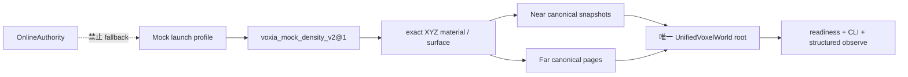
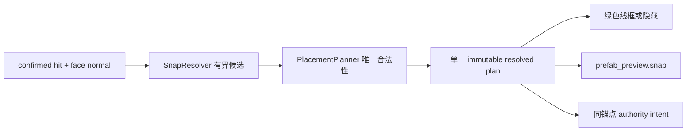
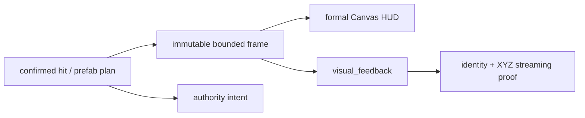
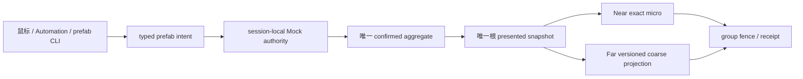
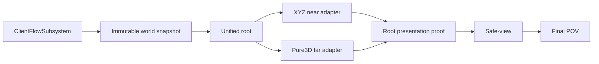

# 当前会话接力：世界分页与空间权威拆分（2026-10-28）

**最终停点：S0 已按批准范围收口（2026-10-28）**。详细证据、复用范围与残余历史事项见[执行计划页首收口记录](../voxel-authority/2026-10-24-world-region-paging/execution-plan.md#s0-本轮收口2026-10-28覆盖下方历史停点)，覆盖下方执行中及更早摘要。最后ring投影修补已进入正常v3正式release，完整N1提交最大231.731ms／p99 128.717ms、最长World回合228.147ms，179笔0错误；G0、D11与当前v3近远景真实验收完成。当前发布物性全部88项材料已配置并由公共API核对。原矩阵、R4 1x/4x、R5不重跑；原失败与F0旧oracle范围保留，不声称所有历史用例全绿。源码与世界WIP原样保留，无提交／推送；本轮UE／BEAM与隔离PG已全部停止，未动如园保护库／备份。后续从既定S1a／Scene分块计划接续，天气／气候仍后移；本轮没有开始S1a。

**新会话接管实跑更新（2026-10-28 18:18，工作仍在继续）**：完整接力依据为 `.demo/observe/s0-resume-20261028/HANDOFF-final.md`，覆盖下方较早停点。R4 1x/4x、R5与原1/2/4/8矩阵已有证据，不重跑。新G0/D11私有部署已按发布物性全部正ID配置88项生产材料、96MiB缓存、生成并发2；已消耗世界及失败报告完整保留，未补料、未提交／推送。

- G0正式v2双端新04已完成采料、付费放置、点火、正常离窗及返回。修正判定器将“每次加热”误当“每次点燃”、将显式只读人物查询拒绝误当业务意图失败后，原始日志离线复判行为通过：36笔业务回执完整，离窗模型推进2.5秒／燃料消耗1MJ，返回同身份确认txn264。证据 `Voxim/Saved/Playtest/paging-20261024/runs/g0-s0-live-20261028-v2-04/clients/report.verify-20261028T101010423981Z.json`；原report不覆盖。真实煤块火焰／HUD已实看，未以此代替如园近远景验收。
- 新单窗首次加载保持原矩阵profile／seq14615／120秒预热，0编辑、0错误、27区快照；最终Liquids指纹修补后的 `info:DOWN` 仍365.261ms，其中27区液体接纳363.929ms。未证解决原366.899ms回合，原N1稳态302.489ms也无批准豁免；S0性能仍未完成。证据 `Voxim/Saved/Playtest/paging-20261024/s0-firstload-20261028a/`，后续只针对已证接纳成本诊断，不追零GC或重跑完整矩阵。
- D11已修发布凭证owner错配；新02第一次UE在登录前D3D12 PSO创建8007000e退出，世界前后seq3、样本未消费，按规则仅环境重试一次。重试实际完成26微格Prefab及第27单元付费建造txn28，但双方只读查询返回当前seq30／incarnation28，候选判定器混淆查询水位与建造事务，已中止并保留现场。第28拒绝／HUD尚未验收；正按真实几何事务与后续同身份查询合同修判定，未改生产规则。

**同轮后续收口（18:32）**：D11新03已完整实跑，发布凭证按D3 owner、建造按双端确切canonical事务、后续查询按request与incarnation绑定；第27接纳／28拒绝、余额不误扣与空位判定通过。实看 `Captures/S0-20261028/d11-03-rejection.png`，中文“连接后电路规模超过上限”清晰且无幽灵方块；`d11-s0-live-20261028-v2-03/clients/visual-review.json`与新的`report.verify-*`通过，原未审图报告保留。如园同切点独占副本也经正式v2根正常出生／Ready，L0–L5显示完成、Net待办／missing／errors／rejected全0；实际查看玩家近景和俯瞰中的建筑、材质、植被、水面与远处地形。证据 `.demo/observe/s0-visual-20261028/run-01/visual-review.json`与 `Captures/S0-20261028/visual-{near-player,near-far-overview}-01.png`；仅改变相机，不将其冒称角色Far换窗（G0另有正常走离／返回证据）。本轮UE与两个WSL节点均已正常退出。

当前只剩性能阻断，正在按既有M0/MemoryWatchdog运行一次27区接纳MFA／GC定向诊断（`.demo/observe/s0-adopt-profile-20261028/`），不编辑、不还原、不重跑矩阵。上述为执行中记录，不是S0完成声明。如园原库／备份未触及；20GiB host available护栏不变。新资源归属与更晚状态以本轮observe产物为准。

**接续 `01a18069-5281-7b51-b860-dc8b84d8fb14` 的恢复核对（2026-10-28）**：原会话后半段因接口错误中断，以下m→n→o摘要不是最新停点。已落盘的后续为EpochChunk压紧、terrain ring差额和删除refined记录memo；q单窗完整action239.2064ms、完整read310.0672ms，仍未过全部性能门禁。memo删除直接4项通过／14排除，尚待其新同输入测量，不重跑已通过项。真实PG恢复与60秒Replica保留已有证据在 `.demo/observe/r5-pg-closure-20261028/`，不再按旧摘要视为未做；完整R4的H/A/B、真实双端和八窗仍待收口。D11潜在图候选已落盘，但玩家提交接线与实测默认上限尚未完成；用户已明确人工宏格／微格／附件槽各计1，上限按实测建议。当前继续S0至适用门禁闭合，仅做必要测试；具体结果仍以[执行计划](../voxel-authority/2026-10-24-world-region-paging/execution-plan.md)及原始证据为准。

当前工作分支为 `paging-window-snapshot`，基点 `5957192b`，包含尚未提交的连续世界和分页收口增量。整体仍在 S0，S1a～S5、协议42与最终分发未完成。当前任务与依赖只在[执行计划](../voxel-authority/2026-10-24-world-region-paging/execution-plan.md)维护；现场资产保护、逐次提交／推送授权及运行目录见 [Voxim HANDOFF](../../../../Voxim/Saved/Playtest/paging-20261024/HANDOFF.md)。

**最新执行优先级**：用户明确“天气和气候全部后移，先专注于内存占用平滑与世界分块(scene)”。现有天气成果保留，不在本主线新增气候／Sekai／天然初始化。先闭合内存与分页在途生命周期、恢复正确性及性能，再按既有Scene分块路线推进；历史热学参照只收尾已开始的小改动，不继续展开为内存前置。原失败、GeneratedStore阻退限制与整体未完成状态均保留。

**最新性能接续（m→n→o，2026-10-28）**：用户再次要求继续S0并禁止非必要测试。已修两处确认的无谓分配：Residency先接纳owner结果，已知阻退时不再展开观察／整树闭包；RefinedSlots改为有序记录＋原枚举索引，Payloads直接复用记录前缀，不逐槽解码再编码。保留GeneratedStore保护、旧map持久、协议字节和HP／代表点；内部布局变更采用冷启动。10个必要直接用例通过、两处旧路径成本反例保留，独审无阻断；仅n/o两次同输入单窗，无全套／8窗。m→o完整action453.7344→259.7888ms、完整后读867.1232→392.192ms；n→o记录393.318→4.915ms，后读GC477.3888→159.5392ms。读取仍未过300ms，剩余GC在terrain时窗，不能宣称S0性能完成。RSS采样峰m1,906,995,200→o1,901,551,616B几乎不变，snapshot23.172608→23.4330112s回退保留。n/o源未漂／护栏未触发／trace清理、自有节点与PG均停。详见[执行计划接续](../voxel-authority/2026-10-24-world-region-paging/execution-plan.md#2026-10-28-接续驻留阻退结果先于闭包投影)与 `.demo/observe/refined-record-reuse-20261028/mno-comparison.json`。下一焦点是必要驻留堆与自然单元分配；epochs仅有历史大字段线索，无本次精确份额，不贸然扩大表示重构。下方m停点及早期记录均保留为历史，S0其余门禁仍未完成。

**接续 `01a17fcc-018d-7803-beb0-f9530249d4b6` 的实际停点**：R1 异步等待生命周期与 RefinedSlots 紧凑表示已实现、直接测试通过且独审无确认阻断；j/k 同输入测量已完成并清理。RSS采样峰下降约19.9%，完整读取1878.528→638.6688ms，但单笔动作422.912→482.0992ms、事务369.664→424.960ms。接续已修碰撞判空多解码首槽，直接5项通过并完成l对照；l动作490.0864ms、事务432.845ms，300ms仍失败，资源已清理。当前推进R4/Q5安全采集；R5恢复、正式双端与8窗门禁仍待闭合。最新证据与后续顺序只在[执行计划的紧凑表示接续段](../voxel-authority/2026-10-24-world-region-paging/execution-plan.md#紧凑表示实测与当前接续点2026-10-28)维护；下方早期“R1未完成／尚待k”的记录不再代表现状。

本次后续已交付两项增量：Q5有限页采集移除整World回传，8项直接及纯判定/护栏测试通过、独审无确认缺陷；完整Q5仍缺逐身份历史A与首次发布同切点资格，旧CLI在任何数据库恢复前明确拒绝。碰撞三模块改为只读变化宏格的旧占用、只物化真实变化的new chunk，14个不同直接用例通过且独审无确认问题。m同输入实跑已完成并清理，内部事务432.845→238.285ms、碰撞226.406→34.099ms、RSS采样峰2.038→1.907GB；但完整action仍453.7344ms、完整后读867.1232ms，不能将内部238ms当作完整300ms门禁通过。下一性能重点是完整操作中的GC与必要驻留工作集；S0、完整Q5/R5、双端/8窗及Scene拆分仍未完成。完整证据和余项继续在执行计划维护，本工作线全部新增改动仍未提交／推送。

用户本轮要求**完成 S0**，并在天然初始化与气候草案的依赖明确后选择“**天然初态移到后续 Weather 阶段**”。该项及相应初始活动／气候身份／旧背景迁移不再是 S0 门禁，但仍未实现；不删 GeneratedStore 阻退保护，不宣称天然全域演化。S0保留显式活动、分页正确性、D11、F0适用失败、真实双端与原300ms／220ms／8窗不退化。执行计划已按 approved v7／M2a／M2b 原批准边界消除将S1a/P5全面拆行提前为G0前置的循环依赖。

本次用户已选择天然世界“按气候生成平衡初态”，随后明确气候仍是草案，已有与 Sekai 联动讨论。已找到 [Voxim Weather.md](../../../../Voxim/Docs/Weather.md)：Sekai 提供离线区域月气候，Voxim 天气消费；P2 服务端权威迁移／P3 物理接入仍待细化。本选择不批准旧 e940 sampler 为正式来源，不直接合入或改旧背景能量；下文“初态待回复”已被此澄清覆盖。具体边界已写持续世界决策稿页首，气候事实源不在分页任务另建。

本次P1电路接续已实跑：最终 `circuit-final-02` **57项通过**，原充放电／复制／重启／挖掘单例 `circuit-energy-02` **1项通过、4项排除**（真实时钟4.1s）。首段电观察先于新热行写回、热历史域与液体域外唤醒格引发反复装退页三处均已修；热循环原60s超时及三秒退休4万→12万、液体原回归失败保留，不改超时／原能量断言。冷回路、IO恢复、编辑排队及32／33槽对照已有证据；数值对照只满足各自原容差，非浮点逐位相等。命令／范围／测试前提裁决见执行计划P1段，源与差异在 `.demo/observe/p1-circuit-finish-20261028/`，运行在 `.demo/observe/p1-residency-20261028/`。护栏未触发、自有树全停；独立修补审查已完成，未发现确认的Critical／Important／Minor（内部报告 `task-p1-circuit-finish-review.md`）。不代表天然初始化、完整P1或性能验收。

用户已明确世界无人时也必须持续演化，旧窗口／预算冻结、冷墙与绝热方案不再有效；D12 只统计角色当前分区拟态，旧分区拟态继续演化；天然雪采用真实寒冷气候、加热后自然融化。对应方案见[持续世界决策稿](../voxel-authority/2026-10-24-world-region-paging/continuous-world-decision.md)，不可沿下方旧记录恢复已撤销语义。

当前优先原始内存尖峰／卡顿目标：修正测量工具整份 World 状态复制后，A/B/C 三轮同输入 cold 8 窗仍未通过性能门禁；C 的提交 p99 为 1376.871 ms。随后单中心窗首笔编辑复现 5 次 major GC，累计 1.6515 s，每次 major 后仍约 950 MiB used heap；这只是持有工作集证据，未确认反复 major 的触发根因。当前不重复跑 8 窗矩阵，先收口执行计划已有 P2 共享缓存与 P3 预制体按需读取，再选择相同场景复测。历史 M0 的 27 个 L0 region／1728 chunks 不能冒充默认近场 27 tiles／9261 chunks 的验收。

最新实现：唯一共享 Cache 已承载 payload／prefab 原始字节；World 预制体目录改为轻描述，按 id 原字节／几何及草稿 compile／preview、失败与退出释放已有直接验证。缓存迁移相关23项通过；Parcel／定义驻留／Closure组17项通过，包含旧v1/v2原字节经过安装与冷重启保持；Scene真实接缝12项、NPC原17项及冷源丢失仍可读取轻目录1项均通过。上述为分组证据，不能相加当作全套或性能验收；源码身份、排除数、原生退出与护栏见 `.demo/observe/world-prefab-residency-20261028/`、`.demo/observe/cache-fixture-migration-20261028-01/` 与 `.demo/observe/prefab-callers-20261028-01/`。NPC首次因隔离PG凭据未注入而准备失败，保留原记录；纠正后新目录实跑，两个VM新库均已清理，隔离PG已停止，凭据未输出。

本轮Core直接回归已收口：GM搬移同key重试、Parcel目标已知作者定义误套玩家上限、NPC最近目录误读raw三项均已修复并独立复核。最新Core组18项通过；Auth冷源失败首红2/3，最小修复后3项通过，显式503并保持原成功字节；L4共享预算单例1项通过、20项排除。NPC最近目录消费 `published_prefab_metadata` 与轻catalog，不为取得id加载全体raw定义；旧消费者最小变异实际0/1预期失败，逐字恢复后同例1项通过，最终文件SHA与原文一致。该短窗口在性能实验停止后运行，两个新库已清理、PG已停。各阶段证据、失败和未覆盖边界仍保留；不能据此标P1/P2/P3性能或整体重构完成。

实际内存对照b已单轮完成且清理：`gc-unit-20261028b/run/comparison-with-a.json` 与 `cleanup-verification.json` 为证据，196项相关源／20项P2/P3差异已冻结，Native kernel／DLL、数据与单笔动作同a。World每次major后存活堆约950–954降为713–716 MiB，主BEAM生命周期OS高水位3.447降为2.914 GB；动作1972.224对1961.779 ms、事务1950.106对1940.275 ms基本不变。GC总span仍约1.65秒，b为5次major加1次268.8 ms minor；minor的old heap约712.891 MiB，不能只拿young 0.078 MiB报全部存活量。此次只证明历史单窗口探针，不证明8窗尾延迟或默认27tiles规模。prepare/run护栏均未触发、相关源未漂移，自有节点与隔离PG均已停止。

GC证伪入口见 `.superpowers/sdd/voxel-authority-sharding/task-gc-trigger-audit.md` 与 `task-gc-setter-map.md`。同ERTS17.0.4／16:16 tiny canary单轮通过后，c已另获授权并单轮实际完成：生产196项逐项同b，唯一World PID／唯一session／唯一精确 `erts_internal:garbage_collect/1` arity-only，捕获5call分别紧邻5次major，另1minor无前置call，17事件／6完整GC对；请求参数和caller未观察。c/run的 `diagnostic-analysis.json`、`call-major-adjacency.json`、`cleanup-verification.json` 为证据；护栏未触发、源未漂移、trace清理完整，自有节点和PG均已停止。本轮为诊断，不能拿时延与b比性能。

官方exact-tag后续审计给出最窄候选：`error_handler → code:ensure_loaded/1` 成功interactive加载后在当前进程同步GC，能在业务源码无显式GC时产生该BIF调用；具体caller／被加载模块仍未知。tiny caller能力校验已实际单轮native1：观察有效、清理完整，但普通GC与合成模块cold加载都只返回包装层 `{erlang,garbage_collect,0}`，无法区分来源；warm与未traced control均零事件。按约定停止该方案，未加到World，未扩栈或第二MFA。

代码就绪d干预已单轮实跑并独立复核：固定三应用178模块中原有85个、一次补载93个，原snapshot后controller正常退出，seq/PID不漂；实际interactive，完整collector生命周期loaded760→760无任何集合／路径差异。原单动作0同步请求／0major／1minor约287.85 ms，action586.752 ms／事务565.351 ms；只支持本轮code-readiness关联，不能指定原五个模块或称自然cold达标。样本未包住整个collector的初版资格缺口已先反例红→修后13项纯绿并独立关闭，原失败保留。

统筹随后按既有授权选择修复M0启动口径，具体计划在 execution-plan 页首小节：正式迁移后、World创建前，由小boot进程按标准三应用manifest一次加载，正常NIF on_load归启动边界，唯一小报告在World前写入，运行期只读；新profile为 `m0_manifest_ready_v1`，真实mode仍记录为interactive。boot／control／identity／README与专用helper已实现，6项Elixir／3项Python通过、独立审查无确认Critical/Important，旧交互式首加载与a–d证据保留。源码归档与最终SHA在 `.demo/observe/m0-startup-code-ready-20261028/`，这不是生产Topology或World计算更改。

e正常新profile首笔已实际完成：manifest `17186ce620343627d07f322c98d327daab9db944d42d65231bc1fba8d227e9e3`，动态199源，仅6条授权bench代码变化，业务lib／NIF／SQL未漂；原observer＋原action，不加载d干预。迁移／冷两次ready与runtime启动事实绑定成功，World前代码就绪顺序成立。原action608.0512 ms、事务586.956 ms，0同步请求／0major／1minor289.3824 ms，仍未过300ms门禁。e/run及独立driver稿保留实际值；guard未触发、源未漂、自有PID与隔离PG均已停止，不自动8窗。

后续两项只读审计已收口：`task-retained-state-audit.md` 说明713MiB不能归为单一字段，P1驻留只增不退与多项预算外缓存确有实现缺口，但未知e哪些页可退；`task-edit-cost-audit.md` 严格证明minor在collision，而无该次GC的l0_cache197.018ms包含仅为derived cache的整L0重压缩。非GC墙钟仍不能叫纯CPU。

统筹已按execution-plan采纳一个最小候选并完成实现／直接验证：`Edits` 删除eager宏格载荷重写和无caller helper，原完整XYZ core/ring失效、canonical真值／结构／后像／collision／选择／seq守卫均保留，完整读者走既有按需重建。目标红例旧路径实际调用1次，修后4passed／91excluded／native0、guard未触发；独立审查无Critical/Important，L0没有因cache miss少验，Replica同seq与suffix正确。实现源SHA／历史／原生证据见 `.demo/observe/lazy-payload-cache-20261028/` 和 `task-lazy-payload-cache{,-review}.md`，首次大L0读取成本仍未覆盖。

f已获单轮授权并实际失败，原始失败保留：manifest `fbb9d5d9ae1302c9ec41ff5a0e005629a14dd6fc797a1cfc350eb970c4d17faf`，199源相对e仅Edits改动。原action456.3968ms／事务433.766ms、seq14616和delta成功，minor319.3856ms；随后完整L0服务端回调1268.326ms、payload/miss，固定头身份被测试helper拒绝，actual header未落盘，不能猜具体字段，后续stats未执行。整轮run native1／后读RPC native2，guard未触发／源未漂／cleanup空，自有六PID与PG均已停。`gc-unit-20261028f/run/failed-run-analysis.json`／`cleanup-verification.json` 与 `task-lazy-payload-cache-driver.md` 为证据；不能因提交较快忽略整轮失败或1.27s读回调。

连续世界合同核查发现测试的严格 `payload.seq == action.seq` 前提不成立：f日志已证14616后液体推进、prepare到14617、随后thermal14618；普通serve按region原子物化并带自己的seq，缓存命中也可合法落后global seq。正文在 `task-post-read-sequence-contract.md`：对这个确认修改目标core的probe，L为已确认action序号，U为同World serve返回后的公开seq fence，要求 `L≤R≤U`／`L≤U`，CV／level／完整XYZ仍严格；不暂停物理、不用无上界>=，旧f actual header仍未知。

g已另获一次实际授权并完整通过身份校验／收尾：manifest `7229acb088d2c02ed3d7f011698229b41d86712f8cdfe143fc995b135216700a`，生产199源逐项同f，实际 `L14616 < R14617 < U14618`、同PID／CV／level／XYZ合格；固定actual header在gate前保存，f的未知header不反填。action404.7872ms／事务384.717ms，0同步请求／0major／1minor282.7264ms；完整读取public1298.944ms、单World callback1273.651ms，fence324.5056ms／stats9.6256ms另列，仍未过300ms。raw20,516,779B／body1,232,338B；读取后701页、overlay11769cell／36region、refined30822macro／instances2056、decoded15／base127、shared cache约4MB，只是该时点计数。g/run的fenced-post-read-analysis及cleanup-verification保存完整证据，guard未触发／源未漂／六自有PID死／PG已停。

完整物化审计已收口为 `task-full-payload-cost-audit.md`：共用terrain→details→Canopy→encode→Cache，HTTP与可选Replica及CanonicalFeed均有活caller；全驻留refined owner枚举是源码事实，不是1.3秒的已证占比。下一观测已实现：`Payloads` 在现有构造点仅记录固定monotonic标量、已生成map/binary大小与既有header大小，source/hit/error不伪完整成功；返回／wire字节与旧摘要一致，最终5项绿，独审无Critical/Important。源Payloads SHA `c87dda910d059f6c0f62708e92a3af2b21887094f8d4b5e748f4613a5b16bb72`，证据 `.demo/observe/payload-construct-observe-20261028/`，未通过性能声明。

h构造计量已另获一次实际授权并终态native0：manifest `d80a3e9d39bcf3f9f4755f0e1ddaafedfafb2b01655929d2e6436e546e97a190`，199源相对g仅Payloads固定观测变化；原g有界helper／原action／c observer及预算／数据不改。目标World PID、seq14617、CV、level0／XYZ与public read源时间包络匹配唯一完整事件，其内匹配唯一details事件。完整物化1249.178ms＝terrain5.735＋details1063.526＋Canopy3.379＋encode176.435＋cache小于微秒刻度（另约0.103ms阶段间隙）；这些都是墙钟，后读未trace GC，不能称CPU或将details直接归因某个子算法。

实际已构造字段为refined8042／refined_records8042、instances652、attachments7264、liquid1262、canopy86／canopy_instances3／residual86；raw20,516,779／body1,232,338B。这些是本region构造输出，不是全局owner数量。h原action413.3888ms／GC292.352ms，public read1275.1872ms，仍未过门禁；L14616<R14617<U14618。guard未触发／源未漂／trace及cleanup完整，六自有PID与PG已停。原构造日志和完整身份保留在 `gc-unit-20261028h/run` 及其cold log，不能把微小轮间差异报算法优化。

details审计已写 `task-payload-details-audit.md`：原Feed在相同region曾构造相同数量，不能证明内容或memo相等；其编码memo不回传World，World冷首读必须自足。当前缺真实hit/miss／槽记录规模与postread GC，不能将1063ms归为slot_records、全局owner扫描或冷memo。

i已单轮终态native0：manifest `3faeab872d81f29d1fea3828b871b2bcdfac0a49087df149bc9a2cd42b9d908c`，动作404.1728ms／事务384.409ms，public read1288.6016ms／callback1264.230ms，原门禁仍失败。record冷循环1056.359ms、8042次miss／0hit、1,221,590槽／19,545,440B记录；顺序第二GC session的3minor＋2major合847.6672ms全部位于该循环，原action session已先完整销毁，无并存session。扣GC墙钟的残差208.6918ms不是CPU。完整分析及清理在 `gc-unit-20261028i/run/details-read-gc-analysis.json`、`cleanup-verification.json`；源未漂、护栏未触发、自有进程与PG已停。

现已停止扩展诊断，进入执行计划既有P1的实质实现：`p1_residency_core` 负责required／持久发布资格／page generation与最后引用退休，`p1_activity_dependencies` 负责热、液体、投射物和待施法的真实当前与未来依赖。最初两个正常文件集成反例0/2预期红；最新生命周期文件11项实际通过，覆盖完整XYZ换窗／payload与碰撞重读、未发布cut、seq0只读、prepare到使用、跨页整树、取消暂存清理、准备回复超时、旧window迟到回灌、无人热源／液体与共享粗层片段最后owner。活动owner纯投影10项通过；这些是分组证据，不相加当全套或性能验收。

直接共享回归曾在shared-02出现25/29通过、3排除、4失败：一个测试读取闸未清理，三项揭露真实显式液体步冷IO后未续行。现已沿原PageLoad／Admission运输并重放同一个 `:liquid_commit`，保留自然due，不新增强制步队列；动态洪泛累计已发现且重放仍读的页到同一不可变context，解决前段页被退后2↔5反复装页；attempt>0未闭合树的专门反例也已恢复并实跑。

core本次最终联合四文件为42/43通过、3数据库用例排除（native2），唯一剩余是旧共享fixture仍等通用 `:wake`；只迁移为观察同一原强制输入并结束读取闸作用域，业务源码不变，随后同源定向1/1通过（native0）。不伪造单次联合43绿。各批20GiB护栏未触发、精确自有树全停，无PG／UE；源码SHA、原失败和清理在 `.demo/observe/p1-residency-20261028/`，独审 `task-p1-core-review.md` 已关闭本范围确认Important。现core代码／单VM租约已交还；fragment选择仍O(驻留fragment)，天然活动初始化、电路闭包与根级性能仍未完成，不能标完整P1或整体重构完成。

统筹已向用户澄清天然热背景的产品初态：构造成气候平衡初态，或保留现生成初态并从开服全域演化；答案尚待回复，不得默默按前者修改模型。期间已将电路实际实现交activity：唯一CircuitGraph复用原seed／导体／附件端点图构造，缺页沿PageLoad接回原自然段，完整后交原Circuit.plan，不新增solver；其现child负责Attachments／Circuit纯helper，core转独立只读审查。业务数值保留每项既有容差及更严断言，不能将1e-8泛化或重录哈希。气候sampler与维护接纳仍为e940候选，只准备局部hunk移植，不整文件覆盖主线。没有启动新benchmark、PG或UE。

其他已验证增量保留：World 调度时钟依赖有3个反例红→绿及24项默认路径回归；两项热学测试每步0.5秒前提恢复，但原冻结摘要仍失败，不能重录。第三轮正式双端瞄准通过后因实际客户端材料 `e63744…` 与服务端旧 `b4d8…` 错配受阻，尚无采料／点火成功证据。后续实际 publication 接纳与逐笔输入门禁已作有界修补并有直接测试，尚未重跑正式 QUIC 双端；本轮内存优先不取消该最终门禁。

当前连续演化、接纳时序与显式 IO 恢复合并验证为48项通过、3项数据库测试排除；身体旧夹具修复10/10、生成源身份精确单例1/1。它们不替代正式双端、天然活动发现、冷恢复、性能及多分区验收。气候 sampler 仍是独立工作树候选，尚未合入正式 World。首次正式双端因护栏接线遗漏行政中断；补齐后第二轮两端均完成协议41 SessionStart/Ready，但首次采料准星被测试室墙体挡住，尚未采料或点火，连续演化仍未验收。原失败见 `Voxim/Saved/Playtest/paging-20261024/runs/g0-continuous-batch-20261027-02/`，本轮进程均已停止。

## 以下为历史会话记录（不作为当前任务或阶段状态）

### Voxim M3 规划（2026-09-09）

当前主线 M1 / M2a 已验收。用户已确认下一会话实施每玩家 GenServer、只读碰撞版本、日志与 AOI／发送改造；本会话仅写规划，M3 尚未实现或验收。先读 [M3 服务端入口](../movement-sync/2026-09-09-voxim-m3.md) 与 [Voxim 下一会话说明](../../../../Voxim/Docs/M3/next-session.md)。完整计划和测试口径只有 Voxim `Docs/M3/plan.md` 一处。

## 以下为历史会话记录（不作为当前 Voxim 的任务或阶段状态）

## 2026-08-26 Gate 连接进程去镜像：会话层从传输层剥离

- **动机**：`tcp_connection.ex`(3137 行) 与 `ws_connection.ex`(2769 行) 是两份逐字镜像，
  约 2000 行重复。这不是风格问题而是正确性问题——`VoxelIntentResult.authoritative`
  透传（2026-06-27 幽灵块点修通道，commit `1069a1dc`）只打进 TCP 一侧，WS 一直回空列表，
  是典型的「复制后各自演化」漂移。
- **边界**：只做 Gate 内部的所有权重划，**不改 wire 协议、不改权威归属**。会话语义
  （鉴权 / 进场 / 移动 / 聊天 / 技能 / 体素意图 / 调试探针）收敛为唯一实现，两个连接进程
  只保留各自真实的传输差异。
- **落地模块**（`apps/gate_server/lib/gate_server/`）：
  - `session/sink.ex`：出站传输契约（socket vs owner 进程）+ observe 事件名前缀，
    是两条链路**唯一**的真实差异。
  - `session/dispatch.ex`：唯一会话状态机；`session/{auth,scene,call,observe,debug_probe}.ex`
    分别拥有鉴权信任边界、Scene 接入契约、安全调用、观测字段、调试探针。
  - `voxel/{intent_pipeline,result_frame,prefab_placement,subscribe_intent}.ex`：
    四类体素意图执行、`0x68` 回执唯一构造、prefab 2PC、订阅意图适配。
- **行为变化（有意为之）**：
  1. WS 侧补上 `authoritative` 透传，与 TCP 一致（修复上述漂移）。
  2. WS 获得 chat / skill / surface element / heightmap 拒绝等此前只有 TCP 有的 clause；
     TCP 获得 `voxel_rebind` 调试探针（此前只有 WS 有）——现役 Voxia 走 TCP，属调试面补齐。
  3. 传输能力差异改由 state 显式字段表达：`fast_lane: :enabled | :unsupported`
     （浏览器无 UDP 快车道，共享 dispatch 显式回错误帧，不静默成功）。
  4. observe 事件名保持不变：sink 按传输加前缀（TCP 无前缀 / WS `ws_`），移动三事件
     走 `emit_transport_tagged` 得到 `tcp_movement_*` / `ws_movement_*`。
- **结果**：`tcp_connection.ex` 3137 → 523 行，`ws_connection.ex` 2769 → 431 行；
  两侧仅剩 `ensure_pg_scope_started/0` 一处（12 行）逐字相同，其余同名函数
  （`init` / `handle_cast` / `handle_info`）差异均为真实传输差异。
- **验证**：`cd apps/gate_server && mix test --no-start` → `239 passed`（与重构前基线一致）；
  `mix compile` 无新增告警。根 `mix test` 中 scene_server 3 例、auth_server 1 例失败与本次
  无关（scene_server 不依赖 gate_server；auth 失败在 world pack manifest 完整性），为既有状态。
- **同期修掉的测试脚手架 bug**：`ws_connection_voxel_test.exs` 的 `on_exit` 无条件调用
  `SceneNodeRegistry.unregister_scene_node/2`，而 `start_supervised!` 起的注册表在 `on_exit`
  前已停，导致 40 例 teardown 崩溃。改为仅在注册表仍存活时摘除。
- **后续可做**：`handle_cast` 的 Scene 回推帧转发两侧仍各写一遍（每 clause 一行 `Sink.send_encoded`），
  差异是 TCP 的 UDP 分支与 WS 的出口预算；判断为真实差异，未强行合并。若之后 WS 也要 UDP
  或 TCP 也要出口预算，应先统一「下行推送」这一层再动。

## 2026-08-25 Near/Far 同区块可见后像修复

- **根因**：SceneHost 已在 Near 提交帧原子切换精确 ownership atlas，但生产 Far 仍绑定不消费 atlas
  的普通外观材质；所以账本已经交权，旧 Far 像素却要等组件退休 1–2 秒才消失。
- **修复边界**：ownership/atlas/fence/退休流程不改。只为 Far 三材质族注入由现役外观事实源
  确定性派生的 `*FarOwned` 父材质；opaque/emissive 用 Masked 二值裁剪，translucent 乘进原
  Opacity。Near 材质、confirmed truth、网格与 patch identity 均不变。
- **契约与观察面**：`VoxiaFarOwnershipClipV1=1` fail-closed；
  `pure3d_world_state.patch_ownership.ownership_clip_capable` 直接回读；生成脚本为
  `clients/Voxia/scripts/create_far_ownership_materials.py`。
- **验证**：Development build 成功；资产/绑定 focused `2/2` 与 SceneHost transaction 成功；
  全量 Voxia Automation `222/222`（209 clean + 13 success-with-warning，0 failed/not-run）。
  1280×720 D3D12 offscreen 唯一生产根 `ready=true`，atlas=`21³`、exact owned=`9261`、三个
  ownership MID capability/installed=true，shader/material/Voxia Error=`0`，clean exit。证据：
  `.demo/observe/voxia_far_ownership_full_20260825/index.json`、
  `.demo/observe/voxia_far_ownership_real_rhi_20260825/stdio.log`。
- **剩余验收**：机器证据已闭合；仍应由用户在可见窗口跨 tile 主观确认旧 Far 不再留下 1–2 秒后像。

## 2026-08-25 跨 tile 不流送与空气墙根因修复

- **现场签名**：唯一生产根跨 tile 后新 Near 已到 `9261`，ledger 却停在
  `12348 = 9261 + 3087`；Far 保留旧中心，liveness 随后 fatal，移动 guard 到窗口外后正确
  fail-closed，表现为空气墙。
- **根因**：Near 工作快照把入场 mesh/move/edit 与依赖新 Far manifest 的 trim/removal 聚合为同一个
  Far 前置门禁；Far 等退场清空，退场又等 Far manifest，形成循环等待。
- **修复**：Near owner 将工作显式分类为 `EntryReady/EntryInFlight` 与
  `FarDependentRetirementPending/InFlight`。Far 调度只等待入场类；liveness 仍观察两类；精确 Far
  manifest 与服务端权威边界均未改变，没有 retry、降级或第二真值源。
- **终验**：Development build 成功；focused Automation `2/2`；Voxia 全量 `221/221`
  （208 clean + 13 warning，0 failed/not-run）。唯一生产根连续移动跨 tile 后中心
  `[11,0,-51] → [11,1,-51]`，新 Far 正常构建/提交，Near ledger 回收至 `9261`，
  pending trim/move/edit=`0`，coverage gap/overlap/orphan=`0/0/0`，无 liveness fatal。
  证据位于 `.demo/observe/voxia_near_far_handoff_final_focused_20260825/`、
  `.demo/observe/voxia_near_far_handoff_final_full_20260825/`、
  `.demo/observe/voxia_near_far_handoff_final_runtime_20260825/runtime.log`。
- **接力边界**：最终仍需用户在可见窗口以 WASD 做主观视觉确认；不要把 Near-playable proof 的
  `far=false` 当失败，它是既有 Near-first 语义，最终 readiness/coverage 才要求 Far 闭合。

## 2026-08-25 自然洞口与唯一根流送回归修复

- **用户现场**：唯一 `production_all_features` 根中流送不再收敛，且已有 cheese 空腔全部被 12 格
  表层盖层封闭，真实探索看不到地下洞穴。
- **流送根因**：Far deadline 进入 `exceeded` 后，同 generation 未完成 required Far 失去收敛保护，
  移动触发 `near_priority` 反复 cancel/restart；同时 WorldGen 订阅把玩家 desired tile 覆写为旧
  granted/lease tile，产生约 205 次/秒相同 Near no-op activation。
- **流送修复**：`active|exceeded + same generation + required unfinished` 统一保护 Far 收敛；controller
  独立保存 `last_desired_tile`，相同 active target 不再 commit，下一请求只由统一 lifecycle policy
  的 tile change/prepared/cooldown 判定。策略 focused automation 已转绿。
- **洞口修复**：Voxia mock identity 升为 `voxia_mock_density_v2@2`，按 128×128 seed 网格正交组合
  “浅层 mouth → 盖层以下 inner”的下降胶囊与末端 chamber；cheese 密度公式和固定 fixture 不变。
  near/far/exact surface/frozen base 仍共用唯一 `ClassifyCell`，洞口包围盒会退出 cheese-only 快证明。
- **观察入口**：`worldgen_inspect_chunk` 增加 `entrance_air_cells` 与首入口 world XYZ；新增
  `worldgen_nearest_entrance world_x world_z [seed]` 返回可直接探索的 mouth/inner world XYZ。
- **当前验证**：Development 编译、WorldGen/CLI/shape cache/流送策略 focused automation 已通过；
  Null-RHI 跨 +Y tile 的唯一生产根通过，Near `3087/3087/6174`、目标级 Far `6618/241/241`、
  Near/required Far=`295/1739ms`、cancel=`0`。Real-RHI 正式地图在 mouth
  `[1271,54,-5711]` 完成 9261-chunk Near 并拍到连续下降洞道；最终 `-ExploreCave` 可见启动以
  `10530ms` 达到 `ready/session_ready=true`，required Far 再用 `74ms` 闭合，同目标 Full 后台扩展
  最终完成 `33725 pages` 并提交，且无 liveness fatal。证据分别位于
  `.demo/observe/voxia_phase1_2026-08-25T01-21-18-032Z_null_rhi_1280x720/`、
  `.demo/observe/voxia_worldgen_streaming_fix_20260825/` 与
  `clients/Voxia/Saved/cave_entrance_inside_production.png`。最终 Development build、Voxia
  Automation `221/221`（`208` clean + `13` warning、`0` failed/not-run）与 Node `198/198` 已通过；
  报告为 `.demo/observe/voxia_worldgen_streaming_fix_20260825/final_all_voxia_green/index.json`。
  同一正式入口的可见根已启动并留给用户探索。
- **边界**：本地 mock 仍不写 Online confirmed truth，Online 失败不回退 mock；不得 reset/clean 两个
  脏工作树，也不要替用户提交。

## 2026-08-24 Voxia MockWorldGen XYZ 与 exact surface 收口

- **范围与边界**：本轮只完善 Voxia `RuntimeMock/dev_worldgen`。`voxia_mock_density_v2@1` 仍是
  mock 独立身份，近景 snapshot 与远景 canonical page 共用同一 XYZ material source，并只组合进
  `AVoxiaUnifiedVoxelWorldActor` 唯一生产根；没有把本地生成结果提升为 confirmed truth，也没有给
  `OnlineAuthority` 增加失败回退。



- **实现**：surface reducer 新增五段 sampling timing；WorldGen source 以全局高度带、保守 cave-density
  区间证明、精确列边、最近正 Y surface 列索引和 solid block witness 证明大范围查询，小 cell 与小
  directed corridor 则一次生成完整 material volume 并逐相邻格扫描 exact solid→air。证明失败只返回
  `unknown` 并落回原 exact sampler；试验后无收益的 lattice/cache/batched-line 路径均已删除。
- **输出冻结**：固定 fixture `chunk=[0,30,0], seed=1337` 仍为 `solid=194`、`cave_air=3902`、
  `first_cave=[0,480,0]`、`fingerprint=8418e5e9fcb0e2e3`；LOD0–4 page/surface fingerprints 与几何
  计数均未变化，故算法身份不 bump。
- **性能与真实入口**：默认 Full shell 同配置冷构建由 `182.570s` 降到 `109.007s`（约 40%）；默认
  stdio `mock` 启动在唯一 `production_all_features` 根用 16 workers 以 `77.420s` 完成 Full build，
  `ready/session_ready/single_composition_root/centers.aligned/far.ready=true`，Full=`6859 patches`。
  CLI `worldgen_inspect_chunk 0 30 0 1337` 返回上述同一 fixture。
- **门禁**：Development build 成功；WorldGen focused Automation `2/2`；最终 Voxia 全量 `221/221`
  （`208` clean + `13` success-with-warning，`0` failed/not-run）；Node `196/196`。13 个 warning 用例中
  12 个是既有负路径，另 1 个是外部 `generate_204` 超时。机器可读汇总在外层仓
  `.demo/observe/voxia_mock_worldgen_surface_fastpath_20260824/final_verification_summary.json`。
- **残余风险**：首次全量进程曾记录一次 background worker access violation；相同重负载序列、macro
  单测与后续两次全量均未复现。minidump 的 fault RIP 指令是无内存写入的 `mov r9d,eax`，却记录
  write `0x35d`，证据内部不自洽；没有据此加入猜测性修补，也不声称已找到根因。
- **下一阶段**：生成 world-pack fixture，并通过 Voxia H-gated local provider 做真实可见验收；
  launcher/content-version 自动绑定、Online provider、自然洞口、biome/material strata、aquifer 仍未完成。
  两个仓库当前都含大量用户/既有未提交改动，继续工作时禁止 reset/clean，也不要替用户提交。

## 2026-08-20 深夜批次：手玩移动冻结三层根因全落修，Phase 2 转绿

- **第 3 层根因（同时是 relocate 停滞与 GUI liveness fatal 的根）**：`LastRendererCoverageAudit`
  只被「重建路径 + 验收 CLI parity」刷新，而增量提交把缓存序列推平使重建永不再触发——
  启动期两次早跑的全量审计（所有权为空 → 19683 全 gap）被冻结成永久事实；移动 guard、
  Observation→`coverage_complete` waiter、settled 三条运行时链全部消费它。修复：SceneHost
  `MaintainRendererCoverageAuditCurrency()`——审计不干净 && 提交序列推进 && 资源静止时
  用增量维护快照补跑全量（稳态零成本，流送中保守，验收面不动）。
- **终验合集**：bootstrap 无 teleport `move_continuous` 400cm 走满（guard `allow`）、
  `gap_count 19683→0`（5 次 `voxia_renderer_coverage_audit_refreshed` 收敛）、
  Automation 221/221、Node 196/196、**Phase 2 冒烟 8/13 后首次全绿**（2m43s 三轴通过）。
- **排障教训（永久）**：构建管道接 `tail` 会吞退出码——链接被残留 UnrealEditor-Cmd 锁死
  （LNK1104）时 exit 仍 0，第一轮验证跑在旧 DLL 上产生假阴性。**构建后必须核对
  `Result: Succeeded` 与 DLL mtime。**
- `Voxia.Voxel.CoverageAuditDump` 转常驻观测面。详情：本目录外
  `voxel-far-field/2026-08-20-phase2-relocate-stall-regression.md` §7/§8、Voxia 仓一致性稿进度日志。
- 待办：用户手玩确认（WASD 移动 + 挖/放光照收敛视觉检查）→ 回归稿归档；改动仍未提交。


## 2026-08-20 遗留项自评批次：光照收敛落地 + 发现既有 relocate 停滞回归

- **13 项遗留全部自评处置**（详表见 Voxia
  `docs/10-active/guideline-conformance/2026-08-20-新准则一致性检查与修正.md` §三）：
  已修 4（光照收敛、EmitQuad 平价测试锁契约、CLI 边界文档、retry-stall 死架删除）、
  部分删 1（SVO/VHI 死地图与死冒烟脚本）、翻译 1、有据保留 7。
- **光照（按用户要求实测调研，不靠猜）**：顶点角点 AO+天空项是体素世界行业标准且
  UE5.8 下引擎 GI 路线仍不可用（5.5 的 DynamicMesh Lumen 支持已被移除，本仓 6 月
  Lumen 结论复核维持）；据此把确认态编辑路径收敛到流送
  `FVoxiaNearActiveChunkMeshBuilder`（共用冻结器+Build），删除双实现，编辑产物自此
  携带与流送一致的 AO/sky UV1；新增 matte AO 场景断言 + near/far EmitQuad 平价测试。
  独立决策稿：Voxia `docs/10-active/guideline-conformance/2026-08-20-近景编辑路径光照收敛决策.md`。
- **发现并定位既有回归**：Phase 2 冒烟（8/13 后未再跑）在第二轴 relocate 上确定性
  停滞；隔离 worktree bisect 定位 first bad = `4cb3e5e`（与不可独立编译的前置
  `18c89e8` 同批，8/19 far manifest/publication 重构，~1.1 万行）；A/B 证实 HEAD 同败、
  与一致性批次无关。护栏已落：liveness 忙等 livelock 击杀
  `streaming_wait_stalled_timeout`（60s 无进展、按进展计时）。**根因未修，Phase 2
  在修复前保持红**（编辑闭环段通过）。详情：
  `docs/10-active/voxel-far-field/2026-08-20-phase2-relocate-stall-regression.md`。
- 终验：build exit 0、Automation 全量（含新增 2 测试场景）、Node 196/196——数字见
  一致性主稿 §四。改动仍未提交。

## 2026-08-20 Voxia 新版 AGENTS.md 一致性检查与修正（收口）

- 依据 Voxia 仓重写后的 AGENTS.md（未提交版）与 deadline-observe-not-kill 决策，对
  `clients/Voxia` 做四路审计（DRY/唯一根、极简正常路径、显式失败、注释与文档），逐项修正。
- 代码：显式失败 10 项（基线水化读 apply 结果、Authority FailSession 落日志/observe、
  Pawn 碰撞真值不可用可见化、意图反馈悬挂终态化、材质/代理资产缺失日志、decode 失败补
  LastError、控制台命令失败输出、VoxelIntentResult 尾部 reason 解码透出、无契约 fallback
  可见化、移动发送假成功修正）；极简正常路径 5 项（60s 会话死线与 liveness 60s WaitDeadline
  转 observe-only——真死锁仍由 owner-idle 击杀，CLI parity 失败与生产 readiness 隔离，
  worker 超时 30→120s，worker 线程 checkf 竞态改丢弃+日志）；DRY 6 项（删约 1200 行死
  代码/归档 XZ 残留/README 称已删的第二实现，float 坐标换算收敛 double 规范实现，GameMode
  probe 证据显式标记 + spawn 块去重）。
- 文档：抢救 AGENTS 重写丢失的 clangd/MCP-inspector 工具链知识入 README「工具链」节；
  Voxia docs 顶层 10 篇孤岛散稿归档 `docs/20-archive/`；Tests/、VoxiaShaders README 新建；
  Gameplay/Debug README 反向漂移（已删除的 legacy probe 入口）改写为现状。
- 注释治理：约 760 行英文散文注释译中文 + 约 72 处反射声明补注（7 路代理，逐 hunk 核验
  只动注释）；全库英文散文句清零，残余 ~102 行为规则内 token 标注。
- 验证：Development build exit 0；Unreal Automation **220/220**（221 − 删除的 1 个死测试）；
  Node **196/196**。教训入 Voxia
  `docs/engineering-notes/2026-08-20-automation-error-log-convention.md`（Error 日志会挂
  负路径 Automation）。
- 遗留待决 13 项清单见 Voxia
  `docs/10-active/guideline-conformance/2026-08-20-新准则一致性检查与修正.md` §三（近景
  meshing 双实现光照不一致、EmitQuad 逐字复制、proof 瞬态拒绝杀会话、双 readiness、双 CLI
  面、checkf 批量降级等，均需单独决策稿）。
- **两仓改动均未提交**：Voxia 工作树含用户此前的 AGENTS.md/README.md 重写（本次修正建立
  在其上），外层仓含 handoff 本条目，留用户审阅后处置。

## 2026-08-13 客户端 Mock 流送顺畅度专项完成

- 范围只包含 `clients/Voxia` 的 RuntimeMock/WorldGen 唯一生产根；服务器、wire、Online
  provider、Web/Bevy 未修改。
- `Playable` 现在硬要求完整 Near `27 tiles / 216 patches / 9261 chunks`、Near post-visibility
  fence、Required Far 与 coverage/parity；完整 Near 之前 Far visible=`0`。Near/Far 均以冻结
  玩家完整 XYZ 由近及远调度。
- Full Far 与开场可操作门解耦，按后台帧预算收敛。同 TargetKey 的 Far generation 推进不再
  撤销既有 root presentation proof；被取消但未发布的 Far candidate 会显式重排，完整 retained
  后的精确重复 mailbox 尾项只在 manifest/live ledger 全字段一致时释放。
- 1280×720 Real-RHI 静止 Full Far：startup playable=`18.502s`，Full=`33725 pages`、
  `6859/6859 patches`，最终 mailbox/pending/ready/in-flight/fatal=`0`、settled/quiescent/clean
  全为 true；证据：
  `.demo/observe/voxia_phase1_2026-08-13T09-12-01-900Z_real_rhi_1280x720/`。
- 10 次独立 Real-RHI 冷启动全部通过，p95=max=`18.410s`、failed=`0`；证据：
  `.demo/observe/voxia_mock_cold_start_gate_2026-08-13T09-28-29-997Z_1280x720/`。
- Development build 成功；Unreal Automation `223/223`、Node `163/163`。Null-RHI 与 Real-RHI
  Phase 1/2/3 全绿；Real-RHI Phase 3 frame/GT/GPU p95=`4.124/3.995/2.346ms`，>8.33ms
  帧为 `0`。Phase 2/3 的正式 runner 已统一支持 `--real-rhi`，旧 `--visible-rhi` 保留兼容。
- 原 known gaps #8（密闭口袋）与 #9（跨 chunk mutation 中毒/retry）已关闭；层间墙人工视觉
  复验、更多硬件矩阵、Online authority、生产 pages/launcher 和服务端 subscription liveness
  仍开放。

## 2026-08-07(夜)分支拓扑收敛到只剩 master

- 按用户指示"先合并至只剩 master 再考虑本次修复",两仓分支面已全部收敛:
  - **Voxia 仓库**:`8b5ca43` 合并 phase3 prefab runtime → master,`85cae92` 合并
    流送活性/首载修复 → master(**合并后 master 树内容与已通过全量 automation
    217/217 + Node 134/134 的 bd7883c 树逐字节一致,门禁严格适用**);随后删除
    全部 6 个已并入本地分支,现在**只剩 `master`**。
  - **外层仓库**:`e4f3407d` 合并 7 月末遗留的 `codex/voxia-editor-authoring`
    文档欠账(streaming-lod.md 冲突按"新真值优先 + 保留作者态章节"解决;
    impl/README 保留新版 Voxia 行 + 新增两行;00-current-truth README 增第 12
    原则),删除 3 个已并入分支,**只剩 `master`**。
- **worktree 处置**:5 棵 worktree 全部转为 detached HEAD(不再持有任何分支),
  目录保留——phase1(2.0G)/phase2(820M)的 `.demo/observe` 与 AutomationReport
  是大量 handoff/验收文档引用的证据,未经用户显式指示不物理删除;
  `voxia-phase3-prefab-runtime` detached 在 master 尖端 `85cae92`,二进制最新,
  仍可直接 `run_voxia_3d_world.ps1` 游玩。`clients/Voxia` 主 checkout(master)
  二进制已重建成功(首次因七月陈旧 Intermediate 瞬时失败,重跑即绿),
  主 checkout 与 phase3 worktree 均自足可玩、内容同一提交。
- 远端分支未动(未 push、未删远端引用);何时推送 master 与清理远端分支由用户拍板。


## 2026-08-07(晚)流送活性与首载修复实施(S0-S4 完成,RHI smoke 与实跑复验待刷新)

- 同日决策稿的迁移顺序已实施到 S2c。Voxia 工作树 `.worktrees/voxia-phase3-prefab-runtime`
  新分支 **`codex/voxia-streaming-liveness`**(基于 phase3 分支),提交:
  `c478008`(S3 覆盖增量提交当帧 + S4 worker 硬件派生 + S0 recovery 死线/就绪原因 +
  S1 parked 正交化)、`19bb965`(S2a 多 chunk mutation 一等公民)、`bd7883c`
  (S2c restore 失败重推导);未推送、未合并。
- 关键实施事实:
  - 覆盖增量的 100% 回退真正机制是 **post-fence 结算时 fence 等待帧内的读取者已重建缓存**,
    搬到可见提交同帧后基线链式衔接由构造成立;回退原因拆五条可诊断;
  - 生产 near 网格化实测一直只跑 **1 worker/8 in-flight**(结构体默认,无脚本传参,07-23
    的 4-worker 口径在 Patch-diff 重写中回归)——现按 `clamp(cores-2,2,8)` 派生;
  - `near_confirmed_edit_spans_multiple_chunks` 已删除:EditKey 升级为严格升序 Chunks 集合,
    静态合同 span≤4/chunks≤64/patches≤27(取代散落硬编码 8),跨 chunk prefab 不再毒化呈现;
  - restore 失败(`near_owner_reservation_restore_asset_missing`)→ journal
    `InvalidateObligation`(保留 work/freeze frame/顺序)→ 按当前 committed owner 重推导,
    retry 真正可恢复;
  - per-mutation 失败 parked(intent `presentation_blocked`)不再令驱动 Tick/root readiness
    失败;Prepare/Reserve 按 work 推迟自愈;修复了推迟 work 未预约即 stage 的次生缺口;
  - `StreamingRecoveryLoading` 补 300s 死线(`recovery_loading_deadline_exceeded`);
    root 未就绪合取逐项命名(`voxel_world_root_waiting`)、parked 诊断
    (`voxel_mutation_presentation_parked`)。
- 门禁:clean Development build;**全量 `Automation RunTests Voxia` 217/217 Success、0 失败**
  (`Saved/Logs/streaming_full_suite.log`);Node `134/134`。测试已按新合同更新并新增
  多 chunk/重推导用例。
- **下一会话必做(写成关闭前)**:Phase 1/2/3 Null-RHI runner、严格 Real-RHI 门禁、
  用户实跑复现原事故路线(放跨 chunk prefab → 应正常呈现且世界不回 loading;
  known_gaps #8 封闭口袋场景属 authority→confirmed 泵,仍开放);D4 完整活性哨兵
  (唤醒键注册表 + `voxel_liveness_state` CLI)与 D7 Bootstrap playable 分层证明为后续切片。

## 2026-08-07(早)流送活性与首载架构审查(取证完成,决策稿就位)

- 用户报告「流送不顺畅、莫名其妙卡住世界、首载慢」。本轮未改任何代码，完成了
  真实现场取证与架构归因，产出决策稿：
  [`2026-08-07-voxia-streaming-liveness-and-first-load-architecture.md`](../voxel-far-field/2026-08-07-voxia-streaming-liveness-and-first-load-architecture.md)；
  known_gaps 新增第 9 条（最高优先），第 8 条归并为同类。
- **卡死现场已在 `run_voxia_3d_world.log`（phase3 worktree，2026-08-06 通宵会话）完整抓到**：
  prefab_place intent 14 跨 chunk → `near_confirmed_edit_spans_multiple_chunks`
  永久拒绝（`UnifiedVoxelWorldActor.cpp:2144`）→ 编辑错误耦合进 root readiness →
  retry 不清毒 + restore 必然 `near_owner_reservation_restore_asset_missing`
  （`WorldActor.cpp:1662-1668`）+ `StreamingRecoveryLoading` 无死线
  （`ClientWorldSession.cpp:343`）→ **零日志无限加载 17m41s**，仅新游戏换 session 解毒
  （World #3 34s ready）。
- 归类结论：07-23 以来 6 起活性事故同构——「管线总是前进或显式失败」不是任何系统的
  自维护不变量（违反 AGENTS.md §2.1 时间性不变量条款）。决策 D1–D7：呈现义务全射
  （Present/Deferred(唤醒键)/DeadLetter 三态，多 chunk mutation-group 一等公民）、
  retry 前义务重推导、readiness 与编辑呈现正交、活性哨兵 `voxel_liveness_state`、
  recovery 死线补洞、覆盖证明增量修复（实测 1018/1018 全量回退，单次 5.7–13.4ms GT）、
  首载分层与 worker 按核数缩放。
- 首载分解：9261 chunks WorldGen 数据仅 2.5s，慢在固定 4-worker 网格化、3.3 万远景页
  artifact、GT 分帧提交与覆盖全量重建；实测冷启动 root_ready 29–42s。
- **下一会话按决策稿 §8 迁移顺序实施**：S0 观测先行（liveness state + recovery 死线）→
  S1 readiness 正交化 → S2 义务全射与恢复语义（核心，顺带关闭 known_gaps #8/#9）→
  S3 覆盖增量 → S4 首载 → S5 全门禁刷新 + 用户复现原事故路线验收。实施在 Voxia 客户端
  （现役环路 `network_allowed=false`，服务端不在环内）；Online provider 后续按 D4 同一
  活性合同接入。

## 2026-08-06 Prefab 最近合法位置吸附（已完成，用户已确认手感）

- 客户端工作树仍为 `.worktrees/voxia-phase3-prefab-runtime`，分支 `codex/voxia-phase3-prefab-runtime`；本轮提交为 `cfd4ece`、`fb96946`、`ceb9ace`、`6d2e5ef`、`1a64b45`，工作树 clean，未推送。
- 普通 prefab place 不再显示无效红框：原 anchor 合法时零偏移直出；不合法时由新增纯客户端 `FVoxiaPrefabPlacementSnapResolver` 沿同一命中面按 `(distance_squared, du, dv)` 有界搜索最近合法 anchor；候选域内无确定解则整体隐藏。无效 replace 同样隐藏，且不移动被选实例。
- `FVoxiaPrefabPlacementPlanner` 仍是唯一合法性来源，`FVoxiaPrefabSurfaceQuery` 仍是唯一 surface 解释器；face-alignment 公式迁出为共享 helper，不存在第二份实现。`FVoxiaPrefabPreviewState` 的 place/replace 分支显式互斥，HUD、CLI 与右键 intent 只读同一份 resolved plan。
- 可观测面：`build_interaction.prefab_preview.snap`（`state=direct|snapped|hidden`、source/resolved/offset 完整 XYZ、命中面法向、半径、候选数、原因、terminal detail；replace 与材质工具为 `null`）；`prefab runtime-metrics.placement_snap` 公开搜索 CPU 样本。
- Phase 3 smoke 新增确定性路线：向下挖竖井直到坑底平面被岩层完全封闭，再用超宽 assembly 证明 `hidden`（797 候选全拒、零 intent），用球体证明 `snapped`（吸附到唯一合法锚点，偏移 `[2,0,2]`）。



| 门禁 | 最终结果 | 产物 |
| --- | --- | --- |
| Development build | UBT success，exit 0 | `VoxiaEditor Win64 Development` |
| 全量 UE Automation | `216/216`：215 success + 1 外部 `generate_204` warning，0 failed/not-run | `.worktrees/voxia-phase3-prefab-runtime/.demo/observe/voxia-prefab-snap/all-20260805/index.json` |
| Node | `134/134` | `node --test clients/Voxia/scripts/*.test.js` |
| Phase 3 Null-RHI | `20/20`，全部 20 项合同检查通过 | `.demo/observe/voxia_phase3_2026-08-06T14-01-48-543Z_null_rhi_1280x720/` |
| 1920×1080 Real-RHI | `20/20`；frame p95/p99=`5.958/7.044ms`、GT p95=`5.852ms`、GPU p95=`3.680ms` | `.demo/observe/voxia_phase3_2026-08-06T14-08-08-594Z_visible_rhi_1920x1080/` |

2026-08-06 用户在 1920×1080 可见生产根窗口（`run_voxia_3d_world.ps1`）实际试玩并确认
"手感目前看起来不错"，§10 完成条件第 7 项闭合，本增量完成。客户端分支与外层 master 均已推送。

**下一会话候选任务**（按建议优先级）：

1. **封闭地下口袋 presentation 停滞（独立运行时缺口，建议优先）**：把 prefab 放进「刚挖开且四周被岩层完全封闭」的地下口袋时，intent 停在 `accepted`、`receipt.acknowledged=false`、`obligated=0`，presentation 不再推进。证据见 `.demo/observe/voxia_phase3_2026-08-06T13-53-30-895Z_null_rhi_1280x720/`（intent `10`）。客户端提交的 plan/锚点/revision 均正确且被 authority 接受，该路径不经过吸附代码；吸附会让用户更容易撞上它（吸附本来就会把 prefab 挪进附近刚挖出的空位）。已同步记入 [`known_gaps.md`](../../00-current-truth/impl/known_gaps.md)。
2. **吸附搜索 CPU 缓存（可选优化）**：`placement_snap` 均值 `1.92ms`、峰值 `5.60ms`（builtin assembly `radius=16` 的 797 候选最坏悬停），当前在既有帧门禁内，但每次 30Hz hover refresh 都会重算。设计 §7 允许在为 `IVoxiaInteractiveCoverageQuery` 增加只读 coverage 身份后按 snap source identity 跨 refresh 缓存。
3. **既有后置边界**：Online authority/wire、Prefab Designer、正式内容发布与 confirmed world truth 边界，均未开始。

- 设计与实施结果：[`2026-08-04-voxia-prefab-nearest-valid-snap-design.md`](2026-08-04-voxia-prefab-nearest-valid-snap-design.md) §11；实施计划：[`2026-08-05-voxia-prefab-nearest-valid-snap.md`](../../superpowers/plans/2026-08-05-voxia-prefab-nearest-valid-snap.md)。

## 2026-08-04 正式命中框与 Prefab 预览线框

- 客户端工作树仍为 `.worktrees/voxia-phase3-prefab-runtime`，分支
  `codex/voxia-phase3-prefab-runtime`；本轮提交为 `01230f8`、`3eebf91`、`003ea99`、
  `aff7180`、`94a0b65`、`195add6`、`740c1c0`。后两项关闭预算原因、无效 replace 角色、
  stdio 全模式审阅缺口，以及内部损坏 footprint 的独立校验原因遗漏；工作树 clean。
- `FVoxiaBuildInteractionController` 现在发布 immutable
  `FVoxiaBuildVisualFeedbackFrame`；`AVoxiaHUD` 是唯一正式 renderer，先画世界线框、再画
  crosshair/hotbar。stream/focus debug controller 不再调用建造 renderer，正常启动无需 debug flag。
- 宏格命中为黄色/无效红色二维面框；prefab place 为绿色、无效红色；replace 用红/黄/绿表示
  removed/retained/added；selection leaf/parent 为青/橙。exact/macro/AABB 三档均原子有界，
  最大 `8192` 条线，不发布半截几何。
- `build_interaction.visual_feedback` 与 HUD 消费同一 frame；`reason` 与
  `validation_reason` 分别公开预算/几何状态和原始校验结果，七项 `role_counts` 总和必须等于
  `line_count`。Phase 3 smoke 硬校验宏格、旋转/无效 place、replace、leaf/parent selection，
  并逐项核对 prefab/selection id、anchor、Orientation24 与 observed revision。合法 revision `0`
  保持为精确 `"0"`，未放宽 validator 或丢失身份。



| 门禁 | 最终结果 | 产物 |
| --- | --- | --- |
| Development build | 当前工作树 success | UBT exit 0 |
| 定向 RED/GREEN | RED 精确复现 `validation_reason=not_updated`；GREEN `2/2` | `.worktrees/voxia-phase3-prefab-runtime/.demo/observe/voxia-build-feedback/minor-diagnostic-{red,green}-20260804/` |
| 全量 UE Automation | `215/215`：214 success + 1 外部 `generate_204` warning，0 failed/not-run | `.worktrees/voxia-phase3-prefab-runtime/.demo/observe/voxia-build-feedback/final-all-20260804/index.json` |
| Node | `130/130` | `node --test clients/Voxia/scripts/*.test.js` |
| Null-RHI Phase 3 | `20/20`；35 feedback、6 mutation、XYZ reload/continuous 全闭合 | `.demo/observe/voxia_phase3_2026-08-04T01-58-00-659Z_null_rhi_1280x720/` |
| 1920×1080 Real-RHI | `20/20`；35 feedback；frame p95/p99 `6.350/6.864ms`、GT/GPU p95 `6.416/3.596ms` | `.demo/observe/voxia_phase3_2026-08-04T02-07-26-751Z_visible_rhi_1920x1080/` |

当前只剩用户可见复核：黄色/红色宏格框、place/replace/selection 颜色与 crosshair/hotbar
层叠尚未由用户确认，不能用结构化门禁冒充。Real-RHI 冷启动一次约 42 秒，超过 smoke 30 秒
ready 门后正常退出；热缓存同参数完整通过，未用 timeout 补丁掩盖。独立最终复核为
Critical/Important/Minor 全部 `0`、`Ready: Yes`。Online authority/wire、Prefab Designer、
正式内容发布与 confirmed world truth 边界仍后置且未改变。

## 2026-08-03 Phase 3 最终闭环

- Voxia 工作树为 `.worktrees/voxia-phase3-prefab-runtime`，分支
  `codex/voxia-phase3-prefab-runtime`；阶段 1–9 最近已推送提交为 `dcdb0a9`，本节记录 Task 10
  的最终实现、验证与待提交状态。
- 唯一运行事实仍是 `/Game/Voxia/Maps/L_VoxiaProductionWorld` 与
  `AVoxiaUnifiedVoxelWorldActor`。默认 `RuntimeMock`；没有修改 `apps/*`、wire、Online provider，
  没有创建第二个 world root 或地图。
- Phase 3 已完成 immutable catalog/Orientation24、层级 directory/coverage、exact footprint/query、
  原子 place/remove/replace、selection/hold、Near 精确微格、Far 版本化粗投影、跨窗口重入、
  单 mutation-group receipt、`prefab` CLI/observe、confirmed 资源 high-water 与 exact micro
  raycast/collision CPU 指标。builtin id `8` 是三 child assembly 的 RuntimeMock 验收 fixture。
- 持续移动发现并修复一项独立 Far 活性根因：旧 builder 只按内容 fingerprint 跳过 Patch；
  `Relocate` 随后会清空 live ledger，导致被跳过的 Patch 无 mesh 可继承。现只逐字段比较完整
  `FVoxiaFarPatchVersion`，且仅 `AdjacentStep` 允许复用；Bootstrap/Relocate 必须重建。
- 提交前审查又补齐 ack-history 边界：prefab ledger 详情被 4096 条窗口淘汰后只恢复可证明的
  change kind/presented 终态，并输出 `details_available:false`；entity-only parent remove 不再被
  误报为普通 macro intent。



| 门禁 | 最终结果 | 产物 |
|---|---|---|
| Clean Development build | 402 actions，success | UBT exit 0 |
| 全量 UE Automation | `213/213` 已执行：212 success + 1 success-with-warning、0 failed/not-run；唯一 warning 为外部 `generate_204` HTTP 超时 | `.worktrees/voxia-phase3-prefab-runtime/Saved/Automation/Task10AllVoxiaFinal_20260803_225642/index.json` |
| Node | `124/124` | `node --test clients/Voxia/scripts/*.test.js` |
| Phase 3 Null-RHI | `18/18`，完整功能与持续 XYZ 路线 | `.demo/observe/voxia_phase3_2026-08-03T13-28-31-631Z_null_rhi_1280x720/` |
| 1920×1080 可见短路线 | `18/18`；frame p95/p99 `5.464/6.095ms`，GPU p95 `4.594ms` | `.demo/observe/voxia_phase3_2026-08-03T13-46-18-891Z_visible_rhi_1920x1080/` |
| 1920×1080 30 分钟持续流送 | 34 个 XYZ 往返样本，资源 current 零漂移，coverage/seam/Error 均 0；ray/collision 均值 `39.676/10.578µs` | `.demo/observe/voxia_phase3_2026-08-03T13-55-12-128Z_visible_rhi_1920x1080/` |

当前后置边界只有：层间墙最新人工视觉复验、更多发布硬件、Online authority/wire 与 Prefab
Designer/正式内容发布。Phase 3 RuntimeMock 完成不能冒充这些后置项。

## 2026-08-03 持续移动流送根修复

## 2026-08-03 持续移动流送根修复

- Voxia 独立仓库 `master` 的实现提交为 `09b1e53`（`fix: harden continuous voxel streaming
  handoff`）。本轮没有增加第二个 world root、地图或运行时路径，仍只使用
  `/Game/Voxia/Maps/L_VoxiaProductionWorld` 与 `AVoxiaUnifiedVoxelWorldActor`。
- “持续移动卡在正在加载大世界”的根因是缺少跨 Root/PlayerSession/Transport 的自维护 source
  时序：Transport 可推进 active Near，Root 仍持有旧 TargetKey；同时 Far metadata handoff
  等待整个 speculative mailbox 被 GameThread 搬空，required publication 又受 Near 交接阶段约束。
- Root 现在独占 `FVoxiaNearSourceActivationGate` 单槽 lease。普通连续移动按完整 XYZ 每轴最多
  推进一步；只有 Pawn/调用方显式声明 `explicit_relocate` 才能直达目标，不能根据距离猜意图。
  当前 Target handoff proof 未完整时，后继 source deferred；PlayerSession 只能激活 Root 实际
  授予的中心，Root 又等待 Transport active/required Near 对齐后才发布 TargetKey。
- 移动安全门同时读取最后完整 Near 和活动 Patch target：前者维持 3-chunk 可玩安全带，后者
  只约束 handoff 中仍滞后的轴，从源头防止普通 desired center 再次跨格。
- Far stream 改为 `demand_driven_v1`：metadata handoff 只等 manifest consumed + producer terminal，
  当前事务按 PatchId 取出 stage，其余留在 worker mailbox；旧 mailbox 异步释放。Real-RHI 红测
  证明同帧取件+呈现会把 GT p95 推到 `3.949ms`，因此调度契约固定为取件帧 yield、次帧呈现，
  没有延长 timeout 或放宽性能阈值。
- 详细根因、所有权图和 RED/GREEN 证据见
  `clients/Voxia/docs/engineering-notes/2026-08-03-near-source-lease-and-continuous-streaming.md`。

| 门禁 | 最终结果 | 产物 |
|---|---|---|
| Development build | UE 5.8 `VoxiaEditor Win64 Development` success | UBT exit 0 |
| 全量 UE Automation | `192/192`；190 success + 2 expected-warning success，0 failed/not-run | `clients/Voxia/Saved/AutomationReport_FullStreamingFinal_20260803/index.json` |
| Node | `106/106` | `node --test clients/Voxia/scripts/*.test.js` |
| 生产地图验证 | 1 组合 + 6 分离 LOD、0 authored runtime root，serial/引用/同步/空间合同全通过 | `clients/Voxia/.demo/observe/voxia_editor_lod_actor_gallery/production_world_validation.json` |
| 完整 Null-RHI Phase 1 | 35 routes；58 source acquisitions，普通移动最大单轴步长 1；572 renderer samples 的 gap/overlap/orphan 全 0 | `.demo/observe/voxia_phase1_2026-08-02T18-32-08-877Z_null_rhi_1280x720/` |
| Phase 2 | place/break 全链；X/Y/Z 各 80 tiles unload/reload；最终 empty | `.demo/observe/voxia_phase2_2026-08-02T18-30-10-529Z_null_rhi_1280x720/` |
| 严格 Real-RHI | 连续两轮通过；末轮 frame p95 7.692/7.692ms、GT p95 2.485/2.542ms、GPU p95 2.750/2.699ms、release 29/29/0 | `.demo/observe/voxia_phase1_2026-08-02T18-23-40-823Z_real_rhi_1280x720/` |

仍保留三个明确后置边界：当前树 5 分钟以上资源长稳与更多硬件矩阵、Near/Far 层间墙的用户
可见复验、Online authority/provider 与阶段 3 Prefab。结构化门禁通过不替代这三项。

## 2026-08-02 唯一生产根与持续流送合并收口

- `clients/Voxia` 是由外层 `.gitignore` 隔离的独立 Git 仓库，不是 submodule/gitlink。集成分支
  `codex/voxia-production-root-integration` 已以非快进方式合入其 `master`，合并提交为
  `ada1065990111f0cdbdd8100c042405cd594e538`；合并树与已验收分支 `54e74c8` 的内容比对为空。
- `/Game/Voxia/Maps/L_VoxiaProductionWorld` 现在是 Editor/Game 唯一正式地图；UDS、UDW、雾、
  PostProcess、补光、组合预览与 Near + FarLOD0–4 六个独立预览 Actor 均为可编辑作者对象。
  地图中 authored runtime root 为零，运行时仍只由 Flow 动态创建一个统一根。
- 默认 `RuntimeMock`；Online provider 未实施时显式失败，不用 WorldGen、快照或旧路径静默兜底。
- 持续移动关键帧中，Near 加载/清理和已完成预取优先；只暂停投机 Far 的可见发布，当前 Far
  构建与 required handoff 继续。停止移动后自动恢复 `full`。SceneHost 用不可变 manifest/
  boundary/plan 凭证、持续 Near 完整性索引和增量 coverage proof，每次 poll 至多在 GameThread
  构建一个 boundary 物理批次；大对象退休和高频 observe 分别移到后台释放与异步 JSONL。
- 全量 Phase 1 首轮暴露 `boundary_stage` 与 `boundary_mesh_build` 阶段标签颠倒：显式暂停实际
  发生在 `PrepareBoundaryMeshes`，旧映射却将它标成 mesh build。该问题先由 source-contract
  自动化红测锁定，再修正为 `PrepareBoundaryMeshes -> boundary_stage`、
  `CreateBoundaryComponents -> boundary_mesh_build`，避免阶段活性门假绿。

| 门禁 | 最终结果 | 产物 |
|---|---|---|
| Development build | UE 5.8 UBT success | Voxia `54e74c8` 对应二进制 |
| 全量 UE Automation | `192/192`；190 success + 2 expected-warning success，0 failed/not-run | `clients/Voxia/Saved/AutomationReport_FullFinalPreMerge_20260802/index.json` |
| Node | `102/102` | `node --test clients/Voxia/scripts/*.test.js` |
| 生产地图验证 | 1 组合 + 6 分离 LOD，7 serial 同步，组合/Gallery 均 9158 triangles | `.worktrees/voxia-phase2-macro-interaction/.demo/observe/voxia_editor_lod_actor_gallery/production_world_validation.json` |
| 完整 Null-RHI Phase 1 | 33 routes；长距离、负坐标、XYZ 对角、快速折返、四阶段暂停、guard、retry/菜单/新游戏通过 | `.demo/observe/voxia_phase1_2026-08-02T13-30-38-915Z_null_rhi_1280x720/` |
| 移动守卫 | 27 tiles/9261 chunks；entered/exited 3087、retained 6174；第 3 格允许、第 4 格阻断 | `.demo/observe/voxia_phase1_2026-08-02T13-44-40-146Z_null_rhi_1280x720/` |
| 竖直路线 | 地面→全空气 Near/Far 可见→下降恢复 | `.demo/observe/voxia_phase1_2026-08-02T13-47-31-366Z_null_rhi_1280x720/` |
| Phase 2 | place/break 全链确认；X/Y/Z 各 80 tiles unload/reload；最终 empty | `.demo/observe/voxia_phase2_2026-08-02T13-42-02-383Z_null_rhi_1280x720/` |
| 严格 Real-RHI | frame p95 7.693/7.693ms；GT p95 3.187/3.347ms；GPU p95 3.897/3.901ms；release 23/23/0 | `.demo/observe/voxia_phase1_2026-08-02T13-51-56-645Z_real_rhi_1280x720/` |

当前只保留三个客户端后置边界：本次树的 5 分钟以上资源长稳/更多硬件、此前层间墙问题的
用户可见复验、以及独立的 Online provider/阶段 3 Prefab。7 月 27 日的 `diagonal_yz`
canonical 外露材质失败与严格性能未关闭状态已被本次完整路线和新鲜严格门禁取代。

## 2026-07-27 Near/Far 无空洞呈现与三维移动安全门

- 工作树仍是 `.worktrees/voxia-phase2-macro-interaction`，分支
  `codex/voxia-phase2-macro-interaction`；Voxia 实现已提交为 `6a4493e`，
  Real-RHI 失败记录已提交为 `349f591`；外层设计与当前真值文档随本轮单独提交，
  均未推送。
- 根因最终分成六层：同编号 Near Patch 的旧边缘被提前撤掉；Near 退出没有验证精确 Far
  与 renderer receipt；固定 Far Patch 的 26 个外框槽不等于真实 Near/Far、Far/Far LOD
  分界；跨 Far Patch 的 `LayerFace` 又被构建器直接跳过；退场保护用旧 Near 污染了新目标
  分界；SceneHost 还用 current/previous 两份目标 manifest 代表所有 live Far，连续移动时
  会让仍在画面的更早 Far 失去 coverage/层间墙依据。
- 2026-07-27 用户再次实跑确认：纵向移动交接已经正常，但 Near/Far 朝内竖墙仍不可见。
  此后代码已改为按实际逐 Tile owner/LOD 生成统一 `LayerFace`，并让每个 live Far 自带
  coverage/层间墙凭证；Null-RHI 已证明连续目标下不再丢依据。
- 同日修改后的 Real-RHI 用户可见复验仍失败：不该补墙的位置出现了墙，应有墙的位置仍然
  缺失。这推翻了“现有实际 owner/LOD 相邻枚举已经等价于视觉所需层间面”的验收假设；
  当前自动化只能证明已登记对象内部一致，不能把竖墙视觉问题写成关闭。
- 当前唯一提交路径先隐藏准备新组件并等待真实 fence，再同帧切换可见 owner；同编号 Near
  先持有新旧范围并集，目标 Far 精确版本接管后才收窄。旧 Near 移除也使用同一证明，
  不存在固定等待、遮洞层或第二条生产路径。
- Root 分离 requested/live 目标，并锁存正在准备的相邻一步，避免 `11→12` 尚未发布时被
  desired `13` 覆盖成 Relocate。Far commit 同时提交 Patch、外壳、真实层间墙与自己的
  immutable manifest entry；entry 只在该 Patch replace/remove 时同步退出。
- Patch 网格不再参与“是否补墙”的判断：跨 Patch 的 Near/Far 由实际 Far 一侧稳定发布，
  Far/Far LOD 由负方向一侧稳定发布；暂留旧 Near 只进入覆盖保护，不进入新目标层间语义。
- SceneHost 按完整 XYZ 核对所有权，并沿六个面各外扩 3 chunks：稳定保护范围 `27³`，
  相邻三轴切换最大 `34³`。最后完整 Near 与整个保护范围同时干净后才累计连续性。
- 移动安全门允许玩家走到最后完整 Near 外 3 chunks；第 4 格先按距离拒绝，前三格内才
  检查真实已提交画面。返回和沿边界始终允许。高空全空气只是 `VerifiedEmpty` 数据，
  与有几何的 Near 共用同一管线。
- fresh 验证：Development build；Node `98/98`；完整 Voxia Automation `165/165`，
  失败与未运行均为 `0`。报告位于
  `.worktrees/voxia-phase2-macro-interaction/.demo/observe/automation-full-cross-patch-20260727/`。
- 最新 Null-RHI 移动安全门与连续目标证据位于
  `.demo/observe/voxia_phase1_2026-07-27T09-42-41-034Z_null_rhi_1280x720/`：
  `depth_three_boundary_and_return` 共 47 个主要交接采样，全部路线共 101 个采样，
  目标连续推进 `11→12→13`，最多 `45082` 个受保护帧中 gap/overlap/orphan 与对应
  失败计数均为 `0`；前三格放行、第四格阻止、沿边和返回放行，acceptance 最终
  `passed=true`。
- Null-RHI 移动安全门证据位于
  `.demo/observe/voxia_phase1_2026-07-26T23-26-47-082Z_null_rhi_1280x720/`：
  `29` 个覆盖采样证明前三格可进入、第四格阻止、沿边界和返回放行；保护帧
  `14117→40523`，失败计数全为 `0`。
- 最终 Real-RHI 竖直证据位于
  `.demo/observe/voxia_phase1_2026-07-26T23-39-35-197Z_real_rhi_1280x720/`：
  高空 `216 VerifiedEmpty / 0 GeometryReady`，Far 仍有 `66` 个几何 Patch 和
  `225` 个可见组件；下降后 Near 几何恢复。`70` 个结构化样本、累计 `8821`
  个受保护帧均为 gap/overlap/orphan=`0`，retry、新游戏、Far release `3/3/0`
  与 clean exit 均通过。
- 不得误报的剩余项：广路线在后续 `diagonal_yz` 仍暴露独立 canonical 外露材质覆盖失败。
  已确认不是交接时序：LOD1 页 `[9,-1,-54]` 的顶面在归约时按精确邻居被视为遮挡，最终拼壳时
  外侧 LOD0 owner 的 coarse 代表采样却为空气；几何需要新增外露面，但 canonical 页没有该面
  的材质事实。generation 12 因而硬失败并保留 generation 11，未制造已发布空洞，但使 Far
  无法跟上 Near。完整根因、证据与禁止 workaround 的边界见
  [`known_gaps.md`](../../00-current-truth/impl/known_gaps.md#2026-07-27-已确认缺口跨-lod-所有权边界会产生无材质的新增外露面)。
  Real-RHI 单 Tile 连续性为零空洞，但 frame p95=`17.378ms`、GameThread p95=`11.088ms`，
  严格性能门未过。连续至少 10 Tile、Relocate、5 分钟以上资源长稳和更多硬件仍待刷新。

## 2026-07-25 Near/Far Patch-diff 架构实施

- 当前唯一设计：
  [`Voxia Near/Far Patch Diff 流送设计`](../voxel-far-field/2026-07-25-voxia-patch-diff-streaming-design.md)。
- Voxia 分支 `codex/voxia-phase2-macro-interaction` 的实施提交为
  `bb474ede3aff81cced5afb2662289619df93a720`，已推送且与远端分支 HEAD 精确一致。
- Voxia 已落地唯一 TargetKey、Near `4³ chunks` Patch、Far `8³ tiles` Patch、
  SceneHost 单一 commit ledger、固定 27-source Near stencil、Far canonical 26-slot boundary shell。
- `FVoxiaFarPatchBuildStream` 已移除完整 BuildFuture 发布门槛：后台先发布完整目标版本表，
  再按离中心最近、坐标稳定排序逐 Patch 交给 GameThread；每个 ready Patch 立即与对应 boundary
  slots 原子提交。
- SceneHost 先推进唯一 Target ledger，Near/Far BuildIndex 再读取同一推进后 snapshot；
  Relocate 不再从旧 ledger 把 216 个 Near Patch 误判为 retained。
- 当前 Target 的 Required provider/surface 工作恢复正常并行容量；已删除把所有
  `LiveGeneration != 0` 工作强制归入单 worker + frame pacer 的错误策略。pacer 只允许未来
  Speculative 使用。
- 相邻 `AdjacentStep` 不根据 outside depth、等待时长或队列长度阻塞动作；只有显式
  `Relocate` loading 阻塞。
- 已删除 production Tile handoff/chunk transaction、target latch、dynamic atlas 扩容、
  no-far/ownership sink、legacy far runtime/probe、root live mirror 与旧 runtime gate。
- fresh 证据：UE 5.8 Development build 成功；完整 Voxia Automation `155/155`
  （153 Success + 2 expected warnings）；Node `84/84`；Phase 1 Null-RHI
  `.demo/observe/voxia_phase1_2026-07-25T06-31-06-911Z_null_rhi_1280x720/`
  与 Phase 2 Null-RHI
  `.demo/observe/voxia_phase2_2026-07-25T06-26-04-367Z_null_rhi_1280x720/`
  均 `passed=true`。
- 下一步仅剩 Real-RHI 连续移动/Relocate/first-Patch 时序、资源平台与长稳；刷新前不得写成
  完整跨 RHI closeout。

## 2026-07-24 same-window candidate refresh 与 exact far live identity closeout

- Voxia 工作树为 `.worktrees/voxia-phase2-macro-interaction`，分支
  `codex/voxia-phase2-macro-interaction`。最终修复提交
  `f02305e4dfa8af92bd83427236ad8857d1717a58` 已推送；本地 HEAD 与
  `origin/codex/voxia-phase2-macro-interaction` 已用 `git ls-remote` 核对一致，工作树 clean。
- CLI 继续追踪用户窗口后，锁定最后两个串联的流送身份缺口。第一，同一逻辑 near 窗口可在
  `Preparing` 期间由 candidate generation 6 重建为 7，旧 latch 只处理 `0→非零`，继续固定 generation
  6，后续逐 Tile 提交永远等不到已经被替代的 candidate。第二，far host 只要同 center 有任意 live
  scene，root/CLI 就可能把旧 transition count/fingerprint 误报为 settled；这会让 stale far receipt
  冒充当前请求已经可玩。
- `EvaluatePreparingCandidateRefresh()` 现在只在 `Preparing` 阶段把最新非零且不同的 candidate
  generation 刷入 latch；首次 candidate 不伪造进展，真正从旧非零 generation 换到新 generation
  才推进 watchdog progress，已经计划过的相同 generation 与 `CommittedToFinish` 均不重复刷新。
  逐 Tile ownership、staging/post fence、latest-wins target 和完整 XYZ 契约不变。
- `UVoxiaVoxelPresentationSceneHost::MatchesTransitionRequest()` 与
  `AVoxiaPure3DVoxelWorldActor::IsDesiredPresentationLive()` 把 far live 身份收紧为
  `center + transition_near_tile_count + transition_near_tile_fingerprint` 精确一致。root readiness、
  `scene_playable`、bootstrap/commit permit 和 stdio 的
  `until_pure3d_world_ready` / `until_pure3d_stream_settled` 都消费同一合同；JavaScript 端拒绝非
  safe-integer XYZ/count 与非十进制字符串 fingerprint，不再靠隐式类型转换给出 false green。
- RED/GREEN 覆盖同窗口旧→新 candidate、首次 candidate、重复 candidate、提交后禁止刷新，以及
  far center 相同但 count/fingerprint stale 的反例。严格审查补齐 CLI false-green 与 JS coercion
  两项缺口后，最终没有剩余 Critical/Important/Minor。
- fresh 验证：Development build 成功；完整 Voxia Automation `155/155` 无失败
  （153 Success + 2 项现有 expected warnings）；Node `84/84`；Phase 1/2 Null-RHI 均
  `passed=true`。产物为
  `.worktrees/voxia-phase2-macro-interaction/Saved/AutomationReport_Full_ReviewFinal_20260724/`、
  `.demo/observe/voxia_phase1_2026-07-24T04-59-51-166Z_null_rhi_1280x720/` 与
  `.demo/observe/voxia_phase2_2026-07-24T05-06-28-643Z_null_rhi_1280x720/`。
- 可见 D3D12 Development 唯一根通过 CLI 主动跨 X、第三轴并快速反向，实际触发同窗口 candidate
  `6→7`。最终 near/far center=`[12,0,-51]`、generation=`7/6`，
  live/staged/retiring/renderer=`27/0/0/27`；desired/in-flight/live count 均为 `27`，fingerprint
  均为 `"1679649817100860358"`；gap/seam-gap/orphan=`0/0/0`，far release=`22/22/0`。
  30 个 live surface witness 的 unresolved、exact→LOD、LOD→final 均为 0，near 与 far LOD0–4
  histogram 只含 material 1，且共同使用 `M_VoxelWorldAligned`。同机位 Lit 与关闭
  Lighting/Fog/PostProcessing 的截图、CLI 与 stderr 证据位于
  `.worktrees/voxia-phase2-macro-interaction/Saved/near_far_candidate_refresh_final_real_rhi_2026-07-24/`。
- 本轮没有引入第二材质、ring tint、shader 补色、表土增厚、硬编码等待、整窗 fallback 或第二生产根；
  完整 XYZ、服务端权威、逐 Tile ownership/fence 与阶段 2 宏格交互均保持不变。阶段 3 仍未启动。

## 2026-07-24 completed-successor active-near liveness closeout

- Voxia 工作树仍为 `.worktrees/voxia-phase2-macro-interaction`，分支
  `codex/voxia-phase2-macro-interaction`。本轮根修复与文档提交为
  `882831fdae50a14814637e09303002bbe5383fde`；本地与
  `origin/codex/voxia-phase2-macro-interaction` 已用 `git ls-remote` 核对一致，工作树 clean。
- 用户当前窗口“走到边缘仍不加载近景”经 stdio/CLI 定位为独立活性回归，不是材质、加载距离、
  authority coverage 缺失或 transition boundary miss。现场 active near center=`[8,0,-53]`、
  9261 chunks 完整，后继 `[8,0,-54]` 已 `ready_to_activate=true`，但 active presentation batch
  仍停在旧 center `[8,0,-52]`；root 卡在 `near_background_progress` /
  `near_active_batch_pending`，far dispatch 持续 deferred。
- 根因是 settled-source policy 同时拒绝 `load_in_flight` 与 `ready_to_activate`。前者表示后继
  source 仍在变化，必须 fail-closed；后者表示后继已完整停止变化但尚未改变 active coverage
  identity。旧判定反向阻塞当前 active-near candidate，far 又等待当前 near readiness，形成循环等待。
- `CanStartSettledPresentationCandidate()` 现仍拒绝 revision 0、仍在加载的后继，以及没有完整
  successor 时尚未发布 settled revision 的最后一个流式批次；仅允许
  `ready_to_activate=true && load_in_flight=false` 的完整后继不再阻塞当前窗口。调用点既有
  voxel/field/overlay/activation identity、mesh/transaction idle、逐 Tile ownership/fence 门禁均未放宽。
- RED `0/1` 精确锁定完整 successor 被旧策略拒绝；GREEN `1/1`。严格审查又补齐
  “load 与 ready flag 矛盾仍拒绝”和“revision 0 仍拒绝”两项防回归断言，最终没有剩余
  Critical/Important/Minor。
- fresh 验证：完整 327-action Development build 成功；Voxia Automation `151/151`、
  Node `83/83`；Phase 1 Null-RHI 25 routes 与 Phase 2 material 6 place/break、revision 1/2、
  X/Y/Z reload、最终 empty、Phase 3 拒绝合同均通过。产物为
  `.worktrees/voxia-phase2-macro-interaction/Saved/Logs/build_near_prefetch_liveness_final_20260724.stdout.log`、
  `.worktrees/voxia-phase2-macro-interaction/Saved/AutomationReport_NearPrefetchLivenessFinal_20260724/`、
  `.worktrees/voxia-phase2-macro-interaction/Saved/Logs/node_near_prefetch_liveness_final_20260724.log`、
  `.demo/observe/voxia_phase1_2026-07-24T01-19-51-514Z_null_rhi_1280x720/` 与
  `.demo/observe/voxia_phase2_2026-07-24T01-26-23-418Z_null_rhi_1280x720/`。
- 可见 D3D12 Development 唯一根由 CLI 从 `[11,0,-51]` 跨两个 Tile 到 `[13,0,-51]`，
  再精确反向跨一个 Tile 到 `[12,0,-51]`。单轴 transition 为
  entered/exited/retained=`3087/3087/6174`；最终 near/far generation=`3/3`，near
  presentation-ready=`9261`、retiring/stale=`0/0`，far queue/cancel/stale=`0/0/0` 且不再
  deferred，gap/overlap/seam-gap/orphan=`0/0/0/0`。stdio 证据位于
  `.worktrees/voxia-phase2-macro-interaction/Saved/near_prefetch_liveness_fix_real_rhi_2026-07-24/`。
- 本轮没有引入第二材质、ring tint、shader 补色、表土增厚、硬编码等待、第二生产根或整窗
  fallback；完整 XYZ、服务端权威、逐 Tile ownership/fence 与阶段 2 宏格交互保持不变。
  阶段 3 仍未启动。

## 2026-07-23 near/far transition boundary envelope closeout

- Voxia 工作树仍为 `.worktrees/voxia-phase2-macro-interaction`，分支
  `codex/voxia-phase2-macro-interaction`。精确 boundary miss 可观测面为 `d12f307`，核心修复为
  `509c91d365a8fca1c0773a5daaac9fe1c5c6001b`，最终文档收口为
  `802817d83753d6aa9b986df1d40294e012a11233`；本地与
  `origin/codex/voxia-phase2-macro-interaction` 已用 `git ls-remote` 核对一致，工作树 clean。
- 颜色修复后暴露的“走到边缘仍不加载近景”不是加载距离或构建耗时问题。confirmed revision
  改变后，玩家从旧中心 `[11,0,-51]` 快速跨多个 Tile 时，旧 near owner 仍可能持有 X=12；
  它的 +X seam 需要当前 source revision 的 far `[13,*,*]/NegX`。旧 far 请求只覆盖最终目标窗口
  与固定 slab，缺少这条边界，逐 Tile ownership 因
  `renderer_tile_ownership_far_boundary_missing` fail-closed，故画面一直保留旧 far。
- Unified Root 现在按 handoff generation 冻结真实 `RendererNearOwnedTiles`；source-neutral
  canonical builder 为“真实 live ∪ 最终 target”的完整 XYZ Tile 集合生成六面边界。center、
  transition count/fingerprint、coverage 与 source identity 共同进入 prepare、incremental plan、
  residency、worker build、hidden stage、root permit 与 live identity。相同 center 但包络变化会
  supersede 旧 hidden generation，并释放对应 residency/coverage；同一 handoff generation 的逐 Tile
  mutation 不会反复重启 far build。
- stdio/CLI 新增 requested/desired/in-flight/live transition count/fingerprint 与精确
  `last_far_boundary_miss`。fingerprint 作为十进制字符串输出，避免 JavaScript 把大于 `2^53`
  的 `uint64` 舍入。Phase 1 稳定根只接受一致的 cold bootstrap `0/"0"` 或生产
  `27/非零字符串`，并要求四个 fingerprint 完全相等、boundary miss 不存在。
- fresh 验证：Development build 成功；完整 Voxia Automation `151/151`、Node `83/83`；
  Phase 1 Null-RHI 25 条完整 XYZ 路线通过，`handoff_failed=0` 且 boundary miss true 为 0；
  Phase 2 Null-RHI 的 material 6 place/break、revision 1/2、X/Y/Z reload、最终 empty 与 Phase 3
  拒绝合同均通过。产物为
  `.worktrees/voxia-phase2-macro-interaction/Saved/AutomationReport_TransitionFinal_20260723/`、
  `.demo/observe/voxia_phase1_2026-07-23T16-48-33-789Z_null_rhi_1280x720/` 与
  `.demo/observe/voxia_phase2_2026-07-23T16-55-15-847Z_null_rhi_1280x720/`。
- 最新可见 D3D12 Development 唯一生产根仍保持运行。它从 `[11,0,-51]` 连续跨越多个 Tile，
  最终 near/far 对齐于 `[8,0,-52]`；live/staged/retiring/renderer=`27/0/0/27`，
  gap/overlap/seam-gap/orphan=`0/0/0/0`，requested/desired/in-flight/live fingerprint 均为
  `"9416127099811288665"`，`last_far_boundary_miss.present=false`。near 与 far LOD0–4
  histogram 只含 material 1，30 个 witness 的 unresolved、exact→LOD、LOD→final 均为 0。
  同机位 Lit/关闭 Lighting·Fog·PostProcessing/恢复 Lit 证据在
  `.worktrees/voxia-phase2-macro-interaction/Saved/near_far_transition_final_real_rhi_2026-07-23/`。
- 严格终审覆盖 identity 冻结、异步 stale gate、permit、整数边界、集合预算、失败清理、CLI JSON、
  逐 Tile ownership/fence 与阶段 2 回归；终审发现的 JS 精度缺口已先 RED 后修复，最终
  Critical/Important/Minor 均为 0。未引入第二套 far 材质、ring tint、shader 补色、表土增厚、
  固定等待或第二生产根；完整 XYZ、服务端权威和阶段 2 宏格交互保持不变。
- 阶段 3 的材质与 near/far transition 前置阻断均已关闭，但本次仍未开始阶段 3。Online
  authority/provider 也未开始，不得把 WorldGen/Mock 当在线 truth。

## 2026-07-23 Far LOD surface semantic + ownership binding closeout

- Voxia 工作树为 `.worktrees/voxia-phase2-macro-interaction`，分支
  `codex/voxia-phase2-macro-interaction`；本轮从 `284cefd` 继续，canonical surface 修复为
  `334ff7799aa97561749caa612285c00302e96cd5`，最终绑定 RED/修复为 `c09a9d0` / `1158d6b`，
  文档收口为 `88f4efa`。这是本节当时的提交状态；当前远端与最终工作树状态以上一节为准。
- 这是两个串联根因：
  1. WorldGen canonical page 的中心点降采样从 LOD1 起可能漏掉默认 4m 表层，使外露面
     material 1 走样为 material 2；
  2. 第一层修复后，SceneHost 又把动态 `VoxiaFarQualityMaterial` 直接作为 ownership MID
     父级。UE 创建出非空但 `Parent=None` 的实例，far component 因而回退默认灰。
- 第一层已经在 source-neutral canonical reducer 根修复：粗 occupancy 保持中心降采样，外露面
  material 只从精确 source surface coverage 归约。VXP5 page 携带 cell semantic、direct-face
  override 与受限 regional fallback；schema 为 `voxia_voxel_source_pages_v5` /
  `dense_material_u16_be_surface_coverage_v4` / `voxia_surface_material_coverage_v4`。
  VXP2/VXP3/VXP4 与旧 manifest/payload/material schema 显式拒绝；page SHA、artifact
  fingerprint、surface dependency、stage/cache 与 near/far boundary fingerprint 都绑定新语义。
- 第二层在 `UVoxiaVoxelPresentationSceneHost` 的材质组合边界根修复：动态输入先展开到合法
  `UMaterial/MIC` 父级，从该父级创建 ownership MID，复制质量参数后再写 ownership atlas
  参数。非法父链以 `renderer_ownership_material_parent_invalid` fail-closed；
  `shared_materials_installed` 只有三个实例全部存在且父链有效时才可为 true。
- CLI 可观测面现在同时覆盖内容与最终绑定：
  `voxel_surface_material_state` 输出 owner/ring/LOD/六向 histogram 和
  `exact source → canonical LOD → final artifact` witness；
  `voxel_world_root_state.renderer_ownership` 输出
  `shared_material_parent_valid_instances`、`shared_material_parent_valid` 与
  `shared_materials_installed`。真实 object dump 还能核对 ownership MID 的 `Parent` 与 far
  component slot 0。
- 最终绑定测试先红后绿：
  `Saved/AutomationReport_FarOwnershipParent_RED_20260723/` 为 `0/1`，精确复现 invalid parent
  warning、`Parent=None` 与质量参数丢失；
  `Saved/AutomationReport_FarOwnershipParent_GREEN_20260723/` 为 `1/1`，warning 为 0。
- fresh 最终验证：
  - Development build：success，exit 0；
  - 完整 `Automation RunTests Voxia`：`153/153` 无失败（151 Success + 2 expected warnings）；
  - Node：`82/82` pass，0 fail；
  - Phase 1 Null-RHI：`passed=true`，25 routes，clean exit，far release `11/11/0`；
  - Phase 2 Null-RHI：`passed=true`，place/break、X/Y/Z reload、最终 empty，Phase 3 拒绝合同通过；
  - 可见 D3D12：1600×900 唯一生产根，同机位 Lit/关闭 Lighting/Fog/PostProcessing，clean exit 0。
- 最终 Real-RHI 根 near geometry/far/Tile handoff 均 ready，中心为 `[11,0,-51]`，
  gap/overlap/seam-gap/orphan=`0/0/0/0`，far component `771/771` 可见。三个共享 MID 父链
  `3/3` 有效并 installed；quality MID、opaque ownership MID 的父级均为
  `M_VoxelWorldAligned`，far component slot 0 真绑定该 ownership MID，invalid parent warning
  为 0。
- 初始 live receipt 的 near histogram 为 material 1 `15933`，far LOD0–4 分别为 material 1
  `121343/82135/241505/129692/117527`；30 个 witness 的 unresolved/exact→LOD/LOD→final
  mismatch=`0/0/0`。关闭 Lighting/Fog/PostProcessing 后，near/far ROI 中位 RGB 分别为
  `[179,157,128]` 与 `[178,156,128]`，最大通道差 1，两侧灰色像素比例均为 0。
- 最终证据：
  - build：`.worktrees/voxia-phase2-macro-interaction/Saved/Logs/build_far_parent_closeout_20260723.stdout.log`；
  - Automation：`.worktrees/voxia-phase2-macro-interaction/Saved/AutomationReport_FarParentCloseout_20260723/`；
  - Node：`.worktrees/voxia-phase2-macro-interaction/Saved/Logs/node_far_parent_closeout_20260723.stdout.log`；
  - Phase 1/2：`.demo/observe/voxia_phase1_2026-07-23T14-12-48-405Z_null_rhi_1280x720/`、
    `.demo/observe/voxia_phase2_2026-07-23T14-19-39-157Z_null_rhi_1280x720/`；
  - Real-RHI：`.worktrees/voxia-phase2-macro-interaction/Saved/near_far_parent_chain_nearfar_2026-07-23/`。
- 独立终审覆盖 `334ff779..1158d6b`，确认 UE5.8 父级规则、参数覆盖顺序、三个材质族、
  fail-closed、UObject 生命周期、真实 SceneHost 反例及架构边界，Critical/Important/Minor 均为 0。
  没有新增第二套 far 材质、ring tint、shader 补色、增厚 `SoilDepthMacro`、等待型生产修复或
  第二组合根；完整 XYZ、服务端权威、逐 Tile ownership/fence 与阶段 2 宏格交互均保持不变。
- 正式决策与完整矩阵见
  [`Far LOD 外露表面材质语义修复`](../voxel-far-field/2026-07-23-far-lod-surface-material-semantic-repair.md)；
  客户端实现/证据见
  `.worktrees/voxia-phase2-macro-interaction/docs/engineering-notes/2026-07-23-far-lod-surface-material-aliasing.md`。
- 本项不再阻断阶段 3 Prefab，但本次没有启动阶段 3。后续仍需独立实施阶段 3，或继续 Online
  authority/provider、服务端 bootstrap/delta/续租/重连；不得把开发 WorldGen/Mock 当在线 truth。

## 2026-07-23 near/far Tile 交接、加载活性与渲染合同 closeout（材质最终结论已被上节修正）

- 用户可见问题包括：远→近阶段同一区域双显、进入/离开接缝缺竖墙、加载不流畅后卡死，以及 near/far
  颜色不一致。2026-07-22 的重开设计正确，但随后实跑又暴露 target supersede 活性、单 future near
  mesh 吞吐、重复 chunk 调度、确定性失败热重试和 UE/canonical 环境光轴映射等独立根因。
- Voxia 工作树仍为 `.worktrees/voxia-phase2-macro-interaction`，分支
  `codex/voxia-phase2-macro-interaction`。唯一 `production_all_features` 根现已安装真实 Pure3D renderer
  sink，以实际 Tile registry、canonical chunk atlas、seam component 与 staging/post fence 逐 Tile 交接；
  normal 单轴移动保留 18 Tile、逐个进入/退出 9 Tile，整窗只用于显式 teleport/预算 fallback。
- Voxia 本轮收口提交为 `92764d2`（实现、测试与门禁）和 `1cf7eac`（README、计划与工程笔记）；客户端
  工作树当前 clean，未合并、未推送。
- 根级 `FVoxiaNearFarHandoffTargetLatch` 在首次可见 mutation 后固定共同 near/far target，只保留一个
  latest-wins 后继目标；near/far/source 实际 fingerprint 维护 60 秒 watchdog。稳定 root ready 要求 latch
  idle、27 live/renderer、0 staged/retiring/ticket/queue，以及 gap/overlap/seam/orphan/error 全零。
- active-near 改为 4-worker/16-cap 最低优先级有界队列、serial 有序发布、pending chunk 去重与
  generation/version/revision/fingerprint stale gate；确定性失败锁存 voxel/field/activation，同一输入不再
  热重试；worker generation/chunk 身份异常会转换为同 serial 的显式失败，不能留下 ordered publish serial
  空洞。WorldGen activation 另发布最终 settled revision，renderer 不读取 loader 私有状态。
- near/far opaque 共同使用 `M_VoxelWorldAligned`、稳定世界格 UV0 与共享 canonical AO/sky。near 已修复
  UE Z-up 到 canonical Y-up 的轴/角点映射；`voxel_material_parity` 校验 asset、base color、ambient、
  range 与 invalid vertex。
- fresh 证据：Development build；Voxia Automation `148/148`；Node `82/82`；Phase 1 Null-RHI
  23 routes / 21 generations 全绿，clean exit、far release pending=0。最终 Tile
  `27/0/0/27`、gap/overlap/seam/orphan=0、near queue failure=0；Real-RHI ROI 的交接帧与稳定帧
  channel delta p95/p99 都为 `1/2`。主要产物：
  `.demo/observe/voxia_phase1_2026-07-23T01-44-43-737Z_null_rhi_1280x720/` 与
  `.worktrees/voxia-phase2-macro-interaction/.demo/observe/near_far_real_rhi_axis_fixed.log`。
- 服务端 authority、wire、Online provider、普通宏格 place/break 与 prefab 边界均未改变。当时“下一步是
  阶段 3”的结论已被本文件首节的新颜色证据取代；先关闭 Far LOD 材质语义门禁。不得新增普通微格编辑
  或第二生产根。

## 2026-07-21 阶段 2 实现与 closeout

- 用户确认普通世界地形支持完整宏格挖放；微格只作为 prefab footprint、材质、命中、碰撞和渲染的
  最小单位，不存在普通微格编辑。普通 SolidMacro 占满整个宏格并与任意 prefab 微格互斥；多个 prefab
  可以在同一宏格范围内占据互不重叠的任意微格。
- 用户批准“实体 mirror → MacroSpace confirmed projection → derived index → presentation”的方案 A，并确认
  当前先在客户端用 Mock authority 完成本地数据/渲染闭环，未来 Online 只替换 authority adapter；生产世界
  truth 始终由服务端拥有。
- 已完成三路并行只读专家审计：Voxia 客户端数据/渲染、Elixir/OTP 服务端权威/协议、跨端领域模型/一致性。
  结论是方案 A 可行，但现有单 owner/`AnyOwner()`、resident scan、逐宏格 prefab 删除、Gate 领域越界、
  服务端 participant 假终局和 identity best-effort 均不能直接延伸为正式实现。
- 正式设计：
  [`Voxia 阶段 2/3：世界占用与 Prefab 运行时设计`](2026-07-21-voxia-phase2-phase3-world-occupancy-and-prefab-runtime-design.md)。
- 独立计划：
  [`阶段 2 普通宏格交互实施计划`](2026-07-21-voxia-phase2-macro-voxel-interaction-implementation-plan.md)；
  [`阶段 3 Prefab 世界运行时实施计划`](2026-07-21-voxia-phase3-prefab-world-runtime-implementation-plan.md)。
- 阶段 2 已在 `.worktrees/voxia-phase2-macro-interaction` / `codex/voxia-phase2-macro-interaction`
  完成，最终实现固定 SHA 为 `15ab99476930f485460552914cb1744040dd2f72`。普通宏格 place/break、
  deterministic Mock authority、唯一 confirmed aggregate、near/far presentation、HUD 与只读 CLI 均已接入
  唯一 `production_all_features` 根；微格编辑继续稳定拒绝，prefab 仍为 Phase 3 gate。
- fresh 证据：Development build success；UE Automation `141/141`；Node `75/75`；Null-RHI runner 完成
  material 6 place、X/Y/Z 各 80 tiles unload/reload、break、projection parity 与返回菜单。产物位于
  `.demo/observe/voxia_phase2_2026-07-21T19-04-35-074Z_null_rhi_1280x720/`。
- 1920×1080 D3D12 Real-RHI 30 分钟长稳也已通过：49 个完成样本、105 次 far commit、release pending
  每代归零、artifact cache 有界、0 fatal/authority/GPU error，最终 break/parity/menu 闭合。产物位于
  `.demo/observe/voxia_phase2_2026-07-21T19-06-27-954Z_visible_rhi_1920x1080/`。
- 新固定 SHA 经两位独立专家最终复审，`Critical/Important/Minor=0/0/0`。审计期间发现的唯一 Minor
  （ledger 淘汰后的 lifecycle 误报完整）已用保守重建 `lifecycle_truncated=true` 和 4096 条交叉容量测试根因修复。
- 根工作树原有未跟踪 `.superpowers/` 保留不动；本轮没有修改 `apps/*`、wire codec 或归档 Web/Bevy。
- 两份旧协议参考中的 `0x66=BlueprintCreate` 已按 codec/golden 真值修正为
  `0x66=VoxelSurfaceElementIntent`；未来 prefab definition 发布必须另分配 append-only opcode/versioned envelope。

下一步：在用户批准后执行阶段 3 Prefab 世界运行时计划。阶段 3 必须复用阶段 2 的唯一 aggregate、adapter、
revision、conflict 与 presentation 骨架；不得新增普通微格编辑或第二生产根。Online authority 仍是后续独立阶段。

## 2026-07-21 远景渲染专题治理收口

- 客户端/外层分支均为 `codex/voxia-render-governance`；全程只使用 Voxia 本地 WorldGen，未启动、
  修改或验证服务端，协议、功能行为与唯一 `production_all_features` 根未改变。
- RG0–RG5 已按顺序提交；RG6 客户端收口提交为
  `a960f1e feat(rendering): close far render governance`。Voxia 是外层忽略的独立 Git 仓库，不存在
  submodule pointer。两个特性分支均已推送，Voxia PR 为
  [`#1`](https://github.com/dyzdyz010/Voxia/pull/1)，外层文档 PR 为
  [`#10`](https://github.com/dyzdyz010/ex_mmo_cluster/pull/10)。
- 发布结果：Voxia PR #1 已以 merge commit `e0d7c94` 合入客户端默认 `master`；外层文档 PR #10
  已以 merge commit `3cdcf3f` 合入主仓默认 `master`。RG0–RG6 的阶段提交历史均保留。
- 最终实现：far generation 原子可见切换、source UV、coverage-resolved AO/sky、唯一环境光与单主投影、
  natural material、`performance_natural|quality_natural` 冻结策略、terrain 双阈值时序诊断。
- fresh 验证：Development build；UE Automation `92/92`；Node `37/37`；Null-RHI 短烟测；
  1920×1080 Real-RHI 完整生命周期与 RG6 七路线；生命周期/视觉各 30 分钟长稳。
- 2026-07-21 可见人工验收从本次 Voxia 工作树启动 1600×900、UDS、WorldGen 与唯一
  `production_all_features` 根；日志确认 `ready/session_ready/centers_aligned=true`。用户确认
  “效果不错”，并明确批准合入生产主线。
- 关键证据：
  - `.demo/observe/voxia_phase1_2026-07-20T20-35-39-702Z_real_rhi_1920x1080/`
  - `.demo/observe/voxia_phase1_2026-07-20T20-52-19-830Z_real_rhi_1920x1080/`
  - `.demo/observe/voxia_far_render_2026-07-20T20-47-48-957Z/`
  - `.demo/observe/voxia_far_render_2026-07-20T21-56-29-664Z/`
- CI 事实：Voxia 仓库当前未配置远端 workflow/status check；外层文档 PR 自动 CI run `214`
  最终为 7/11 通过、4/11 失败。该矩阵不属于客户端渲染验收，本轮依照用户边界不下钻、不修改或
  验证服务端。两个 PR 均已按用户批准合入各自默认 `master`；最终发布状态以 PR 页面与远端
  `master` SHA 为准。

## 2026-07-19 R6 Pawn controller 与文档收口完成

- client 与 outer 继续使用 `codex/voxia-r0-r6-governance` 分支。R6 client 提交为
  `6d6d22f refactor(governance): extract pawn controllers` 与
  `f1c0b4d refactor(governance): pass pawn controller dependencies`。
- `FVoxiaPlayerSessionController` 独占 bootstrap、完整 XYZ subscription、prepare/prefetch、lease 与
  readiness clock；续租每 Tick 自维护，不依赖移动输入或 `bWasMoving`。
- `FVoxiaBuildInteractionController` 独占 hotbar、raycast/edit gate、focus/remote action 和 overlay；
  Interest/Flow 由 Pawn 显式传入，静态门禁禁止 controller 内反向 service locator。
- `FVoxiaPawnDebugScenarioDriver` 独占 AutoEdit/Demo/Glow/Stress/EditShot/截图/FPS 状态，并复用
  Pawn 真实点击 façade。`AVoxiaPawn` 只保留输入、移动呈现、相机、视觉调参与顺序组合。
- wire codec/opcode/body、CLI token/envelope/schema、observe/error 语义、用户键位、可见效果、GameMode 和
  `production_all_features` 唯一根均未改。
- Gameplay README 现只保留当前完整 XYZ/唯一根/controller 口径；旧 XZ/VHI/SVO/raymarch 与
  迁移前性能证据已迁入
  `docs/20-archive/client/2026-07-19-voxia-gameplay-legacy-renderer-and-performance-evidence.md`。
- 最终验证：Development build 成功；Automation `84/84 Success`；唯一生产根 Null-RHI
  25/25 routes；production 交互 CLI 覆盖 land/look/raycast/select/focus/remote/place/break；legacy probe
  显式报告 `production_root=false`。
- 最终证据：
  - `.demo/observe/voxia_governance_r6_explicit_dependency_green_final_20260719/`
  - `.demo/observe/voxia_governance_r6_full_final_20260719/`
  - `.demo/observe/voxia_phase1_2026-07-18T18-30-20-151Z_null_rhi_1280x720/`
  - `.demo/observe/voxia_governance_r6_interaction_cli_final_20260719.log`
  - `.demo/observe/voxia_governance_r6_legacy_probe_cli_final_20260719.log`

R0～R6 批准范围内已无未完成项。后续若要改变协议、功能行为、可见效果或唯一生产根，
必须作为新设计与新批准处理，不得借本治理主线扩展。


> 当前产品总纲：[`Voxia 客户端网络无关功能分阶段收口`](2026-07-14-voxia-client-offline-mock-closure-design.md)。
> 阶段 1 规格与结果已归档：[`PRD`](../../20-archive/client/2026-07-15-voxia-phase1-world-rendering-lifecycle-prd.md) ·
> [`closeout`](../../20-archive/client/2026-07-15-voxia-phase1-world-lifecycle-closeout.md)。

## 2026-07-18 权威窗口后台流送与 3-chunk 超期恢复

### 远端与审查状态

- 外层 `master` 已推送；审查前状态基线为 `origin/master@9134368c`，本轮审查设计与状态更新
  位于本节所在提交。
- Voxia 候选分支已推送到
  `origin/codex/voxia-phase1-hardening-closeout@a37dfeb`，尚未合并客户端 `master`。
- 第一轮只读审查已经完成，结论与分阶段治理边界见
  [`Voxia 工业级代码审查与无行为变化治理设计`](2026-07-18-voxia-industrial-code-review-and-remediation-design.md)。
  已确认的高优先级问题是 production near/legacy far 共享 Actor、Transport 跨领域汇合和 CLI
  路由缺少稳定目录合同；设计批准前不改代码。后续不使用历史阶段 1 通过记录替代修复后的 fresh 验证。

### 当前代码点

- 独立 Voxia worktree/branch：`.worktrees/voxia-phase1-hardening-closeout` /
  `codex/voxia-phase1-hardening-closeout`。
- 本轮客户端提交：
  `454267b feat(streaming): define committed authority coverage bounds`、
  `b9f329b feat(streaming): commit authority coverage with presentation proof`、
  `68e4689 fix(streaming): gate safe-view recovery by coverage depth`、
  `881980c fix(streaming): separate playable flow from coverage recovery`、
  `ee99655 fix(streaming): keep root playable across authority handoff`、
  `f2898c9 test(streaming): cover nonblocking authority handoff`、
  `a37dfeb docs(streaming): document authority coverage handoff`。
- 外层设计/计划基线：`0dc86335` 与 `10b69b8a`；本节及 current-truth 记录实际结果。

### 已实现行为

- 首次 presentation proof 后 session readiness 单调；near/far 正常 desired/live 分离不再让唯一根回退
  InitialLoading。
- 玩家进入新 tile 时立即跟踪 staging target，旧 committed `3×3×3` XYZ coverage 与输入继续有效；
  普通 `streaming` overlay 隐藏。
- presentation proof 原子提交 committed bounds；safe-view 以 canonical player chunk 对旧 bounds 计算
  XYZ/L∞ depth。depth `1..2` 为非阻塞 hold，depth `>=3` 且 pending 才全屏恢复。
- 确定性 snapshot/revision/H/source/provider/ownership/fence/proof 错误仍立即 hard fail；没有本地 fallback。
- root/flow JSON 与 observe 暴露 committed/staging、bounds、玩家 chunk、分轴深度、L∞ 深度、固定阈值
  与 `voxel_authority_stream_*` / `voxel_authority_safe_view_held` 事件。

### 新鲜验证证据

| 门禁 | 结果 | 产物 |
|---|---|---|
| Development build | pass，UBT exit 0 | 2026-07-18 fresh build |
| 全量 automation | `70/70` Success，0 non-success / Voxia automation error / warning | `.demo/observe/voxia_authority_streaming_final_20260718_122257/` |
| Null-RHI 全路线 | 25 routes pass；相邻 `+X` staging=true/recovery=false；clean exit；release=`11/11/0` | `.demo/observe/voxia_phase1_2026-07-18T04-24-07-621Z_null_rhi_1280x720/` |
| 1280×720 Real-RHI | 25 条功能路线完成；相邻 `+X` staging=true/recovery=false；0 `LogVoxia: Error` | `.demo/observe/voxia_phase1_2026-07-18T04-26-34-025Z_real_rhi_1280x720/` |
| Real-RHI 严格性能 | 未闭合：第二窗 GT p95=`1.480ms`、max=`52.351ms`、`>16.67ms=2` | 同上 |

Real-RHI runner 的最终 `passed=false` 仅来自既有严格帧预算断言；功能路线、相邻换窗观察与性能窗口
均保留在同一 index 中，必须继续分层解读。下一步发布硬化仍是在没有外部 D3D12/DXGI stall 的环境
复跑连续性能门禁；不得过滤尖峰或回退本次权威窗口语义。

## 2026-07-17 最终审查与复验

### 当前代码点

- 独立 Voxia worktree/branch：`.worktrees/voxia-phase1-hardening-closeout` /
  `codex/voxia-phase1-hardening-closeout`，基于 `5e9f6b1`。
- 候选由两个提交组成：
  `500248e fix(streaming): harden far pure-data ownership` 与
  `97d5002 fix(streaming): close far release ownership gaps`。
- 最终只读审查已经三轮收口；Critical / Important / Minor 均为 0。主仓与
  `clients/Voxia` master 均未合并或推送，worktree 当前干净。

### 实现边界

- reusable canonical batch 在 stale plan、residency cancel/fail、build cancel/fail/stale 路径均
  归还 actor owner；不同 owner 冲突显式拒绝，不允许旧 generation 覆盖新 owner。
- launch/build result、retired coverage、失败/替换的 artifact cache 和 EndPlay 遗留纯数据统一进入
  单条 `TPri_Lowest` far worker。EndPlay 等待在途工作、drain release queue 后才销毁 UE 线程池。
- observe 新增 `voxel_pure3d_far_release_drained` / `voxel_pure3d_far_release_drain_failed` 与
  `world_snapshot_id`。runner 只接受本次 quit 后、输入序号更新、同一 snapshot、stdout/stderr
  close、进程退出码 0 的成功终态，并显式拒绝失败终态。
- release automation 用阻塞动作占住唯一 worker，将两项析构排在其后；`DrainStarted/DrainReturned`
  证明 drain 真正进入且不能在 worker 放行前伪完成。

### 最终证据矩阵

| 门禁 | 结果 | 产物 |
|---|---|---|
| Development build | pass，UE 5.8 UBT exit 0 | worktree `97d5002` 对应二进制 |
| `Automation RunTests Voxia` | `69/69` pass，0 failed | `.demo/observe/voxia_phase1_review_fixes_20260718_0052/automation_all_voxia_final.log` |
| Null-RHI 全路线 | 25/25 pass，clean exit，release=`11/11/0` | `.demo/observe/voxia_phase1_2026-07-17T17-58-12-947Z_null_rhi_1280x720/` |
| 1600×900 Real-RHI soak | 30 分钟，120 routes、95 资源样本，`growing_keys=[]`；queued/completed=`14→390`、pending=`0`；最终 `391/391/0` | `.demo/observe/voxia_phase1_2026-07-17T17-20-55-320Z_real_rhi_1600x900/` |
| 1280×720 performance-only | 一红一绿；失败轮回程 GT max=`424.536ms`、`>16.67ms=3`；通过轮 GT `>16.67ms=0/0` | `.demo/observe/voxia_phase1_2026-07-17T17-17-41-539Z_real_rhi_1280x720/`、`.demo/observe/voxia_phase1_2026-07-17T17-19-10-704Z_real_rhi_1280x720/` |
| 1280×720 Real-RHI 全路线 | 24 条功能路线后首个性能窗出现一个 `16.98ms` GT 帧，严格失败 | `.demo/observe/voxia_phase1_2026-07-17T17-10-09-719Z_real_rhi_1280x720/` |

长稳态中 95 个 release 样本的 `pending` 最大值为 0；未命中 owner conflict、GameThread fallback、
drain failure 或 `LogVoxia: Error`。两段 soak GT p95=`1.490/1.503ms`、max=`5.119/6.012ms`、
`>16.67ms=0/0`。

### 仍未关闭的门禁

- 当前不能勾选 Task 7 Step 3–5，也不启动可见人工验收。最新两轮 strict performance-only
  没有连续通过；完整 Real-RHI 复验也有一个轻微越线窗。
- 失败 performance-only 仍复现 RHI 初始化约 58–60 秒后的周期性长帧。先前定向 hitch 树将
  `423.086ms` 归因于 D3D12 `STAT_D3DUpdateVideoMemoryStats` 内 DXGI
  `QueryVideoMemoryInfo`；本轮一红一绿说明同一 raw 400ms 尖峰会在不同运行中落到 GT 或
  render/RHI。runner 不做豁免。
- 下一步应在没有该外部 D3D12 stall 的环境直接跑连续两次 performance-only；两次都通过后，
  再 fresh build、focused/full automation、short Null/Real 路线并勾选 Task 7 Step 3–5，最后启动
  可见 `production_all_features` 交给用户手动确认。

## 2026-07-17 本机硬化候选初轮复验（由上节最终复验取代）

### 本次实施结果

- 独立 Voxia worktree/branch：`.worktrees/voxia-phase1-hardening-closeout` /
  `codex/voxia-phase1-hardening-closeout`。候选提交：
  `500248e fix(streaming): harden far pure-data ownership`，基于 WIP checkpoint `5e9f6b1`。
- reusable canonical batch 在 stale plan、residency cancel/fail、build cancel/fail/stale 路径均归还
  actor owner；owner 已持有不同 batch 时拒绝覆盖，并发出
  `voxel_pure3d_reusable_batch_restore_rejected`。
- launch plan、build result、publish success/fail 与 EndPlay 遗留的
  residency/artifact/cache/coverage/provider/snapshot 大纯数据统一在单条
  `TPri_Lowest` far worker 释放。UE 5.8 `FQueuedThreadPool::Destroy()` 会 abandon 队列中
  未开始任务，因此 EndPlay 先条件式 drain，再销毁 worker。
- `pure3d_world_state.far_release` 与 observe 暴露 `queued/completed/pending`；smoke/soak 断言
  `completed <= queued`、`pending = queued - completed` 与 `pending <= 1`。英文参数注解与
  “后台四线程”旧注释已清理。

### 新鲜验证证据

| 门禁 | 结果 | 产物 |
|---|---|---|
| Development build | pass，exit 0 | UE 5.8 UBT，本机 AutoSDK MSVC 14.44 |
| `Automation RunTests Voxia` | `69/69` pass | `.demo/observe/voxia_phase1_hardening_closeout_20260717_2324/automation_all_voxia.log` |
| Null-RHI 全路线 | 25/25 pass | `.demo/observe/voxia_phase1_2026-07-17T15-49-41-681Z_null_rhi_1280x720/` |
| 1280×720 Real-RHI 全路线 | 25/25 pass；GT p95=`1.505/1.506ms`；max=`9.408/4.879ms`；`>16.67ms=0/0`；release=`6/6/0` | `.demo/observe/voxia_phase1_2026-07-17T15-52-34-671Z_real_rhi_1280x720/` |
| 1600×900 Real-RHI soak | 30 分钟；104 route completion；101 资源样本；无单调增长；release `8→208/8→208/0` | `.demo/observe/voxia_phase1_2026-07-17T15-59-31-501Z_real_rhi_1600x900/` |

上述全路线、soak 和 Null-RHI 均未命中 owner 冲突、GameThread 释放回退、release drain
失败或 `LogVoxia: Error`。

### 唯一剩余门禁与根因证据

- 两次独立 `--real-rhi --performance-only --res 1280x720` 都在 RHI 初始化约
  58–60 秒后出现 `422–425ms` GameThread/RHI 长帧，因此不符合“连续两次
  performance-only pass”。复现产物：
  `.demo/observe/voxia_phase1_2026-07-17T15-24-51-877Z_real_rhi_1280x720/` 与
  `.demo/observe/voxia_phase1_2026-07-17T15-29-47-230Z_real_rhi_1280x720/`。
- 定向 hitch 产物
  `.demo/observe/voxia_phase1_2026-07-17T15-36-15-707Z_real_rhi_1280x720/engine.log`
  在 Frame 6386 报告 RHIThread=`427.198ms`、
  `STAT_D3DUpdateVideoMemoryStats=423.086ms`，内部两次 DXGI `QueryVideoMemoryInfo`；同帧
  Voxia world tick 约 `1.4ms`，far build 尚未恢复，release=`4/4/0`。
- UE 5.8 本地引擎源码确认 D3D12 Development 在每个 `RHIEndFrame` 同步收集显存统计，
  没有可禁用或降频的 CVar。本机环境为 RTX 4080 SUPER / NVIDIA 591.86，并存
  向日葵虚拟显示/远控栈。不允许为了门禁自行停用用户远控服务，也不允许
  在 runner 中过滤该帧。

因此计划 Task 7 Step 3–5 保持未勾选，不把候选提交写成新的最终验收点，不启动
可见窗口。下次应在无该 DXGI 阻塞的 D3D12 环境直接重跑连续两次
performance-only；通过后再做最终 fresh build/focused suite/short route，勾选 Task 7 Step 3–5，
并启动可见 `production_all_features` 交给用户手动确认。

## 2026-07-17 跨机器检查点

### 本次停点

- 用户要求在代码审查硬化尚未全部收口时立即记录、提交并推送，供另一台电脑继续。因此，
  `clients/Voxia` 的本次提交是**明确的 WIP checkpoint**，不是新的阶段 1 最终验收点。
- `6de74ec merge: complete phase one world lifecycle` 仍是上一轮完整阶段 1 实现基线；本次检查点
  在其上追加性能屏障、near-first 调度、far worker、canonical page 复用、分帧 residency 与
  scene publication 硬化。
- 客户端检查点提交：`5e9f6b1 checkpoint(voxia): preserve phase one hardening progress`。外层仓库提交记录本页及既有 PRD、计划、
  current-truth 与 closeout 文档。
- 阶段 2–6 继续冻结；Web / Bevy、服务端、wire 与 Online authority 不在本次改动范围内。

### 已实现且在审查前通过实跑的硬化

1. `performance_runtime_barrier` 在 Real-RHI 采样前等待 shader/asset compilation、DDC 与 rendering
   command quiescence；smoke harness 在性能门禁前强制执行。
2. far 构建在 near baseline/presentation 稳定前显式 defer，恢复时发出结构化事件；far 使用一条
   `TPri_Lowest`、512 KiB 栈的专用线程，并在大批 page 组装中协作式让权。
3. canonical batch 跨 generation 复用，按 source/required/dirty 集合修剪；page residency 改为
   每 tick 最多 1024 页的显式事务，CLI 暴露游标、剩余量与最大 tick 耗时。
4. far scene 的注册粒度从 12000 quad 收紧到 1024 quad；成功 publish 后的大 build result 在 far
   worker 上释放，避免正常成功路径集中在 GameThread 析构。
5. 最近一次已完成验证（发生在下述“审查后未验证补丁”之前）：Development build 成功、
   `Automation RunTests Voxia` 为 `68/68`；1280×720 Real-RHI 全路线和 1600×900 默认 GC 30 分钟
   soak 均通过，Null-RHI 全路线通过。

| 证据 | 产物 / 关键结果 |
|---|---|
| 全量 automation | `.demo/observe/voxia_phase1_final3_automation_2026-07-16T02-32-36/`，68/68 |
| 1280×720 Real-RHI | `.demo/observe/voxia_phase1_2026-07-15T18-33-26-725Z_real_rhi_1280x720/`，25 routes；GT p95 4.212/4.296ms，`>16.67ms=0/0` |
| 1600×900 Real-RHI soak | `.demo/observe/voxia_phase1_2026-07-15T18-46-09-481Z_real_rhi_1600x900/`，30 分钟；73 route completion、48 资源样本、无单调增长；第二窗口 GT max 11.843ms；第一窗口有一次 25.575ms 离群帧 |
| Null-RHI | `.demo/observe/voxia_phase1_2026-07-15T19-30-34-803Z_null_rhi_1280x720/`，pass |

> 上表是本地 `.demo/observe/` 证据路径，不提交到 Git。旧 closeout 中较早的 96 routes / 93
> samples 数字仍是历史验收记录；继续工作时应先以本检查点列出的最新运行作为性能调查入口，
> 最终收口后再统一 current-truth 与 closeout 的“最终证据”表。

### 审查后已写入并完成最小验证的补丁

- reusable canonical batch 只有在当前 generation 的 `ResidentPages` lease 同时背书时才可复用；
  取消/失败 generation 遗留候选页会强制重新经过 provider。新增“provider 完成后取消，下一代
  重试必须重新 provider resolve 全部未提交页”的回归用例。
- batch 修剪改用 incremental plan 的 `RequiredPageIds` set，消除逐页 `TArray::Contains` 的 O(N²)。
- budgeted residency transaction 增加有序 page-id 指纹，拒绝“长度相同但 ID/顺序已变”的续批；
  新增失败后 lease 回滚测试。
- far DynamicMesh shard 新增按 quad 边界切分单个 oversized surface 的硬上限实现与 1024+17 quad
  回归用例，避免“只在 surface 之间切分”导致实际 shard 越过 1024。
- 上述四项已在本检查点完成 Development 增量编译，并分别通过
  `Voxia.Gameplay.WorldGenVoxelShellBuilder`、`Voxia.Gameplay.CanonicalVoxelShellSceneBuilder`、
  `Voxia.Voxel.CanonicalPageProvider` 三项定向 automation，三项均为 `Result={Success}`。
- 尚未对当前补丁重跑全量 68 项、Real-RHI 或 30 分钟 soak；接手者仍须把当前提交当成 WIP，
  不能引用前一轮 68/68 证明新补丁已完成最终验收。

### 下一台电脑的收敛顺序

1. 拉取外层仓库与 `clients/Voxia` 独立仓库，确认两个 `master...origin/master` 均为 `0 0`，并先读
   本节与 `AGENTS.md`。
2. 可先用 no-op build 和三项定向测试复核跨机环境；本机检查点已通过 Development build 及
   `Voxia.Gameplay.WorldGenVoxelShellBuilder`、`Voxia.Gameplay.CanonicalVoxelShellSceneBuilder`、
   `Voxia.Voxel.CanonicalPageProvider`。如跨机失败，按根因修复，不回退 residency-backed contract。
3. 完成审查尚未实现的最后一项：stale plan、residency cancel/fail、build cancel/fail、publish fail 与
   EndPlay 的大纯数据都走 far worker 后台释放；成功/失败分支均须保留已提交 reusable batch/cache。
4. 清理本轮新增的英文参数注解，并把 `VoxiaUnifiedVoxelWorldActor.cpp` 中“后台四线程”旧注释改为
   “单条最低优先级专用线程”。
5. 重跑 Development build、全量 `Voxia` automation、连续两次 Real-RHI performance-only、
   1280×720 全路线、1600×900 默认 GC 30 分钟 soak 和 Null-RHI；将新证据统一回写 closeout、
   current-truth、plan 与本 handoff。
6. 只有全部新验证通过后，才勾选计划 Task 7 Step 3–5，并可见启动正式组合根交给用户手动确认。

## 当时状态（阶段 1 历史记录，已被文首 Phase 2 closeout 取代）

- **阶段 1“世界渲染与场景生命周期”已实施并通过自动化、CLI/日志和 Real-RHI 门禁。**
- 独立 Voxia 仓库：上一轮完整阶段 1 基线为 `6de74ec`；本次跨机器 WIP checkpoint 为
  `5e9f6b1 checkpoint(voxia): preserve phase one hardening progress`。
- 最终实现提交：`271e612 feat(voxia): complete phase one world lifecycle`。
- 外层仓库只收口 PRD/current-truth/known-gaps/closeout/plan/handoff 文档；不修改 `apps/**`、wire、
  Web 或 Bevy。
- 当时阶段 2–6 仍冻结；该限制已经由文首 Phase 2 closeout 取代，不再描述当前状态。

## 当时用户可见能力（阶段 1 历史记录）

1. 启动后自动创建一个只读 Mock session，并只生成一个 `AVoxiaUnifiedVoxelWorldActor` 正式根。
2. 首次加载期间阻断游戏输入；near/far/snapshot/ownership/fence 一致后才进入 playable。
3. 玩家可沿正负 X/Y/Z、斜向和多 tile 连续移动；高空 near 零几何时 far 仍保留世界覆盖。
4. coverage 未提交时保持 last-safe view；超过阈值进入恢复加载，可自动恢复、主动 retry 或返回菜单。
5. 菜单只提供 New Game / Exit；新游戏结束旧 session，创建新 snapshot 与根。
6. 当时阶段 2 编辑 affordance 尚未开放；该项已被文首 Phase 2 closeout 取代。

## 关键实现边界



- near/far 都绑定 `root_world_snapshot`；各自维护派生 cache、worker 与原子提交，不共享可变隐式状态。
- near 固定 `27 tiles=9261 chunks`；单轴换窗 entered/exited=`3087`、retained=`6174`。
- near active 绘制按 XYZ tile × material family 合批；far 使用增量 page/artifact/stable patch 与
  render shard。后台构建和 GameThread creation/registration/fence/visibility/retirement 分阶段错峰。
- opaque/translucent/emissive slot 贯穿 artifact、DynamicMesh、scene host 与预算指纹。默认 WorldGen
  内容主要是浅色 opaque terrain；不要把 runtime family contract 误写成美术内容已完成。
- `frame_perf` 同时报告 raw `frame_ms` 与 `game_thread_ms`；阶段 1 streaming 门禁只认后者，但 raw
  环境长帧必须保留。短门禁隔离周期性 pending-kill purge，soak 保留默认 GC。

## 最终证据

| 门禁 | 结果 | 产物 |
|---|---|---|
| Development build | success，exit 0 | UnrealBuildTool 最终运行 |
| `Automation RunTests Voxia` | `68/68` success，0 warning / failed / not-run | `.demo/observe/voxia_phase1_automation_2026-07-16T00-17-07/` |
| Null-RHI 全路线 | 25 routes，pass | `.demo/observe/voxia_phase1_2026-07-15T14-55-37-788Z_null_rhi_1280x720/` |
| 1280×720 Real-RHI 全路线 | 25 routes，pass | `.demo/observe/voxia_phase1_2026-07-15T15-30-59-504Z_real_rhi_1280x720/` |
| 1600×900 Real-RHI soak | 30 分钟、96 route completion、93 资源样本、无单调增长 | `.demo/observe/voxia_phase1_2026-07-15T15-44-42-482Z_real_rhi_1600x900/` |

GameThread p95：1280×720=`4.70/4.56ms`，1600×900=`4.46/4.60ms`；四段
`>16.67ms` 均为 0。长稳态第二段 raw frame max=`65.41ms`，对应 GameThread max=`13.66ms`，
记录为默认 GC/渲染环境长帧，不归因于 streaming CPU。

## 复现命令

```powershell
cd clients/Voxia
& 'D:\Epic Games\UE_5.8\Engine\Build\BatchFiles\Build.bat' VoxiaEditor Win64 Development `
  "-Project=$PWD\Voxia.uproject" -WaitMutex -NoUBA -MaxParallelActions=2

node scripts/run_phase1_world_lifecycle_smoke.js --real-rhi --res 1280x720
node scripts/run_phase1_world_lifecycle_smoke.js --real-rhi --performance-only --res 1600x900 --soak-minutes 30
```

全量 automation 使用绝对 `.uproject` 路径；相对 `./Voxia.uproject` 可能被 Unreal 按引擎目录解析并
在进入测试前失败。

## 当时后续边界（阶段 1 历史记录，已被文首取代）

1. 当时只需保持可见程序运行，等待用户手动确认阶段 1 效果；该动作已完成。
2. 当时阶段 2 尚待启动；该项已经完成并由文首 closeout 取代。
3. Online 仍需独立主线完成 bootstrap、production H-gated pages、snapshot/delta、lease、重连与
   source revision；不得用本地 WorldGen 或 runtime snapshot 兜底。
4. `.demo/`、`Saved/` 与 observe 产物是本地证据，不提交、不清理用户其它工作树内容。
