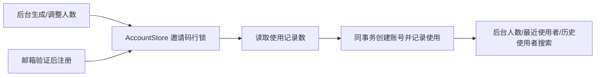

# 邀请码人数额度

目标：管理员为每码设置正整数人数上限，多个邮箱可共享一码；注册成功才计入额度。旧码保留 1 人上限，管理员可提高；停用、删除、到期继续拒绝注册。用户选择自定义人数：网页必填正整数，不预置档位；既有三参数 CLI 和省略额度的 API 保留旧 1 人语义。完整显示沿用已交付功能。

## 决策与实现计划

采用独立 `auth_invite_uses(invite_id, account_id, used_at)` 记录每次成功注册，`auth_invites.max_uses` 为额度唯一来源。迁移回填原 `used_by/used_at` 后删除旧列，列表的使用人数与最近使用者均从使用记录派生。不采用覆盖最近用户而丢弃历史的方案，也不维护第二个可写计数器。

AccountStore 注册事务先锁邀请码行，再在新的 SQL 语句中读取已使用人数（避免等待行锁前的 READ COMMITTED 快照导致漏计），完成注册后插入使用记录。调整上限也取得同一行锁，禁止降到已使用人数以下。停用与删除自然共用该行的更新锁。依据 [PostgreSQL 16 行锁](https://www.postgresql.org/docs/16/explicit-locking.html) 与 [Ecto 迁移](https://hexdocs.pm/ecto_sql/Ecto.Migration.html)；适用现有 PostgreSQL 单库事务，保留既有邮箱证明/账号唯一性边界，不增加重试或备用计数。

- [x] 用真实 Auth + 独占 PostgreSQL 测试库验证顺序复用、3 个邮箱争抢 2 个额度、到期/停用/删除、修改额度与历史迁移；邮件使用 TestMailer。
- [x] 新迁移、AccountStore、Admin/API/网页表单与状态展示一起修改。CLI 使用 `Admin.generate_invites/4` 和 `Admin.set_invite_limit/2`。
- [x] 经 Phoenix 正常注册和管理员表单验证页面行为；最小命令为 Auth 目录 `mix.bat test --no-start test/auth_server/invite_capacity_migration_test.exs test/auth_server/identity_test.exs test/auth_server_web/controllers/account_controller_test.exs`。
- [x] 检查发布范围及迁移，只携带本功能相关代码与迁移，保留回退证据。多用户记录不可无损回滚为旧单人字段，降级必须显式拒绝此种数据丢失。

证据输出放在 `.demo/observe/invite-capacity/`。以上是功能和 HTTP 验证，不冒充浏览器视觉或游戏客户端验收。

2026-10-28 验收：24 项真实数据库／HTTP／迁移测试通过，随后新增的真实网页二人共享邀请码注册与降额拒绝用例单独通过。线上镜像 `voxim-server:20261028-invite-capacity` 基于 `20261028-invite-display` 构建；只替换 AccountStore、Admin、AccountController、AccountAdminController、AccountAdminHTML、Router，加入本次一条迁移。迁移已完成，登录页 HTTP 200；线上回滚事务验证二人共码、用尽拒绝、提高上限后第三人注册及 `3 / 3 人` HTML，未遗留测试账号与邀请码。Scene 拓扑与 QUIC 均就绪。服务器发布证据、备份与源码在 `/data/voxim_qinglan/releases/20261028-invite-capacity/`。回退前必须先停止应用并用新镜像将本迁移降级；已有多人历史时会明确拒绝，不允许只切换旧镜像。
