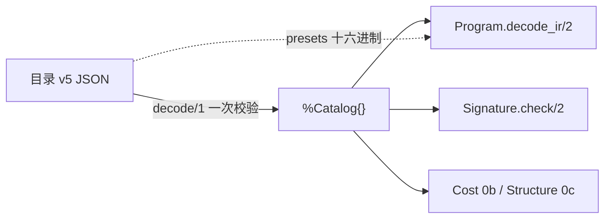

# 魔法目录 v5 schema（服务端起草）

> 状态：**切片 0a**，随 `Magic.Catalog` 版本 5 解码一起落地；已按设计 v2.6 更新、v2.8 调整 4 个姿态（姿态、9 个预设、`b_floor`、§11.4.5.1 新常数、K3 全部下标冻结），§7 各项均已由设计确认或改正。
> 上游：决策稿 [`2026-11-19-glyph-v2-server-landing.md`](2026-11-19-glyph-v2-server-landing.md) §3.1；设计 v2.6 §11.4.5 规定目录 v5 由服务端起草并冻结。
> 唯一解释者：`apps/voxel_region/lib/voxel_region/magic/catalog.ex`（schema 与加载校验）、`program.ex`（IR v2 字节）、`signature.ex`（签名）。本文只描述字段，不复述字节规范；字节规范以设计 §11.4 为准。
> Test-only 夹具：`apps/voxel_region/test/fixtures/magic/<sha256>.json`（P1 内容，见 §6）。

## 1. 总体

- 发布物是 UTF-8 JSON 文件；digest = 文件字节 sha256，文件名即 digest 的小写十六进制（与 v4 同法）。
- 加载即信任边界：任何字段缺失、类型或取值不符都让 `Catalog.decode/1` 抛出 `ArgumentError`，消息带字段路径与原因（AGENTS 铁律 8）。通过后的值是 `%VoxelRegion.Magic.Catalog{}`，下游不再复核。
- v4（`version: 4`）分支原样保留，返回旧的 map，切片 1 删除。

## 2. 顶层字段

| 字段 | 类型 | 语义 |
|---|---|---|
| `version` | 5 | 目录版本 |
| `caster` | 对象 | `resolution_omega`（建构分辨 Ω，单位“单元 × 精度”）、`capacity_j`、`max_power_w`、`draw_efficiency`（0 < η ≤ 1） |
| `construction` | 对象 | 构造计价：`b0_w`、`b_floor`（维护功率底数下限，b_i = b0 · max(b_floor, …)^α，设计 §4.2、§11.4.7；P1 = 1）、`alpha`、`e_ref_j`、`eta_j_s_per_rad2`、`release_lead_s`（≥ 0）、`rest_pose`（6 关节，整数度） |
| `limits` | 对象 | 见 §3 |
| `quotas` | 对象 | 设计 §5.6 配额，见 §4 |
| `runtime` | 对象 | 设计 §13 第 21 项等运行期常数，见 §4 |
| `semblance` | 对象 | `specific_heat_j_per_kg_k`（C_th = 质量 × 比热）、`thermal_conductivity_w_per_m_k`（T15 接触上限） |
| `group_signature` | 对象 | `requires_all`：每个结构组必须具备的标签（表达 §3.1“恰好 1 个〈形〉、恰好 1 个〈蓄〉”，与各符号 `max_per_group: 1` 合用） |
| `symbols` | 数组 | 已发布符号表，见 §5 |
| `reserved_symbols` | 数组 | 预留下标表 `[{index, id}]`，见 §5.1 |
| `presets` | 数组 | `{id, name, program_hex}`；`id` 用设计 §11.4.5 推荐值；`program_hex` 为 IR v2 字节的小写十六进制、无空格（N8）；加载时逐个用 `Program.diagnose_ir/2` 解码（含签名），任一失败即拒绝整个目录 |

## 3. `limits`

| 字段 | 语义 | 加载约束 |
|---|---|---|
| `program_max_bytes` | 程序字节上限（不含 0x82 的 u16 长度前缀） | 1..512；解码器直接使用，所以生效值就是 min(目录值, 512) |
| `range_m`、`local_domain_m`、`cast_interval_ms` | 射程、本地施法域、施法间隔 | 正数；`local_domain_m ≤ range_m` |
| `backup_modes` | 已开放的规则 `backup` 取值 | ⊆ {0, 1, 2}，必须含 0；P1 = `[0]` |
| `counts` | §11.4.1 十个计数的目录值：`n_act n_grp n_ref n_shape n_qual n_energy n_motion n_rule n_read n_resp` | 整数，0 ≤ 值 ≤ 解码器硬上限（`Program.hard_limits/0`）；`n_act = 1`，`n_grp ≥ 1` |

## 4. `quotas` 与 `runtime`

全部为正数；名称带单位后缀；未列出的字段一律拒绝。0a 只解码，语义由 Cost（0b）、Structure（0c）与切片 9 消费。
共 `quotas` 19 项、`runtime` 37 项（35 个数 + 2 个三元组）。设计 §11.4.5.1 核对了原有的 17 + 23 项（设计写作“17 + 25”，按名称逐项数实为 23）并确认名称、语义、P1 值一致；表中标 ★ 的是该节建议补入、本次照抄名称与值加入的字段。

| `quotas` 字段 | 设计量 | P1 值 |
|---|---|---|
| `structures_per_caster` | 每人每分区运行结构 | 6 |
| `folded_per_caster` | 每人每分区折叠核（P2） | 3 |
| `flights_per_caster` | 每人每分区飞行中 | 2 |
| `region_budget_units` / `region_reserve_units` | 分区算力预算 B / 在场保底预留 | 256 / 32 |
| `fair_share_ratio` | 公平准入阈值 | 0.75 |
| `structure_weight_base` / `_awake_thermal_node` / `_per_rule` / `_per_sensing_coupling` | 结构权重各项 | 1 / 2 / 0.5 / 0.5 |
| `structures_per_npc` / `npc_budget_ratio` | NPC 配额 | 4 / 0.25 |
| `region_flight_slots_base` | 分区飞行名额基数（另加在场人数） | 16 |
| `awake_thermal_nodes_per_region` | 每分区醒着的热节点 | 16 |
| `triggers_per_region_tick` / `triggers_per_caster_tick` | 触发预算（待实测） | 64 / 8 |
| `quotes_per_caster_per_s` | 报价限频 | 4 |
| ★ `present_floor_structures` | 在场者保底结构数（§5.6） | 1 |
| ★ `region_flight_slots_per_present` | 每名在场者追加的分区飞行名额（§5.6） | 1 |

| `runtime` 字段 | 设计符号 | P1 值 |
|---|---|---|
| `run_loss_ratio` | ρ_run | 0.05 |
| `reference_volume_m3` | V_ref | 0.05 |
| `disruption_rate_per_s` / `disruption_load_gain` | D0 / κ | 0.02 / 4 |
| `repair_rate_per_s` / `repair_unit_cost_j` | r0 / e_r0 | 0.05 / 4000 |
| `coherence_loss_per_debt` / `segment_debt_limit` / `coherence_min` | c_d / 段阈值 / C_min | 1 / 0.5 / 0.3 |
| `min_energy_per_complexity_j` | E_min 单位（× S·P） | 250 |
| `storage_density_j_per_m3` / `throughput_density_w_per_m2` | e_v / φ_A | 1.6e7 / 2e5 |
| `grade_multipliers` | 容量与修复等级倍率（1、2、3 级） | [1, 1.75, 2.5] |
| `env_temperature_gain` / `env_neighbor_gain` / `env_embedded_gain` | a_T / a_N / a_M | 0.5 / 0.3 / 0.5 |
| `disruption_dose_gain` / `release_dose_ratio` | a_X / k_rel | 1.0 / 0.3 |
| `repair_quality` | Q（照原型 / 含偏离 / 从零 ≥ 2 类） | [1.0, 0.85, 0.7] |
| `leak_deposit_max_j` / `leak_deposit_temperature_k` | Q_dep = min(10 kJ, 2 K × 格热容) | 10000 / 2 |
| `thermal_step_min_ms` / `thermal_check_temperature_k` | T15 步长下限 / T_chk | 25 / 2500 |
| ★ `windup_interrupt_dose` | 前摇打断的累计扰乱量（§5.5、§7.3） | 0.3 |
| ★ `env_neighbor_radius_m` / `env_neighbor_max` | env 邻近活动的空间网格半径 / 邻居上限（§4.3、§5.3.2） | 8 / 16 |
| ★ `env_temperature_ref_k` / `env_temperature_scale_k` | env 温度项的 300 K 与 100 K（§4.3） | 300 / 100 |
| ★ `release_dose_radius_m` | 终止释放剂量半径（§5.5） | 3 |
| ★ `overline_leak_factor` | 越线增量 2 × e_r·(D − R_max)（§4.3） | 2 |
| ★ `dropout_debt_scale` / `dropout_max` | 越线失准 p = min(0.5, debt / 0.5)（§5.4） | 0.5 / 0.5 |
| ★ `leak_heat_fraction` | 泄漏沉积中作为热的份额（§5.3 第 8 步） | 0.5 |
| ★ `release_heat_fraction` | 终止释放中作为热的份额（§5.5） | 0.5 |
| ★ `thermal_sleep_delta_k` / `thermal_sleep_power_w` | 热节点休眠阈值（§5.3.2） | 5 / 100 |
| ★ `quote_life_slices` | `life_s` 能量切片求积段数（§4.2） | 32 |

`Magic.Structure` 与 `Magic.Cost` 读取上表全部 `runtime` 字段，不再持有同值模块常数（0b）；只保留设计正文写死、目录没有字段的归一常数（邻居与剂量的 1 kW、释放剂量的 1 kJ、过载线 0.8·x*、〈满〉的 1/32 量化）。`env_neighbor_max` 由 World 选邻居时使用；`thermal_sleep_*`、`windup_interrupt_dose` 的消费方在切片 1。
## 5. 符号表 `symbols[]`

| 字段 | 必填 | 语义 |
|---|---|---|
| `index` | 是 | u16 稳定下标，按设计 §2.3 表序冻结（K3），发布后不复用；与 `reserved_symbols` 合起来唯一 |
| `id` | 是 | 符号 id；表内唯一 |
| `section` | 是 | `caster_action`、`anchor.form`、`anchor.ref`、`shape`、`quality`、`energy`、`motion`、`rule.reading`、`rule.response` |
| `phase` | 是 | 阶段号（正整数）；只发布已开放阶段的符号（B4） |
| `in_program` | 否，默认 true | false 表示该符号只用于编辑器、计价与字形，下标出现在程序任何 Glyph 位置都拒绝（〈否〉，N3） |
| `params` | 是 | 槽数组，**顺序即字节顺序**，P1 照抄设计 §11.4.2 槽表；见下表 |
| `ranges_by_param` | 否 | `{枚举槽: {枚举名: {槽: [min, max]}}}`；必须覆盖该枚举的每个已发布值；“须为 0”写作 `[0, 0]` |
| `provides` / `provides_by_param` | 否 | 本符号向本组提供的标签 / `{槽: {取值键: [标签]}}` |
| `requires_all` / `requires_any` / `requires_by_param` | 否 | 本组须具备的标签 / “且”组的“或” / `{槽: {取值键: [标签]}}` |
| `excludes` | 否 | 本组不得具备的标签 |
| `max_per_group` | 段符号必填 | 组内出现次数上限；`anchor.ref`、`shape`、`quality`、`energy`、`motion` 段的符号必须写明（落实 §11.4.3 第 2 条“同一下标只能出现在允许多次的符号”），规则段符号可省略 |
| `max_per_rule` | 否 | 单条规则内（读数 + 响应 + 备用响应）出现次数上限 |
| `unique_by` | 否 | 槽名列表：同组内按这些槽的取值判唯一（〈容〉每种 ≤ 1） |
| `refs` | 否 | `[{param, kind: group\|rule, must_be: earlier}]`；`param` 必须是 `ref8` 槽 |
| `numeric_checks` | 否 | 只声明计价层数值检查（设计 §3.3 定名）：`capacity`(T5)、`domain`(T6)、`first_tick`(T13)、`ambient_floor`(T14)、`thermal_step`(T15) |
| `units` / `units_by_param` | 是 / 否 | 计价单元 S；`units_by_param` 命中时取代 `units` |
| `precision` / `precision_by_param` | 是 / 否 | 精度增量 π；同上 |
| `pose` | 是 | 双支链 6 关节 (q1, q2, q3 \| q4, q5, q6)，存储为**整数度**（设计 §2.6 给出的就是度），5 的倍数、\|q\| ≤ 175；服务端加载时换算为弧度，客户端直接读本字段 |

**取值键**（`*_by_param` 共用，设计 §3.2，v2.5 S2）：枚举槽取已发布的枚举名；`u8`、`lin16`、`dec`、`mask8` 槽取解码后、换算到内部单位的整数的十进制字符串（J 槽按 mJ，如 50 kJ 写 `"50000000"`；其余按槽单位）；任何已写入（非“未写”）的值另外匹配键 `"present"`，用于 `zero_means_absent` 槽（〈形〉`mass_g` 写入时提供 `mass`）。

**槽 `params[]`**：

| 字段 | 语义 |
|---|---|
| `name` | 槽名，带单位后缀（N7），后缀必须与 `unit` 一致 |
| `class` | `dec`、`lin16`、`u8`、`enum8`、`mask8`、`ref8`（`id16`、`sid96` 随 P2 符号再开放，现在加载即拒绝） |
| `unit` | `dec`：`J`、`W`、`g`；`lin16`：`mm`、`dK`、`mm/s`、`cs`、`cdeg`、`bp`；其余类不写 |
| `min`、`max` | 闭区间，以槽单位计的整数；数值槽必须有区间，或被 `ranges_by_param` 的每一项覆盖；`cdeg` 的 max ≤ 35999（N6） |
| `enum` | `enum8`：`[{code, name}]`，只列已发布值 |
| `bits` | `mask8`：`[{bit, name}]`，只列已发布位 |
| `zero_means_absent` | 原始值 0 = 未写，跳过区间检查（B1） |
| `refs_enabled` | `ref8`：false 时字节层只允许 0xFF；true 时非 0xFF 值是否严格在前（含越界）由签名层按 `refs` 判，原因码 `refs`（v2.6 S4）。所以每个 `ref8` 槽都必须在本符号 `refs` 中声明，否则加载拒绝 |

解码后的程序参数表以槽名为键、内部单位为值（设计 §11.4.7）；唯一换算是能量：`_j` 槽换算为整数 mJ，键名随之改为 `_mj`（如 `energy_j` → `energy_mj`）。其余槽保持槽单位整数；枚举槽为枚举名；`ref8` 的 0xFF 与“未写”槽为 `nil`。

### 5.1 预留下标 `reserved_symbols[]`

设计 v2.4 K3：目录 v5 按 §2.3 表序一次冻结全部 61 个下标（0 = `energy.draw` … 60 = `real.ascend`）。

- 已开放阶段的符号进 `symbols`；其余 47 个只以 `{index, id}` 写进 `reserved_symbols`，不带签名、槽或姿态。
- 预留项**不发布**：解码层只认 `symbols`，预留下标出现在字节任何 Glyph 位置都按 `{:unknown_index, …}` 拒绝（§11.4.3 拒绝清单的“未知下标”）。
- 发布时把该项从 `reserved_symbols` 移进 `symbols`，下标不变；下标永不复用。〈否〉`resp.backup` 预留 0x0035，P2 以 `in_program = false` 发布。
- 加载约束：`index` 与 `id` 各自唯一，且都不与 `symbols` 重复；已发布与预留的下标合起来恰好是 0..n−1（表序不留空洞）。

## 6. P1 Test-only 夹具

- 文件：`test/fixtures/magic/c6f60cdbcdcc287d71301ed415a0782d8968cc9c7376cb49aed7d2a0ab5e421b.json`（取代 0a 初版 `ce77caac….json`）。
- 14 个 P1 符号，下标取设计 §2.3 表序（〈容〉0x0017、〈满〉0x0024）；其余 47 个下标写入 `reserved_symbols`（含〈否〉0x0035）。签名按设计 §2.3、§3.1–3.3 写成数据。
- `pose` 照抄设计 §2.6 的 14 个 P1 姿态（整数度；〈取〉保留 v4 姿态）。v2.8（字形辨识 G1）调整了〈遇〉34、〈时〉35、〈满〉36、〈散〉44 四个姿态，〈散〉所在响应层左三位改为 (−60, −45, 10)。
- 预设：§11.4.5 清单的 9 组，按清单顺序：`draw_1mj`、`draw_2mj`、`lamp`、`fireball`、`hot_throw`、`scorch`、`dispel_pulse`、`timed_ember`、`guarded_fireball`。字节从设计 §11.4.4 逐字抽取；同一份字节另存 `test/fixtures/magic/ir-v2-samples.json`（带本目录 digest），供客户端测试读取。
- `construction.b_floor = 1`；`quotas` / `runtime` 含 §11.4.5.1 建议补入的全部字段（§4 标 ★）。

## 7. 服务端临时处理的确认状态

0a 初版的 6 项服务端临时处理，设计 v2.3–v2.6 已逐项答复：

1. **已确认**（v2.3 歧义 3）：段基数“恰好 1 个〈形〉/〈蓄〉”用目录级 `group_signature.requires_all = ["form:semblance", "energy:load"]` 表达，二者 `max_per_group = 1`（设计 §3.2）。
2. **已确认**（v2.3 歧义 4）：`provides_by_param` 对 `zero_means_absent` 槽使用取值键 `"present"`（设计 §3.2）。
3. **已确认**（v2.3 歧义 8）：`numeric_checks` 名称 `capacity`(T5)、`domain`(T6)、`first_tick`(T13)、`ambient_floor`(T14)、`thermal_step`(T15)（设计 §3.3）。
4. **已确认**（v2.3 歧义 5）：解码只把能量换算为整数 mJ（键 `_j` → `_mj`），其余保持槽单位整数（设计 §11.4.7）；`*_by_param` 的数值取值键同样按内部单位（v2.5 S2）。
5. **已确认**（v2.3 歧义 7）：〈时〉`from` 的〈记〉见证推迟到 P2 随〈记〉一起写入 schema；P1 `refs_enabled = false` 不可达。
6. **已改正**（v2.3 歧义 9）：新符号姿态不再借用 v4 或占位，改为设计 §2.6 给出的值（§6）。
