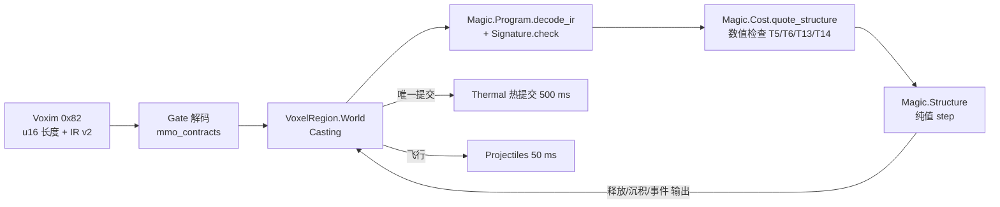

# 符号组合魔法 v2：服务端落地决策稿

> 状态：**用户已于 2026-11-19 批准 §4 的 D1–D9。** 冻结字节须等设计答复 B1–B6 后再生成（见第 7 节）。本稿依据 AGENTS.md §3-8 要求先写决策稿。
> 设计来源：TheWorldBook `docs/2026-11-19-glyph-composition-game-design.md`（v2，下称“设计”），以及用户 2026-11-19 对 Q1–Q19 的裁决（设计 §14.0）。设计本身尚未提交 git；本稿引用的章节号以 v2 为准。
> 代码基线：`29531ea4`，Hello 44。本稿所有代码断言来自只读核对。

## 1. 目标与范围

目标：把设计 v2 的“结构卡 + 类型签名 + 成本模型 + 每拍步进的结构对象”落到服务端权威实现，替换现行 v1：JSON 程序、`@shapes` 六种序列、目录 v4。

不在范围内：
- 客户端（Voxim）的实现；
- 世界正典；
- 动量接触的实现（排期见 §6）。

## 2. 对 worldbook 服务端调研的更正

| 调研原文 | 实际 | 影响 |
|---|---|---|
| 1 万活动格一批 2062 ms，热内核已超节拍；设计 §5.6 据此折算出 89 ms/批 | 2062 ms 是纯 Elixir 夹具的数据，且不含持久化（`docs/10-active/field-emergence/2026-09-15-voxim-b3-active-thermal.md:25`）。换 Rust NIF 后，1 万格无库中位 116.3 ms；全链路（真实 Db、观察投影、排队）中位 103.9 ms，其中准备 29.3 / NIF 3.7 / 接纳 17.0 / 落盘 35.2 ms（同文件 :53，共享机实验，不能当作容量验收） | 按线性折算，432 格约 5 ms。但内核步长取全局最小值（`native/voxim_thermal/src/kernel.rs:108-111`），一个小热容、高温的结构会让整个活动集的子步数成倍增加。线性折算不成立，必须实测 |
| Scene 做扫掠并判 Harm | 扫掠和 Harm 在 World 的异步任务里，调用 `WorldServer.Movement.Projectile.sample`（`world_server/.../projectile.ex:47`）；Player 接纳时再复核一次（`scene_server/.../player.ex:472-477`） | 新的作用类型沿用这两个判定点 |
| 拟态维持期没有授权复核 | 热内核按保护区持有者切断跨边界接触（`voxel_region/world/thermal.ex:759-760`）。真正的缺口是 `release_cell` 不复核持有者（`thermal.ex:826-833`，推测） | 按 Q7 在释放执行时复核 |
| 走火相干度 = 目录值 × Scene 系数 | 结算时取出手瞬间的 `actor.coherence_factor`（`casting.ex:329`、`player.ex:807`）；那个公式只用于报价 | 运行中相干度应从同一来源取 |
| S1a 只提到 A2 的 `stream_row` | S1a 尚未开始；漏了 A1：施法者能量要迁到 `Pages.character_row`，`casting.ex` 也在 A1 范围内（`voxel-authority/2026-10-24-world-region-paging/execution-plan.md:632-648`） | 维持费由谁付会落在 A1，要与 S1a 对齐 |
| NPC 施法“批 4 后期”才做 | master 上已接通（`npc_server/README.md:93-104`、`actions.ex:221-247`） | v2 会让 NPC `profile.spells` 的 JSON 程序全部失效 |
| 调研列了 10 个问题 | 实际是 12 个 | — |

其余描述（六个动词、目录 v4、Cost 公式、0x82/0x83 布局、拟态记录 135 B、背压、Access/Harm 表）与代码一致。

## 3. 切片划分

### 3.1 切片 0：纯值模块与冻结样本

模块全部放在 `apps/voxel_region/lib/voxel_region/magic/`，属于 World 的信任边界。IR 帧长依赖目录槽定义，所以 IR 解码不放进 mmo_contracts；mmo_contracts 只承载“u16 长度 + 字节”。

| 模块 | 新建/修改 | 职责 |
|---|---|---|
| `Magic.Catalog` | 改 | 增加 version 5 解码：签名、符号、常量、量化表；schema 见 [`2026-11-19-catalog-v5-schema.md`](2026-11-19-catalog-v5-schema.md) |
| `Magic.Signature` | 新 | 只解释签名数据（`requires_all/any/by_param`、`excludes`、`max_*`），不按符号 id 写分支（设计 §3.2） |
| `Magic.Program` | 改 | `decode_ir/2` 输出类型化程序，或返回 `:invalid_program`，内部保留诊断原因 |
| `Magic.Cost` | 改 | `quote_structure/4` 报价；数值检查 T5/T6/T13/T14 只在服务端做（Q3）；`staged_failure/3` 取代二值的 `misfire/3` |
| `Magic.Structure` | 新 | 储能用整数 mJ；`step/3` 是纯值函数，只输出释放、沉积请求和事件，由 World 提交（铁律 5） |

热内核限流推迟到切片 1：语义未定，也没有调用方。

切片 0 只在同一分支上作为切片 1 的前置合入，不对外宣称功能交付（§2.2-1、铁律 10）。

测试矩阵（最小充分，期望值取设计附录 A 的手算数）：
1. IR：7 个预设的冻结字节可解码；截断、尾随字节、未知索引、量化越界、超过 512 B、版本错各 1 条反例。
2. Signature：每条规则 1 个反例，7 个预设通过。这组字节就是双端对拍的**唯一判据**，由服务端持有，客户端测试读同一份字节。
3. Cost：
   - 灯和火球按 A.2 手算，误差 < 1%；
   - T13 边界两侧（差 1 J 拒绝、刚好够通过）；
   - T5、T14 反例；
   - `fail_step` 构造用例；
   - 性质测试 `E_phys ≥ 0`。
4. Structure：
   - 灯寿命约 132 s；
   - x* 在 env = 1 和 env = 2 时分别为 0.61 和 0.25；
   - A.4 剂量；
   - 三种终止类型；
   - 整数账闭合。
5. 回归：在 Linux/WSL 上跑 `cd apps/voxel_region && mix test --no-start test/magic_*.exs`。

### 3.2 后续切片（按依赖排序）

| # | 内容 | owner | 前置 |
|---|---|---|---|
| 1 | 可观测面：`voxel_structure_*` 日志与热账科目 | 本稿 | — |
| 2 | S1a A2：`stream_row` 预留设计 §5.1 字段 | `world/pages.ex` 等 A2 owner | S1a 排期 |
| 3 | 协议“下一个 Hello”：0x82 改为二进制 IR，删除 semblance id 字段；0x83 扩展；结构记录 v2；状态增量与事件 | `mmo_contracts` | 切片 0 冻结样本 |
| 4 | 施放结算改为构造结构，分阶段失败，前摇打断；删除 v1（`@shapes`、JSON、按 id 驱散） | `world/casting.ex` | 3 |
| 5 | 热提交点接 `Structure.step`，与热结算同在一笔 commit；内核限流 | `world/thermal.ex`、`native/voxim_thermal` | 4 |
| 6 | 飞行与〈遇〉 | `world/projectiles.ex` | 4 |
| 7 | 驱散改为区域剂量 | casting + Structure | 5 |
| 8 | 持久化与重启恢复 | thermal / log / pages | 2、5 |
| 9 | 配额与分区预算 | casting | 8；“分区”语义要等 S2 |
| 10 | 合成负载实测 | 根级 CLI | 遵守本机 UDP 资源约束，只在 Linux 上跑 |

## 4. 待用户批准的决策点

| # | 决策 | 建议 | 理由 |
|---|---|---|---|
| D1 | 切片 0 是否立即开工（Q10 已同意） | 开工，但等 worldbook 先答完 §5 的 C0 问题再生成冻结字节 | 字节形状没定，样本就是废的 |
| D2 | 魔法是否排在 S1a 之后 | 切片 0–1 不依赖 S1a；切片 2/8 等 S1a A2 | S1a 尚未开始，不阻塞纯值模块 |
| D3 | 持久化真值 | 整数 mJ 就是真值，变化的结构随现有热提交事务写入；**不做量化落盘加冷重启补算** | 补算是第二条真值路径，重启与不重启结果会不同（§2.2-9） |
| D4 | 模拟时钟 | 结构维持按热提交拍号推进；积压或装页暂停时结构一起冻结，设计里的寿命按模拟时间表述 | 世界没有独立的模拟拍号；热拍会暂停（`world.ex:1889-1893`） |
| D5 | 飞行时钟 | 暂时保留墙钟飞行（已批准合同 `cast-phases-2026-10-05.md:35`）；若要做确定性，另行审批 | 修改已批准合同 |
| D6 | Harm 跨 app | 把战斗范围作为数据进入 World，或抽成共享契约；World 不直接调用 scene_server | 铁律 6 |
| D7 | 前摇打断 owner | 由 Player（持有前摇 timer）做唯一 owner；World 的干预剂量以消息通知 Player | 避免两个 owner |
| D8 | NPC | NPC 单独配额，不享有在场保底；法术在注册时用 action 0 报价校验；程序字节由 npc_server 迁移 | NPC 长期在场，会占住公平份额 |
| D9 | 原创决策报告 | 实施前，对以下逐项报告依据或标为原创：分池与热份额、稳态线、E_min、剂量公式、75% 准入（对照 max-min / DRF）、限流（对照 flux limiter）、读数丢失、休眠阈值、触发预算 | §2.2-8 |

## 5. 已发给 worldbook 的问题

C0：阻塞切片 0
1. 设计 §11.4 的 IR 头里没有施法者动作层（〈取〉〈调〉）的编码位置。
2. 参数量化未定：每槽 1 字节还是 2 字节、线性还是对数、取整规则、枚举怎么编码。
3. 字节是否必须按规范顺序排列（顺序不对就拒绝），还是由服务端重排。
4. 目录 v5 的 schema 由服务端起草冻结；Ω/coherence 与现行目录（4/18）的对应关系。
5. 内核限流覆盖哪些量；共享边取两者缩放的较小值；`room` 跨多次 NIF 调用累计。

C1：阻塞后续切片
- 持久化（D3）与模拟时钟（D4）；
- “分区”和“在场”的数据来源；
- Hello 编号不预占；
- 剂量公式里隐含的 1 s 常数，衰减措辞，整脉冲还是每拍；
- 干预占比的字段；
- 前摇剂量阈值在哪一拍判；
- 报价逐拍模拟的上限与去抖；
- 〈附〉的面由服务端射线推出；
- 飞行结构的维持出账点；
- NPC（D8）。

## 6. 风险与验证

| 风险 | 验证 |
|---|---|
| 热内核活动集预算（设计 §5.6） | 在 Linux 上按设计 §12.2 第 6 条的组合实测 `voxel_thermal_kernel` 的 `nif_us`、`kernel_steps`（`thermal.ex:656`），另加“单个最小热容的最热结构”反例；必要时在目录里定 C_th 下限，或改为逐节点子步 |
| 灼点能否替代远程点火 | 粗算：旧 `act.heat` 累计 400 kJ，灼点约 200 kJ。World 级测试，用同一块真实木材目标比较两者能否点燃、多久点燃 |
| 热电石 vs 卡诺 | 材料 43：seebeck 0.05 V/K、σ=2、k=15，没有效率字段，效率由物理推出（`circuit.ex:181-259`），ZT 约 0.1（单位未确认）。风险在离散化（段内保持功率）。熵产生性质测试：每段和累计都满足 W ≤ (1 − T_c/T_h)·Q_h。必须在 Q8 开放制冷之前完成 |
| Q19 动量接触 | 动量稿第 3 片会替换“动能全转热”（`semblance.ex:276-277`）。`Structure` 从切片 0 起把动能单列字段、分配做成显式出口；动量第 1、2 片可以并行推进 |
| 持久化体量 | 逐拍写变化结构，最坏约 10 KB/拍，对照 `page_cut.ex:33` 的积压分级实测 |

## 7. 进度日志

- 2026-11-19：收到 worldbook v2 和裁决；完成调研核对与本草案；问题清单已发 worldbook。等待用户批准 D1–D9，以及 worldbook 对 C0 的答复。
- 2026-11-19：worldbook 已确认收到问题清单，正在出设计 v2.1，将逐条答复 C0–C2 并吸收本稿第 2 节的更正。预判倾向（以正式答复为准）：C0-3 取“规范顺序，非规范即拒绝”；C0-4 由服务端起草目录 v5 schema；C1-6/8/9 采纳本稿建议。v2.1 到达前不生成冻结字节。
- 2026-11-19：设计 v2.1 到达，C0–C2 全部有答复。要点：
  - 0x82 程序头加 `kind` 字节：0 = 施法者动作，1 = 结构；纯〈取〉的示例为 `02 00 01 00 00 33 E8`。
  - 参数量化：能量、功率、质量用十进制浮点 u16（4 位 e 加 12 位 m，值 = m × 10^e），其余用线性 u16；四舍五入、远离零。
  - 只接受规范顺序，非规范一律拒绝。
  - 目录 v5 由服务端起草：删除 coherence，新增 `resolution_omega = 16`；0x83 改为下发 Ω_eff；0x82 删除 semblance id。
  - 限流覆盖四类量，共享边取两者缩放系数的较小值，用温度带实现。
  - 新增 T15：每个热节点的稳定步长 ≥ 25 ms。
  - D3 和 D4 被设计采纳。冻结期间配额照计。“在场”由 Scene 推送。
  - NPC：每个 NPC 最多 4 个结构，全部 NPC 合计不超过 B 的 25%，不享有在场保底。NPC 卸载是否断链，作为 Q20 交用户裁决。
  - 下一步：独立逐字节核对 §11.4（不运行设计自带脚本），等用户批准 D1–D9 后再生成冻结字节。
- 2026-11-19：用户批准 D1–D9。
- 2026-11-19：完成 v2.1 §11.4 的独立逐字节核对，没有运行设计自带脚本。取能、灯、火球、驱散脉冲等示例的字节全部一致。下列 6 处规范歧义阻塞冻结字节，已发给 worldbook：
  - B1：`zero_means_absent` 与 [min, max] 的检查先后顺序；
  - B2：〈否〉的 backup 是内联 Glyph 还是 ref8；
  - B3：0x82 中其余字段是否保留，删除的拟态 id 为 12 B；
  - B4：枚举值按阶段开放的规则落在哪一层，本稿倾向只由目录发布决定；
  - B5：P1 参数槽表缺区间，〈乱〉radius 没有下限；
  - B6：sid64 与现行 12 B 拟态 id 不一致。
  另有：N1–N8 非阻塞问题；0x83 的 quote_s 须改为 S·P；T15 应按 t_hi 计算；正文与对照表有 7 处不一致。
- 2026-11-19：设计 v2.2 答复 B1–B6，切片 0a 开工（目录 v5、IR 解码、签名、冻结样本）。用户裁决 Q20 选 (a)：NPC 卸载、死亡、生命代次切换都断开供能链，与 Q1 一致（D8 据此落实）。Q1–Q20 全部裁决完毕。客户端（voxim）确认以本仓冻结样本为唯一来源，按 digest 读取，不另存副本。
- 2026-11-19：切片 0a 实现（未提交）：
  - `Magic.Catalog` 版本 5 解码（schema 见 [`2026-11-19-catalog-v5-schema.md`](2026-11-19-catalog-v5-schema.md)，v4 分支保留到切片 1）；新模块 `Magic.Signature`；`Magic.Program.decode_ir/2` 与 `diagnose_ir/2`（JSON `parse/validate` 与 `@shapes` 保留）。
  - Test-only 目录 v5 夹具 `test/fixtures/magic/ce77caac….json`；冻结样本 `test/fixtures/magic/ir-v2-samples.json` 从设计 §11.4.4 逐字抽取，5 组全部解码为文档声明的语义值。
  - 测试：`test/magic_ir_test.exs`、`test/magic_signature_test.exs`（16 项通过），回归 `magic_test` / `magic_release_test` / `magic_semblance_test` 21 项通过；均在 WSL Linux 上运行。
  - 待设计确认：定时火种标题写 42 B，字节实为 38 B；schema 文档 §7 的 6 项服务端临时处理；§11.4.5 要求 7 个预设，但只有 5 组给了字节（炽热投掷、灼点缺 `phi_grade`，过热保险缺两条规则的优先级），夹具只收这 5 组。
- 2026-11-19：切片 0c 完成：`Magic.Structure` 纯值步进（`magic/structure.ex`、`test/magic_structure_test.exs`，WSL 11 通过）。灯寿命 132.0 s、x* 0.612/0.250、A.4 剂量逐位到三位小数一致。实现时有 9 处规范歧义（债务偿还与 A.4 的 max(0,…)、脉冲是否作用于自身、活动能去向、终止分类、读数丢失与〈时〉、debt 单位、若干未定成本细节、hash 选型、拍长常数两处定义），已发 worldbook。
- 2026-11-19：设计 v2.3–v2.6 到达：补齐 9 个预设字节、§11.4.7 内部单位（仅能量为 mJ）、§2.6 P1 全部 14 个符号姿态、`construction.b_floor = 1`、检查名补 capacity/domain/first_tick、§11.4.5.1 列出 15 个缺字段常数；K1 dec 规范为 e=0 或 m≥410；K3 建议按 §2.3 表序冻结全部 61 个下标；K4 字节/签名/计价三层分工；S1–S4 与本仓实现一致。用户决定：0a 等 v2.3 后再提交，夹具更新后提交。
- 2026-11-19：0a 夹具按 v2.6 更新（未提交）：目录夹具改名为 `64834aa5….json`（删除 `ce77caac….json`），写入 §2.6 姿态、9 个预设、`b_floor`、§11.4.5.1 新常数与 47 个预留下标（`reserved_symbols`，K3）；`ir-v2-samples.json` 增至 9 组。签名违规补步序号（S3）；加载器要求每个 `ref8` 槽有 `refs` 声明（S4）。schema 文档 §7 六项均已确认或改正。WSL：magic_ir / signature / structure / magic / release / semblance 共 52 项通过。
