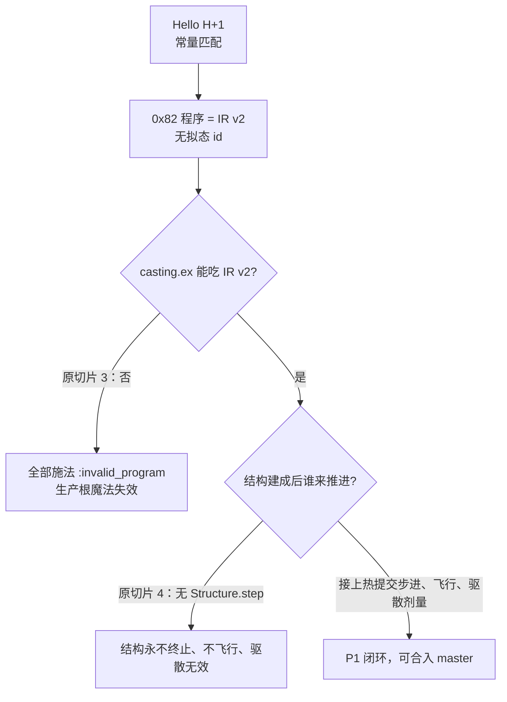

# 符号组合魔法 v2 切片 3：协议“下一个 Hello”决策稿

> 状态：**用户已于 2026-11-20 批准 §12 的 P1–P14（全部按推荐）；未实施。** 编码开工前须等客户端答复 C1/C2/C3/C5。依据 AGENTS.md §3-8：协议扩展先写决策稿，再实施。
> 上游：[`2026-11-19-glyph-v2-server-landing.md`](2026-11-19-glyph-v2-server-landing.md)（下称“落地稿”，§3.2 切片表、§4 D1–D9）、
> [`2026-11-19-catalog-v5-schema.md`](2026-11-19-catalog-v5-schema.md)（下称“schema 稿”）、[`cast-phases-2026-10-05.md`](cast-phases-2026-10-05.md)（现行施法分段合同）。
> 设计来源：TheWorldBook `docs/2026-11-19-glyph-composition-game-design.md` v2.10（下称“设计”），§4.2（含 E4）、§11、§12、§14.0。
> 代码基线：分支 `magic-v2-slice0`（`5755b72a`，目录夹具 digest `fcc1002a…`），工作区与之一致；master 为 `29531ea4`，Hello 44。本稿所有代码断言来自只读核对；行号按该基线。

## 0. 结论摘要

1. **原切分不成立。** Hello 是常量匹配，0x82 的程序字段一换成 IR v2，现有 v1 施法路径整条失效；只合入协议（原切片 3）会让生产根的魔法全部变成 `:invalid_program`，只合入“构造结构但不步进”会产生永不终止的结构。两种中间态都不能进入唯一生产根（铁律 10）。
2. **建议：** 在特性分支上按 §2 的新切片 3–8 逐片实现、逐片验收；**只在 P1 闭环（设计 §12.2 切片 1 的验收）后**，与 Voxim 同版本一起合入 master 并占用下一个 Hello。分支上的开发服明确标为 `probe`。
3. 新切片 3 = 协议定型（Hello H+1、0x82 v2、0x83 v2、施放记录 v2）+ 施法改为 IR v2 解码、报价、分阶段失败 + 〈取〉完整施放 + 删除 v1 的解析与计价 + NPC 程序改为 IR v2 字节。结构施放“建成”分支在切片 3 内显式拒绝，切片 4 换成真正的构造。
4. 结构记录 v2、状态增量和事件编号放在切片 4（有生产者时定型），与切片 3 同属一个 Hello。
5. **施法域距离只在报价里判一次**（设计 v2.10 §4.2 E4，已与设计方确认，见 §3.5）：目录〈取〉声明 `numeric_checks: ["domain"]`；World `spell_target` 的距离检查删除；出手时 World 用当时的施放处读数重新报价、重新判 `rejects`。拒绝原因从 `out_of_domain` 变为 `rejects` 中的 `domain`。

## 1. 现状核对（与切分有关的事实）

| 事实 | 位置 |
|---|---|
| Hello 是常量字段，不等即 `:invalid_m1_message` | `mmo_contracts/session/codec.ex:2,11`；测试 `magic_wire_test.exs:38-45` |
| 0x82 现行帧 139 + n B，程序是 UTF-8 JSON，带 12 B 拟态 id | `mmo_contracts/voxel/codec.ex:171-236` |
| 0x83 现行帧 73 B，`coherence` = 目录相干度 × 身体系数，`quote_s` = 符号权重之和 | `voxel/codec.ex:470-478`；`world/casting.ex:38-49` |
| 结算结果码在 PropertyBatch 的施放记录里（`outcome` 0/1/2），回执原因是 0x68 的字符串 | `voxel/codec.ex:1358-1425`；`gate_server/session/quic_connection.ex:263-289` |
| 施法只认 v1：`Program.parse` → `warm_semblance` → `Cost.quote`；结算按 `sym` 字符串分支，二值走火 | `world/casting.ex:74-87,193-253,321-421` |
| World 读 v4 目录的扁平字段（`range_m`、`coherence`、`max_semblances` 等）；v5 是 `%Catalog{}`，字段在 `caster`/`limits` 下 | `world/casting.ex:39,48,101,194,209,233,236,270,278,290,329`；`world/closure.ex:186-190`；`world.ex:1238`；`world/thermal.ex:741,899` |
| `closure.ex:188` 用 `%{range_m: range}` 匹配目录，换成 v5 会**静默**返回 `:none`（不装射程页） | `world/closure.ex:185-191` |
| Player 不解析程序，只持有前摇定时器（`windup_s` 由 World 给） | `scene_server/movement/player.ex:679-687,797-813,1457-1514` |
| NPC 的 `profile.spells` 是 `%{名字 => JSON 字符串}`，注册时只检查是二进制；0x82 请求填 `semblance: {0, 0}` | `npc_server/registry.ex:166,354`；`npc_server/world_request.ex:174-190`；`npc_server/actions.ex:216-251` |
| v4 目录由 UE `DA_MagicCatalogV1` 发布到 `Content/Voxel/Magic/Published/<sha256>.json`，部署时拷成 `catalogs/magic-catalog.json` | `magic/catalog.ex:5-8`；`deploy/README.md:55`；`deploy/.env.example:54`；`config/runtime.exs:147` |
| 目录 digest 不符：`:stale_magic_catalog`，0x68 rejected | `world/casting.ex:75,84`；`gate voxim_spell_dispatch_test.exs:250` |
| v2 纯值模块已就绪：`Program.decode_ir/2`、`Cost.quote_structure/3`、`Cost.staged_failure/3`、`Structure.step/4` | `magic/program.ex:93-127`；`magic/cost.ex:126-208`；`magic/structure.ex` |
| 施法域距离现在两处判：World `spell_target` 用眼点到目标宏格中心的距离（`casting.ex:286-291`）；Cost 的 T6 只对声明了 `domain` 的符号判 `site.formation_distance_m`（`cost.ex:542-549`），目前只有〈附〉声明（夹具 `fcc1002a…`） | `world/casting.ex:276-297`；`magic/cost.ex:510-549` |
| 取能程序的报价忽略 `site`、`rejects` 恒为空 | `magic/cost.ex:127-136` |
| 出手结算复用前摇开始时的报价，不重算 | `world/casting.ex:161-164`（`settle_spell(…, pending.quote)`）；`cost.ex:111,198` 的文档写“同一份报价按两个 Ω_eff 判定” |
| `out_of_domain` 现有三个来源：射线在 `range_m` 内没命中（`casting.ex:279-280`）、距离超出施法域（`:290-291`）、拟态弹道求交落空（`:237-238`）；按 id 驱散的距离检查（`:209-210`） | `world/casting.ex` |

## 2. 切片划分（回答问题 1）

### 2.1 为什么不能按原计划合入



- 原切片 3 合入后：Hello 升版拒绝 Voxim 现行客户端；新客户端发 IR v2，`casting.ex:76` 仍走 JSON，全部 `:invalid_program`。驱散依赖的拟态 id 已从帧里删除（设计 §11.4.6）。
- 原切片 4 合入后：结构对象能建成，但 `Structure.step` 要到原切片 5 才接热提交，结构没有维持费、不衰竭；飞行终点由射程推导（原切片 6）、驱散剂量（原切片 7）也还没有。
- 能否让 v1 与 v2 在同一 Hello 下共存？不行：0x82 只有一种布局；按程序首字节分派两种格式是兼容层，违反 Q2“单一实现、无别名”（设计 §14.0 Q2、§2.4）与 §2.2-7。
- 结论：**能独立合入 master 的最小单元是 P1 闭环**（设计 §12.2 切片 1 的范围）。分支内部可以再切细，每片独立验收，但都不进入生产根。

### 2.2 建议的切分（分支 `magic-v2-p1`，从 `magic-v2-slice0` 起）

| 新片 | 内容 | 对应原片 | 合入后分支状态 |
|---|---|---|---|
| 3 | 协议定型（Hello H+1、0x82 v2、0x83 v2、施放记录 v2）；施法改为 `decode_ir` → `quote_structure` → `staged_failure`，出手时按当时 site 重新报价；施法域距离统一由 T6 判（目录〈取〉加 `domain`，§3.5）；〈取〉完整施放；结构施放的**中断**完整结算，**建成**分支显式拒绝 `:structure_runtime_pending`（不扣能）；报价限频；删除 v1 解析与计价；NPC 程序改为 IR v2 字节 | 3 + 4 的前半 | 可运行：报价、〈取〉、分阶段失败可联调；结构不会建成。`probe` |
| 4 | 结构构造（`Structure.new` + 物理体）、热提交点调用 `Structure.step`、结构记录 v2、状态增量、事件编号、整数 mJ 随热事务落盘（D3）、旧拟态存档一次迁移；删除 `:structure_runtime_pending` 与旧拟态运行时 | 4 后半 + 5 + 8 的最小部分 | 灯、炽热投掷可完整存活与衰竭；火球飞行仍按旧弹道。`probe` |
| 5 | 飞行与〈遇〉：飞行终点由射程推导，投射物拍产生接触读数 | 6 | 火球、过热保险火球闭环。`probe` |
| 6 | 驱散脉冲剂量；前摇打断与取消结账（D7、Q6） | 7 + 落地稿 D7 | 7 个预设全部可施放。`probe` |
| 7 | 配额：每人每分区（单 World 阶段 = 每 World，设计 §12.1 D12）、NPC 配额（D8、Q20）、热内核限流 | 9 + 5 的限流 | P1 功能完整 |
| 8 | Linux 合成负载实测（落地稿 §3.2 第 10 项、设计 §12.2 验收 6），真实双客户端验收后**合入 master**，与 Voxim 同版本发布 | 10 | 进入唯一生产根 |

- 持久化与重启恢复的完整部分（原切片 8）仍等 S1a A2 的 `stream_row`（落地稿 D2）；切片 4 只按 D3 把结构随现有热检查点写入，与设计 §12.1“在此之前，结构随现有热检查点保存（§5.9）”一致。
- 分支每片的验收只证明它声明的范围；在合入 master 前，任何一片都不写成“已进入正式客户端流程”（铁律 10）。
- Hello 编号不预占（设计 §11.5）：分支取 H+1（现为 45）供联调；若 master 期间被其他功能占用，分支变基后顺延。

**依据**：分支内分片、闭环后一次合入是“长期特性分支”模式；它的已知风险是合并冲突随时间增长（Martin Fowler，*Patterns for Managing Source Code Branches*，martinfowler.com/articles/branching-patterns.html）。本项目不能用“按抽象分支”或功能开关规避，因为线协议只有一个版本（`session/codec.ex:11`），且 `deploy/README.md:96-97` 规定协议变化必须客户端与服务端同版本发布。对策：每片结束后变基到 master，冲突面见 §11。**本节引用未在本稿起草时联网复核，实施前补核**（§2.2-8）。

## 3. 字节布局（回答问题 2）

全部大端，与现行帧相同。偏移从 opcode 起算。

### 3.1 0x82 施法意图 v2（上行，127 + n B）

| 偏移 | 长度 | 字段 | 类型 | 说明 / 来源 |
|---|---|---|---|---|
| 0 | 1 | opcode | u8 = 0x82 | 不变 |
| 1 | 8 | `request_id` | u64 | 不变 |
| 9 | 4 | `client_intent_seq` | u32 | 不变 |
| 13 | 8 | `logical_scene_id` | u64 | 不变 |
| 21 | 1 | `action` | u8 | 0 报价、1 施放、2 取消、3 改向；不变（`codec.ex:180`） |
| 22 | 32 | `catalog_digest` | 32 B | 目录 v5 文件字节的 sha256 |
| 54 | 24 | `direction` | f64 × 3 | 单位向量，范数 ∈ (0.99, 1.01)；不变 |
| 78 | 24 | `micro` | i64 × 3 | 准星目标微格；〈附〉的格面由服务端从视线射线推出（设计 §11.4.6 第 8 项、C1-14） |
| 102 | 8 | `incarnation` | u64 | 不变 |
| 110 | 12 | `owner` | birth u64、occurrence u32 | 不变 |
| 122 | 2 | `material` | u16 | 不变 |
| 124 | 1 | `granularity` | u8 | 0..2；不变 |
| 125 | 2 | `program_len` | u16 | **原拟态 id（125..136，12 B）删除** |
| 127 | n | `program` | IR v2 字节 | 1 ≤ n ≤ min(目录 `program_max_bytes`, 512)，由 World 的 `Program` 判（设计 §11.4.3 第 8 条） |

- mmo_contracts 只判帧形：长度精确、`action`、`granularity`、方向范数（`codec.ex:178-181`），**不判** n 的上下限与程序内容。程序长度与内容归 World 的唯一信任边界（§2.2-6；落地稿 §3.1“IR 解码不放进 mmo_contracts”）。
- 解码结果的 map 去掉 `:semblance` 键；`MmoContracts.Voxel.Codec.intent?/1` 共用同一谓词，NPC 构造请求时不再填该键。

### 3.2 0x83 施法者状态 v2（下行，161 B）

| 偏移 | 字段 | 类型 | 单位 | 来源（World） |
|---|---|---|---|---|
| 0 | opcode | u8 = 0x83 | — | — |
| 1 | `request_id` | u64 | — | 报价/施放的请求；登录与身体推送为 0 |
| 9 | `seq` | u64 | — | World 事务号 |
| 17 | `energy_j` | f64 | J | 施法者余额 |
| 25 | `capacity_j` | f64 | J | 目录 `caster.capacity_j` |
| 33 | `resolution_eff` | f64 | 单元 × 精度 | **原 `coherence`**：Ω_eff = `caster.resolution_omega` × 本人 `coherence_factor`（设计 §11.4.5“Ω 与现行目录的关系”）；身体系数取 `state.caster_coherence`（`casting.ex:46-49`） |
| 41 | `quote_j` | f64 | J | `total_mj / 1000` |
| 49 | `quote_s` | f64 | 单元 × 精度 | **改为 S·P** = `units × precision`，与 Ω_eff 同单位（设计 §11.4.6；quote-v2-samples `fields.precision`） |
| 57 | `spent_j` | f64 | J | 本次实际扣除（整数 mJ / 1000）；报价与推送为 0 |
| 65 | `quote_windup_s` | f64 | s | 报价前摇（含出手前置）；非报价为 0 |
| 73 | `x0` | f64 | 1 | 出生装载比 |
| 81 | `x_star` | f64 | 1 | 稳态线（施放处温度，不含邻近干扰） |
| 89 | `e_min_j` | f64 | J | `e_min_mj / 1000` |
| 97 | `p_maint_w` | f64 | W | 出生维持功率 |
| 105 | `life_s` | f64 | s（模拟） | 能量切片求积；带热耦合者为下界 |
| 113 | `detect_w` | f64 | W | 静持可察觉功率（v2.9 A5） |
| 121 | `fail_step` | f64（整数值） | 步 | `Cost.staged_failure(quote, 可用余额_mJ, Ω_eff)` 的 k，无则 0 |
| 129 | `rejects` | f64（整数值） | 位掩码 | 第 0–4 位依次为 T5 `capacity`、T6 `domain`、T13 `first_tick`、T14 `ambient_floor`、T15 `thermal_step` |
| 137 | `entries_charge` | f64（整数值） | 个 | 无〈印〉的〈纳〉数（P1 恒为 0） |
| 145 | `entries_spoof` | f64（整数值） | 种 | 规则所读外部读数种类数 |
| 153 | `first_tick_min_j` | f64 | J | `first_tick_min_mj / 1000` |

- 前 73 B 位置不变，追加 88 B（设计 §11.4.6，v2.9）。
- **扩展段的填写规则**沿用现行 `quote_windup_s` 的口径（`casting.ex:36-37`）：只有报价回复（action 0）带扩展段；登录推送、身体推送、施放结算后的状态，扩展段全为 0。
- **取能程序（kind = 0）**：设计 v2.10 E4 已定义（`cost.ex:104-108` 文档已照此写）：`quote_j`、`quote_s`（= 1 × 1）、`quote_windup_s`、`fail_step`、`rejects` 照常填，其余结构类字段填 0。切片 3 起〈取〉声明 `domain`，所以取能的 `rejects` 可能出现第 1 位（T6，值 2.0），见 §3.5。
- 施法者能量当前是 f64 J（`casting.ex:39,325`）；`staged_failure/3` 要整数 mJ。切片 3 在调用处取 `trunc(余额_J × 1000)`（向零取整，不会多算余额）。是否改为整数 mJ 存储见 P8。

### 3.3 施放记录 v2（PropertyBatch `casts` 字段，变长）

现行布局见 `codec.ex:1358-1383`。v2 改两处：

```
caster:u64, live:u8, outcome:u8, fail_step:u8 (新增),
t0_us:u64, origin_x/y/z:f64,
n:u8, n × (part_index:u8 (新增), adjust_s:f64, inject_s:f64),
program_len:u16, program bytes (IR v2)
```

| 字段 | 取值 |
|---|---|
| `live` | 1 前摇中 / 0 已结算（不变） |
| `outcome` | 0 建成（〈取〉或结构）/ 1 **建构在第 k 步中断**（设计 §11.4.6“结算结果码的语义变化”）/ 2 结算时拒绝（不扣能）；live = 1 时为 0 |
| `fail_step` | outcome = 1 时为 k（1 起）；其余为 0。解码端拒绝 outcome ≠ 1 且 fail_step ≠ 0 |
| `part_index` | 本步部件在规范字节中的 0 起序号（与签名 `part_index`、报价 `steps[].part_index` 同一编号，`cost.ex:82-93`） |

- 定长部分 46 B（现行 45 B），每步 17 B（现行 16 B）。P1 部件上限 1 + 3 + 5 + 12 + 2 + 4 + 4 × 5 = 47 < 256，u8 足够（`program.ex:81-82` 硬上限）。
- **为什么加 `part_index`（原创决策）**：v1 的步序就是程序序；v2 的构造顺序由服务端按“段序 + 段内最近姿态贪心”推出（设计 §11.4.3 推论、§3.5），与字节序不同。不带它，观察者只能自己重算构造顺序，等于让客户端复制服务端的排序算法。检索范围：本仓现行施放记录、设计 §3.5、§11.4.6；设计没有给出构造顺序的线上表示。风险：每步多 1 B。不变量：`part_index` 序列是 0..n−1 的一个排列。验证：golden 正反例（§8）。
- **实际扣除量不进施放记录**：设计 §11.4.6 写“结算记录同时携带 k 与实际扣除量”。施放记录随 PropertyBatch 广播给窗口内所有订阅者，表现层只需要 k；扣除量只发给施法者本人（0x83 `spent_j`，现已存在）。这是对设计的偏离，列为待问 W3。
- 0x68 回执的原因串（`quic_connection.ex:280-284`）：成功 `"ok"`；中断 `"interrupted_omega"` 或 `"interrupted_energy"`（P6）。

### 3.4 拒绝与诊断的线上表示

| 情形 | 线上 | 扣能 | 依据 |
|---|---|---|---|
| 字节层、签名层违规 | 0x68 rejected `":invalid_program"`；**签名违规清单（含 `part_index`）不上线** | 否 | 结构签名由双端各自解释（Q3），客户端编辑器自己能给出同一判定；服务端只写日志（§7） |
| 数值检查违规，action 0 | 0x83 照常回，`rejects` 位掩码 | — | 设计 §4.2“数值检查违规不返回 error” |
| 数值检查违规，action 1，前摇开始时 | 0x68 rejected `"rejects:<检查名,…>"`（如 `"rejects:domain"`），不进前摇 | 否 | 设计 §3.3 计价层判“报价与施放”；施放不允许带违规建造 |
| 数值检查违规，出手时（按出手 site 重新报价） | 施放记录 outcome 2；0x68 rejected `"rejects:<检查名,…>"` | 否 | 设计 v2.10 E4；§3.5 |
| 射线在 `range_m` 内没命中目标 | 0x68 rejected `":no_target"`（原 `":out_of_domain"`，P13） | 否 | `casting.ex:279-280` |
| 报价超频（> `quotes_per_caster_per_s`） | 0x68 rejected `":quote_rate"` | — | 设计 §4.2 末段 |
| 目录 digest 不符 | 0x68 rejected `":stale_magic_catalog"`（不变） | 否 | `casting.ex:75,84` |
| 切片 3 内结构建成 | 施放记录 outcome 2；0x68 rejected `":structure_runtime_pending"` | 否 | 分支临时，切片 4 删除（原创决策，仅 `probe`） |

### 3.5 施法域距离统一由 T6 判（设计 v2.10 §4.2 E4，已与设计方确认）

**决定**

1. 目录〈取〉（`energy.draw`，下标 0）声明 `numeric_checks: ["domain"]`。取能程序的 `site.formation_distance_m` 定义为施法者到能源目标的距离，几何沿用被删除的 World 检查：眼点到目标宏格中心 `(x + 0.5, y + 0.5, z + 0.5)` 的欧氏距离（`casting.ex:290`），行为只换判定位置，不换口径。T6 在 `Cost.quote_structure/3` 里判。
2. World `spell_target` 的距离检查随切片 3 删除，只保留报价这一处判定。删除位置：`world/casting.ex:286-291` 的 `cond` 分支（`(x + 0.5 - ex) ** 2 + … > magic.local_domain_m ** 2 -> {:error, :out_of_domain, state}`，判定在 `:290-291`）。`spell_target` 保留射线命中与“首个命中须是请求的目标”（`:278-288`），改为返回距离供 site 使用。
3. 报价与施放同源：出手时 World 用当时的 site（施法者眼点、出手方向、当时射线命中的目标、所在格温度）重新调用 `quote_structure/3`，重新判 `rejects`；不再复用前摇开始时的报价（`casting.ex:161-164`）。因此前摇期间目标移出施法域，出手时同样以 T6 拒绝（施放记录 outcome 2，不扣能）。`cost.ex:111,198` 的“同一份报价按两个 Ω_eff 判定”文档随之改写：Ω_eff 与 site 都取各自时刻的值。
4. 拒绝原因从 `out_of_domain` 变为 `rejects` 中的 `domain`。

**需要的代码改动（切片 3）**

| 位置 | 改动 |
|---|---|
| `magic/cost.ex:127-136` | 取能子句不再忽略 `site`：按〈取〉声明的 `numeric_checks` 判 `domain`，复用同一个 `violations(:domain, …)`（`cost.ex:542-549`），不另写一份 |
| 目录夹具 `test/fixtures/magic/fcc1002a….json` | 〈取〉加 `"numeric_checks": ["domain"]`；digest 随之改变，`ir-v2-samples.json`、`quote-v2-samples.json` 的 `catalog_digest` 同步；`quote-v2-samples.json` 两个取能预设的 `rejects` 仍为空（预设报价的 site `formation_distance_m = 3.0` ≤ 6 m）。**改夹具前先通知客户端 voxim-53**，提交后附新 digest 与 commit（落地稿第 7 节约定） |
| `world/casting.ex:286-291` | 删除距离分支（见上） |
| `world/casting.ex:161-164` | `settle_cast` 用出手时的 site 重新报价 |
| schema 稿 §5 | `numeric_checks` 说明补“施法者动作段也可声明 `domain`” |

**线上表示怎么变**

| 情形 | 现行（Hello 44） | v2 |
|---|---|---|
| 报价时目标超出施法域 | 0x68 rejected `":out_of_domain"`，无报价 | 0x83 照常回，`rejects` 第 1 位置位（2.0）；其余字段照常（设计 §4.2“违规不返回 error”） |
| 施放时（前摇开始）目标超出 | 0x68 rejected `":out_of_domain"` | 0x68 rejected `"rejects:domain"`，不进前摇 |
| 出手时目标已移出 | 施放记录 outcome 2；0x68 rejected `":out_of_domain"` | 施放记录 outcome 2；0x68 rejected `"rejects:domain"` |
| 射线没命中任何目标 | 0x68 rejected `":out_of_domain"` | 0x68 rejected `":no_target"`（P13） |

`"rejects:"` 后的检查名按位序（capacity、domain、first_tick、ambient_floor、thermal_step）用逗号连接，与 0x83 位掩码同一顺序，客户端可用同一张“检查名 → 提示文案”表处理两种来源。现行 0x68 原因串是 `inspect` 形式（`":out_of_domain"`）；`"rejects:…"` 不带冒号前缀，是有意区分“计价层数值检查”与其他拒绝（原创决策，替代方案是新增一个 0x68 结果码，但那要改 `encode_voxel_result_code` 的码表，范围更大）。

**客户端提示文案**：原 `out_of_domain` 的文案（“目标超出施法范围”一类）改挂到 `domain` 检查上，报价面板的 `rejects` 第 1 位与 0x68 `"rejects:domain"` 显示同一句；`":no_target"` 另配“没有瞄准到目标”。具体文案由客户端定（C5）。

## 4. 结构记录 v2 与状态增量（回答问题 3）

**建议放在切片 4**，与结构构造和 `Structure.step` 同片定型：没有生产者的编码器违反 §2.2-1；设计里 12 B id、live 扩展、状态增量的发送条件都依赖运行期值。与切片 3 共用同一个 Hello（都在分支内，合入时一次升版）。

与现行的关系：

| 项 | 现行 | v2（设计 §11.1–11.3） | 待定 |
|---|---|---|---|
| 完整记录 | 135 B 拟态记录（`codec.ex:1273-1356`），PropertyBatch `semblances` 字段 | 135 + 25 = **160 B**：尺寸 2/3、原型 id、耦合掩码、装载 x、相干 C、状态标志、失效段掩码、锚类型 + 12 B 锚引用 | `break_on_hit` 字节在规则取代后的去留；`temperature_k`、`glow_w` 是否改为由热份额推出的显示值；“形状扩展与尺寸 2、3”4 B 的具体拆分（W5） |
| id | `{seq u64, n u32}`，n 恒为 0（`casting.ex:367`） | 同一 12 B（设计 B6），程序 `sid96`、增量、事件同用 | — |
| 删除/结束 | `live` 0 普通删除 / 2 碰撞结束 | 追加 3–13 事件类型（设计 §11.3） | 事件 13“建构中断”没有结构 id（结构从未建成），建议只在施放记录 `fail_step` 表达（W4） |
| 状态增量 | 无 | 20 B：id 12 + 装载 + 相干 + 标志 + 段掩码 + 温度 u16 + 发光 u16；跨阈值才发、每结构 ≤ 2 Hz | 需要 PropertyBatch 新增字段（`m1_messages` 字段表，`codec.ex:44-61`），属 Hello 范围 |

**观察**：热提交拍长 500 ms（`structure.ex:71-74`，D4）正好是 2 Hz。状态增量随热提交事务的 PropertyBatch 一起发出即可满足“每结构 ≤ 2 Hz”，不需要独立定时器或节流状态（§2.2-9 自然数据流）。

## 5. 目录下发与 digest（回答问题 4）

### 5.1 现行 v4 流程

UE 作者资产 `DA_MagicCatalogV1` Publish → `Voxim/Content/Voxel/Magic/Published/<sha256>.json`（当前 7 个文件）→ 部署时拷进 `/srv/voxim/catalogs/magic-catalog.json` → `VOXIM_MAGIC_CATALOG_PATH`（`config/runtime.exs:147`）→ World 启动时 `Catalogs.load_magic/1`（`world/catalogs.ex:24-29`）→ `Magic.Catalog.load/1`。目录没有运行期热发布入口，换目录要重启。

### 5.2 v5 的建议

- schema 归服务端（设计 §11.4.5、schema 稿）；P1 内容现在只有 Test-only 夹具 `test/fixtures/magic/fcc1002a….json`（schema 稿 §6）。
- **P9 建议**：v5 发布物以本仓为作者源，路径 `apps/voxel_region/priv/magic/<sha256>.json`（不可变、按内容寻址）；Voxim 的集成脚本把同一文件拷进 `Content/Voxel/Magic/Published/`，部署照旧拷成 `catalogs/magic-catalog.json`。方向与 v4 相反（v4 是 UE → 服务端），需要客户端同意（C1）。若 P1 内容即发布内容，测试改为读 priv 文件，不再保留同字节的夹具副本（§2.2-2）。
- 发布约定沿用切片 0 的约定（落地稿第 7 节 2026-11-19 条）：改目录前先通知 worldbook 与客户端，提交后附新 digest 与 commit。
- **digest 不符**：保持现行 `:stale_magic_catalog`（0x68 rejected，不扣能、不改世界）。NPC 由 `World.magic_digest/1` 填 digest（`npc_server/body.ex:1165`），不受影响。
- **部署时目录版本不符**：切片 3 删除 v4 分支后，配置 v4 文件会在 `Catalog.decode/1` 抛错，World 启动失败（显式失败，铁律 8）。升级清单须同时替换 `magic-catalog.json`。
- **v5 字段迁移**：World 内所有读 v4 扁平字段的地方改读 v5 路径（§1 表第 4 行）。`closure.ex:188` 的模式匹配必须一起改，否则射程页静默不装；切片 3 的 World 测试要覆盖“施放触发射程装页”这一条（§8 W-7）。

## 6. 删除 v1 的范围（回答问题 5）

| 项 | 位置 | 替代物 | 删除时机 |
|---|---|---|---|
| `@shapes` 六种序列 | `magic/program.ex:362-369` | `Signature.check/2` 解释目录签名（`magic/signature.ex`） | 3 |
| JSON `parse/2`、`validate/2`、`valid_step?/2` 及 moduledoc v1 段 | `program.ex:26-38,358-412` | `decode_ir/2` / `diagnose_ir/2` | 3 |
| 目录 v4 分支、`@implemented` | `magic/catalog.ex:5-21,29-31,35-37,130-134,137-215` | `decode_v5` | 3 |
| v4 报价 `quote/3`、`physical_j/4`、二值走火 `misfire/3` | `magic/cost.ex:43-46,630-696` | `quote_structure/3`、`staged_failure/3` | 3 |
| 取能分账 `draw/4` | `cost.ex:698-703` | **保留**，移入 v2 节并改读 `catalog.caster.*`；〈取〉仍需要它 | 3（改写，不删） |
| `spell_target` 的施法域距离分支 | `world/casting.ex:286-291`（判定在 `:290-291`） | T6 `domain`：〈取〉在目录声明，Cost 判（§3.5） | 3 |
| 出手复用前摇开始时的报价 | `world/casting.ex:161-164`；`cost.ex:111,198` 文档 | 出手时按当时 site 重新 `quote_structure/3`（§3.5） | 3（改写） |
| `warm_semblance/2` | `world/casting.ex:66-70,77` | P1 的〈热〉`t0_dk` 槽下限与 T14 `ambient_floor` 数值检查（目录数据）；设计 §12.3 写“P1 保留守卫”，指语义而非这段代码 | 3（W6 确认） |
| 按 id 驱散 `spell_effect(…"act.dispel"…)` | `casting.ex:198-219,373-379` | 驱散脉冲（〈乱〉结构，切片 6） | 3（P1 内驱散暂不可用，直到 6） |
| 按 `sym` 分支的 `spell_effect`、`spell_subject`、`settle_spell` | `casting.ex:193-253,299-314,321-421` | 按程序 kind 分支：kind 0 → 〈取〉；kind 1 → 构造（3 中断 / 4 建成） | 3 |
| `coherence/2`、`caster_view/5` | `casting.ex:38-49` | 改为 Ω_eff 与 0x83 v2 映射 | 3（改写） |
| `Semblance.form_j/3`、`kinetic_j/2`、`new/4` | `magic/semblance.ex:167-191` | `Cost` 的整数 mJ 公式（`cost.ex` §11.4.7）与切片 4 的结构构造 | 3（无调用方后删） |
| 拟态运行时中的能量部分（`expired?`、`glow_j`、`stored_j`、`step`、`cap` 等） | `semblance.ex:193-282`；`world/thermal.ex:475,796-799`；`world/projectiles.ex:107` | `Structure.step/4`；几何与弹道（`position`、`trace`、`segment`、`flight_segments`、`contact`、`conductance`、`radiation`）保留为结构的物理体 | 4 |
| 0x82 `semblance` 字段 | `mmo_contracts/voxel/codec.ex:172-177,212-213,227` | 无（驱散改为区域；〈调〉走 `sid96`，P2） | 3 |
| NPC 请求的 `semblance: {0, 0}` | `npc_server/world_request.ex:174-175,186` | 无 | 3 |
| v4 夹具（11 个 `<sha>.json`，`ff15757b…` 是 v2） | `voxel_region/test/fixtures/magic/` | `fcc1002a…`（切片 3 加〈取〉`domain` 后的新 digest） 或 P9 的 priv 发布物 | 随最后一个引用测试删除 |

相关测试（逐个改写或删除，判据见 §8）：
- `voxel_region`：`magic_test.exs`、`magic_release_test.exs`、`magic_dual_arm_test.exs`（v4 目录/程序，删除，被 `magic_ir/signature/cost/structure` 覆盖）；`magic_world_test.exs`、`magic_windup_world_test.exs`、`body_contact_world_test.exs:325,333`（改为 IR v2）；`magic_semblance_test.exs`、`magic_semblance_world_test.exs`（拟态能量与按 id 驱散，切片 3 无法再经施法入口建拟态，删除；运行时覆盖在切片 4–6 由结构测试重建）。
- `gate_server`：`voxim_spell_dispatch_test.exs`。
- `npc_server`：`npc_abilities_test.exs`、`npc_body_cast_test.exs`、`npc_cast_world_test.exs`、`npc_world_request_test.exs`、`npc_registry_test.exs`。
- `scene_server`：`cast_wait_lifecycle_test.exs`（v4 `magic.json` 夹具）。
- `mmo_contracts`：`magic_wire_test.exs`。

## 7. NPC 迁移（回答问题 6）

| 项 | 建议 |
|---|---|
| 数据形状 | `profile.spells` 改为 `%{名字 => 小写十六进制}`（与目录 `presets[].program_hex` 同一表示，N8）；`registry.ex:354` 的 `spell/1` 改为 `Base.decode16!(hex, case: :lower)`，非法十六进制在登记时 raise（与现有“建树即校验”同一层，`registry.ex:145-146,189-190`）。不用 base64：同一程序在目录、样本和 NPC 里只有一种文字形式 |
| 字节校验 | 登记时只能判十六进制；程序合法性要目录，目录在 World。设计 §2.4 要求“注册时用 action 0 报价校验一次” |
| 报价校验时机 | action 0 必须经 `Player.spell/5`（`player.ex:75-82,1467-1477`），要有在场的 Player。建议在 NPC Body 首次进入场景（会话就绪）时，逐个法术发 action 0；`:invalid_program` 或 `rejects` 非空的法术从本会话的 `spells` 枚举中移除，写 `npc_spell_rejected`。注意报价限频 4/s：法术多于 4 个时按限频排队 |
| 存量数据 | 本仓没有带 `spells` 的登记数据（只在测试里）；生产 PostgreSQL 登记行是否有 v1 法术未知（N1）。若有，在同一次发布中由一次性迁移按设计 §2.4 转写表改写，迁移不过的法术删除并记录 |
| 文案 | `actions.ex:232-237` 的 `misfire_energy / misfire_coherence` 描述改为 `interrupted_*`；驱散改为区域脉冲后 NPC 选择须避开己方结构（设计 §2.4 末段，切片 6 再做） |
| 配额（Q20、D8） | 每 NPC 4 个结构、全部 NPC 合计 ≤ B × 25%、不享有在场保底：切片 7。NPC 卸载、死亡、生命代次切换断供能链（Q20(a)）只影响〈链〉，〈链〉是 P2，P1 不实现 |
| owner | 数据形状、请求形状、文案：本切片（3），改 `npc_server` 的 `registry.ex`、`world_request.ex`、`actions.ex` 与测试；会话就绪时的报价校验涉及 `body.ex`，与 NPC 在途会话冲突（§11），建议交 NPC 统筹会话实施，本稿只给契约 |

## 8. 可观测面（回答问题 7，AGENTS §3-2）

所有事件都是一行 `Logger`，`snake_case` 键值；不记录程序全文，只记 `program_sha`（sha256 前 16 位十六进制，模板身份见设计 §11.4.3 推论）与字节数。

| 事件 | 新增 / 修改 | 字段 |
|---|---|---|
| `voxel_magic_program_rejected` | 修改：移到 `casting.ex` 打，带上下文；`Program.decode_ir/2` 现自带的日志（`program.ex:100`）删除，避免一条拒绝打两次 | `cid request_id action bytes program_sha reason`（`diagnose_ir/2` 原因，带偏移；签名违规带 `part_index`） |
| `voxel_spell_quote` | 新增（现在报价不打日志） | `seq cid request_id phase=quote|prepare|release kind program_sha formation_distance_m units precision sp resolution_eff total_mj windup_s fail_step rejects x0 x_star life_s`（出手重报价同一事件，`phase=release`） |
| `voxel_spell_quote_limited` | 新增 | `cid request_id limit_per_s` |
| `voxel_cast_begin` | 修改（`casting.ex:127-130`） | 去掉 `physical_j loss_j`，加 `kind program_sha sp total_mj steps=[{part_index,adjust_s,inject_s}]` |
| `voxel_spell` | 修改（`casting.ex:409-414`） | `outcome=built|interrupted`、`fail_step cause=omega|energy`、`spent_mj balance_before_mj resolution_eff`；〈取〉另加 `taken_mj gained_mj draw_loss_mj` |
| `voxel_cast_rejected` | 保持（`casting.ex:169`），`reason` 新增 `rejects`、`no_target`、`structure_runtime_pending` | `rejects` 名称列表；出手重报价时另记 `formation_distance_m local_domain_m`，便于区分“前摇中移出域外”与其他拒绝 |
| `npc_spell_rejected` | 新增（npc_server） | `npc name program_sha reason` |
| `voxel_structure_*` | 切片 4 起（落地稿切片 1 的热账科目） | 本片不做 |

热账科目：中断扣除沿用 `cast_waste_j`（`casting.ex:423-424`）；`structure_rounding_mj` 等新科目从切片 4 起（设计 §12.2 切片 0 表）。

## 9. 测试矩阵（回答问题 8）

最小充分（AGENTS §3-14、Voxim `Docs/Testing.md` §1–2）：协议用冻结样本；World 走正常公共入口；不复制产品算法当期望。

| # | 层 | 文件 | 用例 | 能证伪什么 |
|---|---|---|---|---|
| C-1 | 协议 | `mmo_contracts/test/mmo_contracts/magic_wire_test.exs` | 0x82 v2 golden：程序取 `ir-v2-samples.json` 的 `lamp`，断言 127 + n B 与各字段 | 漏删拟态 id、偏移错位 |
| C-2 | 协议 | 同上 | 0x82 反例：截断程序、尾随 1 B、`action` 4、`granularity` 3、非单位方向；现行 v1 冻结样本（139 + n B）按 v2 布局解码被拒 | 帧形校验回退、新旧布局混收 |
| C-3 | 协议 | 同上 | 0x83 v2 golden 161 B：用 `quote-v2-samples.json` 的 `fireball` 报价填扩展段，`rejects` 用 T13 = 4.0、T15 = 16.0 两个值 | 字段顺序、单位换算（mJ → J）、位序 |
| C-4 | 协议 | 同上 | 施放记录 v2：前摇中 1 条（3 步，`part_index` 非递增排列）、中断 1 条（fail_step 3）；反例 outcome 0 带 fail_step ≠ 0、live 1 带 outcome ≠ 0 | `fail_step`、`part_index` 编解码与约束 |
| C-5 | 协议 | 同上 | Hello：`protocol_version() == H+1`；H 与更早版本 `:invalid_m1_message` | 漏升版、旧客户端被放行 |
| G-1 | Gate 集成 | `gate_server/test/gate_server/voxim_spell_dispatch_test.exs` | 报价只回 0x83（161 B）；〈取〉施放先 0x83 后 0x68 `"ok"`；v1 JSON 程序 0x68 `":invalid_program"`；digest 过期 `":stale_magic_catalog"` | Gate 透传、回执顺序、v1 被拒 |
| W-1 | World 集成 | `voxel_region/test/magic_world_test.exs`（改写） | 〈取〉1 MJ 经 `World.spell_intent/3`：余额、石储能、`draw_loss_j` 账闭合 | 〈取〉迁到 v5 后的分账 |
| W-2 | 同上 | 余额不足的灯：中断于第 k 步，扣 min(余额, 第 1..k 步累计)，`cast_waste_j` 同额，施放记录 `fail_step = k` | 分阶段失败结算与账 |
| W-3 | 同上 | 降低 `coherence_factor` 使 Ω_eff 低于第 k 步复杂度：中断、`cause=omega`、扣第 1..k 步 | Ω_eff 取出手瞬间值（授权快照，`world.ex:2010-2013`） |
| W-4 | 同上 | `quote-v2-samples` 的 `t13_first_tick`：action 0 回 `rejects` 第 2 位；action 1 被拒 `"rejects:first_tick"`、不扣能 | 报价与施放对数值检查的不同处理 |
| W-9 | 同上 | 〈取〉：报价与前摇开始时目标在施法域内；前摇期间施法者移开（正常移动输入，经 Player）使目标距离 > `local_domain_m`；出手被拒 `"rejects:domain"`，施放记录 outcome 2，余额与石储能不变 | 出手按当时 site 重新报价（E4 第 3 条）；若仍复用前摇开始时的报价，本用例会错误地施放成功 |
| W-10 | 同上 | 〈取〉瞄准 6 m 外、30 m 内的蓄能石：action 0 回 0x83 且 `rejects` = 2.0；action 1 回 `"rejects:domain"`；瞄准天空回 `":no_target"` | World 距离检查已删、T6 唯一判定；射线落空与超域区分 |
| Q-1 | 算法 | `voxel_region/test/magic_cost_test.exs` | 取能程序：`formation_distance_m` = 6.0 通过、6.01 得 `[%{check: :domain, …}]` | 取能子句不再忽略 site；与结构共用 `violations(:domain, …)` |
| W-5 | 同上 | 1 s 内第 5 次报价 `:quote_rate` | 限频 |
| W-6 | 同上 | 灯建成分支 `:structure_runtime_pending`，不扣能（切片 4 删除本用例） | 分支临时拒绝是显式的 |
| W-7 | 同上 | 施放前后射程区域已装页（经正常入口，观察 World 公开的驻留报告） | `closure.ex:188` 换目录后静默不装页 |
| W-8 | World 集成 | `magic_windup_world_test.exs`（改写） | 灯的前摇时长 = 报价 `windup_s`；施放记录步数与 `part_index` 与报价 `steps` 一致 | 前摇来源仍是同一份报价 |
| N-1 | NPC | `npc_registry_test.exs` | 十六进制法术登记；非法十六进制 raise | 数据形状 |
| N-2 | NPC | `npc_world_request_test.exs` | 冻结请求形状不含 `semblance` | 请求形状 |
| N-3 | NPC 集成 | `npc_cast_world_test.exs` | NPC 用 IR v2 的〈取〉经 `Player.cast_spell/5` 施放成功 | NPC 与玩家同一入口 |
| N-4 | NPC 集成 | 会话就绪报价校验（若 P10 采纳） | 非法法术不进枚举，写 `npc_spell_rejected` | 注册时校验 |
| S-1 | Scene | `cast_wait_lifecycle_test.exs` | 换 v5 夹具后原断言不变 | Player 对程序内容不敏感 |

**golden 与客户端共享**（同 `ir-v2-samples.json` 的做法，落地稿第 7 节）：新建 `apps/mmo_contracts/test/fixtures/magic/wire-v2-samples.json`，每条样本给 `hex`、解码后字段、`catalog_digest`、引用的程序样本 id。`magic_wire_test.exs` 读它断言编解码；Voxim 测试读同一文件，不另存副本。改样本前先通知客户端，提交后附 commit。

运行：WSL Linux，`cd apps/mmo_contracts && mix test test/mmo_contracts/magic_wire_test.exs`；`cd apps/voxel_region && mix test --no-start test/magic_*.exs`；`gate_server`、`npc_server`、`scene_server` 只跑上表文件。

不做：不重跑 0a–0c 已覆盖的 IR、签名、报价数值（它们已有 70 项）；不在本片做真实双客户端验收（Testing.md §2.3，留到切片 8）。

## 10. 开发服最小启动方式（回答问题 9；只写方案，不启动）

用途：给 Voxim 联调切片 3 的协议。属于 `probe`，不是生产根。

| 项 | 方案 |
|---|---|
| 进程 | WSL Linux 原生进程（AGENTS §1；不用 Docker），从分支的正常 Mix 构建启动；入口复用 Voxim R7 harness 的 native 模式（`Voxim/Docs/R7/harness/server.py:45-56`，部署目录 `runtime.json.mode = native` 加 `native-server.py`）。`Docs/R7/tools/isolated_server.py` 现走 Docker（`:166-175`），不直接用；是否已有 native 版准备器须向客户端会话确认，不新造启动器 |
| 拓扑 | 单节点、单 Scene：只设 `VOXIM_M1_CONFIG`，不设 `VOXIM_TOPOLOGY`（`deploy/README.md:73`），不起 peer 节点 |
| 地址与端口 | 全部绑 `127.0.0.1`；Auth HTTP 一个 TCP 端口 P，QUIC 一个 UDP 端口 P + 3（沿用 R7 的端口约定，`isolated_server.py:74-76,117`）；建议 P = 25470，启动前确认未占用 |
| 世界与数据 | 独立数据库（如 `voxim_magic_v2_01`）与独立世界目录；可只读复用版本匹配的 L1–L5 烘焙；`VOXIM_MAGIC_CATALOG_PATH` 指向 v5 文件（P9 定位后的路径） |
| 账号 | 经真实 Auth 新建 1 个测试角色；需要观察者时再建第 2 个。不复用青岚账号，不手补能量：施法者能量经〈取〉从蓄能石获得（Testing.md §3） |
| 并发 | 客户端 ≤ 2；服务端 1 个 QUIC 监听端点 |
| 次数与时长 | 每个会话启动服务端 ≤ 2 次（第 2 次只用于环境故障，Testing.md §2.3）；单次联调 ≤ 2 小时 |
| 基线与观察 | 启动前记录 Windows `Get-NetUDPEndpoint` 总数与按进程计数、WSL `ss -uanp` 计数；运行中每 5 分钟复采一次；总数持续增长或出现连接资源错误立即停止（全局 CLAUDE.md） |
| 清理 | 按 `native-server.py` 记录的 PID 停止 release；关闭客户端；复采 UDP 计数与基线比较；删除本次数据库与世界目录（不得触及如园等受保护对象）；只清理本次创建的进程与端口 |

## 11. 与本仓在途工作的冲突（回答问题 11）

| 在途工作 | 现状 | 冲突面 | 处置 |
|---|---|---|---|
| S1a（分页） | 未开始（`voxel-authority/2026-10-24-world-region-paging/execution-plan.md:57,630-648`） | A1 把施法者能量迁到 `Pages.character_row`，owner 含 `casting.ex`；A2 的 `stream_row` 含 `casting.ex`、`projectiles.ex`、`thermal.ex`、`semblance.ex` | 本稿切片 3 只改 `casting.ex` 的程序与报价路径，不动能量存放位置；P8 的整数 mJ 迁移交 A1 一次做完。切片 4 的结构存储与 A2 直接冲突，按落地稿 D2 等 A2 预留字段 |
| 动量接触 | 设计已确认方向，未实施；未跟踪文档 `movement-sync/2026-11-04-momentum-contact-*.md` | 第 1 片改 Player 与共享移动核，可能先占用下一个 Hello；第 3 片替换 `Semblance` 的动能分配（设计 §13 第 3 项，`momentum-contact-design.md:240`） | 切片 3 不改 Player；Hello 被占用则顺延（设计 §11.5）。动能出口已在 `Structure.settle_kinetic/1` 单列（`structure.ex:48-49`），切片 4 起由它接 |
| NPC 会话 | `npc-life-20261111`、`npc-skill-s1a-20261119`、`worktree-agent-a77f…` 各领先 master 196–213 个提交，未合入；仍是 Hello 44 | 都改 `npc_server/body.ex`（含施法 digest 调用点 `:1165` 附近）、`registry.ex`；都改 `world.ex`（非施法区域，如 `interactions_since`、`production_options`） | 切片 3 对 `registry.ex` 只改 `spell/1` 一处；`world_request.ex`、`actions.ex` 不在它们的改动里。会话就绪时的报价校验落在 `body.ex`，建议由 NPC 统筹会话在其分支实现（P10），避免双方同时改 `body.ex` |
| `telemetry-20261110` | 领先 2 个提交，只加测试 | 无 | — |

## 12. 待用户拍板的决策点

| # | 决策 | 建议 |
|---|---|---|
| P1 | 切分方式 | 采纳 §2.2：分支内切片 3–8，P1 闭环后一次合入 master 与发布 |
| P2 | 切片 3 内结构“建成”怎么办 | 显式拒绝 `:structure_runtime_pending`、不扣能；切片 4 删除 |
| P3 | 0x83 v2 | 按设计追加 88 B；扩展段只在报价回复中非零；字段 `coherence` 改名 `resolution_eff` |
| P4 | 施放记录 v2 | 加 `fail_step` 与每步 `part_index`；实际扣除量只发施法者（0x83），不广播（待 W3） |
| P5 | 违规的线上表示 | `rejects` 用 0x83 位掩码；签名违规清单不上线；施放（前摇开始或出手）带数值违规回 0x68 `"rejects:<检查名,…>"`（§3.5） |
| P6 | 中断原因 | `Cost.staged_failure/3` 的返回加 `cause`（`:omega` / `:energy`），0x68 原因串 `interrupted_omega` / `interrupted_energy` |
| P7 | 报价限频 4/s | 切片 3 上线（`:quote_rate`） |
| P8 | 施法者能量单位 | 切片 3 保持 f64 J、调用处向零取整到 mJ；整数 mJ 存储随 S1a A1 一次迁移 |
| P9 | 目录 v5 发布物位置与方向 | 本仓 `apps/voxel_region/priv/magic/<sha256>.json` 为唯一作者源，Voxim 拷入 `Published/`（需客户端同意 C1） |
| P10 | NPC 程序 | 十六进制；会话就绪时 action 0 报价校验；`body.ex` 部分交 NPC 统筹会话 |
| P11 | 结构记录 v2、状态增量、事件 | 切片 4 定型，与切片 3 同一 Hello |
| P12 | 驱散空窗 | 切片 3–5 分支内没有驱散（按 id 驱散已删、脉冲在 6）；只影响 `probe`，接受 |
| P13 | 射线在 `range_m` 内没命中的原因串 | 由 `":out_of_domain"` 改为 `":no_target"`；`out_of_domain` 不再出现，避免一个原因两种含义（§3.5） |
| P14 | 出手重新报价时的扣费依据 | 扣费与 `fail_step` 都取出手时的报价；已播放的前摇时长来自前摇开始时的报价，两者可差几毫秒（施放处温度变化会改 E_th0 与注能时长），只影响显示（待 W9 确认） |

## 13. 待问清单

### 13.1 worldbook（设计）

| 级别 | # | 问题 |
|---|---|---|
| 阻塞切片 3 | W1 | 中断发生在哪个时刻：前摇走完再结算（现行结算点，`world.ex:2004-2019`），还是到第 k 步的时刻就结算？后者要求 Player 在出手前重判。本稿按前者 |
| 已答 | W2 | kind = 0（〈取〉）的 0x83 扩展段：v2.10 E4 答复，结构类字段填 0，`rejects` 只可能含 T6 |
| 已答 | W10 | 施法域距离由谁判：v2.10 E4 答复，〈取〉声明 `domain`、只在报价判、出手按当时 site 重判（§3.5） |
| 阻塞切片 3 | W9 | 出手重新报价后，扣费是否以出手时的报价为准（P14），前摇时长与之不一致是否接受 |
| 阻塞切片 3 | W3 | §11.4.6“结算记录携带实际扣除量”：是否接受只发施法者本人（0x83 `spent_j`），不进广播的施放记录 |
| 阻塞切片 3 | W7 | 中断已投入的能量沉积在哪里：沿用现行“落脚下、记 `cast_waste_j`”（`casting.ex:381-383`），还是落在手边形成处 |
| 阻塞切片 4 | W4 | 事件 13“建构中断”没有结构 id，是否只由施放记录 `fail_step` 表达 |
| 阻塞切片 4 | W5 | 结构记录 v2 的 4 B“形状扩展与尺寸 2、3”拆分；`break_on_hit`、`temperature_k`、`glow_w` 在 v2 记录中的去留与含义 |
| 不阻塞 | W6 | §12.3“`warm_semblance` 守卫 P1 保留”是否已由〈热〉`t0_dk` 下限与 T14 覆盖，可删除这段代码 |
| 不阻塞 | W8 | 签名违规清单是否需要上线（本稿：不上线，双端各自解释） |

### 13.2 客户端（Voxim）

| 级别 | # | 问题 |
|---|---|---|
| 阻塞切片 3 | C1 | 是否同意 v5 目录以服务端为作者源、Voxim 拷入 `Published/`（P9）；`DA_MagicCatalogV1` 是否退役 |
| 阻塞切片 3 | C2 | 施放记录每步 `part_index` 是否满足前摇字形显示；或客户端更愿意自己按 §3.5 重算 |
| 阻塞切片 3 | C3 | `wire-v2-samples.json` 的路径与字段格式 |
| 不阻塞 | C4 | 联调开发服的 native 启动入口是否已有现成准备器（§10） |
| 阻塞切片 3 | C5 | 原 `out_of_domain` 提示文案改挂到 `domain` 检查：报价面板 `rejects` 第 1 位与 0x68 `"rejects:domain"` 用同一句；`":no_target"` 需要新文案；`"rejects:<名,…>"` 原因串格式是否可接受（§3.5） |
| 通知 | C6 | 切片 3 改目录夹具（〈取〉加 `domain`，digest 由 `fcc1002a…` 变更）：**改之前先通知 voxim-53**，提交后附新 digest 与 commit |

### 13.3 NPC 统筹 / 运维

| 级别 | # | 问题 |
|---|---|---|
| 阻塞合入 | N1 | 生产 NPC 登记行里是否有 v1 `spells`；有则需一次性迁移 |
| 不阻塞 | N2 | 会话就绪报价校验由谁在哪个分支实现（P10） |

## 14. 进度日志

- 2026-11-19：起草。只读核对 `magic-v2-slice0`（`1d575fb6`）与 master（`29531ea4`）；未改代码、测试或夹具，未启动任何服务。结论：原“切片 3 只做协议”无法单独合入，建议分支内切片、P1 闭环后一次合入。待用户批准 P1–P12，待 worldbook 答 W1–W3、W7，待客户端答 C1–C3。
- 2026-11-19：基线更新到 `5755b72a`（v2.10，读数段 `reading_source`，目录 `fcc1002a…`），行号按新基线复核。按统筹转达的、已与设计方确认的 v2.10 §4.2 E4 补 §3.5：〈取〉声明 `domain`、T6 只在报价判；删除 `casting.ex:286-291` 的距离分支；出手按当时 site 重新报价；拒绝原因由 `out_of_domain` 改为 `rejects` 中的 `domain`。W2 由 E4 答复；新增 P13、P14、W9、C5、C6 与测试 W-9、W-10、Q-1。改目录夹具前须先通知 voxim-53。
- 2026-11-20：用户批准 P1–P14（全部按推荐）：在分支 `magic-v2-p1` 上做切片 3–8，开发服标为 probe，P1 闭环后与 Voxim 同版本合入 master。NPC 问题 N1/N2 发 `ex-mmo-cluster-npc-f0`。
- 2026-11-20：设计 v2.11 答复 W1–W9（数值、字节不变；§11.4.6 字节布局与本稿一致）：
  - W1：走到第 k 步即结算。前摇开始时 World 按当前 Ω_eff 与余额预测中断步 k；有 k 时 Player 把计时器设为 t_k = Σ_{i≤k}(T_adj + T_inj)；到 t_k 时 World 用当时值重判 1..k，仍失败就在第一个失败步结算，全部通过则回复“继续”，Player 为剩余前摇重设计时器；只在出手时出现的中断在出手时结算。扣费只取决于步号。**这会改变 §2 切片 3 的 Player/World 交互，实施时按此改。**
  - W3：施放记录只带 outcome + fail_step；扣除量只经 0x83 `spent_j` 发给施法者本人。
  - W7：中断支出落在形成位置（〈握〉〈取〉手点格，〈附〉目标面格）；`release_heat_fraction` 0.5 为该格有限热源，其余记辉光/灵炁辐射；他人保护区经 `release_cell` 复核后全部为辐射。成功施法的构型损耗仍留脚下（`cast_waste_j`）。
  - W9：采纳 P14。扣费、fail_step、数值检查都用结算时（出手或 t_k）的报价；前摇开始时广播的步时长只用于显示。
  - W4：建构中断只由施放记录表达，不进结构事件流。W5：结构记录 v2 的 4 B 拆为 `size2_mm`/`size3_mm` u16，`shape` u8 枚举 0–7；`break_on_hit` 改义 `ends_on_contact`；`temperature_k` = T_port；`glow_w` = 本拍实际光功率；状态标志新增“无质量”位；状态增量温度 u16（0.1 K）、辉光 u16（W）。
  - W6：`warm_semblance` 随 v1 删除。W8：签名违规不上线，客户端本地通过而服务端拒绝时显示“目录或解释器不一致”。施放记录 `part_index` 须为 0..n−1 的排列。
  - 设计方说明：本稿切片 3–8 即设计 §12.2 切片 1 的内部子切片；切片 8 验收即 §12.2 切片 1 验收第 1–8 条；“S1a 合入后”的标题改为“结构存储格式在 S1a A2 后完成”。
- 2026-11-20：客户端（voxim-c0）答复 C1–C6，全部同意：C1 v5 以 `apps/voxel_region/priv/magic/<sha256>.json` 为唯一作者源，Voxim 按 sha256 校验后拷入 `Content/Voxel/Magic/Published/`，`DA_MagicCatalogV1` 随 v1 在下一个 Hello 合入时退役；C2 每步 `part_index` 足够；C3 golden 放 `apps/mmo_contracts/test/fixtures/wire-v2-samples.json`，另收施放记录 v2 正例，以及 `part_index` 非排列、`program_len` 越界的反例；C4 Voxim 无 WSL 原生开发服准备器，客户端经 `--server-dir` 或连接参数接入，需服务端给出有上限的单节点启动与清理方式；C5 `rejects:domain` 复用 T6 文案，`:no_target` 文案“未指向有效目标”；C6 改〈取〉夹具前照例通知。切片 3 阻塞项清零，开工。
- 2026-11-20：3b 提交（`de1f3d6d`）：v5 目录唯一作者源 `apps/voxel_region/priv/magic/e337873b….json`，〈取〉声明 `domain`，取能 T6 在报价里判（6.0 m 通过、6.01 m 拒），样本只改 digest；已通知客户端。
- 2026-11-20：3a 完成：Hello 45；0x82 v2（127 + n B）、0x83 v2（161 B，偏移 33 为 `resolution_eff`，57 为 `spent_j` 仅发施法者，73 起 11 个 f64，rejects 位序取自 `MmoContracts.Voxel.Codec.spell_reject_checks/0`）、施放记录 v2（定长 46 B + 每步 17 B，含 `fail_step` 与 `part_index`，编码端断言排列）。Gate `ResultFrame` 把 `{:rejects, [检查名]}` 下行为 `"rejects:…"`。golden `apps/mmo_contracts/test/fixtures/wire-v2-samples.json`（0x82 170 B、0x83 161 B、施放记录 254 B，4 个反例），生成器 `gen_wire_v2_samples.py` 独立于被测 codec。golden 路径以客户端 C3 为准（不是 §9 写的 `fixtures/magic/`）；`part_index` 正例为产品实际产生的恒等排列，倒序只作测试内往返检查。mmo_contracts 192 项通过；Gate 施法测试 2/6 通过，其余 4 项卡在 World 仍走 v1，3c 修复。
- 待定（问设计方）：取能程序的构型损耗（560.75 J）从哪里付。若只按施法者现有余额判 `staged_failure`，余额为 0 的角色永远在第 1 步中断、取不到能；v1 是从取得的能量里付。
- 2026-11-21：3c 完成（World/Player 施法改走 v2，不含 NPC）：施放入口 `decode_ir` → `quote_structure` → `staged_failure`（返回 `{k, spent_mj, :omega | :energy}`）；W1 时序为 Player `prepare_cast` → World `cast_prepared %{windup_s, checkpoint_s}` → [有 t_k] Player `check_cast` → World `cast_checked :continue | :ended` → Player `authorize_cast`，出手按当时 site 重新报价（W9/P14）；W7 中断支出落形成位置，新增热账科目 `cast_interrupt_heat_j` / `cast_interrupt_radiation_j`；P2 `:structure_runtime_pending`、P7 `:quote_rate`、P13 `:no_target`；删除 v1（JSON 程序、目录 v4、warm_semblance、按 id 驱散、v4 计价及其测试）；`closure.ex` 射程页改读 v5（W-7 先红后绿）。测试：voxel_region 全量 984 项全绿（修复 1 项后），Gate 施法 7/7，Scene 施法 15/15，contracts 192。
  - 〈取〉付费暂行：`cast_funding/3` 按“余额 + η·ΔE”判定资金（v1 语义，余额 0 也能取能），待设计方裁定。
  - 残余：存档拟态运行时暂无 World 级测试（切片 4 重建）；NPC 侧 `npc_world_request_test.exs:295`、`npc_cast_world_test.exs:223/249/271/312` 因协议与目录 v5 失败，待 NPC 迁移（N1/N2）。
  - 临时处理待设计方确认：t_k 时目标失效或数值违规按结算时拒绝（outcome 2，不扣能）；〈附〉形成距离取眼点到目标宏格中心；报价限频用 World 单调时钟 1 s 滑窗。
- 2026-11-21：3c 提交（`1dd3ef7c`）。用户裁定 D-draw：〈取〉的构型损耗从取得的能量里付（`cast_funding/3`：资金 = 余额 + η·ΔE；中断时取能不发生，扣费以余额为限），即 3c 现行实现，不再待定；须通知设计方写进 §4.2。用户决定 NPC 迁移由本分支直接改 npc_server（NPC 会话不在线）；动手前核对 NPC 分支改动范围：`npc-life-20261111`、`npc-skill-s1a-20261119` 均改 body.ex / registry.ex / brain.ex，未改 actions.ex / world_request.ex。
