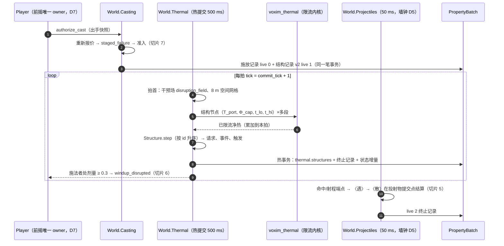

# 符号组合魔法 v2：P1 收口（分支切片 4–8）实施决策稿

> 状态：**用户已于 2026-11-26 批准 §11.1 全部决策点（按推荐）；§11.2 设计方问题由用户代答（待答）；切片 4 未开工。** 依据 AGENTS.md §3-8（运行时边界、协议、事务变化先写决策稿）与 §2.2-8（原创决策实施前报告）。
> 上游（均已批准）：[`2026-11-19-slice3-protocol.md`](2026-11-19-slice3-protocol.md)（下称“切片 3 稿”，§2.2 切片划分、P1–P14、§14 日志）、
> [`2026-11-19-glyph-v2-server-landing.md`](2026-11-19-glyph-v2-server-landing.md)（下称“落地稿”，D1–D9）、[`2026-11-19-catalog-v5-schema.md`](2026-11-19-catalog-v5-schema.md)、[`cast-phases-2026-10-05.md`](cast-phases-2026-10-05.md)。
> 设计：TheWorldBook `docs/2026-11-19-glyph-composition-game-design.md` v2.11（下称“设计”），只引节号不复述。
> 代码基线：分支 `magic-v2-p1` HEAD `f0605411`（Hello 46，目录 `e337873b…`）；工作树另有他会话未提交改动（法杖 `basic_spell` 迁 IR v2、`casting.ex:377` 的 `t0_us`），本稿不涉及。master `62d9a5a5`（Hello 45），领先分支合并基 `3c4d0048` 82 个提交。所有断言来自只读核对。

## 0. 结论摘要

1. 切片 4–8 的边界沿用切片 3 稿 §2.2，只建议一处前移：**热内核节点限流（设计 §5.3.1）从切片 7 前移到切片 4**（Q4-1）。理由：`Structure.step/4` 吃进的净热不设上限（`structure.ex:402-404`），没有内核钳制就不满足 x ≤ 1 与 T_chk，切片 4 的热结构（炽热投掷、灼点）验收对拍不了附录 A。
2. 切片 4 一次定型全部新增字节：结构记录 v2（135 + 25 = 160 B，新字段追加在偏移 135 之后）、终止事件 live 2–6、20 B 状态增量（PropertyBatch 末尾新字段）。仍是 Hello 46，分支未发布，不升版（Q4-10）。
3. 设计 §11.1 的“无质量”状态位与 Hello 45 已有的拟态 `flags` 第 1 位 `no_gravity`（`codec.ex:1348,1370`）重复。建议沿用 flags 字节：第 0 位 `ends_on_contact`、第 1 位无质量；状态字节不再放这一位（Q4-2，需设计方确认）。
4. **法杖普攻在 v2 中保持无重力直飞**：建议把程序里〈形〉的 `mass_g` 改为 0（缺省），也就是不写质量。按 Q17(a) 它就是无质量结构，直线匀速飞行。这样不改协议、目录和设计规则，只改法杖作者数据（Q5-1）。代价是动能为 0，未命中时在 30 m 处悬停约 1 s 后衰竭（手算见 §5.4）。
5. 结构持久化沿用 D3：结构以显式字段 map 存在 `thermal.structures`，随每笔热事务一起写入（`heat_commit.ex:66-72` 的 txn 带整张 `thermal`，`overlay_log.ex:93` 落盘）。体量风险在切片 8 实测，超标的出路是 S1a A2 的 `stream_row`，不另设第二条真值路径（Q4-7）。
6. 旧存档里的拟态在 World 恢复时一次性散解入账，不转写成结构（Q4-6），先例是 `Projectiles.settle_restored/1`（`projectiles.ex:55-71`）。
7. 前摇取消与打断统一按分阶段失败结算：第一笔注能前免费，之后按进行中的步号 k 扣费（Q6-1）。施法者处的扰乱剂量取前摇开始时的位置快照，误差不超过 0.25 m（Q6-2）。
8. 设计 §12.2 验收第 6 条的合成负载（256 结构、16 个醒着的热节点、64 条规则）按 §5.6 的权重算是 320 单位，超过硬上限 B + 32 = 288，**走正常准入造不出来**。需要设计方指定验收规模（Q8-W1）。
9. 切片 8 的负载测试在进程内做（World 级，不开任何 socket）。容量结论只在用户指定的 Linux 主机上采集；本机 WSL 只跑 1/4 规模冒烟。双客户端验收沿用切片 3 稿 §10 的单节点限额与 UDP 基线规程。

## 1. 现状核对

| # | 事实 | 位置 |
|---|---|---|
| 1 | 结构施放走完全部检查后显式拒绝 `:structure_runtime_pending`（outcome 2，不扣能） | `world/casting.ex:493-494`；moduledoc `:50`；`world.ex:423` |
| 2 | 取消待施放一律免费：施放记录 outcome 2，回 `{:error, reason}` | `casting.ex:436-447`（`:443`） |
| 3 | 结算入口：出手（`through = nil`）或第 k 步检查，按当时 site 重新报价、`staged_failure` | `casting.ex:453-497`；`world.ex:2041-2085` |
| 4 | `Structure` 已有 `new/4`、`step/4`、`respond/3`、`settle_kinetic/1`、`disruption_field/4`、`evaluate_rules/4`、mix64 | `magic/structure.ex:262,380,601,620,704,838,929-944` |
| 5 | `step/4` 要求 `tick == last_tick + 1`，净热按 `round(J×1000)` 并入 E_th，**没有上限** | `structure.ex:381-382,402-404` |
| 6 | 拍长有三处定义：`Structure @tick_ms 500`、热提交 `remaining: 0.5` 与 `+ 500`（设计 v2.7 R9 要求统一） | `structure.ex:73`；`thermal.ex:201,244` |
| 7 | 没有整数热提交拍号：只有浮点累计 `thermal.elapsed_s` | `thermal.ex:631`；`catalogs.ex:79` |
| 8 | 热提交是否开始取决于 `continues?`，拟态存在即推进 | `thermal.ex:111-115` |
| 9 | 拟态是热内核的外部节点：每段 NIF 调用前组装节点、边和辐射项，调用后按段推进温度 | `thermal.ex:551-581,649,736-803` |
| 10 | 拟态移除与散解：`release_semblance`、`release/4`、`release_cell`（释放格只认粒度 0 的命中格） | `thermal.ex:806-838` |
| 11 | 一笔热事务带上整张 `thermal`（含拟态），overlay 日志把 `:thermal` 当元数据落盘；分页切点的全局行写 `thermal`（去掉 sources） | `heat_commit.ex:66-72`；`overlay_log.ex:93`；`world/pages.ex:765` |
| 12 | 积压达 mid/hard 时不开始新的热拍或投射物拍（结构冻结，对应 D4） | `world.ex:1925-1930` |
| 13 | 投射物拍 50 ms；飞行终点用 `lifetime_s`；恢复时在飞投射物散入空气 | `projectiles.ex:8-15,26,42,55-71` |
| 14 | 弹道路程达到 `max_path` 时返回 miss（射程端点） | `magic/semblance.ex:91` |
| 15 | 拟态模块头注写明“迁移期”，退出条件是切片 4 以 Structure 取代 | `semblance.ex:6-8` |
| 16 | PropertyBatch 字段表最后两个字段是 `semblances`、`casts`；完整快照要求全部 live = 1 | `mmo_contracts/voxel/codec.ex:44-61,1267-1282` |
| 17 | 拟态记录 135 B；flags 第 0 位 break_on_hit、第 1 位 no_gravity；解码要求 `shape ∈ {0,1}`、`temperature > 0` | `codec.ex:1343-1430`（守卫 `:1406-1410`） |
| 18 | Hello 46 README 写明保留 Hello 45 的 flags 位掩码 | `mmo_contracts/README.md:44` |
| 19 | 目录 v5 已有 `quotas` 全部字段，但 World 里**没有任何读取者**（只有报价限频） | `priv/magic/e337873b….json` `quotas`；`magic/catalog.ex:152,231`；`casting.ex:339` |
| 20 | World 没有“在场”集合，施法快照也没有 NPC 标记 | `world.ex`、`casting.ex` 均无 present/npc 字段 |
| 21 | Player 的移动打断只作用于信标和分选读条（`kind in [:beacon, :sort]`），施法不受影响 | `scene_server/movement/player.ex:1636-1649` |
| 22 | Player 取消前摇：发 `{:cancel_cast, key, reason}` 给 World | `player.ex:1613-1634` |
| 23 | `Harm.permitted?/3` 是纯位置判断，位于 scene_server；world_server 的投射物采样也调用它 | `scene_server/movement/harm.ex:12-18`；`world_server/movement/projectile.ex:47` |
| 24 | 依赖方向：scene_server 依赖 voxel_region（`runtime: false`），三者都依赖 mmo_contracts | `scene_server/mix.exs:33-34`；`voxel_region/mix.exs:29` |
| 25 | 内核节点 tuple 有 10 个字段，没有限流参数；稳定步长对全部节点取最小值 | `native/voxim_thermal/src/kernel.rs:4-5,108-111` |
| 26 | `〈形〉mass_g` 设了 `zero_means_absent`；〈投〉的签名不要求质量；〈热〉要求 `mass` | 目录 `e337873b…` symbols 2、30、15 |
| 27 | 法杖光弹 v2 程序含 `mass_g = 10`（字节 `000a`） | 工作树 `voxel_region/test/magic_staff_bolt_test.exs:48`、`catalog_holdables_test.exs:44` |
| 28 | master 自合并基以来改了 `world.ex`（+536）、`player.ex`（+380）、`quic_connection.ex`（+205）、`voxim_thermal/src/{lib,sim}.rs`；`casting/thermal/projectiles.ex` 与 `magic/` 未改 | `git diff --stat 3c4d0048 master` |
| 29 | 设计 §4.2 仍写“余额耗尽时付到耗尽为止”，尚未写入用户裁定 D-draw（从取得的能量里付） | 设计 `:1023`；切片 3 稿 `:421` |

## 2. 总体时序与所有权

| 真值 | owner | 写入点 | 持久化 |
|---|---|---|---|
| 结构储能、欠账、规则状态（整数 mJ / 1e-6） | `Magic.Structure`（纯值），World 持有 | 热提交拍、投射物提交点 | `thermal.structures`，随热事务写入（D3） |
| 飞行轨迹 | `World.Projectiles` | 50 ms 拍 | 同上（既有 `projectile_source`） |
| 前摇计时、移动/伤口打断 | `SceneServer.Movement.Player` | — | 不持久化 |
| 配额与准入（切片 7） | 新模块 `World.MagicAdmission` | 施放结算前 | 由 `thermal.structures` 推导，不另存计数 |

## 3. 对外字节（切片 4 一次定型，仍为 Hello 46）

全部大端；偏移从记录起点算。golden 追加到 `apps/mmo_contracts/test/fixtures/wire-v2-samples.json`（客户端 C3 已认定的路径），生成器 `gen_wire_v2_samples.py` 保持与 codec 独立。

### 3.1 结构记录 v2（PropertyBatch 原 `semblances` 字段，每条 160 B）

| 偏移 | 长度 | 字段 | 类型 | 取值 / 与 Hello 45 的差异 |
|---|---|---|---|---|
| 0 | 8 | `id_seq` | u64 | 创建事务 seq（设计 B6） |
| 8 | 4 | `id_n` | u32 | P1 恒为 0（一次施放只产生一个组） |
| 12 | 1 | `live` | u8 | 0 删除（无事件）；1 存在；2–6 终止事件（§3.2）；**Hello 46 拒绝 ≥ 7** |
| 13 | 8 | `caster` | u64 | 不变 |
| 21 | 1 | `shape` | u8 | 0 球 / 1 块 / 2 板；**Hello 46 只收 0–2**（原只收 0–1） |
| 22 | 1 | `flags` | u8 | 第 0 位 `ends_on_contact`（原 break_on_hit，W5 改义）；第 1 位无质量（原 no_gravity，Q4-2）；其余位必须为 0 |
| 23 | 8 | `size1_m` | f64 | 原 `radius_m`，与 IR `size1_mm` 同口径 |
| 31 | 8 | `temperature_k` | f64 | T_port；无〈热〉为 0。**解码守卫由 `> 0` 改为 `≥ 0`** |
| 39 | 8 | `glow_w` | f64 | 本拍实际发出的光功率（W5） |
| 47 | 24 | `origin` | f64×3 | 不变 |
| 71 | 24 | `velocity` | f64×3 | 不变 |
| 95 | 8 | `t0_us` | u64 | 服务器时间线，不变 |
| 103 | 8 | `flight_s` | f64 | 飞行终点时刻：命中或射程端点（§5.1 P2-13）；静止为 0 |
| 111 | 24 | `rest` | f64×3 | 飞行终点或静止位置 |
| 135 | 2 | `size2_mm` | u16 | 球为 0 |
| 137 | 2 | `size3_mm` | u16 | 球为 0 |
| 139 | 2 | `proto_id` | u16 | P1 恒为 0（无〈仿〉） |
| 141 | 2 | `coupling_mask` | u16 | 第 0 位〈热〉、1 位〈辉〉、2 位〈容〉、3 位〈乱〉；其余位保留为 0（位表待设计确认，Q4-2） |
| 143 | 1 | `load` | u8 | round(x·255)，x ≤ 1 是不变量（依赖 Q4-1） |
| 144 | 1 | `coherence` | u8 | round(clamp(C,0,1)·255) |
| 145 | 1 | `status` | u8 | 位 0 越线、1 折叠、2 供能中、3 泄放口已损、4 飞行、5 热节点休眠；位 6–7 为 0 |
| 146 | 1 | `failed_segments` | u8 | P1 恒为 0 |
| 147 | 1 | `anchor_type` | u8 | 0 手边（〈握〉）、1 格面（〈附〉）；P1 只用这两种 |
| 148 | 12 | `anchor_ref` | 12 B | P1 全 0（格面沿用位置字段，设计 §11.1） |

- 删除记录：id + `live = 0` + 147 B 全 0，共 160 B。
- **原创决策（字段次序）**：设计 §11.1 只列了新增字段，没有给偏移。本稿把新字段追加在 135 B 之后，前 135 B 保持原偏移，客户端现有解码器只需在尾部延长。替代方案是按设计表序插到 `flags` 之后，但那样全部旧偏移都要移位，没有收益。

### 3.2 终止事件（`live` 2–6）

| live | 事件 | 产生条件（`Structure` 终止类型） | 记录内容 |
|---|---|---|---|
| 2 | 接触终止 | 〈遇〉触发的〈散〉（要求 `ends_on_contact = 1`） | 终态完整快照，`rest` 为命中点 |
| 3 | 断供衰竭 | `:exhausted` | 终态完整快照 |
| 4 | 过载崩解 | `:collapsed` | 同上 |
| 5 | 驱散 | `:dispelled` | 同上 |
| 6 | 主动终止 | 非接触读数（〈时〉〈满〉）触发的〈散〉，即 `:released` | 同上 |

- 2–6 一律带终态完整快照，与 Hello 45 的 live 2 同一语义。客户端在快照位置播放对应原子，不需要先有“存在”记录（无创建前态也能自足，沿用 `cast-phases-2026-10-05.md:19`）。完整快照批中不得出现 2–6（`codec.ex:1277-1278` 的守卫保留）。
- Replica 物化：2–6 与 nil 一样从副本存活表删除，原始增量照常转发（沿用 `cast-phases-2026-10-05.md:21`）。
- 事件 7–12 属于 P2 及以后，13 只由施放记录表达（W4）。

### 3.3 状态增量（PropertyBatch 新增末尾字段 `structure_states: :bytes`，每条 20 B）

| 偏移 | 字段 | 类型 | 说明 |
|---|---|---|---|
| 0 | `id_seq` | u64 | |
| 8 | `id_n` | u32 | |
| 12 | `load` | u8 | 同 §3.1 |
| 13 | `coherence` | u8 | |
| 14 | `status` | u8 | |
| 15 | `failed_segments` | u8 | |
| 16 | `temperature_dk` | u16 | 0.1 K，饱和到 65535 |
| 18 | `glow_w` | u16 | W，饱和到 65535 |

- 按 id 升序且唯一；完整快照批（`complete = 1`）里该字段必须为空；同一批里已有完整记录（live 1–6）的 id 不得再出现在增量里。这些规则加进 `accept_m1/1`（`codec.ex:1267`），解码端显式拒绝。
- **发送条件（原创决策，Q4-4）**：比较同一结构本拍步进前后的量化分箱，任一不同就发。分箱为：装载、相干各 ⌊v·32⌋；温度 ⌊T/25 K⌋；发光为 0，或 ⌊ln(glow)/ln 1.1⌋；状态字节与失效段掩码直接比较。这样不需要记“上次已发值”，也就不会让传输状态进入持久化真值（§2.2-9）。热提交每拍 500 ms，“每结构 ≤ 2 Hz”自然满足（切片 3 稿 §4 观察）。与设计“跨 1/32、跨 25 K、跨 10%”的差别：设计按距上次发送的增量判，本稿按固定分箱判，最坏情况下在分箱边界附近多发几条，带宽上界不变。

### 3.4 其他线上表示

| 项 | 变化 | 片 |
|---|---|---|
| 0x83、施放记录 v2 | 不变 | — |
| 0x68 原因串 | 新增 `interrupted_cancelled`、`interrupted_moved`、`interrupted_disrupted`、`interrupted_wounded`（Q6-4）；`":structure_quota"`、`":flight_quota"`、`":region_budget"`（分区魔法拥挤）；删除 `":structure_runtime_pending"` | 6、7、4 |
| 施法结算回复 | `{:ok, %{seq, outcome, caster}}` 加 `fail_step`（切片 3 残余：NPC 拿不到 k） | 6 |
| Session kind14 ProjectileHit（108 B） | 布局不变；`q_j` 的口径按 Q5-2 | 5 |

## 4. 切片 4：结构构造、热提交步进、结构记录与持久化

### 4.1 范围

| 模块 | 改动 |
|---|---|
| `world/casting.ex` | `:493-494` 改为 `settle_structure/…`：扣 `quote.total_mj`；`Structure.new({seq, 0}, group, quote, commit_tick)`；物理体（形状、尺寸、质量、锚、〈投〉初速）沿用 `Magic.Semblance` 几何；施放记录 live 0 与结构记录 live 1 放在**同一笔**事务；构型损耗照旧记 `cast_waste_j`。删除 `:structure_runtime_pending` 及其文档、日志和测试 W-6 |
| `world/thermal.ex` | `semblances/1` → `structures/1`；`continues?` 改判结构；新增整数 `thermal.commit_tick`，每完成一次提交 +1（Q4-9）；每段 NIF 调用时结构节点温度取 T_port = T_ref + (E_th + 本拍已累计净热)/C_th，净热累加到 `run.structure_heat`；`settle_run` 末尾按 id 升序调用 `Structure.step/4`（输入：所在格温度与热容、是否嵌在固体内、8 m 网格中贡献最大的 ≤ 16 个邻居、3 m 内终止释放剂量、本拍接触），执行请求（`deposit_heat` → 有限热源；`release_thermal` 每格至多到 T_port；`caster_heat` → 施法者脚下 `cast_waste_j`），再求值触发、调用 `respond/3`（切片 4 不设触发预算）。`release_cell` 改为在执行时复核持有者（设计 §12.1 更正 3、Q7） |
| `native/voxim_thermal`（若 Q4-1 采纳） | 外部节点加 `phi_w, t_lo, t_hi`；子步先算后缩放（吞吐 s_i、边取两端 min、温度钳制 k），默认值 +∞ 时数值逐位不变；`ThermalDomain.step` 的 extra 节点参数随之扩展 |
| `magic/structure.ex` | 新增 `to_record/1`、`from_record/2`（显式字段 map，Q4-7）、`wire/1`（量化为 §3.1、§3.3 字段）；`@tick_ms` 作为唯一拍长，`thermal.ex:201,244` 改为引用它（R9） |
| `magic/semblance.ex` | 删除能量部分（`expired?`、`glow_j`、`stored_j`、`step`、`cap`、`spent?`、`break_on_hit?`），保留几何、弹道与热节点项（切片 3 稿 §6）；模块头注删掉“迁移期” |
| `world/projectiles.ex` | 只改为读 `structures`；飞行规则不变（切片 5 再改） |
| `mmo_contracts/voxel/codec.ex` | 按 §3 改 `encode/decode_semblances`（改名 `*_structures`）、PropertyBatch 字段表加 `structure_states`、`accept_m1` 加 §3.3 的约束 |
| `world/{observation,window_snapshot,closure}.ex`、`replica.ex`、`property_observation.ex` | 跟随改名；Replica 按 §3.2 物化 |
| 迁移（Q4-6） | World 恢复时，若 `thermal` 仍有 `semblances` 键，就逐个按旧规则散解入账（`semblance_released_j`），写一笔热事务删除该键；之后代码里不再出现 `semblances` |

### 4.2 账目与可观测面

热账科目（设计 §12.2 切片 0 表，按**去向**记，Q4-8）：

| 科目 | 含义 | 来源（`Structure` ledger） |
|---|---|---|
| `structure_created_j` | 建成时注入结构的物理能（E_op + E_th0 + 动能） | 结算 |
| `structure_heat_in_j` | 内核给结构的净热（有符号） | `in.heat_mj` |
| `structure_light_j` | 发光 | `out.light_mj` |
| `anima_radiated_j` | 灵炁辐射：泄漏的辐射半、释放的辐射半、活动能 | `leak_radiation_mj + release_radiation_mj + activity_mj` |
| `structure_leak_heat_j` | 泄漏批量沉积的热 | `leak_heat_mj` |
| `structure_released_j` | 终止释放进格的热（E_op 热半 + 热份额 + 动能） | `release_heat_mj + release_thermal_mj + kinetic_mj` |
| `structure_rounding_mj` | 内核 f64 → mJ 的舍入残差 | `heat_rounding_mj` |

闭合式：`created + heat_in = light + anima + leak_heat + released + Δstored + rounding/1000`（P1 中 `feed`、`vented` 恒为 0）。运行与修复两项只出现在日志指标里，不进账（与设计列出的 `structure_run_j / structure_repair_j` 有出入，Q4-8）。

| 日志事件 | 字段 |
|---|---|
| `voxel_structure_built` | `seq sid cid program_sha shape mass flags e_op_mj e_th_mj kinetic_mj e_cap_mj e_min_mj x0 x_star born_tick` |
| `voxel_structure_tick`（每拍一行，汇总） | `tick structures awake_nodes step_us_total step_us_max ended deltas rounding_mj` |
| `voxel_structure_end` | `seq sid cid live type tick released_mj heat_mj radiation_mj thermal_mj cell protected` |
| `voxel_structure_migrated`（一次） | `seq count released_j` |
| `voxel_thermal_throttle`（Q4-1） | `tick throttled_nodes clamped_nodes min_scale` |
| `voxel_thermal_commit`（既有，`heat_commit.ex:85`） | 追加上表各科目 |

World 观测快照（`observation.ex:79` 的 ledger）同步追加上述科目和 `structures`、`commit_tick`。

### 4.3 验收测试（先红后绿；对拍值取设计附录 A）

见 §13 的 C4-1–C4-3、S4-1、K4-1、W4-1–W4-7。要点：灯经 `World.spell_intent/3` 施放，断言扣费等于报价、记录 `load = 56`（0.221 × 255）；用注入时钟推进热提交，在出生后第 264 拍（132 s）以 live 3 终止（附录 A.3，误差 ±1 拍）；账目逐项整数闭合；冷重启后整数字段逐位相同，从下一拍继续，不补算。

### 4.4 合入后分支状态

灯、定时火种、灼点、炽热投掷可以建成、维持、衰竭并持久化；火球按旧弹道飞，命中时〈遇〉尚未接通（切片 5）。驱散仍不可用（P12）。`probe`。

## 5. 切片 5：飞行终点由射程推导与〈遇〉

### 5.1 范围

| 模块 | 改动 |
|---|---|
| `world/projectiles.ex` | 飞行终点改为命中或路程达 `limits.range_m`（30 m）中先到者，删除 `lifetime_s`（`:26,42`）；无质量结构按直线（`flags` 第 1 位）到端点后悬停，有质量结构按弹道落地；之后转为静止结构，下一拍接入热内核（设计 §5.1） |
| 〈遇〉接触 | 投射物拍命中时，对该结构按 tick = `last_tick + 1` 调用 `evaluate_rules/4`（含读数丢失 hash）；〈散〉在投射物提交点用 `respond/3` 结算，记录 live 2。丢失时接触保持待决，下一热拍重判（§5.4 R5）。静止结构在热拍里首次出现导热边时置接触 |
| 人物命中 | 沿用 World 冻结 → Player 接纳 → kind14 回执链路（`cast-phases-2026-10-05.md:31-37`）；`q_j` 按 Q5-2。人物采样只对 `ends_on_contact` 结构做（Q5-4，与 v1 只采样触散球一致） |
| 动能出口 | 命中或落地时调 `Structure.settle_kinetic/1`，在命中格沉积为热（R7③，动量接触将替换的唯一出口） |
| 飞行中维持 | 飞行结构每个热拍照常步进，只跳过第 0、2、11 步；在飞行中跌破 E_min 时以 live 3 终止并移除投射物（§5.3） |
| 恢复 | `settle_restored/1` 改为对结构执行“散解即终止”，记 live 3 |

### 5.2 可观测面

`voxel_structure_flight sid phase=launch|contact|endpoint|landed path_m t_s target=terrain|body|none reading_lost`；`voxel_structure_end` 的 `live=2` 带 `hit=terrain|body`；科目沿用 `projectile_body_j`、`body_exchange_j`（`cast-phases-2026-10-05.md:37`）。

### 5.3 验收

见 §13 的 Q5-1、W5-1–W5-5。

### 5.4 法杖普攻（Q5-1 的依据）

| 候选 | 协议影响 | 设计影响 | 结论 |
|---|---|---|---|
| A. 程序不写质量：`mass_g` 字节 `000a` → `0000` | 无（flags 第 1 位已有） | 无；Q17(a)“未写质量者不受重力、匀速直线”，签名允许〈投〉不带质量（§1 #26） | **推荐** |
| B. 目录或 IR 新增“直线”参数或符号 | 目录 digest、IR、签名、双端解释器全部要改 | 与 Q17“质量决定重力”的单一规则重复 | 否 |
| C. 持物作者数据另标无重力 | 0x82 不变，但行为取决于装备而不是程序 | 违反“判定只看程序”（`cast-phases-2026-10-05.md:57`）和 SSOT | 否 |
| D. 接受有重力 | 无 | 无；30 m/s 飞 30 m 下坠 4.9 m，退回 Voxim `6d86205d` 之前的手感 | 否 |

方案 A 的数值（按设计 §4.3 与附录 A.6 同一套公式手算，以切片 5 的 Cost/Structure 实算为准）：

- 物理量：S = 4（〈形〉〈辉〉〈投〉〈遇〉）；V = 5.24e-4 m³；E_cap = 8.38 kJ；x0 = 0.239；E_min = 1 kJ。
- 出账：P_run ≈ 402 W，修复约 99 W，发光 100 W，合计约 0.6 kW；可用 1 kJ，逐拍计约 4 拍（2.0 s）。
- 飞行：30 m / 30 m/s = 1.0 s。未命中时在 30 m 处悬停约 1 s 后以 live 3 熄灭；动能由 4.5 J 变为 0。

另外两项要知会用户：

1. 命中时可释放的能量约 1.7 kJ，按 Q5-2 有一半以上进入目标组织。v1 光弹的剩余能量约 0.1 kJ（发光余量加 4.5 J 动能，`cast-phases-2026-10-05.md:30,52`），普攻伤害约放大一个数量级。
2. 按住连发时，发射间隔 0.5 s、飞到射程端点 1.0 s，与 `flights_per_caster = 2` 恰好卡在边界上（Q7-5）。

需要配合的改动：

- 客户端改 `author_holdable.py` 的 `basic_spell`，重新发布物品目录（服务端夹具 `test/fixtures/items/08bb766b….json` 随之替换）。
- `match_basic_spell` 按字节比对（`casting.ex:835`），新旧程序不会混淆。

## 6. 切片 6：驱散脉冲；前摇打断与取消结账

### 6.1 范围

| 模块 | 改动 |
|---|---|
| `world/thermal.ex` | 拍首（第 0′ 步）对每个带〈乱〉的发出者，用 8 m 网格找半径 r 内的目标，调用 `Structure.disruption_field/4`，结果放进目标的 `inputs.fields`；发出者不受自身场（R2）；冻结交付中的结构不受影响（§7.3 末条）。作用于他人结构前，先按 `Harm.permitted?(scope, 发出者位置, 目标位置)` 判断（Q7、Q6-3） |
| 施法者处剂量 | 同一拍对 `pending_casts` 里每个施法者按“单位精度、零装载”累计 D0·a_X·(P/1 kW)·(1 − d/r)²·t_eff，达到 `runtime.windup_interrupt_dose`（0.3）即向 Player 发 `{:windup_disrupted, key, dose}`；位置取前摇开始时的快照（Q6-2） |
| `scene_server/movement/player.ex` | `interrupt_channel/1`（`:1637-1649`）扩展到 `kind: :spell`：离开前摇起点超过 0.25 m → `:moved`；Body 新增伤口（`body.ex` traumas）→ `:wounded`；收到 `windup_disrupted` → `:disrupted`；主动取消 → `:cancelled`。`cancel_cast/2` 按已流逝时间与已广播步长（`cast_prepared` 的 steps）算出进行中的步 k（仍在第 1 步调整段则 k = 0），发 `{:cancel_cast, key, reason, k}` |
| `world/casting.ex` | `cancel_pending_cast`（`:436-447`）：k = 0 时照旧免费（outcome 2）；k ≥ 1 时用当时的 site 重新报价，按“在第 k 步中断”结算（outcome 1，fail_step = k，扣第 1–k 步，`min(余额, 累计)`，支出落在形成处，W7），0x68 原因串按 Q6-4；结算回复带 `fail_step` |
| `Harm` | 按 D6 抽成共享纯模块（Q6-3）；Player 施法快照带 `combat_scope`，结构里存下施放时的 scope |
| 删除 | 切片 3 稿 P12 的驱散空窗结束 |

### 6.2 可观测面

`voxel_structure_field emitter tick t_eff_s targets doses=[{sid,dose,permitted}]`；`voxel_cast_disrupted cid key dose`；`voxel_cast_cancel cid reason k charged_mj outcome`；Player `character_event :cast_interrupted %{reason, k}`。

### 6.3 验收

见 §13 的 W6-1–W6-6、P6-1、G6-1。对拍附录 A.4：未供能的灯在 d = 0 时第 1 拍终止（欠账 1.182），d = 1 m 时存活（0.601），d = 2 m 时 0.131；施法者处 d = 1 m 剂量 0.527 打断，1.5 m 剂量 0.297 不打断。

### 6.4 合入后状态

7 个预设全部可施放，§12.2 验收第 3、4 条可在 World 级证伪。`probe`。

## 7. 切片 7：配额、准入、NPC、触发预算与热节点休眠

### 7.1 范围

| 项 | 规则（设计 §5.4、§5.6） | 实现 |
|---|---|---|
| 准入 owner | 一处判定、无持久计数 | 新模块 `World.MagicAdmission`：每次施放结算前从 `thermal.structures` 推导用量（权重 1 + 2·醒着热节点 + 0.5·规则 + 0.5·感知耦合）。计数从真值推导，不另存（§2.2-3） |
| 每人上限 | 6 结构、2 飞行（`quotas.*`） | `:structure_quota`、`:flight_quota`。切片 4 已先上 6 结构计数（Q4-5） |
| 分区预算 | 用量 < 75%·B 照常；≥ 75% 时，在场者自身用量须 < 0.75·B / 在场人数；保底 1 个用 32 单位预留；超过 B + 32 回 `:region_budget` | 同上 |
| 在场 | Scene 推送，World 不拉取 | 新公共 API `World.caster_presence(server, cid, :present \| :absent)`，由 Player 在会话就绪与解除时调用（Q7-1） |
| NPC | 每个 NPC 4 个；全体 NPC ≤ 25%·B；不计入在场、无保底 | 施法快照带 `controller: :player \| :npc`，由入口（Gate Dispatch / NPC Body）声明（Q7-2） |
| 飞行名额 | 16 + 在场人数，在场者保底 1 个，其余“轮转” | 即时准入下“轮转”如何定义待设计方回答（Q7-4） |
| 触发预算 | 每分区每拍 64、每人每拍 8；推迟队列按（首次推迟拍号, id）排序，同一规则至多一项 | `thermal.ex` 第 12 步之后由 World 调度 `respond/3` |
| 热节点休眠 | 与所有接触节点温差 < 5 K 且净热流 < 100 W → 下一批不作为种子；每拍复核 | World 侧判定（`structure.ex` moduledoc 第 11 步注明由 World 判） |
| 醒着热节点上限 16 | 超出时的处置未定义 | Q7-3 |

### 7.2 可观测面

`voxel_magic_admission cid controller decision reason usage_units budget present npc_units flights`；`voxel_structure_triggers tick fired deferred oldest_deferred_tick`；`voxel_structure_sleep tick asleep woke`。

### 7.3 验收

见 §13 的 W7-1–W7-7、S7-1。

### 7.4 合入后状态

P1 功能完整（设计 §12.2 切片 1 的服务端行全部落地）。`probe`。

## 8. 切片 8：Linux 合成负载、双客户端验收与合入

### 8.1 合成负载（设计 §12.2 验收第 6 条）

| 项 | 方案 |
|---|---|
| 形态 | 进程内 World 级基准：ExUnit `@tag :load`（默认排除）。经 `World.spell_intent/3` 和既有 World 集成测试的施法者夹具建出结构，不开 Gate/QUIC，**不创建任何 UDP/TCP socket** |
| 数据 | 新建世界副本与独立数据库，持久化开启；结构全部经施放产生（Testing.md §3），不直接写 `thermal.structures` |
| 规模 | 待 Q8-W1：规模 a 为设计原文的 256/16/64，需要 Test-only 目录把 `region_budget_units` 提到 ≥ 320，标为 `probe`；规模 b 为正常准入可达的上限。两档都测 |
| 反例 | 单个最小合法热容（C_th = 0.0556 s × g_max，附录 A.7）、2500 K 的结构，记录 `nif_us`、`kernel_steps` |
| 测量 | 每拍 World 时间（`voxel_thermal_sim wall_us`、`voxel_structure_tick step_us_*`）、热活动集增量、每拍日志与 overlay 字节、`page_cut` 积压分级是否触发；共同窗口 10 min，预热 1 min（Testing.md §4.2） |
| 地点 | 容量结论只在用户指定的 Linux 主机（部署清单所列，或同规格专用 VM）上采集（Q8-1）；本机 WSL 只跑 1/4 规模冒烟，用来验证 harness |
| 资源 | 不涉及网络；仍按全局约定在开始前、结束后各采一次 Windows `Get-NetUDPEndpoint` 与 WSL `ss -uanp` 计数，确认没有变化 |
| 判定 | 若热内核没有余量，按设计 §5.6 下调醒着热节点上限后再测；阈值只放在测试侧（§2.2-9） |

### 8.2 真实双客户端验收（设计 §12.2 验收第 1–5、7 条）

| 项 | 方案（沿用切片 3 稿 §10） |
|---|---|
| 进程 | WSL 原生 release、单节点单 Scene、只绑 127.0.0.1；Auth TCP P = 25470，QUIC UDP P + 3；客户端 ≤ 2 个，服务端每会话最多启动 2 次 |
| 前提 | 新世界副本与新数据库；蓄能石经作者入口一次安装并记账；施法者能量来自开户和〈取〉，不手动补 |
| 场景（每个 ≤ 10 min，按阶段门控，首个失败即停） | E1 七个预设各施放一次，双端看到的生命周期与终止事件一致；E2 火场边的火球出生即越线（状态位 0）；E3 第 k 步中断，扣费与报价 `fail_step` 一致；E4 驱散三项；E5 两项热账闭合（读服务端日志）；E7 带 v1“我的法术”的存档出现迁移对话框，服务端拒绝 v1 |
| UDP 规程 | 启动前记基线（总数与按进程计数），运行中每 5 min 复采；总数持续增长、出现 Tcpip 4266 或连接资源错误时立即停止并保留快照；结束后按 PID 只清理本次进程，删除本次数据库与世界目录（不碰受保护对象），复采对比基线 |
| 执行者 | 由 Voxim 主会话按 R7 harness 执行（Q8-3）；服务端会话只提供 release 与日志判定器 |

### 8.3 合入

1. 先把分支变基到 master；若 master 已占用 46，顺延编号（设计 §11.5）。
2. 生产库 `npc_specs.params` 的 v1 `spells` 盘点（切片 3 稿 N1）。
3. Voxim 用同一 Hello 打包；镜像与打包客户端跑青岚冒烟（Testing.md §4.3）。
4. 合入 master，切片 3–8 的 `probe` 标记撤除，`DA_MagicCatalogV1` 退役（C1）。

## 9. 客户端配套

| 片 | 客户端工作（设计 §12.2 Voxim 行） | 可并行（按冻结 golden） | 需要服务端提供的 golden / 样本 |
|---|---|---|---|
| 4 | 解码结构记录 v2（160 B）、live 2–6 与状态增量；表现原子：断供黯淡、过载爆裂、主动终止、越线辉光与闪烁（`status` 位 0、`load`、`coherence`）；温度与发光改由记录给出，删除按符号 id 写的分支（R9 冲突） | 是：§3 字节冻结后 | `wire-v2-samples.json` 新增 `structure_record_v2`（灯 live 1、飞行火球、无质量光弹、live 0 删除、live 2–6 各一）、`structure_state_delta`、带两字段的 PropertyBatch；反例：live 7、shape 3、flags 保留位、`temperature < 0`、完整批带增量、增量与完整记录同 id、id 未排序 |
| 5 | 飞行插值按“射程终点 + 无质量直线悬停”规则；法杖 `basic_spell` 改为无质量程序并重新发布 | 是 | `ir-v2-samples.json` 新增 `staff_bolt_massless`；`quote-v2-samples.json` 新增同一程序的报价 |
| 6 | 驱散光尘（live 5）；前摇打断原因文案（4 条）；中断回执显示第 k 笔碎裂 | 文案可先做 | 施放记录 outcome 1 由取消产生的样本；0x68 原因串清单 |
| 7 | `":structure_quota"`、`":flight_quota"`、`":region_budget"`（“分区魔法拥挤”）的提示 | 是 | 原因串清单 |
| 8 | U1 编辑器替换现有编辑器；“我的法术”本地转写与迁移对话框（设计 §2.4）；双客户端验收；与服务端同版本打包 | U1 与迁移对话框现在就可做（只依赖目录 v5 与 IR 样本） | 全部 golden 的最终 commit 与目录 digest |

约定照旧（落地稿第 7 节）：改 golden、目录或 schema 之前先通知 worldbook 与客户端，提交后附 commit 与 digest。

## 10. D9 原创决策逐项报告

检索范围：设计 §13.1 已列的出处，再加本次联网核对（2026-11-26）。“对照”只表示可比较的外部方法，不表示照搬。

| 项 | 设计出处 | 外部依据 / 对照（来源） | 与本项目约束的对应 | 判定 |
|---|---|---|---|---|
| 分池与热份额 | §5.2、§13 #7 | E_th = C_th·(T − T_ref) 是集总热容模型（Incropera《Fundamentals of Heat and Mass Transfer》第 5 章，书目，未联网核对页码）；卡诺上限是标准热力学 | 结构节点在内核里本来就是单温度外部节点（`semblance.ex:21`），集总假设与实现一致；两池拆分本身没有出处 | 公式有出处，分池为**原创** |
| 稳态线 x* | §4.3、§13.1 | 对照：漏桶 / 流体队列，流入速率超过排空能力时积压（欠账）线性增长、否则偿还，稳定条件是流入 ≤ 排空（RFC 2697 的令牌桶，https://www.rfc-editor.org/rfc/rfc2697 ，未联网核对） | debt 的累积与偿还（§4.3）与漏桶同构；D、R_max 的函数形式原创 | **原创**（概念可对照） |
| E_min = 250 J × S·P | §4.3、§13 #32 | 未找到对应的外部规则（检索范围：设计 §13.1、热与控制方向的常用教材） | 目的是给复杂结构设最低运行门槛，并与 T13 首拍检查联动 | **原创** |
| 剂量公式 | §7.3、§13 #24 | 对照：UE `ApplyRadialDamageWithFalloff`（内外半径加衰减指数，https://dev.epicgames.com/documentation/unreal-engine/BlueprintAPI/Game/Damage/ApplyRadialDamagewithFalloff ）。内半径取 0、指数取 2 即 (1 − d/r)²；按焦耳计量与逐拍计入是原创 | 工业界通行的径向衰减形状；剂量单位与本项目的欠账模型耦合 | **原创**（衰减形状有工业先例） |
| 75% 准入与保底 | §5.6、§13.1 | max-min 公平（Bertsekas & Gallager《Data Networks》第 6 章，书目）；DRF（Ghodsi 等，NSDI 2011，https://www.usenix.org/conference/nsdi11/dominant-resource-fairness-fair-allocation-multiple-resource-types ）在单一资源下退化为 max-min；工业先例是 YARN Capacity Scheduler 的 `minimum-user-limit-percent`（竞争时每用户保底份额、空闲时可超用，https://hadoop.apache.org/docs/current/hadoop-yarn/hadoop-yarn-site/CapacityScheduler.html ） | 只有一种资源（权重单位），所以不需要 DRF；“75% 起才按人均限”相当于 YARN 的弹性加保底 | 阈值 75% 与 32 单位预留为**原创** |
| 热内核节点限流 | §5.3.1、§13.1 | Zalesak FCT 限制器（J. Comput. Phys. 31:335–362, 1979，https://data.coaps.fsu.edu/pub/eric_back/OCP5930/Papers/FCT-JCPv31.pdf ）：由节点上下界算出每节点的缩放比，每条边取两端比值的较小者，保持守恒。PDF 为扫描件，式号未逐式核对 | 结构相同：节点约束 → 边取 min → 守恒；不同处在于约束是吞吐与温度界而非单调性，并且作用于全部热流 | **原创**（算法骨架有出处） |
| 读数丢失 hash | §5.4、§5.8 | 基于计数器的伪随机（Salmon 等，SC11，DOI 10.1145/2063384.2063405，https://www.cs.tufts.edu/~nr/cs257/archive/john-salmon/parallel-random.pdf ）；mix64 取自 SplitMix（Steele、Lea、Flood，OOPSLA 2014，https://dl.acm.org/doi/10.1145/2660193.2660195 ） | 只用整数运算，双端逐位一致；已实现于 `structure.ex:929-944` | 算法有出处；以丢失概率 min(0.5, debt/0.5) 作为玩法规则是**原创** |
| 休眠阈值 5 K / 100 W | §5.3.2、§13 #35 | Box2D：线速度容差 + `b2_timeToSleep` 0.5 s，按岛整体休眠（https://box2d.org/doc_version_2_4/b2__common_8h.html ，https://box2d.org/posts/2023/10/simulation-islands/ ）；PhysX：按质量归一的动能阈值加唤醒计数器（https://nvidia-omniverse.github.io/PhysX/physx/5.4.0/_api_build/class_px_rigid_dynamic.html ） | 两者都带时间滞回（持续低于阈值一段时间才休眠）；设计只设阈值、没有滞回，边界附近可能逐拍来回切换 | **原创**；建议加 1 拍滞回（Q7-W2） |
| 触发预算 64 / 8 | §5.4、§13.1 | 对照：Deficit Round Robin（Shreedhar & Varghese，SIGCOMM 1995，https://dl.acm.org/doi/10.1145/217382.217453 ）的“每流量子 + 无饥饿轮转”；按“首次推迟拍号”排序相当于调度里的 aging | 每人每拍 8 次就是每流量子；推迟不丢弃 | 数值为**原创**、待实测 |

**本稿新增的原创决策**（实施前一并报告）：§3.1 的字段次序、§3.2 的 live 2 / 6 分工、§3.3 的固定分箱、Q4-6 恢复时散解、Q4-7 显式字段 map、Q4-9 整数拍号、Q6-1 取消按步号 k、Q6-2 剂量位置快照。每一项的风险、不变量与验证见 §11 和 §13 的对应行。

各项的风险与验证：

| 项 | 主要风险 | 验证 |
|---|---|---|
| 分池 | 不加限流时 E_th 越过 E_cap − E_op，x > 1 | K4-1、W4-3（Q4-1） |
| x* | 火场边出生即越线时，表现与数值是否和设计一致 | W4-7、E2 |
| E_min | 复杂结构寿命过短 | W4-2 对拍附录 A.3 寿命 |
| 剂量 | 误伤己方的手感 | W6-1、W6-2、E4 |
| 准入 | 在场人数抖动导致准入时有时无 | W7-2 |
| 限流 | 改变未受限节点的数值 | K4-1 逐位回归 |
| 丢失 | 双端 hash 不一致 | 冻结 mix64 向量，客户端共读 |
| 休眠 | 来回切换 | W7-6 加上切片 8 的休眠与唤醒计数 |
| 触发 | 64/8 过紧或过松 | L8-1 的 64 条规则 |

## 11. 新决策点

### 11.1 用户可直接拍板

| # | 决策 | 建议 | 依据 |
|---|---|---|---|
| Q4-1 | 内核节点限流放在哪一片 | **前移到切片 4**（含 Rust 改动与默认值逐位回归） | §0 第 1 条；附录 A.2“静置时 641 kW 超过 Φ_cap 157 kW，由内核限流” |
| Q4-3 | 终止记录形态 | live 2 = 接触触发的〈散〉，3–6 按 §3.2；2–6 一律带终态快照；live 0 只用于无事件删除 | 客户端已消费 kind2（`cast-phases-2026-10-05.md:19`），不重新定义 |
| Q4-4 | 状态增量的发送条件 | 固定分箱比较步进前后（§3.3），完整快照批不带增量 | 不引入传输状态（§2.2-9） |
| Q4-5 | 切片 4–6 是否先限每人 6 个 | 是，只判 `structures_per_caster`；其余准入留在切片 7 | 防止 probe 中结构无界增长 |
| Q4-6 | 旧拟态存档 | 恢复时一次性散解入账，不转写 | 不另设第二个运行时；先例 `projectiles.ex:55-71` |
| Q4-7 | 结构持久化形态 | `thermal.structures` 存显式字段 map（`to_record/from_record`），恢复时一次校验；体量在切片 8 实测 | 持久化加载属于信任边界（§2.2-6）；S1a A2 的行格式可直接复用 |
| Q4-9 | 结构拍号 | 整数 `thermal.commit_tick`，`Structure.tick_ms` 为唯一拍长 | D4、R9；现在没有整数拍号（§1 #7） |
| Q4-10 | 是否升 Hello | 不升；分支内的 46 在切片 4 冻结前仍可变，以 golden commit 为准 | 设计 §11.5：P1 只占一个 Hello |
| Q5-1 | 法杖无重力直飞 | 方案 A：程序不写质量（§5.4） | Q17(a)；协议与目录不变 |
| Q5-4 | 人物采样范围 | 只对 `ends_on_contact` 结构 | 与 v1 一致，不扩大 Scene 采样负载 |
| Q6-2 | 施法者处剂量的位置 | 取前摇开始时的快照（移动 > 0.25 m 已会打断，误差有界） | World 不向 Scene 拉位置（§5.9） |
| Q6-3 | Harm 跨 app（D6 落实） | `Harm` 抽到 mmo_contracts 作为共享纯模块；`combat_scope` 随施法快照进入结构 | 三个 app 都依赖 mmo_contracts（§1 #24） |
| Q6-4 | 打断原因串 | `interrupted_cancelled / moved / disrupted / wounded` | 客户端需要文案（C5 同一机制） |
| Q7-1 | 在场来源 | Player 会话就绪与解除时调用 `World.caster_presence/3` | 设计 §5.6“Scene 推送” |
| Q7-2 | NPC 标记 | 施法快照带 `controller`，由入口声明 | World 现在区分不了（§1 #20） |
| Q8-1 | 负载测试主机 | 用户指定部署清单中的 Linux 主机或同规格 VM；本机只做 1/4 规模冒烟 | Testing.md §4.2；落地稿 §2“共享机不能当容量验收” |
| Q8-2 | 合入顺序 | 每片开工前变基到 master；切片 4 前先做一次 | master 已领先 82 个提交（§12.2） |
| Q8-3 | 双客户端执行者 | Voxim 主会话按 R7 harness 执行 | 唯一生产根（铁律 10） |
| T1 | （切片 3 临时处理）t_k 时目标失效或有数值违规 | 维持：按结算时拒绝（outcome 2，不扣能），并请设计方补进 §5.5 | 与 W9“以结算时报价为准”一致 |
| T3 | （切片 3 临时处理）报价限频的时钟 | 维持：World 单调时钟、1 s 滑动窗口 | 通行的滑动窗口限流；不受墙钟跳变影响 |
| R1 | （切片 3 残余）存档拟态运行时没有 World 级测试 | 由 Q4-6 与 W4-5 关闭 | — |
| R2 | （切片 3 残余）结算回复不含 k | 切片 6 加 `fail_step`（§3.4） | — |
| R3 | （切片 3 残余）`:quote_rate` 重试无测试；被拒法术仍出现在 LLM 工具枚举 | 交 NPC 会话，不在本分支做 | 冲突面在 `runtime.ex` / `brain/llm.ex` |
| R4 | （切片 3 残余）生产库 NPC v1 法术盘点 | 作为切片 8 合入前置 | 切片 3 稿 N1 |

### 11.2 必须由设计方（worldbook）回答

| # | 问题 | 本稿暂行建议 | 阻塞 |
|---|---|---|---|
| Q4-2 | §11.1“无质量”状态位与 Hello 45 的 flags 第 1 位重复：能否改为 flags 第 1 位、状态字节不再放；`coupling_mask` 的位表；`anchor_type` 的编码 | flags 第 1 位；位表见 §3.1 | 切片 4 |
| Q4-8 | 热账能否按去向记，run/repair 只作日志指标 | 按去向记（§4.2） | 不阻塞 |
| Q4-W3 | live 6 是否只指非接触读数触发的〈散〉（接触触发的归 live 2） | 是 | 切片 4 |
| Q5-2 | 结构命中人物时，哪部分进入 `tissue_j`：E_op 热半 + 热份额（至多 T_port）+ 动能进组织，辐射半记账？这会使普攻伤害约放大一个数量级（§5.4） | 如左；请同时确认普攻伤害是否可接受 | 切片 5 |
| Q5-3 | 命中后在投射物提交点〈散〉时，从上一拍到命中这段不足一拍的维持是否补记 | 不补记，差额随释放计入（账目仍闭合） | 不阻塞 |
| Q5-W4 | 无质量结构带〈投〉、动能为 0、到端点悬停：是否符合 Q17(a) 本意 | 是 | 切片 5 |
| Q6-1 | §14.0 Q6“按已投入部分结账”：取消时按进行中的步 k 扣第 1–k 步（与分阶段失败同一结算），还是只扣已完成的步 | 按进行中的步 k | 切片 6 |
| Q6-5 | §5.5“伤口事件”具体指什么：Body 新增创伤（`body.ex` traumas），还是任一 `receive_effect` | 新增创伤 | 切片 6 |
| T2 | （切片 3 临时处理）〈附〉的形成距离取眼点到目标宏格中心 | 维持，与〈取〉E4 同一几何；请写进 §4.2 | 不阻塞 |
| D-draw | 用户裁定“〈取〉的构型损耗从取得的能量里付”尚未写进设计 §4.2（§1 #29） | 请设计方补写 | 不阻塞 |
| Q7-3 | 醒着的热节点超过 16 时：拒绝新的热结构，还是强制最早的休眠 | 拒绝新施放（`:region_budget`） | 切片 7 |
| Q7-4 | 飞行名额“轮转分配”在即时准入下的含义 | 保底以外先到先得 | 切片 7 |
| Q7-5 | `flights_per_caster = 2` 与法杖节奏（发射间隔 0.5 s、飞到端点 1.0 s）在边界上冲突 | 目录改为 3，由设计方定 | 切片 7 |
| Q7-6 | P1 的“感知耦合”是否为 0（〈遇〉〈时〉〈满〉只算规则） | 是 | 切片 7 |
| Q7-W2 | 热节点休眠是否加 1 拍滞回（§10 Box2D/PhysX 对照） | 加 | 不阻塞 |
| Q8-W1 | 验收第 6 条的负载按 §5.6 权重为 320 单位，超过 B + 32 = 288：验收规模取哪一档 | 两档都测（§8.1） | 切片 8 |

## 12. 工作量与风险

### 12.1 规模估计（量级）

| 片 | 生产代码 | 测试 | 主要文件 |
|---|---|---|---|
| 4 | 12–16 个文件，+1500 / −900 行（含 Rust 约 +250） | +900 行 | `casting.ex`、`thermal.ex`、`structure.ex`、`semblance.ex`、`codec.ex`、`kernel.rs`、`sim.rs`、`lib.rs`、`thermal_domain.ex`、observation/replica 等 |
| 5 | 4–6 个文件，+400 / −250 | +350 | `projectiles.ex`、`thermal.ex`、`semblance.ex` |
| 6 | 6–8 个文件，+500 / −80 | +450 | `thermal.ex`、`casting.ex`、`player.ex`、`world.ex`、`harm.ex` → mmo_contracts |
| 7 | 6–9 个文件，+600 | +500 | 新 `world/magic_admission.ex`、`casting.ex`、`thermal.ex`、`player.ex`（presence）、`world.ex` API |
| 8 | 测试 harness 与文档，+400 | — | `test/magic_load_test.exs`、R7 场景配置（Voxim） |

### 12.2 冲突面

| 来源 | 冲突 | 处置 |
|---|---|---|
| master NPC 合并（82 个提交） | `world.ex` +536（NPC 路线 `protected_cells`、Catalogs alias 重构 `5e9b0049`）；`player.ex` +380（`PlayerWire` 抽取 `24aa774c`、传送 `a0d204d3`）；`quic_connection.ex` +205；`voxim_thermal/src/{lib,sim}.rs`（NIF mutex 加固 `ca6aa6b3`） | 切片 4 开工前变基（Q8-2）；Rust 限流必须基于 master 的 `sim.rs` 写，否则冲突最大；切片 6、7 改 `player.ex` 前再变基一次 |
| S1a | A1/A2 的 owner 含 `casting/projectiles/thermal.ex`、`semblance.ex`（设计 §12.1） | 结构存放按 D2/D3 暂时随热事务写入；A2 落地时用 `to_record/1` 迁到 `stream_row`，作为其退出条件（铁律 9） |
| 动量接触 | 第 3 片替换动能分配 | 只有 `Structure.settle_kinetic/1` 一个出口（`structure.ex:620`） |
| 工作树内他会话 | 法杖 `basic_spell` 迁移、`t0_us` | 等其提交后再做 Q5-1 的程序改动 |

### 12.3 最大风险

1. **限流与 T15 的性能**：Rust 内核改动与 master 的 NIF 改动冲突。“单个最小热容的最热结构”可能让全活动集的子步数翻倍（设计 §5.6）。验证：K4-1 逐位回归加 L8-2 反例；若不过，按设计备选改为逐节点子步（另起决策）。
2. **持久化体量**：每笔热事务写整张 `thermal`（§1 #11），结构以显式 map 计。256 个结构按每个约 0.5 KB 粗估，约 128 KB/拍，远高于设计假设的 16 KB/拍。验证：L8-1 测每拍 overlay 字节与 `page_cut` 分级；超标的出路是提前对接 S1a A2，不另设真值路径。
3. **合并与双端协调**：82 个提交的 master 漂移、Hello 46 在分支内仍可变、普攻伤害与飞行名额的玩法变化（Q5-2、Q7-5）都要与 Voxim 同版本落地。验证：每片开工前变基，golden 按 commit 冻结，E1–E7 在同一版本对上跑。

## 13. 测试矩阵

最小充分（AGENTS §3-14、Voxim `Docs/Testing.md` §1–2）：协议用冻结 golden；World 走公共入口加注入时钟；不复制产品算法当期望（期望取设计附录 A 与手算值）；不重复切片 0–3 已有的 IR、签名、报价、Structure 纯值用例。

| # | 层 | 文件 | 用例 | 证伪什么 |
|---|---|---|---|---|
| C4-1 | 协议 | `mmo_contracts/test/mmo_contracts/magic_wire_test.exs` | 结构记录 v2 golden（灯、飞行火球、无质量光弹）逐字段比对，160 B | 偏移与量化错位 |
| C4-2 | 协议 | 同上 | live 0 与 2–6 正例；反例：live 7、shape 3、flags 保留位、`temperature < 0`、live 2 且 `ends_on_contact = 0`、完整批里出现 2–6 | 守卫回退、Hello 45 旧语义混入 |
| C4-3 | 协议 | 同上 + `property_batch_test.exs` | 状态增量 20 B；反例：完整批带增量、与完整记录同 id、未排序 | §3.3 约束 |
| S4-1 | 纯值 | `voxel_region/test/magic_structure_test.exs` | `to_record/from_record` 往返；损坏行（缺字段、负 mJ）显式失败 | 持久化边界只校验一次 |
| K4-1 | Rust | `native/voxim_thermal` 单测 | 全部节点不受限时与改动前逐位相同；受限节点 Σ 热流守恒、温度不越 [t_lo, t_hi]、两端都受限的边取 min | 限流破坏守恒或改动现有数值 |
| W4-1 | World | `test/magic_structure_world_test.exs`（新） | 灯经 `spell_intent`：扣费 = 报价；同一事务出现施放记录 live 0 与结构 live 1；`load = 56`、`temperature = 0`、`glow = 100` | 建成分支、记录生产者 |
| W4-2 | World | 同上 | 注入时钟推进，灯在第 264 ± 1 拍以 live 3 终止；账目整数闭合（§4.2 闭合式） | 步进接线、拍号、账目 |
| W4-3 | World | 同上 | 炽热投掷落地后 T_port ≤ min(t_hi, 2500 K)，E_th 单调下降，热内核两侧收付一致（验收第 5 条） | 限流接线 |
| W4-4 | World | 同上 | 冷重启：整数字段逐位相同，从 `commit_tick + 1` 继续，不补算 | D3、D4 |
| W4-5 | World | 同上 | 用 master 构建经正常施放产生、按出处记账的 overlay 夹具恢复：`semblances` 键消失，有一笔迁移事务，`semblance_released_j` 增加的量等于存量能量 | Q4-6；产品可产生的数据 |
| W4-6 | World | 同上 | 积压达 mid：热拍暂停，`last_tick` 不变，结构仍计入配额 | 冻结语义 |
| W4-7 | World | 同上 | 在 500 K 格边施放火球：`status` 位 0（越线）置位，x* ≈ 0.25（附录 A.3、验收第 2 条） | env 输入接线 |
| Q5-1 | 纯值 | `magic_semblance_test.exs` | 射程端点为路程 30 m；无质量结构 y 不变并悬停；有质量结构到端点后继续落地 | P2-13、Q17 |
| W5-1 | World | `magic_structure_world_test.exs` | 火球撞墙：在投射物提交点以 live 2 终止，`rest` 为命中点，释放入账 | 〈遇〉→〈散〉 |
| W5-2 | World | 同上 | 过热保险火球由〈满〉在命中前触发 → live 6 | 规则求值与 live 6 |
| W5-3 | World | 同上 | 无质量光弹：直线；未命中时悬停后以 live 3 熄灭（约 4 拍）；命中人物时 `q_j` 按 Q5-2（采样后端替身） | Q5-1、Q5-2 |
| W5-4 | World | 同上 | 带欠账的结构：接触在 mix64 冻结向量给出的丢失拍不触发，下一拍触发 | R5 |
| W5-5 | World | 同上 | 冷重启恢复飞行中的结构 → live 3 散解，不采样 | `settle_restored` 改写 |
| W6-1 | World | 同上 | 驱散脉冲：d = 0 的灯第 1 拍以 live 5 终止；1 m 欠账 0.601 ± 0.005；2 m 为 0.131 ± 0.005（附录 A.4） | 剂量接线 |
| W6-2 | World | 同上 | 施法者自己 1 m 内的结构同样受剂量；发出者不受自身场 | R2、误伤己方 |
| W6-3 | World | 同上 | 战斗范围外的他人结构不受剂量 | Q7、Q6-3 |
| W6-4 | World + Player | `magic_windup_world_test.exs` | 施法者距发出者 1 m 时打断（0.527），1.5 m 时不打断（0.297） | 前摇剂量阈值 |
| W6-5 | World | 同上 | 取消：k = 0 免费（outcome 2）；k = 2 时 outcome 1、`fail_step = 2`、扣第 1–2 步 | Q6、Q6-1 |
| W6-6 | World | 同上 | 结算回复带 `fail_step` | 切片 3 残余 R2 |
| P6-1 | Scene | `cast_wait_lifecycle_test.exs` | 正常移动输入使施法者离开起点 > 0.25 m → 原因 `moved` | 移动打断扩展到施法 |
| G6-1 | Gate | `voxim_spell_dispatch_test.exs` | 0x68 原因串（4 条打断 + 3 条准入） | 下行映射 |
| W7-1 | World | `magic_admission_world_test.exs`（新） | 第 7 个结构回 `:structure_quota`；第 3 个飞行回 `:flight_quota` | 每人上限 |
| W7-2 | World | 同上 | 用量 ≥ 75%·B 时按在场人数公平准入；保底 1 个；超过 B + 32 回 `:region_budget` | §5.6 |
| W7-3 | World | 同上 | NPC 第 5 个被拒；NPC 合计不超过 25%·B；NPC 不享有保底 | D8 |
| W7-4 | World | 同上 | 一拍内同一施法者有 9 条规则触发：执行 8 条、推迟 1 条，下一拍按（首次推迟拍号, id）执行 | 触发预算 |
| W7-5 | World | 同上 | 不在场者的结构照常运行、计入用量，但没有准入资格 | 在场语义 |
| W7-6 | World | 同上 | 静置灼点满足阈值后休眠，碰到火在同一拍唤醒 | 休眠 |
| W7-7 | World | 同上 | 醒着的热节点 > 16 时按 Q7-3 处理 | Q7-3 |
| S7-1 | Scene | `cast_wait_lifecycle_test.exs` | Player 会话解除 → World 在场集合缩小（经公共 API） | Q7-1 |
| L8-1 | 负载 | `magic_load_test.exs`（`@tag :load`） | §8.1 两档规模 | 验收第 6 条 |
| L8-2 | 负载 | 同上 | 最小热容、最高温反例的 `nif_us`、`kernel_steps` | T15 |
| E1–E7 | 双端 | Voxim R7 harness | §8.2 | 验收第 1–5、7 条 |

运行：WSL Linux 下，`cd apps/mmo_contracts && mix test test/mmo_contracts/magic_wire_test.exs`；`cd apps/voxel_region && mix test --no-start test/magic_*.exs`；Rust 用 `cargo test`（`native/voxim_thermal`）；scene_server 与 gate_server 只跑上表文件；L8 用 `mix test --only load`，只在 §8.1 指定的主机上跑。

## 14. 进度日志

- 2026-11-26：起草。只读核对 `magic-v2-p1`（`f0605411`，Hello 46）与 master（`62d9a5a5`）。未改代码、测试或夹具，未启动任何服务或网络连接。联网检索 §10 的外部依据（Zalesak PDF 是扫描件，式号未核；书目类未联网核对页码）。待用户拍板 §11.1，待 worldbook 回答 §11.2，待客户端确认 §9 的 golden 清单。
- 2026-11-26：用户批准 §11.1 全部决策点，均按推荐。补充两项：
  - Q5-1 法杖光弹改为不写质量，保持无重力直飞。依据是设计 §2.4 的 v1→v2 迁移规则："没有〈热〉的结构丢弃 `mass_kg`"。〈蓄〉同样按该规则改为 (glow_w + 0.3 kW) × 旧 lifetime_s = 0.4 kJ，原程序写的 2 kJ 不符合迁移规则。改程序会改 hex，所以客户端要重新发布物品目录，放在切片 5 一并做。
  - §11.2 的设计方问题由用户代答，统筹会话整理后提交。切片 8 的完整规模负载（Q8-1）在本机 WSL 里进程内跑：不建套接字、限定时长、跑完清理。
- 2026-11-26：切片 3 收尾已提交。法杖 `basic_spell` 迁到 IR v2，物品目录夹具改用客户端真实发布物 `08bb766b…`（Voxim `magic-v2-online` `62042c84`），客户端同步到 Hello 46。WSL 全量测试结果：mmo_contracts 209、voxel_region 1002（排除 53）、scene_server 308、gate_server 110、npc_server 807，全部通过。
