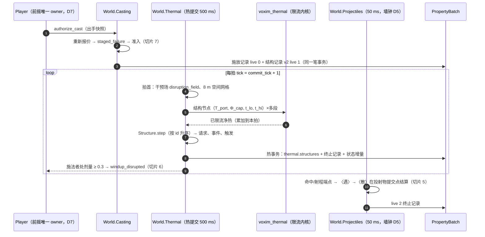

# 符号组合魔法 v2：P1 收口（分支切片 4–8）实施决策稿

> 状态：**用户已于 2026-11-26 批准 §11.1 全部决策点（按推荐）；§11.2 中 Q4-2、Q4-W3 已由用户代答（按推荐），其余待答；切片 4（4a、4b、4c）、切片 5 与收尾 5b、切片 6 已完成，切片 7 待开工；待设计确认项见 §14 切片 5、5b、6 三条。** 依据 AGENTS.md §3-8（运行时边界、协议、事务变化先写决策稿）与 §2.2-8（原创决策实施前报告）。
> 上游（均已批准）：[`2026-11-19-slice3-protocol.md`](2026-11-19-slice3-protocol.md)（下称“切片 3 稿”，§2.2 切片划分、P1–P14、§14 日志）、
> [`2026-11-19-glyph-v2-server-landing.md`](2026-11-19-glyph-v2-server-landing.md)（下称“落地稿”，D1–D9）、[`2026-11-19-catalog-v5-schema.md`](2026-11-19-catalog-v5-schema.md)、[`cast-phases-2026-10-05.md`](cast-phases-2026-10-05.md)。
> 设计：TheWorldBook `docs/2026-11-19-glyph-composition-game-design.md` v2.11（下称“设计”），只引节号不复述。
> 代码基线：分支 `magic-v2-p1` HEAD `f0605411`（Hello 46，目录 `e337873b…`）；工作树另有他会话未提交改动（法杖 `basic_spell` 迁 IR v2、`casting.ex:377` 的 `t0_us`），本稿不涉及。master `62d9a5a5`（Hello 45），领先分支合并基 `3c4d0048` 82 个提交。所有断言来自只读核对。

## 0. 结论摘要

1. 切片 4–8 的边界沿用切片 3 稿 §2.2，只建议一处前移：**热内核节点限流（设计 §5.3.1）从切片 7 前移到切片 4**（Q4-1）。理由：`Structure.step/4` 吃进的净热不设上限（`structure.ex:402-404`），没有内核钳制就不满足 x ≤ 1 与 T_chk，切片 4 的热结构（炽热投掷、灼点）验收对拍不了附录 A。
2. 切片 4 一次定型全部新增字节：结构记录 v2（135 + 25 = 160 B，新字段追加在偏移 135 之后）、终止事件 live 2–6、20 B 状态增量（PropertyBatch 末尾新字段）。仍是 Hello 46，分支未发布，不升版（Q4-10）。
3. 设计 §11.1 的“无质量”状态位与 Hello 45 已有的拟态 `flags` 第 1 位 `no_gravity`（`codec.ex:1348,1370`）重复。建议沿用 flags 字节：第 0 位 `ends_on_contact`、第 1 位无质量；状态字节不再放这一位（Q4-2，需设计方确认）。
4. **法杖普攻在 v2 中保持无重力直飞**：建议把程序里〈形〉的 `mass_g` 改为 0（缺省），也就是不写质量。按 Q17(a) 它就是无质量结构，直线匀速飞行。这样不改协议、目录和设计规则，只改法杖作者数据（Q5-1）。代价是动能为 0，未命中时在 30 m 处悬停约 1 s 后衰竭（手算见 §5.4）。
5. 结构持久化沿用 D3：结构以显式字段 map 存在 `thermal.structures`，随每笔热事务一起写入（`heat_commit.ex:66-72` 的 txn 带整张 `thermal`，`overlay_log.ex:93` 落盘）。体量风险在切片 8 实测，超标的出路是 S1a A2 的 `stream_row`，不另设第二条真值路径（Q4-7）。
6. 旧存档里的拟态在 World 恢复时一次性散解入账，不转写成结构（Q4-6），先例是 `Projectiles.settle_restored/1`（`projectiles.ex:55-71`）。
7. 前摇取消与打断统一按分阶段失败结算：第一笔注能前免费，之后按进行中的步号 k 扣费（Q6-1）。施法者处的扰乱剂量取前摇开始时的位置快照，误差不超过 0.25 m（Q6-2）。
8. 设计 §12.2 验收第 6 条的合成负载（256 结构、16 个醒着的热节点、64 条规则）按 §5.6 的权重算是 320 单位，超过硬上限 B + 32 = 288，**走正常准入造不出来**。需要设计方指定验收规模（Q8-W1）。
9. 切片 8 的负载测试在进程内做（World 级，不开任何 socket）。容量结论只在用户指定的 Linux 主机上采集；本机 WSL 只跑 1/4 规模冒烟。双客户端验收沿用切片 3 稿 §10 的单节点限额与 UDP 基线规程。

## 1. 现状核对

| # | 事实 | 位置 |
|---|---|---|
| 1 | 结构施放走完全部检查后显式拒绝 `:structure_runtime_pending`（outcome 2，不扣能） | `world/casting.ex:493-494`；moduledoc `:50`；`world.ex:423` |
| 2 | 取消待施放一律免费：施放记录 outcome 2，回 `{:error, reason}` | `casting.ex:436-447`（`:443`） |
| 3 | 结算入口：出手（`through = nil`）或第 k 步检查，按当时 site 重新报价、`staged_failure` | `casting.ex:453-497`；`world.ex:2041-2085` |
| 4 | `Structure` 已有 `new/4`、`step/4`、`respond/3`、`settle_kinetic/1`、`disruption_field/4`、`evaluate_rules/4`、mix64 | `magic/structure.ex:262,380,601,620,704,838,929-944` |
| 5 | `step/4` 要求 `tick == last_tick + 1`，净热按 `round(J×1000)` 并入 E_th，**没有上限** | `structure.ex:381-382,402-404` |
| 6 | 拍长有三处定义：`Structure @tick_ms 500`、热提交 `remaining: 0.5` 与 `+ 500`（设计 v2.7 R9 要求统一） | `structure.ex:73`；`thermal.ex:201,244` |
| 7 | 没有整数热提交拍号：只有浮点累计 `thermal.elapsed_s` | `thermal.ex:631`；`catalogs.ex:79` |
| 8 | 热提交是否开始取决于 `continues?`，拟态存在即推进 | `thermal.ex:111-115` |
| 9 | 拟态是热内核的外部节点：每段 NIF 调用前组装节点、边和辐射项，调用后按段推进温度 | `thermal.ex:551-581,649,736-803` |
| 10 | 拟态移除与散解：`release_semblance`、`release/4`、`release_cell`（释放格只认粒度 0 的命中格） | `thermal.ex:806-838` |
| 11 | 一笔热事务带上整张 `thermal`（含拟态），overlay 日志把 `:thermal` 当元数据落盘；分页切点的全局行写 `thermal`（去掉 sources） | `heat_commit.ex:66-72`；`overlay_log.ex:93`；`world/pages.ex:765` |
| 12 | 积压达 mid/hard 时不开始新的热拍或投射物拍（结构冻结，对应 D4） | `world.ex:1925-1930` |
| 13 | 投射物拍 50 ms；飞行终点用 `lifetime_s`；恢复时在飞投射物散入空气 | `projectiles.ex:8-15,26,42,55-71` |
| 14 | 弹道路程达到 `max_path` 时返回 miss（射程端点） | `magic/semblance.ex:91` |
| 15 | 拟态模块头注写明“迁移期”，退出条件是切片 4 以 Structure 取代 | `semblance.ex:6-8` |
| 16 | PropertyBatch 字段表最后两个字段是 `semblances`、`casts`；完整快照要求全部 live = 1 | `mmo_contracts/voxel/codec.ex:44-61,1267-1282` |
| 17 | 拟态记录 135 B；flags 第 0 位 break_on_hit、第 1 位 no_gravity；解码要求 `shape ∈ {0,1}`、`temperature > 0` | `codec.ex:1343-1430`（守卫 `:1406-1410`） |
| 18 | Hello 46 README 写明保留 Hello 45 的 flags 位掩码 | `mmo_contracts/README.md:44` |
| 19 | 目录 v5 已有 `quotas` 全部字段，但 World 里**没有任何读取者**（只有报价限频） | `priv/magic/e337873b….json` `quotas`；`magic/catalog.ex:152,231`；`casting.ex:339` |
| 20 | World 没有“在场”集合，施法快照也没有 NPC 标记 | `world.ex`、`casting.ex` 均无 present/npc 字段 |
| 21 | Player 的移动打断只作用于信标和分选读条（`kind in [:beacon, :sort]`），施法不受影响 | `scene_server/movement/player.ex:1636-1649` |
| 22 | Player 取消前摇：发 `{:cancel_cast, key, reason}` 给 World | `player.ex:1613-1634` |
| 23 | `Harm.permitted?/3` 是纯位置判断，位于 scene_server；world_server 的投射物采样也调用它 | `scene_server/movement/harm.ex:12-18`；`world_server/movement/projectile.ex:47` |
| 24 | 依赖方向：scene_server 依赖 voxel_region（`runtime: false`），三者都依赖 mmo_contracts | `scene_server/mix.exs:33-34`；`voxel_region/mix.exs:29` |
| 25 | 内核节点 tuple 有 10 个字段，没有限流参数；稳定步长对全部节点取最小值 | `native/voxim_thermal/src/kernel.rs:4-5,108-111` |
| 26 | `〈形〉mass_g` 设了 `zero_means_absent`；〈投〉的签名不要求质量；〈热〉要求 `mass` | 目录 `e337873b…` symbols 2、30、15 |
| 27 | 法杖光弹 v2 程序含 `mass_g = 10`（字节 `000a`） | 工作树 `voxel_region/test/magic_staff_bolt_test.exs:48`、`catalog_holdables_test.exs:44` |
| 28 | master 自合并基以来改了 `world.ex`（+536）、`player.ex`（+380）、`quic_connection.ex`（+205）、`voxim_thermal/src/{lib,sim}.rs`；`casting/thermal/projectiles.ex` 与 `magic/` 未改 | `git diff --stat 3c4d0048 master` |
| 29 | 设计 §4.2 仍写“余额耗尽时付到耗尽为止”，尚未写入用户裁定 D-draw（从取得的能量里付） | 设计 `:1023`；切片 3 稿 `:421` |

## 2. 总体时序与所有权

| 真值 | owner | 写入点 | 持久化 |
|---|---|---|---|
| 结构储能、欠账、规则状态（整数 mJ / 1e-6） | `Magic.Structure`（纯值），World 持有 | 热提交拍、投射物提交点 | `thermal.structures`，随热事务写入（D3） |
| 飞行轨迹 | `World.Projectiles` | 50 ms 拍 | 同上（既有 `projectile_source`） |
| 前摇计时、移动/伤口打断 | `SceneServer.Movement.Player` | — | 不持久化 |
| 配额与准入（切片 7） | 新模块 `World.MagicAdmission` | 施放结算前 | 由 `thermal.structures` 推导，不另存计数 |

## 3. 对外字节（切片 4 一次定型，仍为 Hello 46）

全部大端；偏移从记录起点算。golden 追加到 `apps/mmo_contracts/test/fixtures/wire-v2-samples.json`（客户端 C3 已认定的路径），生成器 `gen_wire_v2_samples.py` 保持与 codec 独立。

### 3.1 结构记录 v2（PropertyBatch 原 `semblances` 字段，每条 160 B）

| 偏移 | 长度 | 字段 | 类型 | 取值 / 与 Hello 45 的差异 |
|---|---|---|---|---|
| 0 | 8 | `id_seq` | u64 | 创建事务 seq（设计 B6） |
| 8 | 4 | `id_n` | u32 | P1 恒为 0（一次施放只产生一个组） |
| 12 | 1 | `live` | u8 | 0 删除（无事件）；1 存在；2–6 终止事件（§3.2）；**Hello 46 拒绝 ≥ 7** |
| 13 | 8 | `caster` | u64 | 不变 |
| 21 | 1 | `shape` | u8 | 0 球 / 1 块 / 2 板；**Hello 46 只收 0–2**（原只收 0–1） |
| 22 | 1 | `flags` | u8 | 第 0 位 `ends_on_contact`（原 break_on_hit，W5 改义）；第 1 位无质量（原 no_gravity，Q4-2）；其余位必须为 0 |
| 23 | 8 | `size1_m` | f64 | 原 `radius_m`，与 IR `size1_mm` 同口径 |
| 31 | 8 | `temperature_k` | f64 | T_port；无〈热〉为 0。**解码守卫由 `> 0` 改为 `≥ 0`** |
| 39 | 8 | `glow_w` | f64 | 本拍实际发出的光功率（W5） |
| 47 | 24 | `origin` | f64×3 | 不变 |
| 71 | 24 | `velocity` | f64×3 | 不变 |
| 95 | 8 | `t0_us` | u64 | 服务器时间线，不变 |
| 103 | 8 | `flight_s` | f64 | 飞行终点时刻：命中或射程端点（§5.1 P2-13）；静止为 0 |
| 111 | 24 | `rest` | f64×3 | 飞行终点或静止位置 |
| 135 | 2 | `size2_mm` | u16 | 球为 0 |
| 137 | 2 | `size3_mm` | u16 | 球为 0 |
| 139 | 2 | `proto_id` | u16 | P1 恒为 0（无〈仿〉） |
| 141 | 2 | `coupling_mask` | u16 | 第 0 位〈热〉、1 位〈辉〉、2 位〈容〉、3 位〈乱〉；其余位保留为 0（位表待设计确认，Q4-2） |
| 143 | 1 | `load` | u8 | round(x·255)，x ≤ 1 是不变量（依赖 Q4-1） |
| 144 | 1 | `coherence` | u8 | round(clamp(C,0,1)·255) |
| 145 | 1 | `status` | u8 | 位 0 越线、1 折叠、2 供能中、3 泄放口已损、4 飞行、5 热节点休眠；位 6–7 为 0 |
| 146 | 1 | `failed_segments` | u8 | P1 恒为 0 |
| 147 | 1 | `anchor_type` | u8 | 0 手边（〈握〉）、1 格面（〈附〉）；P1 只用这两种 |
| 148 | 12 | `anchor_ref` | 12 B | P1 全 0（格面沿用位置字段，设计 §11.1） |

- 删除记录：id + `live = 0` + 147 B 全 0，共 160 B。
- **原创决策（字段次序）**：设计 §11.1 只列了新增字段，没有给偏移。本稿把新字段追加在 135 B 之后，前 135 B 保持原偏移，客户端现有解码器只需在尾部延长。替代方案是按设计表序插到 `flags` 之后，但那样全部旧偏移都要移位，没有收益。

### 3.2 终止事件（`live` 2–6）

| live | 事件 | 产生条件（`Structure` 终止类型） | 记录内容 |
|---|---|---|---|
| 2 | 接触终止 | 〈遇〉触发的〈散〉（要求 `ends_on_contact = 1`） | 终态完整快照，`rest` 为命中点 |
| 3 | 断供衰竭 | `:exhausted` | 终态完整快照 |
| 4 | 过载崩解 | `:collapsed` | 同上 |
| 5 | 驱散 | `:dispelled` | 同上 |
| 6 | 主动终止 | 非接触读数（〈时〉〈满〉）触发的〈散〉，即 `:released` | 同上 |

- 2–6 一律带终态完整快照，与 Hello 45 的 live 2 同一语义。客户端在快照位置播放对应原子，不需要先有“存在”记录（无创建前态也能自足，沿用 `cast-phases-2026-10-05.md:19`）。完整快照批中不得出现 2–6（`codec.ex:1277-1278` 的守卫保留）。
- Replica 物化：2–6 与 nil 一样从副本存活表删除，原始增量照常转发（沿用 `cast-phases-2026-10-05.md:21`）。
- 事件 7–12 属于 P2 及以后，13 只由施放记录表达（W4）。

### 3.3 状态增量（PropertyBatch 新增末尾字段 `structure_states: :bytes`，每条 20 B）

| 偏移 | 字段 | 类型 | 说明 |
|---|---|---|---|
| 0 | `id_seq` | u64 | |
| 8 | `id_n` | u32 | |
| 12 | `load` | u8 | 同 §3.1 |
| 13 | `coherence` | u8 | |
| 14 | `status` | u8 | |
| 15 | `failed_segments` | u8 | |
| 16 | `temperature_dk` | u16 | 0.1 K，饱和到 65535 |
| 18 | `glow_w` | u16 | W，饱和到 65535 |

- 按 id 升序且唯一；完整快照批（`complete = 1`）里该字段必须为空；同一批里已有完整记录（live 1–6）的 id 不得再出现在增量里。这些规则加进 `accept_m1/1`（`codec.ex:1267`），解码端显式拒绝。
- **发送条件（原创决策，Q4-4）**：比较同一结构本拍步进前后的量化分箱，任一不同就发。分箱为：装载、相干各 ⌊v·32⌋；温度 ⌊T/25 K⌋；发光为 0，或 ⌊ln(glow)/ln 1.1⌋；状态字节与失效段掩码直接比较。这样不需要记“上次已发值”，也就不会让传输状态进入持久化真值（§2.2-9）。热提交每拍 500 ms，“每结构 ≤ 2 Hz”自然满足（切片 3 稿 §4 观察）。与设计“跨 1/32、跨 25 K、跨 10%”的差别：设计按距上次发送的增量判，本稿按固定分箱判，最坏情况下在分箱边界附近多发几条，带宽上界不变。

### 3.4 其他线上表示

| 项 | 变化 | 片 |
|---|---|---|
| 0x83、施放记录 v2 | 不变 | — |
| 0x68 原因串 | 新增 `interrupted_cancelled`、`interrupted_moved`、`interrupted_disrupted`、`interrupted_wounded`（Q6-4）；`":structure_quota"`、`":flight_quota"`、`":region_budget"`（分区魔法拥挤）；删除 `":structure_runtime_pending"` | 6、7、4 |
| 施法结算回复 | `{:ok, %{seq, outcome, caster}}` 加 `fail_step`（切片 3 残余：NPC 拿不到 k） | 6 |
| Session kind14 ProjectileHit（108 B） | 布局不变；`q_j` 的口径按 Q5-2 | 5 |

## 4. 切片 4：结构构造、热提交步进、结构记录与持久化

### 4.1 范围

| 模块 | 改动 |
|---|---|
| `world/casting.ex` | `:493-494` 改为 `settle_structure/…`：扣 `quote.total_mj`；`Structure.new({seq, 0}, group, quote, commit_tick)`；物理体（形状、尺寸、质量、锚、〈投〉初速）沿用 `Magic.Semblance` 几何；施放记录 live 0 与结构记录 live 1 放在**同一笔**事务；构型损耗照旧记 `cast_waste_j`。删除 `:structure_runtime_pending` 及其文档、日志和测试 W-6 |
| `world/thermal.ex` | `semblances/1` → `structures/1`；`continues?` 改判结构；新增整数 `thermal.commit_tick`，每完成一次提交 +1（Q4-9）；每段 NIF 调用时结构节点温度取 T_port = T_ref + (E_th + 本拍已累计净热)/C_th，净热累加到 `run.structure_heat`；`settle_run` 末尾按 id 升序调用 `Structure.step/4`（输入：所在格温度与热容、是否嵌在固体内、8 m 网格中贡献最大的 ≤ 16 个邻居、3 m 内终止释放剂量、本拍接触），执行请求（`deposit_heat` → 有限热源；`release_thermal` 每格至多到 T_port；`caster_heat` → 施法者脚下 `cast_waste_j`），再求值触发、调用 `respond/3`（切片 4 不设触发预算）。`release_cell` 改为在执行时复核持有者（设计 §12.1 更正 3、Q7） |
| `native/voxim_thermal`（若 Q4-1 采纳） | 外部节点加 `phi_w, t_lo, t_hi`；子步先算后缩放（吞吐 s_i、边取两端 min、温度钳制 k），默认值 +∞ 时数值逐位不变；`ThermalDomain.step` 的 extra 节点参数随之扩展 |
| `magic/structure.ex` | 新增 `to_record/1`、`from_record/2`（显式字段 map，Q4-7）、`wire/1`（量化为 §3.1、§3.3 字段）；`@tick_ms` 作为唯一拍长，`thermal.ex:201,244` 改为引用它（R9） |
| `magic/semblance.ex` | 删除能量部分（`expired?`、`glow_j`、`stored_j`、`step`、`cap`、`spent?`、`break_on_hit?`），保留几何、弹道与热节点项（切片 3 稿 §6）；模块头注删掉“迁移期” |
| `world/projectiles.ex` | 只改为读 `structures`；飞行规则不变（切片 5 再改） |
| `mmo_contracts/voxel/codec.ex` | 按 §3 改 `encode/decode_semblances`（改名 `*_structures`）、PropertyBatch 字段表加 `structure_states`、`accept_m1` 加 §3.3 的约束 |
| `world/{observation,window_snapshot,closure}.ex`、`replica.ex`、`property_observation.ex` | 跟随改名；Replica 按 §3.2 物化 |
| 迁移（Q4-6） | World 恢复时，若 `thermal` 仍有 `semblances` 键，就逐个按旧规则散解入账（`semblance_released_j`），写一笔热事务删除该键；之后代码里不再出现 `semblances` |

### 4.2 账目与可观测面

热账科目（设计 §12.2 切片 0 表，按**去向**记，Q4-8）：

| 科目 | 含义 | 来源（`Structure` ledger） |
|---|---|---|
| `structure_created_j` | 建成时注入结构的物理能（E_op + E_th0 + 动能） | 结算 |
| `structure_heat_in_j` | 内核给结构的净热（有符号） | `in.heat_mj` |
| `structure_light_j` | 发光 | `out.light_mj` |
| `anima_radiated_j` | 灵炁辐射：泄漏的辐射半、释放的辐射半、活动能 | `leak_radiation_mj + release_radiation_mj + activity_mj` |
| `structure_leak_heat_j` | 泄漏批量沉积的热 | `leak_heat_mj` |
| `structure_released_j` | 终止释放进格的热（E_op 热半 + 热份额 + 动能） | `release_heat_mj + release_thermal_mj + kinetic_mj` |
| `structure_rounding_mj` | 内核 f64 → mJ 的舍入残差 | `heat_rounding_mj` |

闭合式：`created + heat_in = light + anima + leak_heat + released + Δstored + rounding/1000`（P1 中 `feed`、`vented` 恒为 0）。运行与修复两项只出现在日志指标里，不进账（与设计列出的 `structure_run_j / structure_repair_j` 有出入，Q4-8）。

| 日志事件 | 字段 |
|---|---|
| `voxel_structure_built` | `seq sid cid program_sha shape mass flags e_op_mj e_th_mj kinetic_mj e_cap_mj e_min_mj x0 x_star born_tick` |
| `voxel_structure_tick`（每拍一行，汇总） | `tick structures awake_nodes step_us_total step_us_max ended deltas rounding_mj` |
| `voxel_structure_end` | `seq sid cid live type tick released_mj heat_mj radiation_mj thermal_mj cell protected` |
| `voxel_structure_migrated`（一次） | `seq count released_j` |
| `voxel_thermal_throttle`（Q4-1） | `tick throttled_nodes clamped_nodes min_scale` |
| `voxel_thermal_commit`（既有，`heat_commit.ex:85`） | 追加上表各科目 |

World 观测快照（`observation.ex:79` 的 ledger）同步追加上述科目和 `structures`、`commit_tick`。

### 4.3 验收测试（先红后绿；对拍值取设计附录 A）

见 §13 的 C4-1–C4-3、S4-1、K4-1、W4-1–W4-7。要点：灯经 `World.spell_intent/3` 施放，断言扣费等于报价、记录 `load = 56`（0.221 × 255）；用注入时钟推进热提交，在出生后第 264 拍（132 s）以 live 3 终止（附录 A.3，误差 ±1 拍）；账目逐项整数闭合；冷重启后整数字段逐位相同，从下一拍继续，不补算。

### 4.4 合入后分支状态

灯、定时火种、灼点、炽热投掷可以建成、维持、衰竭并持久化；火球按旧弹道飞，命中时〈遇〉尚未接通（切片 5）。驱散仍不可用（P12）。`probe`。

## 5. 切片 5：飞行（投掷结构无射程终点）与〈遇〉

### 5.1 范围

| 模块 | 改动 |
|---|---|
| `world/projectiles.ex` | 删除 `lifetime_s`（`:26,42`）。**所有投掷结构都没有射程终点**（用户 2026-11-26 批准，覆盖本行原写的“路程达 `limits.range_m`”与“到端点后悬停 / 继续落地”）：无质量结构（`flags` 第 1 位）直线匀速、有质量结构按弹道，飞到接触（live 2）、落地（之后作为静止结构，下一拍接入热内核，设计 §5.1）或飞行中衰竭（live 3）；飞出可读范围按 §14 切片 5 的显式规则（live 3）。射程与距离衰减由能量账推导；`limits.range_m` 只作施法域（形成位置、准星、〈附〉〈取〉的 T6 `domain`、射线落空 `:no_target`）。施放时的弹道预测与出手读取闭包的飞行走廊只到报价推导的预计飞行时长（§14 切片 5b） |
| 〈遇〉接触 | 投射物拍命中时，对该结构按 tick = `last_tick + 1` 调用 `evaluate_rules/4`（含读数丢失 hash）；〈散〉在投射物提交点用 `respond/3` 结算，记录 live 2。丢失时接触保持待决，下一热拍重判（§5.4 R5）。静止结构在热拍里首次出现导热边时置接触 |
| 人物命中 | 沿用 World 冻结 → Player 接纳 → kind14 回执链路（`cast-phases-2026-10-05.md:31-37`）；`q_j` 按 Q5-2。人物采样只对 `ends_on_contact` 结构做（Q5-4，与 v1 只采样触散球一致） |
| 动能出口 | 命中或落地时调 `Structure.settle_kinetic/1`，在命中格沉积为热（R7③，动量接触将替换的唯一出口） |
| 飞行中维持 | 飞行结构每个热拍照常步进，只跳过第 0、2、11 步；在飞行中跌破 E_min 时以 live 3 终止并移除投射物（§5.3） |
| 恢复 | `settle_restored/1` 改为对结构执行“散解即终止”，记 live 3 |

### 5.2 可观测面

`voxel_structure_flight sid phase=launch|contact|endpoint|landed path_m t_s target=terrain|body|none reading_lost`；`voxel_structure_end` 的 `live=2` 带 `hit=terrain|body`；科目沿用 `projectile_body_j`、`body_exchange_j`（`cast-phases-2026-10-05.md:37`）。

### 5.3 验收

见 §13 的 Q5-1、W5-1–W5-5。

### 5.4 法杖普攻（Q5-1 的依据）

| 候选 | 协议影响 | 设计影响 | 结论 |
|---|---|---|---|
| A. 程序不写质量：`mass_g` 字节 `000a` → `0000` | 无（flags 第 1 位已有） | 无；Q17(a)“未写质量者不受重力、匀速直线”，签名允许〈投〉不带质量（§1 #26） | **推荐** |
| B. 目录或 IR 新增“直线”参数或符号 | 目录 digest、IR、签名、双端解释器全部要改 | 与 Q17“质量决定重力”的单一规则重复 | 否 |
| C. 持物作者数据另标无重力 | 0x82 不变，但行为取决于装备而不是程序 | 违反“判定只看程序”（`cast-phases-2026-10-05.md:57`）和 SSOT | 否 |
| D. 接受有重力 | 无 | 无；30 m/s 飞 30 m 下坠 4.9 m，退回 Voxim `6d86205d` 之前的手感 | 否 |

方案 A 的数值（按设计 §4.3 与附录 A.6 同一套公式手算，以切片 5 的 Cost/Structure 实算为准）：

- 物理量：S = 4（〈形〉〈辉〉〈投〉〈遇〉）；V = 5.24e-4 m³；E_cap = 8.38 kJ；x0 = 0.239；E_min = 1 kJ。
- 出账：P_run ≈ 402 W，修复约 99 W，发光 100 W，合计约 0.6 kW；可用 1 kJ，逐拍计约 4 拍（2.0 s）。
- 飞行：30 m / 30 m/s = 1.0 s。未命中时在 30 m 处悬停约 1 s 后以 live 3 熄灭；动能由 4.5 J 变为 0。（已作废：用户改为不悬停、无射程终点，〈蓄〉最终取 1742 J，见 §14 切片 5、5b。）

另外两项要知会用户：

1. 命中时可释放的能量约 1.7 kJ，按 Q5-2 有一半以上进入目标组织。v1 光弹的剩余能量约 0.1 kJ（发光余量加 4.5 J 动能，`cast-phases-2026-10-05.md:30,52`），普攻伤害约放大一个数量级。
2. 按住连发时，发射间隔 0.5 s、飞到射程端点 1.0 s，与 `flights_per_caster = 2` 恰好卡在边界上（Q7-5）。

需要配合的改动：

- 客户端改 `author_holdable.py` 的 `basic_spell`，重新发布物品目录（服务端夹具 `test/fixtures/items/08bb766b….json` 随之替换）。
- `match_basic_spell` 按字节比对（`casting.ex:835`），新旧程序不会混淆。

## 6. 切片 6：驱散脉冲；前摇打断与取消结账

### 6.1 范围

| 模块 | 改动 |
|---|---|
| `world/thermal.ex` | 拍首（第 0′ 步）对每个带〈乱〉的发出者，用 8 m 网格找半径 r 内的目标，调用 `Structure.disruption_field/4`，结果放进目标的 `inputs.fields`；发出者不受自身场（R2）；冻结交付中的结构不受影响（§7.3 末条）。作用于他人结构前，先按 `Harm.permitted?(scope, 发出者位置, 目标位置)` 判断（Q7、Q6-3） |
| 施法者处剂量 | 同一拍对 `pending_casts` 里每个施法者按“单位精度、零装载”累计 D0·a_X·(P/1 kW)·(1 − d/r)²·t_eff，达到 `runtime.windup_interrupt_dose`（0.3）即向 Player 发 `{:windup_disrupted, key, dose}`；位置取前摇开始时的快照（Q6-2） |
| `scene_server/movement/player.ex` | `interrupt_channel/1`（`:1637-1649`）扩展到 `kind: :spell`：离开前摇起点超过 0.25 m → `:moved`；Body 新增伤口（`body.ex` traumas）→ `:wounded`；收到 `windup_disrupted` → `:disrupted`；主动取消 → `:cancelled`。`cancel_cast/2` 按已流逝时间与已广播步长（`cast_prepared` 的 steps）算出进行中的步 k（仍在第 1 步调整段则 k = 0），发 `{:cancel_cast, key, reason, k}` |
| `world/casting.ex` | `cancel_pending_cast`（`:436-447`）：k = 0 时照旧免费（outcome 2）；k ≥ 1 时用当时的 site 重新报价，按“在第 k 步中断”结算（outcome 1，fail_step = k，扣第 1–k 步，`min(余额, 累计)`，支出落在形成处，W7），0x68 原因串按 Q6-4；结算回复带 `fail_step` |
| `Harm` | 按 D6 抽成共享纯模块（Q6-3）；Player 施法快照带 `combat_scope`，结构里存下施放时的 scope |
| 删除 | 切片 3 稿 P12 的驱散空窗结束 |

### 6.2 可观测面

`voxel_structure_field emitter tick t_eff_s targets doses=[{sid,dose,permitted}]`；`voxel_cast_disrupted cid key dose`；`voxel_cast_cancel cid reason k charged_mj outcome`；Player `character_event :cast_interrupted %{reason, k}`。

### 6.3 验收

见 §13 的 W6-1–W6-6、P6-1、G6-1。对拍附录 A.4：未供能的灯在 d = 0 时第 1 拍终止（欠账 1.182），d = 1 m 时存活（0.601），d = 2 m 时 0.131；施法者处 d = 1 m 剂量 0.527 打断，1.5 m 剂量 0.297 不打断。

### 6.4 合入后状态

7 个预设全部可施放，§12.2 验收第 3、4 条可在 World 级证伪。`probe`。

## 7. 切片 7：配额、准入、NPC、触发预算与热节点休眠

### 7.1 范围

| 项 | 规则（设计 §5.4、§5.6） | 实现 |
|---|---|---|
| 准入 owner | 一处判定、无持久计数 | 新模块 `World.MagicAdmission`：每次施放结算前从 `thermal.structures` 推导用量（权重 1 + 2·醒着热节点 + 0.5·规则 + 0.5·感知耦合）。计数从真值推导，不另存（§2.2-3） |
| 每人上限 | 6 结构、2 飞行（`quotas.*`） | `:structure_quota`、`:flight_quota`。切片 4 已先上 6 结构计数（Q4-5） |
| 分区预算 | 用量 < 75%·B 照常；≥ 75% 时，在场者自身用量须 < 0.75·B / 在场人数；保底 1 个用 32 单位预留；超过 B + 32 回 `:region_budget` | 同上 |
| 在场 | Scene 推送，World 不拉取 | 新公共 API `World.caster_presence(server, cid, :present \| :absent)`，由 Player 在会话就绪与解除时调用（Q7-1） |
| NPC | 每个 NPC 4 个；全体 NPC ≤ 25%·B；不计入在场、无保底 | 施法快照带 `controller: :player \| :npc`，由入口（Gate Dispatch / NPC Body）声明（Q7-2） |
| 飞行名额 | 16 + 在场人数，在场者保底 1 个，其余“轮转” | 即时准入下“轮转”如何定义待设计方回答（Q7-4） |
| 触发预算 | 每分区每拍 64、每人每拍 8；推迟队列按（首次推迟拍号, id）排序，同一规则至多一项 | `thermal.ex` 第 12 步之后由 World 调度 `respond/3` |
| 热节点休眠 | 与所有接触节点温差 < 5 K 且净热流 < 100 W → 下一批不作为种子；每拍复核 | World 侧判定（`structure.ex` moduledoc 第 11 步注明由 World 判） |
| 醒着热节点上限 16 | 超出时的处置未定义 | Q7-3 |

### 7.2 可观测面

`voxel_magic_admission cid controller decision reason usage_units budget present npc_units flights`；`voxel_structure_triggers tick fired deferred oldest_deferred_tick`；`voxel_structure_sleep tick asleep woke`。

### 7.3 验收

见 §13 的 W7-1–W7-7、S7-1。

### 7.4 合入后状态

P1 功能完整（设计 §12.2 切片 1 的服务端行全部落地）。`probe`。

## 8. 切片 8：Linux 合成负载、双客户端验收与合入

### 8.1 合成负载（设计 §12.2 验收第 6 条）

| 项 | 方案 |
|---|---|
| 形态 | 进程内 World 级基准：ExUnit `@tag :load`（默认排除）。经 `World.spell_intent/3` 和既有 World 集成测试的施法者夹具建出结构，不开 Gate/QUIC，**不创建任何 UDP/TCP socket** |
| 数据 | 新建世界副本与独立数据库，持久化开启；结构全部经施放产生（Testing.md §3），不直接写 `thermal.structures` |
| 规模 | 待 Q8-W1：规模 a 为设计原文的 256/16/64，需要 Test-only 目录把 `region_budget_units` 提到 ≥ 320，标为 `probe`；规模 b 为正常准入可达的上限。两档都测 |
| 反例 | 单个最小合法热容（C_th = 0.0556 s × g_max，附录 A.7）、2500 K 的结构，记录 `nif_us`、`kernel_steps` |
| 测量 | 每拍 World 时间（`voxel_thermal_sim wall_us`、`voxel_structure_tick step_us_*`）、热活动集增量、每拍日志与 overlay 字节、`page_cut` 积压分级是否触发；共同窗口 10 min，预热 1 min（Testing.md §4.2） |
| 地点 | 容量结论只在用户指定的 Linux 主机（部署清单所列，或同规格专用 VM）上采集（Q8-1）；本机 WSL 只跑 1/4 规模冒烟，用来验证 harness |
| 资源 | 不涉及网络；仍按全局约定在开始前、结束后各采一次 Windows `Get-NetUDPEndpoint` 与 WSL `ss -uanp` 计数，确认没有变化 |
| 判定 | 若热内核没有余量，按设计 §5.6 下调醒着热节点上限后再测；阈值只放在测试侧（§2.2-9） |

### 8.2 真实双客户端验收（设计 §12.2 验收第 1–5、7 条）

| 项 | 方案（沿用切片 3 稿 §10） |
|---|---|
| 进程 | WSL 原生 release、单节点单 Scene、只绑 127.0.0.1；Auth TCP P = 25470，QUIC UDP P + 3；客户端 ≤ 2 个，服务端每会话最多启动 2 次 |
| 前提 | 新世界副本与新数据库；蓄能石经作者入口一次安装并记账；施法者能量来自开户和〈取〉，不手动补 |
| 场景（每个 ≤ 10 min，按阶段门控，首个失败即停） | E1 七个预设各施放一次，双端看到的生命周期与终止事件一致；E2 火场边的火球出生即越线（状态位 0）；E3 第 k 步中断，扣费与报价 `fail_step` 一致；E4 驱散三项；E5 两项热账闭合（读服务端日志）；E7 带 v1“我的法术”的存档出现迁移对话框，服务端拒绝 v1 |
| UDP 规程 | 启动前记基线（总数与按进程计数），运行中每 5 min 复采；总数持续增长、出现 Tcpip 4266 或连接资源错误时立即停止并保留快照；结束后按 PID 只清理本次进程，删除本次数据库与世界目录（不碰受保护对象），复采对比基线 |
| 执行者 | 由 Voxim 主会话按 R7 harness 执行（Q8-3）；服务端会话只提供 release 与日志判定器 |

### 8.3 合入

1. 先把分支变基到 master；若 master 已占用 46，顺延编号（设计 §11.5）。
2. 生产库 `npc_specs.params` 的 v1 `spells` 盘点（切片 3 稿 N1）。
3. Voxim 用同一 Hello 打包；镜像与打包客户端跑青岚冒烟（Testing.md §4.3）。
4. 合入 master，切片 3–8 的 `probe` 标记撤除，`DA_MagicCatalogV1` 退役（C1）。

## 9. 客户端配套

| 片 | 客户端工作（设计 §12.2 Voxim 行） | 可并行（按冻结 golden） | 需要服务端提供的 golden / 样本 |
|---|---|---|---|
| 4 | 解码结构记录 v2（160 B）、live 2–6 与状态增量；表现原子：断供黯淡、过载爆裂、主动终止、越线辉光与闪烁（`status` 位 0、`load`、`coherence`）；温度与发光改由记录给出，删除按符号 id 写的分支（R9 冲突） | 是：§3 字节冻结后 | `wire-v2-samples.json` 新增 `structure_record_v2`（灯 live 1、飞行火球、无质量光弹、live 0 删除、live 2–6 各一）、`structure_state_delta`、带两字段的 PropertyBatch；反例：live 7、shape 3、flags 保留位、`temperature < 0`、完整批带增量、增量与完整记录同 id、id 未排序 |
| 5 | 飞行插值按“无射程终点”规则：`flying` 位置位时按 t0、初速（有质量加重力）外推、不按 `flight_s` 截断，收到不带 `flying` 的 live 1 或 live 2–6 时取其 `rest`；报价面板“预计有效距离”由 0x83 `life_s` 与程序自己的〈投〉速度推导（§14 切片 5b）；法杖 `basic_spell` 改为无质量程序（〈蓄〉1742 J）并重新发布 | 是 | `ir-v2-samples.json` 的 `staff_bolt_massless`；`quote-v2-samples.json` 同一程序的报价 |
| 6 | 驱散光尘（live 5）；前摇打断原因文案（4 条）；中断回执显示第 k 笔碎裂 | 文案可先做 | 施放记录 outcome 1 由取消产生的样本；0x68 原因串清单 |
| 7 | `":structure_quota"`、`":flight_quota"`、`":region_budget"`（“分区魔法拥挤”）的提示 | 是 | 原因串清单 |
| 8 | U1 编辑器替换现有编辑器；“我的法术”本地转写与迁移对话框（设计 §2.4）；双客户端验收；与服务端同版本打包 | U1 与迁移对话框现在就可做（只依赖目录 v5 与 IR 样本） | 全部 golden 的最终 commit 与目录 digest |

约定照旧（落地稿第 7 节）：改 golden、目录或 schema 之前先通知 worldbook 与客户端，提交后附 commit 与 digest。

## 10. D9 原创决策逐项报告

检索范围：设计 §13.1 已列的出处，再加本次联网核对（2026-11-26）。“对照”只表示可比较的外部方法，不表示照搬。

| 项 | 设计出处 | 外部依据 / 对照（来源） | 与本项目约束的对应 | 判定 |
|---|---|---|---|---|
| 分池与热份额 | §5.2、§13 #7 | E_th = C_th·(T − T_ref) 是集总热容模型（Incropera《Fundamentals of Heat and Mass Transfer》第 5 章，书目，未联网核对页码）；卡诺上限是标准热力学 | 结构节点在内核里本来就是单温度外部节点（`semblance.ex:21`），集总假设与实现一致；两池拆分本身没有出处 | 公式有出处，分池为**原创** |
| 稳态线 x* | §4.3、§13.1 | 对照：漏桶 / 流体队列，流入速率超过排空能力时积压（欠账）线性增长、否则偿还，稳定条件是流入 ≤ 排空（RFC 2697 的令牌桶，https://www.rfc-editor.org/rfc/rfc2697 ，未联网核对） | debt 的累积与偿还（§4.3）与漏桶同构；D、R_max 的函数形式原创 | **原创**（概念可对照） |
| E_min = 250 J × S·P | §4.3、§13 #32 | 未找到对应的外部规则（检索范围：设计 §13.1、热与控制方向的常用教材） | 目的是给复杂结构设最低运行门槛，并与 T13 首拍检查联动 | **原创** |
| 剂量公式 | §7.3、§13 #24 | 对照：UE `ApplyRadialDamageWithFalloff`（内外半径加衰减指数，https://dev.epicgames.com/documentation/unreal-engine/BlueprintAPI/Game/Damage/ApplyRadialDamagewithFalloff ）。内半径取 0、指数取 2 即 (1 − d/r)²；按焦耳计量与逐拍计入是原创 | 工业界通行的径向衰减形状；剂量单位与本项目的欠账模型耦合 | **原创**（衰减形状有工业先例） |
| 75% 准入与保底 | §5.6、§13.1 | max-min 公平（Bertsekas & Gallager《Data Networks》第 6 章，书目）；DRF（Ghodsi 等，NSDI 2011，https://www.usenix.org/conference/nsdi11/dominant-resource-fairness-fair-allocation-multiple-resource-types ）在单一资源下退化为 max-min；工业先例是 YARN Capacity Scheduler 的 `minimum-user-limit-percent`（竞争时每用户保底份额、空闲时可超用，https://hadoop.apache.org/docs/current/hadoop-yarn/hadoop-yarn-site/CapacityScheduler.html ） | 只有一种资源（权重单位），所以不需要 DRF；“75% 起才按人均限”相当于 YARN 的弹性加保底 | 阈值 75% 与 32 单位预留为**原创** |
| 热内核节点限流 | §5.3.1、§13.1 | Zalesak FCT 限制器（J. Comput. Phys. 31:335–362, 1979，https://data.coaps.fsu.edu/pub/eric_back/OCP5930/Papers/FCT-JCPv31.pdf ）：由节点上下界算出每节点的缩放比，每条边取两端比值的较小者，保持守恒。PDF 为扫描件，式号未逐式核对 | 结构相同：节点约束 → 边取 min → 守恒；不同处在于约束是吞吐与温度界而非单调性，并且作用于全部热流 | **原创**（算法骨架有出处） |
| 读数丢失 hash | §5.4、§5.8 | 基于计数器的伪随机（Salmon 等，SC11，DOI 10.1145/2063384.2063405，https://www.cs.tufts.edu/~nr/cs257/archive/john-salmon/parallel-random.pdf ）；mix64 取自 SplitMix（Steele、Lea、Flood，OOPSLA 2014，https://dl.acm.org/doi/10.1145/2660193.2660195 ） | 只用整数运算，双端逐位一致；已实现于 `structure.ex:929-944` | 算法有出处；以丢失概率 min(0.5, debt/0.5) 作为玩法规则是**原创** |
| 休眠阈值 5 K / 100 W | §5.3.2、§13 #35 | Box2D：线速度容差 + `b2_timeToSleep` 0.5 s，按岛整体休眠（https://box2d.org/doc_version_2_4/b2__common_8h.html ，https://box2d.org/posts/2023/10/simulation-islands/ ）；PhysX：按质量归一的动能阈值加唤醒计数器（https://nvidia-omniverse.github.io/PhysX/physx/5.4.0/_api_build/class_px_rigid_dynamic.html ） | 两者都带时间滞回（持续低于阈值一段时间才休眠）；设计只设阈值、没有滞回，边界附近可能逐拍来回切换 | **原创**；建议加 1 拍滞回（Q7-W2） |
| 触发预算 64 / 8 | §5.4、§13.1 | 对照：Deficit Round Robin（Shreedhar & Varghese，SIGCOMM 1995，https://dl.acm.org/doi/10.1145/217382.217453 ）的“每流量子 + 无饥饿轮转”；按“首次推迟拍号”排序相当于调度里的 aging | 每人每拍 8 次就是每流量子；推迟不丢弃 | 数值为**原创**、待实测 |

**本稿新增的原创决策**（实施前一并报告）：§3.1 的字段次序、§3.2 的 live 2 / 6 分工、§3.3 的固定分箱、Q4-6 恢复时散解、Q4-7 显式字段 map、Q4-9 整数拍号、Q6-1 取消按步号 k、Q6-2 剂量位置快照。每一项的风险、不变量与验证见 §11 和 §13 的对应行。

各项的风险与验证：

| 项 | 主要风险 | 验证 |
|---|---|---|
| 分池 | 不加限流时 E_th 越过 E_cap − E_op，x > 1 | K4-1、W4-3（Q4-1） |
| x* | 火场边出生即越线时，表现与数值是否和设计一致 | W4-7、E2 |
| E_min | 复杂结构寿命过短 | W4-2 对拍附录 A.3 寿命 |
| 剂量 | 误伤己方的手感 | W6-1、W6-2、E4 |
| 准入 | 在场人数抖动导致准入时有时无 | W7-2 |
| 限流 | 改变未受限节点的数值 | K4-1 逐位回归 |
| 丢失 | 双端 hash 不一致 | 冻结 mix64 向量，客户端共读 |
| 休眠 | 来回切换 | W7-6 加上切片 8 的休眠与唤醒计数 |
| 触发 | 64/8 过紧或过松 | L8-1 的 64 条规则 |

## 11. 新决策点

### 11.1 用户可直接拍板

| # | 决策 | 建议 | 依据 |
|---|---|---|---|
| Q4-1 | 内核节点限流放在哪一片 | **前移到切片 4**（含 Rust 改动与默认值逐位回归） | §0 第 1 条；附录 A.2“静置时 641 kW 超过 Φ_cap 157 kW，由内核限流” |
| Q4-3 | 终止记录形态 | live 2 = 接触触发的〈散〉，3–6 按 §3.2；2–6 一律带终态快照；live 0 只用于无事件删除 | 客户端已消费 kind2（`cast-phases-2026-10-05.md:19`），不重新定义 |
| Q4-4 | 状态增量的发送条件 | 固定分箱比较步进前后（§3.3），完整快照批不带增量 | 不引入传输状态（§2.2-9） |
| Q4-5 | 切片 4–6 是否先限每人 6 个 | 是，只判 `structures_per_caster`；其余准入留在切片 7 | 防止 probe 中结构无界增长 |
| Q4-6 | 旧拟态存档 | 恢复时一次性散解入账，不转写 | 不另设第二个运行时；先例 `projectiles.ex:55-71` |
| Q4-7 | 结构持久化形态 | `thermal.structures` 存显式字段 map（`to_record/from_record`），恢复时一次校验；体量在切片 8 实测 | 持久化加载属于信任边界（§2.2-6）；S1a A2 的行格式可直接复用 |
| Q4-9 | 结构拍号 | 整数 `thermal.commit_tick`，`Structure.tick_ms` 为唯一拍长 | D4、R9；现在没有整数拍号（§1 #7） |
| Q4-10 | 是否升 Hello | 不升；分支内的 46 在切片 4 冻结前仍可变，以 golden commit 为准 | 设计 §11.5：P1 只占一个 Hello |
| Q5-1 | 法杖无重力直飞 | 方案 A：程序不写质量（§5.4） | Q17(a)；协议与目录不变 |
| Q5-4 | 人物采样范围 | 只对 `ends_on_contact` 结构 | 与 v1 一致，不扩大 Scene 采样负载 |
| Q6-2 | 施法者处剂量的位置 | 取前摇开始时的快照（移动 > 0.25 m 已会打断，误差有界） | World 不向 Scene 拉位置（§5.9） |
| Q6-3 | Harm 跨 app（D6 落实） | `Harm` 抽到 mmo_contracts 作为共享纯模块；`combat_scope` 随施法快照进入结构 | 三个 app 都依赖 mmo_contracts（§1 #24） |
| Q6-4 | 打断原因串 | `interrupted_cancelled / moved / disrupted / wounded` | 客户端需要文案（C5 同一机制） |
| Q7-1 | 在场来源 | Player 会话就绪与解除时调用 `World.caster_presence/3` | 设计 §5.6“Scene 推送” |
| Q7-2 | NPC 标记 | 施法快照带 `controller`，由入口声明 | World 现在区分不了（§1 #20） |
| Q8-1 | 负载测试主机 | 用户指定部署清单中的 Linux 主机或同规格 VM；本机只做 1/4 规模冒烟 | Testing.md §4.2；落地稿 §2“共享机不能当容量验收” |
| Q8-2 | 合入顺序 | 每片开工前变基到 master；切片 4 前先做一次 | master 已领先 82 个提交（§12.2） |
| Q8-3 | 双客户端执行者 | Voxim 主会话按 R7 harness 执行 | 唯一生产根（铁律 10） |
| T1 | （切片 3 临时处理）t_k 时目标失效或有数值违规 | 维持：按结算时拒绝（outcome 2，不扣能），并请设计方补进 §5.5 | 与 W9“以结算时报价为准”一致 |
| T3 | （切片 3 临时处理）报价限频的时钟 | 维持：World 单调时钟、1 s 滑动窗口 | 通行的滑动窗口限流；不受墙钟跳变影响 |
| R1 | （切片 3 残余）存档拟态运行时没有 World 级测试 | 由 Q4-6 与 W4-5 关闭 | — |
| R2 | （切片 3 残余）结算回复不含 k | 切片 6 加 `fail_step`（§3.4） | — |
| R3 | （切片 3 残余）`:quote_rate` 重试无测试；被拒法术仍出现在 LLM 工具枚举 | 交 NPC 会话，不在本分支做 | 冲突面在 `runtime.ex` / `brain/llm.ex` |
| R4 | （切片 3 残余）生产库 NPC v1 法术盘点 | 作为切片 8 合入前置 | 切片 3 稿 N1 |

### 11.2 必须由设计方（worldbook）回答

| # | 问题 | 本稿暂行建议 | 阻塞 |
|---|---|---|---|
| Q4-2 | §11.1“无质量”状态位与 Hello 45 的 flags 第 1 位重复：能否改为 flags 第 1 位、状态字节不再放；`coupling_mask` 的位表；`anchor_type` 的编码 | flags 第 1 位；位表见 §3.1 | 切片 4 |
| Q4-8 | 热账能否按去向记，run/repair 只作日志指标 | 按去向记（§4.2） | 不阻塞 |
| Q4-W3 | live 6 是否只指非接触读数触发的〈散〉（接触触发的归 live 2） | 是 | 切片 4 |
| Q5-2 | 结构命中人物时，哪部分进入 `tissue_j`：E_op 热半 + 热份额（至多 T_port）+ 动能进组织，辐射半记账？这会使普攻伤害约放大一个数量级（§5.4） | 如左；请同时确认普攻伤害是否可接受 | 切片 5 |
| Q5-3 | 命中后在投射物提交点〈散〉时，从上一拍到命中这段不足一拍的维持是否补记 | 不补记，差额随释放计入（账目仍闭合） | 不阻塞 |
| Q5-W4 | 无质量结构带〈投〉、动能为 0、到端点悬停：是否符合 Q17(a) 本意 | 是 | 切片 5 |
| Q6-1 | §14.0 Q6“按已投入部分结账”：取消时按进行中的步 k 扣第 1–k 步（与分阶段失败同一结算），还是只扣已完成的步 | 按进行中的步 k | 切片 6 |
| Q6-5 | §5.5“伤口事件”具体指什么：Body 新增创伤（`body.ex` traumas），还是任一 `receive_effect` | 新增创伤 | 切片 6 |
| T2 | （切片 3 临时处理）〈附〉的形成距离取眼点到目标宏格中心 | 维持，与〈取〉E4 同一几何；请写进 §4.2 | 不阻塞 |
| D-draw | 用户裁定“〈取〉的构型损耗从取得的能量里付”尚未写进设计 §4.2（§1 #29） | 请设计方补写 | 不阻塞 |
| Q7-3 | 醒着的热节点超过 16 时：拒绝新的热结构，还是强制最早的休眠 | 拒绝新施放（`:region_budget`） | 切片 7 |
| Q7-4 | 飞行名额“轮转分配”在即时准入下的含义 | 保底以外先到先得 | 切片 7 |
| Q7-5 | `flights_per_caster = 2` 与法杖节奏（发射间隔 0.5 s、飞到端点 1.0 s）在边界上冲突 | 目录改为 3，由设计方定 | 切片 7 |
| Q7-6 | P1 的“感知耦合”是否为 0（〈遇〉〈时〉〈满〉只算规则） | 是 | 切片 7 |
| Q7-W2 | 热节点休眠是否加 1 拍滞回（§10 Box2D/PhysX 对照） | 加 | 不阻塞 |
| Q8-W1 | 验收第 6 条的负载按 §5.6 权重为 320 单位，超过 B + 32 = 288：验收规模取哪一档 | 两档都测（§8.1） | 切片 8 |

## 12. 工作量与风险

### 12.1 规模估计（量级）

| 片 | 生产代码 | 测试 | 主要文件 |
|---|---|---|---|
| 4 | 12–16 个文件，+1500 / −900 行（含 Rust 约 +250） | +900 行 | `casting.ex`、`thermal.ex`、`structure.ex`、`semblance.ex`、`codec.ex`、`kernel.rs`、`sim.rs`、`lib.rs`、`thermal_domain.ex`、observation/replica 等 |
| 5 | 4–6 个文件，+400 / −250 | +350 | `projectiles.ex`、`thermal.ex`、`semblance.ex` |
| 6 | 6–8 个文件，+500 / −80 | +450 | `thermal.ex`、`casting.ex`、`player.ex`、`world.ex`、`harm.ex` → mmo_contracts |
| 7 | 6–9 个文件，+600 | +500 | 新 `world/magic_admission.ex`、`casting.ex`、`thermal.ex`、`player.ex`（presence）、`world.ex` API |
| 8 | 测试 harness 与文档，+400 | — | `test/magic_load_test.exs`、R7 场景配置（Voxim） |

### 12.2 冲突面

| 来源 | 冲突 | 处置 |
|---|---|---|
| master NPC 合并（82 个提交） | `world.ex` +536（NPC 路线 `protected_cells`、Catalogs alias 重构 `5e9b0049`）；`player.ex` +380（`PlayerWire` 抽取 `24aa774c`、传送 `a0d204d3`）；`quic_connection.ex` +205；`voxim_thermal/src/{lib,sim}.rs`（NIF mutex 加固 `ca6aa6b3`） | 切片 4 开工前变基（Q8-2）；Rust 限流必须基于 master 的 `sim.rs` 写，否则冲突最大；切片 6、7 改 `player.ex` 前再变基一次 |
| S1a | A1/A2 的 owner 含 `casting/projectiles/thermal.ex`、`semblance.ex`（设计 §12.1） | 结构存放按 D2/D3 暂时随热事务写入；A2 落地时用 `to_record/1` 迁到 `stream_row`，作为其退出条件（铁律 9） |
| 动量接触 | 第 3 片替换动能分配 | 只有 `Structure.settle_kinetic/1` 一个出口（`structure.ex:620`） |
| 工作树内他会话 | 法杖 `basic_spell` 迁移、`t0_us` | 等其提交后再做 Q5-1 的程序改动 |

### 12.3 最大风险

1. **限流与 T15 的性能**：Rust 内核改动与 master 的 NIF 改动冲突。“单个最小热容的最热结构”可能让全活动集的子步数翻倍（设计 §5.6）。验证：K4-1 逐位回归加 L8-2 反例；若不过，按设计备选改为逐节点子步（另起决策）。
2. **持久化体量**：每笔热事务写整张 `thermal`（§1 #11），结构以显式 map 计。256 个结构按每个约 0.5 KB 粗估，约 128 KB/拍，远高于设计假设的 16 KB/拍。验证：L8-1 测每拍 overlay 字节与 `page_cut` 分级；超标的出路是提前对接 S1a A2，不另设真值路径。
3. **合并与双端协调**：82 个提交的 master 漂移、Hello 46 在分支内仍可变、普攻伤害与飞行名额的玩法变化（Q5-2、Q7-5）都要与 Voxim 同版本落地。验证：每片开工前变基，golden 按 commit 冻结，E1–E7 在同一版本对上跑。

## 13. 测试矩阵

最小充分（AGENTS §3-14、Voxim `Docs/Testing.md` §1–2）：协议用冻结 golden；World 走公共入口加注入时钟；不复制产品算法当期望（期望取设计附录 A 与手算值）；不重复切片 0–3 已有的 IR、签名、报价、Structure 纯值用例。

| # | 层 | 文件 | 用例 | 证伪什么 |
|---|---|---|---|---|
| C4-1 | 协议 | `mmo_contracts/test/mmo_contracts/magic_wire_test.exs` | 结构记录 v2 golden（灯、飞行火球、无质量光弹）逐字段比对，160 B | 偏移与量化错位 |
| C4-2 | 协议 | 同上 | live 0 与 2–6 正例；反例：live 7、shape 3、flags 保留位、`temperature < 0`、live 2 且 `ends_on_contact = 0`、完整批里出现 2–6 | 守卫回退、Hello 45 旧语义混入 |
| C4-3 | 协议 | 同上 + `property_batch_test.exs` | 状态增量 20 B；反例：完整批带增量、与完整记录同 id、未排序 | §3.3 约束 |
| S4-1 | 纯值 | `voxel_region/test/magic_structure_test.exs` | `to_record/from_record` 往返；损坏行（缺字段、负 mJ）显式失败 | 持久化边界只校验一次 |
| K4-1 | Rust | `native/voxim_thermal` 单测 | 全部节点不受限时与改动前逐位相同；受限节点 Σ 热流守恒、温度不越 [t_lo, t_hi]、两端都受限的边取 min | 限流破坏守恒或改动现有数值 |
| W4-1 | World | `test/magic_structure_world_test.exs`（新） | 灯经 `spell_intent`：扣费 = 报价；同一事务出现施放记录 live 0 与结构 live 1；`load = 56`、`temperature = 0`、`glow = 100` | 建成分支、记录生产者 |
| W4-2 | World | 同上 | 注入时钟推进，灯在第 264 ± 1 拍以 live 3 终止；账目整数闭合（§4.2 闭合式） | 步进接线、拍号、账目 |
| W4-3 | World | 同上 | 炽热投掷落地后 T_port ≤ min(t_hi, 2500 K)，E_th 单调下降，热内核两侧收付一致（验收第 5 条） | 限流接线 |
| W4-4 | World | 同上 | 冷重启：整数字段逐位相同，从 `commit_tick + 1` 继续，不补算 | D3、D4 |
| W4-5 | World | 同上 | 用 master 构建经正常施放产生、按出处记账的 overlay 夹具恢复：`semblances` 键消失，有一笔迁移事务，`semblance_released_j` 增加的量等于存量能量 | Q4-6；产品可产生的数据 |
| W4-6 | World | 同上 | 积压达 mid：热拍暂停，`last_tick` 不变，结构仍计入配额 | 冻结语义 |
| W4-7 | World | 同上 | 在 500 K 格边施放火球：`status` 位 0（越线）置位，x* ≈ 0.25（附录 A.3、验收第 2 条） | env 输入接线 |
| Q5-1 | 纯值 | `magic_semblance_test.exs` | 无质量直线 y 不变；有质量弹道飞过 30 m 路程照常求交到落地；预测只到预计飞行时长或不可读处（切片 5b） | Q17、无射程终点 |
| W5-1 | World | `magic_structure_world_test.exs` | 火球撞墙：在投射物提交点以 live 2 终止，`rest` 为命中点，释放入账 | 〈遇〉→〈散〉 |
| W5-2 | World | 同上 | 过热保险火球由〈满〉在命中前触发 → live 6 | 规则求值与 live 6 |
| W5-3 | World | 同上 | 无质量光弹：直线；未命中时在第 3 拍于飞行中以 live 3 熄灭（发射相位 0.05 s / 0.5 s → 31.5 m / 45 m）；命中人物时 `q_j` 按 Q5-2（采样后端替身）；A1 有质量投掷飞过 30 m 不停、A3 闭包走廊、A5 近/远命中（切片 5b） | Q5-1、Q5-2、无射程终点 |
| W5-4 | World | 同上 | 带欠账的结构：接触在 mix64 冻结向量给出的丢失拍不触发，下一拍触发 | R5 |
| W5-5 | World | 同上 | 冷重启恢复飞行中的结构 → live 3 散解，不采样 | `settle_restored` 改写 |
| W6-1 | World | 同上 | 驱散脉冲：d = 0 的灯第 1 拍以 live 5 终止；1 m 欠账 0.601 ± 0.005；2 m 为 0.131 ± 0.005（附录 A.4） | 剂量接线 |
| W6-2 | World | 同上 | 施法者自己 1 m 内的结构同样受剂量；发出者不受自身场 | R2、误伤己方 |
| W6-3 | World | 同上 | 战斗范围外的他人结构不受剂量 | Q7、Q6-3 |
| W6-4 | World + Player | `magic_windup_world_test.exs` | 施法者距发出者 1 m 时打断（0.527），1.5 m 时不打断（0.297） | 前摇剂量阈值 |
| W6-5 | World | 同上 | 取消：k = 0 免费（outcome 2）；k = 2 时 outcome 1、`fail_step = 2`、扣第 1–2 步 | Q6、Q6-1 |
| W6-6 | World | 同上 | 结算回复带 `fail_step` | 切片 3 残余 R2 |
| P6-1 | Scene | `cast_wait_lifecycle_test.exs` | 正常移动输入使施法者离开起点 > 0.25 m → 原因 `moved` | 移动打断扩展到施法 |
| G6-1 | Gate | `voxim_spell_dispatch_test.exs` | 0x68 原因串（4 条打断 + 3 条准入） | 下行映射 |
| W7-1 | World | `magic_admission_world_test.exs`（新） | 第 7 个结构回 `:structure_quota`；第 3 个飞行回 `:flight_quota` | 每人上限 |
| W7-2 | World | 同上 | 用量 ≥ 75%·B 时按在场人数公平准入；保底 1 个；超过 B + 32 回 `:region_budget` | §5.6 |
| W7-3 | World | 同上 | NPC 第 5 个被拒；NPC 合计不超过 25%·B；NPC 不享有保底 | D8 |
| W7-4 | World | 同上 | 一拍内同一施法者有 9 条规则触发：执行 8 条、推迟 1 条，下一拍按（首次推迟拍号, id）执行 | 触发预算 |
| W7-5 | World | 同上 | 不在场者的结构照常运行、计入用量，但没有准入资格 | 在场语义 |
| W7-6 | World | 同上 | 静置灼点满足阈值后休眠，碰到火在同一拍唤醒 | 休眠 |
| W7-7 | World | 同上 | 醒着的热节点 > 16 时按 Q7-3 处理 | Q7-3 |
| S7-1 | Scene | `cast_wait_lifecycle_test.exs` | Player 会话解除 → World 在场集合缩小（经公共 API） | Q7-1 |
| L8-1 | 负载 | `magic_load_test.exs`（`@tag :load`） | §8.1 两档规模 | 验收第 6 条 |
| L8-2 | 负载 | 同上 | 最小热容、最高温反例的 `nif_us`、`kernel_steps` | T15 |
| E1–E7 | 双端 | Voxim R7 harness | §8.2 | 验收第 1–5、7 条 |

运行：WSL Linux 下，`cd apps/mmo_contracts && mix test test/mmo_contracts/magic_wire_test.exs`；`cd apps/voxel_region && mix test --no-start test/magic_*.exs`；Rust 用 `cargo test`（`native/voxim_thermal`）；scene_server 与 gate_server 只跑上表文件；L8 用 `mix test --only load`，只在 §8.1 指定的主机上跑。

## 14. 进度日志

- 2026-11-26：起草。只读核对 `magic-v2-p1`（`f0605411`，Hello 46）与 master（`62d9a5a5`）。未改代码、测试或夹具，未启动任何服务或网络连接。联网检索 §10 的外部依据（Zalesak PDF 是扫描件，式号未核；书目类未联网核对页码）。待用户拍板 §11.1，待 worldbook 回答 §11.2，待客户端确认 §9 的 golden 清单。
- 2026-11-26：用户批准 §11.1 全部决策点，均按推荐。补充两项：
  - Q5-1 法杖光弹改为不写质量，保持无重力直飞。依据是设计 §2.4 的 v1→v2 迁移规则："没有〈热〉的结构丢弃 `mass_kg`"。〈蓄〉同样按该规则改为 (glow_w + 0.3 kW) × 旧 lifetime_s = 0.4 kJ，原程序写的 2 kJ 不符合迁移规则。改程序会改 hex，所以客户端要重新发布物品目录，放在切片 5 一并做。
  - §11.2 的设计方问题由用户代答，统筹会话整理后提交。切片 8 的完整规模负载（Q8-1）在本机 WSL 里进程内跑：不建套接字、限定时长、跑完清理。
- 2026-11-26：切片 3 收尾已提交。法杖 `basic_spell` 迁到 IR v2，物品目录夹具改用客户端真实发布物 `08bb766b…`（Voxim `magic-v2-online` `62042c84`），客户端同步到 Hello 46。WSL 全量测试结果：mmo_contracts 209、voxel_region 1002（排除 53）、scene_server 308、gate_server 110、npc_server 807，全部通过。
- 2026-11-26：分支变基到 master `62d9a5a5`（合并基原为 `3c4d0048`，master 新增 82 个提交；本次用 `git rebase master`，逐条解决冲突）。冲突与处理：
  - `gate_server/test/.../voxim_spell_dispatch_test.exs`（3a）、`npc_server/test/.../npc_cast_world_test.exs`（3d）：master 只改了 v1 用例（期望改取 `Cost.quote/2`、v1 JSON 程序）。这些用例分支已按 v2 重写，所以取分支版本，不恢复 v1 断言。合入后自动带进来的 `windup_ms()` 调用改回分支的 `@windup_ms`。
  - `voxel_region/lib/voxel_region/world.ex`（3c）：master 的 `5e9b0049` 把 14 个 World 子模块 import 改成了显式 alias。冲突处保留分支的施法逻辑（报价也求射线、`caster_status/2`、`refresh_pending/3`、`settle_cast/3`、第 k 步检查 `check_cast`），调用按 master 风格写成 `Casting.` / `Tools.` 限定。
  - `npc_server/lib/npc_server/{body,brain}.ex`（3d）：两边都是新增，全部保留。Body 的 alias 同时含 `Route` 与 `Spells`；状态同时有 `landing` 与 `spell_check`；`apply_command` 同时保留传送回出生点子句与被拒法术就地回 `spell_rejected` 子句（后者在通用世界意图子句之前）。brain 文档同时保留 `find_route` 行，`cast_spell` 行写 IR v2。
  - 自动合并的文件已逐个核对：`dispatch.ex`、`session/codec.ex`（Hello 46）、`actions.ex`、`player.ex`（master 抽出的 `PlayerWire` 不涉及分支对前摇检查的改动）、`access.ex`、`closure.ex`、两份 README。master 新增代码里没有走 v1 施法的地方（JSON 程序、`semblance`、`:coherence`、`out_of_domain`），也没有写 45 的版本断言；deploy 的 NPC 登记数据不带法术。
  - 变基后单独提交 `a15238ab`：master 的 `8ac22da8` 新增了 NPC 工具 `find_route` 和 `teleport_to_spawn`，但 `npc_brain_llm_test` 的工具表全等断言没有同步。现在补齐期望表，断言仍是全等比较。这个缺陷来自 master，与魔法改动无关，master 上也应修。
  - WSL 全量测试：mmo_contracts 209；voxel_region 1006（排除 53）；scene_server 346（排除 1）；gate_server 48（排除 68）；npc_server 827（排除 20）；world_server 13（排除 1，`--sname`）。全部通过。另有三点说明：
    - gate_server 排除的 68 项都是 `@moduletag :quic_transport` 的 `T1TransportTest`。它会起真实 QUIC 监听，按本机 UDP 约束没有跑。
    - scene_server 首轮有 3 项失败，都在 `P0BodyLifecycleTest`，原因是 `:stale_owner`：该测试的 cid 取 `System.unique_integer + 500_000`，每次运行都会重复，而本地测试库保留了上一轮写下的 `character_bodies` 行（owner_epoch 2/3）。单跑该文件 5/5 通过。删掉这 6 行测试残留后全量通过。CI 每次用新库，不受影响。
    - `mix format --check-formatted` 通过；mmo_contracts、gate_server、npc_server、world_server、auth_server、data_service 的 `mix compile --force --warnings-as-errors --no-optional-deps` 全部通过。
- 2026-11-26：用户以设计方身份回答 Q4-2 和 Q4-W3，都按推荐：
  - Q4-2：v2 里"无质量"和"不受重力"是同一个事实（Q17(a)：有没有质量决定受不受重力）。Hello 45 的 `no_gravity` 是 v1 为了给有质量的光弹关掉重力而加的特例，v2 不再需要。所以只留一位，含义定为"无质量"，放在 flags 第 1 位；状态字节不再重复放这一位。客户端在"飞行中且有质量"时按弹道插值。
  - Q4-W3：〈遇〉→〈散〉（碰撞触发）一律发 live 2，沿用客户端现有的命中表现；live 6 只用于非接触读数触发的〈散〉（〈满〉、〈时〉等）。
  - 其余 §11.2 问题等用到时再答。切片 4 开工，拆成 4a（对外字节与 golden）、4b（热内核限流）、4c（World 接线、步进、持久化、迁移）。
- 2026-11-26：切片 4a 完成（对外字节一次定型，仍为 Hello 46；只做协议与量化层，不接 World 运行时）。
  - 代码：`mmo_contracts/voxel/codec.ex` 的 PropertyBatch 字段表 `semblances` 改名 `structures`，`casts` 之后追加 `structure_states`；`encode/decode_structures`（160 B，§3.1）、`encode/decode_structure_states`（20 B，§3.3）、`structure_state/1`（完整记录 → 增量的量化，唯一定义处）、位表 `structure_couplings/0`、`structure_status_bits/0` 与 `structure_end_live/1`（`:contact` 2、`:exhausted` 3、`:collapsed` 4、`:dispelled` 5、`:released` 6）。编码与解码共用一个约束谓词，违约记录编码时显式失败。`accept_m1` 加 §3.3 的约束。旧 135 B 拟态记录删除，不保留兼容解码。`magic/structure.ex` 新增 `wire/1`。
  - golden：字段值文件 `apps/voxel_region/test/fixtures/magic/structure-v2-samples.json`（新），由 `magic_structure_wire_samples_test.exs` 调用 `Program.decode_ir/2`、`Cost.quote_structure/3`、`Structure.new/4`、`step/4`、`respond/3`、`wire/1` 产出，默认只比较，`WRITE_STRUCTURE_WIRE_SAMPLES=1` 时重写。线字节仍追加在 `apps/mmo_contracts/test/fixtures/wire-v2-samples.json`（客户端 C3 路径），由独立生成器 `gen_wire_v2_samples.py` 读字段值按 §3 逐段排出，不调用 codec。切片 3 的 7 个旧样本逐字节未变。
  - 样本：`structure_record_v2_deleted`（live 0）、`lamp_born`（live 1，无质量、静止）、`fireball_flight`（live 1，有质量飞行，status 位 4）、`fireball_contact`（live 2，第 1 拍〈遇〉→〈散〉）、`lamp_exhausted`（live 3，第 264 拍）、`lamp_collapsed`（live 4，800 K 火场格第 48 拍）、`lamp_dispelled`（live 5，驱散脉冲 d = 0 第 1 拍）、`timed_ember_released`（live 6，第 60 拍）；`structure_states_v2`（2 × 20 B：灯第 3 拍、定时火种第 53 拍，装载分箱改变）；`property_batch_structures_v2`（完整 M1 帧 1132 B，增量批同时带 6 条记录与 2 条增量）。反例 19 条：live 7、shape 3、flags 保留位、温度 < 0、live 2 无 `ends_on_contact`、coupling 保留位、status 保留位、球的 size2 ≠ 0、anchor_type 2、删除记录非零、乱序、截断；增量乱序、重复、status 保留位；完整批含 live 3、完整批含 live 0、完整批带增量、增量与同批记录同 id。
  - 与 §3 不同或 §3 未写明、本片定下的取舍：
    1. `wire/1` 的参数是二元组：`{结构, 报价}` 用于出生记录（越线按报价 x₀ > x*，相干为 1），`{结构, step/4 的 outputs}` 用于步进后（装载、x*、相干取本拍 metrics；发光 = 本拍 `light_mj` ÷ 拍长；供能中 = 本拍链功率 > 0；终止拍的装载与端口温度取终止判定那一刻的值，不是清空后的 0 与 T_ref）。`respond/3` 的 outputs 的 metrics 为空，不被接受。终止记录取同拍 `step/4` 的结果。
    2. `wire/1` 只给本模块拥有的动态字段（load、coherence、status 中的越线与供能中、failed_segments、temperature_k、glow_w）。形状、尺寸、质量、耦合、锚、`ends_on_contact`、运动字段，以及 status 的飞行、热节点休眠位，属于 World（4c）。
    3. §3.3 只写“不得与同批 live 1–6 记录重 id”，本片改为与同批**任何**结构记录（含 live 0 删除）都不重 id：删除后再发增量没有意义。
    4. 解码守卫比 §3.1 多几条：球的 size2、size3 为 0，块与板二者为正；size1 > 0；发光与飞行时长非负；coupling 第 4–15 位、status 第 6–7 位为 0；anchor_type 只收 0–1。proto_id、failed_segments、anchor_ref 只按字段宽度承载，不按 P1 取值卡死（P2 不必改解码）。
    5. 状态增量的温度、发光按“四舍五入（半数远离零）后饱和到 65535”量化。
    6. §9 清单里的“无质量光弹”样本没有收：法杖 `basic_spell` 改为无质量程序在切片 5，现在没有产品能产生的光弹。无质量位由灯覆盖。
  - World 临时跟随：`scene_server/movement/player_wire.ex` 不再编码拟态，`structures` 与 `structure_states` 暂为空（代码注释写明“切片 4c 接结构运行时”）。施法入口早已不再创建拟态，所以只影响旧存档里的拟态：它们在 4c 迁移前对客户端不可见。World 内部的 `semblances` 键与运行时都没有改。
  - 需要客户端配合：Voxim 的共享 golden `Docs/R7/fixtures/property-batch.bin` 要按以往新增尾段的做法（Voxim `Docs/R7/wire.md`）在末尾加 `00000000`（273 → 277 B，头部长度 264 → 268）。在这之前，mmo_contracts 的 `property_batch_test.exs` 失败（解码旧帧时缺尾段，`:invalid_m1_message`）。服务端不改客户端仓库，也不放宽这条测试。
  - 测试（WSL）。先红：新测试对着改动前的 lib 运行，`magic_wire_test.exs` 编译失败（`:structures` 键不存在），voxel_region 结构测试 14/20（`wire/1` 未定义）。再绿：`magic_wire_test.exs` 16、`magic_structure_test.exs` + `magic_structure_wire_samples_test.exs` 20、mmo_contracts 全量 214/215（唯一失败为上面的客户端 golden）、voxel_region 的 magic_*、window、damage、protection、projectile、overlay、world 等 254、gate_server 48（排除 68 个 `quic_transport`，未起 QUIC）、scene_server PlayerWire 两个文件 11。`protection_wire_test.exs` 的帧尾断言随新增尾段更新。`mix format --check-formatted` 通过；mmo_contracts、gate_server 的 `mix compile --force --warnings-as-errors --no-optional-deps` 通过。未启动任何服务或网络连接。
  - 留给 4c：`to_record/from_record`；World 的结构记录生产者（静态与运动字段、飞行与休眠位、按 §3.3 固定分箱决定是否发增量），届时 `magic_structure_wire_samples_test.exs` 的 `program_fields/2`、`motion/3` 改为调用它；Replica 按 §3.2 物化 live 2–6；旧存档拟态迁移（Q4-6）后删除 World 里的 `semblances`。
- 2026-11-26：切片 4b（热内核节点限流，Q4-1、K4-1）完成，分支 `magic-v2-p1-throttle`（从 `1e6afc56` 分出）。只改内核与传参边界，`world/thermal.ex` 只在 `voxel_thermal_kernel` 日志行追加 `kernel_steps`，结构接线留给 4c。
  - 参数形状：外部节点除 `{输入, 事件}` 外可写 `{输入, 事件, {phi_w, t_lo, t_hi}}`（`domain_step/12`、`advance/7` 都接受）。不附第三项就是不限（Erlang 浮点没有 ±∞，所以用"缺省"表示）。三项须有限、`phi_w ≥ 0`、`t_lo ≤ t_hi`，否则 `ArgumentError`。世界节点一律不限。
  - 算法：每个子步先把四类热流（接触、互见、对天空、对流）算进缓冲；吞吐 s_i = min(1, Φ·dt/Σ|q|)，边取两端较小的 s；按缩放后的热流加有限源试算温度，越过 t_hi（t_lo）时把流入（流出）各项乘同一个 k，使节点恰好停在边界，边取两端较小的 k；最后两端等量施加。稳定步长的计算不变。
  - 默认逐位不变的证据：`kernel::tests::unlimited_nodes_reproduce_the_pre_throttle_kernel_bit_for_bit` 冻结了改动前内核（`1e6afc56`）对同一四节点样本三条路径（整段推进、热前沿提前返回、旧 `batch` 定步长）的 f64 位模式，改动后逐位相同。`limits_that_never_bind_…` 证明参数不生效时（每段 6 个子步）受限节点也逐位不变。实现上，不触及受限节点的项系数恒为 1.0，乘 1.0 在 IEEE 754 下精确，求和次序与原实现相同。World 级热测试全量通过（见下），也可作旁证。
  - 新计数：`domain_step` 返回元组末尾追加 `{子步数, 吞吐受限节点数, 温度钳制节点数, 最小吞吐缩放比}`，`ThermalDomain.step/11` 的结果里是 `kernel: %{steps, throttled_nodes, clamped_nodes, min_scale}`。计数按一次 NIF 调用统计，一次热提交有多次调用，由 4c 汇总后写 `voxel_thermal_throttle`（建议子步数相加、节点数取最大、min_scale 取最小）。L8-2 的 `kernel_steps` 已在 `voxel_thermal_kernel` 行。
  - 测试：`cargo test`（voxim_thermal）25 项通过，新增 10 项：逐位对照、不生效逐位、吞吐两侧收付同为 50 J（手算 850 J × 1/17）、两端受限取较小 s、四类热流守恒且付出 ≤ Φ·时长、上限与下限恰好停在边界、已越上限只挡流入、边界校验、外部节点限流参数在有/无世界节点时都进入内核。T15 反例（C = 0.0556 s × g_max、贴 4000 K 大热容格、旁有 20 个活动格）断言 0.5 s 调用 `kernel_steps ≤ 20`；不限流时超过 20，说明上界来自钳制。先红：钳制与吞吐分别变异后，对应的 4 项、3 项变红。实现中还抓到一个缺陷：没有世界节点时限流参数被丢弃，已修复并加了回归。Mix：`thermal_native_test.exs` 新增 1 项（经 `ThermalDomain.step/11` 验参数与计数）；voxel_region 全量 `Result: 1007 passed, 53 excluded`（原 1006 + 1）。`mix format --check-formatted` 中本次改动的文件全部干净，失败的只有 master `99296b54` 带来的 `npc_server/skills/build.ex` 与 `npc_build_test.exs`（与本片无关，未动）。clippy 警告从 6 条降到 2 条，剩下的都在 `lib.rs` 既有代码里。`cargo fmt --check` 不通过：本 crate 基线就没有按 rustfmt 排版（未改动的 `domain.rs` 同样不通过），CI 也不跑 voxim_thermal 的 fmt、clippy 或 `cargo test`，所以没有整 crate 重排。
  - 待设计确认：① 两个受限节点直接相连的边，按设计"取两端 k 的较小者"后，未钳制的一端可能因对端缩小而略越过自身边界。保守的替代是 Zalesak 式，把可能被对端削减的流出不计入，但会更早限流。当前几何里结构只连世界节点和身体节点，不出现这种边。② 有限源不属于四类热流，不缩放；若只靠有限源就越过 t_hi，不会被钳制。结构节点现在功率为 0，没有影响。③ 节点已高于 t_hi（拍间 E_op 变化使上限下移）时取 k = 0：流入全部挡住，流出照常，不主动泄放到边界。
  - 风险：CI 的 `test-native-rust` 只跑 voxim_worldgen，本片的 Rust 测试不在 CI 里（建议加一行 `cargo test`）。`kernel.rs` 的 `evolve_steps` 改动较大，`StepOut` 从 12 个元素变为 13 个；master 之后若再改 `kernel.rs`、`sim.rs`、`lib.rs`，冲突会集中在这三处。
- 2026-11-26：切片 4c 完成（World 接入结构运行时），切片 4 全部完成。提交：`3d6732f9`（4c-1 持久化记录与拍长唯一定义）、`0213e320`（4c-2 删除拟态运行时与旧存档迁移）、`985f5e71`（4c-3 结构建成、逐拍步进、记录生产与持久化）、4c-4（恢复人物采样后端仍在用的 `Semblance.flight_segments/2`、CI、文档，即记录本条的提交）。
  - 4c-1：`Structure.to_record/1`、`from_record/2`（显式字段 map，Q4-7；键集合、拍号、计价量、整数储能池、欠账、读数形态、响应符号按目录一次校验）。拍长唯一定义 `Structure.tick_ms/0`，`World.Thermal` 的定时间隔、每次提交的模拟时长与进度推导改为引用它（R9）。
  - 4c-2：新 `World.SemblanceMigration`：恢复后若 `thermal` 仍带 `semblances`，按旧规则剩余能量（显热 + 飞行动能 + 发光余量）散入空气记 `semblance_released_j`，一笔热事务删除该键，日志 `voxel_structure_migrated`（Q4-6）。删除拟态的能量运行时（`Thermal` 的拟态节点、寿命、触散释放；`Magic.Semblance` 只留几何、弹道与热节点项，改为三轴半尺寸 `half`）。删除 World 侧投射物实时采样驱动（`World.Projectiles` 及其节拍、任务回复、驻留、闭包与恢复接线、`:projectile_backend` 配置）。广播键 `semblances` → `structures`（Replica 按 §3.2 物化）。之后运行时代码不再出现 `semblances` 键，迁移模块与 `OverlayLog.historical_atoms/0`（旧存档解码所需原子）除外。
  - 4c-3：新 `World.Structures`（条目 `%{structure, body, wire}`；物理体、记录生产者、持久化边界、每拍编排）。施法结构建成扣 `quote.total_mj`，施放记录 live 0 与结构记录 live 1 同一笔事务，物理能量记 `structure_created_mj`，构型损耗照旧 `cast_waste_j`；每人 6 个上限 `:structure_quota`（Q4-5）；删除 `:structure_runtime_pending` 及 W-6。热提交：落地的带〈热〉结构是受限外部节点（T_port 含本拍已累计净热，`{Φ_cap, T_ref, min(T_ref + (E_cap − E_op)/C_th, 2500 K)}`），净热按调用累计，提交末按 id 升序 `step/4` → `respond/3`，执行沉积请求，`commit_tick` +1；限流计数汇总为 `voxel_thermal_throttle`（子步相加、节点数取最大、`min_scale` 取最小、`calls` 为调用数）。持久化：`Log` 的事务元数据与 `Pages.globals/1` 写出前换成显式字段 map，恢复后 `Structures.restore/1` 一次校验（含 `last_tick = commit_tick`）。下发：`PlayerWire` 编码 `structures` 与 `structure_states`（状态增量随事务运输完整记录，编码时用 `Codec.structure_state/1` 投影）。
  - 账目闭合证据（W4-2，灯 `{6, 0}`，经 `spell_intent` 施放后逐次热提交）：第 264 拍 `live 3`（附录 A.3：132 s / 0.5 s = 264，误差 0 拍）；终止时 `structure_created_mj 50 000 000 + structure_heat_in_mj 0 = structure_light_mj 13 200 000 + anima_radiated_mj 36 800 000 + structure_leak_heat_mj 0 + structure_released_mj 0 + structure_stored_mj 0`，逐项整数；发光 100 W × 132 s = 13.2 kJ。灯悬在手边空气里，泄漏与释放的热无接触格可落，全部计入灵炁辐射账。定时火种对照用例（贴叶）释放热进叶格、闭合；他人保护区用例 `structure_released_mj = structure_leak_heat_mj = 0`，`voxel_structure_end … protected=true`，叶格无新热源，闭合。
  - 持久化与迁移的验证：W4-4 冷重启前后观察快照的结构记录、`commit_tick` 与结构账逐位相同；日志里最后一份 `thermal.structures` 是显式字段 map（`last_tick = commit_tick`）；重启后一次提交只走一拍（`last_tick` +1、`E_op` 减一拍出账），不补算停机时间。W4-5 用 master `62d9a5a5` 经正式施法录制的 overlay 夹具（`test/fixtures/semblance_migration/`，录制器 `record_62d9a5a5_helper.exs`，期望值由 master 自己的 `Semblance.stored_j/2` 对持久化的最后一份 `thermal` 算出）：手边光球 11 850 J + 落地热投掷 934 657.02 J，迁移事务 seq = 12（夹具末 seq + 1），`semblances` 键消失，`semblance_released_j` 增加 946 507.02 J，再重启无迁移。先红：不调用迁移时 0/2。
  - golden：`magic_structure_wire_samples_test.exs` 的 `program_fields/2`、`motion/3` 换成 World 真实生产者（`Structures.body/5`、`launch/4`、`record/3`），4a 冻结的 `structure-v2-samples.json` 逐字段不变，线字节因此不变。
  - 测试（WSL）。先红：`magic_structure_world_test.exs` 对 4c-2 的 lib 0/7。再绿：该文件 7 项（W4-1、W4-2、W4-3 炽热投掷落地后受限与降温、W4-4、Q4-5、保护区复核与对照）；S4-1 2 项；W4-5 2 项；结构驻留 1 项。全量（4c-4 状态）：voxel_region `1020 passed, 53 excluded`；mmo_contracts 215 全过（4a 记录的 `property_batch_test.exs` 1 项已随客户端更新 golden 转绿）；scene_server 346（排除 1）；gate_server 48（排除 68 个 `quic_transport`，未起 QUIC）；npc_server 826/827（排除 20），唯一失败 `NpcSpeakTest`（HTTP 替身计时，单跑 1/1 通过，与本片无关）；world_server 13（排除 1，`--sname`；首轮 12/13 是 4c-2 删掉了采样后端仍在用的 `Semblance.flight_segments/2`，4c-4 恢复后通过）；voxim_thermal `cargo test` 25。`mix format --check-formatted` 通过；mmo_contracts、gate_server、npc_server、world_server、auth_server、data_service 的 `mix compile --force --warnings-as-errors --no-optional-deps` 全部通过（world_server 同上，4c-4 后通过）。未启动任何服务或网络连接。
  - CI：`test-native-rust` 增加 voxim_thermal 的 `cargo test`（4b 的限流与逐位回归进入 CI），rust-cache 同时缓存该 crate。
  - 与本稿不一致或本片定下的取舍：
    1. 科目名用 `_mj` 后缀（`structure_created_mj`、`structure_heat_in_mj`、`structure_light_mj`、`anima_radiated_mj`、`structure_leak_heat_mj`、`structure_released_mj`；舍入残差 `structure_rounding_mj`），值为整数 mJ，闭合式逐项整数；§4.2 表里写的是 `_j`。
    2. `commit_tick` 只在有结构参与的热提交完成时 +1，没有结构时不推进也不写进 `thermal`（拍号的唯一读者是结构）。理由：每拍都写会改变无魔法世界的 `thermal`，7 个逐位对照的既有用例（保护区身份 4、气候区与 master 摘要、热休眠前后物理量、参数发布热账）因此失败。结构的时钟语义不变（有结构时每次提交都推进且步进全部结构）。
    3. Q4-4 的“步进前”分箱取条目里上一次算出的动态字段 `wire`（出生或上一拍的结果，随结构持久化），不是“上次发送值”；没有另存传输状态。分箱用线上量化值（装载、相干的 u8 ÷ 255）。
    4. 删除了 World 侧投射物实时采样驱动，而不是 §4.1 写的“只改为读 structures”：该驱动只服务 v1〈触散〉拟态，4c 不产生实时采样的飞行体；它的能量分支（寿命、冷却、命中交付 q_j）依赖已删除的拟态运行时，人物命中的 q_j 口径待 Q5-2。Scene/WorldServer 的人物采样与 kind14 回执链路保留，切片 5 接回。
    5. 4c 中带〈投〉的结构一律按施放时对当时世界的求交飞行（旧的“静态弹道”路径），射程端点未命中时停在端点（有质量者继续下落在切片 5）；落地后才进热内核；动能留在结构里直到终止释放（`settle_kinetic/1` 的接线在切片 5）。
    6. 旧存档迁移一律散入空气（不按旧规则落入接触格）：恢复时页未必驻留，旧 `settle_restored` 同样散入空气；已冻结的身体命中交付同样散解，不重投。
  - 待设计确认（按最保守做法暂行，代码注释已标）：① 所在格温度：落地且有接触格时取接触格温度，否则取中心所在格（实占用格取其温度，空气取气候区温度）；泄漏沉积阈值用接触格热容，无接触格时为 0（每拍沉积，热半落不进格即计入辐射）。② 邻居项的 P_leak 取邻居拍首的运行损耗 `running_loss_w/3`（与处理顺序无关）。③ 邻近终止释放剂量按 id 升序，本拍已终止结构的释放作用于其后处理的结构。④ 物理体与世界轴对齐（size1–3 对应 x、y、z），〈附〉上的〈投〉自格面点抛出。⑤ 释放格只认接触格（施放时射线命中的未细分宏格，落地后须仍是同一热节点）。
  - 未做：W4-6（积压 mid 冻结）没有单独的 World 用例：冻结由既有的热提交暂停实现（`world.ex` 的 mid/hard 分支不开始热提交），结构没有额外的冻结状态；W4-7（500 K 格边施放火球越线）只有纯值层的出生越线用例（`magic_structure_test.exs`），World 层的“火场边”取决于上面的 ①。
  - 留给切片 5：飞行终点由射程推导（有质量者到端点后继续下落、无质量者悬停）、〈遇〉接触读数与 live 2、人物采样与命中 q_j（Q5-2/Q5-4，接回 kind14 链路）、`settle_kinetic/1` 在命中或落地时调用、恢复时飞行中的结构以 live 3 散解、法杖光弹改为无质量程序（Q5-1）。
- 2026-11-26：用户以设计方身份回答切片 5 的三个问题：
  - **更正（统筹之误）**：之前记的"Q5-1〈蓄〉按迁移规则改为 0.4 kJ"是错的。法杖光弹的 E_min 约 1 kJ，0.4 kJ 出生就低于 E_min，会立刻熄灭。最终方案仍是不写质量（直飞）。
  - **Q5-W4（改写）**：无质量的投掷结构不设射程终点，直线匀速飞行，直到接触（live 2）或在飞行中衰竭（live 3）。理由是没有重力、没有阻力，就没有让它停下的原因；"到端点悬停"不再采用。有质量的结构仍按 §5 走弹道。
  - **法杖〈蓄〉**：用户要求"约 30 m 处熄灭"，射程与现状一致。〈蓄〉从 2 kJ 下调，取值由切片 5 用真实的 Cost/Structure 实算决定：以 30 m/s 发射，路程约 30 m 时在飞行中以 live 3 衰竭。不选 2 kJ 方案，那样会飞约 50–60 m。同时飞行上限按 Q7-5 推荐仍为 3。
  - **Q5-2**：命中人物时一半算伤害。进入 `tissue_j` 的是 E_op 热半 + 热份额（至多到 T_port）+ 动能；辐射半只记账，不算伤害。按旧 2 kJ 估算，每发约 0.7–1 kJ，组织块（约 209 J/K）升温约 4 °C；〈蓄〉调低后以实算为准。
  - Q5-3 未答，按推荐暂行：命中时不补记不足一拍的维持费，差额随释放入账。
- 2026-11-26：切片 5（飞行与〈遇〉）完成。提交：`f1f6da63`（5-1 飞行驱动、〈遇〉结算、人物命中链路与 World 级用例）、`be4671fd`（5-2 法杖无质量程序与 golden 样本）、5-3（文档，即记录本条的提交）。
  - 飞行规则（用户答复为准）：带〈投〉的结构一律由新 `World.Projectiles` 按墙钟 50 ms 拍（`projectile_tick`，经 World 的 `Clock`）逐段飞行；无质量者直线匀速、无射程终点，直到地形或人物接触（〈遇〉→〈散〉，live 2）或在热拍里于飞行中衰竭（live 3）；有质量者按弹道直到落地或接触。不在端点悬停。施放时 `Semblance.trace/8` 的求交只作线上记录里的预测。飞行中照常在热拍步进（不进热内核），位置取已推进到的飞行时长；在飞行中终止的结构就地释放，落不进格的部分计入辐射账。
  - 投射物提交点（`Structures.land/5`、`hit_body/5`、`deliver/3`、`dissipate/3`）：地形命中先 `settle_kinetic/1`（动能沉积进命中格），再按 `last_tick + 1` 调 `evaluate_rules/4`（含读数丢失），触发即 `respond/3`，一笔事务发 live 2；丢失时停在命中点作为静止结构、接触待决，之后的热拍重判（live 2）。〈散〉的线上事件按触发它的规则判：`Structure` 的触发项新增 `contact`（该规则是否读〈遇〉），读〈遇〉→ live 2，其余 → live 6。
  - 人物命中（Q5-2、Q5-4）：只对 `ends_on_contact` 结构、且施法者是 Player（带生命代次）时采样；4c 删除的 World 侧采样驱动按结构重建（异步任务 → 页闸 → `accept/2`），采样后端 `WorldServer.Movement.Projectile.poll/2` 改收结构形状的飞行体（`massless`、扫掠半径、无寿命上限），Harm 仍只在后端采样与 Player 接纳两处判。触发〈散〉时冻结交付（条目带 `delivery`，随 `thermal` 持久化，先广播停在命中点的 live 1），Player 接纳后终止发 live 2 与 kind14。进入组织 `q = E_op 热半 + 热份额（至多把组织块加热到 T_port）+ 动能`，辐射半只记账；`Player.hit_context` 新增 `tissue_k`、`tissue_c_j_per_k`。新科目 `structure_body_mj`（接纳进组织），闭合式变为 `created + heat_in = light + anima + leak_heat + released + body + Δstored`；分项沿 v1 记 `projectile_body_j`、`body_exchange_j`，未接纳记 `projectile_rejected_j`。
  - 恢复（W5-5）：冷重启时仍在飞行的结构以 live 3 散解（新纯值函数 `Structure.dissipate/2`，一笔事务，`voxel_projectile_restored_dissipated`），不采样；冻结交付照常重投。
  - **离开可读范围（显式规则，待设计确认）**：每段弦求交前确认两端所在 L0 region 都能由 `Canonical.decoded/3` 读出 canonical（区域基底或 baseline 源）；读不出就在该弦段起点以 live 3 散解，日志 `voxel_structure_out_of_domain sid t_s reason={region, 原因}` 与 `voxel_structure_flight phase=out_of_domain`。理由：缺失 region 上 canonical 求交没有真值，当空气会违反铁律 3；停在边界又违反“不悬停”。生成式 baseline（GeneratedStore）在 L0 处处可生成，实际只在文件后端或缺失来源时触发。驻留预取只覆盖每个飞行体未来 1 s 的弦段，其余由页闸按需装入。
  - **法杖光弹（Q5-1）**：`mass_g` `000a` → `0000`，〈蓄〉`07d0`（2000 J）→ `05a4`（1444 J），其余字节不变。新 hex `020101000700010002000032000000000000010010006401001b05a401001e7530010001002201002c00`。选取（真实 `Cost.quote_structure/3` + `Structure.new/4` + 逐拍 `Structure.step/4`，飞行中读数：293.15 K 空气、无接触格、无净热、无邻居）：〈蓄〉1–1295 J 报价被拒（T13 首拍，`first_tick_min_mj` = 1 295 960）；1296–1592 J 在第 2 拍衰竭；1593–1891 J 在第 3 拍；1892–2193 J 第 4 拍（原 2 kJ 落在这里，约 60 m）。取第 2 拍区间的中点 1444 J，两侧各留约 148 J（约半拍出账）的余量，环境稍变（升温、邻近结构）不跳拍。逐拍：E_op 1444 → 1148.04 J（发光 50 J + 泄漏 245.96 J）→ 第 2 拍跌破 E_min 1 kJ，live 3。模拟寿命 1.0 s，以 30 m/s 计路程 30 m。报价：总价 9 936 275 mJ（原 10 499 481），物理 1444 J，x₀ 0.172，E_min 1 kJ，报价寿命（能量切片求积）0.754 s，成本模型前摇 1.1840 s（持物普攻仍 0.3 s），rejects 为空。
  - **飞行墙钟与热拍的相位（待设计确认）**：设计 §5.8 规定飞行走墙钟、维持走热拍。结构出生后第一个热拍在墙钟 (0, 0.5] s 内到来，所以“第 2 拍衰竭”对应的实际飞行时长在 (0.5, 1.0] s，路程 15–30 m（W5-3 用注入时钟对齐到 1.0 s、30 m）。若要墙钟路程平均约 30 m，可改取第 3 拍区间（1593–1891 J，30–45 m）；本片按用户“约 30 m 熄灭、射程与现状一致”取模拟 30 m。
  - 命中人物一发（W5-3，采样后端替身）：命中在第一个热拍之前 E_op = 1444 J，Q5-3 不补记维持费，`q = ½ × 1444 = 722 J`（无〈热〉、无质量，无热份额与动能），辐射半 722 J 只记账；组织块热容 209.4 J/K，升温 3.45 K。命中在第一拍之后则 E_op = 1148.04 J，q = 574.02 J，升温 2.74 K。
  - 火球与过热保险火球（W5-1、W5-2）：火球瞄向墙石 (2, 2, 4)，第一个热拍之前在 t = 0.2855 s、路程 3.45 m 撞上 z = 4 面，球心停在 z = 3.75；同一笔投射物提交事务里 live 2（拍号 1）。结构账：建成 446 736 000 mJ（〈蓄〉20 kJ + 热份额 426.7 kJ + 动能 36 J）= 进墙格 436 736 000 mJ（E_op 热半 10 kJ + 动能 36 J 作有限热源，热份额 426.7 kJ 按 T_port 上限全部进格）+ 灵炁辐射 10 000 000 mJ（E_op 辐射半）；命中前没有热拍，发光与维持为 0（Q5-3）。过热保险火球停在距定时火种约 1.37 m 的飞行点（t = 0.055 s）：火种第 60 拍〈散〉释放约 187 kJ，同一拍里过热保险的相干跌到 117/255 ≈ 0.46，〈满 相干 < 0.5〉触发，在飞行中以 live 6 终止，落点即该飞行点。
  - W4-6、W4-7（4c 留的 World 级缺口）：W4-6 用写回停在发布点的日志后端把积压推到 mid，验证热提交与投射物拍都不开始、拍号与飞行进度不变、冻结结构仍计入每人 6 个上限。W4-7 按决策稿写的“500 K 格边施放火球”做不到：火球在切片 5 接触即〈散〉，留不在格边；出生记录按报价判越线，而报价的环境温度按设计 §4.2 取施法者所在格的气候温度，不是邻格。改为灼点贴在 500 K 墙面：第一拍 env 取接触格温度，`voxel_structure_state … x_star=0.25 env=2.0`，越线位置位，与手算 env = 1 + 0.5 × (500 − 300)/100 = 2、x* = √(((1 + 4 × 0.6124²)/2 − 1)/4) = 0.25 一致。最初用两个灼点时 x* 测得 0.218，是另一个灼点经邻居项抬高了 env，改为单个后对上。
  - golden 与夹具：`ir-v2-samples.json` 新增 `staff_bolt_massless`（标明来自本片、非设计 §11.4.4 抽取），`quote-v2-samples.json` 由生成器重写，只多出这一组报价，原 9 组逐字不变。物品目录夹具 `fixtures/items/08bb766b….json` 是客户端真实发布物，未改；`catalog_holdables_test` 仍读它（旧 hex，属预期）；`magic_staff_bolt_test` 与 scene_server `cast_wait_lifecycle_test` 改用测试内持物表与新程序。4a 的 `structure-v2-samples.json` 与线字节未变（飞行记录的 `flight_s`/`rest` 仍是施放时的预测）。
  - 可观测：`voxel_structure_flight phase=launch|contact|landed|out_of_domain|restored target=terrain|body|none t_s path_m reading_lost`；`voxel_structure_end … hit=terrain|body`（人物命中另带 `accepted body_mj target_id`）；`voxel_structure_state`（随状态增量记 load、x*、env、相干、所在格温度）；`World.stats/1` 的 `simulation_progress.projectiles`（每个飞行体已推进/应到时长、落后量、等待原因，冻结交付）。
  - 测试（WSL）。先红：新测试对着 HEAD（`31ebf5fe`）的 lib 跑 `magic_structure_world_test.exs`，10/16 失败（8 个因为没有飞行驱动，测试无法推进飞行；W4-6、W4-7 因投射物进度与 `voxel_structure_state` 观测行是新增的——冻结与越线行为本身 4c 已有，这两条补的是 World 级覆盖）。再绿：该文件 16/16。全量（WSL）：voxel_region `1029 passed, 53 excluded`（4c 为 1020，新增 9）；mmo_contracts 215；scene_server 346（排除 1）；gate_server 48（排除 68 个 `quic_transport`，未起 QUIC）；npc_server 826/827（排除 20），唯一失败 `NpcSpeakTest`（HTTP 替身计时），单跑 1/1 通过；world_server 13（排除 1，`--sname`）；voxim_thermal `cargo test` 25。`mix format --check-formatted` 通过；mmo_contracts、gate_server、npc_server、world_server、auth_server、data_service、scene_server 的 `mix compile --force --warnings-as-errors --no-optional-deps` 全部通过，voxel_region 编译无警告。未启动任何服务或网络连接，未建 UDP/QUIC。
  - 与本稿不一致或本片定下的取舍：
    1. 所有带〈投〉的结构都走墙钟飞行驱动（§5.1 只写了 `ends_on_contact` 采样）；无质量者无射程终点（用户答复，覆盖 §5.1 “悬停”）。
    2. 飞行中记录的 `flight_s`/`rest` 是施放时的预测，客户端在 `flying` 位时不截断；真实终点由下一条记录给出。
    3. 新增科目 `structure_body_mj`（§4.2 没有人物去向）。
    4. 〈散〉的 live 由触发规则是否读〈遇〉决定，`Structure` 触发项多一个 `contact` 字段。
    5. 人物命中读数丢失时停在命中点（空气中，接触待决），之后的释放落不进格；没有选择穿过人物继续飞。
    6. §5.1 的“静止结构在热拍里首次出现导热边时置接触”未做：P1 预设里带〈遇〉的只有投掷结构，本片只接投射物命中；留作后续。
    7. W4-7 改用灼点（见上）；W5-2 的欠账来源用邻近定时火种的终止释放剂量（〈乱〉接线在切片 6）。
    8. 测试环境不配置采样后端（`config/runtime.exs` 在 test 下不设 `:projectile_backend`）：各 app 单独测试时 world_server 未必编译；需要后端的 World 用例显式注入替身。
  - 待设计确认：① Q5-3（命中时不补记不足一拍的维持费）；② 离开可读范围的终止规则；③ 人物命中读数丢失时停住还是穿过；④ 飞行墙钟与热拍相位使法杖实际路程为 15–30 m；⑤ 静止结构的首次导热边接触。
  - 客户端需要配合：① 改 `author_holdable.py` 的 `basic_spell` 为新 hex 并重新发布物品目录，服务端随后替换夹具 `08bb766b…`；② 飞行插值：`flying` 位置位时按 t0、初速（有质量加重力）外推、不按 `flight_s` 截断，收到不带 `flying` 的 live 1 或 live 2–6 时取其 `rest`；③ golden 新样本 `ir-v2-samples.json` 的 `staff_bolt_massless` 与 `quote-v2-samples.json` 对应报价；④ ProjectileHit（kind14）布局不变，`q_j` 口径按 Q5-2。线字节（PropertyBatch、结构记录）不变。
- 2026-11-26：用户批准（切片 5 执行期间提出，切片 5b 落地）：**所有投掷结构取消飞行射程终点**。有质量与无质量的投掷结构都没有射程终点：无质量者直线匀速、有质量者按弹道，直到接触（live 2）、落地（之后作为静止结构接入热内核）或飞行中衰竭（live 3）。射程与距离衰减都由能量账推导，不加任何距离衰减规则；`limits.range_m`（30 m）只作施法域。法杖光弹〈蓄〉按“保证够到 30 m”重选（第 3 拍衰竭区间中点）。§5.1 范围表、§9 第 5 行、§13 Q5-1 与 W5-3 已改成新规则；§3（字节冻结）未改，其中 §3.1 `flight_s` 一行的“命中或射程端点”现在的含义见下文取舍 1。
- 2026-11-26：切片 5b（切片 5 收尾）完成。提交：`48c015a2`（5b-1 无射程终点、预测与闭包按报价推导）、`3e00f622`（5b-2 法杖〈蓄〉1742 J、golden、近/远命中）、5b-3（文档，即记录本条的提交）。
  - 现状核对：切片 5 的飞行驱动（`World.Projectiles`）已不以 `range_m` 结束飞行，`projectiles.ex` 没有射程逻辑。仍按 `range_m` 截断的只有两处：施放时的弹道预测（`structures.ex` 原 `:132`、`:142` 把 `range_m` 作为路程上界传给 `Semblance.trace/8`，`semblance.ex` 原 `:78` 的 `path >= max_path`），以及出手的读取闭包（`closure.ex:184` 只装眼睛 ±`range_m` 的立方）。〈附〉沿眼睛射线找格面（原 `:136`）属于施法域，保留。
  - **预计飞行时长 T（原创决策，`Structures.flight_horizon_s/4`）**：T_life = (⌊life_s / Δ⌋ + 1)·Δ，Δ = 热拍 0.5 s，life_s 是报价的能量切片求积寿命；有质量者 T = min(T_life, t_fall)，t_fall = (v_y + √(v_y² + 2·g·D))/g，D = 出发点高出施法者脚下支撑格（同 `Canonical.foot_target/2`）底面的高度，至少 1 m。依据：维持按整拍在拍首储能上扣，drain 随储能单调增，离散扣费不晚于连续积分耗尽，衰竭拍号 k ≤ ⌊life_s/Δ⌋ + 1；第一个热拍在出生后墙钟 (0, Δ] 内，第 k 拍不晚于 k·Δ。t_fall 是抛体落到出发点下方 D 处水平面的标准解（运动学教材公式），平地上弹道在此之前落地。核对：法杖光弹一族（〈蓄〉1296–4095 J 每 1 J、4.1–41 kJ 每 70 J，共 2862 个取值）用真实 `Cost.quote_structure/3` + `Structure.new/4` + 逐拍 `step/4` 实算，k 都没有超过该界（life_s/Δ − k ∈ [−0.994, 3.11]）；带〈热〉者的 life_s 是寿命下界，T_life 对它们不保证上界，由 t_fall 截住。无质量者路程 = |v|·T，有质量者路程 = ∫₀ᵀ|v(t)|dt。法杖光弹 T = 1.5 s（45 m），4000 J 光弹 T = 5.0 s（150 m）。
  - T 只限定两件事，不截断飞行：① 施放时的弹道预测（`Semblance.trace/8` 第 5 个参数由路程上界改为 T；新增回调结果 `:unreadable`，读不出 canonical 的弦段处预测提前结束，与飞行驱动同一判定 `Projectiles.readable/3`。不加这条，预测越过缺失 region 时 `target_at` 会匹配失败使 World 崩溃）；② 读取闭包（见下）。线上记录的 `flight_s`/`rest` 因此是“到 T 为止的预测”。
  - **闭包推导（完整做了，未动非魔法装页契约）**：出手与第 k 步检查（`Closure` 的 `authorize_cast`/`check_cast`）与前摇驻留（`Casting.residency_dependencies/1`）在施法域立方之外加飞行走廊 `Casting.flight_keys/4`：按此刻 actor 与方向重报价（life_s 只取决于程序与施法者所在格的气候温度，与结算报价同值），`Structures.flight_plan/5` 给出出发点、初速与 T，`Projectiles.corridor_keys/1` 沿 0…T 的 0.05 s 弦段取 region 包围范围（带祖页，再按闭包惯例扩 26 邻页）。〈附〉〈投〉的出发点在施法域线段 [眼, 眼 + d·range_m] 上，闭包时尚未求交，取两端弹道的包围盒（弹道对出发点是平移）、D 取两端较高者。报价与前摇开始（`spell_intent`、`prepare_cast`、`quote_cast`）不建结构、不预测，只装施法域。T 之后的飞行由 `Projectiles` 既有的页闸按段装入（另有 1 s 驻留预取），读不出 canonical 时按切片 5 的显式规则（`voxel_structure_out_of_domain`，live 3）散解。三者合起来覆盖整个飞行。残余：走廊与页闸里第一次读到的 L0 mixed region 由 `GeneratedStore.read` 在 World 进程内在线生成（`World.spell_intent/3` 的调用方预生成只覆盖施法域），只影响性能，不影响正确性；切片 8 负载里观测。
  - **`range_m` 现在的全部用途**：① 施法者眼睛射线射程（`Casting.spell_target/3` → `Tools.tool_target`，射程内没命中回 `:no_target`，〈取〉的能源目标与〈附〉的准星格面都由它找）；② 〈附〉形成时沿眼睛射线找格面（`Structures.launch/7` 的 `far`）；③ 读取闭包与前摇驻留的施法域立方（`Closure.magic/2`）、`World.spell_intent/3` 调用方预生成区域（`:magic_range`）；④ 〈附〉〈投〉闭包走廊的出发点线段端点（`flight_plan/5`）；⑤ 目录加载校验 `local_domain_m ≤ range_m`。T6 `domain` 比较的是形成距离与 `limits.local_domain_m`（≤ `range_m`），不直接读 `range_m`。飞行、预测长度、闭包走廊长度都不再读它。
  - **报价面板“预计有效距离”（0x82/0x83 字节不变）**：0x83 v2 有 `life_s`（偏移 105）；初速与有无质量在客户端自己的程序里（〈投〉`speed_mmps`、〈形〉`mass_g` 是否为 0）；热拍 Δ = 0.5 s 是设计 §5.8 的常数，不在线上。客户端推导：v = speed_mmps / 1000，T = (⌊life_s / 0.5⌋ + 1) × 0.5；无质量：名义距离 v·life_s，上界 v·T（法杖：37.7 m / 45 m，实际 30–45 m）；有质量：t* = min(T, t_fall)，t_fall = (v_y + √(v_y² + 2·9.81·D))/9.81（v_y = v·瞄准方向 y 分量，D = 手边高出脚下支撑格底面的高度、至少 1 m），水平距离 = v_h·t*。缺的：① 实际衰竭拍号 k（实际距离在 (v·(k−1)·Δ, v·k·Δ]），0x83 没有，所以给不出下界，只能给名义值与上界；② 带〈热〉结构的 life_s 是下界；③ Δ 不在线上。若要给出区间下界，需要在后续版本给 0x83 增加字段（本片不改冻结字节）。
  - **法杖光弹〈蓄〉（B，用户选“保证够到 30 m”）**：用真实 `Cost.quote_structure/3` + `Structure.new/4` + 逐拍 `Structure.step/4` 重算（飞行中读数：293.15 K 空气、无接触格、无净热、无邻居），区间与切片 5 报告一致：〈蓄〉≤ 1295 J 报价被拒（T13，`first_tick_min_mj` 1 295 960），1296–1592 J 第 2 拍，**1593–1891 J 第 3 拍**，1892–2193 J 第 4 拍。取第 3 拍区间中点 **1742 J**（`06ce`，指数 0，即量化值本身），逐拍 E_op 1742 → 1443.838 → 1147.879 J → 第 3 拍跌破 E_min 1 kJ，live 3。实际飞行 = 发射相位 + 1.0 s，相位 ∈ (0, 0.5]，所以飞行 (1.0, 1.5] s、路程 **(30, 45] m**，任何相位都 ≥ 30 m。新 hex `020101000700010002000032000000000000010010006401001b06ce01001e7530010001002201002c00`；报价总价 **10 235 708 mJ**（原 9 936 275），物理 1742 J，life_s 1.255 s，x₀ 0.208，成本模型前摇 1.1843 s（持物普攻仍 0.3 s），rejects 为空。`ir-v2-samples.json` 只改 `staff_bolt_massless` 的字节与说明；`quote-v2-samples.json` 由生成器（`WRITE_MAGIC_QUOTE_SAMPLES=1`）重写，只有这一组报价变化，其余 9 组逐字不变；物品目录夹具 `08bb766b…` 是客户端真实发布物，未改。切片 5 待设计确认 ④（法杖实际路程 15–30 m）随之消解。
  - **近/远命中（A5，采样后端替身）**：同一光弹 2 m 处命中（t = 1/15 s，第一个热拍前，E_op = 1742 J）进入组织 **871 J**，组织块（209.4 J/K）升温约 **4.16 K**；40 m 处命中（t = 4/3 s，飞行中已走两个热拍，E_op = 1147.879 J，接近衰竭）进入组织 **573.94 J**（½ × 1 147 879 mJ 按整数 mJ 四舍五入），升温约 **2.74 K**。近大远小完全来自飞行中的维持出账，没有距离衰减规则。W5-3 的单发命中同步为 871 J。
  - 测试（WSL）。先红：5b-1 的新用例对着改动前的 lib 跑 `magic_semblance_test.exs` + `magic_structure_world_test.exs`，17/22（纯值 3 项因预测长度语义改变、A1 预测在 30 m 截断、A3 `flight_horizon_s/4` 未定义）；5b-2 的〈蓄〉选取用例把 `@bolt_hex` 换回旧字节时 7/10（选取、报价、前摇 3 项红）。再绿：上述文件与 `magic_structure_wire_samples_test.exs`（4a golden 逐字段不变）、`magic_quote_samples_test.exs`、`magic_staff_bolt_test.exs`、`activity_residency_dependencies_test.exs`、`magic_windup_world_test.exs` 全绿。全量：voxel_region `1034 passed, 53 excluded`（切片 5 为 1029，新增 5）；mmo_contracts 215；scene_server 346（排除 1）；gate_server 48（排除 68 个 `quic_transport`，未起 QUIC）；npc_server 827（排除 20）；world_server 13（排除 1，`--sname`）；voxim_thermal `cargo test` 25。`mix format --check-formatted` 通过；mmo_contracts、gate_server、npc_server、world_server、auth_server、data_service、scene_server、voxel_region 的 `mix compile --force --warnings-as-errors --no-optional-deps` 全部通过。未启动任何服务或网络连接，未建 UDP/QUIC；主机 UDP 端点开始与结束都是 86（Windows）、38（WSL）。
  - 与本稿不一致或本片定下的取舍：
    1. §3.1（冻结）写 `flight_s` 为“飞行终点时刻：命中或射程端点”。字节与含义位置不变；飞行中（`flying` 位）它是到预计飞行时长 T 为止的预测（命中时刻，或未命中时的 T / 不可读处），飞行结束后的记录里是真实飞行时长。`mmo_contracts` codec 的 moduledoc 已按此改写（只改文档，不改字节）。
    2. 预计飞行时长 T 的公式、D 取“脚下支撑格底面、至少 1 m”、〈附〉〈投〉走廊取施法域线段两端，均为原创决策（依据与核对见上）。
    3. 闭包里为求 T 以形成距离 0 报价：life_s 不读形成距离，与结算时报价同值；没有为此在待施放里另存报价。
  - 待设计确认：① T 的公式与 D 的取法；② 0x83 缺衰竭拍号（报价面板只能给名义距离与上界）；③ 切片 5 的 ①②③⑤ 仍待答（Q5-3、离开可读范围、人物命中读数丢失停住或穿过、静止结构首次导热边接触）。
  - 客户端需要配合：① `author_holdable.py` 的 `basic_spell` 改为新 hex（〈蓄〉1742 J）并重新发布物品目录，服务端随后替换夹具 `08bb766b…`（`catalog_holdables_test` 届时改读新文件）；② golden：`ir-v2-samples.json` 的 `staff_bolt_massless` 与 `quote-v2-samples.json` 对应报价已更新（切片 5 的 1444 J 版本作废）；③ 飞行插值按 §9 第 5 行（`flying` 位不截断）；④ 报价面板“预计有效距离”按上式由 `life_s` 与程序推导。线字节（PropertyBatch、结构记录、0x82/0x83）不变。
- 2026-11-26：客户端切片 5 已提交（Voxim `magic-v2-online` `7affe19e`）：投掷结构飞行插值不再按 `flight_s` 截断；法杖无质量光弹（〈蓄〉1742 J）用真实工具重新发布物品目录 `c9aa29e6…`；报价面板新增"预计有效距离"一行（参考读数，法杖名义 37.7 m、上界 45.0 m）；命中火花与驱散光尘改由记录的 `load` 驱动；`structure.end` 日志的重名键修复（终止类型改为 `end` 字段）。golden 钉在服务端 `8f80418d`。Automation 163/163。服务端物品目录夹具由 `08bb766b…` 换成 `c9aa29e6…`，`catalog_holdables_test` 与 `magic_staff_bolt_test` 12 项通过。客户端遗留：剑技能条默认法术名与目录预设不一致；`projectile_combat.py` 的时间线仍走旧编辑器；以上在切片 8 前处理。
- 2026-11-26：切片 6（驱散脉冲剂量；前摇打断与取消结账）完成。提交：`5d86de0d`（6-1 Harm 迁入 mmo_contracts）、`73868ccf`（6-2 World 与 Player）、`d9948cf9`（6-3 NPC 跟随与 Gate 原因串用例）、6-4（文档，即记录本条的提交）。
  - 6-1（Q6-3、落地稿 D6）：`SceneServer.Movement.Harm` 原样迁为 `MmoContracts.Harm`（纯值，`open?/1`、`permitted?/3`）。调用方：Scene 的 `ToolAction` 候选与提交、`Scene` 开场判定、`Player.receive_effect`、world_server 投射物采样，以及 World 的驱散脉冲。行为不变，scene_server 原模块删除（无兼容别名），mmo_contracts 补规则单测。
  - 6-2 World：`Structures.tick/3` 第 0′ 步，用拍首状态为每个有场的发出者（带〈乱〉、拍首预付 t_eff > 0）求半径内其余运行中结构的 `Structure.disruption_field/4`，作为 `inputs.fields` 交给目标的 `step/4`。场包括施法者自己的其他结构，不包括发出者自身（R2）和冻结交付中的结构；飞行中的结构也算，位置取已推进到的飞行位置。作用于他人结构前，按发出者施放时的战斗范围判 `Harm.permitted?`。战斗范围存在物理体新键 `combat_scope` 里，随 `thermal.structures` 持久化，恢复时校验；来源是 Player 施法快照 `actor_context.combat_scope`，缺省 nil 表示禁伤。被打到相干跌破、且 `debt_int > debt/2` 的结构由既有判定以 `:dispelled` 终止，记录 live 5。
  - 6-2 施法者处剂量（Q6-2）：新纯值函数 `Structure.windup_dose/2`，即单位精度、零装载的 `disruption_rate × t_eff`。同一拍对每个前摇中的施法者累计到待施放的 `windup_dose` 上，位置取待施放里的施法者快照：前摇开始时给出，第 k 步检查时随快照刷新，二者相差不超过 0.25 m。他人的场先过 Harm。累计首次达到 `runtime.windup_interrupt_dose`（0.3）时，向 `pending.actor.player` 发一次 `{:windup_disrupted, 动作键, 累计量}`，之后只累计、不重发。
  - 6-2 取消结账（Q6-1）：新增 `Casting.cancel_pending_cast/4`，消息改为 `{:cancel_cast, key, reason, k}`，`Closure`、`PageLoad.order_key` 同步。k = 0 时免费：outcome 2，回 `{:error, reason}`。k ≥ 1 时按“在第 k 步中断”结算，与分阶段失败同一口径：新函数 `Cost.charge_through/3`，`staged_failure/3` 也改为调用它。扣第 1..k 步累计支出，付到余额为止。报价按此刻施法者所在格的气候温度重算；作用面沿用前摇开始时的 `checked`（待施放新存），不再求射线。支出落在形成处（W7）。施放记录 outcome 1、`fail_step = k`，结算 outcome 即打断原因，经 `publish_cast_reply` 下发 0x83 与 0x68 accepted。World 自己收尾的取消（Player 退出、装页失败）一律 k = 0。前摇计划 `cast_prepared` 加 `steps`（各步 {调整, 注能}），与施放记录同一份。
  - 6-2 结算回复（R2）：`commit_settlement` 的回复加 `fail_step`，与施放记录同值，建成为 0。
  - 6-2 Player（D7）：施法动作槽带 `kind: :spell` 与 `origin`（发 `prepare_cast` 时的位置）；`cast_prepared` 时记下 `steps` 与单调起点。四种打断经 `interrupt_spell/2`：主动取消（action 2）→ `interrupted_cancelled`；`:windup`/`:checking` 中离开起点 > 0.25 m（`interrupt_channel/1` 扩展）→ `interrupted_moved`；`receive_effect` 后 Body `traumas` 改变 → `interrupted_wounded`（Q6-5）；收到 `windup_disrupted` 且仍在前摇 → `interrupted_disrupted`。k 由 `step_in_progress/2` 求出：第 1 步调整段内为 0，之后取所在步，出手前置段算最后一步。前摇中打断时 Player 发 `{:cancel_cast, key, reason, k}`，动作槽立即释放，但不自行回复等待方，唯一回复由 World 经原 relay 转交。`:preparing` 中打断沿原取消路径，k = 0。系统撤销（下线、seal、等待者退出、到期时已死）照旧为 `cast_cancelled`、免费。
  - 6-3：NPC 的 Outcome 原样带 World 回复，所以带 `fail_step`。新增端到端用例：余额 0 的 NPC 施放灯，第 1 步中断，`data.fail_step = 1`。T4.2 的取消原因改为 `interrupted_cancelled`。工具描述、`brain.ex` 与 README 只更正事实，不改行为策略。Gate 无代码改动（accepted 取 outcome 文本、rejected 取 inspect），G6-1 冻结两种形式。
  - **0x68 原因串（客户端配文案）**：k ≥ 1 时为 accepted `interrupted_cancelled` / `interrupted_moved` / `interrupted_disrupted` / `interrupted_wounded`（result_ref = seq，先有 0x83，`spent_j` 为实际扣除）；k = 0 时为 rejected `:interrupted_cancelled` / `:interrupted_moved` / `:interrupted_disrupted` / `:interrupted_wounded`。系统撤销仍为 `:cast_cancelled`。
  - **A.4 对拍（World 级，经 `spell_intent` 施放的真实脉冲，`magic_structure_world_test.exs`）**：灯与脉冲各自单独一个世界。灯先建成，id 更小，同拍先步进，避免混进脉冲第 2 拍衰竭时的终止释放剂量；脉冲〈附〉在墙面，球心外移 0.2 m。结果：d = 0 时灯第 1 拍以 live 5 终止；脉冲第 1 拍 `t_eff_s=0.5`，自身不受场，第 2 拍以 live 3 衰竭。d = 1 m 时欠账 **0.602195**（A.4 0.601），灯存活，状态增量的 coherence < 255。d = 2 m 时 **0.132388**（A.4 0.131）。二者都比 A.4 高约 0.001，来自 World 里不可避免的邻居项：脉冲自身的运行损耗经 8 m 邻居网格抬高灯的 env（A.4 口径没有邻居）。施法者处剂量：1 m 时第 1 拍 **0.444444**（0.02 × 100 × (2/3)² × 0.5）即通知，两拍合计 **0.527413**（A.4 0.527）；1.5 m 时合计 **0.296670**（A.4 0.297），不通知。
  - **验收第 3 条（服务端部分，`magic_world_test.exs`）**：身体系数 0.1 → Ω_eff 1.6，灯各步累计 S·P 为 0、1、2、2。报价 0x83 的 `fail_step = 3`；前摇在 t_3 检查，结算 `interrupted_omega`，回复 `fail_step 3`，施放记录 outcome 1 / fail_step 3。扣费等于报价样本第 3 步累计支出 1521.539 J，余额只减少这些，未被扣光。取消用例：k = 2 扣 870.689 J（第 2 步累计），全部计入 `cast_interrupt_radiation_j`（手边是空气）；k = 0 不扣能。
  - **验收第 4 条（服务端部分）**：正中熄灭未供能的灯（live 5）；2 m 外的灯存活、欠账 0.132；1 m 处 coherence 下降（变暗）。灯与脉冲属同一施法者，即施法者自己 1 m / 2 m 内的结构同样受剂量（误伤己方）。W6-3：施法时没有战斗范围，他人的灯欠账为 0，日志 `doses=[{sid, 0.444…, false}]`；带覆盖双方的战斗范围时，他人的灯欠账 > 0.5。
  - 可观测：`voxel_structure_field emitter cid tick t_eff_s radius_m targets doses=[{sid, 单位剂量, permitted}]`、`voxel_cast_dose cid key tick dose total threshold notify`、`voxel_cast_disrupted cid key tick dose`、`voxel_cast_cancel seq cid request_id reason k charged_mj outcome windup_dose`、Player `character_event cast_interrupted %{client_intent_seq, reason, k, elapsed_s}`、`voxel_player_windup_disrupted`。
  - 测试（WSL）。先红：World 新用例对着改动前的 lib 跑 `magic_structure_world_test.exs`、`magic_world_test.exs`、`magic_windup_world_test.exs`，34/47（新 10 项，加上 3 项四元组取消消息）；scene 用例对着改动前的 lib 跑 21/30（新 5 项，加上 4 项原因串、取消消息形状变更）；NPC 改前 T4.2 红。G6-1 无对应生产改动，不存在红态。再绿（全量，WSL）：voxel_region `1044 passed, 53 excluded`（5b 为 1034，新增 10）；mmo_contracts 217（新增 Harm 2）；scene_server 351（排除 1；新增 5）；gate_server 49（排除 68 个 `quic_transport`，未起 QUIC；新增 G6-1）；npc_server 828（排除 20；新增 1）；world_server 13（排除 1，`--sname`）；voxim_thermal `cargo test` 25。`mix format --check-formatted` 通过；mmo_contracts、gate_server、npc_server、world_server、auth_server、data_service、scene_server、voxel_region 的 `mix compile --force --warnings-as-errors --no-optional-deps` 全部通过（首轮抓到 6-2 里 `Tuple.append/2` 弃用警告，6-4 改为显式解构）。未启动任何服务、未建 UDP/QUIC；主机 UDP 端点开始与结束：Windows 89 → 92（未见本任务进程持有 UDP，属正常波动），WSL 36 → 36。
  - 与本稿不一致或本片定下的取舍：
    1. P6-1 放在 `beacon_travel_test.exs`（真实 Player + 替身 World，与信标、分选同一读条打断），不在 `cast_wait_lifecycle_test.exs`：后者的 Player 没有 Scene，无法驱动正常移动输入。`cast_wait_lifecycle_test` 只改了取消原因的期望。
    2. 剂量位置用待施放里最近的施法者快照（前摇开始，或第 k 步检查时刷新），没有另存“前摇开始位置”字段；误差界不变。
    3. 取消结账不重新求射线，作用面沿用前摇开始时的 `checked`；只按此刻的气候温度重报价（§6.1 写的是“用当时的 site 重新报价”，此处 site 只含温度与形成距离）。
    4. 系统撤销（下线、移交 seal、等待者退出、到期时已死或会话失败）不算玩家打断，仍为 `cast_cancelled`、k = 0 免费。§6.1 只列了四种原因。
    5. 每个有场的发出者每拍记一行 `voxel_structure_field`。剂量按单位精度、零装载记，与施法者处同一口径；目标的实际欠账另由 `voxel_structure_state` 的相干给出。
  - 待设计确认（代码注释已标“待用户确认”）：① Q6-1 取消按进行中的步 k 扣第 1–k 步；② Q6-5 只有 Body 新增创伤算伤口事件；③ **移动打断对法杖普攻的影响**：前摇期间输入限幅 0.35，按住移动施法仍可能在 0.3 s 前摇内走出 0.25 m 而被打断。设计 §5.5 没有例外，本片按原文实现，建议实跑观察后由设计方决定是否对持物普攻放宽。
  - 客户端需要配合：① live 5 驱散光尘；② 四条打断原因的文案，accepted 与 rejected 两种形式（见上）；③ 中断回执显示第 k 笔碎裂，取消产生的 outcome 1 同样带 `fail_step`；④ 新 golden 样本：本片未改冻结字节（PropertyBatch、结构记录、0x82/0x83 不变），建议在 `wire-v2-samples.json` 增补一条由取消产生的施放记录 outcome 1（`fail_step` = 2），以及 G6-1 的 0x68 帧样本，由客户端确认后再加。
- 2026-11-26：用户以设计方身份裁定：**持物普攻不受移动打断**。范围是命中持物 `basic_spell`、前摇取作者值 `basic_windup_s` 的那条普攻程序（World 按字节匹配，`Casting.match_basic_spell/2`）；受伤、驱散剂量与主动取消照样打断，其余施法照设计 §5.5 仍受移动打断。理由：上一轮已验收的法杖演示含跑动连射，0.3 s 前摇加施法 35% 移速，边走边打会被打断，属于已验收手感的退化。切片 6 待设计确认 ③ 随之关闭。
  - 实现（切片 6-5，即记录本条的提交）：World 在 `begin_cast` 判一次 `basic_attack = match_basic_spell(state, program) != nil`（与固定前摇同一判定），随 `cast_prepared` 计划交给 Player。Player 只读这一位存进动作槽，不解析程序、不查持物表（信任边界校验一次）。移动打断子句 `interrupt_channel/1` 只匹配 `basic_attack: false`；伤口、剂量、主动取消的路径不读它。
  - 测试（WSL）。先红：新用例对着改动前的 lib 跑，scene 28/32（持物普攻边走边打被打断；计划缺 `basic_attack`；真实 World + Player 两例没有交接这一位），voxel_region `magic_staff_bolt_test.exs` 10/11（计划不带 `basic_attack`）。再绿：
    - `beacon_travel_test`（真实 Player）：持物普攻走出 0.4 m 不打断，到期照常授权，结算经 relay 转交一次；持物普攻受伤照样 `interrupted_wounded`；非普攻移动打断（P6-1）不变。
    - `cast_action_test`：持物普攻的剂量与主动取消照样打断。
    - `cast_wait_lifecycle_test`（真实 World + 真实 Player）：带持物表时光弹 `basic_attack: true`；同一程序、无持物表时为 `false`。
    - `magic_staff_bolt_test`：持物普攻程序为真，差 1 字节的同形程序为假。
  - 回归：scene_server 353（排除 1）；voxel_region 施法相关 8 个文件 107；gate_server 49（排除 68 个 `quic_transport`，未起 QUIC）；npc_server 828（排除 20）。`mix format --check-formatted` 通过，八个 app 的 `mix compile --force --warnings-as-errors --no-optional-deps` 通过。未建 UDP/QUIC；UDP 端点 Windows 88、WSL 36。
