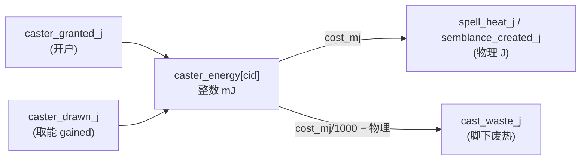

# 施法分段

分类：Global system 实施记录。批准设计与共同测试计划见 Voxim `Docs/Gameplay/CastActions.md`、`Docs/Magic/CastPhases-plan.md`。

目录 v4 增加最终定形到出手帧的 `release_lead_s`；Cost 将该时长及最终结构维护费纳入同一次报价。Player 使用完整前摇授权，World 保持一次支付与现有取消语义。客户端同目录摘要读取时长，PropertyBatch 步骤格式和 Hello35 不变。

验证：手算零距离 1000 W × 0.25 s = 250 J；原有 Magic Cost/World/取消测试；双端正式输入核对出手帧与事务。性能与分发不在本次范围。

## 触散与驻留（2026-10-05）

Global system：新增终结符 `act.break_on_hit`（〈触散〉，act/semblance，无槽，权重 1，姿态 `[45,90,-90,135,-90,90]`）。仅 `form.semblance + act.throw + act.break_on_hit` 合法；原来的两步投掷继续驻留。触散物理支出为 0，正常计结构、构型损耗与前摇。UE 发布目录 `badc8a074db08d5abcc425178aebebfd36486305329c210031f49cb22ea7bd76` 同时保留 `hot_throw` 并加入三步 `fireball`。

World 在运行记录上携带可选 `break_on_hit: true`，沿既有模拟飞行端点调用 `Thermal.release_semblance`，一次移除并释放显热、动能和未用发光预算。零飞行命中先广播有落点的创建记录，第一热步在推进任何模拟时间前散解。到期与驱散保持原语义；旧记录未带该键时驻留。协议 Hello36：拟态记录 shape 后增加 `break_on_hit:u8`（只能 0/1），每条 135 B；手写冻结样本验证编码、解码、删除补零和旧版本拒绝，客户端必须使用同版本。

设计对照：[Epic UProjectileMovementComponent](https://dev.epicgames.com/documentation/unreal-engine/API/Runtime/Engine/UProjectileMovementComponent) 的停止事件将碰撞停止与后续效果分离。本项目采用同样的职责边界，但碰撞与能量权威仍在 World；UE 只消费轨迹和触散标记。没有通用触发器框架，没有身体碰撞冲量或击退；动能沿已有规则转为热量。轨迹仍在施放时按当时世界预解，后续几何变化不重算。

Test-only：手写目录 `19c513f9…` 扩展既有规则夹具；`badc8a07…` 是 UE 发布原字节。`magic_semblance_test.exs` 验证合法形态、纯值命中端点与 53485 J 手算守恒，`magic_semblance_world_test.exs` 经正常施法入口验证创建/删除事务、叶获热、光账、一次释放及立即命中。运行器：`../Voxim/Saved/CastShowcase/mix-dual.sh voxel_region test --no-start test/magic_semblance_test.exs test/magic_semblance_world_test.exs`；协议为同入口 `mmo_contracts test --no-start`。红绿原始输出在 `../Voxim/Saved/CastShowcase/impact-*.log`。这些模块场景不替代真实双客户端、画面或分发验收。

碰撞结束观察修正：固定 0.5 s 模拟提交可能早于客户端墙钟轨迹终点；创建与删除也可能在同一显示帧被合并，因此普通 nil 删除不足以表达碰撞。Hello36 尚未分发，沿用 135 B 行，将 live 扩展为 `0=普通删除、1=存活、2=碰撞结束完整快照`。碰撞最终记录只暂存于本次 `thermal_run.impacts`，提交时覆盖对应 nil；不进入 `thermal.semblances`，不参与能量计算，也不在重启后恢复为存活对象。客户端消费明确 kind2 事件，直接使用确认落点，不从消失或本地 flight_s 时钟推断碰撞。kind2 必须带 break_on_hit=true，完整快照不得包含事件；寿命到期与驱散仍为普通删除。回归覆盖正常及立即命中、一次事件、无创建前态的自足结束快照、空间投影、重启不复活、过期/驱散原因和冻结线上字节；红绿日志为 `impact-end-*.log`。

Replica 物化边界：kind2 和 nil 都从副本存活表删除；原始 kind2 delta 仍正常转发并保留于有界事务历史，用于已有订阅及前缀追赶，后来订阅的完整快照不得带结束事件。真实 World→Replica→订阅测试已先复现旧快照错误保留 kind2，再验证转发、历史和空存活快照；日志为 `impact-replica-*.log`。

## 飞行期间命中人物（2026-10-05，已实现，真实双端待验收）

批准范围是触散球命中当前正常移动的玩家。World 保有拟态及能量真值，Scene/Player 保有当前胶囊、会话、生命代次与完整身体。新触散球按 World 定时器推进实际经过的短飞行段；同一轮只有一个异步人物采样，不重叠结算。目标不在施放时锁定。当前段首先受 canonical 地形限制，再从当前 Scene 的合法人物胶囊中取首个球扫掠命中，排除施法者，沿工具的显式战斗域规则。未带新来源标记的已保存拟态和驻留投掷继续原热流程。

依据：[Rapier shape casting](https://rapier.rs/docs/user_guides/c/scene_queries_shape_casting/) 将形状扫掠的首次接触参数作为结果，并明确起始重叠语义；这里复用既有解析胶囊射线，将半径与半高增加球半径，避免新增物理引擎。只对当前采样姿态做短段扫掠，不宣称连续移动目标 CCD 或延迟补偿。[OTP gen_server](https://www.erlang.org/docs/27/system/gen_server_concepts.html) 的同步调用等待回复；World 与 Scene 之间使用异步查询工作，避免 Scene 正在等待 World 时形成环形等待。

命中剩余显热、未用辉光及动能统一转入现有 Body 的局部组织 `tissue_j`。动能沿完全非弹性转热，无独立机械伤或击退，不创造固定火球伤害或第二套 HP。World 转给身体后不得同时沉积到地块或环境。Body 仍按既有 1 Hz 热剂量与急性组织进展推导烧伤和生命；这不模拟组织汽化、爆炸范围或按头腿区分的热组织块。

必要持久边界：World 先冻结命中目标/生命/会话与待交付能量，再由当前 Player 接纳并将去重收据与待吸收热同笔存档；World 收到接纳结果后最终移除，广播既有 kind2 及双方相同的 ProjectileHit。中断恢复重新交付同一不可变收据，不能重新选中另一个目标。旧生命/旧 owner 未接纳时释放到环境，不能转给新生命。Hello37，Session kind14，108 B payload：identity、world_seq u64、projectile_seq u64、projectile_n u32、source_id/source_life/target_id/target_life 各 u64、q_j f64、position 三个 canonical f64；无部位字节。身体状态继续使用 BodyState。

最小证伪：手算球/胶囊首次接触、移动后擦过；当前 owner/生命拒旧、持久去重和焦耳守恒；真实 World 的地形优先、当前人物进入/离开轨迹、创建至命中的时钟、一次 kind2 与双方同一收据。日志统一 `../Voxim/Saved/CastShowcase/combat-*.log`。真实双客户端由 Voxim 正式组合根继续完成，模块测试不作为实跑结论。

实际时钟与显示：每次采样覆盖从上次年龄到实际墙钟年龄的整个区间，以最多 50 ms 的重力弦段求交，不截掉 RPC/提交耗时。实时球初始 `flight_s=lifetime_s`、`rest=寿命末弹道位置`、`contact=nil`；施放时原地形 trace 仅用于已有范围与地块权限检查，不把未来地形预览当 confirmed 碰撞。眼到手被挡住时初始球心置于原面外，防止生成点越墙。当前短段地形仍是原有中心射线，人物为球半径膨胀胶囊；这不是完整球与体素形状扫掠。碰撞冻结后先广播落点，确认身体接纳后再发 kind2，客户端触散音画只消费 kind2。

恢复与交付：`impact_delivery` 是拟态内不可再消耗的冻结交付记录；期间不继续冷却、接触换热或允许驱散。目标暂时离线/移交中时保持原记录等待，不把“未答复”当作未入账。`WorldServer.Movement.character_owner/1` 经已配置 Scene 的成员查当前最高会话 owner，不另存角色路由真值。Player 先查持久收据，再判新接纳的 life/session/战斗域；因此承伤后重登或跨 Scene 移交仍返回旧回执而不再吸热，未接纳的旧身份明确拒绝。身体存档 v2 追加收据表，显式读取既有 v1；完整身体仍由同一 owner 存档。已接纳的 q 同时计入 World `projectile_body_j`（分项）和 `body_exchange_j`（身体总流入），只在拟态 `semblance_released_j` 出账一次；分项不能再叠加为一份额外能量。拒绝项为 `projectile_rejected_j`。

已观察验证（2026-10-05）：原始红灯 `combat-body-red.log`（缺少扫掠/接纳）与 `combat-wire-red.log`（Hello36）；首次 World 回归发现 nullable 对象误用严格 `not`，保留于 `combat-world-first.log`，修复后 `combat-world-green.log`。正式 Mix 图、隔离 DB：`scene_server` 的 ToolHit/ToolAction/Snapshot 11 项通过；`world_server` 的 `p0_body_world_test.exs` 3 项通过，实际 Native 移动后采到目标新位置和非零速度、双方回执相同、PG 身体存档重登去重、真实跨 Scene 移交后重投去重；`voxel_region` 的 magic_semblance/magic_semblance_world/magic_cost/magic_world/world 61 项通过；`mmo_contracts test --no-start` 136 项通过。后补 World 冻结交付不能驱散、重启恢复同一目标/金额，定向 3 项通过（`combat-world-persistence.log`）。World 测试仅替换人物查询和时钟，真实 World/NIF/日志未替换；真实 Player 测试用纯弹道输入验证组合边界，不冒称正式施法双客户端已验收。

正式镜像 `voxim-server:20261005-combat-projectile`，image id `sha256:5e23de6321af5edcc8fa18e6eb5ef5a566fc036a1b94e7827f60299cdb57e30a`，构建 exit0，日志 `combat-server-build.log`；Hello37，UE 目录 `71ca543b42db5ca5b1b8fea62771aa0c256399b2fa00c0525eccb4d9953860a7`。没有修改魔法 Cost 或目录参数。实际正式 Cost 对比由 `combat_speed_quote.exs` 执行：fireball 前摇 2.9759839847→2.0762897908 s，报价 445361.3299→438968.3333 J，日志 `combat-speed-quote.log`。镜像已交 Voxim 主任务开始真实双客户端闭环；本记录不把构建/模块绿灯写成双端或分发验收。

## 飞行合同改为结构飞行（魔法 v2 切片 5，2026-11-26，服务端已实现；双端未跑）

Global system。决策稿 [`2026-11-26-p1-closure-slices4-8.md`](2026-11-26-p1-closure-slices4-8.md) §5、§14（用户答复为准）。上文“飞行期间命中人物”的 v1 合同（拟态、寿命端点、`lifetime_s`）由下面替换；World 冻结 → Player 接纳 → kind14 回执的链路、108 B ProjectileHit 布局、两个 Harm 判定点不变。

- **谁飞**：带〈投〉的结构一律由 World 的 `World.Projectiles` 按墙钟 50 ms 拍逐段飞行（不再只限 v1〈触散〉）；施放时对当时世界的求交只作预测。
- **终点**：没有寿命也没有射程终点（切片 5b：用户 2026-11-26 批准对有质量者同样适用）。无质量结构（flags 第 1 位，Q17(a)）直线匀速、有质量结构按弹道，飞到接触（〈遇〉→〈散〉，live 2）、落地（之后作为静止结构接入热内核）或在飞行中于热拍衰竭（live 3）。不在端点悬停。射程与距离衰减由能量账推导；目录 `limits.range_m`（30 m）只作施法域（准星、形成位置、〈附〉格面、`:no_target`）。
- **预计飞行时长（切片 5b）**：T = (⌊life_s / 0.5 s⌋ + 1) × 0.5 s，有质量者再取 min(T, t_fall)，t_fall = (v_y + √(v_y² + 2gD))/g，D 为出发点高出施法者脚下支撑格底面的高度（至少 1 m）。T 只限定施放时的弹道预测与出手读取闭包的飞行走廊，不截断飞行。
- **线上记录（客户端须改插值）**：飞行中的结构记录带 `flying` 状态位，`flight_s`/`rest` 是施放时到预计飞行时长为止的预测；客户端在 `flying` 位置位时按 `p(τ) = origin + v·τ（有质量者 − ½gτ²ŷ）`、`τ = (服务端时钟 − t0_us)/1e6` 外推，**不再按 `flight_s` 截断**。飞行结束一定有一条新记录：停住的 live 1（无 `flying`）或 live 2–6 终态快照，其 `flight_s` 是真实飞行时长、`rest` 是真实落点。
- **人物采样**：只对 `ends_on_contact` 结构（Q5-4），且施法者是 Player（带生命代次，沿 v1）。命中时按 `last_tick + 1` 求值〈遇〉：触发则冻结交付（先广播停在命中点的 live 1），Player 接纳后发 live 2 与 kind14；`q_j` 改为 Q5-2 口径——E_op 热半 + 热份额（至多把组织块加热到 T_port）+ 动能，辐射半只记账（`Player.hit_context` 新增组织块温度与热容供 World 求上限）。
- **账目**：接纳的 q 记 `structure_body_mj`（并沿 v1 记分项 `projectile_body_j` 与 `body_exchange_j`），未接纳散入空气记 `projectile_rejected_j`。
- **恢复与越界**：冷重启时仍在飞行的结构以 live 3 散解，不采样；冻结交付照常重投。飞进 World 读不出 canonical 的 region（`Canonical.decoded/3` 失败）时在该弦段起点以 live 3 散解，日志 `voxel_structure_out_of_domain`（显式终止规则，待设计确认）。
- **法杖光弹**（切片 5b 改〈蓄〉，用户选“保证够到 30 m”）：程序无质量（`mass_g` 0000）、〈蓄〉1742 J，hex `020101000700010002000032000000000000010010006401001b06ce01001e7530010001002201002c00`；以 30 m/s 射出，在第 3 个热拍于飞行中衰竭。第一个热拍在出生后墙钟 (0, 0.5] s 内到来，所以实际飞行 (1.0, 1.5] s、路程 (30, 45] m；报价 10 235.708 J，前摇仍 0.3 s。命中人物进组织：第一拍前 871 J（组织块升温约 4.16 K），第 2 拍后 573.94 J（约 2.74 K），近大远小来自维持出账，没有距离衰减规则。客户端须改 `author_holdable.py` 的 `basic_spell` 并重新发布物品目录。（切片 5 的 1444 J、hex `…001b05a4…` 作废。）
- 验证：`apps/voxel_region/test/magic_structure_world_test.exs`（W5-1–W5-5、越界、W4-6、W4-7、A1、A3、A5）；`apps/world_server/test/world_server/movement/p0_body_world_test.exs`（后端按 v2 飞行体形状采样）。

## 法杖光弹：整数 mJ 施法者账与开户充能（2026-11-20，服务端已实现；单客户端已实跑，待用户验收；双端未跑）

Global system。法杖的能量就是既有的每角色施法者账 `World.caster_energy`，只有这一本账，不另设法杖账。

- **整数 mJ**：账值改为整数毫焦（守恒量按整数最小单位结算，Voxim AGENTS 设计纪律 7；同 [Fowler, PoEAA “Money”](https://martinfowler.com/eaaCatalog/money.html) 以最小货币单位存整数的做法）。唯一读取入口 `World.Casting.balance_mj/2`。扣款 `cost_mj = round(报价总支出 J × 1000)`（Elixir `round/1` 半数远离零），走火判定比较 `可用_mj < cost_mj`，相干度判定不变；走火扣 `min(cost_mj, 余额_mj)`。`Magic.Cost.quote` v4 不变。
- **热账同额**：物理部分仍记浮点 J（连续物理状态），废热改为 `cost_mj / 1000 − 物理 J`（走火为 `spent_mj / 1000`），所以每笔施法的施法者扣款 = 热账入账（`spell_heat_j` / `semblance_created_j` + `cast_waste_j`）。
- **取能整数分账**（`Magic.Cost.draw/4`，唯一实现，入参全是 mJ）：`taken = min(round(请求 J × 1000), trunc(石 stored_j × 1000), round(容量 J × 1000) − 余额)`，`gained = round(η × taken)`，`loss = taken − gained`；石 `stored_j −= taken / 1000`，`caster_drawn_j += gained / 1000`，`draw_loss_j` 与石格热源 `+= loss / 1000`。
- **迁移兼容**：来源 = 整数化之前已持久化的浮点 J 余额（如青岚生产日志、检查点）；原因 = 日志按键合并、不改写历史；规则 = `trunc(J × 1000)`（与魔法 v2 决策 P8 同一取整）；该键下次结算即写回整数；退出条件 = S1a A1 把施法者能量迁入 `Pages.character_row` 时一次性换算并删除该分支。
- **开户一次性充能**：`World.send_caster_state`（Gate 在 QUIC 接纳时排一次，及客户端显式请求；NPC 不经过）在已加载魔法目录且账上**没有该 cid 的键**时，先提交一笔充能事务：`caster_energy: %{cid => 497_084_850}`，热账新增源项 `caster_granted_j += 497 084.85`（凭空注入、与 `caster_drawn_j` 同为施法者能量来源），主体 `{:character, cid}`，日志 `voxel_caster_grant seq=.. cid=.. granted_mj=..`。键随日志持久化，重连、冷重启、检查点后都不再充；已有键（含 0、旧浮点）不动。只读 `caster_state` 仍是纯读。`Access` 中该消息改归 `:character_intent`。
- **光弹数值**（目录 `71ca543b…`、环境 293.15 K）：程序 `form.semblance{shape 0, radius_m 0.05, mass_kg 0.01, temperature_k 293.15, glow_w 100, lifetime_s 1} → act.throw{speed_mps 30} → act.break_on_hit{}`（普通 v1 施法意图；服务端只为固定前摇解析 holdable 的 basic_spell / basic_windup_s，见下）。真实 `Cost.quote` 与独立 Python 复算一致：总支出 9941.697170433505 J（物理 104.5 J）、前摇 1.9299314814115767 s → `cost_mj = 9_941_697`；充能 = 50 × cost_mj = `497_084_850` mJ（`World.Casting` 模块属性，唯一定义处）。
- **线协议不变**：0x83 仍为 f64 J（`energy_j = 余额_mj / 1000`、`spent_j = spent_mj / 1000`），Hello 44 不变。`voxel_spell` 日志新增 `spent_mj=`、`energy_mj=`。
- **战斗范围**：施法链路（Gate → `Player.cast_spell` → World）没有 `combat_scope` 判定；该判定只在伤害人物处（`Scene.tool_candidates`、`Player.receive_effect`、投射物命中采样）。
- **普攻固定前摇 0.3 s（用户 2026-11-20 定）**：成本模型给光弹 1.93 s 前摇，作普攻太慢；只对持物普攻法术用作者定的固定前摇，其余法术不变，成本不变。
  - 唯一来源：已发布属性目录 `holdables[].basic_windup_s`（s，> 0，只能随 `basic_spell` 出现；Voxim `Docs/Gameplay/author_actions.py` 作者表，法杖 0.3）。`Damage.load` 只取带 `basic_windup_s` 的 `{basic_spell, basic_windup_s}` 对为 `properties.basic_windups`，其余持物字段仍是客户端动作表；没有 `basic_windup_s` 的普攻照常按成本模型。
  - 裁决（`World.Casting.basic_windup/3`，报价与施放共用 `prepare_spell` 一处）：请求程序与某个 `basic_spell` 按魔法目录 `Program.validate` 解析后**相等**（参数统一为浮点；不比原始字节——客户端 0x82 以 `%.17g` 重印数字，与目录字节不同），则 `windup_s := basic_windup_s`。服务端不知道玩家拿什么（装备在客户端），所以判定只看程序：同一程序从技能栏（M）施放也是 0.3 s——这是程序的规则，不是装备规则。改一个参数（如 lifetime_s 1→2，差一字节）即回到成本模型前摇。
  - 成本不变：`total_j`、`cost_mj` 9 941 697、走火判定都用原报价。构型损耗公式里调整时长 T_adj = d·√(η/b) 是损耗最小的时长，强制 0.3 s 而照收最优时长的成本是用户定的玩法例外，不从公式推出。
  - 广播的各步 `{调整 s, 注能 s}` 按同一比例 k = (basic_windup_s − release_lead_s) / Σ(调整 + 注能) 缩放：客户端施法进度条与姿态由施放记录的各步 + release_lead_s 推算，必须与服务端计时一致。现行魔法目录 release_lead_s 恰为 0.3，所以光弹各步为 0、只剩出手前置段。作者前摇须 ≥ release_lead_s（未加运行时防御，作者表注释写明）。
  - 节奏：前摇 0.3 s 短于魔法目录 `cast_interval_ms` 500（间隔从上一次施放意图的接收时刻算，见 `Damage.admit_attack`），所以按住连发由 0.5 s 间隔决定；客户端按住/再按在间隔内等待，不提前发（否则 `cast_too_soon` 被拒并停止连发）。要更快只能改魔法目录间隔（影响所有法术），未改。
  - 线协议、Hello 44、0x83 字段不变（0x83 `quote_windup_s` 报价即 0.3）。
- **首次真实实跑（2026-11-20，Voxim `Saved/Tests/staff-20261120/`，本分支 native prod release，青岚世界副本、战斗关闭）**：
  - aim-02 暴露既有 prod 崩溃：投射物采样任务结果 `{任务引用, 结果}` 经输入闸门排队时，`World.queue_ready_input/2` 的 info 日志 `kind=#{Admission.kind(...)}` 插入引用 → `String.Chars` 异常 → `VoxelRegion.World` 退出 → 两个场景 `canonical_incomplete`、玩家会话 reason 5。只在 info 日志级别（prod）且投射物采样到真实人物（Player actor 带 `life_generation`、配置了采样后端）时出现，测试环境默认 warning 级别、无后端，所以 CI 没覆盖到。修复：`Admission.kind/1` 对 `{引用, _}` 返回 `:projectile_result`（三处日志共用）；回归 `magic_staff_bolt_test`“投射物采样结果在 info 日志级别经输入闸门提交，World 不崩”（采样后端替身 + Player 形状施法者），去掉修复时按同一 `String.Chars` 崩溃红。
  - World 崩溃时持久化了在飞投射物（带 `projectile_source`），冷重启恢复后立即向尚未启动的 Scene 采样 → `noproc` → `replica_snapshot_failed`，拓扑启动失败（run-04；当时换干净部署 server2 继续）。已修，见下“后续修复”。
- **后续修复（2026-11-20，分支 `staff-bolt-followup-20261120`，未实跑）**：
  - **瞄空的投掷照常接纳（用户定）**：rclick-01 对 ~25 m 外空地瞄准被拒 `out_of_domain` 的根因是 `Semblance.trace` 的抛物线自手边求交 `range_m`（30 m）路程未碰到实占用格即返回 miss，`Casting.spell_effect` 把 miss 直接映射成 `out_of_domain`；投掷路径没有任何权威域边界判定（World 是单一 canonical authority，页按需装入），所以不存在要保留的“离开权威域”分支。现规则：miss 时 `trace` 给出射程端点时刻，施法照常接纳、照常扣 cost_mj，记录 `contact = nil`、`flight_s = 射程端点时刻`；无投射物后端的运动学拟态到射程端点落地即散解（`Semblance.spent?/1`：无接触、有初速、已落地），有后端的〈触散〉光弹按既有结算规则改为按寿命实时采样飞行、寿命到期散解；两者都以 `Thermal.release` 散入空气，剩余能量记 `semblance_released_j`。地块权限只查成形处手边宏格。作用于目标格的加热／取能不变（瞄空仍 `out_of_domain`、非蓄能石仍 `invalid_target`）。客户端拒绝文案“投掷 30 m 内需落点”已过时，属 Voxim 侧。
  - **重启恢复在飞投射物**：`Projectiles.settle_restored/1` 在 World 恢复完成时把尚无冻结交付的投射物按已持久年龄散入空气（`semblance_released_j`，一笔热提交删除记录），不再向后端采样。理由：实时采样以墙钟与当时人物为准，崩溃间隙不可追溯，恢复时 Scene 也未接入。已冻结的命中交付仍照原设计重投同一目标（其真实后端在 Scene 未起时同样会 `noproc`，未在本次处理）。
  - **冻结命中重投等 Scene**：`WorldServer.Movement.character_owner/1` 把已部署路由上尚未启动的 Scene（`noproc`）视为无 owner，交付返回既有 `{:retry, :target_unavailable}`，World 保留冻结交付、50 ms 后重投，Scene 起后只交付一次（`projectile_scene_down_test` 改前 noproc 失败；`magic_semblance_world_test` 新增重投用例；未实跑）。
  - **服务器时间线单一来源（2026-11-21，未实跑）**：devenv 运行 49 220 s 后 Scene 时间比墙钟快 2.025 s（该主机单调时钟未受 NTP 校频），客户端按 Scene 时间回复同步，光弹 τ ≈ 2 s、只显示已落地（证据 Voxim `Saved/Tests/devenv-20261120/projectile-delay-20261121/`）。根因：Scene 时间回复 = 启动墙钟 + 单调增量，World 的施放记录 t0、拟态 t0_us 与投射物采样时刻直接读墙钟。现由 `MmoContracts.ServerTime` 唯一定义服务器时间线（本 VM 首次加载时的墙钟锚点 + BEAM 单调 µs）：Scene 时间零点、Gate→Player 输入的跨节点时间戳、World 施放记录／拟态 t0、`Projectiles.progress` 与采样后端 `poll(shots, server_clock)` 都取它；World 可注入 `server_clock`（默认生产单调时钟），线格式不变。仍是墙钟的：交互 `at_ms`、`Session` epoch、日志 `at_us`。回归 `magic_staff_bolt_test`“单调与墙钟漂移 2 s”改前失败（t0 落后 Scene 时间 2.0 s）、改后通过。生产主机 chronyd 同步中，未见此漂移。
  - aim-04（server2，新角色）：开户 497 084.85 J；单击一发报价前摇 0.3 s、扣 9 941.697 J → 487 143.153 J；按住连发 4 发、松开时在途 1 发，每发同额，余额逐发 477 201.456 → 437 434.668 J；服务端 `voxel_cast_begin windup_s=0.3 steps=[{0.0, 0.0}, …]`、`voxel_spell spent_mj=9941697`；施放意图间隔 0.559／0.501／0.535 s（受 `cast_interval_ms` 500 限），施放→结果 0.318–0.519 s。取能未实跑（部署上没有已充能蓄能石）。

Test-only 验证：`apps/voxel_region/test/magic_staff_bolt_test.exs`（目录 `fixtures/magic/71ca543b…` 为 UE 发布原字节）覆盖报价、开户一次与冷恢复、光弹扣款与热账同额、空账/不足走火、旧浮点余额、取能整数分账、瞄空光弹接纳与散解（运动学与实时采样两路）、加热／取能无效目标仍拒；`magic_semblance_world_test` 覆盖重启时在飞投射物散解记账且 World 存活；`apps/scene_server/test/scene_server/movement/cast_wait_lifecycle_test.exs` 用真实 Player（combat_scope nil）证明光弹照常结算；gate 的接纳 0x83 用例改为开户后余额。既有用例按整数规则改的期望见提交说明。客户端法杖、真实双端与分发未验证。
